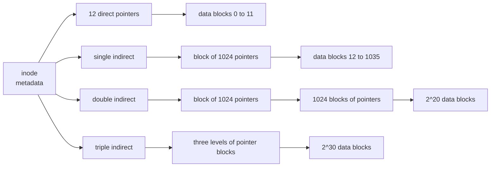

Memory loses its contents when the power goes off; a **file** does not. The file system is the part of the operating system that turns a storage device, an array of numbered blocks, into the named, hierarchical, persistent objects that every program uses: a FASTQ file of sequencing reads, a Python script, a directory of results. This chapter follows the treatment of persistence in *Operating Systems: Three Easy Pieces* (OSTEP). It first describes the interface that Linux offers to programs (files, directories, links and file descriptors), then shows how a file system implements that interface with inodes, bitmaps and directory blocks, how the Fast File System made it fast by exploiting **locality**, and how journaling keeps the structure consistent when the machine crashes in the middle of an update. The devices underneath (disks, SSDs, RAID) and the buffering between a program and the device are the subject of the next chapter, [4.11.8](/4.11.8); files from the point of view of a C or C++ program were introduced in [4.1.9](/4.1.9#sec-9.3) and [4.2.11](/4.2.11#sec-11.2.3).

All command output in this chapter was produced on Ubuntu 24.04 under WSL 2 (Linux 6.6) with an ext4 root file system.

## 7.1. Files and Directories

### 7.1.1. Two Abstractions

The **operating system** presents persistent storage through two abstractions.

**Definition 7.1.1 (File System)** A **file system** is the part of the operating system (together with the data structures it keeps on a storage device) that organizes the device's blocks into named **files** and **directories**, records their metadata, and implements the operations on them. A **file** is, for the file system, an array of bytes with a low-level name, its inode number (§7.2.2); the file system does not interpret the bytes. A **directory** is a file whose contents are a list of entries, each mapping a human-readable name to an inode number. Because directories can contain directories, the names form a tree, the *directory tree*, whose root is written `/`.

A *path name* names a file by the sequence of directory entries leading to it: the absolute path `/home/alice/run1/reads.fq` starts at the root, and a relative path such as `run1/reads.fq` starts at the current working directory of the **process**. Every directory contains two special entries: `.` (the directory itself) and `..` (its parent). **Linux distributions** follow the Filesystem Hierarchy Standard for the top levels:

| Directory | Contents |
|---|---|
| `/bin`, `/usr/bin` | programs (on current distributions `/bin` is a symbolic link to `/usr/bin`) |
| `/etc` | system configuration files |
| `/home/<user>` | users' home directories (written `~` in the shell) |
| `/tmp` | temporary files, often cleared at boot |
| `/var` | variable data: logs, caches, spool files |
| `/dev` | device files ([4.11.8](/4.11.8)) |
| `/proc`, `/sys` | virtual file systems through which the kernel exposes processes and devices |
| `/mnt`, `/media` | mount points for other file systems |

The name of a file says nothing about its format. The suffix `.fq.gz` is a convention for people and programs; to the file system, the name is an arbitrary string of bytes other than `/` and the null byte, with a usual limit of 255 bytes per component.

### 7.1.2. File Descriptors and the File API

A **process** accesses a file through a small integer obtained from `open`.

**Definition 7.1.2 (File Descriptor)** A **file descriptor** is a small non-negative integer that a process uses to refer to an open file (or to another open I/O object, such as a pipe, a terminal or a network socket). The kernel keeps a per-process table of descriptors; each entry points to an *open file description*, a kernel object that records the access mode and the current *file offset*, the position at which the next `read` or `write` takes place.

By convention descriptors 0, 1 and 2 are standard input, standard output and standard error, and `open` returns the lowest unused number. The core **system calls** are:

| Call | Effect |
|---|---|
| `int open(const char *path, int flags, mode_t mode)` | open (and with `O_CREAT` create) a file; returns a descriptor or −1 |
| `ssize_t read(int fd, void *buf, size_t n)` | read up to `n` bytes at the current offset and advance it; returns the number read, 0 at end of file |
| `ssize_t write(int fd, const void *buf, size_t n)` | write up to `n` bytes at the current offset (at the end with `O_APPEND`) |
| `off_t lseek(int fd, off_t off, int whence)` | set the offset (`SEEK_SET`, `SEEK_CUR`, `SEEK_END`) without any I/O |
| `int fsync(int fd)` | force the file's modified data and metadata to the device (§7.4.5) |
| `int close(int fd)` | release the descriptor |
| `int stat(const char *path, struct stat *st)` | read the file's metadata |
| `int rename(const char *old, const char *new)` | change the name; **atomic** when both are in the same file system |

Flags combine with `|`: `O_RDONLY`, `O_WRONLY` or `O_RDWR`, plus `O_CREAT`, `O_TRUNC`, `O_APPEND`, `O_CLOEXEC` and others. Every call can fail, and robust code checks every return value; in particular `read` and `write` may transfer fewer bytes than requested, which [4.11.8](/4.11.8#sec-8.5.1) discusses. The C library's `FILE *` streams (`fopen`, `fprintf`) and C++'s file **streams** are buffered layers built on these calls.

Two **processes** that open the same file get separate open file descriptions and therefore independent offsets; a child created by `fork` inherits copies of its parent's descriptors that share the parent's descriptions, and so shares the offset. This sharing is what makes shell redirection work ([4.11.10](/4.11.10#sec-10.3)) and is drawn in [4.11.8](/4.11.8#sec-8.5.3).

### 7.1.3. Metadata

Besides its contents, every file has metadata, which `stat` returns and the `stat` command prints:

```text
$ stat reads.fq
  File: reads.fq
  Size: 10000     	Blocks: 24         IO Block: 4096   regular file
Device: 8,48	Inode: 1174001     Links: 1
Access: (0644/-rw-r--r--)  Uid: ( 1000/ zf-li23)   Gid: ( 1000/ zf-li23)
Access: 2026-10-21 15:36:23.669797567 +0800
Modify: 2026-10-21 15:36:23.669797567 +0800
Change: 2026-10-21 15:36:23.669797567 +0800
 Birth: 2026-10-21 15:36:23.669797567 +0800
```

The fields are the size in bytes; the space allocated, in 512-byte units (24 units = 12 KiB, three 4-KiB blocks for 10000 bytes); the inode number; the number of hard links (§7.1.4); the file type and permission bits (explained in [4.11.10](/4.11.10#sec-10.4)); the owner and group; and four timestamps. *Modify* (mtime) is the last change of the contents, *Change* (ctime) the last change of the metadata (not the creation time), *Access* (atime) the last read, and *Birth* the creation time where the file system records it. Updating atime on every read would turn reads into writes, so Linux mounts file systems with `relatime` by default, which updates atime at most once a day or when it is older than mtime. Tools such as `make` and workflow managers ([4.11.11](/4.11.11#sec-11.6)) decide what to rebuild by comparing mtimes.

### 7.1.4. Hard Links and Symbolic Links

Because a directory entry is only a pair (name, inode number), one file can have several names.

**Definition 7.1.3 (Hard Link and Symbolic Link)** A **hard link** is a directory entry that refers to an inode; creating another hard link (`link`, or `ln target name`) adds a second name for the same file, and the inode's *link count* records how many names it has. A **symbolic link** (or soft link, `symlink`, `ln -s target name`) is a separate small file whose content is a path name; the kernel follows that path whenever the link is opened.

Removing a file is therefore `unlink`: it deletes one directory entry and decrements the link count, and the file system frees the inode and its blocks only when the count is zero and no process still has the file open. The following program shows the difference:

```c
#include <stdio.h>
#include <stdlib.h>
#include <fcntl.h>
#include <unistd.h>
#include <sys/stat.h>

static void check(int ret, const char *what) {
    if (ret == -1) { perror(what); exit(1); }
}

static void show(const char *path) {
    struct stat st;
    check(lstat(path, &st), path);        /* lstat does not follow symlinks */
    printf("%-9s inode=%lu links=%lu size=%lld%s\n", path,
           (unsigned long)st.st_ino, (unsigned long)st.st_nlink,
           (long long)st.st_size, S_ISLNK(st.st_mode) ? " (symlink)" : "");
}

int main(void) {
    int fd = open("data.txt", O_WRONLY | O_CREAT | O_TRUNC, 0644);
    check(fd, "open");
    check(write(fd, "hello\n", 6), "write");
    check(close(fd), "close");

    check(link("data.txt", "hard.txt"), "link");       /* second name, same inode */
    check(symlink("data.txt", "soft.txt"), "symlink"); /* new inode holding a path */
    show("data.txt"); show("hard.txt"); show("soft.txt");

    check(unlink("data.txt"), "unlink");               /* remove one name */
    printf("after unlink(\"data.txt\"):\n");
    show("hard.txt");
    if (open("soft.txt", O_RDONLY) == -1)
        printf("open(\"soft.txt\") failed: dangling symlink\n");
    unlink("hard.txt"); unlink("soft.txt");
    return 0;
}
```

```text
data.txt  inode=1173993 links=2 size=6
hard.txt  inode=1173993 links=2 size=6
soft.txt  inode=1173994 links=1 size=8 (symlink)
after unlink("data.txt"):
hard.txt  inode=1173993 links=1 size=6
open("soft.txt") failed: dangling symlink
```

The symbolic link has size 8, the length of the string `data.txt`, and it dangles once that name is gone, while the hard link keeps the data alive. The two kinds have different limits:

| | Hard link | Symbolic link |
|---|---|---|
| Refers to | an inode | a path name |
| Across file systems | no (inode numbers are per file system) | yes |
| To directories | not allowed (it could create cycles in the tree) | allowed |
| When the target is removed | the data survive | the link dangles |

Symbolic links are everywhere in practice: `/bin -> usr/bin`, versioned shared libraries (`libz.so.1 -> libz.so.1.3.1`, see **dynamic libraries** in [4.2.2](/4.2.2#sec-2.4.4)), and links from a project directory to a large reference genome stored elsewhere.

### 7.1.5. Mounting and the Virtual File System

A Linux system has one directory tree, but it is assembled from many file systems.

**Definition 7.1.4 (Mount)** To **mount** a file system is to attach the root of its directory tree to an existing directory, the *mount point*, of the tree already in use; afterwards path names under the mount point are resolved inside the mounted file system.

`findmnt` lists the mounts; on the machine used here, for example:

```text
$ findmnt -no TARGET,FSTYPE,SOURCE /
/      ext4   /dev/sdd
$ findmnt -no TARGET,FSTYPE,SOURCE /mnt/c
/mnt/c 9p     C:\
```

The **kernel** can mount very different file systems side by side because **system calls** do not talk to them directly. They go through the *virtual file system* (VFS), a layer that defines generic objects (superblock, inode, directory entry, open file) and a table of operations that each concrete file system implements. The same `read` therefore works on ext4, on a network file system, on `tmpfs` (a file system that lives in memory) and on pseudo file systems such as `/proc`, where reading `/proc/self/status` makes the kernel generate text describing the calling process. "Everything is a file" in Unix means exactly this uniform interface.

## 7.2. Implementing a Simple File System

We now look under the interface. Following OSTEP, we build a very simple file system (vsfs) whose structure is that of the classic Unix file system and, in its essentials, of ext2 and ext4.

### 7.2.1. On-Disk Layout

The device is an array of blocks of fixed size, say 4 KiB, numbered from 0. A file system must store four kinds of information: the data of the files, the metadata of each file, which blocks and inodes are free, and global parameters. vsfs reserves regions for each:

| Region | Contents |
|---|---|
| superblock | parameters of the file system: block size, number of inodes and blocks, where each region starts, a magic number identifying the type |
| inode bitmap | one bit per inode: used or free |
| data bitmap | one bit per data block: used or free |
| inode table | an array of fixed-size inodes |
| data region | the blocks holding file contents and directory contents |

**Definition 7.2.1 (Superblock)** The **superblock** is the block, at a fixed location on the device, that records the global parameters of a file system. Mounting reads it first; ext4 keeps backup copies in several block groups because without it the file system cannot be interpreted.

Free space is tracked with bitmaps: allocating means finding a zero bit, setting it, and using the corresponding inode or block. ext4 divides the device into *block groups* of 32768 blocks (128 MiB with 4-KiB blocks), each with its own bitmaps and part of the inode table; §7.3 explains why.

### 7.2.2. Inodes

**Definition 7.2.2 (Inode)** An **inode** (index node) is the on-disk structure that describes one file: its type, size, owner, permission bits, timestamps, link count and the locations of its data blocks. Inodes are stored in an array, and the index of a file's inode in that array, its *inode number* (i-number), is the file's low-level name. The name of a file is not in its inode; it is in the directory entries that point to it.

Given an inode number, the file system computes the location of the inode directly. With 256-byte inodes, a 4-KiB block holds 16 of them; if the inode table starts at block 1056, inode $n$ lies in block $1056 + \lfloor n/16 \rfloor$ at byte offset $256 \cdot (n \bmod 16)$. For inode 1000 this is block $1056 + 62 = 1118$, offset $256 \cdot 8 = 2048$.

The number of inodes is fixed when the file system is created (`mkfs.ext4` allocates one per 16 KiB of space by default). The root file system of the machine used here has $2^{26} = 67108864$ inodes for a 1-TiB device ($2^{40} / 2^{14} = 2^{26}$), as `df -i` shows:

```text
$ df -i /
Filesystem       Inodes   IUsed    IFree IUse% Mounted on
/dev/sdd       67108864 1175744 65933120    2% /
```

A file system can therefore be "full" with free space left, when millions of tiny files have used up the inodes. Bioinformatics pipelines that write one file per read or per sequence hit this limit, and cluster file systems often impose an inode (file-count) quota in addition to a space quota ([4.11.11](/4.11.11#sec-11.1)).

### 7.2.3. The Multi-Level Index

How does an inode record which blocks belong to the file? The classic answer is a *multi-level index*: the inode holds a few block pointers directly and, for larger files, pointers to blocks that contain more pointers.

**Definition 7.2.3 (Indirect Block)** In a multi-level index, a **direct pointer** in the inode holds the number of a data block; a **single indirect block** is a block filled with block numbers of data blocks; a **double indirect block** holds numbers of single indirect blocks, and a **triple indirect block** holds numbers of double indirect blocks. The inode stores a fixed number of direct pointers and one pointer of each indirect kind.

The ext2 and ext3 inode has 12 direct pointers and one single, double and triple indirect pointer:



**Example 7.2.1 (Maximum File Size)** Let blocks be 4 KiB and block numbers 4 bytes, so a block holds $4096/4 = 1024$ pointers. The index can address

$$
12 + 1024 + 1024^2 + 1024^3 = 1\,074\,791\,436
$$

blocks, that is $48\,\mathrm{KiB} + 4\,\mathrm{MiB} + 4\,\mathrm{GiB} + 4\,\mathrm{TiB} \approx 4\,\mathrm{TiB}$. Small files, which are the majority on most systems, need no indirect block at all: the first 48 KiB are reached from the inode alone. (ext3 actually limited files to 2 TiB because of a 32-bit field elsewhere in the inode.)

**Example 7.2.2 (Locating a Byte)** Which blocks must be read to fetch the byte at offset 5 000 000 of a file? The logical block index is $\lfloor 5\,000\,000 / 4096 \rfloor = 1220$, at offset $5\,000\,000 - 1220 \cdot 4096 = 2880$ within the block. Indices 0–11 are direct and 12–1035 go through the single indirect block, so index 1220 is the $1220 - 1036 = 184$-th block reached through the double indirect block: entry $\lfloor 184/1024 \rfloor = 0$ of the double indirect block, then entry $184 \bmod 1024 = 184$ of that single indirect block. If nothing is cached, the read costs four block reads: the inode, the double indirect block, one single indirect block and the data block.

A multi-level index is an unbalanced tree tuned to the observation that most files are small but most bytes belong to large files. Its weakness is that a large file needs one pointer per block, even when the blocks are contiguous. Modern file systems use extents instead.

**Definition 7.2.4 (Extent)** An **extent** is a run of contiguous blocks described by a starting block and a length. An extent-based file system records a file as a list of extents (organized as a tree when the list is long) instead of one pointer per block.

ext4 stores up to four extents in the inode itself, each describing up to 32768 blocks (128 MiB with 4-KiB blocks), and an extent tree for files with more fragments. A 1-GiB file written contiguously is described by eight extents (held in a single extent-tree block, since only four fit in the inode) instead of 262144 block pointers. XFS and Btrfs also use extents, and their tree structures are **B+ trees**, the same structure that databases use ([4.3.8](/4.3.8)).

### 7.2.4. Directories and Path Lookup

A directory is stored like a file, in data blocks, as a sequence of entries (inode number, record length, name length, name). Linear search through the entries is slow for large directories, so ext4 indexes them with a hashed tree (HTree), keyed by the value of a **hash function** applied to the name. Path lookup walks the tree one component at a time.

**Example 7.2.3 (Opening a File)** To open `/home/alice/notes.txt` with an empty cache, the file system reads:

| Step | Read | Purpose |
|---|---|---|
| 1 | inode 2 | the root directory's inode (the root has a well-known number, 2 in ext4) |
| 2 | a data block of `/` | find the entry `home` and its inode number |
| 3 | inode of `home` | locate its data |
| 4 | a data block of `home` | find `alice` |
| 5 | inode of `alice` | |
| 6 | a data block of `alice` | find `notes.txt` |
| 7 | inode of `notes.txt` | check permissions, create the open file description |

Each component also requires a permission check: the process needs execute (search) permission on every directory along the path. Creating a file costs more: besides the lookup, the file system must read and write the inode bitmap, initialize the new inode, add an entry to the directory's data block (possibly allocating a new block, which touches the data bitmap) and update the directory's inode (its size and mtime). One `open(..., O_CREAT)` thus generates around ten I/Os in the worst case. In practice almost none of them reach the device, because of caching.

### 7.2.5. The Page Cache

**Definition 7.2.5 (Page Cache)** The **page cache** is the part of main memory in which the kernel keeps recently used file data and metadata, in units of pages. A `read` is served from the page cache when the data are there and causes device I/O only on a miss; a `write` normally only modifies the cached page and marks it *dirty*, and the kernel writes dirty pages back to the device later.

Linux lets the page cache grow into all memory that processes do not use, which is why `free` reports most memory as `buff/cache` on a busy machine; the cache shrinks when programs need memory. Write-back is delayed (by default dirty data are written within about 30 seconds, or sooner when too much memory is dirty), which has two effects. Many writes are absorbed in memory: a file that is created, written and deleted within seconds may never reach the device. And a crash loses writes that the program considered complete, which is why §7.4 matters and why `fsync` exists. The same cache backs **memory-mapped files** (`mmap`, [4.11.4](/4.11.4)), so a file mapped into memory and the same file accessed by `read` see the same data. Reading a large file a second time is often an order of magnitude faster than the first time: the data come from the page cache. Benchmarks of I/O-heavy tools must account for this, by reading the data once before timing or by timing a cold cache.

## 7.3. Locality and the Fast File System

The original Unix file system of the 1970s had the vsfs layout and delivered about 2 % of the disk's bandwidth. Its free list became scrambled as files were created and deleted, so consecutive blocks of a file lay far apart, and inodes lay at the start of the disk, far from their data. Every access paid a long seek ([4.11.8](/4.11.8#sec-8.2.1)). The Fast File System (FFS) of BSD Unix (McKusick et al., 1984) fixed this by making the file system aware of the device's geometry, an application of **locality of reference** ([4.3.8](/4.3.8)).

FFS divides the disk into *cylinder groups* (ext2/3/4 call them block groups), each a complete small file system with its own copy of the superblock, bitmaps, inodes and data blocks. Its placement policy is "keep related things together":

- a new directory is placed in a group with few allocated directories and many free inodes, to spread directories out;
- a file's inode and data blocks go into the same group as its directory, because files in one directory are often accessed together (compiling all sources of a project, reading all FASTQ files of a run);
- a large file is split into chunks (in FFS, the first 48 KiB stay with the inode and further chunks of several megabytes go to other groups), so that one huge file does not fill a group and destroy locality for every other file in its directory; transfers of a few megabytes are long enough to amortize the seek between chunks.

FFS also introduced long file names, symbolic links, atomic `rename` and sub-blocks for small files, and raised the bandwidth to 20–40 % of the disk. Modern file systems refine the same ideas: ext4 allocates in block groups, uses *delayed allocation* (choosing physical blocks only when dirty data are written back, when the final size is known) and preallocation (`fallocate`) to keep files contiguous; XFS uses *allocation groups* that also allow parallel allocation by many threads.

## 7.4. Crash Consistency

### 7.4.1. The Problem

A single logical operation updates several on-disk structures, and the device writes one block at a time. If power fails or the kernel crashes between the writes, the structures disagree.

**Definition 7.4.1 (Crash Consistency)** A file system is **crash-consistent** if, after a crash at any moment, its on-disk structures can be brought to a state in which they are mutually consistent (every used block and inode is marked used and reachable, every reachable one is marked used, and every pointer leads to valid data), and that state reflects each operation either completely or not at all. The *crash-consistency problem* is to achieve this although the device updates only one block (or one sector) atomically.

**Example 7.4.1 (Appending a Block)** Appending one block to a file requires three writes: the new data block $D$, the inode $I$ (new size and pointer) and the data bitmap $B$ (mark the block used). The outcome of a crash depends on which writes reached the device:

| Written | Result |
|---|---|
| $D$ only | consistent; the append is lost, as if it never happened |
| $I$ only | the inode points to a block containing old garbage, and the bitmap says that block is free: inconsistent, and the file shows garbage |
| $B$ only | a block is marked used but nothing points to it: a space leak |
| $I$ and $B$ | metadata consistent, but the file contains garbage where the new data should be |
| $I$ and $D$ | correct data, but the bitmap says the block is free; it could be allocated again to another file |
| $B$ and $D$ | the block is used but unreachable: a leak, and the append is lost |

No order of the three writes avoids every bad case, and the device and the kernel's I/O scheduler may reorder writes anyway. There are three families of solutions: repair after the crash, journaling, and never overwriting.

### 7.4.2. File-System Checking

The early approach was to let inconsistencies happen and repair them at boot with `fsck` (file-system check). It scans the whole file system: it checks the superblock, rebuilds the bitmaps from the inodes, verifies that every inode is **reachable** and has a correct link count (moving orphans to `lost+found`), detects blocks claimed by two inodes, and checks directory entries. `fsck` cannot detect the "$I$ and $B$" case, in which the metadata are consistent but the data are garbage, and its running time is proportional to the size of the file system, not to the amount of work interrupted: on a multi-terabyte array it takes hours. It remains useful for repairing corruption from hardware faults and bugs.

### 7.4.3. Journaling

The idea of journaling, borrowed from databases, is to write a description of an update to a log before performing it.

**Definition 7.4.2 (Journaling)** A **journaling file system** reserves an area of the device, the *journal*, and performs each update in two phases. First it writes a *transaction* to the journal: a begin block, the new contents of every block the update will change, and finally a *commit* block. Only after the commit block is durable does it *checkpoint*, writing the blocks to their final locations; afterwards the transaction's space in the journal can be reused. This technique is also called **write-ahead logging**.

Recovery after a crash is short and simple: the file system scans the journal and *replays* every committed transaction, writing its blocks to their final locations (writing them twice is harmless, since the writes are idempotent), and ignores incomplete transactions. The time is proportional to the size of the journal, not of the file system. The commit block is written separately, and only after the device confirms that the rest of the transaction is durable (using a cache flush, or a checksum over the transaction so that a partially written transaction is detected), because the device may reorder the writes inside its own cache.

Writing every data block twice halves the write bandwidth, so most systems journal only metadata:

| ext4 mode | What goes into the journal | Guarantee |
|---|---|---|
| `data=journal` | data and metadata | strongest; data written twice |
| `data=ordered` (default) | metadata only, but data blocks are written to their final location before the metadata transaction commits | metadata never point to garbage |
| `data=writeback` | metadata only, no ordering for data | metadata consistent, but files may contain stale data after a crash |

The ordered mode resolves Example 7.4.1: $D$ is written first, then a transaction containing $I$ and $B$ is committed, then checkpointed. A crash before the commit loses the append cleanly; a crash after it is repaired by replay. The mount options of the machine used here show the default:

```text
$ findmnt -t ext4 -no OPTIONS /
rw,relatime,discard,errors=remount-ro,data=ordered
```

ext3 introduced journaling to the ext family in 2001; ext4, XFS and NTFS are journaling file systems, and ext4's journal (the JBD2 layer) also groups many operations into one transaction to amortize the commit.

### 7.4.4. Never Overwriting: Copy-on-Write and Log-Structured File Systems

The third approach avoids in-place updates altogether. A **copy-on-write** file system never modifies a block in place: to change a block, it writes a new copy elsewhere, then a new copy of the block that points to it, and so on up to the root of the tree; the final step is an atomic switch of the root pointer (in the superblock). Before the switch the old tree is intact, after it the new one is, so the structure is always consistent. Btrfs and ZFS work this way. The same mechanism provides cheap *snapshots* (keep the old root), checksums of all data and metadata stored in the parent pointers (so corruption is detected on every read and, with redundancy, repaired), and clones of files that share blocks until modified (`cp --reflink`). The costs are fragmentation of files that are updated in place, such as databases and virtual-machine images, and more complex free-space management.

The *log-structured file system* (LFS; Rosenblum and Ousterhout, 1991) takes the idea to the limit: it buffers all updates, data and metadata, in memory and writes them sequentially to the end of a log in large segments, turning random writes into sequential ones. Because inodes move with every write, LFS keeps an *inode map* from inode numbers to their current locations, and a *cleaner* compacts partly obsolete segments to reclaim space. LFS anticipated the internal structure of flash SSDs ([4.11.8](/4.11.8#sec-8.3)), and F2FS, the flash-oriented file system used on many Android phones, is log-structured.

### 7.4.5. What Applications Must Do

File-system consistency is not application consistency. A journaling file system guarantees that its own structures survive a crash; it does not guarantee that the last `write` of a program reached the device, nor that a file that was being rewritten is either entirely old or entirely new. Programs that need durability must ask for it:

- `fsync(fd)` returns only when the file's data and metadata are on the device (and the device's volatile cache has been flushed); `fdatasync` skips metadata that are not needed to read the data, such as mtime.
- A newly created file is durable only when its directory entry is also durable, which requires an `fsync` on the directory.
- `rename` within a file system is atomic: after a crash the target name refers to either the old or the new file.

These combine into the standard pattern for replacing a file safely (used by editors, **package managers** and databases):

```c
/* Atomically replace the contents of "results.tsv". */
int fd = open("results.tsv.tmp", O_WRONLY | O_CREAT | O_TRUNC, 0644);
write_all(fd, buf, len);          /* loop until every byte is written */
fsync(fd);                        /* data of the new file are durable */
close(fd);
rename("results.tsv.tmp", "results.tsv");   /* atomic switch of the name */
int dir = open(".", O_RDONLY | O_DIRECTORY);
fsync(dir);                       /* the rename itself is durable */
close(dir);
```

Durability is expensive. The following program appends 2000 records of 100 bytes to a file, once with plain `write` and once with `fsync` after every record:

```c
#include <stdio.h>
#include <stdlib.h>
#include <fcntl.h>
#include <unistd.h>
#include <time.h>

static double now(void) {
    struct timespec t;
    clock_gettime(CLOCK_MONOTONIC, &t);
    return t.tv_sec + t.tv_nsec * 1e-9;
}

/* Append n records of 100 bytes; optionally fsync after each one. */
static double run(int n, int sync_each) {
    char rec[100] = {0};
    int fd = open("log.bin", O_WRONLY | O_CREAT | O_TRUNC, 0644);
    if (fd == -1) { perror("open"); exit(1); }
    double t0 = now();
    for (int i = 0; i < n; i++) {
        if (write(fd, rec, sizeof rec) != sizeof rec) { perror("write"); exit(1); }
        if (sync_each && fsync(fd) == -1) { perror("fsync"); exit(1); }
    }
    double t = now() - t0;
    close(fd);
    unlink("log.bin");
    return t;
}

int main(void) {
    int n = 2000;
    printf("write only      : %8.2f us per record\n", run(n, 0) / n * 1e6);
    printf("write + fsync   : %8.2f us per record\n", run(n, 1) / n * 1e6);
    return 0;
}
```

```text
write only      :     0.48 us per record
write + fsync   :  3730.13 us per record
```

A `write` that only copies 100 bytes into the page cache takes half a microsecond; forcing each record to the (virtual) disk takes several milliseconds, almost four orders of magnitude more. Databases therefore batch many transactions into one `fsync` (group commit), and analysis code should write results in large chunks and rely on `fsync` only at points where losing work would matter.

## 7.5. Linux File Systems Today

Linux supports dozens of file systems through the VFS. Those a computational biologist meets in practice:

| File system | Kind | Where it is used | Notes |
|---|---|---|---|
| ext4 | journaling, extents | default of Debian, Ubuntu and the root file system of WSL 2 | mature and fast; volumes up to 1 EiB, files up to 16 TiB with 4-KiB blocks |
| XFS | journaling, extents, B+ trees | default of Red Hat Enterprise Linux and Rocky Linux, common on servers and clusters | scales well to large files and parallel I/O; cannot be shrunk |
| Btrfs | copy-on-write | default of Fedora and openSUSE | snapshots, checksums, compression, subvolumes, built-in RAID 1/10 (its RAID 5/6 is still not recommended) |
| ZFS (OpenZFS) | copy-on-write, integrated volume manager | storage servers, TrueNAS, optional on Ubuntu | not in the mainline kernel because of its license (CDDL); RAID-Z, checksums, snapshots |
| F2FS | log-structured | flash storage, Android | designed around SSD and eMMC behavior |
| tmpfs | in memory | `/dev/shm`, often `/tmp` and `/run` | contents vanish at reboot; counts against memory |
| NFS | network | home and project directories on servers | a client-server protocol over the network; version 4.2 is current |
| Lustre, IBM Storage Scale (GPFS), BeeGFS, CephFS | parallel, distributed | scratch file systems of clusters | stripe files over many storage servers for aggregate bandwidth ([4.11.11](/4.11.11#sec-11.1)) |

bcachefs, a copy-on-write file system merged into Linux 6.7, was removed from the mainline kernel in 6.18 (2025) and is now distributed as an external module; it is a reminder that a file system takes a decade to become trusted. For a local disk the defaults (ext4 or XFS) are the right choice unless snapshots or checksums are needed.

Two practical consequences for WSL 2 ([4.11.9](/4.11.9#sec-9.3)): the Linux file system lives in a virtual disk (a VHDX file) formatted with ext4, while the Windows drives appear under `/mnt/c` through the 9P network protocol, as the `findmnt` output above shows. Every file operation on `/mnt/c` crosses the boundary between the virtual machine and Windows, so tools that touch many small files (`git`, `conda`, compilers, pipelines over thousands of FASTQ files) are many times slower there than under `/home`. Projects and data belong in the Linux file system.

## Summary

- A file system turns an array of blocks into named, persistent files and directories. Programs use them through file descriptors and the calls `open`, `read`, `write`, `lseek`, `fsync`, `close`, `stat`, `rename`, `link` and `unlink`; the VFS lets one interface serve many file systems mounted into a single tree.
- A file's identity is its inode, which holds its metadata and the location of its blocks; names live in directories, so a file can have several hard links, and a symbolic link is a small file containing a path.
- Block locations are recorded by a multi-level index (direct, single, double, triple indirect pointers) or, in modern file systems, by extents. Path lookup reads one inode and one directory block per component, and the page cache absorbs most of these reads and delays writes.
- FFS made file systems fast by placing related data close together on the disk; block groups, delayed allocation and extents continue that idea.
- A crash in the middle of an update leaves inconsistent structures. `fsck` repairs them slowly; journaling (write-ahead logging) writes a transaction to a log before checkpointing it, and ext4's default ordered mode journals only metadata; copy-on-write and log-structured file systems never overwrite in place.
- File-system consistency does not make application data durable: use `fsync` (also on the directory) and the write-to-temporary-then-`rename` pattern, and batch writes because each `fsync` costs milliseconds.
- ext4 and XFS are the standard local file systems; Btrfs and ZFS add snapshots and checksums; clusters use NFS for homes and parallel file systems for scratch. Under WSL 2, keep work in the Linux file system rather than on `/mnt/c`.
