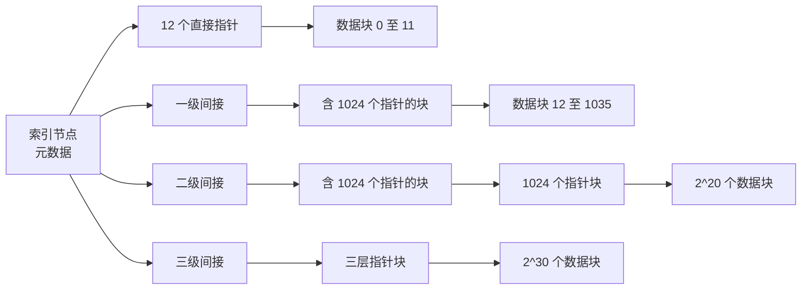

内存在断电后会丢失内容，**文件**不会。文件系统是操作系统中的一部分，它把存储设备（一个带编号的块的数组）变成每个程序都在使用的、有名字的、层次化的持久对象：一个保存测序读段的 FASTQ 文件、一个 Python 脚本、一个结果目录。本章遵循《Operating Systems: Three Easy Pieces》（OSTEP）对持久性的讲法。首先介绍 Linux 提供给程序的接口（文件、目录、链接与文件描述符），然后说明文件系统怎样用索引节点、位图和目录块实现这一接口，快速文件系统怎样利用**局部性**使它变快，以及日志怎样在机器于更新中途崩溃时保持结构一致。下面的设备（磁盘、SSD、RAID）以及程序与设备之间的缓冲是下一章 [4.11.8](/4.11.8) 的主题；C 或 C++ 程序视角下的文件已在 [4.1.9](/4.1.9#sec-9.3) 和 [4.2.11](/4.2.11#sec-11.2.3) 介绍。

本章所有命令输出都在 WSL 2（Linux 6.6）下的 Ubuntu 24.04 上得到，根文件系统为 ext4。

## 7.1. 文件与目录

### 7.1.1. 两个抽象

**操作系统**通过两个抽象来呈现持久存储。

**定义 7.1.1（文件系统）** **文件系统**是操作系统的一部分（连同它在存储设备上保存的数据结构），它把设备的块组织成有名字的**文件**和**目录**，记录它们的元数据，并实现对它们的操作。对文件系统而言，**文件**是一个字节数组，带有一个低层名字，即它的索引节点号（§7.2.2）；文件系统不解释这些字节。**目录**是内容为一个条目列表的文件，每个条目把一个便于人读的名字映射到一个索引节点号。因为目录中可以包含目录，所以这些名字构成一棵树，即**目录树**，其根写作 `/`。

**路径名**通过通向文件的一串目录条目来命名它：绝对路径 `/home/alice/run1/reads.fq` 从根开始，相对路径如 `run1/reads.fq` 从**进程**的当前工作目录开始。每个目录都含有两个特殊条目：`.`（目录自身）和 `..`（它的父目录）。**Linux 发行版**的顶层目录遵循文件系统层次标准（Filesystem Hierarchy Standard）：

| 目录 | 内容 |
|---|---|
| `/bin`、`/usr/bin` | 程序（在当前的发行版上 `/bin` 是指向 `/usr/bin` 的符号链接） |
| `/etc` | 系统配置文件 |
| `/home/<user>` | 用户的主目录（在 shell 中写作 `~`） |
| `/tmp` | 临时文件，常在启动时清空 |
| `/var` | 可变数据：日志、缓存、假脱机文件 |
| `/dev` | 设备文件（[4.11.8](/4.11.8)） |
| `/proc`、`/sys` | 内核借以暴露进程和设备的虚拟文件系统 |
| `/mnt`、`/media` | 其他文件系统的挂载点 |

文件的名字并不说明它的格式。后缀 `.fq.gz` 是给人和程序看的约定；对文件系统而言，名字是由除 `/` 和空字节以外的字节组成的任意串，每个分量通常限长 255 字节。

### 7.1.2. 文件描述符与文件 API

**进程**通过 `open` 得到的一个小整数访问文件。

**定义 7.1.2（文件描述符）** **文件描述符**是进程用来指代一个打开的文件（或其他打开的 I/O 对象，如管道、终端或网络套接字）的非负小整数。内核为每个进程维护一张描述符表；每个表项指向一个*打开文件描述*，这是记录访问模式和当前*文件偏移量*的内核对象，文件偏移量就是下一次 `read` 或 `write` 发生的位置。

按约定，描述符 0、1、2 分别是标准输入、标准输出和标准错误，`open` 返回最小的未用编号。核心的**系统调用**如下：

| 调用 | 作用 |
|---|---|
| `int open(const char *path, int flags, mode_t mode)` | 打开文件（带 `O_CREAT` 时创建）；返回描述符或 −1 |
| `ssize_t read(int fd, void *buf, size_t n)` | 从当前偏移量读最多 `n` 字节并推进偏移量；返回读到的字节数，到达文件末尾时为 0 |
| `ssize_t write(int fd, const void *buf, size_t n)` | 在当前偏移量写最多 `n` 字节（带 `O_APPEND` 时写在末尾） |
| `off_t lseek(int fd, off_t off, int whence)` | 设置偏移量（`SEEK_SET`、`SEEK_CUR`、`SEEK_END`），不做任何 I/O |
| `int fsync(int fd)` | 强制把文件已修改的数据和元数据写到设备（§7.4.5） |
| `int close(int fd)` | 释放描述符 |
| `int stat(const char *path, struct stat *st)` | 读取文件的元数据 |
| `int rename(const char *old, const char *new)` | 改名；两者在同一文件系统内时是**原子操作** |

标志用 `|` 组合：`O_RDONLY`、`O_WRONLY` 或 `O_RDWR`，再加上 `O_CREAT`、`O_TRUNC`、`O_APPEND`、`O_CLOEXEC` 等。每个调用都可能失败，健壮的代码要检查每个返回值；特别是 `read` 和 `write` 传输的字节数可能少于请求的数目，[4.11.8](/4.11.8#sec-8.5.1) 对此有讨论。C 库的 `FILE *` 流（`fopen`、`fprintf`）和 C++ 的文件**流**是建立在这些调用之上的带缓冲的层。

两个**进程**打开同一个文件，会得到各自独立的打开文件描述，因而偏移量也相互独立；由 `fork` 创建的子进程继承父进程描述符的副本，这些副本共享父进程的描述，因此也共享偏移量。这种共享使 shell 重定向得以工作（[4.11.10](/4.11.10#sec-10.3)），并在 [4.11.8](/4.11.8#sec-8.5.3) 中画出。

### 7.1.3. 元数据

除了内容，每个文件还有元数据，由 `stat` 返回并由 `stat` 命令打印：

```text
$ stat reads.fq
  File: reads.fq
  Size: 10000     	Blocks: 24         IO Block: 4096   regular file
Device: 8,48	Inode: 1174001     Links: 1
Access: (0644/-rw-r--r--)  Uid: ( 1000/ zf-li23)   Gid: ( 1000/ zf-li23)
Access: 2026-10-21 15:36:23.669797567 +0800
Modify: 2026-10-21 15:36:23.669797567 +0800
Change: 2026-10-21 15:36:23.669797567 +0800
 Birth: 2026-10-21 15:36:23.669797567 +0800
```

各字段依次是以字节计的大小；已分配的空间，以 512 字节为单位（24 个单位 = 12 KiB，10000 字节占三个 4 KiB 的块）；索引节点号；硬链接的数目（§7.1.4）；文件类型和权限位（在 [4.11.10](/4.11.10#sec-10.4) 中说明）；所有者和所属组；以及四个时间戳。*Modify*（mtime）是内容最后一次改变的时间，*Change*（ctime）是元数据最后一次改变的时间（不是创建时间），*Access*（atime）是最后一次读取的时间，*Birth* 是文件系统记录创建时间时的创建时间。每次读取都更新 atime 会把读变成写，所以 Linux 默认以 `relatime` 挂载文件系统，它至多每天更新一次 atime，或者在 atime 早于 mtime 时更新。`make` 和工作流管理器（[4.11.11](/4.11.11#sec-11.6)）等工具通过比较 mtime 来决定重新构建什么。

### 7.1.4. 硬链接与符号链接

因为目录条目只是一个（名字，索引节点号）对，所以一个文件可以有多个名字。

**定义 7.1.3（硬链接与符号链接）** **硬链接**是引用一个索引节点的目录条目；再创建一个硬链接（`link`，或 `ln target name`）就为同一个文件增加了第二个名字，索引节点的*链接计数*记录它有多少个名字。**符号链接**（或称软链接，`symlink`，`ln -s target name`）是一个单独的小文件，其内容是一个路径名；每当打开该链接时，内核都会沿着这个路径走。

因此删除文件就是 `unlink`：它删掉一个目录条目并把链接计数减一，只有当计数为零并且没有进程仍打开着这个文件时，文件系统才释放索引节点及其块。下面的程序展示了两者的差别：

```c
#include <stdio.h>
#include <stdlib.h>
#include <fcntl.h>
#include <unistd.h>
#include <sys/stat.h>

static void check(int ret, const char *what) {
    if (ret == -1) { perror(what); exit(1); }
}

static void show(const char *path) {
    struct stat st;
    check(lstat(path, &st), path);        /* lstat does not follow symlinks */
    printf("%-9s inode=%lu links=%lu size=%lld%s\n", path,
           (unsigned long)st.st_ino, (unsigned long)st.st_nlink,
           (long long)st.st_size, S_ISLNK(st.st_mode) ? " (symlink)" : "");
}

int main(void) {
    int fd = open("data.txt", O_WRONLY | O_CREAT | O_TRUNC, 0644);
    check(fd, "open");
    check(write(fd, "hello\n", 6), "write");
    check(close(fd), "close");

    check(link("data.txt", "hard.txt"), "link");       /* second name, same inode */
    check(symlink("data.txt", "soft.txt"), "symlink"); /* new inode holding a path */
    show("data.txt"); show("hard.txt"); show("soft.txt");

    check(unlink("data.txt"), "unlink");               /* remove one name */
    printf("after unlink(\"data.txt\"):\n");
    show("hard.txt");
    if (open("soft.txt", O_RDONLY) == -1)
        printf("open(\"soft.txt\") failed: dangling symlink\n");
    unlink("hard.txt"); unlink("soft.txt");
    return 0;
}
```

```text
data.txt  inode=1173993 links=2 size=6
hard.txt  inode=1173993 links=2 size=6
soft.txt  inode=1173994 links=1 size=8 (symlink)
after unlink("data.txt"):
hard.txt  inode=1173993 links=1 size=6
open("soft.txt") failed: dangling symlink
```

符号链接的大小为 8，即字符串 `data.txt` 的长度，一旦这个名字消失它就悬空了，而硬链接使数据保持存活。两种链接的限制不同：

| | 硬链接 | 符号链接 |
|---|---|---|
| 引用的对象 | 一个索引节点 | 一个路径名 |
| 跨文件系统 | 不可以（索引节点号是每个文件系统各自的） | 可以 |
| 指向目录 | 不允许（可能在树中造成环） | 允许 |
| 目标被删除时 | 数据仍然存在 | 链接悬空 |

符号链接在实践中无处不在：`/bin -> usr/bin`、带版本的共享库（`libz.so.1 -> libz.so.1.3.1`，见 [4.2.2](/4.2.2#sec-2.4.4) 中的**动态库**），以及从项目目录指向存放在别处的大型参考基因组的链接。

### 7.1.5. 挂载与虚拟文件系统

一个 Linux 系统只有一棵目录树，但它是由许多文件系统拼装而成的。

**定义 7.1.4（挂载）** **挂载**一个文件系统，就是把它的目录树的根附着到正在使用的目录树中的某个已有目录，即*挂载点*上；此后挂载点之下的路径名在被挂载的文件系统内解析。

`findmnt` 列出各个挂载；例如在这里使用的机器上：

```text
$ findmnt -no TARGET,FSTYPE,SOURCE /
/      ext4   /dev/sdd
$ findmnt -no TARGET,FSTYPE,SOURCE /mnt/c
/mnt/c 9p     C:\
```

**内核**能够同时挂载差别很大的文件系统，是因为**系统调用**并不直接与它们交谈。它们要经过虚拟文件系统（virtual file system），简称 VFS，这一层定义了通用对象（超级块、索引节点、目录项、打开的文件）和一张操作表，由每个具体的文件系统来实现。因此同一个 `read` 对 ext4、网络文件系统、`tmpfs`（存在于内存中的文件系统）以及 `/proc` 这样的伪文件系统都适用，读 `/proc/self/status` 时内核会生成描述调用进程的文本。Unix 中的"一切皆文件"指的正是这种统一的接口。

## 7.2. 实现一个简单的文件系统

现在来看接口之下。遵循 OSTEP，我们构造一个非常简单的文件系统（vsfs），它的结构就是经典 Unix 文件系统的结构，本质上也是 ext2 和 ext4 的结构。

### 7.2.1. 磁盘布局

设备是由固定大小的块（比如 4 KiB）组成的数组，从 0 开始编号。文件系统必须存储四类信息：文件的数据、每个文件的元数据、哪些块和索引节点是空闲的，以及全局参数。vsfs 为它们各保留一个区域：

| 区域 | 内容 |
|---|---|
| 超级块 | 文件系统的参数：块大小、索引节点数和块数、各区域的起点、标识类型的魔数 |
| 索引节点位图 | 每个索引节点一位：已用或空闲 |
| 数据位图 | 每个数据块一位：已用或空闲 |
| 索引节点表 | 由固定大小的索引节点组成的数组 |
| 数据区 | 保存文件内容和目录内容的块 |

**定义 7.2.1（超级块）** **超级块**是位于设备上固定位置的块，记录文件系统的全局参数。挂载时首先读它；ext4 在若干块组中保存备份，因为没有它，文件系统就无法解释。

空闲空间用位图来跟踪：分配就是找到一个零位，把它置位，并使用对应的索引节点或块。ext4 把设备划分为每组 32768 个块（4 KiB 块时为 128 MiB）的*块组*，每个块组有自己的位图和索引节点表的一部分；原因见 §7.3。

### 7.2.2. 索引节点

**定义 7.2.2（索引节点）** **索引节点**（inode，index node）是描述一个文件的磁盘结构：它的类型、大小、所有者、权限位、时间戳、链接计数和数据块的位置。索引节点存放在一个数组中，文件的索引节点在该数组中的下标，即它的*索引节点号*（i-number），就是文件的低层名字。文件的名字不在它的索引节点里，而在指向它的目录条目里。

给定索引节点号，文件系统可以直接算出该索引节点的位置。若索引节点为 256 字节，则一个 4 KiB 的块可容纳 16 个；若索引节点表从第 1056 块开始，则索引节点 $n$ 位于第 $1056 + \lfloor n/16 \rfloor$ 块，块内字节偏移为 $256 \cdot (n \bmod 16)$。对于索引节点 1000，这是第 $1056 + 62 = 1118$ 块，偏移 $256 \cdot 8 = 2048$。

索引节点的数目在创建文件系统时就固定了（`mkfs.ext4` 默认每 16 KiB 空间分配一个）。这里使用的机器的根文件系统对于一个 1 TiB 的设备有 $2^{26} = 67108864$ 个索引节点（$2^{40} / 2^{14} = 2^{26}$），如 `df -i` 所示：

```text
$ df -i /
Filesystem       Inodes   IUsed    IFree IUse% Mounted on
/dev/sdd       67108864 1175744 65933120    2% /
```

因此，当数百万个小文件用光了索引节点时，文件系统可能在仍有空闲空间的情况下就"满"了。为每条读段或每条序列写一个文件的生物信息学流水线会碰到这个限制，集群文件系统除了空间配额之外，往往还施加索引节点（文件数）配额（[4.11.11](/4.11.11#sec-11.1)）。

### 7.2.3. 多级索引

索引节点怎样记录哪些块属于这个文件？经典的答案是*多级索引*（multi-level index）：索引节点直接保存少数几个块指针，对于更大的文件，则保存指向含有更多指针的块的指针。

**定义 7.2.3（间接块）** 在多级索引中，索引节点里的**直接指针**保存一个数据块的编号；**一级间接块**是装满数据块编号的块；**二级间接块**保存一级间接块的编号，**三级间接块**保存二级间接块的编号。索引节点存储固定数目的直接指针，以及每种间接块各一个指针。

ext2 和 ext3 的索引节点有 12 个直接指针，以及一个一级、二级和三级间接指针：



**例 7.2.1（最大文件大小）** 设块为 4 KiB，块号为 4 字节，则一个块含 $4096/4 = 1024$ 个指针。该索引可以寻址

$$
12 + 1024 + 1024^2 + 1024^3 = 1\,074\,791\,436
$$

个块，即 $48\,\mathrm{KiB} + 4\,\mathrm{MiB} + 4\,\mathrm{GiB} + 4\,\mathrm{TiB} \approx 4\,\mathrm{TiB}$。小文件在大多数系统上占多数，它们根本不需要间接块：前 48 KiB 仅从索引节点就能到达。（ext3 实际上把文件限制在 2 TiB，因为索引节点中别处有一个 32 位字段。）

**例 7.2.2（定位一个字节）** 要取文件中偏移 5 000 000 处的字节，必须读哪些块？逻辑块下标为 $\lfloor 5\,000\,000 / 4096 \rfloor = 1220$，块内偏移为 $5\,000\,000 - 1220 \cdot 4096 = 2880$。下标 0–11 是直接指针，12–1035 经过一级间接块，所以下标 1220 是经由二级间接块到达的第 $1220 - 1036 = 184$ 个块：先是二级间接块的第 $\lfloor 184/1024 \rfloor = 0$ 项，再是那个一级间接块的第 $184 \bmod 1024 = 184$ 项。如果什么都没有缓存，这次读取需要四次块读：索引节点、二级间接块、一个一级间接块和数据块。

多级索引是一棵不平衡的树，针对"大多数文件很小，但大多数字节属于大文件"这一观察而调校。它的弱点是大文件的每个块都需要一个指针，即使这些块是连续的。现代文件系统改用区段。

**定义 7.2.4（区段）** **区段**是由起始块和长度描述的一段连续的块。基于区段的文件系统把文件记录为一个区段列表（列表很长时组织成树），而不是每块一个指针。

ext4 在索引节点本身中存储最多四个区段，每个描述最多 32768 个块（4 KiB 块时为 128 MiB），片段更多的文件则使用区段树。连续写入的 1 GiB 文件由八个区段描述（它们放在单个区段树块中，因为索引节点里只放得下四个），而不是 262144 个块指针。XFS 和 Btrfs 也使用区段，它们的树结构是 **B+ 树**，与数据库使用的结构相同（[4.3.8](/4.3.8)）。

### 7.2.4. 目录与路径查找

目录像文件一样存储在数据块中，是一串条目（索引节点号、记录长度、名字长度、名字）。对大目录而言，线性搜索这些条目太慢，所以 ext4 用哈希树（HTree）为它们建立索引，键是对名字施加**散列函数**得到的值。路径查找一次走一个分量。

**例 7.2.3（打开一个文件）** 缓存为空时，要打开 `/home/alice/notes.txt`，文件系统要读：

| 步骤 | 读取 | 目的 |
|---|---|---|
| 1 | 索引节点 2 | 根目录的索引节点（根有一个众所周知的编号，在 ext4 中是 2） |
| 2 | `/` 的一个数据块 | 找到条目 `home` 及其索引节点号 |
| 3 | `home` 的索引节点 | 定位它的数据 |
| 4 | `home` 的一个数据块 | 找到 `alice` |
| 5 | `alice` 的索引节点 | |
| 6 | `alice` 的一个数据块 | 找到 `notes.txt` |
| 7 | `notes.txt` 的索引节点 | 检查权限，创建打开文件描述 |

每个分量还需要一次权限检查：进程需要对路径上的每个目录有执行（搜索）权限。创建文件的代价更高：除了查找，文件系统还必须读写索引节点位图，初始化新的索引节点，向目录的数据块中添加一个条目（可能要分配新块，这会涉及数据位图），并更新目录的索引节点（它的大小和 mtime）。因此一次 `open(..., O_CREAT)` 在最坏情况下会产生大约十次 I/O。实际上，由于缓存的缘故，几乎没有一次会到达设备。

### 7.2.5. 页缓存

**定义 7.2.5（页缓存）** **页缓存**是主存中的一部分，内核在其中以页为单位保存最近使用的文件数据和元数据。数据在页缓存中时，`read` 由页缓存满足，只有在未命中时才引起设备 I/O；`write` 通常只修改缓存的页并把它标记为*脏*，内核稍后再把脏页写回设备。

Linux 让页缓存增长到进程不用的全部内存中，所以在繁忙的机器上 `free` 把大部分内存报告为 `buff/cache`；程序需要内存时缓存就会缩小。写回是延迟的（默认情况下脏数据在大约 30 秒内写出，脏数据过多时则更早），这有两个后果。许多写操作在内存中被吸收：一个在几秒内创建、写入又删除的文件可能根本不会到达设备。而且崩溃会丢失程序认为已经完成的写操作，这就是 §7.4 重要的原因，也是 `fsync` 存在的原因。同一个缓存也支撑着**内存映射文件**（`mmap`，[4.11.4](/4.11.4)），所以映射到内存的文件与用 `read` 访问的同一个文件看到的是相同的数据。第二次读取大文件常常比第一次快一个数量级：数据来自页缓存。对 I/O 密集的工具做基准测试时必须考虑这一点，方法是计时之前先把数据读一遍，或者在冷缓存下计时。

## 7.3. 局部性与快速文件系统

20 世纪 70 年代的原始 Unix 文件系统具有 vsfs 的布局，只发挥出磁盘约 2% 的带宽。随着文件的创建和删除，它的空闲链表变得杂乱无章，因此一个文件的连续块相距很远，索引节点又位于磁盘的起始处，远离它们的数据。每次访问都要付出一次长长的寻道（[4.11.8](/4.11.8#sec-8.2.1)）。BSD Unix 的快速文件系统（Fast File System，FFS；McKusick 等，1984）通过让文件系统感知设备的几何结构解决了这个问题，这是对**局部性**（[4.3.8](/4.3.8)）的一次应用。

FFS 把磁盘划分为*柱面组*（ext2/3/4 称之为块组），每个柱面组都是一个完整的小文件系统，有自己的超级块副本、位图、索引节点和数据块。它的放置策略是"把相关的东西放在一起"：

- 新目录放在已分配目录少、空闲索引节点多的组中，以便把目录分散开；
- 文件的索引节点和数据块放入与其目录相同的组，因为同一目录中的文件常常被一起访问（编译一个项目的所有源文件，读取一次运行的所有 FASTQ 文件）；
- 大文件被切分成若干块（在 FFS 中，前 48 KiB 留在索引节点所在的组，之后每几兆字节的一块放到其他组），这样一个巨大的文件不会填满一个组，从而破坏同一目录中所有其他文件的局部性；几兆字节的传输足够长，可以摊销块与块之间的寻道。

FFS 还引入了长文件名、符号链接、原子的 `rename` 和针对小文件的子块，并把带宽提高到磁盘的 20–40%。现代文件系统改进了同样的想法：ext4 按块组分配，使用*延迟分配*（只在脏数据被写回、最终大小已知时才选定物理块）和预分配（`fallocate`）使文件保持连续；XFS 使用*分配组*，还允许许多线程并行分配。

## 7.4. 崩溃一致性

### 7.4.1. 问题

一个逻辑操作会更新多个磁盘结构，而设备一次写一个块。如果在这些写操作之间断电或者内核崩溃，这些结构就会彼此矛盾。

**定义 7.4.1（崩溃一致性）** 如果在任意时刻崩溃之后，文件系统的磁盘结构都能恢复到彼此一致的状态（每个已用的块和索引节点都标记为已用且可达，每个可达的都标记为已用，每个指针都指向有效的数据），并且该状态对每个操作的反映要么是完整的、要么是完全没有，那么这个文件系统具有**崩溃一致性**。*崩溃一致性问题*是在设备只能原子地更新一个块（或一个扇区）的情况下做到这一点。

**例 7.4.1（追加一个块）** 向文件追加一个块需要三次写：新的数据块 $D$、索引节点 $I$（新的大小和指针）以及数据位图 $B$（把该块标记为已用）。崩溃的结果取决于哪些写已经到达设备：

| 已写入 | 结果 |
|---|---|
| 仅 $D$ | 一致；追加丢失，就像从未发生过 |
| 仅 $I$ | 索引节点指向一个含有旧垃圾的块，而位图说这个块空闲：不一致，文件显示垃圾 |
| 仅 $B$ | 一个块被标记为已用，但没有任何东西指向它：空间泄漏 |
| $I$ 和 $B$ | 元数据一致，但在应有新数据的地方文件含有垃圾 |
| $I$ 和 $D$ | 数据正确，但位图说这个块空闲；它可能被再次分配给别的文件 |
| $B$ 和 $D$ | 块已用但不可达：泄漏，并且追加丢失 |

这三次写不论怎样排序都无法避免所有坏情形，而且设备和内核的 I/O 调度器本来就可能重排写操作。解决办法有三类：崩溃后修复、日志，以及永不覆盖。

### 7.4.2. 文件系统检查

早期的做法是允许不一致发生，并在启动时用 `fsck`（file-system check，文件系统检查）修复。它扫描整个文件系统：检查超级块，根据索引节点重建位图，验证每个索引节点都**可达**且链接计数正确（把孤儿移入 `lost+found`），检测被两个索引节点同时声称的块，并检查目录条目。`fsck` 无法检测"$I$ 和 $B$"的情形，那时元数据是一致的而数据是垃圾；而且它的运行时间与文件系统的大小成正比，而不是与被中断的工作量成正比：在数 TB 的阵列上要花数小时。它对修复硬件故障和软件错误造成的损坏仍然有用。

### 7.4.3. 日志

日志的思想借自数据库，即在执行更新之前，先把对更新的描述写到一个日志中。

**定义 7.4.2（日志）** **日志文件系统**在设备上保留一个区域，即*日志*（journal），并分两个阶段执行每次更新。首先，它把一个*事务*写入日志：一个开始块、更新将要改变的每个块的新内容，最后是一个*提交*块。只有在提交块持久之后，它才进行*检查点*操作，把这些块写到它们的最终位置；此后该事务在日志中占用的空间可以重用。这种技术也称为**预写日志**。

崩溃后的恢复简短而简单：文件系统扫描日志并*重放*每个已提交的事务，把它的块写到最终位置（写两次无害，因为这些写操作是幂等的），并忽略未完成的事务。所需时间与日志的大小成正比，而不是与文件系统的大小成正比。提交块是单独写的，并且只在设备确认事务的其余部分已经持久之后才写（借助缓存刷新，或者对事务计算校验和以便检测写了一半的事务），因为设备可能在自己的缓存内重排写操作。

把每个数据块都写两次会使写带宽减半，所以大多数系统只对元数据记日志：

| ext4 模式 | 进入日志的内容 | 保证 |
|---|---|---|
| `data=journal` | 数据和元数据 | 最强；数据写两次 |
| `data=ordered`（默认） | 只有元数据，但数据块在元数据事务提交之前先写到最终位置 | 元数据绝不指向垃圾 |
| `data=writeback` | 只有元数据，不为数据排序 | 元数据一致，但崩溃后文件可能含有陈旧数据 |

有序模式解决了例 7.4.1：先写 $D$，然后提交含有 $I$ 和 $B$ 的事务，再做检查点。在提交之前崩溃，干净地丢失这次追加；在提交之后崩溃，则靠重放修复。这里使用的机器的挂载选项显示了默认值：

```text
$ findmnt -t ext4 -no OPTIONS /
rw,relatime,discard,errors=remount-ro,data=ordered
```

ext3 在 2001 年把日志引入 ext 家族；ext4、XFS 和 NTFS 都是日志文件系统，ext4 的日志（JBD2 层）还把许多操作合并到一个事务中以摊销提交的开销。

### 7.4.4. 永不覆盖：写时复制与日志结构文件系统

第三种办法完全避免原地更新。**写时复制**文件系统从不就地修改块：要改变一个块，它就在别处写入一个新副本，然后写入指向该块的块的新副本，如此一直向上到树根；最后一步是原子地切换根指针（在超级块中）。切换之前旧树完好无损，切换之后新树完好无损，因此结构始终是一致的。Btrfs 和 ZFS 就是这样工作的。同一机制还提供廉价的*快照*（保留旧的根）、保存在父指针中的所有数据和元数据的校验和（所以每次读取时都能检测到损坏，有冗余时还能修复），以及在被修改之前共享块的文件克隆（`cp --reflink`）。代价是对就地更新的文件（如数据库和虚拟机映像）会产生碎片，以及更复杂的空闲空间管理。

日志结构文件系统（log-structured file system），简称 LFS（Rosenblum 和 Ousterhout，1991）把这一思想推到极致：它把所有的更新（数据和元数据）缓冲在内存中，再以大的段为单位顺序写到日志的末尾，从而把随机写变成顺序写。因为索引节点在每次写入时都会移动，LFS 保存一张从索引节点号到其当前位置的*索引节点映射*，并用一个*清理器*压缩部分过时的段以回收空间。LFS 预示了闪存 SSD 的内部结构（[4.11.8](/4.11.8#sec-8.3)），而 F2FS，即许多 Android 手机使用的面向闪存的文件系统，就是日志结构的。

### 7.4.5. 应用程序必须做什么

文件系统一致不等于应用程序一致。日志文件系统保证它自己的结构在崩溃后得以保全；它不保证程序最后一次 `write` 到达了设备，也不保证一个正被重写的文件要么完全是旧的、要么完全是新的。需要持久性的程序必须明确要求：

- `fsync(fd)` 只有在文件的数据和元数据都到达设备（并且设备的易失性缓存已被刷新）之后才返回；`fdatasync` 跳过读取数据所不需要的元数据，如 mtime。
- 新创建的文件只有在它的目录条目也持久时才是持久的，这需要对目录执行 `fsync`。
- 文件系统内的 `rename` 是原子的：崩溃之后，目标名字指向的要么是旧文件，要么是新文件。

这些合起来构成安全替换文件的标准模式（编辑器、**包管理器**和数据库都在使用）：

```c
/* Atomically replace the contents of "results.tsv". */
int fd = open("results.tsv.tmp", O_WRONLY | O_CREAT | O_TRUNC, 0644);
write_all(fd, buf, len);          /* loop until every byte is written */
fsync(fd);                        /* data of the new file are durable */
close(fd);
rename("results.tsv.tmp", "results.tsv");   /* atomic switch of the name */
int dir = open(".", O_RDONLY | O_DIRECTORY);
fsync(dir);                       /* the rename itself is durable */
close(dir);
```

持久性是昂贵的。下面的程序向文件追加 2000 条每条 100 字节的记录，一次只用普通的 `write`，另一次在每条记录之后都 `fsync`：

```c
#include <stdio.h>
#include <stdlib.h>
#include <fcntl.h>
#include <unistd.h>
#include <time.h>

static double now(void) {
    struct timespec t;
    clock_gettime(CLOCK_MONOTONIC, &t);
    return t.tv_sec + t.tv_nsec * 1e-9;
}

/* Append n records of 100 bytes; optionally fsync after each one. */
static double run(int n, int sync_each) {
    char rec[100] = {0};
    int fd = open("log.bin", O_WRONLY | O_CREAT | O_TRUNC, 0644);
    if (fd == -1) { perror("open"); exit(1); }
    double t0 = now();
    for (int i = 0; i < n; i++) {
        if (write(fd, rec, sizeof rec) != sizeof rec) { perror("write"); exit(1); }
        if (sync_each && fsync(fd) == -1) { perror("fsync"); exit(1); }
    }
    double t = now() - t0;
    close(fd);
    unlink("log.bin");
    return t;
}

int main(void) {
    int n = 2000;
    printf("write only      : %8.2f us per record\n", run(n, 0) / n * 1e6);
    printf("write + fsync   : %8.2f us per record\n", run(n, 1) / n * 1e6);
    return 0;
}
```

```text
write only      :     0.48 us per record
write + fsync   :  3730.13 us per record
```

只是把 100 字节复制进页缓存的 `write` 需要半微秒；强制每条记录写到（虚拟的）磁盘需要几毫秒，几乎多出四个数量级。因此数据库把许多事务批量合并到一次 `fsync` 中（组提交），分析代码应该以大块写出结果，只在丢失工作会造成损失的地方才依赖 `fsync`。

## 7.5. 当今的 Linux 文件系统

Linux 通过 VFS 支持几十种文件系统。计算生物学家在实践中会遇到的有：

| 文件系统 | 类型 | 使用场合 | 说明 |
|---|---|---|---|
| ext4 | 日志、区段 | Debian 和 Ubuntu 的默认，也是 WSL 2 的根文件系统 | 成熟而快速；卷最大 1 EiB，4 KiB 块时文件最大 16 TiB |
| XFS | 日志、区段、B+ 树 | Red Hat Enterprise Linux 和 Rocky Linux 的默认，常见于服务器和集群 | 对大文件和并行 I/O 的扩展性好；不能缩小 |
| Btrfs | 写时复制 | Fedora 和 openSUSE 的默认 | 快照、校验和、压缩、子卷，内置 RAID 1/10（其 RAID 5/6 至今仍不推荐） |
| ZFS（OpenZFS） | 写时复制，集成的卷管理器 | 存储服务器、TrueNAS，在 Ubuntu 上可选 | 因许可证（CDDL）而不在主线内核中；RAID-Z、校验和、快照 |
| F2FS | 日志结构 | 闪存存储、Android | 围绕 SSD 和 eMMC 的行为设计 |
| tmpfs | 内存中 | `/dev/shm`，常常还有 `/tmp` 和 `/run` | 内容在重启时消失；占用内存 |
| NFS | 网络 | 服务器上的主目录和项目目录 | 基于网络的客户端—服务器协议；当前版本为 4.2 |
| Lustre、IBM Storage Scale（GPFS）、BeeGFS、CephFS | 并行、分布式 | 集群的暂存（scratch）文件系统 | 把文件条带化到许多存储服务器上以获得聚合带宽（[4.11.11](/4.11.11#sec-11.1)） |

bcachefs 是 Linux 6.7 合并的一个写时复制文件系统，在 6.18（2025 年）中被移出主线内核，现在以外部模块的形式发布；它提醒我们，一个文件系统要花十年才能获得信任。对于本地磁盘，除非需要快照或校验和，默认的 ext4 或 XFS 就是正确的选择。

对 WSL 2（[4.11.9](/4.11.9#sec-9.3)）有两个实际的后果：Linux 文件系统位于一个格式化为 ext4 的虚拟磁盘（VHDX 文件）中，而 Windows 的各个驱动器通过 9P 网络协议出现在 `/mnt/c` 之下，如上面的 `findmnt` 输出所示。对 `/mnt/c` 的每个文件操作都要跨越虚拟机与 Windows 之间的边界，所以接触大量小文件的工具（`git`、`conda`、编译器、处理数千个 FASTQ 文件的流水线）在那里比在 `/home` 下慢许多倍。项目和数据应当放在 Linux 文件系统中。

## 小结

- 文件系统把块的数组变成有名字的持久文件和目录。程序通过文件描述符以及 `open`、`read`、`write`、`lseek`、`fsync`、`close`、`stat`、`rename`、`link` 和 `unlink` 这些调用来使用它们；VFS 使同一个接口可以服务于挂载到同一棵树中的许多文件系统。
- 文件的身份是它的索引节点，其中保存它的元数据和块的位置；名字存在于目录中，因此一个文件可以有多个硬链接，而符号链接是含有一个路径的小文件。
- 块的位置由多级索引（直接、一级、二级、三级间接指针）记录，在现代文件系统中则由区段记录。路径查找对每个分量读一个索引节点和一个目录块，而页缓存吸收了其中大部分读操作并延迟写操作。
- FFS 通过把相关数据放在磁盘上相近的位置使文件系统变快；块组、延迟分配和区段延续了这一思想。
- 更新中途崩溃会留下不一致的结构。`fsck` 缓慢地修复它们；日志（预写日志）在做检查点之前先把事务写入日志，而 ext4 默认的有序模式只对元数据记日志；写时复制和日志结构文件系统从不就地覆盖。
- 文件系统一致并不使应用程序的数据持久：要使用 `fsync`（对目录也一样）以及先写临时文件再 `rename` 的模式，并且要批量写入，因为每次 `fsync` 要花几毫秒。
- ext4 和 XFS 是标准的本地文件系统；Btrfs 和 ZFS 增加了快照和校验和；集群用 NFS 放主目录，用并行文件系统放暂存数据。在 WSL 2 下，要把工作放在 Linux 文件系统而不是 `/mnt/c` 中。
