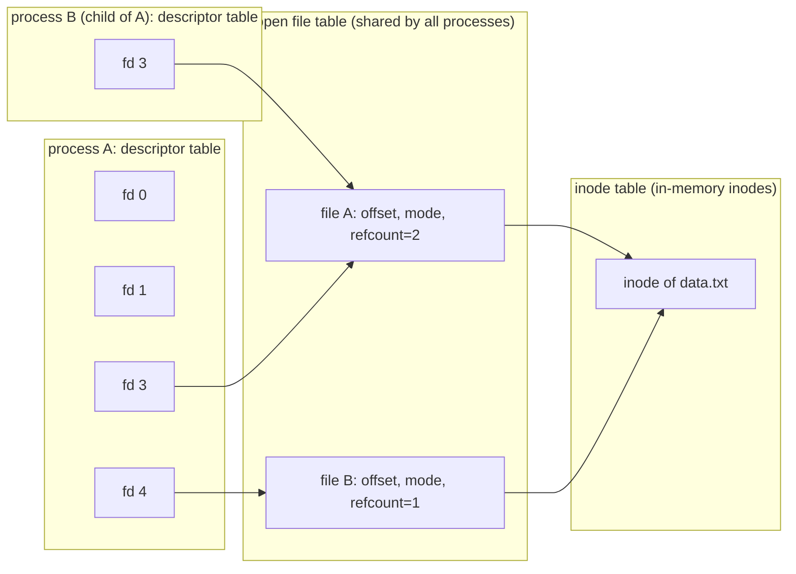

A computer that cannot exchange data with the outside world computes nothing useful, and almost all data of interest to a computational biologist live on storage devices: sequencing runs, reference genomes, alignments. This chapter looks at input/output from three levels. At the bottom, the operating system communicates with devices through registers, **interrupts** and direct memory access, hidden behind device drivers. In the middle, the two kinds of storage devices, hard disks and flash SSDs, have very different performance characteristics, and RAID combines several of them into one faster and more reliable device. At the top, a program reads and writes through Unix I/O and the buffering layers of the C library and the **kernel**, and its performance depends on how it uses them. The **file systems** that sit on these devices were the subject of [4.11.7](/4.11.7); the hardware side of buses and memory hierarchies belongs to computer organization ([4.10](/4.10)). The material follows OSTEP's chapters on I/O devices, disks, RAID and flash, and CS:APP's chapter on system-level I/O.

## 8.1. Devices and the Operating System

### 8.1.1. The Canonical Device

A device presents to the rest of the system an *interface*, a few registers that software can read and write, and hides an *internal structure* that may itself contain a processor, memory and firmware (a modern SSD controller runs a small operating system of its own). The canonical device of OSTEP has three registers: a *status* register (is the device busy?), a *command* register and a *data* register. The simplest protocol to use it is:

```c
while (STATUS == BUSY)
    ;                        /* wait until the device is ready (polling) */
write data to DATA register;
write command to COMMAND register;   /* this starts the device */
while (STATUS == BUSY)
    ;                        /* wait until the request is done */
```

The protocol has two inefficiencies. The CPU spins in the loops, doing nothing useful while it waits; and the CPU itself copies every word of data into the data register, which is called *programmed I/O* (PIO). The two mechanisms below remove them.

**Definition 8.1.1 (Polling)** **Polling** is the method of waiting for a device by repeatedly reading its status register until the device reports that it is ready or done.

There are two ways for the CPU to access device registers. With *port-mapped I/O* (the `in` and `out` instructions of x86) devices have a separate **address space** accessible only to **privileged instructions**. With *memory-mapped I/O*, the registers appear at **physical addresses**, and ordinary loads and stores to those addresses reach the device; memory-mapped I/O is the norm on RISC-V and ARM and for PCI Express devices on x86. In both cases access is restricted to the kernel, so a user program reaches a device only through a system call.

### 8.1.2. Interrupts

**Definition 8.1.2 (Interrupt)** An **interrupt** is a signal from a device to the processor that an event needing attention has occurred (a request has completed, data have arrived). On receiving it, the processor finishes or abandons the current instruction, saves enough state to resume, switches to kernel mode and jumps to an interrupt handler (interrupt service routine) chosen by the interrupt's number through a table set up by the kernel; when the handler returns, the interrupted computation continues as if nothing had happened.

With **interrupts**, the OS issues a request, puts the requesting **process** to sleep and runs another process; when the device finishes, the interrupt handler wakes the sleeping process. Computation and I/O overlap, which is the whole point of **multiprogramming**. Interrupts are not always better than polling:

| Situation | Better choice | Reason |
|---|---|---|
| slow device, long waits (disk, keyboard) | interrupts | the CPU does other work meanwhile |
| very fast device, completion in microseconds | polling | an interrupt costs a context switch and cache pollution that may exceed the wait |
| high, bursty rates (a network card receiving millions of packets) | hybrid | under a flood of interrupts the system can do nothing but handle them (*receive livelock*) |

Linux combines the two. Its network stack (NAPI) takes one interrupt, then disables further interrupts from the card and polls it until the queue is empty. Devices *coalesce* interrupts, delivering one for a batch of completions, and the kernel splits a handler into a short "top half" that runs with interrupts disabled and a deferred "bottom half" (softirqs, threaded interrupts, work queues) that does the rest. For the fastest NVMe SSDs the kernel can also poll for completions (`io_uring` with `IORING_SETUP_IOPOLL`). The interrupts handled so far are listed in `/proc/interrupts`; on the WSL 2 virtual machine used for this chapter the busiest sources are the virtual disk and the hypervisor's timer:

```text
$ cat /proc/interrupts      (abridged; counts summed over the 8 CPUs)
 25:    22831  Hyper-V PCIe MSI ...-edge   virtio0-virtqueues
HVS:  3969198  Hyper-V stimer0 interrupts
```

The same machinery handles events that are not caused by devices: the timer interrupt that lets the scheduler regain control from a running process, and **exceptions** raised by the CPU itself (**page faults**, division by zero, the trap instruction of a **system call**). They are discussed with processes ([4.11.2](/4.11.2)) and virtual memory ([4.11.4](/4.11.4)).

### 8.1.3. Direct Memory Access

**Definition 8.1.3 (Direct Memory Access)** **Direct memory access** (DMA) is a mechanism by which a device (or a DMA engine next to it) transfers data between itself and main memory without the CPU copying each word. The OS tells the device where the data are in memory (a list of physical address ranges, the *scatter-gather list*), how many bytes to transfer and in which direction; the device performs the transfer and raises an interrupt when it is done.

With DMA and interrupts, a disk read proceeds as follows: the driver writes the request (sector, length, the physical addresses of the destination pages) into the device's command queue, the **process** sleeps, the device transfers the data directly into those pages, raises an interrupt, and the handler marks the request complete and wakes the process. The CPU spends only the few microseconds of setup and completion. Because devices use physical addresses, the pages must stay resident during the transfer, and an *IOMMU* translates and restricts device addresses so that a faulty or malicious device cannot write anywhere in memory (this is also what makes passing a device into a virtual machine safe, [4.11.9](/4.11.9#sec-9.2.4)).

### 8.1.4. Device Drivers and Device Files

The kernel cannot know every device, so device-specific code is isolated in *device drivers*, modules that implement a generic interface for a class of devices. A file system asks the block layer to read block 1118; the block layer queues and schedules the request and hands it to the driver of an NVMe drive, a SATA disk, a USB stick or a virtual disk. Drivers account for most of the Linux source code and for most kernel bugs, which is why some systems run them in user space.

Unix exposes devices as special files in `/dev`, marked `b` (block devices, accessed in blocks through the block layer and the **page cache**, such as disks) or `c` (character devices, accessed as byte streams, such as terminals and `/dev/null`). The two numbers in place of a size are the major number (which driver) and the minor number (which device):

```text
$ ls -l /dev/null /dev/zero /dev/urandom /dev/tty /dev/sdd
crw-rw-rw- 1 root root 1,  3 Oct 21 15:05 /dev/null
crw-rw-rw- 1 root root 1,  5 Oct 21 15:05 /dev/zero
crw-rw-rw- 1 root root 1,  9 Oct 21 15:05 /dev/urandom
crw-rw-rw- 1 root tty  5,  0 Oct 21 15:05 /dev/tty
brw-rw---- 1 root disk 8, 48 Oct 21 15:05 /dev/sdd
```

`/dev/null` discards everything written to it and returns end of file on reading; `/dev/zero` returns zero bytes; `/dev/urandom` returns cryptographically secure random bytes. They are used constantly in the shell ([4.11.10](/4.11.10)): `command 2>/dev/null` throws away error messages, and `head -c 16M /dev/urandom > test.bin` creates a test file.

## 8.2. Hard Disk Drives

### 8.2.1. Geometry and Access Time

A hard disk drive (HDD) stores data magnetically on one or more *platters* rotating at a constant speed (5400, 7200, 10000 or 15000 revolutions per minute). Each surface is divided into concentric *tracks*, and each track into *sectors* of 512 bytes or, on modern drives, 4096 bytes. A *disk head* on an *arm* reads and writes one track at a time; the arm moves all heads together. To the OS the disk presents only a linear array of sectors (logical block addresses); the mapping to the geometry is the drive's business, but the drive keeps consecutive addresses physically consecutive, so the costs below are predictable.

**Definition 8.2.1 (Seek Time and Rotational Latency)** The time to serve a request on a hard disk is

$$
T_{\mathrm{I/O}} = T_{\mathrm{seek}} + T_{\mathrm{rotation}} + T_{\mathrm{transfer}},
$$
where the **seek time** $T_{\mathrm{seek}}$ is the time to move the arm to the right track, the **rotational latency** $T_{\mathrm{rotation}}$ is the time until the first requested sector rotates under the head, and $T_{\mathrm{transfer}}$ is the time to read or write the data as they pass under the head. The rate of a request of size $s$ is $R_{\mathrm{I/O}} = s / T_{\mathrm{I/O}}$.

The average seek is about a third of a full stroke and is quoted by manufacturers; the average rotational latency is half a revolution.

**Example 8.2.1 (Random and Sequential Access)** Take a 7200-rpm drive with an average seek of 8 ms and a sustained transfer rate of 250 MB/s, typical of a current high-capacity drive. One revolution takes $60/7200\,\mathrm{s} = 8.33\,\mathrm{ms}$, so the average rotational latency is $4.17\,\mathrm{ms}$.

| Request | $T_{\mathrm{seek}}$ | $T_{\mathrm{rotation}}$ | $T_{\mathrm{transfer}}$ | $T_{\mathrm{I/O}}$ | $R_{\mathrm{I/O}}$ |
|---|---|---|---|---|---|
| random 4 KiB | 8 ms | 4.17 ms | 0.016 ms | 12.2 ms | 0.34 MB/s |
| random 1 MiB | 8 ms | 4.17 ms | 4.2 ms | 16.4 ms | 64 MB/s |
| 100 MiB sequential | 8 ms | 4.17 ms | 419 ms | 432 ms | 243 MB/s |

Small random requests reach about 82 operations per second and one seven-hundredth of the drive's bandwidth: positioning dominates. The same drive that streams a BAM file at 250 MB/s needs about two and a half hours to read the same 3 GB in random 4-KiB pieces. Every design choice for disks (FFS's placement policy in [4.11.7](/4.11.7#sec-7.3), log-structured writes, large I/O sizes, sorting data before random lookups) aims to turn random access into sequential access.


The drive has a cache of tens to hundreds of megabytes. It reads ahead the rest of a track and, with *write-back caching*, reports a write complete as soon as the data are in its cache, which is fast but unsafe on power loss; this is why file systems must issue explicit cache flushes to make data durable ([4.11.7](/4.11.7#sec-7.4.3)).

### 8.2.2. Disk Scheduling

Because the cost of a request depends on where the head is, the order in which queued requests are served matters. Unlike CPU scheduling, the scheduler can estimate the length of each "job" (its seek and rotation), so it can approximate shortest-job-first.

**Definition 8.2.2 (Disk Scheduling)** **Disk scheduling** is the choice of the order in which pending disk requests are served. Common policies are:

- **first come, first served** (FCFS);
- **shortest seek time first** (SSTF): serve the request on the nearest track next;
- the **elevator algorithm** (SCAN): sweep the head across the disk in one direction, serving requests in track order, then reverse; *LOOK* reverses at the last request instead of the edge, and *C-SCAN*/*C-LOOK* serve requests in one direction only and jump back, which treats the inner and outer tracks more evenly;
- **shortest positioning time first** (SPTF): like SSTF but counting rotation as well as seek, which only the drive itself knows precisely.

**Example 8.2.2** The head is on track 53 and requests are queued for tracks 98, 183, 37, 122, 14, 124, 65, 67 (in arrival order). The total head movement in tracks is:

| Policy | Service order | Head movement |
|---|---|---|
| FCFS | 98, 183, 37, 122, 14, 124, 65, 67 | 640 |
| SSTF | 65, 67, 37, 14, 98, 122, 124, 183 | 236 |
| LOOK, moving toward 0 first | 37, 14, 65, 67, 98, 122, 124, 183 | $39 + 169 = 208$ |
| C-LOOK, moving upward | 65, 67, 98, 122, 124, 183, then jump to 14, 37 | $130 + 169 + 23 = 322$ |

SSTF is greedy and can *starve* requests at the edges if new requests keep arriving near the head; the elevator variants bound the waiting time at the cost of some extra movement.

Inside Linux the choice now happens at two levels. Modern drives accept many requests at once (32 with SATA native command queuing, up to 64K queues of 64K entries with NVMe) and reorder them internally with full knowledge of their geometry. The kernel's multi-queue block layer offers the schedulers `mq-deadline` (sorts requests and enforces a deadline to prevent **starvation**; the usual default for rotating disks), `bfq` (budget fair queueing, which divides bandwidth fairly between processes; good for desktops), `kyber` (latency targets for fast devices) and `none` (no reordering, the default for NVMe SSDs, where reordering gains nothing). The active one is shown in brackets:

```text
$ cat /sys/block/sdd/queue/scheduler
[none] mq-deadline kyber
```

The virtual disk of WSL 2 uses `none`: the real scheduling happens in Windows, beneath the virtual machine.

## 8.3. Flash-Based SSDs

### 8.3.1. NAND Flash

A solid-state drive (SSD) has no moving parts. It stores bits as charge in the floating gates (or charge traps) of transistors in NAND flash chips. A cell holding one bit is SLC; cells holding 2, 3 or 4 bits (MLC, TLC, QLC) distinguish 4, 8 or 16 charge levels, which increases density and lowers cost at the expense of speed and endurance. Flash has three peculiarities that shape everything above it:

- Reads and writes (programs) operate on pages of 4–16 KiB, but erasing works only on whole *blocks* of hundreds of pages (several megabytes).
- A page can be programmed only after its block has been erased: there is no overwrite in place.
- Each block survives only a limited number of program/erase cycles (on the order of 100 000 for SLC, a few thousand for TLC, around a thousand for QLC) before cells wear out.

Typical latencies are tens of microseconds for a page read, a few hundred microseconds for a program, and milliseconds for an erase.

### 8.3.2. The Flash Translation Layer

An SSD hides these properties behind the same interface as a disk, an array of logical blocks that can be read and overwritten, using firmware called the flash translation layer.

**Definition 8.3.1 (Flash Translation Layer)** The **flash translation layer** (FTL) is the firmware of an SSD that maps logical block addresses to physical flash pages. It is log-structured: an overwrite of a logical block is written to a fresh, already erased page, the mapping is updated, and the old page is marked invalid. Garbage collection in the FTL later copies the remaining valid pages out of blocks with many invalid pages and erases those blocks for reuse.

The log-structured design is the idea of LFS ([4.11.7](/4.11.7#sec-7.4.4)) implemented inside the device. It has costs that a user of an SSD should know.

**Definition 8.3.2 (Write Amplification)** The **write amplification** of an SSD is the ratio of the number of bytes written to flash to the number of bytes written by the host. Garbage collection makes it greater than 1, because valid pages are copied again; it grows when the drive is nearly full and the writes are small and random.

To keep blocks from wearing out unevenly, the FTL performs *wear leveling*: it spreads program/erase cycles over all blocks, occasionally moving long-lived, rarely changed data out of blocks that would otherwise never be erased. The FTL also benefits from knowing which logical blocks no longer hold useful data: the *TRIM* command (called *discard* in Linux, *deallocate* in NVMe) tells the drive that blocks of deleted files are free, so garbage collection need not copy them. File systems issue it either continuously (the `discard` **mount** option, which the ext4 root of WSL 2 uses) or periodically (`fstrim`, run weekly by a systemd timer on most distributions). Drives reserve spare capacity (*over-provisioning*), and leaving part of a drive unpartitioned lowers write amplification further.

The mapping table itself is large (4 bytes per 4-KiB page is 1 GiB of mapping per 1 TiB of flash), so drives keep it in DRAM on the controller; cheaper DRAM-less drives borrow host memory (the NVMe *host memory buffer*) or cache only part of it, and their random performance suffers.

### 8.3.3. Interfaces and Performance

| | HDD (7200 rpm) | SATA SSD | NVMe SSD (PCIe 4.0 / 5.0) |
|---|---|---|---|
| Random 4-KiB read latency | ~12 ms | ~100 µs | 50–100 µs |
| Random 4-KiB read IOPS (deep queue) | ~100–200 | ~90 000 | 1 000 000 and more |
| Sequential bandwidth | ~250 MB/s | ~550 MB/s (limited by SATA) | ~7 GB/s / ~14 GB/s |
| Queues | 1 (NCQ depth 32) | 1 (NCQ depth 32) | up to 65 535, each up to 65 536 deep |
| Cost per terabyte | lowest | middle | middle to high |

SATA and its AHCI protocol were designed for disks, with one queue and a register interface that must be accessed under a lock. NVMe, designed for flash on PCI Express, gives each CPU its own submission and completion queues in memory, so cores issue requests without coordinating. At these speeds the operating system becomes the bottleneck: a million requests per second leaves one microsecond of CPU time per request. This motivated the multi-queue block layer and `io_uring` (§8.5.4). HDDs remain the cheapest bulk storage and fill the large arrays behind cluster file systems and archives; SSDs hold operating systems, home directories, databases and scratch space.

## 8.4. RAID

### 8.4.1. The Idea

**Definition 8.4.1 (RAID)** A **redundant array of inexpensive disks** (RAID; also "independent disks") combines several disks into one logical disk that is larger, faster and, when the data are stored with redundancy, able to survive the failure of some of its disks. RAID is implemented in a hardware controller or in software (the Linux `md` driver with the `mdadm` tool, or a file system such as ZFS or Btrfs); the file system above sees one block device.

RAID levels are built from three techniques. *Striping* spreads consecutive chunks (for example 64 KiB or 512 KiB) of the logical disk round-robin over the disks, so that large requests use all disks at once and independent small requests are served in parallel. *Mirroring* keeps identical copies on two or more disks. *Parity* stores, for each stripe, the bitwise **exclusive or** (XOR) of the data chunks, from which any one missing chunk can be recomputed:

$$
P = D_1 \oplus D_2 \oplus \cdots \oplus D_{N-1}, \qquad D_i = P \oplus \bigoplus_{j \ne i} D_j .
$$

A RAID level is judged by three criteria, under the *fail-stop* fault model (a disk either works correctly or fails completely and detectably): capacity, reliability (how many disk failures it tolerates) and performance.

### 8.4.2. The Standard Levels

| Level | Layout | Usable capacity | Failures tolerated | Random read | Random write | Sequential read / write |
|---|---|---|---|---|---|---|
| RAID 0 | striping only | $N \cdot B$ | 0 | $N R$ | $N R$ | $N S$ / $N S$ |
| RAID 1 (RAID 10) | mirrored pairs, striped | $N B / 2$ | 1 for sure (up to $N/2$ if each failure hits a different pair) | $N R$ | $N R / 2$ | $N S/2$ / $N S/2$ |
| RAID 4 | striping with a dedicated parity disk | $(N-1) B$ | 1 | $(N-1) R$ | $R / 2$ | $(N-1) S$ / $(N-1) S$ |
| RAID 5 | striping with rotated parity | $(N-1) B$ | 1 | $N R$ | $N R / 4$ | $(N-1) S$ / $(N-1) S$ |
| RAID 6 | striping with two independent parity chunks per stripe | $(N-2) B$ | 2 | $N R$ | $N R / 6$ | $(N-2) S$ / $(N-2) S$ |

Here $N$ is the number of disks, $B$ the capacity of one disk, $R$ the random and $S$ the sequential bandwidth of one disk (following OSTEP's simple model). The random-write column needs explanation.

**Definition 8.4.2 (Small-Write Problem)** In a parity RAID, a write that changes only one chunk of a stripe must also update the parity. The cheapest way (*subtractive parity*) reads the old data and the old parity, computes

$$
P_{\mathrm{new}} = P_{\mathrm{old}} \oplus D_{\mathrm{old}} \oplus D_{\mathrm{new}},
$$
and writes the new data and the new parity: four I/Os for one logical write. This penalty for small writes is the **small-write problem**.

In RAID 4 every small write touches the single parity disk, which serializes all writes: random write throughput is $R/2$ no matter how many disks there are. RAID 5 rotates the parity across disks so that the four I/Os of different writes fall on different disks, and $N$ disks together sustain $N R / 4$. RAID 6 must update two parities, six I/Os per small write. Writes of whole stripes avoid the problem entirely, since the parity is computed from the new data alone; the file system on top can align its allocations to the stripe (ext4's `stride` and `stripe_width`, XFS's `su` and `sw`).

**Example 8.4.1 (Choosing a Level)** A lab server has eight 20-TB disks. The usable capacity is 160 TB with RAID 0, 80 TB with RAID 10, 140 TB with RAID 5 and 120 TB with RAID 6. After a disk fails, the array runs *degraded* and must be *rebuilt* onto a replacement by reading all surviving disks: at 250 MB/s, writing 20 TB takes $20 \times 10^{12} / (250 \times 10^6)\,\mathrm{s} \approx 22$ hours, longer while the array is serving users. During this time RAID 5 has no redundancy left. Worse, the rebuild must read all $7 \times 20\,\mathrm{TB} = 1.12 \times 10^{15}$ bits of the other disks; with the unrecoverable read error rate of $10^{-15}$ per bit that enterprise drives specify, the expected number of unreadable sectors during the rebuild is 1.12 and, modeling errors as a Poisson process, the probability of finishing without one is $\mathrm{e}^{-1.12} \approx 0.33$. (Specified rates are conservative and an unreadable sector loses one stripe rather than the array, but the conclusion stands.) With disks this large, RAID 6 or mirroring is the reasonable choice, and RAID 5 is not.

RAID protects against the failure of disks, nothing else. It does not protect against deleting a file, a bug that corrupts data, ransomware, theft or a fire; every write, including a mistaken `rm -rf`, is faithfully applied to all copies. RAID is not a backup: important data, in particular raw sequencing data that cannot be regenerated, need copies in another place, preferably following the 3-2-1 rule (three copies, on two kinds of media, one off-site). Modern storage systems also go beyond fail-stop: ZFS and Btrfs checksum every block, detect *silent* corruption (latent sector errors, misdirected writes) and repair it from the redundant copy, and periodic *scrubbing* reads all data to find errors before a disk fails. Large storage systems replace RAID by *erasure coding* across many servers, a generalization of parity (Reed–Solomon codes) that tolerates the loss of several whole machines.

## 8.5. System-Level I/O

### 8.5.1. Unix I/O and Short Counts

The calls `open`, `read`, `write` and `close` of [4.11.7](/4.11.7#sec-7.1.2) are *Unix I/O*, the lowest-level I/O interface that a program can use. They are unbuffered in the sense that each call is a **system call**, crossing into the kernel. `read(fd, buf, n)` returns the number of bytes actually transferred, which may be less than `n`.

**Definition 8.5.1 (Short Count)** A **short count** is a return value of `read` or `write` that is smaller than the number of bytes requested without an error having occurred. Short counts occur when `read` reaches the end of a file, when reading from a terminal (one line at a time), a pipe or a network socket (whatever has arrived so far), and when a call is interrupted by a signal after transferring some data.

Reads from regular files on local disks give short counts only at end of file, which makes the bug of ignoring them easy to miss until the program reads from a pipe or a network connection. Robust programs therefore wrap the calls in loops, as CS:APP's RIO package does:

```c
#include <errno.h>
#include <unistd.h>

/* Read exactly n bytes unless end of file comes first.
   Returns the number of bytes read, or -1 on error. */
ssize_t read_full(int fd, void *buf, size_t n) {
    size_t left = n;
    char *p = buf;
    while (left > 0) {
        ssize_t k = read(fd, p, left);
        if (k < 0) {
            if (errno == EINTR)        /* interrupted by a signal: retry */
                continue;
            return -1;
        }
        if (k == 0)                    /* end of file */
            break;
        left -= k;
        p += k;
    }
    return n - left;
}
```

A short count is easy to provoke with a pipe. A writer sends three chunks of 30000 bytes, 0.1 s apart, into a program that calls first `read` and then `read_full` with a 100000-byte buffer:

```c
int main(void) {
    static char b[100000];
    ssize_t r = read(0, b, sizeof b);
    ssize_t f = read_full(0, b, sizeof b);
    printf("plain read: %zd, read_full: %zd\n", r, f);
    return 0;
}
```

```text
$ (for i in 1 2 3; do head -c 30000 /dev/zero; sleep 0.1; done) | ./shortcount
plain read: 30000, read_full: 60000
```

The plain `read` returns what has arrived in the pipe so far; `read_full` keeps reading until the writer closes the pipe (end of file) and collects the remaining 60000 bytes.

The writing counterpart `write_full` (used in the atomic-replace example of [4.11.7](/4.11.7#sec-7.4.5)) has the same structure and never stops early.

### 8.5.2. Buffering

A system call costs a few hundred nanoseconds even when no device is involved, because of the switch into the kernel and back. The following program reads a 16-MiB file that is already in the **page cache**, first with `read` calls of different sizes, then byte by byte through the C library's `getc`:

```c
#include <stdio.h>
#include <stdlib.h>
#include <fcntl.h>
#include <unistd.h>
#include <time.h>

static double now(void) {
    struct timespec t;
    clock_gettime(CLOCK_MONOTONIC, &t);
    return t.tv_sec + t.tv_nsec * 1e-9;
}

/* Read the whole file with read() calls of the given size. */
static void with_read(const char *path, size_t bufsize) {
    char *buf = malloc(bufsize);
    int fd = open(path, O_RDONLY);
    if (fd == -1 || buf == NULL) { perror("setup"); exit(1); }
    long calls = 0;
    ssize_t n;
    double t0 = now();
    while ((n = read(fd, buf, bufsize)) > 0)
        calls++;
    double t = now() - t0;
    if (n == -1) { perror("read"); exit(1); }
    printf("read(), %8zu B buffer: %9ld calls %9.1f ms\n", bufsize, calls, t * 1e3);
    close(fd);
    free(buf);
}

/* Read the file one byte at a time through the stdio buffer. */
static void with_getc(const char *path) {
    FILE *f = fopen(path, "rb");
    if (f == NULL) { perror("fopen"); exit(1); }
    long bytes = 0;
    double t0 = now();
    while (getc(f) != EOF)
        bytes++;
    double t = now() - t0;
    printf("getc(), stdio buffer : %9ld bytes %9.1f ms\n", bytes, t * 1e3);
    fclose(f);
}

int main(int argc, char **argv) {
    const char *path = argc > 1 ? argv[1] : "in.bin";
    size_t sizes[] = {1, 16, 256, 4096, 65536, 1 << 20};
    for (size_t i = 0; i < sizeof sizes / sizeof sizes[0]; i++)
        with_read(path, sizes[i]);
    with_getc(path);
    return 0;
}
```

```text
read(),        1 B buffer:  16777216 calls    5513.2 ms
read(),       16 B buffer:   1048576 calls     287.9 ms
read(),      256 B buffer:     65536 calls      17.0 ms
read(),     4096 B buffer:      4096 calls       2.0 ms
read(),    65536 B buffer:       256 calls       1.4 ms
read(),  1048576 B buffer:        16 calls       2.2 ms
getc(), stdio buffer :  16777216 bytes      46.4 ms
```

Reading one byte per system call costs about 330 ns per byte; with buffers of 4 KiB or more the per-call cost disappears and only copying remains (about 8 GB/s here). `getc` also delivers one byte per call, but from a 4-KiB buffer inside the `FILE` object that the library refills with one `read` when it is empty, so it is more than a hundred times faster than `read` of one byte. Between a program and the device there are several such layers, each with its own way to push data down:

| Layer | Where | Flushed by |
|---|---|---|
| user-space buffer (C `FILE *`, C++ streams, Python file objects) | process memory | `fflush`, `std::flush`, `close`/`fclose`, normal exit; full buffer; newline for terminals |
| page cache ([4.11.7](/4.11.7#sec-7.2.5)) | kernel memory | `fsync`/`fdatasync`, periodic write-back |
| device cache | the drive | cache-flush command issued by `fsync` |

Two consequences follow. Output written with `printf` may still be in the process's buffer when the process crashes or calls `_exit`, and is then lost; standard output is line-buffered when connected to a terminal but fully buffered when redirected to a file or a pipe, which is why the order of interleaved `printf` and `perror` output can change under redirection (standard error is unbuffered). And data that `fclose` has handed to the kernel are safe against a crash of the process but not against a crash of the machine; only `fsync` guarantees that ([4.11.7](/4.11.7#sec-7.4.5)).

### 8.5.3. How Descriptors Share Files

The **kernel** represents open files with three tables (CS:APP §10.8):



Each process has a descriptor table whose entries point to entries of the system-wide open file table; each open file entry holds the offset, the access mode and a reference count, and points to the in-memory **inode**. In the figure, process A opened `data.txt` twice (descriptors 3 and 4), getting two open file entries with independent offsets, and then forked B, whose descriptor 3 shares A's first open file entry and therefore its offset. Closing a descriptor decrements the reference count, and the open file entry is freed when the count reaches zero.

`dup2(oldfd, newfd)` makes `newfd` point to the same open file entry as `oldfd`. This is how a shell implements `command > out.txt`: after `fork`, the child opens `out.txt`, calls `dup2(fd, 1)` so that standard output refers to the file, closes `fd` and calls `exec`. The program writes to descriptor 1 as always and never knows that its output goes to a file. The pipe `a | b` works the same way with the two ends of a pipe ([4.11.10](/4.11.10#sec-10.3)).

```c
#include <fcntl.h>
#include <stdio.h>
#include <unistd.h>

int main(void) {
    int fd = open("out.txt", O_WRONLY | O_CREAT | O_TRUNC, 0644);
    if (fd == -1) { perror("open"); return 1; }
    dup2(fd, STDOUT_FILENO);          /* descriptor 1 now refers to out.txt */
    close(fd);
    execlp("echo", "echo", "written by echo", (char *)NULL);
    perror("execlp");                 /* reached only if exec fails */
    return 1;
}
```

```text
$ ./redirect && cat out.txt
written by echo
```

### 8.5.4. Beyond read and write

Several interfaces exist for cases where plain blocking `read` and `write` do not fit:

- **Memory-mapped files**: `mmap` maps a file into the address space, and loads and stores access the page cache directly ([4.11.4](/4.11.4)). Convenient for random access to large read-only files such as genome indexes, which several processes can share.
- *Vectored and positional I/O*: `readv`/`writev` transfer several buffers in one call; `pread`/`pwrite` take an explicit offset and do not move the shared one, which lets threads use one descriptor safely.
- *Advice and preallocation*: `posix_fadvise` tells the kernel the access pattern (sequential, random, not needed again); `fallocate` reserves space so a file is laid out contiguously.
- *Direct I/O*: `O_DIRECT` bypasses the page cache, with buffers aligned to the block size; databases use it because they manage their own cache.
- *Readiness notification*: `poll` and Linux's `epoll` let one thread wait for any of thousands of descriptors (sockets, pipes) to become readable or writable; this is the basis of event-driven servers ([4.11.6](/4.11.6)).
- *io_uring* (Linux 5.1, 2019): the application and the kernel share two ring buffers in memory; the application places requests (read, write, accept, fsync and many others) in the submission ring and collects results from the completion ring, so that many I/Os are issued and completed with few or no system calls. It is the fastest asynchronous interface on Linux and is used by databases and storage engines. Because it has been a frequent source of kernel vulnerabilities, some environments (Android, ChromeOS, some container platforms) disable it.

For analysis code in Python or R, the lessons translate directly: read and write in large chunks or through buffered libraries, never one record per system call; prefer formats that can be read sequentially or by index (BAM with its index, Parquet, HDF5) to scattered small files; compress data that are read sequentially, since decompression is usually faster than the disk (block-compressed BGZF, used by BAM and tabix, keeps random access possible); and place temporary files on local SSD scratch rather than a network file system ([4.11.11](/4.11.11#sec-11.1)).

## Summary

- The OS controls devices through registers (port-mapped or memory-mapped). Polling wastes CPU time on slow devices, interrupts let the CPU work while I/O proceeds, and DMA moves the data without the CPU; Linux mixes polling and interrupts for very fast devices. Drivers implement generic interfaces, and devices appear as block or character special files in `/dev`.
- A hard disk's access time is seek + rotation + transfer. Random small requests achieve well under 1 % of the sequential bandwidth, so software arranges for large sequential I/O. Disk schedulers (SSTF, elevator variants) reduce head movement; Linux offers `mq-deadline`, `bfq`, `kyber` and `none`.
- Flash cannot overwrite in place and erases in large blocks; the FTL maps logical blocks to pages log-structurally, with garbage collection, write amplification, wear leveling and TRIM. NVMe's many queues expose the parallelism of flash.
- RAID 0 stripes, RAID 1/10 mirror, RAID 4/5/6 use parity; parity RAIDs suffer the small-write problem (four I/Os per write in RAID 5). Long rebuilds of large disks make RAID 6 or mirroring the safe choice. RAID is not a backup.
- Unix I/O calls may return short counts and cost a system call each; buffering in the C library and the page cache amortizes this, and only `fsync` makes data durable. Descriptor table, open file table and inode table explain how offsets are shared after `fork`, and `dup2` implements redirection. `mmap`, `epoll` and `io_uring` serve special needs.
