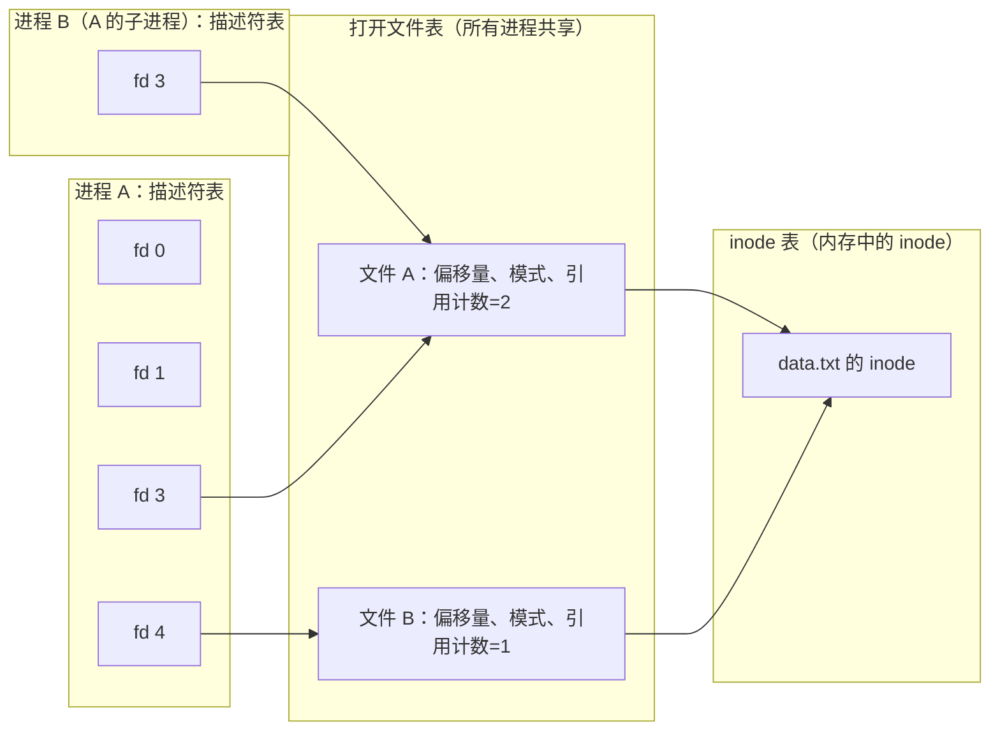

不能与外界交换数据的计算机算不出任何有用的结果，而计算生物学家关心的几乎所有数据都存放在存储设备上：测序结果、参考基因组、比对文件。本章从三个层次考察输入输出。最底层，操作系统通过寄存器、**中断**和直接存储器访问与设备通信，细节被设备驱动程序隐藏。中间层，硬盘与闪存固态硬盘这两类存储设备的性能特征截然不同，RAID 则把多块盘组合成一个更快、更可靠的设备。最上层，程序通过 Unix I/O 以及 C 库和**内核**的缓冲层读写数据，性能取决于它如何使用这些层次。建立在这些设备之上的**文件系统**已在 [4.11.7](/4.11.7) 讨论；总线与存储层次的硬件部分属于计算机组成（[4.10](/4.10)）。本章内容依据 OSTEP 关于 I/O 设备、磁盘、RAID 和闪存的各章，以及 CS:APP 关于系统级 I/O 的一章。

## 8.1. 设备与操作系统

### 8.1.1. 典型设备

设备对系统其余部分呈现一个*接口*，即软件可以读写的几个寄存器，并隐藏其*内部结构*；内部结构本身可能包含处理器、存储器和固件（现代 SSD 的控制器运行着一个小型操作系统）。OSTEP 的典型设备有三个寄存器：*状态*寄存器（设备是否忙）、*命令*寄存器和*数据*寄存器。使用它的最简单协议是：

```c
while (STATUS == BUSY)
    ;                        /* wait until the device is ready (polling) */
write data to DATA register;
write command to COMMAND register;   /* this starts the device */
while (STATUS == BUSY)
    ;                        /* wait until the request is done */
```

这个协议有两处低效。CPU 在循环中空转，等待期间不做任何有用的事；而且每个数据字都由 CPU 亲自复制到数据寄存器，称为程序控制 I/O（programmed I/O），简称 PIO。下面的两种机制分别消除这两个问题。

**定义 8.1.1（轮询）** **轮询**是通过反复读取设备的状态寄存器来等待设备的方法，直到设备报告已就绪或已完成。

CPU 访问设备寄存器有两种方式。*端口映射 I/O*（x86 的 `in` 和 `out` 指令）为设备提供独立的**地址空间**，只有**特权指令**才能访问。采用存储器映射 I/O（memory-mapped I/O）时，寄存器出现在**物理地址**上，对这些地址的普通读写指令会到达设备；存储器映射 I/O 是 RISC-V 和 ARM 上的常规做法，x86 上的 PCI Express 设备也是如此。两种方式下，访问都仅限内核，因此用户程序只能通过系统调用接触设备。

### 8.1.2. 中断

**定义 8.1.2（中断）** **中断**是设备向处理器发出的信号，表示发生了需要处理的事件（请求已完成、数据已到达）。处理器收到后，完成或放弃当前指令，保存足以恢复执行的状态，切换到内核态，并通过内核建立的表，按中断号跳转到相应的中断处理程序（中断服务程序）；处理程序返回后，被中断的计算像什么都没发生过一样继续。

有了**中断**，操作系统发出请求后让发出请求的**进程**睡眠，转而运行另一个进程；设备完成时，中断处理程序唤醒睡眠的进程。计算与 I/O 因此重叠，这正是**多道程序设计**的全部意义。中断并不总是优于轮询：

| 情形 | 更好的选择 | 原因 |
|---|---|---|
| 慢速设备、等待时间长（磁盘、键盘） | 中断 | CPU 可在等待期间做别的工作 |
| 极快的设备，几微秒内完成 | 轮询 | 一次中断带来的上下文切换与缓存污染，开销可能超过等待时间 |
| 速率高且突发（网卡每秒接收数百万个包） | 混合 | 中断洪泛时系统除了处理中断什么也做不了（*接收活锁*，receive livelock） |

Linux 把两者结合起来。其网络协议栈（NAPI）先接收一次中断，随后关闭网卡的后续中断并轮询网卡，直到队列清空。设备会*合并*中断（interrupt coalescing），多个完成事件只发一次中断；内核则把处理程序拆成两部分：在关中断状态下运行的简短"上半部"，以及完成其余工作的延后执行的"下半部"（软中断、线程化中断、工作队列）。对最快的 NVMe SSD，内核还可以轮询完成事件（带 `IORING_SETUP_IOPOLL` 的 `io_uring`）。已处理的中断列在 `/proc/interrupts` 中；在本章使用的 WSL 2 虚拟机上，最繁忙的来源是虚拟磁盘和虚拟机监控器的定时器：

```text
$ cat /proc/interrupts      (abridged; counts summed over the 8 CPUs)
 25:    22831  Hyper-V PCIe MSI ...-edge   virtio0-virtqueues
HVS:  3969198  Hyper-V stimer0 interrupts
```

同样的机制还处理并非由设备引起的事件：让调度器从运行中的进程手中夺回控制权的定时器中断，以及 CPU 自身引发的**异常**（**缺页**、除以零、**系统调用**的陷入指令）。它们分别在进程（[4.11.2](/4.11.2)）和虚拟内存（[4.11.4](/4.11.4)）中讨论。

### 8.1.3. 直接存储器访问

**定义 8.1.3（直接存储器访问）** **直接存储器访问**（DMA）是设备（或设备旁的 DMA 引擎）在无需 CPU 逐字复制的情况下，在自身与主存之间传输数据的机制。操作系统告诉设备数据在内存中的位置（一组物理地址范围，即*分散-聚集列表*，scatter-gather list）、要传输的字节数和方向；设备完成传输后发出中断。

有了 DMA 和中断，一次磁盘读取的过程如下：驱动程序把请求（扇区、长度、目标页的物理地址）写入设备的命令队列，**进程**睡眠，设备把数据直接传入这些页，发出中断，处理程序把请求标记为完成并唤醒进程。CPU 只花费建立和完成请求的几微秒。由于设备使用物理地址，传输期间这些页必须常驻内存；*IOMMU* 负责转换并限制设备地址，使出错或恶意的设备无法写入内存中的任意位置（这也使把设备直通给虚拟机成为安全的做法，[4.11.9](/4.11.9#sec-9.2.4)）。

### 8.1.4. 设备驱动程序与设备文件

内核不可能认识所有设备，所以与设备相关的代码被隔离在设备驱动程序（device driver）中：它们是为一类设备实现通用接口的模块。文件系统请求块层读取 1118 号块；块层把请求排队、调度，再交给 NVMe 盘、SATA 盘、U 盘或虚拟磁盘的驱动程序。驱动程序占 Linux 源代码的大部分，也是内核缺陷的主要来源，因此有些系统把它们放在用户空间运行。

Unix 把设备暴露为 `/dev` 中的特殊文件，类型标记为 `b`（块设备，经块层和**页缓存**按块访问，如磁盘）或 `c`（字符设备，按字节流访问，如终端和 `/dev/null`）。本应显示大小的位置上的两个数是主设备号（哪个驱动程序）和次设备号（哪个设备）：

```text
$ ls -l /dev/null /dev/zero /dev/urandom /dev/tty /dev/sdd
crw-rw-rw- 1 root root 1,  3 Oct 21 15:05 /dev/null
crw-rw-rw- 1 root root 1,  5 Oct 21 15:05 /dev/zero
crw-rw-rw- 1 root root 1,  9 Oct 21 15:05 /dev/urandom
crw-rw-rw- 1 root tty  5,  0 Oct 21 15:05 /dev/tty
brw-rw---- 1 root disk 8, 48 Oct 21 15:05 /dev/sdd
```

`/dev/null` 丢弃写入的一切，读取时返回文件结束；`/dev/zero` 返回零字节；`/dev/urandom` 返回密码学安全的随机字节。它们在 shell 中随处可用（[4.11.10](/4.11.10)）：`command 2>/dev/null` 丢弃错误信息，`head -c 16M /dev/urandom > test.bin` 创建测试文件。

## 8.2. 硬盘

### 8.2.1. 几何结构与访问时间

硬盘（HDD）以磁的方式把数据存储在一个或多个以恒定转速旋转的*盘片*上（每分钟 5400、7200、10000 或 15000 转）。每个盘面划分为同心的*磁道*，每个磁道再划分为 512 字节（现代硬盘为 4096 字节）的*扇区*。*磁头*装在*磁臂*上，一次读写一条磁道；磁臂带动所有磁头一起移动。对操作系统而言，磁盘只呈现为扇区的线性数组（逻辑块地址）；到几何位置的映射是硬盘自己的事，但硬盘会使连续的地址在物理上也连续，因此下面的开销是可以预期的。

**定义 8.2.1（寻道时间与旋转延迟）** 硬盘服务一次请求的时间为

$$
T_{\mathrm{I/O}} = T_{\mathrm{seek}} + T_{\mathrm{rotation}} + T_{\mathrm{transfer}},
$$
其中**寻道时间** $T_{\mathrm{seek}}$ 是把磁臂移到正确磁道的时间，**旋转延迟** $T_{\mathrm{rotation}}$ 是等待第一个所需扇区转到磁头下方的时间，$T_{\mathrm{transfer}}$ 是数据从磁头下经过时读写它们的时间。大小为 $s$ 的请求的速率为 $R_{\mathrm{I/O}} = s / T_{\mathrm{I/O}}$。

平均寻道约为全程的三分之一，由厂商给出；平均旋转延迟是半圈的时间。

**例 8.2.1（随机访问与顺序访问）** 取一块 7200 转/分的硬盘，平均寻道 8 ms，持续传输速率 250 MB/s，这对当前的大容量硬盘是典型的。一圈需要 $60/7200\,\mathrm{s} = 8.33\,\mathrm{ms}$，因此平均旋转延迟为 $4.17\,\mathrm{ms}$。

| 请求 | $T_{\mathrm{seek}}$ | $T_{\mathrm{rotation}}$ | $T_{\mathrm{transfer}}$ | $T_{\mathrm{I/O}}$ | $R_{\mathrm{I/O}}$ |
|---|---|---|---|---|---|
| 随机 4 KiB | 8 ms | 4.17 ms | 0.016 ms | 12.2 ms | 0.34 MB/s |
| 随机 1 MiB | 8 ms | 4.17 ms | 4.2 ms | 16.4 ms | 64 MB/s |
| 顺序 100 MiB | 8 ms | 4.17 ms | 419 ms | 432 ms | 243 MB/s |

小的随机请求每秒约 82 次操作，只有硬盘带宽的七百分之一：定位时间占主导。同一块能以 250 MB/s 流式读取 BAM 文件的硬盘，若按随机的 4 KiB 小块读取同样的 3 GB，需要约两个半小时。针对磁盘的每一项设计选择（[4.11.7](/4.11.7#sec-7.3) 中 FFS 的放置策略、日志结构写入、大的 I/O 尺寸、随机查找前先对数据排序）都是为了把随机访问变成顺序访问。


硬盘有几十到几百兆字节的缓存。它会预读磁道的剩余部分，并且在*写回缓存*（write-back caching）下，数据一进入缓存就报告写入完成，这样很快，但断电时不安全；这就是文件系统必须发出显式的缓存刷新命令才能使数据持久的原因（[4.11.7](/4.11.7#sec-7.4.3)）。

### 8.2.2. 磁盘调度

由于一次请求的开销取决于磁头当前所在的位置，服务排队请求的顺序很重要。与 CPU 调度不同，调度器可以估计每个"作业"的长度（它的寻道与旋转），因此可以近似最短作业优先。

**定义 8.2.2（磁盘调度）** **磁盘调度**是对待处理的磁盘请求选择服务顺序。常见策略有：

- **先来先服务**（FCFS）；
- **最短寻道时间优先**（SSTF）：下一个服务离当前最近的磁道上的请求；
- **电梯算法**（SCAN）：磁头沿一个方向扫过磁盘，按磁道顺序服务请求，然后反向；*LOOK* 在最后一个请求处而不是盘的边缘折返，*C-SCAN*/*C-LOOK* 只在一个方向上服务请求，然后跳回起点，这样对内外磁道更为均匀；
- **最短定位时间优先**（SPTF）：与 SSTF 类似，但除寻道外还计入旋转，这只有硬盘自身才能精确知道。

**例 8.2.2** 磁头在 53 号磁道，排队的请求依次到达，磁道号为 98、183、37、122、14、124、65、67。以磁道数计的磁头总移动量为：

| 策略 | 服务顺序 | 磁头移动量 |
|---|---|---|
| FCFS | 98, 183, 37, 122, 14, 124, 65, 67 | 640 |
| SSTF | 65, 67, 37, 14, 98, 122, 124, 183 | 236 |
| LOOK，先向 0 移动 | 37, 14, 65, 67, 98, 122, 124, 183 | $39 + 169 = 208$ |
| C-LOOK，向上移动 | 65, 67, 98, 122, 124, 183，然后跳到 14, 37 | $130 + 169 + 23 = 322$ |

SSTF 是贪心的，若新请求不断出现在磁头附近，边缘处的请求会被*饿死*；电梯类算法以多一些移动为代价限定了等待时间。

在 Linux 内部，如今调度在两个层次上进行。现代硬盘可以同时接受许多请求（SATA 的原生命令队列为 32 个，NVMe 最多 64K 个队列、每个 64K 项），并凭借对自身几何结构的完整了解在内部重排它们。内核的多队列块层提供调度器 `mq-deadline`（对请求排序并强制截止时间以防止**饥饿**；旋转磁盘通常的默认选择）、`bfq`（预算公平排队，在进程间公平分配带宽；适合桌面）、`kyber`（面向快速设备的延迟目标）和 `none`（不重排；NVMe SSD 的默认选择，重排在其上毫无收益）。当前启用的调度器显示在方括号中：

```text
$ cat /sys/block/sdd/queue/scheduler
[none] mq-deadline kyber
```

WSL 2 的虚拟磁盘使用 `none`：真正的调度发生在虚拟机之下的 Windows 中。

## 8.3. 闪存固态硬盘

### 8.3.1. NAND 闪存

固态硬盘（SSD）没有活动部件。它把比特以电荷的形式存储在 NAND 闪存芯片中晶体管的浮栅（或电荷陷阱）里。存一个比特的单元是 SLC；存 2、3 或 4 个比特的单元（MLC、TLC、QLC）要区分 4、8 或 16 个电荷水平，这提高了密度、降低了成本，代价是速度和耐久性。闪存有三个特殊之处，决定了它之上的一切设计：

- 读与写（编程）以 4–16 KiB 的页为单位，但擦除只能对包含数百页（几兆字节）的整个*块*进行。
- 页必须在其所在块被擦除之后才能编程：不能原地覆盖。
- 每个块只能经受有限次数的编程/擦除循环，之后单元就会磨损（SLC 约 100 000 次，TLC 几千次，QLC 约一千次）。

典型延迟是：读一页几十微秒，编程几百微秒，擦除几毫秒。

### 8.3.2. 闪存转换层

SSD 借助称为闪存转换层的固件，把这些特性隐藏在与磁盘相同的接口之后：一个可以读取和覆盖的逻辑块数组。

**定义 8.3.1（闪存转换层）** **闪存转换层**（FTL）是 SSD 的固件，负责把逻辑块地址映射到物理闪存页。它是日志结构的：对逻辑块的覆盖写入会写到一个新的、已擦除的页上，更新映射，并把旧页标记为无效。之后，FTL 中的垃圾回收把有许多无效页的块中剩余的有效页复制出去，再擦除这些块以便重用。

这种日志结构的设计就是 LFS（[4.11.7](/4.11.7#sec-7.4.4)）的思想在设备内部的实现。它带来一些 SSD 用户应当了解的代价。

**定义 8.3.2（写放大）** SSD 的**写放大**是写入闪存的字节数与主机写入的字节数之比。垃圾回收会重复复制有效页，因而使它大于 1；盘接近写满且写入又小又随机时，它会增大。

为防止各块磨损不均，FTL 执行*磨损均衡*（wear leveling）：把编程/擦除循环分散到所有块上，必要时把长期存在、很少改动的数据从本来永远不会被擦除的块中移走。FTL 还受益于知道哪些逻辑块已不再保存有用数据：*TRIM* 命令（Linux 中称为 *discard*，NVMe 中称为 *deallocate*）告诉硬盘已删除文件的块是空闲的，这样垃圾回收就不必复制它们。文件系统或者持续发出该命令（`discard` **挂载**选项，WSL 2 的 ext4 根文件系统使用它），或者定期发出（`fstrim`，大多数发行版上由 systemd 定时器每周运行一次）。硬盘会保留备用容量（*预留空间*，over-provisioning），把盘的一部分留着不分区能进一步降低写放大。

映射表本身很大（每 4 KiB 页 4 字节，即每 1 TiB 闪存需要 1 GiB 的映射表），所以硬盘把它放在控制器上的 DRAM 中；较便宜的无 DRAM 硬盘借用主机内存（NVMe 的*主机内存缓冲区*）或只缓存映射表的一部分，其随机性能会因此变差。

### 8.3.3. 接口与性能

| | HDD（7200 转/分） | SATA SSD | NVMe SSD（PCIe 4.0 / 5.0） |
|---|---|---|---|
| 随机 4 KiB 读延迟 | ~12 ms | ~100 µs | 50–100 µs |
| 随机 4 KiB 读 IOPS（深队列） | ~100–200 | ~90 000 | 1 000 000 以上 |
| 顺序带宽 | ~250 MB/s | ~550 MB/s（受 SATA 限制） | ~7 GB/s / ~14 GB/s |
| 队列 | 1（NCQ 深度 32） | 1（NCQ 深度 32） | 最多 65 535 个，每个最深 65 536 |
| 每 TB 成本 | 最低 | 居中 | 居中到较高 |

SATA 及其 AHCI 协议是为磁盘设计的：只有一个队列，寄存器接口必须在加锁的情况下访问。NVMe 为 PCI Express 上的闪存设计，在内存中为每个 CPU 核分配各自的提交队列和完成队列，因此各核发出请求时无需协调。在这样的速度下，操作系统成了瓶颈：每秒一百万个请求，意味着每个请求只有一微秒的 CPU 时间。这催生了多队列块层和 `io_uring`（§8.5.4）。HDD 仍是最便宜的大容量存储，用在集群文件系统和归档背后的大型阵列中；SSD 则存放操作系统、主目录、数据库和临时空间。

## 8.4. RAID

### 8.4.1. 基本思想

**定义 8.4.1（RAID）** **独立磁盘冗余阵列**（RAID，早期称"廉价磁盘冗余阵列"，redundant array of inexpensive disks）把多块磁盘组合成一个逻辑磁盘，它更大、更快，并且当数据带冗余存储时，能经受部分磁盘的故障。RAID 由硬件控制器实现，或由软件实现（Linux 的 `md` 驱动程序及其 `mdadm` 工具，或 ZFS、Btrfs 之类的文件系统）；上层的文件系统只看到一个块设备。

各 RAID 级别由三种技术构成。*条带化*把逻辑磁盘上连续的块（例如 64 KiB 或 512 KiB）轮流分布到各磁盘上，使大请求同时用到所有磁盘，使互相独立的小请求并行得到服务。*镜像*在两块或更多磁盘上保留相同的副本。*奇偶校验*对每个条带存储各数据块按位的**异或**（XOR），由它可以重算任何一个缺失的块：

$$
P = D_1 \oplus D_2 \oplus \cdots \oplus D_{N-1}, \qquad D_i = P \oplus \bigoplus_{j \ne i} D_j .
$$

在*故障即停*（fail-stop）的故障模型下（磁盘要么正确工作，要么彻底且可被察觉地失效），评价一个 RAID 级别有三个标准：容量、可靠性（能容忍几块磁盘失效）和性能。

### 8.4.2. 标准级别

| 级别 | 布局 | 可用容量 | 可容忍的故障数 | 随机读 | 随机写 | 顺序读 / 写 |
|---|---|---|---|---|---|---|
| RAID 0 | 仅条带化 | $N \cdot B$ | 0 | $N R$ | $N R$ | $N S$ / $N S$ |
| RAID 1（RAID 10） | 镜像对，再条带化 | $N B / 2$ | 必然可容忍 1 块（若每次故障落在不同的镜像对上，最多 $N/2$ 块） | $N R$ | $N R / 2$ | $N S/2$ / $N S/2$ |
| RAID 4 | 条带化，带专用校验盘 | $(N-1) B$ | 1 | $(N-1) R$ | $R / 2$ | $(N-1) S$ / $(N-1) S$ |
| RAID 5 | 条带化，校验轮转分布 | $(N-1) B$ | 1 | $N R$ | $N R / 4$ | $(N-1) S$ / $(N-1) S$ |
| RAID 6 | 条带化，每个条带有两个独立的校验块 | $(N-2) B$ | 2 | $N R$ | $N R / 6$ | $(N-2) S$ / $(N-2) S$ |

这里 $N$ 是磁盘数，$B$ 是单块磁盘的容量，$R$ 是单块磁盘的随机带宽，$S$ 是其顺序带宽（采用 OSTEP 的简单模型）。随机写一列需要解释。

**定义 8.4.2（小写问题）** 在带奇偶校验的 RAID 中，只改动条带中一个块的写入也必须更新校验。最便宜的方法（*减法校验*）是读出旧数据和旧校验，计算

$$
P_{\mathrm{new}} = P_{\mathrm{old}} \oplus D_{\mathrm{old}} \oplus D_{\mathrm{new}},
$$
再写入新数据和新校验：一次逻辑写需要四次 I/O。这种对小写入的惩罚称为**小写问题**。

在 RAID 4 中，每次小写都要访问唯一的校验盘，这使所有写入串行化：无论有多少块磁盘，随机写吞吐量都是 $R/2$。RAID 5 把校验轮转分布到各磁盘上，使不同写入的四次 I/O 落在不同的磁盘上，$N$ 块磁盘合起来能维持 $N R / 4$。RAID 6 要更新两个校验，每次小写需要六次 I/O。整条带写入则完全避开了这个问题，因为校验只由新数据算出；上层文件系统可以让自己的分配与条带对齐（ext4 的 `stride` 和 `stripe_width`，XFS 的 `su` 和 `sw`）。

**例 8.4.1（选择级别）** 某实验室服务器有八块 20 TB 的磁盘。可用容量在 RAID 0 下为 160 TB，RAID 10 下为 80 TB，RAID 5 下为 140 TB，RAID 6 下为 120 TB。一块磁盘失效后，阵列*降级*运行，必须读取所有幸存磁盘，把数据*重建*到替换盘上：按 250 MB/s 计，写入 20 TB 需要 $20 \times 10^{12} / (250 \times 10^6)\,\mathrm{s} \approx 22$ 小时，阵列同时还在为用户服务时更长。在此期间 RAID 5 不再有任何冗余。更糟的是，重建必须读取其余磁盘的全部 $7 \times 20\,\mathrm{TB} = 1.12 \times 10^{15}$ 比特；企业级硬盘标称的不可恢复读错误率为每比特 $10^{-15}$，则重建期间不可读扇区的期望个数为 1.12，把错误建模为 Poisson 过程，没有遇到一个错误就完成重建的概率为 $\mathrm{e}^{-1.12} \approx 0.33$。（标称错误率偏保守，而且一个不可读扇区损失的是一个条带而不是整个阵列，但结论依然成立。）对于这样大的磁盘，合理的选择是 RAID 6 或镜像，而不是 RAID 5。

RAID 只防止磁盘失效，别的都不管。它不能防止误删文件、使数据损坏的缺陷、勒索软件、盗窃或火灾；每一次写入，包括误敲的 `rm -rf`，都会被忠实地应用到所有副本上。RAID 不是备份：重要数据，尤其是无法重新生成的原始测序数据，需要在别处另存副本，最好遵循 3-2-1 规则（三份副本，两种介质，一份异地）。现代存储系统也超出了故障即停的假设：ZFS 和 Btrfs 对每个块做校验和，检测*静默*损坏（潜在扇区错误、写错位置），并用冗余副本修复；定期的*巡检*（scrubbing）读取全部数据，在磁盘失效之前发现错误。大型存储系统用跨许多服务器的*纠删码*取代 RAID，它是奇偶校验的推广（Reed–Solomon 码），能容忍同时丢失好几台整机。

## 8.5. 系统级 I/O

### 8.5.1. Unix I/O 与不足值

[4.11.7](/4.11.7#sec-7.1.2) 中的 `open`、`read`、`write` 和 `close` 调用就是 *Unix I/O*，程序可以使用的最底层 I/O 接口。它们是无缓冲的，意思是每次调用都是一次**系统调用**，要进入内核。`read(fd, buf, n)` 返回实际传输的字节数，这个数可能小于 `n`。

**定义 8.5.1（不足值）** **不足值**（short count）是 `read` 或 `write` 返回的、小于所请求字节数但并未发生错误的返回值。不足值出现在以下情形：`read` 到达文件末尾；从终端（一次一行）、管道或网络套接字（只给出目前已到达的数据）读取；以及调用在传输了部分数据后被信号中断。

从本地磁盘上的普通文件读取，只在文件末尾才会产生不足值，这使忽略它们的缺陷很容易被漏掉，直到程序从管道或网络连接读取才暴露。因此健壮的程序把这些调用包在循环里，CS:APP 的 RIO 包就是这样做的：

```c
#include <errno.h>
#include <unistd.h>

/* Read exactly n bytes unless end of file comes first.
   Returns the number of bytes read, or -1 on error. */
ssize_t read_full(int fd, void *buf, size_t n) {
    size_t left = n;
    char *p = buf;
    while (left > 0) {
        ssize_t k = read(fd, p, left);
        if (k < 0) {
            if (errno == EINTR)        /* interrupted by a signal: retry */
                continue;
            return -1;
        }
        if (k == 0)                    /* end of file */
            break;
        left -= k;
        p += k;
    }
    return n - left;
}
```

用管道很容易触发不足值。写入端每隔 0.1 秒向管道发送一块 30000 字节，共三块；读取端程序先调用 `read`，再调用 `read_full`，缓冲区为 100000 字节：

```c
int main(void) {
    static char b[100000];
    ssize_t r = read(0, b, sizeof b);
    ssize_t f = read_full(0, b, sizeof b);
    printf("plain read: %zd, read_full: %zd\n", r, f);
    return 0;
}
```

```text
$ (for i in 1 2 3; do head -c 30000 /dev/zero; sleep 0.1; done) | ./shortcount
plain read: 30000, read_full: 60000
```

普通的 `read` 返回管道中目前已到达的数据；`read_full` 一直读到写入端关闭管道（文件结束），收齐剩下的 60000 字节。

与之对应的写入函数 `write_full`（用于 [4.11.7](/4.11.7#sec-7.4.5) 的原子替换示例）结构相同，永远不会提前停止。

### 8.5.2. 缓冲

即使不涉及任何设备，一次系统调用也要花几百纳秒，因为要切换进入内核再切换回来。下面的程序读取一个已在**页缓存**中的 16 MiB 文件，先用不同大小的 `read` 调用，再通过 C 库的 `getc` 逐字节读取：

```c
#include <stdio.h>
#include <stdlib.h>
#include <fcntl.h>
#include <unistd.h>
#include <time.h>

static double now(void) {
    struct timespec t;
    clock_gettime(CLOCK_MONOTONIC, &t);
    return t.tv_sec + t.tv_nsec * 1e-9;
}

/* Read the whole file with read() calls of the given size. */
static void with_read(const char *path, size_t bufsize) {
    char *buf = malloc(bufsize);
    int fd = open(path, O_RDONLY);
    if (fd == -1 || buf == NULL) { perror("setup"); exit(1); }
    long calls = 0;
    ssize_t n;
    double t0 = now();
    while ((n = read(fd, buf, bufsize)) > 0)
        calls++;
    double t = now() - t0;
    if (n == -1) { perror("read"); exit(1); }
    printf("read(), %8zu B buffer: %9ld calls %9.1f ms\n", bufsize, calls, t * 1e3);
    close(fd);
    free(buf);
}

/* Read the file one byte at a time through the stdio buffer. */
static void with_getc(const char *path) {
    FILE *f = fopen(path, "rb");
    if (f == NULL) { perror("fopen"); exit(1); }
    long bytes = 0;
    double t0 = now();
    while (getc(f) != EOF)
        bytes++;
    double t = now() - t0;
    printf("getc(), stdio buffer : %9ld bytes %9.1f ms\n", bytes, t * 1e3);
    fclose(f);
}

int main(int argc, char **argv) {
    const char *path = argc > 1 ? argv[1] : "in.bin";
    size_t sizes[] = {1, 16, 256, 4096, 65536, 1 << 20};
    for (size_t i = 0; i < sizeof sizes / sizeof sizes[0]; i++)
        with_read(path, sizes[i]);
    with_getc(path);
    return 0;
}
```

```text
read(),        1 B buffer:  16777216 calls    5513.2 ms
read(),       16 B buffer:   1048576 calls     287.9 ms
read(),      256 B buffer:     65536 calls      17.0 ms
read(),     4096 B buffer:      4096 calls       2.0 ms
read(),    65536 B buffer:       256 calls       1.4 ms
read(),  1048576 B buffer:        16 calls       2.2 ms
getc(), stdio buffer :  16777216 bytes      46.4 ms
```

每次系统调用读一个字节，每字节约 330 ns；缓冲区达到 4 KiB 或更大时，每次调用的开销消失，只剩下复制的开销（这里约 8 GB/s）。`getc` 每次调用同样只交付一个字节，但它从 `FILE` 对象内部的 4 KiB 缓冲区取数据，缓冲区空了才由库用一次 `read` 重新填充，所以比每次 `read` 一个字节快一百多倍。程序与设备之间有若干这样的层次，每一层都有自己把数据向下推送的方式：

| 层次 | 位置 | 由何刷新 |
|---|---|---|
| 用户空间缓冲区（C 的 `FILE *`、C++ 流、Python 文件对象） | 进程内存 | `fflush`、`std::flush`、`close`/`fclose`、正常退出；缓冲区满；终端上的换行 |
| 页缓存（[4.11.7](/4.11.7#sec-7.2.5)） | 内核内存 | `fsync`/`fdatasync`，周期性写回 |
| 设备缓存 | 硬盘 | `fsync` 发出的缓存刷新命令 |

由此得到两个结论。用 `printf` 写出的输出，在进程崩溃或调用 `_exit` 时可能仍在进程自己的缓冲区中，从而丢失；标准输出连接到终端时是行缓冲的，重定向到文件或管道时则是全缓冲的，因此交错的 `printf` 与 `perror` 输出的顺序在重定向下可能改变（标准错误是无缓冲的）。另外，`fclose` 已经交给内核的数据能经受进程崩溃，但经受不了机器崩溃；只有 `fsync` 才能保证这一点（[4.11.7](/4.11.7#sec-7.4.5)）。

### 8.5.3. 描述符如何共享文件

**内核**用三张表表示打开的文件（CS:APP §10.8）：



每个进程有一张描述符表，其表项指向系统范围的打开文件表中的表项；每个打开文件表项保存偏移量、访问模式和引用计数，并指向内存中的**索引节点**。图中，进程 A 两次打开 `data.txt`（描述符 3 和 4），得到两个偏移量互相独立的打开文件表项，随后 fork 出 B；B 的描述符 3 与 A 共享第一个打开文件表项，因而共享其偏移量。关闭描述符使引用计数减一，计数降为零时释放该打开文件表项。

`dup2(oldfd, newfd)` 让 `newfd` 指向与 `oldfd` 相同的打开文件表项。shell 就是这样实现 `command > out.txt` 的：`fork` 之后，子进程打开 `out.txt`，调用 `dup2(fd, 1)` 使标准输出指向该文件，关闭 `fd`，再调用 `exec`。程序照常向描述符 1 写数据，却不知道输出去了文件。管道 `a | b` 的工作方式相同，只是用的是管道的两端（[4.11.10](/4.11.10#sec-10.3)）。

```c
#include <fcntl.h>
#include <stdio.h>
#include <unistd.h>

int main(void) {
    int fd = open("out.txt", O_WRONLY | O_CREAT | O_TRUNC, 0644);
    if (fd == -1) { perror("open"); return 1; }
    dup2(fd, STDOUT_FILENO);          /* descriptor 1 now refers to out.txt */
    close(fd);
    execlp("echo", "echo", "written by echo", (char *)NULL);
    perror("execlp");                 /* reached only if exec fails */
    return 1;
}
```

```text
$ ./redirect && cat out.txt
written by echo
```

### 8.5.4. 超越 read 与 write

在普通的阻塞式 `read` 和 `write` 不适用的情形下，还有几种接口：

- **内存映射文件**：`mmap` 把文件映射到地址空间，读写指令直接访问页缓存（[4.11.4](/4.11.4)）。适合对大型只读文件（如基因组索引）做随机访问，多个进程可以共享。
- *向量化 I/O 与定位 I/O*：`readv`/`writev` 一次调用传输多个缓冲区；`pread`/`pwrite` 接受显式偏移量，且不移动共享的偏移量，使多个线程可以安全地共用一个描述符。
- *建议与预分配*：`posix_fadvise` 告诉内核访问模式（顺序、随机、不会再用）；`fallocate` 预留空间，使文件连续存放。
- *直接 I/O*：`O_DIRECT` 绕过页缓存，缓冲区须按块大小对齐；数据库使用它，因为它们自己管理缓存。
- *就绪通知*：`poll` 和 Linux 的 `epoll` 让一个线程等待成千上万个描述符（套接字、管道）中任何一个变为可读或可写；这是事件驱动服务器的基础（[4.11.6](/4.11.6)）。
- *io_uring*（Linux 5.1，2019 年）：应用程序与内核在内存中共享两个环形缓冲区；应用程序把请求（read、write、accept、fsync 等许多种）放入提交环，并从完成环取回结果，因此许多 I/O 的发出与完成只需很少的系统调用甚至不需要。它是 Linux 上最快的异步接口，被数据库和存储引擎使用。由于它一直是内核漏洞的常见来源，一些环境（Android、ChromeOS、部分容器平台）将其禁用。

对于 Python 或 R 的分析代码，这些经验可以直接迁移：以大块读写或通过带缓冲的库读写，绝不要一条记录一次系统调用；相比分散的小文件，优先选择可以顺序读取或按索引读取的格式（带索引的 BAM、Parquet、HDF5）；对顺序读取的数据进行压缩，因为解压通常比磁盘更快（BAM 和 tabix 使用的分块压缩 BGZF 仍保持随机访问）；临时文件放在本地 SSD 的临时空间而不是网络文件系统上（[4.11.11](/4.11.11#sec-11.1)）。

## 小结

- 操作系统通过寄存器（端口映射或存储器映射）控制设备。轮询在慢速设备上浪费 CPU 时间，中断让 CPU 在 I/O 进行时继续工作，DMA 不经 CPU 搬运数据；对极快的设备，Linux 混用轮询与中断。驱动程序实现通用接口，设备在 `/dev` 中表现为块或字符特殊文件。
- 硬盘的访问时间是寻道 + 旋转 + 传输。小的随机请求只能达到顺序带宽的不足 1 %，所以软件要安排大块顺序 I/O。磁盘调度器（SSTF、电梯类算法）减少磁头移动；Linux 提供 `mq-deadline`、`bfq`、`kyber` 和 `none`。
- 闪存不能原地覆盖，且以大块为单位擦除；FTL 以日志结构把逻辑块映射到页，伴随垃圾回收、写放大、磨损均衡和 TRIM。NVMe 的多队列暴露了闪存的并行性。
- RAID 0 条带化，RAID 1/10 镜像，RAID 4/5/6 使用奇偶校验；带校验的 RAID 有小写问题（RAID 5 每次写四次 I/O）。大磁盘漫长的重建使 RAID 6 或镜像成为稳妥的选择。RAID 不是备份。
- Unix I/O 调用可能返回不足值，且每次都花费一次系统调用；C 库和页缓存中的缓冲摊薄了这一开销，只有 `fsync` 能使数据持久。描述符表、打开文件表和 inode 表解释了 `fork` 之后偏移量如何共享，`dup2` 实现重定向。`mmap`、`epoll` 和 `io_uring` 满足特殊需求。
