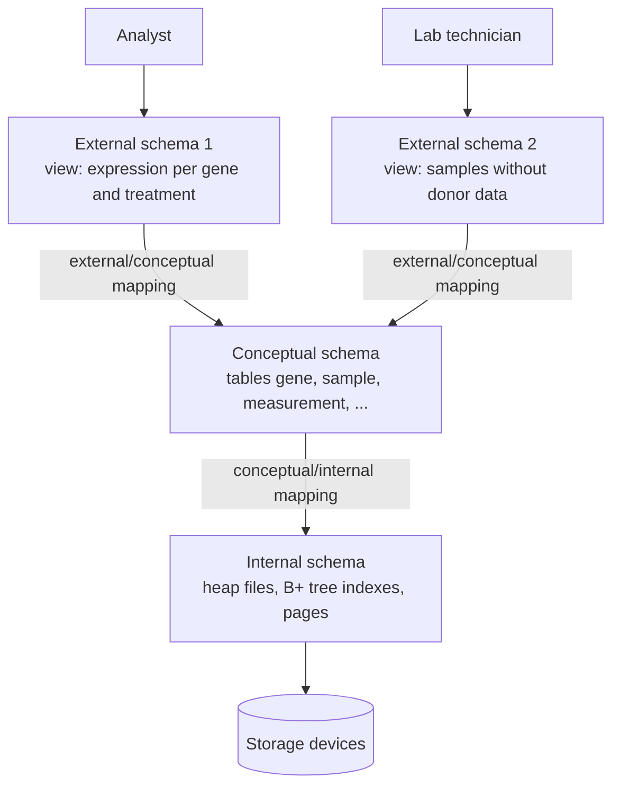
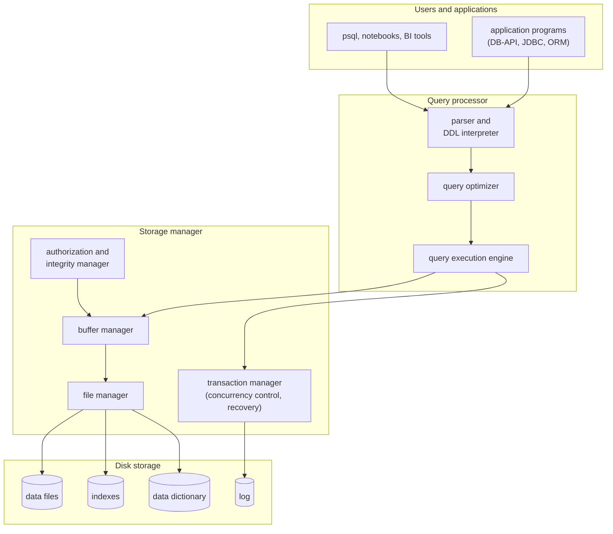

Almost every program that keeps information beyond a single run, from a laboratory information system to a web shop, stores it in a database and lets a database management system look after it. This chapter explains what such a system provides: a precise description of the data (the schema), a high-level language for asking questions about it, efficient storage and retrieval of data far larger than main memory, and the guarantee that data stay correct when many users work at once and when the machine crashes. It introduces the vocabulary of the course and the architecture of a database system, whose components the later chapters treat one by one: the relational model and SQL ([4.13.2](/4.13.2)–[4.13.4](/4.13.4)), database design ([4.13.5](/4.13.5), [4.13.6](/4.13.6)), storage, indexing and query processing ([4.13.7](/4.13.7)–[4.13.9](/4.13.9)), transactions ([4.13.10](/4.13.10), [4.13.11](/4.13.11)) and, finally, how the pieces fit together in a small relational system of one's own ([4.13.12](/4.13.12)). PostgreSQL serves as the reference system throughout.

## 1.1. Why Database Systems

### 1.1.1. Databases and Database Management Systems

**Definition 1.1.1 (Database and DBMS)** A **database** is a collection of interrelated data, stored persistently, that describes some part of the world and serves the applications of an organization. A **database management system** (DBMS) is software that defines, stores and maintains databases, and gives many users and programs controlled, concurrent and reliable access to them. A DBMS together with its databases and the applications that use them is called a **database system**.

Examples of DBMSs are PostgreSQL, MySQL, SQLite, Oracle Database, Microsoft SQL Server and DuckDB. The data themselves can be anything with structure: the samples and measurements of an experiment, the accounts and transfers of a bank, the courses and enrollments of a university.

### 1.1.2. The File-Processing Approach and Its Problems

The alternative to a DBMS is to keep data in ordinary **files** ([4.11.7](/4.11.7)) and to write a program for every task. A laboratory might keep a spreadsheet of samples, one CSV file of expression values per sequencing run, and a script for each analysis. This works for one person and a few files, and fails as the data, the programs and the number of users grow. The classical problems are:

| Problem | Example |
|---|---|
| redundancy and inconsistency | the tissue of a sample is copied into every results file; a correction in one copy leaves the others wrong |
| difficulty of access | every new question ("all treated lung samples with high CDKN1A") requires a new program |
| data isolation | data are scattered over files with different formats and identifiers (gene symbols in one file, Ensembl identifiers in another) |
| integrity | rules such as "an expression value is non-negative" or "every measurement refers to an existing sample" are buried in program code and are easily bypassed |
| atomicity | a crash in the middle of an update (moving a sample to another project, which changes two files) leaves the data half changed |
| concurrent access | two people editing the same file at once overwrite each other's changes |
| security | a file is readable as a whole or not at all; one cannot give a collaborator access to some columns or rows only |

A DBMS addresses each of these centrally rather than in every program: data are described once by a schema (§1.2), queried in a declarative language (§1.4), checked against integrity constraints ([4.13.6](/4.13.6)), and updated inside transactions that are atomic, isolated from each other and durable after a crash ([4.13.10](/4.13.10)). The price is an extra layer of software and the discipline of designing the schema; for a single analysis of a single file, a script remains the simpler tool. Analytical engines such as DuckDB ([4.13.12](/4.13.12)) narrow the gap by running SQL directly over CSV and Parquet files.

## 1.2. Data Models

### 1.2.1. What a Data Model Is

**Definition 1.2.1 (Data Model)** A **data model** is a collection of conceptual tools for describing data: the structures in which data are organized, the operations on them, and the constraints they must satisfy.

The **data models** in use are:

- the relational model ([4.13.2](/4.13.2)), which represents all data as tables (relations) of rows and columns; it underlies SQL and the large majority of **database systems**, and is the subject of this course;
- the entity–relationship model ([4.13.5](/4.13.5)), a model for **database** design that describes the world as entities and the relationships among them, and is translated into relational tables;
- *semi-structured* models, in which individual items of the same type may have different attributes; JSON documents are the main example, stored by document databases such as MongoDB and in the `jsonb` columns of PostgreSQL;
- the *object-based* model, which adds objects, inheritance and methods; it survives as the object-relational features of SQL and in the object–relational mappers of programming languages ([4.13.4](/4.13.4#sec-4.9));
- *graph* models (property graphs, RDF), which treat vertices and edges as first-class data, as in Neo4j and in the SQL/PGQ part of SQL:2023;
- the older *network* and *hierarchical* models (§1.7), in which records were linked by explicit pointers.

### 1.2.2. Schemas and Instances

**Definition 1.2.2 (Schema and Instance)** The **schema** of a database is its overall design: which kinds of data it holds, how they are structured and what constraints they obey. An **instance** of the database is the collection of data stored in it at a particular moment.

The analogy with programming is close: the **schema** corresponds to the type declarations of a program, and an instance to the values of its variables at a moment of execution. The schema changes rarely and deliberately (by data-definition statements, §1.4); the instance changes with every insertion, update and deletion. In the running example of this course ([4.13.3](/4.13.3#sec-3.2.3)) the schema says that a sample has an identifier, a tissue, a treatment, a donor age and a collection date, and that a measurement refers to one sample and one gene; an instance consists of six particular samples, eight genes and 46 measurements.

## 1.3. Levels of Abstraction and Data Independence

### 1.3.1. The Three-Schema Architecture

A **database** is described at several levels of abstraction, so that each user sees only what concerns them and the physical details can change without disturbing the users. The ANSI/SPARC report of 1975 proposed three levels, and they remain the standard way of thinking about a **DBMS**:

**Definition 1.3.1 (Three-Schema Architecture)** The **three-schema architecture** describes a database at three levels.

- The **internal schema** (physical level) describes how the data are actually stored: files, pages, record formats, indexes, compression.
- The **conceptual schema** (logical level) describes what data are stored and the relationships among them, for the whole database, in terms of the **data model** (for a relational database: the tables, columns, keys and constraints).
- Each **external schema** (view level) describes the part of the database relevant to one group of users, possibly restructured or computed; a database has many external schemas.

The DBMS maintains *mappings* between the levels: from each **external schema** to the **conceptual schema**, and from the conceptual to the **internal schema**. In SQL, external schemas are views ([4.13.4](/4.13.4#sec-4.6)), the conceptual schema is the set of `CREATE TABLE` statements, and the internal schema consists of the storage structures and indexes chosen by the system and the administrator ([4.13.7](/4.13.7), [4.13.8](/4.13.8)).

### 1.3.2. Data Independence

**Definition 1.3.2 (Data Independence)** **Data independence** is the ability to change the schema at one level without having to change the schema at the next higher level or the application programs. **Physical data independence** is the ability to change the internal schema without changing the conceptual schema; **logical data independence** is the ability to change the conceptual schema without changing the external schemas.

**Physical data independence** is achieved almost completely by relational systems: an index can be added, a table reorganized or moved to another disk, and every query keeps its meaning (it may only become faster or slower). This is the main reason why queries are written declaratively: a query that states *what* it wants does not depend on *how* the data are stored. **Logical data independence** is harder, because a change in the conceptual **schema** can remove information that a view needs; it is achieved for changes such as adding a column or splitting a table, provided a view reconstructs the old table for the old programs.

## 1.4. Database Languages

A **DBMS** offers two kinds of language, which in SQL are parts of one language ([4.13.3](/4.13.3#sec-3.1.2)).

**Definition 1.4.1 (DDL and DML)** A **data-definition language** (DDL) specifies the database schema: the structures, the integrity constraints and the access rights. A **data-manipulation language** (DML) expresses the retrieval, insertion, deletion and modification of data. The part of a DML that retrieves data is a **query language**.

A **DML** is *procedural* if the user specifies how to obtain the result (which records to read and in what order), and *declarative* (nonprocedural) if the user specifies only which data are wanted. The relational algebra ([4.13.2](/4.13.2#sec-2.3)) is procedural in this sense, the relational calculus and SQL are declarative. Declarative languages are easier to use and give the system the freedom to choose an efficient evaluation, which the query optimizer ([4.13.9](/4.13.9)) exploits.

The output of the **DDL** is itself data, kept by the DBMS:

**Definition 1.4.2 (Data Dictionary)** The **data dictionary** (or **system catalog**) is the part of the database that stores **metadata**, data about the data: the schemas of all tables, the columns and their types, the constraints, views, indexes, users and access rights, and the statistics used by the optimizer.

The DBMS consults the catalog for every statement (to check that the tables and columns exist, that the user may access them and that an update satisfies the constraints) and updates it with every DDL statement. In relational systems the catalog is stored as tables and can be queried with SQL, through the standard `information_schema` ([4.13.3](/4.13.3#sec-3.2.4)) or system-specific tables such as PostgreSQL's `pg_class`.

## 1.5. Architecture of a Database System

### 1.5.1. Components

A **DBMS** is divided into components with clearly separated tasks. The classical division (Silberschatz et al.; Hellerstein, Stonebraker and Hamilton, *Architecture of a Database System*, 2007) is:

- The *query processor* turns a statement into results. The *parser* checks the syntax and resolves the names against the catalog; the *optimizer* chooses an efficient evaluation plan among the many equivalent ones; the *execution engine* runs the plan, calling the storage manager for the data ([4.13.9](/4.13.9)).
- The *storage manager* is the interface between the logical data and the files on disk. Its file manager allocates space and organizes records into pages ([4.13.7](/4.13.7)); its buffer manager decides which pages are kept in main memory, which is the key to performance because a **database** is usually much larger than memory; the *authorization and integrity manager* checks access rights and constraints. Indexes ([4.13.8](/4.13.8)) give fast access to records with given values.
- The *transaction manager*, often counted as part of the storage manager, ensures that the database stays consistent despite concurrent access and failures. Its concurrency-control manager coordinates simultaneous transactions ([4.13.11](/4.13.11)); its recovery manager writes a log and uses it to restore a consistent state after a crash ([4.13.10](/4.13.10)).

Much of this repeats what an **operating system** does: a buffer manager is a **page cache** with a **replacement policy** ([4.11.4](/4.11.4)), and a recovery log is the write-ahead journal of a file system ([4.11.7](/4.11.7#sec-7.4.3)). A DBMS nevertheless implements its own versions, because it knows the access patterns of its queries and must control exactly when a page reaches the disk.

### 1.5.2. Deployment Architectures

The same components can be arranged in several ways:

| Architecture | How it runs | Examples |
|---|---|---|
| embedded | the DBMS is a library linked into the application; the database is a file | SQLite, DuckDB, RocksDB |
| client–server | a server process owns the database; clients connect over a network protocol | PostgreSQL (one server process per connection), MySQL (one thread per connection) |
| parallel | one database spread over many cores, disks or machines in one data center, to answer large queries faster | Greenplum, Amazon Redshift, the parallel query execution of PostgreSQL |
| distributed | data stored at several sites, often replicated across data centers, with transactions spanning sites | Google Spanner, CockroachDB, Cassandra |

Application programs are usually organized in three tiers: a client (browser or app) talks to an application server, which holds the business logic and is the only component that talks to the database. Accessing databases from programs is the topic of [4.13.4](/4.13.4#sec-4.9); the design of such multi-tier applications belongs to software engineering ([4.14](/4.14)).

## 1.6. Database Users and Administrators

People interact with a **database system** in different roles:

- *end users* use applications (a laboratory information system, a web form) without seeing the **database**;
- *analysts* and scientists write queries directly, in SQL or through data-frame libraries;
- *application programmers* write the programs that access the database, usually through an interface library;
- the database administrator (DBA) has central control over the database: defines and changes the **schema** and the storage structures, grants access rights, monitors performance, plans backups, and upgrades the software.

**Definition 1.6.1 (Database Administrator)** A **database administrator** is a person or team with central control over the data and the programs that access them in an organization's database system, responsible in particular for the schema, the physical organization, authorization, backups and recovery, and routine maintenance.

In cloud services much of the **DBA**'s routine work (installation, backups, replication, upgrades) is automated by the provider, but schema design and query tuning remain with the users.

## 1.7. History and the Current Landscape

### 1.7.1. From Navigational Databases to the Relational Model

The first **database systems** of the 1960s were *navigational*. IBM's IMS (1966, built for the Apollo program) organized records in hierarchies, and the CODASYL network model (1969) linked records by pointers into graphs. A program retrieved data by following these links one record at a time, so its logic depended on the physical structure: there was no **data independence**.

In 1970 Edgar F. Codd proposed the relational model: data as mathematical relations, queried by set-oriented operations, with all storage details hidden. Two research prototypes showed in the 1970s that it could be implemented efficiently: IBM's System R, which introduced SQL and cost-based query optimization, and Ingres at Berkeley. Commercial relational systems followed around 1980 (Oracle, IBM DB2), SQL was standardized in 1986, and by the 1990s relational systems dominated. The Postgres project at Berkeley (1986) extended the relational model with user-defined types and became PostgreSQL in 1996; MySQL (1995) and SQLite (2000) followed as open-source and embedded systems.

### 1.7.2. Transaction Processing and Analytics

Two workloads with very different requirements developed side by side:

**Definition 1.7.1 (OLTP and OLAP)** **Online transaction processing** (OLTP) is the workload of many short transactions that read and update a few records each, such as recording a sample or a bank transfer. **Online analytical processing** (OLAP) is the workload of complex queries that read and aggregate large parts of the data, such as computing the mean expression of every gene per tissue over millions of measurements.

**OLTP** systems are optimized for low latency and high concurrency, store each row together and rely on indexes. For analytics, data are copied into a *data warehouse*, a **database** that integrates data from many sources for analysis, where column-oriented storage ([4.13.7](/4.13.7)) and compression allow a query to read only the columns it needs. Today's analytical systems include cloud warehouses (Snowflake, Google BigQuery, Amazon Redshift), open table formats over files (Parquet with Apache Iceberg or Delta Lake), and the embedded engine DuckDB, which brings column-oriented analytics into a Python or R session.

### 1.7.3. NoSQL, NewSQL and Today

Web-scale applications around 2005–2010 needed more throughput and availability than a single relational server provided, and many companies built simpler systems that scale across thousands of machines by giving up **joins**, **schemas** or strong consistency. These *NoSQL* ("not only SQL") systems include key–value stores (Amazon Dynamo, Redis), wide-column stores (Google Bigtable, Apache Cassandra, HBase), document databases (MongoDB) and graph databases (Neo4j). Many of them later added SQL-like languages, schemas and transactions again. *NewSQL* and distributed SQL systems (Google Spanner, CockroachDB, TiDB) provide the relational model with ACID transactions while scaling horizontally.

The relational model has absorbed most of these ideas rather than being replaced. PostgreSQL stores and indexes JSON documents, full text and, through extensions, geographic data (PostGIS) and vectors for similarity search (pgvector); SQL:2023 added property-graph queries. Relational systems remain the default choice for structured data, and the components of this course (relational algebra, SQL, normalization, **B+ trees**, query optimization, **write-ahead logging**, locking and multiversion concurrency control) appear in essentially every one of them, as [4.13.12](/4.13.12) surveys.

## Summary

- A **DBMS** manages persistent, shared data: it provides a **schema**, a declarative **query language**, efficient storage, integrity, security, concurrency control and recovery, which file-based programs would each have to implement.
- A data model gives structures, operations and constraints; the relational model dominates, alongside the E-R model for design and semi-structured, graph and key–value models.
- The schema is the design, an instance the data at a moment. The three-schema architecture separates external, conceptual and internal schemas; physical and logical data independence let lower levels change without affecting higher ones.
- DDL defines schemas, DML manipulates data; the definitions are stored as metadata in the data dictionary (system catalog).
- A DBMS consists of a query processor (parser, optimizer, execution engine), a storage manager (file, buffer, authorization and integrity managers) and a transaction manager (concurrency control and recovery); it runs embedded, client–server, parallel or distributed.
- History: navigational databases, Codd's relational model (1970), System R and SQL, OLTP and OLAP, NoSQL and NewSQL; today relational systems incorporate JSON, full text, vectors and graphs.
