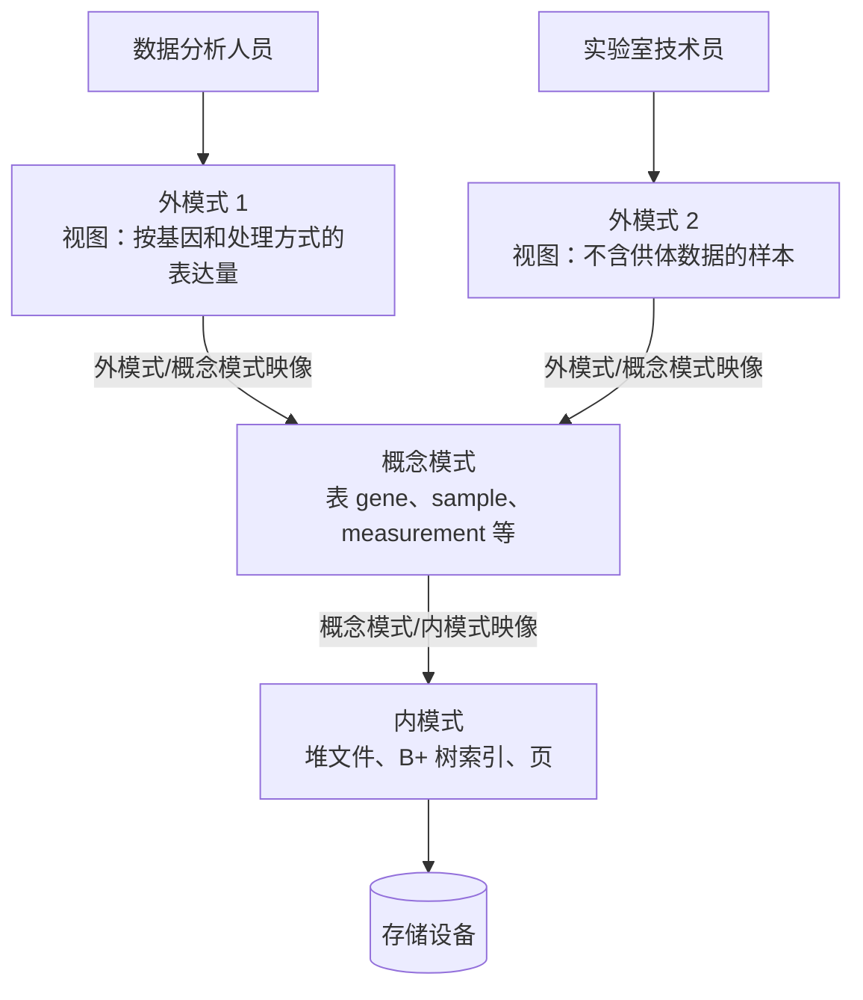
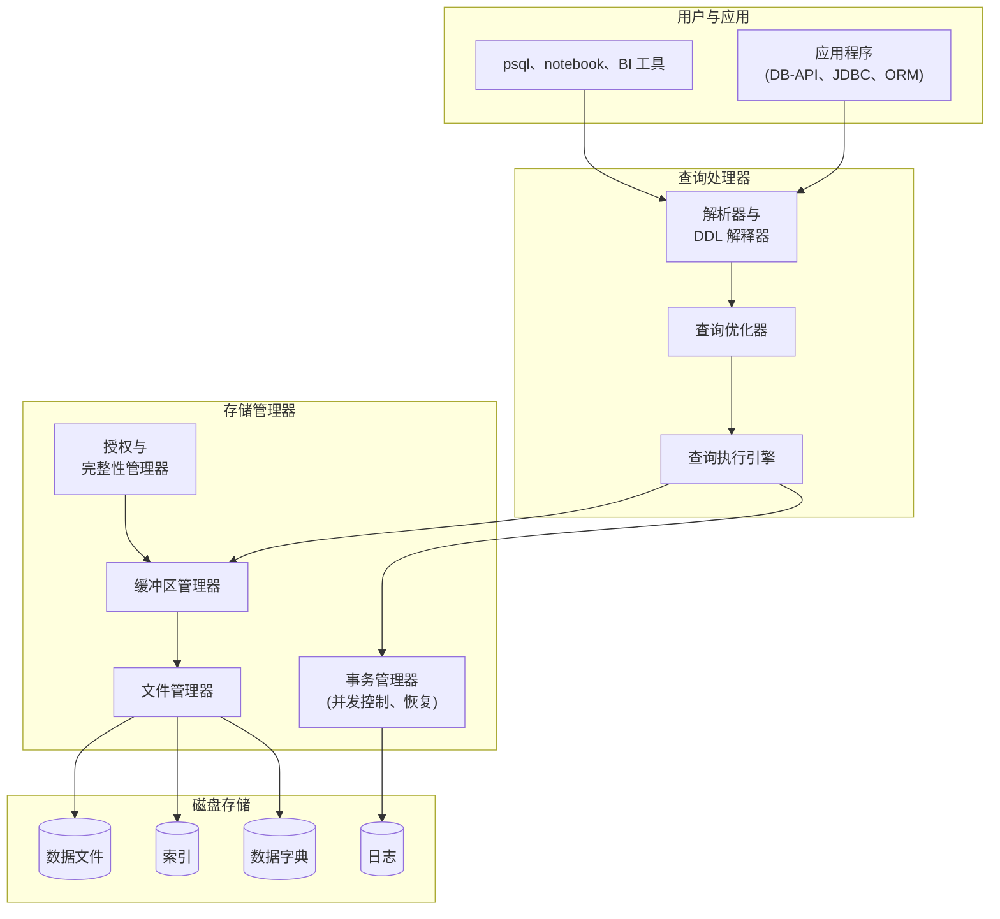

从实验室信息系统到网上商店，几乎每个需要在程序运行结束后继续保存信息的程序，都把数据存进数据库，交给数据库管理系统来管理。本章说明这样的系统提供什么：对数据的精确描述（模式）、用来提问的高级语言、对远大于内存的数据的高效存取，以及在多用户同时工作、机器崩溃时数据仍然正确的保证。本章还引入本课程的术语和数据库系统的体系结构，其各个组成部分将在后续章节逐一讨论：关系模型与 SQL（[4.13.2](/4.13.2)–[4.13.4](/4.13.4)）、数据库设计（[4.13.5](/4.13.5)、[4.13.6](/4.13.6)）、存储、索引与查询处理（[4.13.7](/4.13.7)–[4.13.9](/4.13.9)）、事务（[4.13.10](/4.13.10)、[4.13.11](/4.13.11)），最后是这些部分如何在一个自己动手实现的小型关系系统中组合起来（[4.13.12](/4.13.12)）。全课程以 PostgreSQL 作为参考系统。

## 1.1. 为什么需要数据库系统

### 1.1.1. 数据库与数据库管理系统

**定义 1.1.1（数据库与 DBMS）** **数据库**是一组相互关联、持久存储的数据，它描述现实世界的某一部分，并为一个组织的应用服务。**数据库管理系统**（DBMS）是定义、存储和维护数据库的软件，并为多个用户和程序提供受控的、并发的、可靠的访问。DBMS 连同它管理的数据库以及使用数据库的应用程序，合称**数据库系统**。

DBMS 的例子有 PostgreSQL、MySQL、SQLite、Oracle Database、Microsoft SQL Server 和 DuckDB。数据本身可以是任何有结构的东西：实验的样本与测量值、银行的账户与转账、大学的课程与选课记录。

### 1.1.2. 文件处理方式及其问题

DBMS 的替代方案是把数据存放在普通**文件**（[4.11.7](/4.11.7)）中，并为每项任务编写一个程序。实验室可能用一个电子表格记录样本，每次测序运行用一个 CSV 文件存放表达量，再为每种分析写一个脚本。这种做法对一个人、少量文件尚可，随着数据、程序和用户的增多就会失效。典型的问题如下：

| 问题 | 例子 |
|---|---|
| 冗余与不一致 | 样本所属的组织被复制到每个结果文件中；在一个副本里改正后，其余副本仍然是错的 |
| 存取困难 | 每提出一个新问题（“所有高表达 CDKN1A 的经处理肺样本”）都要写一个新程序 |
| 数据孤立 | 数据分散在格式和标识符各不相同的文件中（一个文件用基因符号，另一个用 Ensembl 标识符） |
| 完整性 | “表达量非负”“每个测量值都指向一个已有样本”这类规则埋在程序代码里，很容易被绕过 |
| 原子性 | 更新到一半时崩溃（把样本移到另一个项目，要改两个文件）会使数据只改了一半 |
| 并发访问 | 两个人同时编辑同一个文件，会互相覆盖对方的修改 |
| 安全性 | 文件要么整个可读，要么完全不可读；无法只向合作者开放某些列或某些行 |

DBMS 集中解决这些问题，而不是在每个程序里各自处理：数据由模式一次性描述（§1.2），用声明式语言查询（§1.4），按完整性约束检查（[4.13.6](/4.13.6)），并在事务中更新，事务是原子的、彼此隔离的，且在崩溃后仍然持久（[4.13.10](/4.13.10)）。代价是多了一层软件，并需要认真设计模式；对于只分析一个文件的单次分析，脚本仍是更简单的工具。DuckDB（[4.13.12](/4.13.12)）这类分析型引擎可以直接在 CSV 和 Parquet 文件上运行 SQL，缩小了两者的差距。

## 1.2. 数据模型

### 1.2.1. 什么是数据模型

**定义 1.2.1（数据模型）** **数据模型**是描述数据的一组概念工具：数据的组织结构、对数据的操作，以及数据必须满足的约束。

常用的**数据模型**有：

- 关系模型（[4.13.2](/4.13.2)），把所有数据表示成由行和列构成的表（关系）；它是 SQL 和绝大多数**数据库系统**的基础，也是本课程的主题；
- 实体–联系模型（[4.13.5](/4.13.5)），一种用于**数据库**设计的模型，把世界描述成实体及实体之间的联系，并转换成关系表；
- 半结构化（semi-structured）模型，同一类型的各个数据项可以有不同的属性；JSON 文档是主要的例子，MongoDB 等文档数据库以及 PostgreSQL 的 `jsonb` 列都用它存储；
- 面向对象（object-based）模型，增加了对象、继承和方法；它以 SQL 的对象–关系特性和编程语言的对象–关系映射器（[4.13.4](/4.13.4#sec-4.9)）的形式保留下来；
- 图（graph）模型（属性图、RDF），把顶点和边当作一等数据，如 Neo4j 和 SQL:2023 的 SQL/PGQ 部分；
- 更早的网状（network）与层次（hierarchical）模型（§1.7），记录之间通过显式指针相连。

### 1.2.2. 模式与实例

**定义 1.2.2（模式与实例）** 数据库的**模式**是它的总体设计：存放哪几类数据、数据如何组织、遵循哪些约束。数据库的**实例**是某一时刻存放在其中的数据。

这与编程的类比很贴切：**模式**对应程序中的类型声明，实例对应程序运行到某一时刻时各变量的值。模式很少改变，且是有意为之（通过数据定义语句，§1.4）；实例随每次插入、更新和删除而改变。在本课程的运行示例中（[4.13.3](/4.13.3#sec-3.2.3)），模式规定样本有标识符、组织、处理方式、供体年龄和采集日期，测量值指向一个样本和一个基因；实例则由六个具体的样本、八个基因和 46 个测量值构成。

## 1.3. 抽象层次与数据独立性

### 1.3.1. 三级模式结构

**数据库**在几个抽象层次上描述，使每个用户只看到与自己有关的部分，物理细节也可以改变而不影响用户。1975 年的 ANSI/SPARC 报告提出了三个层次，至今仍是理解 **DBMS** 的标准方式：

**定义 1.3.1（三级模式结构）** **三级模式结构**在三个层次上描述数据库。

- **内模式**（物理层）描述数据实际如何存储：文件、页、记录格式、索引、压缩。
- **概念模式**（逻辑层）借助**数据模型**描述整个数据库存储了什么数据以及数据之间的联系（对关系数据库而言：表、列、码和约束）。
- 每个**外模式**（视图层）描述与某一用户群有关的那部分数据库，可以经过重新组织或计算；一个数据库有多个外模式。

DBMS 维护各层之间的*映像*：从每个**外模式**到**概念模式**的映像，以及从概念模式到**内模式**的映像。在 SQL 中，外模式是视图（[4.13.4](/4.13.4#sec-4.6)），概念模式是一组 `CREATE TABLE` 语句，内模式则是系统和管理员选定的存储结构与索引（[4.13.7](/4.13.7)、[4.13.8](/4.13.8)）。

### 1.3.2. 数据独立性

**定义 1.3.2（数据独立性）** **数据独立性**是指改变某一层的模式而不必改变上一层的模式或应用程序的能力。**物理数据独立性**是改变内模式而不改变概念模式的能力；**逻辑数据独立性**是改变概念模式而不改变外模式的能力。

关系系统几乎完全做到了**物理数据独立性**：可以添加索引，重新组织表或把表移到另一块磁盘，每个查询的含义都不变（至多变快或变慢）。这正是查询用声明方式书写的主要原因：说明*要什么*的查询不依赖数据*如何*存储。**逻辑数据独立性**较难，因为概念**模式**的改变可能删去视图所需的信息；对于添加列、拆分表这类改变，只要用视图为旧程序重建出旧表，就可以做到。

## 1.4. 数据库语言

**DBMS** 提供两类语言，在 SQL 中它们是同一种语言的两个部分（[4.13.3](/4.13.3#sec-3.1.2)）。

**定义 1.4.1（DDL 与 DML）** **数据定义语言**（DDL）用于说明数据库模式：结构、完整性约束和访问权限。**数据操纵语言**（DML）用于表达数据的检索、插入、删除和修改。DML 中检索数据的部分是**查询语言**。

如果用户要指明如何得到结果（读哪些记录、按什么顺序），**DML** 就是*过程式*的；如果用户只指明需要哪些数据，就是*声明式*（非过程式）的。在这个意义上，关系代数（[4.13.2](/4.13.2#sec-2.3)）是过程式的，关系演算和 SQL 是声明式的。声明式语言更易使用，并让系统可以自由选择高效的求值方式，查询优化器（[4.13.9](/4.13.9)）正是利用了这一点。

**DDL** 的输出本身也是数据，由 DBMS 保存：

**定义 1.4.2（数据字典）** **数据字典**（或**系统目录**）是数据库中存放**元数据**，即关于数据的数据的部分：所有表的模式、列及其类型、约束、视图、索引、用户和访问权限，以及优化器使用的统计信息。

DBMS 对每条语句都要查阅目录（检查表和列是否存在、用户是否有权访问、更新是否满足约束），并在每条 DDL 语句执行时更新它。在关系系统中，目录以表的形式存储，可以用 SQL 查询，途径是标准的 `information_schema`（[4.13.3](/4.13.3#sec-3.2.4)），或 PostgreSQL 的 `pg_class` 之类系统专有的表。

## 1.5. 数据库系统的体系结构

### 1.5.1. 组成部分

**DBMS** 分成任务明确分开的几个组成部分。经典的划分（Silberschatz 等；Hellerstein、Stonebraker 和 Hamilton，*Architecture of a Database System*，2007）如下：

- 查询处理器（query processor）把语句变成结果。解析器检查语法并根据目录解析名字；优化器在众多等价的计划中选出高效的求值计划；执行引擎运行该计划，并调用存储管理器获取数据（[4.13.9](/4.13.9)）。
- 存储管理器（storage manager）是逻辑数据与磁盘文件之间的接口。它的文件管理器分配空间，并把记录组织到页中（[4.13.7](/4.13.7)）；它的缓冲区管理器决定哪些页保留在内存中，这是性能的关键，因为**数据库**通常远大于内存；授权与完整性管理器检查访问权限和约束。索引（[4.13.8](/4.13.8)）使具有给定值的记录可以被快速访问。
- 事务管理器（transaction manager）常被算作存储管理器的一部分，负责保证在并发访问和故障下数据库仍然一致。它的并发控制管理器协调同时运行的事务（[4.13.11](/4.13.11)）；它的恢复管理器写日志，并在崩溃后用日志恢复一致状态（[4.13.10](/4.13.10)）。

这在很大程度上重复了**操作系统**所做的事：缓冲区管理器是带有**页面置换算法**的**页缓存**（[4.11.4](/4.11.4)），恢复日志则是文件系统的预写日志（[4.11.7](/4.11.7#sec-7.4.3)）。DBMS 仍然要自己实现这些功能，因为它了解查询的访问模式，并且必须精确控制页何时写到磁盘。

### 1.5.2. 部署架构

同样的组成部分可以有几种组织方式：

| 架构 | 运行方式 | 例子 |
|---|---|---|
| 嵌入式 | DBMS 是链接进应用程序的库；数据库是一个文件 | SQLite、DuckDB、RocksDB |
| 客户端–服务器 | 由一个服务器进程拥有数据库；客户端通过网络协议连接 | PostgreSQL（每个连接一个服务器进程）、MySQL（每个连接一个线程） |
| 并行 | 一个数据库分布在同一数据中心的多个核、磁盘或机器上，以更快地回答大型查询 | Greenplum、Amazon Redshift、PostgreSQL 的并行查询执行 |
| 分布式 | 数据存放在多个站点，常跨数据中心复制，事务可以跨站点 | Google Spanner、CockroachDB、Cassandra |

应用程序通常分为三层：客户端（浏览器或 app）与应用服务器通信，应用服务器承载业务逻辑，并且是唯一与数据库通信的组件。从程序访问数据库是 [4.13.4](/4.13.4#sec-4.9) 的主题；这类多层应用的设计属于软件工程（[4.14](/4.14)）。

## 1.6. 数据库用户与管理员

人们以不同的角色与**数据库系统**交互：

- 最终用户使用应用程序（实验室信息系统、网页表单），看不到**数据库**；
- 分析人员和科研人员直接用 SQL 或通过数据框库编写查询；
- 应用程序员编写访问数据库的程序，通常通过接口库；
- 数据库管理员（DBA）对数据库拥有集中控制权：定义和修改**模式**与存储结构，授予访问权限，监控性能，规划备份，升级软件。

**定义 1.6.1（数据库管理员）** **数据库管理员**是在一个组织的数据库系统中，对数据及访问数据的程序拥有集中控制权的个人或团队，尤其负责模式、物理组织、授权、备份与恢复以及日常维护。

在云服务中，**DBA** 的许多日常工作（安装、备份、复制、升级）由服务提供商自动完成，但模式设计和查询调优仍由用户负责。

## 1.7. 历史与当前格局

### 1.7.1. 从导航式数据库到关系模型

20 世纪 60 年代的第一批**数据库系统**是*导航式*的。IBM 的 IMS（1966，为阿波罗计划而建）把记录组织成层次结构，CODASYL 网状模型（1969）用指针把记录连成图。程序沿着这些链接一次一条记录地检索数据，因此程序逻辑依赖于物理结构：没有**数据独立性**。

1970 年，Edgar F. Codd 提出了关系模型：数据是数学意义上的关系，用面向集合的运算查询，所有存储细节都被隐藏。20 世纪 70 年代的两个研究原型证明它可以高效实现：IBM 的 System R 引入了 SQL 和基于代价的查询优化，以及 Berkeley 的 Ingres。商用关系系统在 1980 年前后出现（Oracle、IBM DB2），SQL 于 1986 年标准化，到 20 世纪 90 年代关系系统占据主导地位。Berkeley 的 Postgres 项目（1986）用用户自定义类型扩展了关系模型，并在 1996 年成为 PostgreSQL；MySQL（1995）和 SQLite（2000）则作为开源系统和嵌入式系统相继出现。

### 1.7.2. 事务处理与分析

两种需求截然不同的工作负载并行发展起来：

**定义 1.7.1（OLTP 与 OLAP）** **联机事务处理**（OLTP）是由大量短事务构成的工作负载，每个事务读写少数几条记录，例如登记一个样本或一次银行转账。**联机分析处理**（OLAP）是由复杂查询构成的工作负载，这些查询读取并汇总数据的大部分，例如在数百万个测量值上计算每个基因在各组织中的平均表达量。

**OLTP** 系统针对低延迟和高并发优化，把每一行的数据存放在一起，并依赖索引。对于分析，数据被复制到数据仓库（data warehouse）中，这是一个整合了多个来源数据以供分析的**数据库**，其中的列式存储（[4.13.7](/4.13.7)）和压缩使查询只需读取所需的列。今天的分析型系统包括云数据仓库（Snowflake、Google BigQuery、Amazon Redshift）、文件之上的开放表格式（Parquet 配合 Apache Iceberg 或 Delta Lake），以及嵌入式引擎 DuckDB，它把列式分析带进了 Python 或 R 会话。

### 1.7.3. NoSQL、NewSQL 与今天

2005–2010 年前后的网络规模应用需要比单个关系服务器更高的吞吐量和可用性，许多公司通过放弃**连接**、**模式**或强一致性，构建了可以扩展到数千台机器的更简单的系统。这些 *NoSQL* 系统（“not only SQL”）包括键值存储（Amazon Dynamo、Redis）、宽列存储（Google Bigtable、Apache Cassandra、HBase）、文档数据库（MongoDB）和图数据库（Neo4j）。其中许多后来又重新加入了类 SQL 语言、模式和事务。*NewSQL* 与分布式 SQL 系统（Google Spanner、CockroachDB、TiDB）在水平扩展的同时提供带 ACID 事务的关系模型。

关系模型吸收了其中的大部分思想，而没有被取代。PostgreSQL 可以存储并索引 JSON 文档和全文，并通过扩展支持地理数据（PostGIS）和用于相似性搜索的向量（pgvector）；SQL:2023 增加了属性图查询。关系系统仍是结构化数据的默认选择，本课程的各个组成部分（关系代数、SQL、规范化、**B+ 树**、查询优化、**预写日志**、封锁与多版本并发控制）几乎出现在每一个关系系统中，[4.13.12](/4.13.12) 对此作了概览。

## 小结

- **DBMS** 管理持久的共享数据：它提供**模式**、声明式**查询语言**、高效存储、完整性、安全性、并发控制和恢复，而基于文件的程序则必须各自实现这些功能。
- 数据模型给出结构、操作和约束；关系模型占主导地位，用于设计的 E-R 模型以及半结构化、图和键值模型与它并存。
- 模式是设计，实例是某一时刻的数据。三级模式结构区分外模式、概念模式和内模式；物理数据独立性与逻辑数据独立性使较低层次可以改变而不影响较高层次。
- DDL 定义模式，DML 操纵数据；定义作为元数据存放在数据字典（系统目录）中。
- DBMS 由查询处理器（解析器、优化器、执行引擎）、存储管理器（文件、缓冲区、授权与完整性管理器）和事务管理器（并发控制与恢复）组成；它可以以嵌入式、客户端–服务器、并行或分布式方式运行。
- 历史：导航式数据库、Codd 的关系模型（1970）、System R 与 SQL、OLTP 与 OLAP、NoSQL 与 NewSQL；今天的关系系统纳入了 JSON、全文、向量和图。
