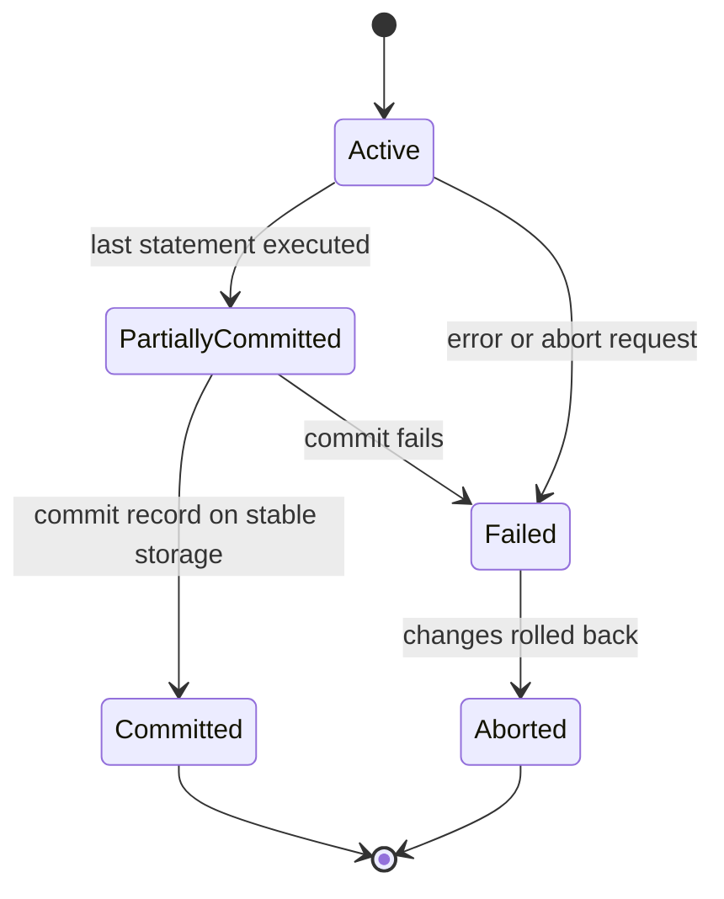
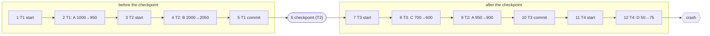

A database is shared by many users and must outlive the failures of the machine it runs on. Both facts threaten its correctness. Two programs that read and update the same rows at the same time can interleave their steps so that one overwrites the other's work, and a crash in the middle of a multi-step update can leave the database half changed. The *transaction* is the abstraction that removes both problems from the application programmer's concerns: a group of operations that the system executes as if it ran alone and either completely or not at all. This chapter defines transactions and their guarantees, develops the theory of schedules that says when an interleaved execution is as good as a serial one, and then treats the half of the problem concerned with failures: logging and recovery. The other half, the protocols that produce only good interleavings, is the subject of [4.13.11](/4.13.11). The SQL statements that delimit transactions appeared in [4.13.4](/4.13.4#sec-4.7); the buffer pool whose write-back policy recovery must control is that of [4.13.7](/4.13.7#sec-7.2). The same ideas appear in file systems, where **journaling** protects metadata against crashes ([4.11.7](/4.11.7#sec-7.4)); databases apply them to arbitrary user data with stronger guarantees.

## 10.1. Transactions

### 10.1.1. The Concept and the ACID Properties

For the theory we abstract a database as a set of named *data items* $A, B, \dots$ (a value, a row or a page) and a transaction as a sequence of two kinds of operations: $\operatorname{read}(X)$ copies item $X$ into a local variable of the transaction, and $\operatorname{write}(X)$ copies a local value back into the database. Computations on local variables are invisible to the system.

**Definition 10.1.1 (Transaction)** A **transaction** is a unit of program execution that accesses and possibly updates data items, delimited by a begin operation and ending either with a **commit**, which makes its effects permanent, or with an **abort** (rollback), which undoes them.

**Definition 10.1.2 (ACID)** A DBMS guarantees for each transaction:

1. **Atomicity**: either all operations of the transaction are reflected in the database or none are.
2. **Consistency**: executed alone on a consistent database (one that satisfies the integrity constraints and the application's invariants), the transaction leaves the database consistent.
3. **Isolation**: although transactions may run concurrently, each transaction is unaware of the others; for every pair $T_i, T_j$ it appears to $T_i$ that $T_j$ finished before $T_i$ started or started after $T_i$ finished.
4. **Durability**: once a transaction has committed, its changes persist, even if the system fails afterwards.

Consistency is largely the responsibility of the programmer, who writes transactions that preserve the invariants, assisted by the integrity constraints the DBMS checks ([4.13.6](/4.13.6)). Atomicity and durability are provided by the *recovery system* (§10.4–§10.7), isolation by *concurrency control* ([4.13.11](/4.13.11)).

**Example 10.1.1** A laboratory re-processes sample `S03` and replaces its measurements: the transaction deletes the old rows of `measurement` for `S03`, inserts the new ones, and updates a processing date. Without atomicity, a crash after the deletion leaves a sample without data; without isolation, a concurrent query computing the mean expression per tissue may see the sample with no rows, with some new rows, or with both old and new rows; without durability, a report already sent to collaborators may refer to measurements that disappear after a restart. In abstract form the transaction is $\operatorname{read}(X)$, $\operatorname{write}(X)$, $\operatorname{read}(Y)$, $\operatorname{write}(Y)$ on two data items.

### 10.1.2. Transaction States



A transaction is *active* while it executes, *partially committed* after its last statement, *committed* once the system has made its effects durable, *failed* when it can no longer proceed (an error, a violated constraint, a deadlock, or an explicit `ROLLBACK`), and *aborted* after its effects have been undone. An aborted transaction can be restarted as a new transaction if the failure was not caused by its own logic, as after a deadlock. External actions that cannot be undone, such as printing a result or sending a message, should be performed only after commit.

## 10.2. Schedules and Serializability

### 10.2.1. Schedules

**Definition 10.2.1 (Schedule)** A **schedule** of a set of transactions is a sequence of all their operations (including commit and abort) that preserves the order of the operations within each transaction. A schedule is **serial** if the operations of each transaction are consecutive, that is, if the transactions run one after another.

A serial schedule of consistent transactions always preserves consistency, since each transaction starts from a consistent state. Running transactions concurrently is nevertheless essential: while one waits for a disk read or for the client, others can use the CPU and the other disks, which raises throughput and keeps short transactions from waiting behind long ones. The question is which interleavings are acceptable.

Below, $R_i(X)$ and $W_i(X)$ denote $\operatorname{read}(X)$ and $\operatorname{write}(X)$ by transaction $T_i$. Consider $T_1$, which moves 50 units from $A$ to $B$, and $T_2$, which adds 10% interest to $A$.

| Step | $T_1$ | $T_2$ |
|---|---|---|
| 1 | $R_1(A)$ | |
| 2 | | $R_2(A)$ |
| 3 | $A := A - 50$; $W_1(A)$ | |
| 4 | $R_1(B)$ | |
| 5 | | $A := 1.1 A$; $W_2(A)$ |
| 6 | $B := B + 50$; $W_1(B)$ | |

With $A = 1000$ and $B = 2000$ initially, the two serial schedules end with $(A, B) = (1045, 2050)$ ($T_1$ first) or $(1050, 2050)$ ($T_2$ first). This interleaving ends with $A = 1100$, $B = 2050$: the write of $T_2$ is based on a value of $A$ read before $T_1$'s write, and $T_1$'s withdrawal is lost. This is the *lost update* anomaly, and the schedule is incorrect because its result equals that of no serial schedule.

**Definition 10.2.2 (Serializable Schedule)** A schedule is **serializable** if its effect on every database state is the same as that of some serial schedule of the same transactions.

Serializability in this semantic sense depends on what the transactions compute and cannot be decided from the sequence of reads and writes alone. The theory therefore uses a sufficient condition that depends only on the order of conflicting operations.

### 10.2.2. Conflict Serializability

**Definition 10.2.3 (Conflict)** Two operations of a schedule **conflict** if they belong to different transactions, access the same data item, and at least one of them is a write.

The pairs $R_i(X), W_j(X)$ and $W_i(X), W_j(X)$ conflict; $R_i(X), R_j(X)$ and operations on different items do not. Swapping two adjacent non-conflicting operations of different transactions changes neither the value any read returns nor the final value of any item.

**Definition 10.2.4 (Conflict Serializability)** Two schedules of the same transactions are **conflict equivalent** if one can be transformed into the other by a sequence of swaps of adjacent non-conflicting operations; equivalently, if every pair of conflicting operations appears in the same order in both. A schedule is **conflict serializable** if it is conflict equivalent to a serial schedule.

Every conflict serializable schedule is serializable, since conflict equivalent schedules read the same values and write the same final values. The converse fails: some serializable schedules are not conflict serializable (§10.2.4).

### 10.2.3. The Precedence Graph

**Definition 10.2.5 (Precedence Graph)** The **precedence graph** (serialization graph) of a schedule $S$ is the directed graph whose vertices are the transactions of $S$ and which has an edge $T_i \to T_j$ whenever an operation of $T_i$ conflicts with a later operation of $T_j$ in $S$.

An edge $T_i \to T_j$ says that in any conflict equivalent serial schedule, $T_i$ must come before $T_j$.

**Theorem 10.2.1** A schedule is conflict serializable if and only if its precedence graph is acyclic. In that case, every **topological sorting** of the precedence graph gives a conflict equivalent serial schedule.

**Proof** Suppose $S$ is conflict equivalent to a serial schedule $S'$ in which the transactions appear in the order $T_{\pi(1)}, \dots, T_{\pi(n)}$. If $T_i \to T_j$ is an edge, some operation of $T_i$ precedes a conflicting operation of $T_j$ in $S$, hence also in $S'$, so $T_i$ precedes $T_j$ in the serial order. Every edge thus goes forward in a linear order of the vertices, and the graph has no cycle.

Conversely, suppose the graph is acyclic, so it is a **directed acyclic graph** and has a topological order $T_{\pi(1)}, \dots, T_{\pi(n)}$, in which every edge goes from an earlier to a later transaction. Let $S'$ be the serial schedule in this order. Take any pair of conflicting operations $o_i$ of $T_i$ and $o_j$ of $T_j$ with $o_i$ before $o_j$ in $S$. Then $T_i \to T_j$ is an edge, so $T_i$ precedes $T_j$ in the topological order, and $o_i$ precedes $o_j$ in $S'$. All conflicting pairs are therefore in the same order in $S$ and $S'$, and the schedules are conflict equivalent. $\square$

Building the graph takes time quadratic in the length of the schedule (linear per item with an index of the last reads and writes), and cycle detection is linear in its size. The following checker builds the graph and returns a serial order or a cycle.

```python
from graphlib import TopologicalSorter, CycleError


def precedence_graph(schedule):
    """Edges Ti -> Tj for conflicting operations of Ti before Tj."""
    edges = set()
    for i, (ti, op_i, x) in enumerate(schedule):
        for tj, op_j, y in schedule[i + 1:]:
            if ti != tj and x == y and "W" in (op_i, op_j):
                edges.add((ti, tj))
    return edges


def serial_order(schedule):
    graph = {t: set() for t, _, _ in schedule}
    for ti, tj in precedence_graph(schedule):
        graph[tj].add(ti)                  # tj must come after ti
    try:
        return list(TopologicalSorter(graph).static_order())
    except CycleError as e:
        return f"not conflict serializable, cycle {e.args[1]}"


def parse(text):
    """'R1(A) W2(A)' -> [('T1', 'R', 'A'), ('T2', 'W', 'A')]"""
    return [(f"T{s[1]}", s[0], s[3]) for s in text.split()]


schedules = {
    "S1": "R1(A) W1(A) R2(A) W2(A) R1(B) W1(B) R2(B) W2(B)",
    "S2": "R1(A) R2(A) W1(A) W2(A) R1(B) W1(B)",
    "S3": "R1(A) W1(A) R2(A) R3(B) W2(B) W3(C) R1(C)",
    "S4": "R2(A) R1(B) W2(A) R3(A) W1(B) W3(A) R2(B) W2(B)",
}
for name, text in schedules.items():
    s = parse(text)
    print(name, sorted(precedence_graph(s)), "->", serial_order(s))
```

```text
S1 [('T1', 'T2')] -> ['T1', 'T2']
S2 [('T1', 'T2'), ('T2', 'T1')] -> not conflict serializable, cycle ['T1', 'T2', 'T1']
S3 [('T1', 'T2'), ('T3', 'T1'), ('T3', 'T2')] -> ['T3', 'T1', 'T2']
S4 [('T1', 'T2'), ('T2', 'T3')] -> ['T1', 'T2', 'T3']
```

**Example 10.2.1** Schedule $S_2$ is the lost update of §10.2.1 restricted to $A$ and $B$: $R_2(A)$ precedes $W_1(A)$, giving $T_2 \to T_1$, and $W_1(A)$ precedes $W_2(A)$, giving $T_1 \to T_2$. The cycle shows that no serial order is equivalent. In $S_3$, $T_3$ reads $B$ before $T_2$ writes it and writes $C$ before $T_1$ reads it, so $T_3$ must come first, although its first operation occurs after operations of $T_1$ and $T_2$: the equivalent serial order need not be the order in which the transactions started. $S_4$ interleaves all three transactions and is equivalent to $T_1, T_2, T_3$.

### 10.2.4. View Serializability

**Definition 10.2.6 (View Serializability)** Two schedules of the same transactions are **view equivalent** if (1) each transaction reads the initial value of an item in one schedule if and only if it does so in the other, (2) each read reads the value written by the same write in both, and (3) the same transaction performs the final write of each item in both. A schedule is **view serializable** if it is view equivalent to a serial schedule.

Conflict serializability implies view serializability. The schedule $R_1(A), W_2(A), W_1(A), W_3(A)$ is view equivalent to the serial schedule $T_1, T_2, T_3$ (only $T_1$ reads, and it reads the initial value; $T_3$ writes last), but its precedence graph has the cycle $T_1 \to T_2 \to T_1$. The writes of $T_2$ and $T_1$ are *blind writes* (writes without a preceding read of the item by the same transaction) that $T_3$ overwrites. Testing view serializability is NP-complete (Papadimitriou, 1979), and since the additional schedules it admits are rare and of little practical value, concurrency control protocols aim at conflict serializability.

## 10.3. Recoverability

Serializability considers only committed transactions. When a transaction aborts, the system must undo its effects, and the interleaving may make this impossible.

**Definition 10.3.1 (Recoverable, Cascadeless and Strict Schedules)** In a schedule, $T_j$ *reads from* $T_i$ if $T_j$ reads an item $X$ whose last write before the read was performed by $T_i$, and $T_i$ has not aborted before the read. A schedule is

1. **recoverable** if, whenever $T_j$ reads from $T_i$, the commit of $T_i$ precedes the commit of $T_j$;
2. **cascadeless** if, whenever $T_j$ reads an item written by $T_i$, the commit of $T_i$ precedes the read;
3. **strict** if no transaction reads or writes an item written by another transaction until that transaction has committed or aborted.

In the schedule $W_1(A)$, $R_2(A)$, $C_2$, $A_1$ (where $C$ and $A$ stand for commit and abort), $T_2$ committed a result computed from a value of $T_1$ that never officially existed. Since $T_2$ is committed, durability forbids undoing it, and atomicity of $T_1$ cannot be achieved: the schedule is not recoverable. In $W_1(A)$, $R_2(A)$, $W_2(B)$, $A_1$, the abort of $T_1$ forces the abort of $T_2$, which read from it, and possibly of further transactions that read from $T_2$: a *cascading rollback*. Cascadeless schedules avoid cascades by letting transactions read only committed data; strict schedules also forbid overwriting uncommitted data, which is what allows undo by restoring old values (§10.5).

**Proposition 10.3.1** Every strict schedule is cascadeless, and every cascadeless schedule is recoverable.

**Proof** Strictness forbids in particular reading an item written by an uncommitted transaction, which is the cascadeless condition. In a cascadeless schedule, if $T_j$ reads from $T_i$, then $T_i$ committed before the read, hence before the commit of $T_j$, which follows the read. $\square$

The inclusions are strict: $W_1(A), W_2(A), C_1, C_2$ is cascadeless but not strict, and $W_1(A), R_2(A), C_1, C_2$ is recoverable but not cascadeless. The strict two-phase locking protocol of [4.13.11](/4.13.11) produces schedules that are both conflict serializable and strict.

## 10.4. Failures and Storage

### 10.4.1. Failure Classes

| Failure | Example | What is lost | Remedy |
|---|---|---|---|
| Transaction failure | constraint violation, deadlock victim, explicit rollback | the transaction's work | undo that transaction (rollback) |
| System crash | power failure, operating-system or DBMS crash | main memory (buffer pool, in-memory state); persistent storage survives | recovery from the log at restart |
| Media failure | disk failure, corrupted device | part of persistent storage | restore a backup and replay the archived log; replication |

The recovery system assumes *fail-stop* behaviour: a crash halts the system without corrupting persistent storage. Partial writes of a page (a *torn page*) do happen, and systems detect them with page checksums and repair them from a full-page image in the log (PostgreSQL's `full_page_writes`) or from a second copy (InnoDB's doublewrite buffer).

### 10.4.2. Stable Storage and Buffer Policies

**Definition 10.4.1 (Stable Storage)** **Stable storage** is an idealized storage medium whose contents are never lost. It is approximated by writing each block to several independent devices (mirroring, **RAID**, replicas in other machines or data centers) and by completing a write only after the device has confirmed it is persistent (`fsync`, with the device's volatile write cache flushed).

Recovery is shaped by two decisions of the buffer manager.

**Definition 10.4.2 (Steal and Force Policies)** Under a **steal** policy, the buffer manager may write a page modified by an uncommitted transaction to disk (to free its frame); under **no-steal**, such pages stay in memory until the transaction ends. Under a **force** policy, all pages modified by a transaction are written to disk before it commits; under **no-force**, they may be written any time later.

| Policy | Undo needed after a crash? | Redo needed after a crash? | Comment |
|---|---|---|---|
| no-steal, force | no | no | simple, but long transactions need unbounded memory and every commit waits for random writes |
| steal, force | yes | no | |
| no-steal, no-force | no | yes | |
| steal, no-force | yes | yes | best performance; used by almost all systems |

Steal requires the ability to *undo* uncommitted changes found on disk after a crash; no-force requires the ability to *redo* committed changes that never reached the disk. Both are provided by a log.

## 10.5. Log-Based Recovery

### 10.5.1. The Log

**Definition 10.5.1 (Log)** The **log** is a sequence of **log records**, appended in order and stored on stable storage, each identified by its position, the *log sequence number* (LSN). The essential records are:

- $\langle T_i\ \mathrm{start} \rangle$ when $T_i$ begins;
- the *update record* $\langle T_i, X, V_1, V_2 \rangle$ when $T_i$ writes item $X$, changing its value from $V_1$ (the *before-image*, used for undo) to $V_2$ (the *after-image*, used for redo);
- $\langle T_i\ \mathrm{commit} \rangle$ and $\langle T_i\ \mathrm{abort} \rangle$ when $T_i$ ends;
- *redo-only* records $\langle T_i, X, V \rangle$ written while undoing an update of $T_i$ (in ARIES called *compensation log records*), and checkpoint records (§10.5.3).

A transaction is regarded as committed exactly when its commit record has reached stable storage. Log records are appended to an in-memory log buffer and forced to stable storage in batches; one `fsync` of the log can make the commits of many concurrent transactions durable at once, a technique called *group commit*.

**Definition 10.5.2 (Write-Ahead Logging)** A recovery scheme follows **write-ahead logging** (WAL) if

1. before a modified data page is written to stable storage, all log records describing changes to that page have been written to stable storage; and
2. before a transaction commits, all its log records, including the commit record, have been written to stable storage.

The first rule makes steal safe: whatever uncommitted value reaches the disk, its before-image is already in the log. The second makes no-force safe: whatever committed value is missing from the disk, its after-image is in the log. The buffer manager enforces rule 1 by comparing the LSN of the last change to a page (PostgreSQL's `pd_lsn`, [4.13.7](/4.13.7#sec-7.3.3)) with the LSN up to which the log has been flushed before writing the page.

### 10.5.2. Undo, Redo and Rollback

- $\operatorname{redo}(\langle T_i, X, V_1, V_2 \rangle)$ sets $X$ to $V_2$; $\operatorname{undo}$ sets $X$ to $V_1$. Both write *values*, not differences, so applying them twice has the same effect as applying them once: they are idempotent, which matters if the system crashes during recovery.
- A *rollback* of $T_i$ during normal operation scans the log backwards; for each update record $\langle T_i, X, V_1, V_2 \rangle$ it restores $X := V_1$ and logs a redo-only record $\langle T_i, X, V_1 \rangle$; at $\langle T_i\ \mathrm{start} \rangle$ it logs $\langle T_i\ \mathrm{abort} \rangle$. Logging the undo actions turns rollback itself into ordinary history that can be repeated by redo.

### 10.5.3. Checkpoints

Without checkpoints, recovery would have to scan the log from the beginning of time. A simple checkpoint, as in Silberschatz and others, performs the following while no update is in progress: write all log records in memory to stable storage, write all dirty buffer pages to disk, and write the record $\langle \mathrm{checkpoint}\ L \rangle$, where $L$ is the list of transactions active at that moment. After a crash, every update logged before the last checkpoint is already on disk, so redo can start at the checkpoint; only transactions in $L$ or started later can be incomplete. Real systems use *fuzzy checkpoints* that let transactions continue while dirty pages are flushed in the background (§10.6).

### 10.5.4. The Recovery Algorithm

**Algorithm 10.5.1 (Restart Recovery)** After a crash:

1. *Redo phase.* Find the last $\langle \mathrm{checkpoint}\ L \rangle$ record and set the *undo list* to $L$. Scan the log forward from the checkpoint. For every update record and every redo-only record, redo it. For $\langle T_i\ \mathrm{start} \rangle$ add $T_i$ to the undo list; for $\langle T_i\ \mathrm{commit} \rangle$ or $\langle T_i\ \mathrm{abort} \rangle$ remove it.
2. *Undo phase.* Scan the log backward from the end. For every update record $\langle T_i, X, V_1, V_2 \rangle$ with $T_i$ in the undo list, restore $X := V_1$ and log $\langle T_i, X, V_1 \rangle$. At $\langle T_i\ \mathrm{start} \rangle$ for $T_i$ in the undo list, log $\langle T_i\ \mathrm{abort} \rangle$ and remove $T_i$. Stop when the undo list is empty.

The redo phase *repeats history*: it brings the database to the exact state at the time of the crash, including the changes of transactions that will be rolled back; the undo phase then rolls back the incomplete transactions, the *losers*, exactly as a normal rollback would.

**Theorem 10.5.1 (Correctness of WAL Recovery)** Assume that the schedule is strict, that the system follows write-ahead logging and the checkpoint procedure of §10.5.3, and that update records carry before- and after-images. Then after Algorithm 10.5.1 completes, every data item has the value written by the last committed transaction that wrote it (or its initial value if none did); that is, the database reflects exactly the committed transactions (atomicity and durability). This holds whatever subset of the dirty pages had reached the disk before the crash, and also if the system crashes during recovery and recovery is restarted.

**Proof** (sketch) Fix a data item $X$.

*After the redo phase.* Updates logged before the checkpoint were on disk when the checkpoint was taken. After the checkpoint, by WAL rule 1, the disk can contain only values whose update records are in the stable log. The redo phase reapplies, in log order, every update and redo-only record of $X$ after the checkpoint. Since redo sets values, after the last such record $X$ holds that record's after-image regardless of the value found on disk; if there is no such record, the disk value is the value at the checkpoint, which is also the last logged value. So after redo, $X$ has the value of the last logged write of $X$, the value it had in memory at the crash.

*Committed writes are present.* By WAL rule 2, every committed transaction has all its update records in the stable log, so its writes were reapplied in the redo phase in their original order.

*After the undo phase.* By strictness, no transaction writes $X$ while another uncommitted transaction has written it, so at most one loser $T$ has written $X$, and all writes of $X$ that follow $T$'s first write of $X$ in the log are $T$'s own (the loser never committed, so nobody else could write $X$ until the crash). The undo phase visits $T$'s updates of $X$ in reverse order and restores each before-image; the last one restored is the before-image of $T$'s first write of $X$, the value written by the last committed transaction before it (or the initial value). Items not written by any loser are untouched by the undo phase and already have their last committed value. The undo list is correct because a transaction is removed from it exactly when its commit or abort record is seen, and transactions active at the checkpoint are listed in it.

*Repeated crashes.* Redo and undo are idempotent, and every undo action is logged as a redo-only record before the corresponding abort record. If the system crashes during recovery, the next redo phase reapplies the undo actions already logged, and the next undo phase skips transactions whose abort record was written; for a partially rolled-back loser it undoes the remaining updates, and restoring a before-image a second time is harmless. $\square$

### 10.5.5. A Recovery Trace

**Example 10.5.1** The log of a crashed system contains the following records ($T_1$ committed before the checkpoint, $T_3$ after it; $T_2$ and $T_4$ were active at the crash).

| LSN | Record |
|---|---|
| 1 | $\langle T_1\ \mathrm{start} \rangle$ |
| 2 | $\langle T_1, A, 1000, 950 \rangle$ |
| 3 | $\langle T_2\ \mathrm{start} \rangle$ |
| 4 | $\langle T_2, B, 2000, 2050 \rangle$ |
| 5 | $\langle T_1\ \mathrm{commit} \rangle$ |
| 6 | $\langle \mathrm{checkpoint}\ \{T_2\} \rangle$ |
| 7 | $\langle T_3\ \mathrm{start} \rangle$ |
| 8 | $\langle T_3, C, 700, 600 \rangle$ |
| 9 | $\langle T_2, A, 950, 900 \rangle$ |
| 10 | $\langle T_3\ \mathrm{commit} \rangle$ |
| 11 | $\langle T_4\ \mathrm{start} \rangle$ |
| 12 | $\langle T_4, D, 50, 75 \rangle$ |



At the checkpoint all dirty pages were flushed, so the disk then held $A = 950$, $B = 2050$ (an uncommitted value, written under the steal policy), $C = 700$, $D = 50$. Afterwards each of the pages of $A$, $C$ and $D$ may or may not have been written back. The simulation runs Algorithm 10.5.1 on one possible disk state with a trace, and then on all eight, checking that recovering a second time from the extended log changes nothing.

```python
from itertools import product

# The log at the time of the crash. Update records are
# (lsn, "update", txn, item, old value, new value).
log = [
    (1, "start", "T1"),
    (2, "update", "T1", "A", 1000, 950),
    (3, "start", "T2"),
    (4, "update", "T2", "B", 2000, 2050),
    (5, "commit", "T1"),
    (6, "checkpoint", ["T2"]),          # active transactions at the checkpoint
    (7, "start", "T3"),
    (8, "update", "T3", "C", 700, 600),
    (9, "update", "T2", "A", 950, 900),
    (10, "commit", "T3"),
    (11, "start", "T4"),
    (12, "update", "T4", "D", 50, 75),
]                                       # crash after LSN 12


def recover(log, disk, verbose=False):
    db, log = dict(disk), list(log)          # work on copies
    say = print if verbose else (lambda *a: None)
    # Redo phase: from the last checkpoint, repeat history.
    cp = max(i for i, r in enumerate(log) if r[1] == "checkpoint")
    undo_list = set(log[cp][2])
    for rec in log[cp + 1:]:
        kind = rec[1]
        if kind == "start":
            undo_list.add(rec[2])
        elif kind in ("commit", "abort"):
            undo_list.discard(rec[2])
        elif kind in ("update", "clr"):
            db[rec[3]] = rec[5]
            say(f"redo  LSN {rec[0]:2d}: {rec[3]} := {rec[5]}")
    say(f"undo list after redo: {sorted(undo_list)}")
    # Undo phase: scan backwards, roll back the incomplete transactions,
    # logging a redo-only (compensation) record for every restored value.
    lsn = log[-1][0]
    for rec in reversed(list(log)):         # a copy: records are appended
        if not undo_list:
            break
        if rec[1] == "update" and rec[2] in undo_list:
            db[rec[3]] = rec[4]
            lsn += 1
            log.append((lsn, "clr", rec[2], rec[3], None, rec[4]))
            say(f"undo  LSN {rec[0]:2d}: {rec[3]} := {rec[4]}   (log LSN {lsn}: redo-only <{rec[2]}, {rec[3]}, {rec[4]}>)")
        elif rec[1] == "start" and rec[2] in undo_list:
            lsn += 1
            log.append((lsn, "abort", rec[2]))
            undo_list.discard(rec[2])
            say(f"           {rec[2]} rolled back   (log LSN {lsn}: <{rec[2]} abort>)")
    return db, log


# At the checkpoint every dirty page was flushed, so the disk holds
# A = 950, B = 2050 (T2's uncommitted write was stolen), C = 700, D = 50.
# After the checkpoint, each page may or may not have been written back.
choices = {"A": [950, 900], "B": [2050], "C": [700, 600], "D": [50, 75]}
disk = {"A": 900, "B": 2050, "C": 700, "D": 75}   # one possible crash state
print("disk at crash:", disk)
result, final_log = recover(log, disk, verbose=True)
print("after recovery:", result)

outcomes = set()
for values in product(*choices.values()):
    state = dict(zip(choices, values))
    db, new_log = recover(log, state)
    outcomes.add(tuple(sorted(db.items())))
    # a crash right after recovery: recovering again from the extended log
    # (with its compensation and abort records) changes nothing
    again, _ = recover(new_log, db)
    assert again == db
print(f"{len(list(product(*choices.values())))} possible disk states, distinct outcomes: {outcomes}")
```

```text
disk at crash: {'A': 900, 'B': 2050, 'C': 700, 'D': 75}
redo  LSN  8: C := 600
redo  LSN  9: A := 900
redo  LSN 12: D := 75
undo list after redo: ['T2', 'T4']
undo  LSN 12: D := 50   (log LSN 13: redo-only <T4, D, 50>)
           T4 rolled back   (log LSN 14: <T4 abort>)
undo  LSN  9: A := 950   (log LSN 15: redo-only <T2, A, 950>)
undo  LSN  4: B := 2000   (log LSN 16: redo-only <T2, B, 2000>)
           T2 rolled back   (log LSN 17: <T2 abort>)
after recovery: {'A': 950, 'B': 2000, 'C': 600, 'D': 50}
8 possible disk states, distinct outcomes: {(('A', 950), ('B', 2000), ('C', 600), ('D', 50))}
```

The redo phase starts after the checkpoint and repeats the updates of all transactions, the losers' included. The undo list $\{T_2, T_4\}$ consists of $T_2$ from the checkpoint record and $T_4$, which started later and never committed, while $T_3$ was added and removed again. The undo phase crosses the checkpoint backwards to reach $T_2$'s update of $B$ at LSN 4, which is why the checkpoint must record the active transactions. The result reflects $T_1$ ($A = 950$) and $T_3$ ($C = 600$) and nothing of $T_2$ and $T_4$, for every possible disk state, as Theorem 10.5.1 asserts.

## 10.6. ARIES

The algorithm above is a simplified form of ARIES (Algorithms for Recovery and Isolation Exploiting Semantics; Mohan and others, 1992), the recovery method of IBM Db2, SQL Server and many other systems, and the standard reference design. ARIES adds the following.

- *LSNs on pages.* Each page stores the *pageLSN*, the LSN of the last log record whose change is reflected on the page. Redo applies a record only if its LSN is greater than the pageLSN, which makes redo correct for *physiological* log records ("insert this tuple into slot 5 of page 42"), which, unlike value records, are not idempotent.
- *Per-transaction chains.* Every log record stores the LSN of the previous record of the same transaction (*PrevLSN*), so undo follows a transaction's records without scanning the whole log.
- Compensation log records (CLRs) for undo actions, each with an *UndoNextLSN* pointing to the next record of the transaction still to be undone. CLRs are redo-only and are never undone, so a crash during rollback never undoes an undo, and the work of recovery is bounded even under repeated crashes.
- *Fuzzy checkpointing.* A checkpoint record contains the *transaction table* (active transactions and their last LSN) and the *dirty page table* (each dirty page in the buffer pool with its *recLSN*, the LSN of the first record that dirtied it); pages are flushed continuously in the background, never all at once.
- *Three passes.* The *analysis* pass scans forward from the last checkpoint and reconstructs the transaction table and the dirty page table at the time of the crash. The redo pass starts at the smallest recLSN in the dirty page table and repeats history, skipping records for pages that are not in the table or whose pageLSN shows that the change is already on disk. The undo pass rolls back all losers together, always processing the largest pending LSN next and writing CLRs.
- *Logical undo and early lock release.* Index operations can be undone logically (delete the inserted key wherever it now is), so that page latches can be released early while structural changes such as B+-tree splits are protected by short *nested top actions*.

## 10.7. Recovery in Practice

*PostgreSQL* writes its write-ahead log to the directory `pg_wal` in segment files of 16 MB. After the first modification of a page following a checkpoint, the log contains a full image of the page (`full_page_writes`, protection against torn pages); later records describe changes physiologically. Checkpoints are spread out over time and occur every `checkpoint_timeout` (5 minutes by default) or when `max_wal_size` (1 GB) of log has accumulated. PostgreSQL needs no undo phase: because of its multiversion design ([4.13.11](/4.13.11)), an update writes a new row version instead of overwriting the old one, and whether a version is visible depends on the commit status of the transaction that created it, which is recorded in the commit log `pg_xact`. Recovery replays the WAL (redo only), and the versions written by transactions that never committed simply stay invisible until `VACUUM` removes them. With `synchronous_commit = off`, commits return before the log is flushed, which risks losing the last few hundred milliseconds of committed transactions in a crash but never corrupts the database. The same log stream serves for streaming replication to standby servers and, archived, for point-in-time recovery.

*MySQL's InnoDB* keeps a redo log (sized by `innodb_redo_log_capacity`) and separate undo logs in undo tablespaces; the undo logs serve both rollback and the reconstruction of old row versions for consistent reads. Pages are written through a *doublewrite buffer* so that a torn page can be repaired from its second copy.

*SQLite* has two journaling methods. In the default rollback-journal mode, before a page of the database file is changed, its original content is copied to a journal file; a transaction commits when the journal is deleted (or invalidated), and after a crash a remaining journal is played back to undo the incomplete transaction: an undo log with a force policy. In WAL mode, changed pages are appended to a `-wal` file instead and the database file is untouched until a *checkpoint* copies the pages back; readers combine the database file with the WAL, using an index in the shared-memory file `-shm`. The following program commits one transaction in WAL mode, starts a second one, and kills the process without committing or closing the database.

```python
import os, sqlite3, subprocess, sys

DB = "lab.db"

if len(sys.argv) > 1 and sys.argv[1] == "child":
    con = sqlite3.connect(DB, isolation_level=None)       # explicit transactions
    print("journal mode:", con.execute("PRAGMA journal_mode = WAL").fetchone()[0], flush=True)
    con.execute("PRAGMA wal_autocheckpoint = 0")           # keep changes in the WAL
    con.execute("BEGIN")
    con.execute("INSERT INTO sample VALUES ('S07', 'liver', 'control', 50, '2025-04-01')")
    con.execute("COMMIT")
    con.execute("BEGIN")
    con.execute("INSERT INTO sample VALUES ('S08', 'lung', 'treated', 41, '2025-04-01')")
    con.execute("UPDATE sample SET donor_age = 99 WHERE sample_id = 'S01'")
    os._exit(1)                                            # crash: no commit, no close

for f in os.listdir("."):
    if f.startswith(DB):
        os.remove(f)
setup = sqlite3.connect(DB)
setup.executescript(open("../schema.sql").read() + open("../data.sql").read())
setup.close()
subprocess.run([sys.executable, __file__, "child"])
for f in sorted(os.listdir(".")):
    if f.startswith(DB):
        print(f"{f:12s} {os.path.getsize(f):6d} bytes")
con = sqlite3.connect(DB)                                  # recovery happens here
print(con.execute("SELECT sample_id, donor_age FROM sample "
                  "WHERE sample_id IN ('S01', 'S07', 'S08') ORDER BY 1").fetchall())
print("integrity:", con.execute("PRAGMA integrity_check").fetchone()[0])
```

```text
journal mode: wal
lab.db        53248 bytes
lab.db-shm    32768 bytes
lab.db-wal     8272 bytes
[('S01', 54), ('S07', 50)]
integrity: ok
```

The WAL file holds a 32-byte header and two frames of $24 + 4096$ bytes, the two pages changed by the committed insertion (the table B-tree of `sample` and its primary-key index). The uncommitted insertion and update were still in the crashed process's page cache and never reached the WAL; had they been spilled to it, they would lack a commit frame and be ignored. Reopening the database recovers it: the committed sample `S07` is present, `S08` and the changed age of `S01` are not. Note that durability also depends on the setting `PRAGMA synchronous`: in WAL mode with `synchronous = NORMAL`, a commit is not flushed to the device immediately and may be lost in a power failure (though never corrupting the database), while `FULL` syncs the WAL at every commit.

## Summary

- A transaction is a unit of work with the ACID properties; the recovery system provides atomicity and durability, concurrency control provides isolation, and consistency follows from correct transactions and integrity constraints.
- A schedule is conflict serializable if and only if its precedence graph is acyclic; a topological order gives an equivalent serial schedule. View serializability is more permissive but NP-complete to test.
- Schedules must be recoverable, should be cascadeless, and in practice are strict, which makes undo by before-images correct.
- With the steal and no-force buffer policies, recovery needs both undo and redo information, provided by a log written ahead of the data (WAL) and forced at commit.
- Restart recovery repeats history from the last checkpoint and then rolls back the losers, logging compensation records; it is correct for every pattern of flushed pages and idempotent under repeated crashes.
- ARIES refines this with pageLSNs, PrevLSN chains, CLRs with UndoNextLSN, fuzzy checkpoints and the analysis, redo and undo passes. PostgreSQL recovers by redo alone thanks to multiversioning; SQLite offers an undo-style rollback journal and a redo-style WAL.
