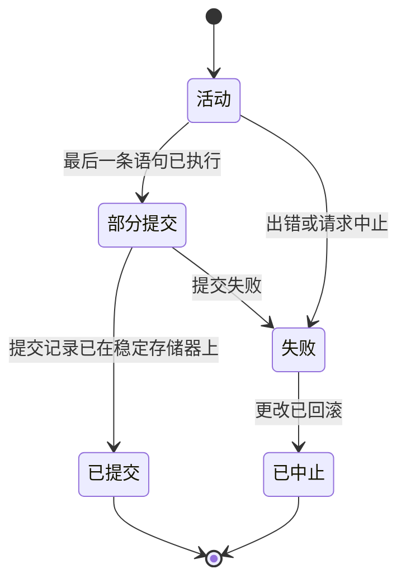
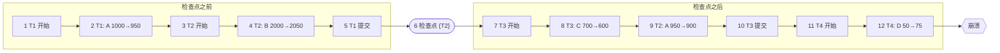

**数据库**由许多用户共享，并且必须在其所在机器发生故障之后仍然存在。这两点都威胁着它的正确性。两个程序同时读写相同的行时，它们的步骤可能交错，使得其中一个覆盖了另一个的工作；多步更新进行到一半时发生崩溃，则可能使数据库只改了一半。*事务*这一抽象把这两个问题都从应用程序员的关注中去除：它是一组操作，系统执行它时如同它独自运行，并且要么全部完成，要么完全不做。本章定义事务及其保证，发展调度理论以说明交错执行何时与串行执行一样好，然后处理问题中与故障有关的那一半：日志与恢复。另一半，即只产生良好交错的协议，是 [4.13.11](/4.13.11) 的主题。界定事务的 **SQL** 语句已在 [4.13.4](/4.13.4#sec-4.7) 中出现；恢复必须控制其写回策略的**缓冲池**就是 [4.13.7](/4.13.7#sec-7.2) 中的缓冲池。相同的思想也出现在文件系统中，那里**日志**保护元数据免受崩溃的影响（[4.11.7](/4.11.7#sec-7.4)）；数据库则把它们用于任意的用户数据，并给出更强的保证。

## 10.1. 事务

### 10.1.1. 概念与 ACID 特性

为了理论分析，我们把**数据库**抽象为一组有名字的*数据项* $A, B, \dots$（一个值、一行或一个**页**），把事务抽象为两类操作的序列：$\operatorname{read}(X)$ 把数据项 $X$ 复制到事务的一个局部变量中，$\operatorname{write}(X)$ 把一个局部值复制回数据库。对局部变量的计算对系统是不可见的。

**定义 10.1.1（事务）** **事务**是访问并可能更新数据项的一个程序执行单元，由开始操作界定，并以**提交**或**中止**（回滚）结束：提交使它的效果成为永久的，中止则撤销它的效果。

**定义 10.1.2（ACID 特性）** 数据库管理系统对每个事务保证：

1. **原子性**：事务的所有操作要么全部反映在数据库中，要么全都不反映。
2. **一致性**：事务在一个一致的数据库（满足**完整性约束**和应用不变式的数据库）上单独执行时，使数据库保持一致。
3. **隔离性**：尽管事务可以并发运行，每个事务并不知道其他事务的存在；对每一对 $T_i, T_j$，在 $T_i$ 看来，$T_j$ 要么在 $T_i$ 开始之前已结束，要么在 $T_i$ 结束之后才开始。
4. **持久性**：事务一旦提交，它的更改就会持续存在，即使系统随后发生故障。

一致性主要由程序员负责：他编写能保持不变式的事务，并借助**数据库管理系统**检查的完整性约束（[4.13.6](/4.13.6)）。原子性和持久性由*恢复系统*（§10.4–§10.7）提供，隔离性由*并发控制*（[4.13.11](/4.13.11)）提供。

**例 10.1.1** 实验室重新处理样本 `S03` 并替换它的测量值：事务删除 `measurement` 中 `S03` 的旧行，插入新行，并更新处理日期。没有原子性，删除之后发生崩溃会留下一个没有数据的样本；没有隔离性，并发的、计算各组织平均表达量的查询可能看到该样本没有行、只有部分新行，或者新旧行并存；没有持久性，已发给合作者的报告可能引用重启之后消失的测量值。抽象地说，该事务就是对两个数据项的 $\operatorname{read}(X)$、$\operatorname{write}(X)$、$\operatorname{read}(Y)$、$\operatorname{write}(Y)$。

### 10.1.2. 事务的状态



事务在执行时处于*活动*状态；最后一条语句之后为*部分提交*；系统使其效果持久之后为*已提交*；不能再继续（出错、违反约束、**死锁**或显式的 `ROLLBACK`）时为*失败*；效果被撤销之后为*已中止*。如果失败不是由事务自身的逻辑引起的（如死锁之后），已中止的事务可以作为新事务重新启动。无法撤销的外部动作，例如打印结果或发送消息，应当只在**提交**之后执行。

## 10.2. 调度与可串行化

### 10.2.1. 调度

**定义 10.2.1（调度）** 一组事务的**调度**是它们全部操作（包括提交与中止）的一个序列，并保持每个事务内部操作的顺序。若每个事务的操作是连续的，即事务一个接一个地运行，则称该调度是**串行调度**。

一致的事务的串行**调度**总是保持**一致性**，因为每个事务都从一致的状态开始。尽管如此，并发地运行事务仍然是必要的：一个事务等待磁盘读取或等待客户端时，其他事务可以使用 CPU 和其他磁盘，这提高了吞吐量，也避免短事务排在长事务后面等待。问题是哪些交错是可接受的。

下面用 $R_i(X)$ 和 $W_i(X)$ 表示事务 $T_i$ 对 $X$ 的 $\operatorname{read}(X)$ 和 $\operatorname{write}(X)$。考虑 $T_1$，它把 50 个单位从 $A$ 转到 $B$；以及 $T_2$，它给 $A$ 加 10% 的利息。

| 步骤 | $T_1$ | $T_2$ |
|---|---|---|
| 1 | $R_1(A)$ | |
| 2 | | $R_2(A)$ |
| 3 | $A := A - 50$；$W_1(A)$ | |
| 4 | $R_1(B)$ | |
| 5 | | $A := 1.1 A$；$W_2(A)$ |
| 6 | $B := B + 50$；$W_1(B)$ | |

设初始 $A = 1000$、$B = 2000$，两个串行调度的结果分别是 $(A, B) = (1045, 2050)$（$T_1$ 在先）和 $(1050, 2050)$（$T_2$ 在先）。这个交错调度的结果是 $A = 1100$、$B = 2050$：$T_2$ 的写入基于在 $T_1$ 写入之前读到的 $A$ 值，$T_1$ 的取款丢失了。这就是*丢失更新*（lost update）异常，该调度不正确，因为它的结果不等于任何串行调度的结果。

**定义 10.2.2（可串行化调度）** 若一个调度对每个数据库状态的效果都与同一组事务的某个串行调度相同，则称它是**可串行化调度**。

这种语义意义上的**可串行化**取决于事务计算什么，不能仅凭读写序列判定。因此理论使用一个只依赖于冲突操作顺序的充分条件。

### 10.2.2. 冲突可串行化

**定义 10.2.3（冲突操作）** 调度中的两个操作若属于不同事务、访问同一数据项，并且至少有一个是写操作，则称它们**冲突**。

$R_i(X), W_j(X)$ 与 $W_i(X), W_j(X)$ 这两种配对冲突；$R_i(X), R_j(X)$ 以及对不同数据项的操作不冲突。交换不同事务中两个相邻的不冲突操作，既不改变任何读操作返回的值，也不改变任何数据项的最终值。

**定义 10.2.4（冲突可串行化）** 同一组事务的两个调度，若其中一个可以经一系列相邻不冲突操作的交换变成另一个，则称它们是**冲突等价**的；等价地说，若每一对冲突操作在两个调度中出现的顺序相同。若一个调度与某个串行调度冲突等价，则称它是**冲突可串行化**的。

每个**冲突可串行化**的调度都是可串行化的，因为**冲突等价**的调度读到相同的值，写出相同的最终值。反过来不成立：有些可串行化的调度不是冲突可串行化的（§10.2.4）。

### 10.2.3. 优先图

**定义 10.2.5（优先图）** 调度 $S$ 的**优先图**（串行化图）是一个有向图，其顶点是 $S$ 的事务；只要在 $S$ 中 $T_i$ 的某个操作与 $T_j$ 的某个较后的操作冲突，就有一条边 $T_i \to T_j$。

边 $T_i \to T_j$ 表示在任何与之冲突等价的串行调度中，$T_i$ 必须在 $T_j$ 之前。

**定理 10.2.1** 调度是冲突可串行化的，当且仅当它的**优先图**无环。此时，优先图的每个**拓扑排序**都给出一个冲突等价的串行调度。

**证明** 设 $S$ 与某个串行调度 $S'$ 冲突等价，$S'$ 中事务的顺序为 $T_{\pi(1)}, \dots, T_{\pi(n)}$。若 $T_i \to T_j$ 是一条边，则在 $S$ 中 $T_i$ 的某个操作先于 $T_j$ 的一个冲突操作，因此在 $S'$ 中也是如此，所以在串行顺序中 $T_i$ 先于 $T_j$。于是每条边在顶点的线性序中都指向前方，图中没有环。

反之，设图无环，于是它是**有向无环图**，有拓扑序 $T_{\pi(1)}, \dots, T_{\pi(n)}$，其中每条边都从较早的事务指向较晚的事务。令 $S'$ 为按此顺序的串行调度。任取一对**冲突操作**，$T_i$ 的 $o_i$ 与 $T_j$ 的 $o_j$，在 $S$ 中 $o_i$ 在 $o_j$ 之前。则 $T_i \to T_j$ 是一条边，所以在拓扑序中 $T_i$ 先于 $T_j$，在 $S'$ 中 $o_i$ 先于 $o_j$。因此所有冲突对在 $S$ 与 $S'$ 中顺序相同，这两个调度冲突等价。$\square$

构造该图的时间与调度长度的平方成正比（借助记录每个数据项最后读写的**索引**，则对每个数据项为线性），环检测的时间与其大小成线性。下面的检查程序构造该图，并返回一个串行顺序或一个环。

```python
from graphlib import TopologicalSorter, CycleError


def precedence_graph(schedule):
    """Edges Ti -> Tj for conflicting operations of Ti before Tj."""
    edges = set()
    for i, (ti, op_i, x) in enumerate(schedule):
        for tj, op_j, y in schedule[i + 1:]:
            if ti != tj and x == y and "W" in (op_i, op_j):
                edges.add((ti, tj))
    return edges


def serial_order(schedule):
    graph = {t: set() for t, _, _ in schedule}
    for ti, tj in precedence_graph(schedule):
        graph[tj].add(ti)                  # tj must come after ti
    try:
        return list(TopologicalSorter(graph).static_order())
    except CycleError as e:
        return f"not conflict serializable, cycle {e.args[1]}"


def parse(text):
    """'R1(A) W2(A)' -> [('T1', 'R', 'A'), ('T2', 'W', 'A')]"""
    return [(f"T{s[1]}", s[0], s[3]) for s in text.split()]


schedules = {
    "S1": "R1(A) W1(A) R2(A) W2(A) R1(B) W1(B) R2(B) W2(B)",
    "S2": "R1(A) R2(A) W1(A) W2(A) R1(B) W1(B)",
    "S3": "R1(A) W1(A) R2(A) R3(B) W2(B) W3(C) R1(C)",
    "S4": "R2(A) R1(B) W2(A) R3(A) W1(B) W3(A) R2(B) W2(B)",
}
for name, text in schedules.items():
    s = parse(text)
    print(name, sorted(precedence_graph(s)), "->", serial_order(s))
```

```text
S1 [('T1', 'T2')] -> ['T1', 'T2']
S2 [('T1', 'T2'), ('T2', 'T1')] -> not conflict serializable, cycle ['T1', 'T2', 'T1']
S3 [('T1', 'T2'), ('T3', 'T1'), ('T3', 'T2')] -> ['T3', 'T1', 'T2']
S4 [('T1', 'T2'), ('T2', 'T3')] -> ['T1', 'T2', 'T3']
```

**例 10.2.1** 调度 $S_2$ 是 §10.2.1 的**丢失更新**限制在 $A$ 和 $B$ 上的情形：$R_2(A)$ 先于 $W_1(A)$，给出 $T_2 \to T_1$；$W_1(A)$ 先于 $W_2(A)$，给出 $T_1 \to T_2$。这个环表明没有任何串行顺序与之等价。在 $S_3$ 中，$T_3$ 在 $T_2$ 写 $B$ 之前读它，并在 $T_1$ 读 $C$ 之前写它，所以 $T_3$ 必须排在最前，尽管它的第一个操作出现在 $T_1$ 和 $T_2$ 的一些操作之后：等价的串行顺序不必是事务开始的顺序。$S_4$ 交错了三个事务，它等价于 $T_1, T_2, T_3$。

### 10.2.4. 视图可串行化

**定义 10.2.6（视图可串行化）** 同一组事务的两个调度，若 (1) 每个事务在一个调度中读到某数据项的初始值当且仅当它在另一个调度中也是如此，(2) 每次读取在两个调度中读到的都是同一个写操作写出的值，(3) 每个数据项的最终写操作在两个调度中由同一事务执行，则称它们是**视图等价**的。若一个调度与某个串行调度视图等价，则称它是**视图可串行化**的。

冲突可串行化蕴含**视图可串行化**。调度 $R_1(A), W_2(A), W_1(A), W_3(A)$ 与串行调度 $T_1, T_2, T_3$ **视图等价**（只有 $T_1$ 读，并且读到的是初始值；$T_3$ 最后写），但它的优先图含有环 $T_1 \to T_2 \to T_1$。$T_2$ 与 $T_1$ 的写是*盲写*（同一事务事先没有读过该数据项的写），并被 $T_3$ 覆盖。检验视图可串行化是 **NP 完全**的（Papadimitriou，1979），而且它多接受的那些调度很少见、实际价值不大，所以并发控制协议以冲突可串行化为目标。

## 10.3. 可恢复性

**可串行化**只考虑已提交的**事务**。当事务**中止**时，系统必须撤销它的效果，而交错有可能使这无法做到。

**定义 10.3.1（可恢复、无级联与严格调度）** 在一个调度中，若 $T_j$ 读取数据项 $X$，且该读取之前对 $X$ 的最后一次写由 $T_i$ 执行，并且 $T_i$ 在该读取之前没有中止，则称 $T_j$ *读取自* $T_i$。一个调度称为

1. **可恢复调度**，若每当 $T_j$ 读取自 $T_i$ 时，$T_i$ 的**提交**先于 $T_j$ 的提交；
2. **无级联调度**，若每当 $T_j$ 读取 $T_i$ 写过的数据项时，$T_i$ 的提交先于该读取；
3. **严格调度**，若任何事务在另一事务提交或中止之前，既不读取也不写入该事务写过的数据项。

在**调度** $W_1(A)$、$R_2(A)$、$C_2$、$A_1$（其中 $C$ 和 $A$ 表示提交和中止）中，$T_2$ 提交了一个根据 $T_1$ 的值算出的结果，而该值从未正式存在过。由于 $T_2$ 已提交，**持久性**禁止撤销它，$T_1$ 的**原子性**也无法实现：这个调度不是可恢复的。在 $W_1(A)$、$R_2(A)$、$W_2(B)$、$A_1$ 中，$T_1$ 的中止迫使读取自它的 $T_2$ 中止，也可能迫使读取自 $T_2$ 的更多事务中止：这就是*级联回滚*（cascading rollback）。无级联调度让事务只读取已提交的数据，从而避免级联；严格调度还禁止覆盖未提交的数据，这使得通过恢复旧值来撤销成为可能（§10.5）。

**命题 10.3.1** 每个严格调度都是无级联的，每个无级联调度都是可恢复的。

**证明** 严格性特别地禁止读取未提交事务写过的数据项，这就是无级联条件。在无级联调度中，若 $T_j$ 读取自 $T_i$，则 $T_i$ 在该读取之前提交，因此先于跟在该读取之后的 $T_j$ 的提交。$\square$

这些包含关系是严格的：$W_1(A), W_2(A), C_1, C_2$ 是无级联的但不严格，$W_1(A), R_2(A), C_1, C_2$ 是可恢复的但不是无级联的。[4.13.11](/4.13.11) 的严格两阶段锁协议产生的调度既是**冲突可串行化**的，又是严格的。

## 10.4. 故障与存储

### 10.4.1. 故障的类别

| 故障 | 例子 | 丢失什么 | 补救 |
|---|---|---|---|
| 事务故障 | 违反约束、死锁牺牲者、显式回滚 | 该事务的工作 | 撤销该事务（回滚） |
| 系统崩溃 | 断电、操作系统或数据库管理系统崩溃 | 主存（缓冲池、内存中的状态）；持久存储保留 | 重启时依据日志恢复 |
| 介质故障 | 磁盘故障、设备损坏 | 部分持久存储 | 恢复备份并重放归档日志；复制 |

恢复系统假定*故障即停止*（fail-stop）的行为：崩溃使系统停止，但不破坏持久存储。**页**的部分写入（*撕裂页*，torn page）确实会发生，系统用页校验和检测它们，并从日志中的整页映像（PostgreSQL 的 `full_page_writes`）或第二份副本（InnoDB 的双写缓冲区）修复。

### 10.4.2. 稳定存储器与缓冲策略

**定义 10.4.1（稳定存储器）** **稳定存储器**是一种理想化的存储介质，其内容永不丢失。它通过把每个块写到多个独立设备（镜像、**RAID**、其他机器或数据中心中的副本），并且只在设备确认数据已持久之后才算写完成（`fsync`，同时清空设备的易失写缓存）来近似实现。

恢复由**缓冲区管理器**的两项决策塑造。

**定义 10.4.2（窃取与强制策略）** 在**窃取策略**下，缓冲区管理器可以把被未提交事务修改过的页写入磁盘（以释放其帧）；在**非窃取**下，这样的页留在内存中，直到事务结束。在**强制策略**下，事务修改过的所有页在它提交之前写入磁盘；在**非强制**下，它们可以在以后任何时候写入。

| 策略 | 崩溃后需要撤销？ | 崩溃后需要重做？ | 说明 |
|---|---|---|---|
| 非窃取、强制 | 否 | 否 | 简单，但长事务需要无限的内存，且每次提交都要等待随机写 |
| 窃取、强制 | 是 | 否 | |
| 非窃取、非强制 | 否 | 是 | |
| 窃取、非强制 | 是 | 是 | 性能最好；几乎所有系统都采用 |

**窃取策略**要求有能力*撤销*（undo）崩溃后在磁盘上发现的未提交更改；非强制要求有能力*重做*（redo）从未到达磁盘的已提交更改。二者都由日志提供。

## 10.5. 基于日志的恢复

### 10.5.1. 日志

**定义 10.5.1（事务日志）** **事务日志**是一系列**日志记录**的序列，按顺序追加并存放在稳定存储器上，每条记录由它的位置即日志序列号（log sequence number）标识，简称 LSN。基本的记录有：

- $T_i$ 开始时的 $\langle T_i\ \mathrm{start} \rangle$；
- $T_i$ 写数据项 $X$ 时的*更新记录* $\langle T_i, X, V_1, V_2 \rangle$，把它的值从 $V_1$（*前像*，用于撤销）改为 $V_2$（*后像*，用于重做）；
- $T_i$ 结束时的 $\langle T_i\ \mathrm{commit} \rangle$ 和 $\langle T_i\ \mathrm{abort} \rangle$；
- 撤销 $T_i$ 的某个更新时写入的*只重做*记录 $\langle T_i, X, V \rangle$（在 ARIES 中称为*补偿日志记录*（compensation log record）），以及检查点记录（§10.5.3）。

事务恰在它的**提交**记录到达**稳定存储器**时才被视为已提交。日志记录先追加到内存中的日志缓冲区，再成批地强制写到稳定存储器；对日志做一次 `fsync` 就可以使许多并发事务的提交一起持久，这种技术称为*组提交*（group commit）。

**定义 10.5.2（预写日志）** 若恢复方案满足

1. 在被修改的数据**页**写入稳定存储器之前，描述对该页的更改的所有**日志记录**都已写入稳定存储器；并且
2. 在事务提交之前，它的所有日志记录，包括提交记录，都已写入稳定存储器，

则称它遵循**预写日志**（WAL）。

第一条规则使**窃取策略**安全：无论哪个未提交的值到达了磁盘，它的前像都已在日志中。第二条规则使**非强制**安全：无论磁盘上缺少哪个已提交的值，它的后像都在日志中。**缓冲区管理器**通过在写页之前，比较该页最后一次更改的 LSN（PostgreSQL 的 `pd_lsn`，[4.13.7](/4.13.7#sec-7.3.3)）与日志已刷出的 LSN，来强制执行规则 1。

### 10.5.2. 撤销、重做与回滚

- $\operatorname{redo}(\langle T_i, X, V_1, V_2 \rangle)$ 把 $X$ 设为 $V_2$；$\operatorname{undo}$ 把它设为 $V_1$。二者写的都是*值*而不是差量，因此应用两次与应用一次效果相同：它们是幂等的，这在系统于恢复期间崩溃时很重要。
- 正常运行期间对 $T_i$ 的*回滚*反向扫描日志；对每条更新记录 $\langle T_i, X, V_1, V_2 \rangle$，它恢复 $X := V_1$，并记录一条只重做记录 $\langle T_i, X, V_1 \rangle$；到达 $\langle T_i\ \mathrm{start} \rangle$ 时，它记录 $\langle T_i\ \mathrm{abort} \rangle$。记录撤销动作使**回滚**本身成为可以由重做重复的普通历史。

### 10.5.3. 检查点

没有检查点，恢复就必须从日志的开头扫描起。Silberschatz 等人书中的简单检查点在没有更新进行时执行如下步骤：把内存中的所有日志记录写入稳定存储器，把所有脏缓冲页写入磁盘，并写入记录 $\langle \mathrm{checkpoint}\ L \rangle$，其中 $L$ 是此刻活动事务的列表。崩溃之后，最后一个检查点之前记录的每个更新都已在磁盘上，所以重做可以从检查点开始；只有 $L$ 中的事务或在其后开始的事务才可能不完整。真实系统使用*模糊检查点*（fuzzy checkpoint），使事务在后台刷出脏页时可以继续运行（§10.6）。

### 10.5.4. 恢复算法

**算法 10.5.1（重启恢复）** 崩溃之后：

1. *重做阶段。* 找到最后一条 $\langle \mathrm{checkpoint}\ L \rangle$ 记录，并把*撤销列表*设为 $L$。从检查点起向前扫描日志。对每条更新记录和每条只重做记录，重做它。遇到 $\langle T_i\ \mathrm{start} \rangle$，把 $T_i$ 加入撤销列表；遇到 $\langle T_i\ \mathrm{commit} \rangle$ 或 $\langle T_i\ \mathrm{abort} \rangle$，把它移出。
2. *撤销阶段。* 从末尾向后扫描日志。对每条更新记录 $\langle T_i, X, V_1, V_2 \rangle$，若 $T_i$ 在撤销列表中，则恢复 $X := V_1$ 并记录 $\langle T_i, X, V_1 \rangle$。对撤销列表中 $T_i$ 的 $\langle T_i\ \mathrm{start} \rangle$，记录 $\langle T_i\ \mathrm{abort} \rangle$ 并移除 $T_i$。撤销列表为空时停止。

重做阶段*重复历史*：它使**数据库**恢复到崩溃时的确切状态，包括将被回滚的事务的更改；撤销阶段随后回滚不完整的事务，即*失败者*（loser），与正常回滚完全一样。

**定理 10.5.1（WAL 恢复的正确性）** 假设调度是严格的，系统遵循预写日志和 §10.5.3 的检查点过程，并且更新记录带有前像和后像。则算法 10.5.1 完成之后，每个数据项的值都是最后一个写过它的已提交事务所写的值（若没有事务写过它，则为初始值）；也就是说，数据库恰好反映已提交的事务（**原子性**和**持久性**）。无论崩溃之前有哪一部分脏页已到达磁盘，这一结论都成立；若系统在恢复期间再次崩溃并重新开始恢复，它也成立。

**证明**（概要）固定数据项 $X$。

*重做阶段之后。* 检查点之前记录的更新在做检查点时已在磁盘上。检查点之后，由**预写日志**规则 1，磁盘上只可能含有其更新记录已在稳定日志中的值。重做阶段按日志顺序重新应用检查点之后 $X$ 的每条更新记录和只重做记录。由于重做是设置值，在最后一条这样的记录之后，无论磁盘上找到的是什么值，$X$ 都保存该记录的后像；若没有这样的记录，则磁盘上的值是检查点时的值，它也是最后记录的值。所以重做之后，$X$ 取得对 $X$ 的最后一次已记录写入的值，即崩溃时它在内存中的值。

*已提交的写入都在。* 由预写日志规则 2，每个已提交事务的全部更新记录都在稳定日志中，所以它的写入已在重做阶段按原来的顺序重新应用。

*撤销阶段之后。* 由严格性，当另一个未提交事务已写过 $X$ 时没有事务写 $X$，所以至多有一个失败者 $T$ 写过 $X$，并且日志中跟在 $T$ 第一次写 $X$ 之后对 $X$ 的所有写入都是 $T$ 自己的（失败者从未提交，所以在崩溃之前没有别人能写 $X$）。撤销阶段按逆序访问 $T$ 对 $X$ 的更新并恢复每个前像；最后恢复的是 $T$ 第一次写 $X$ 的前像，即在它之前最后一个已提交事务写的值（或初始值）。没有被任何失败者写过的数据项不受撤销阶段影响，已经具有它最后的已提交值。撤销列表是正确的，因为事务恰在看到它的提交或中止记录时被移出，而检查点时活动的事务都列在其中。

*反复崩溃。* 重做和撤销是幂等的，并且每个撤销动作都先作为只重做记录写入日志，再写相应的中止记录。若系统在恢复期间崩溃，下一次重做阶段会重新应用已记录的撤销动作，下一次撤销阶段会跳过中止记录已写出的事务；对部分回滚的失败者，它撤销其余的更新，而第二次恢复同一个前像是无害的。$\square$

### 10.5.5. 一个恢复的轨迹

**例 10.5.1** 一个崩溃系统的日志包含如下记录（$T_1$ 在检查点之前提交，$T_3$ 在其后提交；崩溃时 $T_2$ 和 $T_4$ 处于活动状态）。

| LSN | 记录 |
|---|---|
| 1 | $\langle T_1\ \mathrm{start} \rangle$ |
| 2 | $\langle T_1, A, 1000, 950 \rangle$ |
| 3 | $\langle T_2\ \mathrm{start} \rangle$ |
| 4 | $\langle T_2, B, 2000, 2050 \rangle$ |
| 5 | $\langle T_1\ \mathrm{commit} \rangle$ |
| 6 | $\langle \mathrm{checkpoint}\ \{T_2\} \rangle$ |
| 7 | $\langle T_3\ \mathrm{start} \rangle$ |
| 8 | $\langle T_3, C, 700, 600 \rangle$ |
| 9 | $\langle T_2, A, 950, 900 \rangle$ |
| 10 | $\langle T_3\ \mathrm{commit} \rangle$ |
| 11 | $\langle T_4\ \mathrm{start} \rangle$ |
| 12 | $\langle T_4, D, 50, 75 \rangle$ |



在检查点时所有脏页都已刷出，所以磁盘上当时是 $A = 950$、$B = 2050$（一个未提交的值，由窃取策略写出）、$C = 700$、$D = 50$。此后 $A$、$C$ 和 $D$ 所在的页各自可能已写回，也可能没有。下面的模拟先在一种可能的磁盘状态上运行算法 10.5.1 并输出轨迹，再在全部八种状态上运行，并检验从扩展后的日志第二次恢复不会改变任何东西。

```python
from itertools import product

# The log at the time of the crash. Update records are
# (lsn, "update", txn, item, old value, new value).
log = [
    (1, "start", "T1"),
    (2, "update", "T1", "A", 1000, 950),
    (3, "start", "T2"),
    (4, "update", "T2", "B", 2000, 2050),
    (5, "commit", "T1"),
    (6, "checkpoint", ["T2"]),          # active transactions at the checkpoint
    (7, "start", "T3"),
    (8, "update", "T3", "C", 700, 600),
    (9, "update", "T2", "A", 950, 900),
    (10, "commit", "T3"),
    (11, "start", "T4"),
    (12, "update", "T4", "D", 50, 75),
]                                       # crash after LSN 12


def recover(log, disk, verbose=False):
    db, log = dict(disk), list(log)          # work on copies
    say = print if verbose else (lambda *a: None)
    # Redo phase: from the last checkpoint, repeat history.
    cp = max(i for i, r in enumerate(log) if r[1] == "checkpoint")
    undo_list = set(log[cp][2])
    for rec in log[cp + 1:]:
        kind = rec[1]
        if kind == "start":
            undo_list.add(rec[2])
        elif kind in ("commit", "abort"):
            undo_list.discard(rec[2])
        elif kind in ("update", "clr"):
            db[rec[3]] = rec[5]
            say(f"redo  LSN {rec[0]:2d}: {rec[3]} := {rec[5]}")
    say(f"undo list after redo: {sorted(undo_list)}")
    # Undo phase: scan backwards, roll back the incomplete transactions,
    # logging a redo-only (compensation) record for every restored value.
    lsn = log[-1][0]
    for rec in reversed(list(log)):         # a copy: records are appended
        if not undo_list:
            break
        if rec[1] == "update" and rec[2] in undo_list:
            db[rec[3]] = rec[4]
            lsn += 1
            log.append((lsn, "clr", rec[2], rec[3], None, rec[4]))
            say(f"undo  LSN {rec[0]:2d}: {rec[3]} := {rec[4]}   (log LSN {lsn}: redo-only <{rec[2]}, {rec[3]}, {rec[4]}>)")
        elif rec[1] == "start" and rec[2] in undo_list:
            lsn += 1
            log.append((lsn, "abort", rec[2]))
            undo_list.discard(rec[2])
            say(f"           {rec[2]} rolled back   (log LSN {lsn}: <{rec[2]} abort>)")
    return db, log


# At the checkpoint every dirty page was flushed, so the disk holds
# A = 950, B = 2050 (T2's uncommitted write was stolen), C = 700, D = 50.
# After the checkpoint, each page may or may not have been written back.
choices = {"A": [950, 900], "B": [2050], "C": [700, 600], "D": [50, 75]}
disk = {"A": 900, "B": 2050, "C": 700, "D": 75}   # one possible crash state
print("disk at crash:", disk)
result, final_log = recover(log, disk, verbose=True)
print("after recovery:", result)

outcomes = set()
for values in product(*choices.values()):
    state = dict(zip(choices, values))
    db, new_log = recover(log, state)
    outcomes.add(tuple(sorted(db.items())))
    # a crash right after recovery: recovering again from the extended log
    # (with its compensation and abort records) changes nothing
    again, _ = recover(new_log, db)
    assert again == db
print(f"{len(list(product(*choices.values())))} possible disk states, distinct outcomes: {outcomes}")
```

```text
disk at crash: {'A': 900, 'B': 2050, 'C': 700, 'D': 75}
redo  LSN  8: C := 600
redo  LSN  9: A := 900
redo  LSN 12: D := 75
undo list after redo: ['T2', 'T4']
undo  LSN 12: D := 50   (log LSN 13: redo-only <T4, D, 50>)
           T4 rolled back   (log LSN 14: <T4 abort>)
undo  LSN  9: A := 950   (log LSN 15: redo-only <T2, A, 950>)
undo  LSN  4: B := 2000   (log LSN 16: redo-only <T2, B, 2000>)
           T2 rolled back   (log LSN 17: <T2 abort>)
after recovery: {'A': 950, 'B': 2000, 'C': 600, 'D': 50}
8 possible disk states, distinct outcomes: {(('A', 950), ('B', 2000), ('C', 600), ('D', 50))}
```

重做阶段从检查点之后开始，重复所有事务的更新，包括失败者的更新。撤销列表 $\{T_2, T_4\}$ 由检查点记录中的 $T_2$ 和后来开始且从未提交的 $T_4$ 组成，而 $T_3$ 被加入后又被移出。撤销阶段向后越过检查点，才到达 $T_2$ 在 **LSN** 4 对 $B$ 的更新，这就是检查点必须记录活动事务的原因。对每一种可能的磁盘状态，结果都反映 $T_1$（$A = 950$）和 $T_3$（$C = 600$），而完全没有 $T_2$ 和 $T_4$ 的痕迹，正如定理 10.5.1 所断言的。

## 10.6. ARIES

上面的算法是 ARIES（Algorithms for Recovery and Isolation Exploiting Semantics，即利用语义的恢复与**隔离性**算法；Mohan 等人，1992）的简化形式，ARIES 是 IBM Db2、SQL Server 及许多其他系统的恢复方法，也是标准的参考设计。ARIES 增加了以下内容。

- *页上的 LSN。* 每个**页**存储 *pageLSN*，即其更改已反映在该页上的最后一条**日志记录**的 **LSN**。只有当记录的 LSN 大于 pageLSN 时，重做才应用它，这使得重做对*物理逻辑*日志记录（“把这个元组插入第 42 页的第 5 槽”）也是正确的；与值记录不同，物理逻辑记录不是幂等的。
- *每个事务的链。* 每条日志记录都存储同一事务前一条记录的 LSN（*PrevLSN*），所以撤销无需扫描整个日志，就能沿着事务的记录进行。
- 撤销动作的补偿日志记录（CLR），每条带有一个 *UndoNextLSN*，指向该事务下一条仍待撤销的记录。CLR 是只重做的，永远不会被撤销，所以回滚期间的崩溃不会撤销一个撤销，即使反复崩溃，恢复的工作量也有界。
- *模糊检查点。* 检查点记录包含*事务表*（活动事务及其最后的 LSN）和*脏页表*（缓冲池中的每个脏页及其 *recLSN*，即首次弄脏它的记录的 LSN）；页在后台持续刷出，而不是一次全部刷出。
- *三趟扫描。* *分析*趟从最后一个检查点向前扫描，重建崩溃时的事务表和脏页表。重做趟从脏页表中最小的 recLSN 开始并重复历史，跳过针对不在表中的页、或其 pageLSN 表明更改已在磁盘上的页的记录。撤销趟一起回滚所有失败者，总是接着处理最大的待处理 LSN，并写 CLR。
- *逻辑撤销与提前释放锁。* 索引操作可以按逻辑撤销（不论插入的键现在在哪里都把它删除），这样页闩锁就可以提前释放，而 B+ 树分裂等结构性更改则由短暂的*嵌套顶层操作*（nested top action）保护。

## 10.7. 实践中的恢复

*PostgreSQL* 把预写**日志**写入目录 `pg_wal`，分成每个 16 MB 的段文件。在检查点之后第一次修改某个**页**之后，日志含有该页的完整映像（`full_page_writes`，防止撕裂页）；之后的记录按物理逻辑方式描述更改。检查点分散在一段时间内进行，每隔 `checkpoint_timeout`（默认 5 分钟）或累积了 `max_wal_size`（1 GB）的日志时发生。PostgreSQL 不需要撤销阶段：由于它的多版本设计（[4.13.11](/4.13.11)），更新写入新的行版本而不是覆盖旧版本，版本是否可见取决于创建它的事务的**提交**状态，该状态记录在提交日志 `pg_xact` 中。恢复只重放 WAL（只有重做），而从未提交的事务所写的版本只是保持不可见，直到 `VACUUM` 将其清除。设置 `synchronous_commit = off` 时，提交在日志刷出之前就返回，这有在崩溃时丢失最后几百毫秒已提交事务的风险，但绝不会破坏数据库。同一日志流还用于向备用服务器做流复制，归档之后则用于时间点恢复。

*MySQL 的 InnoDB* 保存一份重做日志（大小由 `innodb_redo_log_capacity` 设定），以及位于撤销表空间中的独立撤销日志；撤销日志既用于**回滚**，也用于为一致性读重建旧的行版本。页经由*双写缓冲区*写出，以便撕裂页可以由它的第二份副本修复。

*SQLite* 有两种**日志**方式。在默认的回滚日志模式下，数据库文件的某页被修改之前，它的原始内容先被复制到日志文件；日志被删除（或失效）时事务提交，崩溃之后残留的日志被回放以撤销不完整的事务：这是采用强制策略的撤销日志。在 WAL 模式下，被修改的页改为追加到 `-wal` 文件，数据库文件保持不变，直到*检查点*把页复制回去；读者把数据库文件与 WAL 结合起来读取，借助共享内存文件 `-shm` 中的索引。下面的程序在 WAL 模式下提交一个事务，开始第二个事务，然后在不提交、不关闭数据库的情况下杀死进程。

```python
import os, sqlite3, subprocess, sys

DB = "lab.db"

if len(sys.argv) > 1 and sys.argv[1] == "child":
    con = sqlite3.connect(DB, isolation_level=None)       # explicit transactions
    print("journal mode:", con.execute("PRAGMA journal_mode = WAL").fetchone()[0], flush=True)
    con.execute("PRAGMA wal_autocheckpoint = 0")           # keep changes in the WAL
    con.execute("BEGIN")
    con.execute("INSERT INTO sample VALUES ('S07', 'liver', 'control', 50, '2025-04-01')")
    con.execute("COMMIT")
    con.execute("BEGIN")
    con.execute("INSERT INTO sample VALUES ('S08', 'lung', 'treated', 41, '2025-04-01')")
    con.execute("UPDATE sample SET donor_age = 99 WHERE sample_id = 'S01'")
    os._exit(1)                                            # crash: no commit, no close

for f in os.listdir("."):
    if f.startswith(DB):
        os.remove(f)
setup = sqlite3.connect(DB)
setup.executescript(open("../schema.sql").read() + open("../data.sql").read())
setup.close()
subprocess.run([sys.executable, __file__, "child"])
for f in sorted(os.listdir(".")):
    if f.startswith(DB):
        print(f"{f:12s} {os.path.getsize(f):6d} bytes")
con = sqlite3.connect(DB)                                  # recovery happens here
print(con.execute("SELECT sample_id, donor_age FROM sample "
                  "WHERE sample_id IN ('S01', 'S07', 'S08') ORDER BY 1").fetchall())
print("integrity:", con.execute("PRAGMA integrity_check").fetchone()[0])
```

```text
journal mode: wal
lab.db        53248 bytes
lab.db-shm    32768 bytes
lab.db-wal     8272 bytes
[('S01', 54), ('S07', 50)]
integrity: ok
```

**WAL** 文件含有一个 32 字节的文件头和两个 $24 + 4096$ 字节的帧，即已提交的插入所更改的两个页（`sample` 的表 **B 树**及其主码**索引**）。未提交的插入和更新仍在崩溃进程的页缓存中，从未到达 WAL；即使它们被溢出到 WAL 中，由于缺少提交帧，也会被忽略。重新打开数据库即完成恢复：已提交的样本 `S07` 存在，`S08` 和 `S01` 被修改的年龄则不存在。注意持久性还取决于设置 `PRAGMA synchronous`：在 WAL 模式下，`synchronous = NORMAL` 时提交不会立即刷到设备上，断电时可能丢失（但绝不会破坏数据库），而 `FULL` 在每次提交时都同步 WAL。

## 小结

- **事务**是具有 **ACID 特性**的工作单元；恢复系统提供**原子性**和持久性，并发控制提供隔离性，一致性则来自正确的事务和完整性约束。
- 调度是冲突可串行化的，当且仅当它的优先图无环；拓扑序给出等价的串行调度。视图可串行化更宽松，但检验它是 NP 完全的。
- 调度必须是可恢复的，应当是无级联的，实践中是严格的，这使得通过前像撤销是正确的。
- 在窃取和非强制的缓冲策略下，恢复同时需要撤销和重做信息，它们由先于数据写出、并在提交时强制刷出的日志（WAL）提供。
- 重启恢复从最后一个检查点起重复历史，然后回滚失败者，并记录补偿记录；它对每种已刷出页的模式都是正确的，并且在反复崩溃下是幂等的。
- ARIES 用 pageLSN、PrevLSN 链、带 UndoNextLSN 的 CLR、模糊检查点以及分析、重做、撤销三趟扫描改进了这一做法。PostgreSQL 借助多版本只靠重做就能恢复；SQLite 则提供撤销式的回滚日志和重做式的 WAL。
