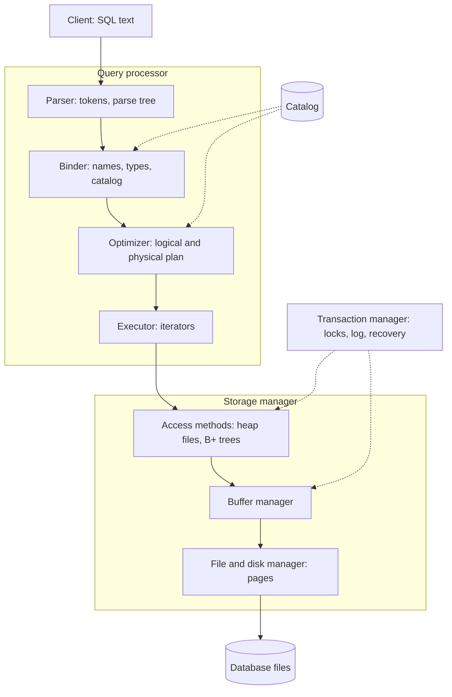

The previous chapters took a relational **database system** apart: the model and the language ([4.13.2](/4.13.2)–[4.13.4](/4.13.4)), design ([4.13.5](/4.13.5), [4.13.6](/4.13.6)), storage and **indexes** ([4.13.7](/4.13.7), [4.13.8](/4.13.8)), query processing ([4.13.9](/4.13.9)), **transactions**, recovery and concurrency ([4.13.10](/4.13.10), [4.13.11](/4.13.11)). This chapter puts the pieces back together, first from the point of view of someone who builds a small relational system, as in the course project of a single-user relational DBMS with an SQL parser and its own file storage, and then from the point of view of someone who chooses among the many kinds of database systems in use today. The first half connects the course with formal languages ([4.8](/4.8)), whose grammars and automata are exactly what an SQL front end implements, and contains a miniature query engine that runs real queries on the running example. The second half surveys distributed and cloud databases, NoSQL systems, analytical engines, vector search, and the way databases are used in data analysis and bioinformatics, where most readers of this course will meet them.

## 12.1. The Architecture of a Relational DBMS

### 12.1.1. The Layers

Hellerstein, Stonebraker and Hamilton's "Architecture of a Database System" (2007) describes the structure shared by essentially all relational systems. Its core, for a single **process** and a single user, is a stack of layers, each using only the interface of the one below.



| Layer | Interface it offers | Chapter |
|---|---|---|
| File (disk space) manager | allocate, free, read and write pages of a file | [4.13.7](/4.13.7#sec-7.1) |
| Buffer manager | pin and unpin pages, mark them dirty, flush | [4.13.7](/4.13.7#sec-7.2) |
| Record manager (heap files) | insert, delete, update and fetch records by record identifier; scan a file | [4.13.7](/4.13.7#sec-7.3) |
| Index manager | insert and delete entries; search for a key or a range, returning record identifiers | [4.13.8](/4.13.8) |
| Catalog | create and drop tables and indexes; look up schemas and statistics | [4.13.7](/4.13.7#sec-7.6) |
| Parser and binder | SQL text to a checked logical plan | §12.2 |
| Optimizer | logical plan to physical plan | [4.13.9](/4.13.9#sec-9.8) |
| Executor | run a physical plan, producing rows | [4.13.9](/4.13.9#sec-9.1.2) |
| Transaction manager | begin, commit, abort; locks; log records; restart recovery | [4.13.10](/4.13.10), [4.13.11](/4.13.11) |

A full system adds a process model (one process per connection in PostgreSQL, **threads** in MySQL, a library inside the application for SQLite and DuckDB), a network protocol, authentication, and utilities for backup, bulk loading and statistics.

### 12.1.2. A Single-User System as a Project

A single-user system can omit the **transaction manager**'s concurrency control, and if crash safety is not required, recovery too; what remains is still a complete pipeline from **SQL** text to bytes on disk. Building it bottom-up gives a sequence of milestones, each testable on its own:

1. *Page file manager*: a **database** is a directory or a single file of fixed-size **pages**; functions to create, open and close files and to read and write page $n$.
2. **Buffer manager**: a fixed array of frames with a **page table** and LRU or clock replacement ([4.13.7](/4.13.7#sec-7.2.2)); every higher layer accesses pages only through it.
3. *Record manager*: fixed- or variable-length records in slotted pages, with record identifiers (page, slot), a free-space list and a scan iterator.
4. *Index manager*: a B+ tree whose nodes are pages, supporting insertion, deletion, point and range search on integer and string keys, possibly with duplicates.
5. *System management*: the catalog stored in the database itself, and the statements `CREATE`/`DROP DATABASE`, `CREATE`/`DROP TABLE`, `CREATE`/`DROP INDEX`, `SHOW TABLES` and `DESCRIBE`.
6. *Parser*: a grammar for the supported subset of SQL and a parser that produces a syntax tree with clear error messages (§12.2).
7. *Query execution*: `INSERT`, `DELETE`, `UPDATE` and `SELECT` with conditions, joins of several tables, aggregation and ordering, using indexes where they apply.
8. **Integrity constraints**: `NOT NULL`, primary keys, unique and foreign keys checked on every modification ([4.13.6](/4.13.6)).

The interfaces in the table above are the contract between milestones; a design that respects them lets the parser be developed against a stub executor, or the executor against an in-memory table, before the lower layers exist. The software-engineering side of such a project (version control, testing, code review) is the subject of [4.14](/4.14).

## 12.2. From SQL Text to a Plan

### 12.2.1. Lexical Analysis

The first step splits the text into *tokens*: keywords (`SELECT`, `FROM`), identifiers, numeric and string literals, operators and punctuation, discarding whitespace and comments. Each token class is a regular language, so the lexer is a **finite automaton**, usually generated from **regular expressions** ([4.8.3](/4.8.3), [4.8.4](/4.8.4)): a scanner generator such as Flex turns the token definitions into a DFA, and a hand-written lexer implements the same automaton with a loop over characters. **SQL**'s lexical rules have their own subtleties: keywords are case-insensitive, quoted identifiers (`"Gene ID"`) preserve case and may contain spaces, string literals double an embedded quote (`'it''s'`), and many keywords are reserved only in some positions.

### 12.2.2. Syntax Analysis

The structure of a statement is described by a **context-free grammar** ([4.8.2](/4.8.2)). A subset sufficient for single-block queries, in extended BNF (braces for repetition, brackets for options):

```text
query       = "SELECT" select_list "FROM" table_ref { "JOIN" table_ref "ON" expr }
              [ "WHERE" expr ] [ "ORDER" "BY" column ] ;
select_list = "*" | expr { "," expr } ;
table_ref   = name [ name ] ;
expr        = and_expr { "OR" and_expr } ;
and_expr    = cmp { "AND" cmp } ;
cmp         = term [ ( "=" | "<>" | "<" | "<=" | ">" | ">=" ) term ] ;
term        = number | string | column | "(" expr ")" ;
column      = name [ "." name ] ;
```

The grammar encodes operator precedence by its layering: `AND` binds more tightly than `OR` because an `and_expr` is a part of an `expr` and not the other way round. A grammar that wrote `expr = expr "AND" expr | expr "OR" expr | cmp` instead would be an **ambiguous grammar**, with two **parse trees** for `a OR b AND c` ([4.8.2](/4.8.2#sec-2.5)). The parser builds the parse tree, or directly a more compact *abstract syntax tree*, which is what the later stages need.

Two families of parsers are used in practice.

- *Recursive descent* (top-down, LL): one function per nonterminal, choosing a production by looking at the next token. It is easy to write by hand and to give good error messages, and it requires a grammar without left recursion (hence the repetitions `{ ... }` above instead of rules like `expr = expr "OR" and_expr`). The engine in §12.3 and the ANTLR parser generator, popular for course projects, work this way.
- *LR parsing* (bottom-up): a **deterministic pushdown automaton** ([4.8.7](/4.8.7#sec-7.6)) driven by a table computed from the grammar by a generator such as Bison or Lemon; it handles left-recursive grammars directly and resolves ambiguities by declared precedences. PostgreSQL's parser is generated by Bison from the grammar file `gram.y` with a Flex scanner; SQLite uses its own LALR(1) generator, Lemon, with a hand-written tokenizer; DuckDB reuses PostgreSQL's grammar through the `libpg_query` library.

### 12.2.3. Semantic Analysis and Planning

The syntax tree says nothing about whether `gene.symbl` exists. The *binder* resolves every table and column name against the catalog (taking aliases and the scoping rules of subqueries into account), reports unknown or ambiguous names, determines the type of every expression and inserts implicit conversions, expands `*` and views, and checks **privileges**. Its output is a logical plan in **relational algebra** ([4.13.9](/4.13.9#sec-9.1.1)). A simple planner then applies rule-based rewrites, the most valuable being **selection pushdown** (Theorem 9.8.1), chooses an access path per table (an index whose key matches an equality condition, otherwise a scan) and a join algorithm per join, and orders joins, greedily or by the dynamic programming of [4.13.9](/4.13.9#sec-9.8.3).

## 12.3. A Miniature Query Engine

The following program implements the whole query pipeline for the grammar of §12.2.2 in about 250 lines of Python: a lexer based on a single regular expression, a recursive-descent parser with one method per grammar rule, a planner that pushes each conjunct of the `WHERE` clause down to the scan of the only table it mentions and uses **hash joins** for the equality conditions of `JOIN ... ON`, and an executor in the **iterator model** in which every operator is a Python iterable ([4.13.9](/4.13.9#sec-9.1.2)). Storage is reduced to lists of **tuples** loaded from the SQLite database of the running example; a real system would put the record manager and the buffer pool there. Finally the result is compared with SQLite's answer to the same query, a cheap form of **differential testing**.

```python
import re
import sqlite3

# ---------- lexical analysis: a regular language, recognized by one regex ----------
TOKEN = re.compile(r"""\s*(?:
    (?P<num>\d+(?:\.\d+)?) | (?P<str>'[^']*') | (?P<name>[A-Za-z_][A-Za-z_0-9]*) |
    (?P<op><>|<=|>=|[=<>(),.*]) )""", re.X)
KEYWORDS = {"SELECT", "FROM", "JOIN", "ON", "WHERE", "AND", "OR", "ORDER", "BY"}


def tokenize(sql):
    pos, out = 0, []
    sql = sql.strip()
    while pos < len(sql):
        m = TOKEN.match(sql, pos)
        if not m:
            raise SyntaxError(f"unexpected character at {pos}: {sql[pos]!r}")
        kind = m.lastgroup
        text = m.group(kind)
        if kind == "name" and text.upper() in KEYWORDS:
            kind, text = "kw", text.upper()
        out.append((kind, text))
        pos = m.end()
    return out + [("end", "")]


# ---------- syntax analysis: recursive descent, one function per rule ----------
class Parser:
    def __init__(self, sql):
        self.toks, self.i = tokenize(sql), 0

    def peek(self, text=None):
        kind, t = self.toks[self.i]
        return t if text is None else t == text

    def take(self, text=None):
        kind, t = self.toks[self.i]
        if text is not None and t != text:
            raise SyntaxError(f"expected {text!r}, found {t!r}")
        self.i += 1
        return kind, t

    def query(self):              # query = SELECT list FROM table {JOIN table ON expr} [WHERE expr] [ORDER BY col]
        self.take("SELECT")
        cols = ["*"] if self.peek("*") and self.take("*") else self.expr_list()
        self.take("FROM")
        tables, joins = [self.table_ref()], []
        while self.peek("JOIN"):
            self.take("JOIN")
            t = self.table_ref()
            self.take("ON")
            joins.append((t, self.expr()))
        where = self.expr() if self.peek("WHERE") and self.take("WHERE") else None
        order = None
        if self.peek("ORDER"):
            self.take("ORDER"); self.take("BY")
            order = self.column()
        self.take("")              # end of input
        return {"select": cols, "from": tables[0], "joins": joins, "where": where, "order": order}

    def expr_list(self):
        items = [self.expr()]
        while self.peek(","):
            self.take(",")
            items.append(self.expr())
        return items

    def table_ref(self):          # table_ref = name [alias]
        _, name = self.take()
        alias = self.take()[1] if self.toks[self.i][0] == "name" else name
        return (name, alias)

    def expr(self):               # expr = and_expr {OR and_expr}
        e = self.and_expr()
        while self.peek("OR"):
            self.take("OR")
            e = ("OR", e, self.and_expr())
        return e

    def and_expr(self):           # and_expr = cmp {AND cmp}
        e = self.cmp()
        while self.peek("AND"):
            self.take("AND")
            e = ("AND", e, self.cmp())
        return e

    def cmp(self):                # cmp = term [op term]
        left = self.term()
        if self.peek() in ("=", "<>", "<", "<=", ">", ">="):
            op = self.take()[1]
            return (op, left, self.term())
        return left

    def term(self):               # term = number | string | column | ( expr )
        kind, t = self.toks[self.i]
        if kind == "num":
            self.take()
            return ("const", float(t) if "." in t else int(t))
        if kind == "str":
            self.take()
            return ("const", t[1:-1])
        if t == "(":
            self.take("(")
            e = self.expr()
            self.take(")")
            return e
        return self.column()

    def column(self):             # column = name [. name]
        kind, a = self.take()
        if kind != "name":
            raise SyntaxError(f"expected a column name, found {a or 'end of input'!r}")
        if self.peek("."):
            self.take(".")
            return ("col", a, self.take()[1])
        return ("col", None, a)


# ---------- execution: iterators (Python generators) ----------
OPS = {"=": lambda a, b: a == b, "<>": lambda a, b: a != b, "<": lambda a, b: a < b,
       "<=": lambda a, b: a <= b, ">": lambda a, b: a > b, ">=": lambda a, b: a >= b,
       "AND": lambda a, b: a and b, "OR": lambda a, b: a or b}


def evaluate(e, row):
    if e[0] == "const":
        return e[1]
    if e[0] == "col":
        if e[1] is not None:
            return row[f"{e[1]}.{e[2]}"]
        hits = [v for k, v in row.items() if k.split(".")[1] == e[2]]
        if len(hits) != 1:
            raise NameError(f"column {e[2]!r} is unknown or ambiguous")
        return hits[0]
    a, b = evaluate(e[1], row), evaluate(e[2], row)
    return None if a is None or b is None else OPS[e[0]](a, b)   # NULL -> unknown


class Scan:
    def __init__(self, catalog, table, alias):
        self.catalog, self.table, self.alias = catalog, table, alias
    def __iter__(self):
        cols, rows = self.catalog[self.table]
        for r in rows:
            yield {f"{self.alias}.{c}": v for c, v in zip(cols, r)}
    def show(self):
        return [f"Scan {self.table} AS {self.alias}"]


class Filter:
    def __init__(self, child, pred):
        self.child, self.pred = child, pred
    def __iter__(self):
        return (r for r in self.child if evaluate(self.pred, r) is True)
    def show(self):
        return [f"Filter {fmt(self.pred)}"] + ["  " + s for s in self.child.show()]


class HashJoin:
    def __init__(self, probe, build, probe_key, build_key):
        self.probe, self.build, self.pk, self.bk = probe, build, probe_key, build_key
    def __iter__(self):
        table = {}
        for r in self.build:                                   # build phase
            table.setdefault(evaluate(self.bk, r), []).append(r)
        for r in self.probe:                                   # probe phase
            for s in table.get(evaluate(self.pk, r), []):
                yield {**r, **s}
    def show(self):
        return [f"HashJoin {fmt(self.pk)} = {fmt(self.bk)}"] + \
               ["  " + s for c in (self.probe, self.build) for s in c.show()]


class Project:
    def __init__(self, child, exprs):
        self.child, self.exprs = child, exprs
    def __iter__(self):
        for r in self.child:
            yield tuple(r.values()) if self.exprs == ["*"] else \
                  tuple(evaluate(e, r) for e in self.exprs)
    def show(self):
        return ["Project " + ", ".join(map(fmt, self.exprs))] + ["  " + s for s in self.child.show()]


class Sort:
    def __init__(self, child, key):
        self.child, self.key = child, key
    def __iter__(self):
        return iter(sorted(self.child, key=lambda r: evaluate(self.key, r)))
    def show(self):
        return [f"Sort {fmt(self.key)}"] + ["  " + s for s in self.child.show()]


def fmt(e):
    if e == "*":
        return "*"
    if e[0] == "const":
        return repr(e[1])
    if e[0] == "col":
        return f"{e[1]}.{e[2]}" if e[1] else e[2]
    return f"({fmt(e[1])} {e[0]} {fmt(e[2])})"


# ---------- planning: push conjuncts to the scans, use hash joins for equalities ----------
def conjuncts(e):
    return [] if e is None else conjuncts(e[1]) + conjuncts(e[2]) if e[0] == "AND" else [e]


def aliases(e, catalog, tables):
    if e[0] == "const":
        return set()
    if e[0] == "col":
        if e[1]:
            return {e[1]}
        return {a for t, a in tables if e[2] in catalog[t][0]}
    return aliases(e[1], catalog, tables) | aliases(e[2], catalog, tables)


def plan(q, catalog):
    tables = [q["from"]] + [t for t, _ in q["joins"]]
    preds = conjuncts(q["where"])
    def access(t, a):
        node = Scan(catalog, t, a)
        for p in [p for p in preds if aliases(p, catalog, tables) == {a}]:
            preds.remove(p)
            node = Filter(node, p)                             # selection pushdown
        return node
    node, seen = access(*q["from"]), {q["from"][1]}
    for (t, a), cond in q["joins"]:
        right = access(t, a)
        l, r = cond[1], cond[2]
        if aliases(l, catalog, tables) == {a}:
            l, r = r, l
        node = HashJoin(node, right, l, r)
        seen.add(a)
    for p in preds:                                            # anything left
        node = Filter(node, p)
    if q["order"]:
        node = Sort(node, q["order"])
    return Project(node, q["select"])


# ---------- the catalog and data: loaded from the SQLite database of 4.13.3 ----------
src = sqlite3.connect("t.db")
catalog = {}
for (t,) in src.execute("SELECT name FROM sqlite_schema WHERE type = 'table'"):
    cur = src.execute(f"SELECT * FROM {t}")
    catalog[t] = ([d[0] for d in cur.description], cur.fetchall())

sql = """SELECT s.sample_id, s.tissue, m.tpm
         FROM measurement m JOIN sample s ON m.sample_id = s.sample_id
                            JOIN gene g ON g.gene_id = m.gene_id
         WHERE g.symbol = 'CDKN1A' AND s.treatment = 'treated' AND m.tpm > 100
         ORDER BY m.tpm"""
query = Parser(sql).query()
print("WHERE as a tree:", query["where"])
p = plan(query, catalog)
print("\n".join(p.show()))
mine = list(p)
for row in mine:
    print(row)
print("same as SQLite:", mine == src.execute(sql).fetchall())
try:
    Parser("SELECT symbol FROM gene WHERE chrom =").query()
except SyntaxError as e:
    print("SyntaxError:", e)
```

```text
WHERE as a tree: ('AND', ('AND', ('=', ('col', 'g', 'symbol'), ('const', 'CDKN1A')), ('=', ('col', 's', 'treatment'), ('const', 'treated'))), ('>', ('col', 'm', 'tpm'), ('const', 100)))
Project s.sample_id, s.tissue, m.tpm
  Sort m.tpm
    HashJoin m.gene_id = g.gene_id
      HashJoin m.sample_id = s.sample_id
        Filter (m.tpm > 100)
          Scan measurement AS m
        Filter (s.treatment = 'treated')
          Scan sample AS s
      Filter (g.symbol = 'CDKN1A')
        Scan gene AS g
('S06', 'lung', 120.8)
('S05', 'lung', 141.5)
same as SQLite: True
SyntaxError: expected a column name, found 'end of input'
```

The plan is printed with each operator above its inputs, as `EXPLAIN` does. The three single-table conditions were pushed into filters directly above the scans, and the **joins** form a left-deep tree in the order of the `FROM` clause, with the right input of each hash join as its build side; the sorted output agrees with SQLite. The engine leaves out much of what a real system needs, each omission pointing to a chapter of the course: **aggregation** and `GROUP BY` (hash aggregation, [4.13.9](/4.13.9#sec-9.5.5)), `NULL` semantics beyond comparisons ([4.13.2](/4.13.2#sec-2.6)), a catalog with types and the type checks of a binder, cost-based join ordering, **index** access paths, pages and a buffer pool under the scans, and data modification under transactions. Adding them, layer by layer, is the project.

## 12.4. The Storage Side and Testing

At the bottom of the project lies the **storage manager** of [4.13.7](/4.13.7) and [4.13.8](/4.13.8). A few points recur in every implementation.

- *Serialization.* Records and B+-tree nodes are byte arrays inside **pages**; a fixed layout (Python's `struct`, C structs with explicit widths, little-endian integers) and a version number in the file header keep **databases** readable across runs and builds.
- *The catalog is data.* Storing table and **index** descriptions in a system table, read through the same record manager, avoids a second file format and makes `DESCRIBE` a query.
- *Resource discipline.* Every pinned page must be unpinned, on error paths as well; leaked pins eventually exhaust the buffer pool. Wrapping pin and unpin in a scope object (a C++ destructor, a Python context manager) prevents the leak.
- *Testing.* Unit tests for each layer (split and merge cases of the B+ tree, page replacement under a tiny pool), and end-to-end tests that run the same SQL on the student system and on SQLite and compare the results. Randomized generation of queries, as in the SQLancer tool, which found hundreds of bugs in SQLite, PostgreSQL, MySQL and DuckDB, extends the comparison to cases no one thought of.

## 12.5. Distributed and Cloud Databases

### 12.5.1. Partitioning and Replication

A single server eventually runs out of capacity, and a single server is a single point of failure. Distributed **databases** address the two problems with two techniques.

**Definition 12.5.1 (Sharding and Replication)** **Sharding** (horizontal partitioning across machines) divides the rows of a table among several servers, the *shards*, by ranges or by a hash of a *shard key* ([4.13.7](/4.13.7#sec-7.4.4)). **Replication** keeps copies of the same data, the *replicas*, on several servers. With *synchronous* replication a write is acknowledged only after several replicas have it; with *asynchronous* replication it is acknowledged after the primary has it, and the replicas follow with some delay.

**Sharding** scales capacity and write throughput, provided that most **transactions** touch one **shard**: a query or transaction that spans shards must coordinate them. Replication improves availability and read throughput; a *primary–backup* scheme sends all writes to one primary, whose log is shipped to the backups (PostgreSQL's streaming replication replays the WAL of [4.13.10](/4.13.10#sec-10.7)), while multi-leader and leaderless schemes accept writes at several replicas and must reconcile conflicting updates.

### 12.5.2. Distributed Transactions and Consensus

**Definition 12.5.2 (Two-Phase Commit)** The **two-phase commit protocol** (2PC) makes a transaction that updated data at several sites commit atomically. A *coordinator* first sends *prepare* to all participants; each participant forces a *prepared* log record (from then on it can commit or abort as instructed, even after a crash) and votes yes, or votes no. If all votes are yes, the coordinator forces a commit record and sends **commit** to all participants; otherwise it sends **abort**. Participants acknowledge, after which the coordinator can forget the transaction.

**Two-phase commit** is *blocking*: a participant that has voted yes and then loses contact with the coordinator can neither **commit** nor **abort** until the coordinator recovers. Modern systems avoid the single coordinator by replicating every shard, and the coordinator's decision, with a consensus protocol such as Paxos (Lamport) or Raft (Ongaro and Ousterhout, 2014): a group of replicas agrees on a single sequence of log entries as long as a majority of them is up and can communicate. A transaction then runs 2PC among groups of replicas rather than among single machines, and the failure of a minority of machines blocks nothing.

How much **consistency** a replicated system can offer during failures is limited by the *CAP theorem* (Brewer's conjecture of 2000, proved by Gilbert and Lynch in 2002): when the network partitions the replicas into groups that cannot communicate, a system must give up either consistency (every read sees the latest write, more precisely linearizability) or availability (every request to a working replica gets a response). Abadi's PACELC formulation adds that even without a partition, a system trades latency against consistency. Relational and distributed **SQL** systems choose consistency; many **NoSQL** systems were designed for availability with *eventual consistency*, in which replicas converge only when updates stop.

### 12.5.3. Distributed SQL and Cloud-Native Systems

- *Distributed SQL* (**NewSQL**) systems keep the **relational model** and serializable or snapshot-isolated transactions while sharding and replicating automatically: Google Spanner (Paxos groups, and synchronized clocks with bounded uncertainty, TrueTime, for externally consistent timestamps), CockroachDB and YugabyteDB (Raft), and TiDB (Raft-replicated key–value storage in TiKV).
- *Cloud-native* designs separate compute from storage. Amazon Aurora keeps the MySQL or PostgreSQL query engine but replaces the storage layer by a distributed service that receives only **log records** and materializes pages itself ("the log is the database"), with six copies across three availability zones. Snowflake, BigQuery and Databricks store data as files in object storage and start compute clusters on demand; Neon does the same for PostgreSQL.
- *Managed services* (Amazon RDS, Google Cloud SQL, Azure Database, Supabase) run ordinary PostgreSQL or MySQL servers with automated backup, replication and upgrades; for most applications this, not a distributed system, is the right choice.

## 12.6. NoSQL Systems

From about 2005, web companies built data stores that give up parts of the **relational model** to scale across many machines with high availability. The term **NoSQL** ("not only SQL") covers several **data models**.

| Model | Data and access | Examples | Typical uses |
|---|---|---|---|
| Key–value | opaque values by key: `get`, `put`, `delete`, sometimes ranges | Redis, Amazon DynamoDB, etcd, RocksDB (embedded) | caches, sessions, configuration, building block of other systems |
| Document | nested JSON-like documents grouped in collections, queried by fields and paths | MongoDB, Couchbase, Firestore | records with variable structure, data that is read and written as whole objects |
| Wide-column | rows with dynamic columns grouped into column families, partitioned by key and sorted by clustering columns | Google Bigtable, Apache Cassandra, HBase, ScyllaDB | time series, event logs, very high write rates |
| Graph | nodes and edges with properties, queried by path patterns | Neo4j (Cypher), Amazon Neptune, the GQL standard (ISO/IEC 39075, 2024) | networks, recommendations, knowledge graphs, biological interaction networks |

The lines have blurred since. Relational systems store and **index** JSON (PostgreSQL's `jsonb` with GIN indexes, [4.13.8](/4.13.8#sec-8.5.2)), and SQL:2023 added property-graph queries (**SQL**/PGQ); conversely, MongoDB and DynamoDB support multi-document **ACID** transactions, and Cassandra offers an SQL-like language, CQL. The relevant question is less "SQL or NoSQL" than which data model fits the access patterns, and what consistency the application needs.

## 12.7. Analytical Databases

Analytical (**OLAP**) workloads scan and aggregate large data sets with few concurrent writers. Their systems combine the column storage and compression of [4.13.7](/4.13.7#sec-7.5), vectorized or compiled execution ([4.13.9](/4.13.9#sec-9.1.2)), and parallelism across cores and machines. **Data warehouses** traditionally organize data in a **star schema**: a large **fact table** of events or measurements (here, `measurement`) with **foreign keys** to small **dimension tables** that describe them (`gene`, `sample`), so that typical queries join the fact table with a few dimensions and aggregate. The *lakehouse* architecture stores the tables as Parquet files in object storage, with a table format such as Apache Iceberg or Delta Lake adding a transaction log for atomic updates, schema evolution and time travel, and lets several engines (Spark, Trino, Snowflake, DuckDB) query the same files.

DuckDB is the analytical counterpart of SQLite: an embedded library without a server, with a **column store**, vectorized execution and a PostgreSQL-like **SQL** dialect, that reads CSV, Parquet and JSON files and the data frames of Python and R directly. In the following program one connection writes the running example in long format to a Parquet file, as a step of an analysis pipeline would, and a fresh connection queries the file without loading it first, pivoting the mean expression of three genes of the p53 pathway by tissue and treatment.

```python
import duckdb

con = duckdb.connect()
con.execute(open("schema.sql").read())
con.execute(open("data.sql").read())
# Export a long-format table to a Parquet file, as a pipeline step would.
con.execute("""
COPY (SELECT s.sample_id, s.tissue, s.treatment, g.symbol, m.tpm
      FROM measurement m JOIN sample s USING (sample_id) JOIN gene g USING (gene_id))
TO 'expression.parquet' (FORMAT parquet)""")

# A fresh connection queries the file directly, without loading it first.
fresh = duckdb.connect()
print(fresh.sql("""
PIVOT (SELECT symbol, tissue || '_' || treatment AS grp, tpm
       FROM 'expression.parquet'
       WHERE symbol IN ('TP53', 'CDKN1A', 'MDM2'))
ON grp USING round(avg(tpm), 1)
ORDER BY symbol"""))
```

```text
┌─────────┬───────────────┬───────────────┬──────────────┬──────────────┐
│ symbol  │ liver_control │ liver_treated │ lung_control │ lung_treated │
│ varchar │    double     │    double     │    double    │    double    │
├─────────┼───────────────┼───────────────┼──────────────┼──────────────┤
│ CDKN1A  │          11.7 │          88.7 │         20.3 │        131.2 │
│ MDM2    │           7.9 │          30.2 │          9.4 │         35.0 │
│ TP53    │          33.5 │          42.6 │         48.9 │         53.2 │
└─────────┴───────────────┴───────────────┴──────────────┴──────────────┘
```

The treatment induces the p53 targets CDKN1A and MDM2 in both tissues while TP53 itself changes little, the pattern expected of a DNA-damaging drug. The query reads only the three columns it needs from the file and evaluates the `IN` condition on the column `symbol`; for files in object storage, DuckDB fetches only the needed byte ranges over HTTP.

## 12.8. Vector Search

Machine-learning models represent texts, images, proteins and cells as *embedding vectors* of hundreds or thousands of dimensions, chosen so that similar objects have nearby vectors ([4.6](/4.6), [4.7](/4.7)). Retrieval then means finding the $k$ vectors most similar to a query vector by **cosine similarity** or Euclidean distance: a **k-nearest neighbors** query. Exact search compares the query with every vector, which is linear in the size of the collection; **indexes** for **approximate nearest neighbor** search trade a small loss of recall for orders of magnitude of speed.

| Index | Idea |
|---|---|
| IVF (inverted file) | cluster the vectors with $k$-means; search only the clusters whose centroids are closest to the query |
| HNSW (hierarchical navigable small world; Malkov and Yashunin, 2016) | a layered proximity graph; greedy search descends from a sparse top layer to the dense bottom layer |
| Product quantization | compress each vector into a few bytes by quantizing sub-vectors, so that distances can be estimated from codes in memory |
| DiskANN and similar | graph indexes laid out for SSDs, for collections larger than memory |

These indexes are available as libraries (FAISS), in dedicated vector **databases** (Milvus, Qdrant, Weaviate, Pinecone), and inside general-purpose systems: PostgreSQL's `pgvector` extension adds a `vector` type, distance operators and HNSW and IVFFlat index types, so that embeddings can be stored next to the relational data they describe and filtered and joined with **SQL**:

```sql
CREATE EXTENSION vector;
CREATE TABLE protein (id text PRIMARY KEY, name text, embedding vector(1024));
CREATE INDEX ON protein USING hnsw (embedding vector_cosine_ops);
-- the 10 proteins closest to a query embedding $1 (<=> is the cosine distance)
SELECT id, name FROM protein ORDER BY embedding <=> $1 LIMIT 10;
```

Expression profiles are vectors too. In the running example, the profile of a gene is its vector of $\log_2(\mathrm{TPM} + 1)$ values across the six samples; centred on its mean, the cosine similarity of two profiles is their Pearson correlation, the standard measure of co-expression. DuckDB stores such vectors in fixed-size arrays and computes the similarity directly (exact search; its `vss` extension adds HNSW indexes):

```python
import duckdb

con = duckdb.connect()
con.execute(open("schema.sql").read())
con.execute(open("data.sql").read())
# One expression profile per gene: log2(TPM + 1) in samples S01..S06, centred
# on the gene's mean, stored as a fixed-length array (an "embedding").
con.execute("""
CREATE TABLE profile AS
WITH v AS (
    SELECT g.symbol, m.sample_id, log2(m.tpm + 1) AS x
    FROM measurement m JOIN gene g USING (gene_id)),
c AS (
    SELECT symbol, sample_id, x - avg(x) OVER (PARTITION BY symbol) AS x
    FROM v)
SELECT symbol, list(x ORDER BY sample_id)::DOUBLE[6] AS vec
FROM c
GROUP BY symbol
HAVING count(*) = 6""")
print(con.sql("""
SELECT p.symbol,
       round(array_cosine_similarity(p.vec, q.vec), 3) AS similarity
FROM profile p, profile q
WHERE q.symbol = 'CDKN1A' AND p.symbol <> 'CDKN1A'
ORDER BY similarity DESC"""))
```

```text
┌─────────┬────────────┐
│ symbol  │ similarity │
│ varchar │   double   │
├─────────┼────────────┤
│ MDM2    │      0.995 │
│ TP53    │        0.8 │
│ BRCA1   │      0.776 │
│ GAPDH   │       0.61 │
│ ACTB    │      0.406 │
│ MYC     │      0.163 │
└─────────┴────────────┘
```

EGFR is missing because it has no measurement in sample `S05`. MDM2, like CDKN1A a transcriptional target of p53, has an almost identical profile, a typical result of a co-expression search, here on invented values; the housekeeping genes GAPDH and ACTB, which mainly differ between tissues, are less similar.

## 12.9. Databases in Data Analysis and Bioinformatics

For data analysis, a **database** is most often not a server that an application talks to but a tool inside an analysis.

- *From analysis languages.* Python connects through the DB-API ([4.13.4](/4.13.4#sec-4.9.1)); pandas reads query results into data frames with `read_sql`, and DuckDB queries data frames in place. In R, the DBI package plays the role of the DB-API, and `dbplyr` translates dplyr pipelines into **SQL**, so that a pipeline written for a data frame runs inside the database. The relational operations behind these tools are the same: **split-apply-combine** is grouping and **aggregation**, and the **inner join** and **left join** of data frames ([4.4.5](/4.4.5)) are those of SQL.
- *Long format is a relation.* A table with one row per (sample, gene, value), the **long format** of **tidy data** ([4.4.5](/4.4.5)), is exactly the `measurement` **relation**. Keeping data normalized in this way and pivoting only for presentation, as in §12.7, avoids the inconsistencies of wide spreadsheets.
- *Embedded databases as file formats.* An SQLite or DuckDB file is a self-describing, indexed, transactional container that needs no server. Bioconductor's annotation packages (such as `org.Hs.eg.db`) are SQLite databases accessed through the AnnotationDbi interface; the Python package `gffutils` loads GFF and GTF genome annotations into SQLite to query features by region and hierarchy; many workflow tools keep their job state in SQLite.
- *Public biological databases.* Ensembl runs public MySQL servers with its full genome annotation, and the UCSC Genome Browser offers its annotation tables both through a public MySQL server and as downloadable files; BioMart provides a query interface over such warehouses. Large variant collections use specialized storage (TileDB-VCF, GenomicsDB in the GATK toolkit, Hail), and public data sets such as gnomAD are also distributed as Parquet or as tables in cloud warehouses that can be queried with SQL.
- *Laboratory information management.* Sample tracking, metadata and results of a laboratory are the classic transactional use: a schema like the running example, integrity constraints that keep identifiers consistent, and transactions that record an experiment completely or not at all ([4.13.10](/4.13.10)).

A practical rule follows from the course as a whole. For a single analysis of a few files, a data frame is enough; as soon as data are shared, updated, larger than memory, or queried in many ways, a database, embedded or server-based, provides the declarative queries, **indexes**, constraints and **transactions** that would otherwise have to be rebuilt by hand, and an analytical engine such as DuckDB provides them without leaving the analysis environment.

## Summary

- A relational **DBMS** is a stack of layers: file, buffer, record and **index** managers and the catalog form the **storage manager**; parser, binder, optimizer and executor form the query processor; the transaction manager adds locking, logging and recovery. A single-user system is built bottom-up along these interfaces.
- The SQL front end applies formal-language theory: a lexer is a finite automaton for regular token classes, the parser a top-down (recursive-descent, LL) or bottom-up (LR) parser for a context-free grammar whose layering encodes operator precedence; the binder resolves names and types against the catalog.
- A miniature engine with a recursive-descent parser, selection pushdown, hash joins and iterators answers real queries in a few hundred lines; differential testing against an existing system checks it.
- Distributed databases shard and replicate data; two-phase commit makes multi-shard transactions atomic, consensus protocols (Paxos, Raft) make replicas agree, and the CAP theorem limits consistency and availability under partitions. Distributed SQL and cloud-native systems combine these with the relational model.
- NoSQL systems offer key–value, document, wide-column and graph models; relational systems have absorbed many of their features.
- Analytical databases use column storage and vectorized execution; DuckDB brings them into the analysis environment and queries Parquet files directly. Vector indexes (HNSW, IVF) support similarity search, in dedicated systems or in PostgreSQL with `pgvector`.
- In data analysis and bioinformatics, databases appear as embedded file formats, as public annotation servers and as the backbone of laboratory data, and the relational operations underlie the data-frame tools.
