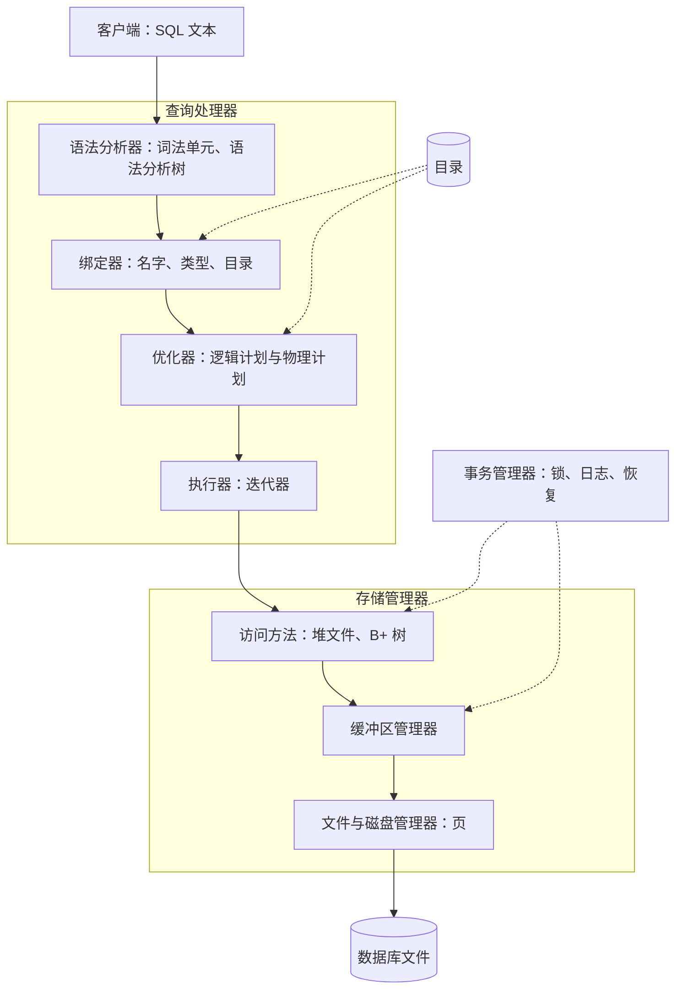

前面各章拆解了一个关系型**数据库系统**：模型与语言（[4.13.2](/4.13.2)–[4.13.4](/4.13.4)）、设计（[4.13.5](/4.13.5)、[4.13.6](/4.13.6)）、存储与**索引**（[4.13.7](/4.13.7)、[4.13.8](/4.13.8)）、查询处理（[4.13.9](/4.13.9)）、**事务**、恢复与并发（[4.13.10](/4.13.10)、[4.13.11](/4.13.11)）。本章把这些部件重新组装起来：先从构建小型关系系统的人的角度，就像课程项目中带 SQL 语法分析器和自有文件存储的单用户关系型 DBMS 那样；再从在当今使用的众多数据库系统中做选择的人的角度。前半部分把本课程与形式语言（[4.8](/4.8)）联系起来，SQL 前端实现的恰恰是形式语言的文法和自动机，并包含一个在示例数据上运行真实查询的微型查询引擎。后半部分概述分布式与云数据库、NoSQL 系统、分析型引擎、向量检索，以及数据库在数据分析和生物信息学中的用法，本课程的多数读者会在那里遇到它们。

## 12.1. 关系型 DBMS 的体系结构

### 12.1.1. 分层

Hellerstein、Stonebraker 和 Hamilton 的《Architecture of a Database System》（2007）描述了几乎所有关系系统共有的结构。对于单**进程**、单用户的情形，其核心是一叠分层，每层只使用其下一层的接口。



| 层 | 它提供的接口 | 章节 |
|---|---|---|
| 文件（磁盘空间）管理器 | 分配、释放、读写文件的页 | [4.13.7](/4.13.7#sec-7.1) |
| 缓冲区管理器 | 固定与取消固定页，标记为脏，刷出 | [4.13.7](/4.13.7#sec-7.2) |
| 记录管理器（堆文件） | 按记录标识符插入、删除、更新和取回记录；扫描文件 | [4.13.7](/4.13.7#sec-7.3) |
| 索引管理器 | 插入和删除条目；按键或范围查找，返回记录标识符 | [4.13.8](/4.13.8) |
| 目录 | 创建和删除表与索引；查询模式与统计信息 | [4.13.7](/4.13.7#sec-7.6) |
| 语法分析器与绑定器 | 从 SQL 文本到经过检查的逻辑计划 | §12.2 |
| 优化器 | 从逻辑计划到物理计划 | [4.13.9](/4.13.9#sec-9.8) |
| 执行器 | 运行物理计划，产生行 | [4.13.9](/4.13.9#sec-9.1.2) |
| 事务管理器 | 开始、提交、中止；锁；日志记录；重启恢复 | [4.13.10](/4.13.10)、[4.13.11](/4.13.11) |

完整的系统还要增加进程模型（PostgreSQL 每个连接一个进程，MySQL 用**线程**，SQLite 和 DuckDB 则是应用程序内部的一个库）、网络协议、身份认证，以及用于备份、批量加载和统计信息的工具。

### 12.1.2. 作为项目的单用户系统

单用户系统可以省去**事务管理器**的并发控制；若不要求崩溃安全，恢复也可以省去；剩下的仍是从 **SQL** 文本到磁盘字节的完整流水线。自底向上构建它，会得到一系列里程碑，每个都可以单独测试：

1. *页文件管理器*：**数据库**是由固定大小的**页**构成的一个目录或单个文件；提供创建、打开和关闭文件以及读写第 $n$ 页的函数。
2. **缓冲区管理器**：一个固定的帧数组，配有**页表**和 LRU 或时钟替换（[4.13.7](/4.13.7#sec-7.2.2)）；所有更高层都只通过它访问页。
3. *记录管理器*：槽式页中的定长或变长记录，带有记录标识符（页，槽）、空闲空间列表和扫描迭代器。
4. *索引管理器*：以页为结点的 B+ 树，支持对整数和字符串键（可能有重复）的插入、删除、点查找和范围查找。
5. *系统管理*：存放在数据库自身中的目录，以及 `CREATE`/`DROP DATABASE`、`CREATE`/`DROP TABLE`、`CREATE`/`DROP INDEX`、`SHOW TABLES` 和 `DESCRIBE` 语句。
6. *语法分析器*：所支持的 SQL 子集的文法，以及产生语法树并给出清晰错误信息的语法分析器（§12.2）。
7. *查询执行*：带条件的 `INSERT`、`DELETE`、`UPDATE` 和 `SELECT`，多表连接、聚集与排序，在适用处使用索引。
8. **完整性约束**：`NOT NULL`、主码、唯一码和外码，在每次修改时检查（[4.13.6](/4.13.6)）。

上表中的接口是各里程碑之间的契约；遵守它们的设计使语法分析器可以针对一个桩执行器开发，执行器也可以针对内存中的表开发，而无需等到更低层存在。这类项目中软件工程方面的内容（版本控制、测试、代码评审）是 [4.14](/4.14) 的主题。

## 12.2. 从 SQL 文本到计划

### 12.2.1. 词法分析

第一步把文本切分为*词法单元*（token）：关键字（`SELECT`、`FROM`）、标识符、数值和字符串字面量、运算符和标点，同时丢弃空白和注释。每一类词法单元都是一个正则语言，所以词法分析器是一个**有限自动机**，通常由**正则表达式**（[4.8.3](/4.8.3)、[4.8.4](/4.8.4)）生成：Flex 之类的扫描器生成器把词法单元的定义变成 DFA，手写的词法分析器则用对字符的循环实现同一个自动机。**SQL** 的词法规则有自己的微妙之处：关键字不区分大小写，带引号的标识符（`"Gene ID"`）保留大小写并且可以含空格，字符串字面量中嵌入的引号要重写一遍（`'it''s'`），许多关键字只在某些位置才是保留字。

### 12.2.2. 语法分析

语句的结构由**上下文无关文法**（[4.8.2](/4.8.2)）描述。下面是足以表示单块查询的一个子集，用扩展 BNF 书写（花括号表示重复，方括号表示可选）：

```text
query       = "SELECT" select_list "FROM" table_ref { "JOIN" table_ref "ON" expr }
              [ "WHERE" expr ] [ "ORDER" "BY" column ] ;
select_list = "*" | expr { "," expr } ;
table_ref   = name [ name ] ;
expr        = and_expr { "OR" and_expr } ;
and_expr    = cmp { "AND" cmp } ;
cmp         = term [ ( "=" | "<>" | "<" | "<=" | ">" | ">=" ) term ] ;
term        = number | string | column | "(" expr ")" ;
column      = name [ "." name ] ;
```

文法通过它的分层来编码运算符优先级：`AND` 比 `OR` 结合得更紧，因为 `and_expr` 是 `expr` 的一部分，而不是反过来。若改写成 `expr = expr "AND" expr | expr "OR" expr | cmp`，它就成了**二义文法**，对 `a OR b AND c` 有两棵**语法分析树**（[4.8.2](/4.8.2#sec-2.5)）。语法分析器构造语法分析树，或者直接构造更紧凑的*抽象语法树*，这才是后面各阶段所需要的。

实践中使用两类语法分析器。

- *递归下降*（自顶向下，LL）：每个非终结符一个函数，通过查看下一个词法单元来选择产生式。它易于手写，也容易给出良好的错误信息，但要求文法没有左递归（所以上面用重复 `{ ... }`，而不用 `expr = expr "OR" and_expr` 之类的规则）。§12.3 中的引擎和课程项目中流行的 ANTLR 语法分析器生成器都这样工作。
- *LR 分析*（自底向上）：一个由 Bison 或 Lemon 等生成器根据文法计算出的表驱动的**确定下推自动机**（[4.8.7](/4.8.7#sec-7.6)）；它能直接处理左递归文法，并通过声明的优先级解决二义性。PostgreSQL 的语法分析器由 Bison 根据文法文件 `gram.y` 生成，并配有 Flex 扫描器；SQLite 使用自己的 LALR(1) 生成器 Lemon，配手写的词法分析器；DuckDB 通过 `libpg_query` 库复用 PostgreSQL 的文法。

### 12.2.3. 语义分析与规划

语法树不说明 `gene.symbl` 是否存在。*绑定器*依据目录解析每个表名和列名（考虑别名和子查询的作用域规则），报告未知或有歧义的名字，确定每个表达式的类型并插入隐式转换，展开 `*` 和视图，并检查**权限**。它的输出是**关系代数**中的逻辑计划（[4.13.9](/4.13.9#sec-9.1.1)）。简单的规划器随后应用基于规则的重写，其中最有价值的是**选择下推**（定理 9.8.1），为每个表选择访问路径（键与等值条件匹配的索引，否则扫描）并为每个连接选择连接算法，还要排列连接顺序，或者用贪心法，或者用 [4.13.9](/4.13.9#sec-9.8.3) 的动态规划。

## 12.3. 一个微型查询引擎

下面的程序用大约 250 行 Python 为 §12.2.2 的文法实现了整个查询流水线：基于单个正则表达式的词法分析器；每条文法规则一个方法的递归下降语法分析器；把 `WHERE` 子句的每个合取项下推到它唯一涉及的那个表的扫描上，并对 `JOIN ... ON` 的等值条件使用**散列连接**的规划器；以及**迭代器模型**的执行器，其中每个算子都是一个 Python 可迭代对象（[4.13.9](/4.13.9#sec-9.1.2)）。存储被简化为从示例的 SQLite 数据库载入的**元组**列表；真实的系统会在这里放上记录管理器和缓冲池。最后，把结果与 SQLite 对同一查询的回答比较，这是**对拍**（差分测试）的一种廉价形式。

```python
import re
import sqlite3

# ---------- lexical analysis: a regular language, recognized by one regex ----------
TOKEN = re.compile(r"""\s*(?:
    (?P<num>\d+(?:\.\d+)?) | (?P<str>'[^']*') | (?P<name>[A-Za-z_][A-Za-z_0-9]*) |
    (?P<op><>|<=|>=|[=<>(),.*]) )""", re.X)
KEYWORDS = {"SELECT", "FROM", "JOIN", "ON", "WHERE", "AND", "OR", "ORDER", "BY"}


def tokenize(sql):
    pos, out = 0, []
    sql = sql.strip()
    while pos < len(sql):
        m = TOKEN.match(sql, pos)
        if not m:
            raise SyntaxError(f"unexpected character at {pos}: {sql[pos]!r}")
        kind = m.lastgroup
        text = m.group(kind)
        if kind == "name" and text.upper() in KEYWORDS:
            kind, text = "kw", text.upper()
        out.append((kind, text))
        pos = m.end()
    return out + [("end", "")]


# ---------- syntax analysis: recursive descent, one function per rule ----------
class Parser:
    def __init__(self, sql):
        self.toks, self.i = tokenize(sql), 0

    def peek(self, text=None):
        kind, t = self.toks[self.i]
        return t if text is None else t == text

    def take(self, text=None):
        kind, t = self.toks[self.i]
        if text is not None and t != text:
            raise SyntaxError(f"expected {text!r}, found {t!r}")
        self.i += 1
        return kind, t

    def query(self):              # query = SELECT list FROM table {JOIN table ON expr} [WHERE expr] [ORDER BY col]
        self.take("SELECT")
        cols = ["*"] if self.peek("*") and self.take("*") else self.expr_list()
        self.take("FROM")
        tables, joins = [self.table_ref()], []
        while self.peek("JOIN"):
            self.take("JOIN")
            t = self.table_ref()
            self.take("ON")
            joins.append((t, self.expr()))
        where = self.expr() if self.peek("WHERE") and self.take("WHERE") else None
        order = None
        if self.peek("ORDER"):
            self.take("ORDER"); self.take("BY")
            order = self.column()
        self.take("")              # end of input
        return {"select": cols, "from": tables[0], "joins": joins, "where": where, "order": order}

    def expr_list(self):
        items = [self.expr()]
        while self.peek(","):
            self.take(",")
            items.append(self.expr())
        return items

    def table_ref(self):          # table_ref = name [alias]
        _, name = self.take()
        alias = self.take()[1] if self.toks[self.i][0] == "name" else name
        return (name, alias)

    def expr(self):               # expr = and_expr {OR and_expr}
        e = self.and_expr()
        while self.peek("OR"):
            self.take("OR")
            e = ("OR", e, self.and_expr())
        return e

    def and_expr(self):           # and_expr = cmp {AND cmp}
        e = self.cmp()
        while self.peek("AND"):
            self.take("AND")
            e = ("AND", e, self.cmp())
        return e

    def cmp(self):                # cmp = term [op term]
        left = self.term()
        if self.peek() in ("=", "<>", "<", "<=", ">", ">="):
            op = self.take()[1]
            return (op, left, self.term())
        return left

    def term(self):               # term = number | string | column | ( expr )
        kind, t = self.toks[self.i]
        if kind == "num":
            self.take()
            return ("const", float(t) if "." in t else int(t))
        if kind == "str":
            self.take()
            return ("const", t[1:-1])
        if t == "(":
            self.take("(")
            e = self.expr()
            self.take(")")
            return e
        return self.column()

    def column(self):             # column = name [. name]
        kind, a = self.take()
        if kind != "name":
            raise SyntaxError(f"expected a column name, found {a or 'end of input'!r}")
        if self.peek("."):
            self.take(".")
            return ("col", a, self.take()[1])
        return ("col", None, a)


# ---------- execution: iterators (Python generators) ----------
OPS = {"=": lambda a, b: a == b, "<>": lambda a, b: a != b, "<": lambda a, b: a < b,
       "<=": lambda a, b: a <= b, ">": lambda a, b: a > b, ">=": lambda a, b: a >= b,
       "AND": lambda a, b: a and b, "OR": lambda a, b: a or b}


def evaluate(e, row):
    if e[0] == "const":
        return e[1]
    if e[0] == "col":
        if e[1] is not None:
            return row[f"{e[1]}.{e[2]}"]
        hits = [v for k, v in row.items() if k.split(".")[1] == e[2]]
        if len(hits) != 1:
            raise NameError(f"column {e[2]!r} is unknown or ambiguous")
        return hits[0]
    a, b = evaluate(e[1], row), evaluate(e[2], row)
    return None if a is None or b is None else OPS[e[0]](a, b)   # NULL -> unknown


class Scan:
    def __init__(self, catalog, table, alias):
        self.catalog, self.table, self.alias = catalog, table, alias
    def __iter__(self):
        cols, rows = self.catalog[self.table]
        for r in rows:
            yield {f"{self.alias}.{c}": v for c, v in zip(cols, r)}
    def show(self):
        return [f"Scan {self.table} AS {self.alias}"]


class Filter:
    def __init__(self, child, pred):
        self.child, self.pred = child, pred
    def __iter__(self):
        return (r for r in self.child if evaluate(self.pred, r) is True)
    def show(self):
        return [f"Filter {fmt(self.pred)}"] + ["  " + s for s in self.child.show()]


class HashJoin:
    def __init__(self, probe, build, probe_key, build_key):
        self.probe, self.build, self.pk, self.bk = probe, build, probe_key, build_key
    def __iter__(self):
        table = {}
        for r in self.build:                                   # build phase
            table.setdefault(evaluate(self.bk, r), []).append(r)
        for r in self.probe:                                   # probe phase
            for s in table.get(evaluate(self.pk, r), []):
                yield {**r, **s}
    def show(self):
        return [f"HashJoin {fmt(self.pk)} = {fmt(self.bk)}"] + \
               ["  " + s for c in (self.probe, self.build) for s in c.show()]


class Project:
    def __init__(self, child, exprs):
        self.child, self.exprs = child, exprs
    def __iter__(self):
        for r in self.child:
            yield tuple(r.values()) if self.exprs == ["*"] else \
                  tuple(evaluate(e, r) for e in self.exprs)
    def show(self):
        return ["Project " + ", ".join(map(fmt, self.exprs))] + ["  " + s for s in self.child.show()]


class Sort:
    def __init__(self, child, key):
        self.child, self.key = child, key
    def __iter__(self):
        return iter(sorted(self.child, key=lambda r: evaluate(self.key, r)))
    def show(self):
        return [f"Sort {fmt(self.key)}"] + ["  " + s for s in self.child.show()]


def fmt(e):
    if e == "*":
        return "*"
    if e[0] == "const":
        return repr(e[1])
    if e[0] == "col":
        return f"{e[1]}.{e[2]}" if e[1] else e[2]
    return f"({fmt(e[1])} {e[0]} {fmt(e[2])})"


# ---------- planning: push conjuncts to the scans, use hash joins for equalities ----------
def conjuncts(e):
    return [] if e is None else conjuncts(e[1]) + conjuncts(e[2]) if e[0] == "AND" else [e]


def aliases(e, catalog, tables):
    if e[0] == "const":
        return set()
    if e[0] == "col":
        if e[1]:
            return {e[1]}
        return {a for t, a in tables if e[2] in catalog[t][0]}
    return aliases(e[1], catalog, tables) | aliases(e[2], catalog, tables)


def plan(q, catalog):
    tables = [q["from"]] + [t for t, _ in q["joins"]]
    preds = conjuncts(q["where"])
    def access(t, a):
        node = Scan(catalog, t, a)
        for p in [p for p in preds if aliases(p, catalog, tables) == {a}]:
            preds.remove(p)
            node = Filter(node, p)                             # selection pushdown
        return node
    node, seen = access(*q["from"]), {q["from"][1]}
    for (t, a), cond in q["joins"]:
        right = access(t, a)
        l, r = cond[1], cond[2]
        if aliases(l, catalog, tables) == {a}:
            l, r = r, l
        node = HashJoin(node, right, l, r)
        seen.add(a)
    for p in preds:                                            # anything left
        node = Filter(node, p)
    if q["order"]:
        node = Sort(node, q["order"])
    return Project(node, q["select"])


# ---------- the catalog and data: loaded from the SQLite database of 4.13.3 ----------
src = sqlite3.connect("t.db")
catalog = {}
for (t,) in src.execute("SELECT name FROM sqlite_schema WHERE type = 'table'"):
    cur = src.execute(f"SELECT * FROM {t}")
    catalog[t] = ([d[0] for d in cur.description], cur.fetchall())

sql = """SELECT s.sample_id, s.tissue, m.tpm
         FROM measurement m JOIN sample s ON m.sample_id = s.sample_id
                            JOIN gene g ON g.gene_id = m.gene_id
         WHERE g.symbol = 'CDKN1A' AND s.treatment = 'treated' AND m.tpm > 100
         ORDER BY m.tpm"""
query = Parser(sql).query()
print("WHERE as a tree:", query["where"])
p = plan(query, catalog)
print("\n".join(p.show()))
mine = list(p)
for row in mine:
    print(row)
print("same as SQLite:", mine == src.execute(sql).fetchall())
try:
    Parser("SELECT symbol FROM gene WHERE chrom =").query()
except SyntaxError as e:
    print("SyntaxError:", e)
```

```text
WHERE as a tree: ('AND', ('AND', ('=', ('col', 'g', 'symbol'), ('const', 'CDKN1A')), ('=', ('col', 's', 'treatment'), ('const', 'treated'))), ('>', ('col', 'm', 'tpm'), ('const', 100)))
Project s.sample_id, s.tissue, m.tpm
  Sort m.tpm
    HashJoin m.gene_id = g.gene_id
      HashJoin m.sample_id = s.sample_id
        Filter (m.tpm > 100)
          Scan measurement AS m
        Filter (s.treatment = 'treated')
          Scan sample AS s
      Filter (g.symbol = 'CDKN1A')
        Scan gene AS g
('S06', 'lung', 120.8)
('S05', 'lung', 141.5)
same as SQLite: True
SyntaxError: expected a column name, found 'end of input'
```

计划按每个算子在其输入之上的方式打印，如同 `EXPLAIN` 那样。三个单表条件被下推为紧接在扫描之上的过滤，各**连接**构成一棵按 `FROM` 子句顺序排列的左深树，每个散列连接的右输入作为其构建侧；排序后的输出与 SQLite 一致。该引擎省去了真实系统所需的许多东西，每项省略都指向课程的某一章：**聚集**与 `GROUP BY`（散列聚集，[4.13.9](/4.13.9#sec-9.5.5)）、除比较之外的 `NULL` 语义（[4.13.2](/4.13.2#sec-2.6)）、带类型的目录以及绑定器的类型检查、基于代价的连接排序、**索引**访问路径、扫描之下的页和缓冲池，以及事务下的数据修改。逐层加入它们，就是这个项目。

## 12.4. 存储侧与测试

项目的最底层是 [4.13.7](/4.13.7) 和 [4.13.8](/4.13.8) 的**存储管理器**。有几点在每个实现中都会反复出现。

- *序列化。* 记录和 B+ 树结点是**页**内的字节数组；固定的布局（Python 的 `struct`、带显式宽度的 C 结构体、小端整数）以及文件头中的版本号，使**数据库**在不同的运行和构建之间保持可读。
- *目录就是数据。* 把表和**索引**的描述存放在系统表中，通过同一个记录管理器读取，避免了第二种文件格式，也使 `DESCRIBE` 成为一个查询。
- *资源纪律。* 每个被固定的页都必须取消固定，出错路径上也一样；泄漏的固定最终会耗尽缓冲池。把固定与取消固定包装在一个作用域对象中（C++ 的析构函数、Python 的上下文管理器）可以防止泄漏。
- *测试。* 对每一层做单元测试（B+ 树的分裂与合并情形、极小缓冲池下的页替换），以及端到端测试：在学生实现的系统和 SQLite 上运行同样的 SQL 并比较结果。随机生成查询，如 SQLancer 工具那样，它在 SQLite、PostgreSQL、MySQL 和 DuckDB 中发现了数百个缺陷，把这种比较扩展到没人想到的情形。

## 12.5. 分布式与云数据库

### 12.5.1. 分区与复制

单台服务器终会耗尽容量，而且单台服务器是单点故障。分布式**数据库**用两种技术应对这两个问题。

**定义 12.5.1（分片与复制）** **分片**（跨机器的水平划分）按范围或按*分片键*的散列值把表的行分到若干服务器，即*分片*（[4.13.7](/4.13.7#sec-7.4.4)）。**复制**在若干服务器上保存相同数据的副本，即*副本*。在*同步*复制下，只有在若干副本都得到写入之后才确认写操作；在*异步*复制下，主副本得到写入后即确认，其余副本稍有延迟地跟进。

**分片**扩展容量和写吞吐量，前提是大多数**事务**只触及一个**分片**：跨分片的查询或事务必须协调各分片。复制提高可用性和读吞吐量；*主–备*方案把所有写操作发往一个主副本，其日志传送给备份（PostgreSQL 的流复制重放 [4.13.10](/4.13.10#sec-10.7) 的 WAL），而多主和无主方案在多个副本上接受写入，必须调和相互冲突的更新。

### 12.5.2. 分布式事务与共识

**定义 12.5.2（两阶段提交）** **两阶段提交协议**（2PC）使在多个站点更新了数据的事务原子地提交。*协调者*先向所有参与者发送*准备*（prepare）；每个参与者强制写出一条*已准备*日志记录（此后即使崩溃，它也能按指示提交或中止），并投赞成票，或者投反对票。若所有票都是赞成，协调者强制写出一条提交记录并向所有参与者发送**提交**；否则发送**中止**。参与者确认之后，协调者即可忘记该事务。

**两阶段提交**是*阻塞*的：已投赞成票而后与协调者失去联系的参与者，在协调者恢复之前既不能**提交**也不能**中止**。现代系统通过复制每个分片，并用 Paxos（Lamport）或 Raft（Ongaro 与 Ousterhout，2014）等共识协议复制协调者的决定，来避免单一协调者：只要多数副本在运行并能通信，一组副本就对单一的日志条目序列达成一致。于是事务在多组副本之间而不是在单台机器之间运行 2PC，少数机器的故障不会阻塞任何事情。

复制系统在故障期间能提供多少**一致性**，受 CAP 定理（CAP theorem）（Brewer 在 2000 年的猜想，Gilbert 与 Lynch 在 2002 年证明）限制：当网络把副本划分成不能通信的若干组时，系统必须放弃一致性（每次读都看到最新的写，更准确地说是线性一致性）或可用性（对仍在工作的副本的每个请求都得到响应）。Abadi 的 PACELC 表述补充说，即使没有划分，系统也要在延迟与一致性之间权衡。关系型和分布式 **SQL** 系统选择一致性；许多 **NoSQL** 系统则为可用性而设计，采用最终一致性（eventual consistency），副本只有在更新停止后才收敛。

### 12.5.3. 分布式 SQL 与云原生系统

- *分布式 SQL*（**NewSQL**）系统在自动分片和复制的同时，保持**关系模型**以及可串行化或快照隔离的事务：Google Spanner（Paxos 组，以及用于外部一致时间戳的、不确定性有界的同步时钟 TrueTime）、CockroachDB 和 YugabyteDB（Raft）、TiDB（TiKV 中 Raft 复制的键值存储）。
- *云原生*设计把计算与存储分离。Amazon Aurora 保留 MySQL 或 PostgreSQL 的查询引擎，但把存储层换成一个分布式服务，它只接收**日志记录**并自己物化页（“日志即数据库”），在三个可用区中保存六份副本。Snowflake、BigQuery 和 Databricks 把数据作为文件存放在对象存储中，并按需启动计算集群；Neon 对 PostgreSQL 做同样的事。
- *托管服务*（Amazon RDS、Google Cloud SQL、Azure Database、Supabase）运行普通的 PostgreSQL 或 MySQL 服务器，并提供自动的备份、复制和升级；对大多数应用，正确的选择是这个，而不是分布式系统。

## 12.6. NoSQL 系统

大约从 2005 年起，Web 公司构建了放弃**关系模型**的一些部分的数据存储，以便在许多机器上扩展并保持高可用。**NoSQL**（“not only SQL”，不仅是 SQL）一词涵盖几种**数据模型**。

| 模型 | 数据与访问 | 例子 | 典型用途 |
|---|---|---|---|
| 键值 | 按键访问不透明的值：`get`、`put`、`delete`，有时支持范围 | Redis、Amazon DynamoDB、etcd、RocksDB（嵌入式） | 缓存、会话、配置，其他系统的构件 |
| 文档 | 按集合分组的嵌套类 JSON 文档，按字段和路径查询 | MongoDB、Couchbase、Firestore | 结构可变的记录，作为整个对象读写的数据 |
| 宽列 | 带动态列、分成列族的行，按键划分、按聚簇列排序 | Google Bigtable、Apache Cassandra、HBase、ScyllaDB | 时间序列、事件日志、极高的写入速率 |
| 图 | 带属性的结点与边，按路径模式查询 | Neo4j（Cypher）、Amazon Neptune、GQL 标准（ISO/IEC 39075，2024） | 网络、推荐、知识图谱、生物相互作用网络 |

此后这些界线已变得模糊。关系系统存储并**索引** JSON（PostgreSQL 的 `jsonb` 与 GIN 索引，[4.13.8](/4.13.8#sec-8.5.2)），SQL:2023 加入了属性图查询（**SQL**/PGQ）；反过来，MongoDB 和 DynamoDB 支持多文档 **ACID 特性**的事务，Cassandra 提供类 SQL 的语言 CQL。相关的问题与其说是“SQL 还是 NoSQL”，不如说是哪种数据模型适合访问模式，以及应用需要什么样的一致性。

## 12.7. 分析型数据库

分析型（**OLAP**）负载扫描并聚集大型数据集，并发写者很少。它们的系统结合了 [4.13.7](/4.13.7#sec-7.5) 的列存储与压缩、向量化或编译式执行（[4.13.9](/4.13.9#sec-9.1.2)），以及跨核心和机器的并行。**数据仓库**传统上用**星型模式**组织数据：一张由事件或测量值构成的大**事实表**（这里是 `measurement`），带有指向描述它们的小**维表**（`gene`、`sample`）的**外码**，使典型的查询把事实表与少数几个维表连接并聚集。*湖仓一体*（lakehouse）架构把表以 Parquet 文件存放在对象存储中，由 Apache Iceberg 或 Delta Lake 之类的表格式增加事务日志，以支持原子更新、模式演化和时间旅行，并让多个引擎（Spark、Trino、Snowflake、DuckDB）查询同一批文件。

DuckDB 是 SQLite 的分析型对应物：一个没有服务器的嵌入式库，带有**列存储**、向量化执行和类 PostgreSQL 的 **SQL** 方言，能直接读取 CSV、Parquet 和 JSON 文件以及 Python 和 R 的数据框。在下面的程序中，一个连接像分析流水线的一步那样，把示例以长格式写入 Parquet 文件，新的连接不先载入文件就直接查询它，按组织和处理方式透视 p53 通路三个基因的平均表达量。

```python
import duckdb

con = duckdb.connect()
con.execute(open("schema.sql").read())
con.execute(open("data.sql").read())
# Export a long-format table to a Parquet file, as a pipeline step would.
con.execute("""
COPY (SELECT s.sample_id, s.tissue, s.treatment, g.symbol, m.tpm
      FROM measurement m JOIN sample s USING (sample_id) JOIN gene g USING (gene_id))
TO 'expression.parquet' (FORMAT parquet)""")

# A fresh connection queries the file directly, without loading it first.
fresh = duckdb.connect()
print(fresh.sql("""
PIVOT (SELECT symbol, tissue || '_' || treatment AS grp, tpm
       FROM 'expression.parquet'
       WHERE symbol IN ('TP53', 'CDKN1A', 'MDM2'))
ON grp USING round(avg(tpm), 1)
ORDER BY symbol"""))
```

```text
┌─────────┬───────────────┬───────────────┬──────────────┬──────────────┐
│ symbol  │ liver_control │ liver_treated │ lung_control │ lung_treated │
│ varchar │    double     │    double     │    double    │    double    │
├─────────┼───────────────┼───────────────┼──────────────┼──────────────┤
│ CDKN1A  │          11.7 │          88.7 │         20.3 │        131.2 │
│ MDM2    │           7.9 │          30.2 │          9.4 │         35.0 │
│ TP53    │          33.5 │          42.6 │         48.9 │         53.2 │
└─────────┴───────────────┴───────────────┴──────────────┴──────────────┘
```

处理使两种组织中 p53 的靶基因 CDKN1A 和 MDM2 都被诱导，而 TP53 本身变化很小，这是 DNA 损伤药物预期的模式。该查询只从文件中读取它需要的三列，并在列 `symbol` 上计算 `IN` 条件；对于对象存储中的文件，DuckDB 通过 HTTP 只获取需要的字节范围。

## 12.8. 向量检索

机器学习模型把文本、图像、蛋白质和细胞表示为数百或数千维的*嵌入向量*（embedding vector），其选取使相似的对象有相近的向量（[4.6](/4.6)、[4.7](/4.7)）。检索于是意味着按**余弦相似度**或欧氏距离找出与查询向量最相似的 $k$ 个向量：一个 **k 近邻**查询。精确检索把查询与每个向量比较，其代价与集合大小成线性；**近似最近邻**检索的**索引**以少量召回率的损失换取几个数量级的速度。

| 索引 | 思想 |
|---|---|
| IVF（倒排文件） | 用 $k$ 均值对向量聚类；只搜索质心离查询最近的那些簇 |
| HNSW（分层可导航小世界；Malkov 与 Yashunin，2016） | 分层的邻近图；贪心搜索从稀疏的顶层下降到稠密的底层 |
| 乘积量化 | 通过量化子向量把每个向量压缩成几个字节，使距离可以在内存中由编码估计 |
| DiskANN 及类似方法 | 为固态硬盘设计布局的图索引，用于大于内存的集合 |

这些索引可以作为库（FAISS）、在专用的向量**数据库**（Milvus、Qdrant、Weaviate、Pinecone）中，以及在通用系统内部获得：PostgreSQL 的 `pgvector` 扩展增加了 `vector` 类型、距离运算符以及 HNSW 和 IVFFlat 索引类型，使嵌入向量可以与它们所描述的关系数据存放在一起，并用 **SQL** 过滤和连接：

```sql
CREATE EXTENSION vector;
CREATE TABLE protein (id text PRIMARY KEY, name text, embedding vector(1024));
CREATE INDEX ON protein USING hnsw (embedding vector_cosine_ops);
-- the 10 proteins closest to a query embedding $1 (<=> is the cosine distance)
SELECT id, name FROM protein ORDER BY embedding <=> $1 LIMIT 10;
```

表达谱也是向量。在示例中，一个基因的表达谱是它在六个样本中的 $\log_2(\mathrm{TPM} + 1)$ 值构成的向量；以其均值中心化之后，两条表达谱的余弦相似度就是它们的 Pearson 相关系数，这是共表达的标准度量。DuckDB 把这样的向量存储在定长数组中，并直接计算相似度（精确检索；它的 `vss` 扩展增加 HNSW 索引）：

```python
import duckdb

con = duckdb.connect()
con.execute(open("schema.sql").read())
con.execute(open("data.sql").read())
# One expression profile per gene: log2(TPM + 1) in samples S01..S06, centred
# on the gene's mean, stored as a fixed-length array (an "embedding").
con.execute("""
CREATE TABLE profile AS
WITH v AS (
    SELECT g.symbol, m.sample_id, log2(m.tpm + 1) AS x
    FROM measurement m JOIN gene g USING (gene_id)),
c AS (
    SELECT symbol, sample_id, x - avg(x) OVER (PARTITION BY symbol) AS x
    FROM v)
SELECT symbol, list(x ORDER BY sample_id)::DOUBLE[6] AS vec
FROM c
GROUP BY symbol
HAVING count(*) = 6""")
print(con.sql("""
SELECT p.symbol,
       round(array_cosine_similarity(p.vec, q.vec), 3) AS similarity
FROM profile p, profile q
WHERE q.symbol = 'CDKN1A' AND p.symbol <> 'CDKN1A'
ORDER BY similarity DESC"""))
```

```text
┌─────────┬────────────┐
│ symbol  │ similarity │
│ varchar │   double   │
├─────────┼────────────┤
│ MDM2    │      0.995 │
│ TP53    │        0.8 │
│ BRCA1   │      0.776 │
│ GAPDH   │       0.61 │
│ ACTB    │      0.406 │
│ MYC     │      0.163 │
└─────────┴────────────┘
```

EGFR 不在其中，因为它在样本 `S05` 中没有测量值。MDM2 与 CDKN1A 一样是 p53 的转录靶基因，表达谱几乎相同，这是共表达搜索的典型结果，这里用的是虚构的数值；主要在组织之间有差异的管家基因 GAPDH 和 ACTB 则相似度较低。

## 12.9. 数据分析与生物信息学中的数据库

在数据分析中，**数据库**往往不是应用程序与之通信的服务器，而是分析内部的一个工具。

- *来自分析语言。* Python 通过 DB-API 连接（[4.13.4](/4.13.4#sec-4.9.1)）；pandas 用 `read_sql` 把查询结果读入数据框，DuckDB 则就地查询数据框。在 R 中，DBI 包扮演 DB-API 的角色，`dbplyr` 把 dplyr 管道翻译成 **SQL**，使为数据框写的管道在数据库内部运行。这些工具背后的关系运算是相同的：**拆分-应用-合并**就是分组与**聚集**，数据框的**内连接**与**左连接**（[4.4.5](/4.4.5)）就是 SQL 的内连接与左连接。
- *长格式就是一个关系。* 每个（样本，基因，值）一行的表，即**整洁数据**（[4.4.5](/4.4.5)）的**长格式**，恰是 `measurement` **关系**。像这样保持数据规范化，仅在展示时才透视（如 §12.7），可以避免宽电子表格的不一致。
- *作为文件格式的嵌入式数据库。* SQLite 或 DuckDB 文件是自描述的、带索引的、有事务的容器，不需要服务器。Bioconductor 的注释包（如 `org.Hs.eg.db`）是通过 AnnotationDbi 接口访问的 SQLite 数据库；Python 包 `gffutils` 把 GFF 和 GTF 基因组注释载入 SQLite，以便按区域和层次查询特征；许多工作流工具把它们的作业状态保存在 SQLite 中。
- *公共生物数据库。* Ensembl 运行公共的 MySQL 服务器，提供完整的基因组注释；UCSC Genome Browser 既通过公共 MySQL 服务器、也以可下载文件的形式提供它的注释表；BioMart 在这类仓库之上提供查询接口。大型变异集合使用专门的存储（TileDB-VCF、GATK 工具包中的 GenomicsDB、Hail），gnomAD 等公共数据集也以 Parquet 形式或云仓库中的表发布，可用 SQL 查询。
- *实验室信息管理。* 实验室的样本跟踪、元数据与结果是经典的事务型用法：一个类似示例的模式，使标识符保持一致的完整性约束，以及使一次实验要么完整记录、要么完全不记录的事务（[4.13.10](/4.13.10)）。

整门课程给出一条实用的规则。对于几个文件的单次分析，数据框就够了；一旦数据要共享、更新、大于内存或要以多种方式查询，数据库，无论嵌入式还是基于服务器的，都提供了否则必须手工重建的声明式查询、**索引**、约束和**事务**，而 DuckDB 之类的分析型引擎无需离开分析环境就能提供它们。

## 小结

- 关系型 **DBMS** 是一叠分层：文件、缓冲区、记录和**索引**管理器与目录构成**存储管理器**；语法分析器、绑定器、优化器和执行器构成查询处理器；事务管理器增加封锁、日志和恢复。单用户系统沿着这些接口自底向上构建。
- SQL 前端应用形式语言理论：词法分析器是识别正则词法单元类的有限自动机，语法分析器是针对上下文无关文法的自顶向下（递归下降、LL）或自底向上（LR）分析器，文法的分层编码运算符优先级；绑定器依据目录解析名字和类型。
- 带递归下降语法分析器、选择下推、散列连接和迭代器的微型引擎，用几百行就能回答真实的查询；与现有系统做对拍可以检验它。
- 分布式数据库对数据分片和复制；两阶段提交使跨分片事务原子化，共识协议（Paxos、Raft）使副本达成一致，CAP 定理限制了网络划分下的一致性与可用性。分布式 SQL 和云原生系统把这些与关系模型结合起来。
- NoSQL 系统提供键值、文档、宽列和图模型；关系系统已吸收了它们的许多特性。
- 分析型数据库使用列存储和向量化执行；DuckDB 把它们带入分析环境并直接查询 Parquet 文件。向量索引（HNSW、IVF）支持相似性检索，或在专用系统中，或在带 `pgvector` 的 PostgreSQL 中。
- 在数据分析和生物信息学中，数据库表现为嵌入式文件格式、公共注释服务器和实验室数据的骨干，关系运算则是数据框工具的基础。
