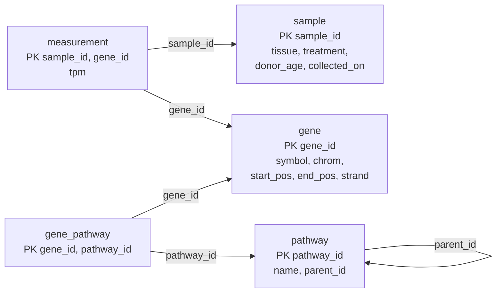

The *relational model*, proposed by E. F. Codd in 1970, is the foundation of SQL and of most database systems. Its idea is to represent all data in one simple structure, the relation, a set of tuples in the sense of discrete mathematics ([1.2](/1.2)), and to answer queries with a small set of operations on relations, the relational algebra. Because a relation says nothing about how it is stored, the model gives the physical data independence described in [4.13.1](/4.13.1#sec-1.3.2); because the operations are few and precisely defined, queries can be analyzed, rewritten and optimized ([4.13.9](/4.13.9)). This chapter defines the structures and keys of the model, the algebra and its relationship with the relational calculus, and the null values that every real system adds. The next chapter, [4.13.3](/4.13.3), shows how SQL expresses all of this; the examples here already use the gene-expression database that it creates.

## 2.1. Structure of Relational Databases

### 2.1.1. Relations

A relational database consists of tables. Each table has a name and a fixed set of named columns, and each row records a fact, such as "gene TP53 lies on chromosome 17". The formal definitions follow.

**Definition 2.1.1 (Domain and Attribute)** An **attribute** is a name for a column, with an associated set of permitted values, its **domain** $\operatorname{dom}(A)$. A domain is **atomic** if its elements are regarded as indivisible by the database: an integer, a string or a date, but not a set or a list of values.

**Definition 2.1.2 (Relation Schema, Tuple, Relation)** A **relation schema** $R = (A_1, \dots, A_n)$ is a finite list of distinct attributes; we write $r(R)$ for a relation named $r$ on the schema $R$. A **tuple** on $R$ is a function $t$ that assigns to each attribute $A_i$ a value $t[A_i] \in \operatorname{dom}(A_i)$; for a set of attributes $X \subseteq R$, $t[X]$ is the restriction of $t$ to $X$. A **relation** on $R$ (also a *relation instance*) is a finite set of tuples on $R$. The number $n$ of attributes is the *degree* of the relation.

Up to the order of the attributes, a relation on $R$ is a finite subset of the Cartesian product $\operatorname{dom}(A_1) \times \cdots \times \operatorname{dom}(A_n)$, that is, an $n$-ary relation in the sense of set theory; this is the origin of the name. In database usage, *table*, *row* and *column* are the informal synonyms of relation, tuple and attribute.

Several properties follow directly from the definition:

- The tuples of a relation are not ordered: a relation is a set. Two relations with the same tuples in a different order are equal.
- A relation contains no duplicate tuples. (SQL tables are multisets and may contain duplicates, [4.13.3](/4.13.3#sec-3.3.3).)
- Attributes are identified by name, not by position, so the order of the columns does not matter either.
- Every value is a single element of an atomic domain. Requiring atomic domains is the first normal form ([4.13.6](/4.13.6#sec-6.7)); a column holding a list of pathway names would violate it.

A special value null, which belongs to every domain and signifies an unknown or nonexistent value, is added in practice; §2.6 discusses it.

**Example 2.1.1** The running example ([4.13.3](/4.13.3#sec-3.2.3)) has five relation schemas, written with the primary key (§2.2) underlined in textbooks and listed first here:

$$
\begin{aligned}
&\mathit{gene}(\underline{\mathit{gene\_id}}, \mathit{symbol}, \mathit{chrom}, \mathit{start\_pos}, \mathit{end\_pos}, \mathit{strand})\\
&\mathit{sample}(\underline{\mathit{sample\_id}}, \mathit{tissue}, \mathit{treatment}, \mathit{donor\_age}, \mathit{collected\_on})\\
&\mathit{measurement}(\underline{\mathit{sample\_id}, \mathit{gene\_id}}, \mathit{tpm})\\
&\mathit{pathway}(\underline{\mathit{pathway\_id}}, \mathit{name}, \mathit{parent\_id})\\
&\mathit{gene\_pathway}(\underline{\mathit{gene\_id}, \mathit{pathway\_id}})
\end{aligned}
$$

Part of the current instance of $\mathit{gene}$ (identifiers shortened to their last digits):

| gene_id | symbol | chrom | start_pos | end_pos | strand |
|---|---|---|---|---|---|
| …141510 | TP53 | chr17 | 7661779 | 7687538 | − |
| …012048 | BRCA1 | chr17 | 43044295 | 43125483 | − |
| …124762 | CDKN1A | chr6 | 36676460 | 36687339 | + |
| …075624 | ACTB | chr7 | 5526409 | 5563902 | − |

Each row is a tuple $t$ with, for instance, $t[\mathit{symbol}] = \text{TP53}$ and $t[\mathit{chrom}, \mathit{strand}] = (\text{chr17}, -)$.

### 2.1.2. Database Schema and Instance

**Definition 2.1.3 (Database Schema)** A **database schema** is a set of relation schemas together with the integrity constraints on them; a *database instance* assigns to each relation schema a relation.

This is the schema/instance distinction of [4.13.1](/4.13.1#sec-1.2.2) made precise. A relation schema corresponds to a type, a relation to a value of that type. How the relation schemas of a database are chosen, which facts go into which relation, is the problem of database design ([4.13.5](/4.13.5), [4.13.6](/4.13.6)). For example, the many-to-many association between genes and pathways is not stored in $\mathit{gene}$ (that would need a list-valued attribute) but in the separate relation $\mathit{gene\_pathway}$.

## 2.2. Keys

### 2.2.1. Superkeys, Candidate Keys and Primary Keys

The tuples of a relation must be distinguishable by their values, since there is no other way to refer to them. Keys formalize this.

**Definition 2.2.1 (Superkey and Candidate Key)** Let $R$ be a relation schema. A set of attributes $K \subseteq R$ is a **superkey** of $R$ if no legal relation $r(R)$ contains two distinct tuples $t_1 \ne t_2$ with $t_1[K] = t_2[K]$. A superkey is a **candidate key** if no proper subset of it is a superkey.

"Legal" is essential: a key is a statement about every relation that the application can ever produce, not a property that the current instance happens to have. In the current instance of $\mathit{sample}$ the donor age happens to distinguish the samples, but it is not a key, because two donors may have the same age. Keys are therefore part of the schema, declared by the designer from knowledge of the world.

**Definition 2.2.2 (Primary Key)** The **primary key** of a relation schema is a candidate key chosen by the designer as the principal means of identifying tuples. Primary-key attributes may not be null.

**Example 2.2.1** In $\mathit{gene}$, the identifier $\{\mathit{gene\_id}\}$ and the symbol $\{\mathit{symbol}\}$ are both candidate keys (the HGNC assigns each gene a unique symbol), and $\{\mathit{gene\_id}, \mathit{chrom}\}$ is a superkey that is not a candidate key. The primary key is $\mathit{gene\_id}$, because symbols are occasionally renamed while Ensembl identifiers are stable. In $\mathit{measurement}$ neither $\mathit{sample\_id}$ nor $\mathit{gene\_id}$ alone is a key, but the pair is: each gene is measured at most once per sample. The other candidate key of $\mathit{gene}$ is declared in SQL as `UNIQUE`.

Every relation has at least one superkey, the set $R$ of all its attributes (a relation is a set, so no two tuples agree everywhere), and hence at least one candidate key. A good primary key is minimal, never null and *stable*, since every reference to the tuple stores it. When no natural attribute qualifies, a *surrogate key* generated by the system is used ([4.13.3](/4.13.3#sec-3.2.2)).

### 2.2.2. Foreign Keys and Referential Integrity

Relations refer to each other through their key values: a measurement refers to its sample by storing the sample's identifier.

**Definition 2.2.3 (Foreign Key and Referential Integrity)** Let $r_1(R_1)$ and $r_2(R_2)$ be relations and $K$ the primary key of $R_2$. A list of attributes $F$ of $R_1$ is a **foreign key** from $r_1$ referencing $r_2$ if it is required that for every tuple $t_1 \in r_1$ there is a tuple $t_2 \in r_2$ with $t_1[F] = t_2[K]$. This requirement is a **referential integrity constraint**; $r_1$ is the *referencing* and $r_2$ the *referenced* relation.

More generally, a referential integrity constraint may require only that $t_1[F]$ appear among the values of some attributes of $r_2$ that form a candidate key; SQL also allows the referenced attributes to be any `UNIQUE` columns. A foreign key may be null when the reference is optional, as $\mathit{parent\_id}$ of a top-level pathway.

**Example 2.2.2** The foreign keys of the running example are $\mathit{measurement}.\mathit{sample\_id} \to \mathit{sample}$, $\mathit{measurement}.\mathit{gene\_id} \to \mathit{gene}$, $\mathit{gene\_pathway}.\mathit{gene\_id} \to \mathit{gene}$, $\mathit{gene\_pathway}.\mathit{pathway\_id} \to \mathit{pathway}$, and $\mathit{pathway}.\mathit{parent\_id} \to \mathit{pathway}$, a relation that references itself. Inserting a measurement for sample S99, which does not exist, violates the first of them, and the DBMS rejects it ([4.13.3](/4.13.3#sec-3.2.3)).

A *schema diagram* draws each relation as a box listing its attributes, with the primary key marked, and draws an arrow from each foreign key to the referenced relation:

## 2.3. The Relational Algebra

### 2.3.1. The Fundamental Operations

**Definition 2.3.1 (Relational Algebra)** The **relational algebra** is a procedural query language consisting of a set of operations that take one or two relations as input and produce a relation as output. Its fundamental operations are selection, projection, union, set difference, Cartesian product and rename; its expressions are built from relation names and constant relations by applying the operations.

Because every operation returns a relation, operations compose like arithmetic operators: the output of one is the input of another. Throughout, $r$ and $s$ are relations on the schemas $R$ and $S$.

**Definition 2.3.2 (Selection)** For a predicate $\theta$ on the attributes of $R$, the **selection** $\sigma_\theta(r) = \{\, t \in r \mid \theta(t) \,\}$ is the relation of the tuples of $r$ that satisfy $\theta$. The predicate is built from comparisons $A \mathbin{\mathrm{op}} B$ and $A \mathbin{\mathrm{op}} c$ (attribute names $A, B$, a constant $c$, $\mathrm{op} \in \{=, \ne, <, \le, >, \ge\}$) with $\land$, $\lor$ and $\lnot$.

**Definition 2.3.3 (Projection)** For a set of attributes $X \subseteq R$, the **projection** $\Pi_X(r) = \{\, t[X] \mid t \in r \,\}$ is the relation on $X$ obtained by keeping only the attributes in $X$; because the result is a set, tuples that become equal are merged.

Selection picks rows and projection picks columns. For example, $\sigma_{\mathit{chrom} = \text{chr17}}(\mathit{gene})$ returns the two genes TP53 and BRCA1, and $\Pi_{\mathit{tissue}}(\mathit{sample}) = \{(\text{liver}), (\text{lung})\}$ has two tuples although $\mathit{sample}$ has six, because projection removes duplicates.

**Definition 2.3.4 (Set Operations on Relations)** Two relations $r$ and $s$ are *union-compatible* if they have the same degree and the domains of their $i$-th attributes agree for every $i$. For union-compatible $r$ and $s$, $r \cup s$ is the relation of the tuples in $r$ or in $s$, and $r - s$ the relation of the tuples in $r$ but not in $s$; the result takes the attribute names of $r$.

These are the **union** and **set difference** of sets of tuples. Union combines the answers of two queries ("genes on chromosome 17 or in pathway PW3"); difference expresses negation ("genes in no pathway").

**Definition 2.3.5 (Cartesian Product and Rename)** If $R$ and $S$ have no attribute in common, the **Cartesian product** $r \times s$ is the relation on $R \cup S$ containing, for every $t_r \in r$ and $t_s \in s$, the tuple $t$ with $t[R] = t_r$ and $t[S] = t_s$. The **rename** operation $\rho_x(E)$ returns the result of the expression $E$ under the name $x$; $\rho_{x(B_1,\dots,B_n)}(E)$ also renames its attributes to $B_1,\dots,B_n$.

When the two schemas share attribute names, the attributes of the product are qualified by the relation name ($\mathit{gene}.\mathit{gene\_id}$ and $\mathit{gene\_pathway}.\mathit{gene\_id}$); rename makes this possible when a relation is combined with itself. The product has $\lvert r\rvert \cdot \lvert s\rvert$ tuples and is almost always followed by a selection.

**Example 2.3.1** The symbols of the genes annotated to pathway PW3:

$$
\Pi_{\mathit{symbol}}\bigl(\sigma_{\mathit{gene}.\mathit{gene\_id} = \mathit{gene\_pathway}.\mathit{gene\_id} \,\land\, \mathit{pathway\_id} = \text{PW3}}(\mathit{gene} \times \mathit{gene\_pathway})\bigr) = \{\text{TP53}, \text{CDKN1A}, \text{MDM2}\}.
$$

The selection first matches each gene with its own annotations, then keeps those for PW3.

**Example 2.3.2** Pairs of distinct genes on the same chromosome need two copies of $\mathit{gene}$:

$$
\Pi_{a.\mathit{symbol},\, b.\mathit{symbol}}\bigl(\sigma_{a.\mathit{chrom} = b.\mathit{chrom} \,\land\, a.\mathit{symbol} < b.\mathit{symbol}}(\rho_a(\mathit{gene}) \times \rho_b(\mathit{gene}))\bigr).
$$

The condition $a.\mathit{symbol} < b.\mathit{symbol}$ removes the pairs of a gene with itself and lists each pair once. The result is {(BRCA1, TP53), (GAPDH, MDM2), (ACTB, EGFR)}.

**Example 2.3.3** The genes that belong to no pathway are those whose identifier is in $\mathit{gene}$ but not in $\mathit{gene\_pathway}$:

$$
\Pi_{\mathit{gene\_id}}(\mathit{gene}) - \Pi_{\mathit{gene\_id}}(\mathit{gene\_pathway}) = \{\text{…075624}\}, \text{ the gene ACTB}.
$$

**Example 2.3.4** The largest donor age, without any aggregate operation: an age is not the largest if some other sample has a larger one, so

$$
\Pi_{\mathit{donor\_age}}(\mathit{sample}) - \Pi_{s.\mathit{donor\_age}}\bigl(\sigma_{s.\mathit{donor\_age} < t.\mathit{donor\_age}}(\rho_s(\mathit{sample}) \times \rho_t(\mathit{sample}))\bigr).
$$

Ignoring for the moment the unknown age of S05 (§2.6), the ages are 54, 61, 58, 47 and 66; the subtracted relation contains every age except 66, and the result is $\{66\}$. The construction, a difference of all candidates and the dominated ones, is the general way of expressing "maximal" in the algebra.

### 2.3.2. Derived Operations

Some combinations of the fundamental operations are so common that they have their own symbols. They add no expressive power, as the theorems below show, but they make expressions shorter and, more importantly, can be implemented much faster than the expressions that define them ([4.13.9](/4.13.9)).

**Definition 2.3.6 (Intersection, Theta Join, Natural Join)** For union-compatible $r$ and $s$, the **intersection** $r \cap s$ is the relation of the tuples in both. For a predicate $\theta$ on $R \cup S$, the **theta join** is $r \bowtie_\theta s = \sigma_\theta(r \times s)$; it is an **equijoin** if $\theta$ is a conjunction of equalities. The **natural join** $r \bowtie s$ is the relation on $R \cup S$ of all tuples $t$ such that $t[R] \in r$ and $t[S] \in s$.

The natural join pairs the tuples of $r$ and $s$ that agree on all common attributes and keeps one copy of each common attribute. If $R \cap S = \varnothing$, it is the Cartesian product.

**Theorem 2.3.1** For union-compatible $r$ and $s$, $r \cap s = r - (r - s)$. For $R \cap S = \{A_1, \dots, A_k\}$,

$$
r \bowtie s = \Pi_{R \cup S}\bigl(\sigma_{r.A_1 = s.A_1 \land \cdots \land r.A_k = s.A_k}(r \times s)\bigr),
$$

where the projection keeps one copy $A_i$ of each pair $r.A_i, s.A_i$.

**Proof** A tuple $t$ lies in $r - (r - s)$ if and only if $t \in r$ and not ($t \in r$ and $t \notin s$), that is, if and only if $t \in r$ and $t \in s$. For the join, a tuple of the product is a pair $(t_r, t_s)$ with $t_r \in r$, $t_s \in s$, and it passes the selection exactly when $t_r[A_i] = t_s[A_i]$ for all common attributes. For such a pair the two copies of each common attribute have the same value, so the projection yields a well-defined tuple $t$ on $R \cup S$ with $t[R] = t_r \in r$ and $t[S] = t_s \in s$. Conversely, every $t$ in $r \bowtie s$ arises in this way from the pair $(t[R], t[S])$. $\square$

**Proposition 2.3.2** The natural join is commutative and associative: $r \bowtie s = s \bowtie r$ and $(r \bowtie s) \bowtie u = r \bowtie (s \bowtie u)$.

**Proof** Both sides of the second identity are the set of tuples $t$ on $R \cup S \cup U$ with $t[R] \in r$, $t[S] \in s$ and $t[U] \in u$: for the left side, $t \in (r \bowtie s) \bowtie u$ means $t[R \cup S] \in r \bowtie s$ and $t[U] \in u$, and $t[R \cup S] \in r \bowtie s$ means $t[R] \in r$ and $t[S] \in s$; the right side is symmetric. Commutativity is immediate from the definition. $\square$

Associativity lets us write $\mathit{gene} \bowtie \mathit{gene\_pathway} \bowtie \mathit{pathway}$ without parentheses, and lets the optimizer choose the order in which the joins are computed.

The last derived operation answers queries with "for all".

**Definition 2.3.7 (Division)** Let $S \subseteq R$ and $Y = R - S$. The **division** $r \div s$ is the relation on $Y$ of all tuples $t \in \Pi_Y(r)$ such that for every $u \in s$ the tuple on $R$ that combines $t$ and $u$, written $(t, u)$, belongs to $r$.

**Theorem 2.3.3** With $Y = R - S$,

$$
r \div s = \Pi_Y(r) - \Pi_Y\bigl((\Pi_Y(r) \times s) - r\bigr).
$$

**Proof** Both sides are subsets of $\Pi_Y(r)$; take $t \in \Pi_Y(r)$. The relation $(\Pi_Y(r) \times s) - r$ consists of the combinations $(t', u)$ with $t' \in \Pi_Y(r)$ and $u \in s$ that are missing from $r$. Hence $t$ belongs to its projection on $Y$ if and only if some $u \in s$ has $(t, u) \notin r$, that is, if and only if $t \notin r \div s$. Subtracting these tuples from $\Pi_Y(r)$ leaves exactly $r \div s$. $\square$

**Example 2.3.5** The samples in which every gene was measured:

$$
\Pi_{\mathit{sample\_id}, \mathit{gene\_id}}(\mathit{measurement}) \div \Pi_{\mathit{gene\_id}}(\mathit{gene}) = \{\text{S01}, \text{S02}, \text{S03}, \text{S04}\},
$$

since EGFR is missing in S05 and S06. In the formula of Theorem 2.3.3, $(\Pi_Y(r) \times s) - r$ is the set of the two missing (sample, gene) pairs, (S05, EGFR) and (S06, EGFR). SQL has no division operator; [4.13.4](/4.13.4#sec-4.2) expresses this query with `NOT EXISTS` and with counting.

The *assignment* $\mathit{temp} \leftarrow E$ stores the result of $E$ under a temporary name for use in later expressions, which makes long queries readable; it is the algebraic counterpart of the `WITH` clause of SQL.

### 2.3.3. Extended Operations

Practical queries need operations beyond the basic algebra. The three extensions below correspond directly to SQL features.

**Definition 2.3.8 (Generalized Projection and Aggregation)** The *generalized projection* $\Pi_{F_1, \dots, F_k}(E)$ allows arithmetic expressions $F_i$ over the attributes, as in $\Pi_{\mathit{symbol},\, \mathit{end\_pos} - \mathit{start\_pos} + 1}(\mathit{gene})$. The **aggregation** $_{G_1, \dots, G_m}\gamma_{F_1(A_1), \dots, F_k(A_k)}(E)$ partitions the tuples of $E$ into groups with equal values of $G_1, \dots, G_m$ and returns, for each group, the values $G_1, \dots, G_m$ together with the aggregate functions $F_i$ (`count`, `sum`, `avg`, `min`, `max`) applied to the multiset of values of $A_i$ in the group.

For example, $_{\mathit{tissue}}\gamma_{\mathrm{count}(\mathit{sample\_id})}(\mathit{sample}) = \{(\text{liver}, 3), (\text{lung}, 3)\}$. The aggregate is applied to a multiset: the average of the TPM values must count equal values as often as they occur, so aggregation is the one place where the set-based algebra needs duplicates.

The outer joins extend the natural join (or a theta join) by the tuples that have no partner, padded with nulls: the left outer join $r \bowtie_{\mathrm{left}} s$ adds the tuples of $r$ without a partner in $s$, the right outer join $r \bowtie_{\mathrm{right}} s$ those of $s$, and the full outer join $r \bowtie_{\mathrm{full}} s$ both (textbooks draw them as ⟕, ⟖ and ⟗). They can be expressed by the basic operations together with a constant relation of nulls; for the left outer join,

$$
r \bowtie_{\mathrm{left}} s = (r \bowtie s) \cup \bigl((r - \Pi_R(r \bowtie s)) \times \{(\mathrm{null}, \dots, \mathrm{null})\}\bigr),
$$

where the constant relation has one tuple on $S - R$. In SQL these are the **left join** and the **full outer join** ([4.13.3](/4.13.3#sec-3.4.3)).

### 2.3.4. Writing Queries in the Algebra

An algebra expression is a tree whose leaves are relations and whose inner nodes are operations, evaluated from the leaves up; this tree is also the form in which a database system represents a query plan ([4.13.9](/4.13.9)). A query is usually developed backwards from the result: which attributes are wanted, which relations contain them, how the relations are connected, and which conditions restrict them.

**Example 2.3.6** "Names of the pathways containing a gene with more than 100 TPM in some lung sample." The answer attribute $\mathit{name}$ is in $\mathit{pathway}$; the TPM values are in $\mathit{measurement}$, the tissue in $\mathit{sample}$, and $\mathit{gene\_pathway}$ connects measurements (through $\mathit{gene\_id}$) with pathways. All connections are on equally named attributes, so natural joins suffice:

$$
\Pi_{\mathit{name}}\Bigl(\sigma_{\mathit{tpm} > 100 \,\land\, \mathit{tissue} = \text{lung}}\bigl(\mathit{measurement} \bowtie \mathit{sample} \bowtie \mathit{gene\_pathway} \bowtie \mathit{pathway}\bigr)\Bigr) = \{\text{Glycolysis}, \text{p53-dependent G1 arrest}\}.
$$

GAPDH (Glycolysis) and CDKN1A (p53-dependent G1 arrest) exceed 100 TPM in the lung samples; ACTB does too but belongs to no pathway. An equivalent and cheaper expression selects early, before the joins enlarge the data:

$$
\Pi_{\mathit{name}}\Bigl(\bigl(\sigma_{\mathit{tpm} > 100}(\mathit{measurement}) \bowtie \sigma_{\mathit{tissue} = \text{lung}}(\mathit{sample})\bigr) \bowtie \mathit{gene\_pathway} \bowtie \mathit{pathway}\Bigr).
$$

A natural join is safe here only because the shared attribute names mean the same thing. Joining $\mathit{pathway}$ with $\mathit{gene}$ would be a Cartesian product, and joining two relations that both had an attribute $\mathit{name}$ with different meanings would silently demand equal names.

**Example 2.3.7** "Genes whose expression exceeded 50 TPM in every treated lung sample." Let

$$
T \leftarrow \Pi_{\mathit{sample\_id}}\bigl(\sigma_{\mathit{treatment} = \text{treated} \,\land\, \mathit{tissue} = \text{lung}}(\mathit{sample})\bigr),
$$

the samples S05 and S06. Then

$$
\Pi_{\mathit{symbol}}\Bigl(\mathit{gene} \bowtie \bigl(\Pi_{\mathit{gene\_id}, \mathit{sample\_id}}(\sigma_{\mathit{tpm} > 50}(\mathit{measurement})) \div T\bigr)\Bigr) = \{\text{GAPDH}, \text{ACTB}, \text{TP53}, \text{CDKN1A}\}.
$$

TP53 (55.3 and 51.0) and CDKN1A (141.5 and 120.8) qualify together with the two housekeeping genes; MDM2 (36.8 and 33.1), MYC and BRCA1 stay below 50, and EGFR was not measured in these samples, so it cannot satisfy "every".

## 2.4. Equivalence of Expressions

Two algebra expressions are *equivalent* if they produce the same relation on every legal database instance. Equivalences are the basis of query optimization ([4.13.9](/4.13.9)): the optimizer replaces an expression by an equivalent one that is cheaper to evaluate. The most useful ones are:

| Rule | Equivalence | Condition |
|---|---|---|
| cascade of selections | $\sigma_{\theta_1 \land \theta_2}(E) = \sigma_{\theta_1}(\sigma_{\theta_2}(E))$ | — |
| commuting selections | $\sigma_{\theta_1}(\sigma_{\theta_2}(E)) = \sigma_{\theta_2}(\sigma_{\theta_1}(E))$ | — |
| cascade of projections | $\Pi_{X}(\Pi_{Y}(E)) = \Pi_X(E)$ | $X \subseteq Y$ |
| selection into a product | $\sigma_\theta(E_1 \times E_2) = E_1 \bowtie_\theta E_2$ | definition of the theta join |
| pushing a selection | $\sigma_{\theta}(E_1 \bowtie E_2) = \sigma_{\theta}(E_1) \bowtie E_2$ | $\theta$ involves only attributes of $E_1$ |
| join order | $E_1 \bowtie E_2 = E_2 \bowtie E_1$, $(E_1 \bowtie E_2) \bowtie E_3 = E_1 \bowtie (E_2 \bowtie E_3)$ | Proposition 2.3.2 |
| selection over union and difference | $\sigma_\theta(E_1 \cup E_2) = \sigma_\theta(E_1) \cup \sigma_\theta(E_2)$, likewise for $-$ | — |

**Proposition 2.4.1** If $\theta$ involves only attributes of $E_1$, then $\sigma_\theta(E_1 \bowtie E_2) = \sigma_\theta(E_1) \bowtie E_2$.

**Proof** A tuple $t$ belongs to the left side if and only if $t[R_1] \in E_1$, $t[R_2] \in E_2$ and $\theta(t)$ holds. Since $\theta$ refers only to attributes of $R_1$, $\theta(t)$ holds if and only if $\theta(t[R_1])$ does, so the condition is equivalent to $t[R_1] \in \sigma_\theta(E_1)$ and $t[R_2] \in E_2$, which is membership in the right side. $\square$

The second form of Example 2.3.6 was obtained by this rule. Pushing selections down is the single most effective rewriting, because a join of filtered inputs is usually far smaller than a join of the full relations.

The operations differ in a way that matters for both expressiveness and implementation: selection, projection, union, Cartesian product and the joins are *monotone*, meaning that adding tuples to the inputs can only add tuples to the output, whereas set difference and division are not (a new annotation can remove ACTB from Example 2.3.3). A query whose answer can shrink when the database grows, such as any query containing "no" or "every", therefore needs difference.

## 2.5. Relational Calculus

The relational algebra is procedural: an expression prescribes a sequence of operations. The relational calculus is the declarative counterpart, based on first-order **predicate logic**: a query describes the tuples of the result by a formula.

**Definition 2.5.1 (Tuple Relational Calculus)** A query of the **tuple relational calculus** has the form $\{\, t \mid P(t) \,\}$, the set of all tuples $t$ for which the formula $P$ is true. Formulas are built from atoms $t \in r$, $t[A] \mathbin{\mathrm{op}} s[B]$ and $t[A] \mathbin{\mathrm{op}} c$ with $\land$, $\lor$, $\lnot$, $\to$ and the quantifiers $\exists s \in r$ and $\forall s \in r$.

The *domain relational calculus* is similar, but its variables range over the values of attributes rather than over tuples: $\{\, \langle x_1, \dots, x_n\rangle \mid P(x_1, \dots, x_n) \,\}$.

**Example 2.5.1** The symbols of the genes in no pathway (Example 2.3.3):

$$
\{\, t \mid \exists g \in \mathit{gene}\,\bigl(t[\mathit{symbol}] = g[\mathit{symbol}] \land \lnot \exists a \in \mathit{gene\_pathway}\,(a[\mathit{gene\_id}] = g[\mathit{gene\_id}])\bigr) \,\}.
$$

The samples in which every gene was measured (Example 2.3.5) use a universal quantifier, which is the calculus form of division:

$$
\{\, t \mid \exists s \in \mathit{sample}\,\bigl(t[\mathit{sample\_id}] = s[\mathit{sample\_id}] \land \forall g \in \mathit{gene}\; \exists m \in \mathit{measurement}\,(m[\mathit{sample\_id}] = s[\mathit{sample\_id}] \land m[\mathit{gene\_id}] = g[\mathit{gene\_id}])\bigr) \,\}.
$$

Not every formula is a sensible query. $\{\, t \mid \lnot (t \in \mathit{gene}) \,\}$ describes all tuples that are not genes, an infinite set that depends on the domains rather than on the database. A calculus expression is *safe* if all values in its result come from the relations and constants mentioned in it; the formal definitions of safety restrict negation and quantification so that this holds. SQL's `NOT EXISTS` and `EXISTS` subqueries ([4.13.4](/4.13.4#sec-4.1)) are taken directly from the tuple relational calculus.

**Theorem 2.5.1 (Codd)** The relational algebra (with the six fundamental operations), the safe tuple relational calculus and the safe domain relational calculus are equally expressive: every query expressible in one of them is expressible in the others.

Codd (1972) proved this and called a query language *relationally complete* if it can express every query of the relational algebra. SQL is relationally complete, and goes beyond it with aggregation, ordering and recursion. The algebra has real limits: Aho and Ullman (1979) showed that the transitive closure of a relation, for instance "all ancestors of a pathway" in the hierarchy given by $\mathit{parent\_id}$, cannot be expressed by any relational-algebra expression, because each expression joins a bounded number of copies of the relation and so follows paths of bounded length only. SQL therefore added recursive queries ([4.13.4](/4.13.4#sec-4.3)); compare the **transitive closure** of a relation in discrete mathematics.

## 2.6. Null Values and Three-Valued Logic

In practice some attribute values are unknown (the donor age of sample S05 was not recorded) or do not apply (a top-level pathway has no parent). The relational model represents both by a single special value.

**Definition 2.6.1 (Null Value)** The **null value**, written null (`NULL` in SQL), is a special value in every domain that indicates that the value is unknown or does not exist.

Null is not a value like the others: an unknown age cannot be said to be larger or smaller than 50. Comparisons involving null therefore have a third truth value, *unknown*, and the logical connectives are extended accordingly.

**Definition 2.6.2 (Three-Valued Logic)** In **three-valued logic** the truth values are true, false and unknown. Any comparison $x \mathbin{\mathrm{op}} y$ in which $x$ or $y$ is null has the value unknown, and the connectives are defined by:

| $p$ | $q$ | $p \land q$ | $p \lor q$ | $\lnot p$ |
|---|---|---|---|---|
| true | unknown | unknown | true | false |
| false | unknown | false | unknown | true |
| unknown | unknown | unknown | unknown | unknown |

together with the usual tables when neither operand is unknown.

The rules are those of Kleene's strong three-valued logic: read unknown as "true or false, we do not know which", and the result is unknown exactly when the two possibilities would give different results. Thus false $\land$ unknown is false (whatever the unknown is, the conjunction is false), and true $\lor$ unknown is true.

The operations of the algebra treat null as follows:

- A selection keeps a tuple only if the predicate is *true*; tuples for which it is false or unknown are dropped. So $\sigma_{\mathit{donor\_age} > 50}(\mathit{sample})$ and $\sigma_{\lnot(\mathit{donor\_age} > 50)}(\mathit{sample})$ together miss S05: the law of the excluded middle fails.
- A join condition comparing a null with anything is unknown, so a tuple with a null in a join attribute finds no partner.
- Projection, union, intersection, difference and grouping treat two nulls as identical, as if null were an ordinary value; this is needed to make duplicate elimination well defined.
- Aggregates ignore nulls, except that counting tuples counts them; the aggregate of an empty multiset is null (`count` gives 0).
- A special test, "is null", is true for nulls and false otherwise; it is never unknown.

Nulls make several otherwise valid equivalences false. In Example 2.3.4, the unknown age of S05 is not subtracted (no comparison with it is true), so it survives the difference: in the algebra with nulls the result is $\{66, \mathrm{null}\}$, and the query needs an additional selection "$\mathit{donor\_age}$ is not null". SQL's aggregate `max` ignores the null and returns 66 directly. Codd later proposed distinguishing "unknown" from "inapplicable" values, but no system adopted it; avoiding nulls where possible, by `NOT NULL` constraints and by splitting optional data into separate relations, is the usual design advice ([4.13.6](/4.13.6)). SQL's treatment of nulls in detail is given in [4.13.3](/4.13.3#sec-3.7).

## Summary

- A relation on a schema $R = (A_1,\dots,A_n)$ is a finite set of tuples, each assigning to every attribute a value from its atomic domain; tuples and attributes are unordered and there are no duplicates.
- A superkey determines a tuple uniquely in every legal relation; a candidate key is a minimal superkey; the primary key is the chosen candidate key. A foreign key's values must appear as key values of the referenced relation (referential integrity).
- The fundamental operations of the relational algebra are $\sigma$, $\Pi$, $\cup$, $-$, $\times$ and $\rho$. Intersection, theta join, natural join and division are derived: $r \cap s = r - (r - s)$, $r \bowtie s = \Pi(\sigma(r \times s))$, $r \div s = \Pi_Y(r) - \Pi_Y((\Pi_Y(r) \times s) - r)$. Aggregation $\gamma$ and outer joins extend the algebra.
- Equivalences such as pushing selections into joins are the basis of query optimization; difference and division are the non-monotone operations needed for "no" and "every".
- The tuple and domain relational calculus are declarative; their safe forms have exactly the power of the algebra (relational completeness). Transitive closure is beyond all three.
- Null denotes an unknown or nonexistent value; comparisons with null are unknown, selection keeps only true tuples, and the connectives follow Kleene's three-valued logic.
