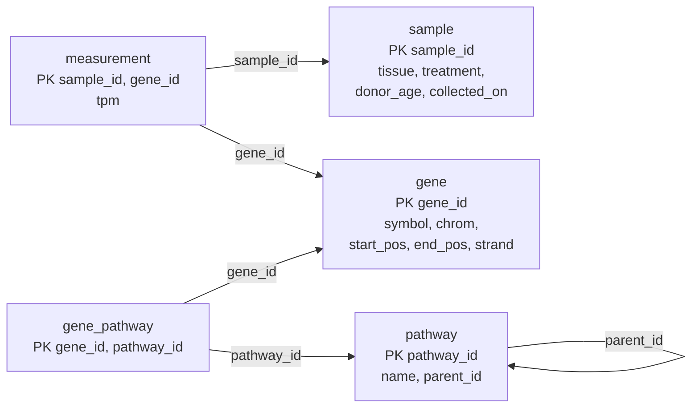

E. F. Codd 在 1970 年提出的**关系模型**是 SQL 和大多数**数据库系统**的基础。它的思想是用一种简单的结构，即关系，来表示所有数据，关系就是离散数学意义上的元组的集合（[1.2](/1.2)），并用关系上的一小组运算，即关系代数，来回答查询。关系不涉及自身如何存储，因此该模型具有 [4.13.1](/4.13.1#sec-1.3.2) 所述的**物理数据独立性**；运算数量少且定义精确，因此查询可以被分析、改写和优化（[4.13.9](/4.13.9)）。本章定义模型的结构与码、关系代数及其与关系演算的关系，以及每个实际系统都要增加的空值。下一章 [4.13.3](/4.13.3) 说明 SQL 如何表达这一切；本章的例子已经使用它所创建的基因表达**数据库**。

## 2.1. 关系数据库的结构

### 2.1.1. 关系

关系**数据库**由表构成。每个表有一个名字和一组固定的、有名字的列，每一行记录一个事实，例如“基因 TP53 位于 17 号染色体”。形式化定义如下。

**定义 2.1.1（域与属性）** **属性**是列的名字，并带有一个允许取值的集合，即它的**域** $\operatorname{dom}(A)$。如果数据库把域中的元素视为不可再分的，则该域是**原子的**：整数、字符串或日期，而不是值的集合或列表。

**定义 2.1.2（关系模式、元组、关系）** **关系模式** $R = (A_1, \dots, A_n)$ 是由互不相同的属性构成的有限列表；用 $r(R)$ 表示模式 $R$ 上名为 $r$ 的关系。$R$ 上的**元组**是一个函数 $t$，它给每个属性 $A_i$ 指定一个值 $t[A_i] \in \operatorname{dom}(A_i)$；对属性集 $X \subseteq R$，$t[X]$ 是 $t$ 在 $X$ 上的限制。$R$ 上的**关系**（也称*关系实例*）是 $R$ 上元组的有限集合。属性个数 $n$ 称为关系的*度*。

不计**属性**的顺序，$R$ 上的**关系**就是**笛卡儿积** $\operatorname{dom}(A_1) \times \cdots \times \operatorname{dom}(A_n)$ 的有限子集，也就是集合论意义上的 $n$ 元关系；“关系”一名即由此而来。在数据库的习惯用法中，*表*、*行*和*列*分别是关系、元组和属性的非正式同义词。

由定义可以直接得到几条性质：

- 关系的**元组**没有顺序：关系是集合。元组相同而顺序不同的两个关系相等。
- 关系不含重复元组。（SQL 的表是多重集，可以含有重复，[4.13.3](/4.13.3#sec-3.3.3)。）
- 属性靠名字而不是位置来识别，所以列的顺序也无关紧要。
- 每个值都是某个原子**域**中的单个元素。要求域是原子的就是第一范式（[4.13.6](/4.13.6#sec-6.7)）；存放通路名称列表的列会违反这一要求。

实际系统中还增加一个特殊值空值，它属于每个域，表示未知或不存在的值；§2.6 讨论它。

**例 2.1.1** 运行示例（[4.13.3](/4.13.3#sec-3.2.3)）有五个**关系模式**，教材中在主码（§2.2）下面加下划线，这里主码列在最前面：

$$
\begin{aligned}
&\mathit{gene}(\underline{\mathit{gene\_id}}, \mathit{symbol}, \mathit{chrom}, \mathit{start\_pos}, \mathit{end\_pos}, \mathit{strand})\\
&\mathit{sample}(\underline{\mathit{sample\_id}}, \mathit{tissue}, \mathit{treatment}, \mathit{donor\_age}, \mathit{collected\_on})\\
&\mathit{measurement}(\underline{\mathit{sample\_id}, \mathit{gene\_id}}, \mathit{tpm})\\
&\mathit{pathway}(\underline{\mathit{pathway\_id}}, \mathit{name}, \mathit{parent\_id})\\
&\mathit{gene\_pathway}(\underline{\mathit{gene\_id}, \mathit{pathway\_id}})
\end{aligned}
$$

$\mathit{gene}$ 当前实例的一部分（标识符只保留末几位数字）：

| gene_id | symbol | chrom | start_pos | end_pos | strand |
|---|---|---|---|---|---|
| …141510 | TP53 | chr17 | 7661779 | 7687538 | − |
| …012048 | BRCA1 | chr17 | 43044295 | 43125483 | − |
| …124762 | CDKN1A | chr6 | 36676460 | 36687339 | + |
| …075624 | ACTB | chr7 | 5526409 | 5563902 | − |

每一行是一个元组 $t$，例如 $t[\mathit{symbol}] = \text{TP53}$，$t[\mathit{chrom}, \mathit{strand}] = (\text{chr17}, -)$。

### 2.1.2. 数据库模式与实例

**定义 2.1.3（数据库模式）** **数据库模式**是一组关系模式连同其上的完整性约束；*数据库实例*给每个关系模式指定一个关系。

这就是 [4.13.1](/4.13.1#sec-1.2.2) 中**模式**与实例之分的精确化。关系模式对应一个类型，关系对应该类型的一个值。数据库的关系模式如何选取、哪些事实放进哪个关系，是数据库设计的问题（[4.13.5](/4.13.5)、[4.13.6](/4.13.6)）。例如，基因与通路之间的多对多联系并不存放在 $\mathit{gene}$ 中（那需要一个取列表值的属性），而是存放在单独的关系 $\mathit{gene\_pathway}$ 中。

## 2.2. 码

### 2.2.1. 超码、候选码与主码

**关系**的**元组**必须能靠取值相互区分，因为没有别的办法指称它们。码把这一点形式化。

**定义 2.2.1（超码与候选码）** 设 $R$ 是关系模式。属性集 $K \subseteq R$ 是 $R$ 的**超码**，如果任何合法关系 $r(R)$ 中都不含两个不同的元组 $t_1 \ne t_2$ 使得 $t_1[K] = t_2[K]$。如果超码的任何真子集都不是超码，它就是**候选码**。

“合法”是关键：码是对应用可能产生的每一个关系的陈述，而不是当前实例碰巧具有的性质。在 $\mathit{sample}$ 的当前实例中，供体年龄恰好能区分各个样本，但它不是码，因为两个供体可能年龄相同。因此码是**模式**的一部分，由设计者根据对现实世界的了解来声明。

**定义 2.2.2（主码）** 关系模式的**主码**是设计者选定的、用作识别元组的主要手段的候选码。主码属性不能为空。

**例 2.2.1** 在 $\mathit{gene}$ 中，标识符 $\{\mathit{gene\_id}\}$ 与符号 $\{\mathit{symbol}\}$ 都是**候选码**（HGNC 给每个基因分配唯一的符号），而 $\{\mathit{gene\_id}, \mathit{chrom}\}$ 是**超码**但不是候选码。**主码**取 $\mathit{gene\_id}$，因为符号偶尔会改名，而 Ensembl 标识符是稳定的。在 $\mathit{measurement}$ 中，$\mathit{sample\_id}$ 和 $\mathit{gene\_id}$ 单独都不是码，但二者构成的对是码：每个基因在每个样本中至多测量一次。$\mathit{gene}$ 的另一个候选码在 SQL 中用 `UNIQUE` 声明。

每个关系至少有一个超码，即它全部**属性**的集合 $R$（关系是集合，不会有两个元组处处相同），因而至少有一个候选码。好的主码应当极小、不为空，并且是*稳定*的，因为对该元组的每个引用都要存储它。没有合适的自然属性时，就使用由系统生成的代理键（surrogate key）（[4.13.3](/4.13.3#sec-3.2.2)）。

### 2.2.2. 外码与参照完整性

关系之间通过码值相互引用：测量值通过存储样本的标识符来引用它的样本。

**定义 2.2.3（外码与参照完整性）** 设 $r_1(R_1)$ 与 $r_2(R_2)$ 是关系，$K$ 是 $R_2$ 的主码。如果要求对每个元组 $t_1 \in r_1$ 都有元组 $t_2 \in r_2$ 满足 $t_1[F] = t_2[K]$，则 $R_1$ 的属性列表 $F$ 是 $r_1$ 引用 $r_2$ 的**外码**。这一要求是**参照完整性约束**；$r_1$ 称为*参照*关系，$r_2$ 称为*被参照*关系。

更一般地，**参照完整性约束**可以只要求 $t_1[F]$ 出现在 $r_2$ 的某些构成候选码的属性的取值之中；SQL 还允许被参照的属性是任意的 `UNIQUE` 列。当引用是可选的时，**外码**可以为空，例如顶层通路的 $\mathit{parent\_id}$。

**例 2.2.2** 运行示例中的外码有 $\mathit{measurement}.\mathit{sample\_id} \to \mathit{sample}$、$\mathit{measurement}.\mathit{gene\_id} \to \mathit{gene}$、$\mathit{gene\_pathway}.\mathit{gene\_id} \to \mathit{gene}$、$\mathit{gene\_pathway}.\mathit{pathway\_id} \to \mathit{pathway}$，以及 $\mathit{pathway}.\mathit{parent\_id} \to \mathit{pathway}$，这是一个引用自身的关系。为不存在的样本 S99 插入一条测量值会违反其中的第一个，**DBMS** 会拒绝它（[4.13.3](/4.13.3#sec-3.2.3)）。

模式图（schema diagram）把每个关系画成一个方框，列出它的属性并标出主码，再从每个外码向被参照的关系画一条箭头：

## 2.3. 关系代数

### 2.3.1. 基本运算

**定义 2.3.1（关系代数）** **关系代数**是一种过程式查询语言，由一组以一个或两个关系为输入、产生一个关系为输出的运算构成。它的基本运算是选择、投影、并、集合差、笛卡儿积和更名；它的表达式由关系名和常量关系经运算构造而成。

由于每个运算都返回一个**关系**，运算可以像算术运算符那样复合：一个运算的输出是另一个运算的输入。下面总设 $r$ 与 $s$ 分别是**模式** $R$ 与 $S$ 上的关系。

**定义 2.3.2（选择）** 设 $\theta$ 是 $R$ 的属性上的谓词，则**选择** $\sigma_\theta(r) = \{\, t \in r \mid \theta(t) \,\}$ 是 $r$ 中满足 $\theta$ 的元组构成的关系。谓词由比较 $A \mathbin{\mathrm{op}} B$ 与 $A \mathbin{\mathrm{op}} c$（属性名 $A, B$，常量 $c$，$\mathrm{op} \in \{=, \ne, <, \le, >, \ge\}$）经 $\land$、$\lor$ 和 $\lnot$ 构成。

**定义 2.3.3（投影）** 设属性集 $X \subseteq R$，则**投影** $\Pi_X(r) = \{\, t[X] \mid t \in r \,\}$ 是只保留 $X$ 中属性所得的 $X$ 上的关系；因为结果是集合，变得相同的元组被合并。

**选择**取行，**投影**取列。例如 $\sigma_{\mathit{chrom} = \text{chr17}}(\mathit{gene})$ 返回 TP53 和 BRCA1 两个基因，而 $\Pi_{\mathit{tissue}}(\mathit{sample}) = \{(\text{liver}), (\text{lung})\}$ 只有两个**元组**，尽管 $\mathit{sample}$ 有六个，原因是投影去除了重复。

**定义 2.3.4（关系上的集合运算）** 如果两个关系 $r$ 与 $s$ 的度相同，且对每个 $i$，第 $i$ 个属性的域一致，就称它们是*并相容*的。对并相容的 $r$ 与 $s$，$r \cup s$ 是在 $r$ 中或在 $s$ 中的元组构成的关系，$r - s$ 是在 $r$ 中但不在 $s$ 中的元组构成的关系；结果沿用 $r$ 的属性名。

这就是元组集合的**并集**与**差集**。并用来合并两个查询的答案（“位于 17 号染色体或属于通路 PW3 的基因”）；差表达否定（“不属于任何通路的基因”）。

**定义 2.3.5（笛卡儿积与更名）** 如果 $R$ 与 $S$ 没有公共属性，则**笛卡儿积** $r \times s$ 是 $R \cup S$ 上的关系，对每个 $t_r \in r$ 和 $t_s \in s$，它含有满足 $t[R] = t_r$ 且 $t[S] = t_s$ 的元组 $t$。**更名**运算 $\rho_x(E)$ 返回表达式 $E$ 的结果，并以 $x$ 为名；$\rho_{x(B_1,\dots,B_n)}(E)$ 还把它的属性更名为 $B_1,\dots,B_n$。

当两个模式含有同名**属性**时，积的属性用关系名限定（$\mathit{gene}.\mathit{gene\_id}$ 与 $\mathit{gene\_pathway}.\mathit{gene\_id}$）；当一个关系与自身组合时，更名使这种限定成为可能。积有 $\lvert r\rvert \cdot \lvert s\rvert$ 个元组，几乎总是后接一个选择。

**例 2.3.1** 注释到通路 PW3 的基因的符号：

$$
\Pi_{\mathit{symbol}}\bigl(\sigma_{\mathit{gene}.\mathit{gene\_id} = \mathit{gene\_pathway}.\mathit{gene\_id} \,\land\, \mathit{pathway\_id} = \text{PW3}}(\mathit{gene} \times \mathit{gene\_pathway})\bigr) = \{\text{TP53}, \text{CDKN1A}, \text{MDM2}\}.
$$

选择先把每个基因与它自己的注释配对，再保留属于 PW3 的那些。

**例 2.3.2** 位于同一染色体上的不同基因对需要用到 $\mathit{gene}$ 的两个副本：

$$
\Pi_{a.\mathit{symbol},\, b.\mathit{symbol}}\bigl(\sigma_{a.\mathit{chrom} = b.\mathit{chrom} \,\land\, a.\mathit{symbol} < b.\mathit{symbol}}(\rho_a(\mathit{gene}) \times \rho_b(\mathit{gene}))\bigr).
$$

条件 $a.\mathit{symbol} < b.\mathit{symbol}$ 去掉了基因与自身配成的对，并使每一对只列出一次。结果是 {(BRCA1, TP53), (GAPDH, MDM2), (ACTB, EGFR)}。

**例 2.3.3** 不属于任何通路的基因，是其标识符在 $\mathit{gene}$ 中而不在 $\mathit{gene\_pathway}$ 中的基因：

$$
\Pi_{\mathit{gene\_id}}(\mathit{gene}) - \Pi_{\mathit{gene\_id}}(\mathit{gene\_pathway}) = \{\text{…075624}\}, \text{ the gene ACTB}.
$$

**例 2.3.4** 不用任何聚集运算求最大的供体年龄：如果有另一个样本的年龄更大，则这个年龄就不是最大的，于是

$$
\Pi_{\mathit{donor\_age}}(\mathit{sample}) - \Pi_{s.\mathit{donor\_age}}\bigl(\sigma_{s.\mathit{donor\_age} < t.\mathit{donor\_age}}(\rho_s(\mathit{sample}) \times \rho_t(\mathit{sample}))\bigr).
$$

暂不考虑 S05 的未知年龄（§2.6），各年龄为 54、61、58、47 和 66；被减去的关系含有除 66 之外的每个年龄，结果是 $\{66\}$。这种构造，即从全部候选中减去被支配者，是在代数中表达“最大”的一般方法。

### 2.3.2. 导出运算

有些基本运算的组合十分常见，因此有了各自的符号。如下面的定理所示，它们并不增加表达能力，但使表达式更短，更重要的是，它们可以比定义它们的表达式实现得快得多（[4.13.9](/4.13.9)）。

**定义 2.3.6（交、θ 连接、自然连接）** 对并相容的 $r$ 与 $s$，**交** $r \cap s$ 是同时在两者中的元组构成的关系。对 $R \cup S$ 上的谓词 $\theta$，**θ 连接**是 $r \bowtie_\theta s = \sigma_\theta(r \times s)$；如果 $\theta$ 是若干等式的合取，它就是**等值连接**。**自然连接** $r \bowtie s$ 是 $R \cup S$ 上所有满足 $t[R] \in r$ 且 $t[S] \in s$ 的元组 $t$ 构成的关系。

**自然连接**把 $r$ 与 $s$ 中在所有公共属性上取值相同的元组配对，并且每个公共属性只保留一份。如果 $R \cap S = \varnothing$，它就是**笛卡儿积**。

**定理 2.3.1** 对并相容的 $r$ 与 $s$，$r \cap s = r - (r - s)$。对 $R \cap S = \{A_1, \dots, A_k\}$，

$$
r \bowtie s = \Pi_{R \cup S}\bigl(\sigma_{r.A_1 = s.A_1 \land \cdots \land r.A_k = s.A_k}(r \times s)\bigr),
$$

其中投影对每一对 $r.A_i, s.A_i$ 保留一份 $A_i$。

**证明** 元组 $t$ 属于 $r - (r - s)$，当且仅当 $t \in r$ 且并非（$t \in r$ 且 $t \notin s$），即当且仅当 $t \in r$ 且 $t \in s$。对于**连接**，积中的元组是一个对 $(t_r, t_s)$，$t_r \in r$，$t_s \in s$，它通过选择，恰当对所有公共属性有 $t_r[A_i] = t_s[A_i]$。对这样的对，每个公共属性的两份取值相同，所以投影得到 $R \cup S$ 上一个定义良好的元组 $t$，满足 $t[R] = t_r \in r$ 且 $t[S] = t_s \in s$。反之，$r \bowtie s$ 中的每个 $t$ 都以这种方式由对 $(t[R], t[S])$ 产生。$\square$

**命题 2.3.2** 自然连接满足交换律与结合律：$r \bowtie s = s \bowtie r$，$(r \bowtie s) \bowtie u = r \bowtie (s \bowtie u)$。

**证明** 第二个等式的两边都是 $R \cup S \cup U$ 上满足 $t[R] \in r$、$t[S] \in s$ 且 $t[U] \in u$ 的元组 $t$ 的集合：对左边，$t \in (r \bowtie s) \bowtie u$ 表示 $t[R \cup S] \in r \bowtie s$ 且 $t[U] \in u$，而 $t[R \cup S] \in r \bowtie s$ 表示 $t[R] \in r$ 且 $t[S] \in s$；右边是对称的。交换律由定义立即得到。$\square$

结合律使我们可以不加括号地写 $\mathit{gene} \bowtie \mathit{gene\_pathway} \bowtie \mathit{pathway}$，并让优化器自行选择各个连接的计算顺序。

最后一个导出运算回答带有“对所有”的查询。

**定义 2.3.7（除）** 设 $S \subseteq R$，$Y = R - S$。**除** $r \div s$ 是 $Y$ 上的关系，由所有满足下述条件的元组 $t \in \Pi_Y(r)$ 构成：对每个 $u \in s$，把 $t$ 与 $u$ 合起来得到的 $R$ 上的元组（记作 $(t, u)$）属于 $r$。

**定理 2.3.3** 设 $Y = R - S$，则

$$
r \div s = \Pi_Y(r) - \Pi_Y\bigl((\Pi_Y(r) \times s) - r\bigr).
$$

**证明** 两边都是 $\Pi_Y(r)$ 的子集；取 $t \in \Pi_Y(r)$。关系 $(\Pi_Y(r) \times s) - r$ 由 $r$ 中缺少的、满足 $t' \in \Pi_Y(r)$ 且 $u \in s$ 的组合 $(t', u)$ 构成。因此 $t$ 属于它在 $Y$ 上的投影，当且仅当存在 $u \in s$ 使 $(t, u) \notin r$，即当且仅当 $t \notin r \div s$。从 $\Pi_Y(r)$ 中减去这些元组，剩下的恰好是 $r \div s$。$\square$

**例 2.3.5** 每个基因都被测量过的样本：

$$
\Pi_{\mathit{sample\_id}, \mathit{gene\_id}}(\mathit{measurement}) \div \Pi_{\mathit{gene\_id}}(\mathit{gene}) = \{\text{S01}, \text{S02}, \text{S03}, \text{S04}\},
$$

因为 EGFR 在 S05 和 S06 中缺失。在定理 2.3.3 的公式中，$(\Pi_Y(r) \times s) - r$ 是两个缺失的（样本，基因）对 (S05, EGFR) 与 (S06, EGFR) 构成的集合。SQL 没有**除**运算符；[4.13.4](/4.13.4#sec-4.2) 用 `NOT EXISTS` 和计数来表达这个查询。

*赋值* $\mathit{temp} \leftarrow E$ 把 $E$ 的结果存放在一个临时名字之下，供后面的表达式使用，使长查询更易读；它是 SQL 的 `WITH` 子句在代数中的对应物。

### 2.3.3. 扩展运算

实际的查询需要基本代数之外的运算。下面三种扩展直接对应 SQL 的功能。

**定义 2.3.8（广义投影与聚集）** *广义投影* $\Pi_{F_1, \dots, F_k}(E)$ 允许在属性上使用算术表达式 $F_i$，如 $\Pi_{\mathit{symbol},\, \mathit{end\_pos} - \mathit{start\_pos} + 1}(\mathit{gene})$。**聚集** $_{G_1, \dots, G_m}\gamma_{F_1(A_1), \dots, F_k(A_k)}(E)$ 把 $E$ 的元组按 $G_1, \dots, G_m$ 取值相同分成若干组，并对每组返回 $G_1, \dots, G_m$ 的值，连同对该组中 $A_i$ 的值的多重集施用的聚集函数 $F_i$（`count`、`sum`、`avg`、`min`、`max`）。

例如，$_{\mathit{tissue}}\gamma_{\mathrm{count}(\mathit{sample\_id})}(\mathit{sample}) = \{(\text{liver}, 3), (\text{lung}, 3)\}$。聚集施用于多重集：TPM 值的平均必须把相等的值按其出现次数重复计算，所以**聚集**是基于集合的代数唯一需要重复的地方。

外连接在自然连接（或 **θ 连接**）的基础上，加入没有配对对象的元组，并用空值补齐：**左外连接** $r \bowtie_{\mathrm{left}} s$ 加入 $r$ 中在 $s$ 里没有配对对象的元组，右外连接 $r \bowtie_{\mathrm{right}} s$ 加入 $s$ 中的这类元组，**全外连接** $r \bowtie_{\mathrm{full}} s$ 两者都加入（教材中画作 ⟕、⟖ 和 ⟗）。它们可以由基本运算与一个由空值构成的常量关系表达出来；对左外连接，

$$
r \bowtie_{\mathrm{left}} s = (r \bowtie s) \cup \bigl((r - \Pi_R(r \bowtie s)) \times \{(\mathrm{null}, \dots, \mathrm{null})\}\bigr),
$$

其中常量关系是 $S - R$ 上的一个元组。在 SQL 中它们是**左连接**和**全外连接**（[4.13.3](/4.13.3#sec-3.4.3)）。

### 2.3.4. 用代数书写查询

代数表达式是一棵树，叶子是关系，内部结点是运算，自叶向上求值；这棵树也是**数据库系统**表示查询计划的形式（[4.13.9](/4.13.9)）。查询通常从结果倒推着写：需要哪些属性，哪些关系含有它们，这些关系如何连接，哪些条件对它们加以限制。

**例 2.3.6** “含有在某个肺样本中 TPM 超过 100 的基因的通路的名称。”答案属性 $\mathit{name}$ 在 $\mathit{pathway}$ 中；TPM 值在 $\mathit{measurement}$ 中，组织在 $\mathit{sample}$ 中，而 $\mathit{gene\_pathway}$ 把测量值（通过 $\mathit{gene\_id}$）与通路连起来。所有连接都在同名属性上进行，所以自然连接就够了：

$$
\Pi_{\mathit{name}}\Bigl(\sigma_{\mathit{tpm} > 100 \,\land\, \mathit{tissue} = \text{lung}}\bigl(\mathit{measurement} \bowtie \mathit{sample} \bowtie \mathit{gene\_pathway} \bowtie \mathit{pathway}\bigr)\Bigr) = \{\text{Glycolysis}, \text{p53-dependent G1 arrest}\}.
$$

GAPDH（Glycolysis）和 CDKN1A（p53-dependent G1 arrest）在肺样本中超过 100 TPM；ACTB 也是如此，但它不属于任何通路。一个等价而代价更低的表达式在连接使数据变大之前先做选择：

$$
\Pi_{\mathit{name}}\Bigl(\bigl(\sigma_{\mathit{tpm} > 100}(\mathit{measurement}) \bowtie \sigma_{\mathit{tissue} = \text{lung}}(\mathit{sample})\bigr) \bowtie \mathit{gene\_pathway} \bowtie \mathit{pathway}\Bigr).
$$

只有当共有的属性名含义相同时，这里使用自然连接才是安全的。把 $\mathit{pathway}$ 与 $\mathit{gene}$ 连接会得到笛卡儿积，而连接两个都有属性 $\mathit{name}$ 但含义不同的关系，则会悄悄地要求名字相等。

**例 2.3.7** “在每个经处理的肺样本中表达量都超过 50 TPM 的基因。”令

$$
T \leftarrow \Pi_{\mathit{sample\_id}}\bigl(\sigma_{\mathit{treatment} = \text{treated} \,\land\, \mathit{tissue} = \text{lung}}(\mathit{sample})\bigr),
$$

即样本 S05 与 S06。则

$$
\Pi_{\mathit{symbol}}\Bigl(\mathit{gene} \bowtie \bigl(\Pi_{\mathit{gene\_id}, \mathit{sample\_id}}(\sigma_{\mathit{tpm} > 50}(\mathit{measurement})) \div T\bigr)\Bigr) = \{\text{GAPDH}, \text{ACTB}, \text{TP53}, \text{CDKN1A}\}.
$$

TP53（55.3 与 51.0）和 CDKN1A（141.5 与 120.8）与两个管家基因一同满足条件；MDM2（36.8 与 33.1）、MYC 和 BRCA1 都低于 50，而 EGFR 在这些样本中没有被测量，所以不满足“每个”。

## 2.4. 表达式的等价

如果两个代数表达式在每个合法的**数据库**实例上产生相同的**关系**，就称它们是*等价*的。等价式是查询优化的基础（[4.13.9](/4.13.9)）：优化器把一个表达式替换成求值代价更低的等价表达式。最有用的几条是：

| 规则 | 等价式 | 条件 |
|---|---|---|
| 选择的级联 | $\sigma_{\theta_1 \land \theta_2}(E) = \sigma_{\theta_1}(\sigma_{\theta_2}(E))$ | — |
| 选择的交换 | $\sigma_{\theta_1}(\sigma_{\theta_2}(E)) = \sigma_{\theta_2}(\sigma_{\theta_1}(E))$ | — |
| 投影的级联 | $\Pi_{X}(\Pi_{Y}(E)) = \Pi_X(E)$ | $X \subseteq Y$ |
| 选择并入积 | $\sigma_\theta(E_1 \times E_2) = E_1 \bowtie_\theta E_2$ | θ 连接的定义 |
| 选择下推 | $\sigma_{\theta}(E_1 \bowtie E_2) = \sigma_{\theta}(E_1) \bowtie E_2$ | $\theta$ 只涉及 $E_1$ 的属性 |
| 连接顺序 | $E_1 \bowtie E_2 = E_2 \bowtie E_1$，$(E_1 \bowtie E_2) \bowtie E_3 = E_1 \bowtie (E_2 \bowtie E_3)$ | 命题 2.3.2 |
| 选择对并与差的分配 | $\sigma_\theta(E_1 \cup E_2) = \sigma_\theta(E_1) \cup \sigma_\theta(E_2)$，对 $-$ 同理 | — |

**命题 2.4.1** 如果 $\theta$ 只涉及 $E_1$ 的**属性**，则 $\sigma_\theta(E_1 \bowtie E_2) = \sigma_\theta(E_1) \bowtie E_2$。

**证明** **元组** $t$ 属于左边，当且仅当 $t[R_1] \in E_1$、$t[R_2] \in E_2$ 且 $\theta(t)$ 成立。由于 $\theta$ 只涉及 $R_1$ 的属性，$\theta(t)$ 成立当且仅当 $\theta(t[R_1])$ 成立，所以该条件等价于 $t[R_1] \in \sigma_\theta(E_1)$ 且 $t[R_2] \in E_2$，这正是属于右边的条件。$\square$

例 2.3.6 的第二种写法就是用这条规则得到的。把**选择**下推是单项最有效的改写，因为对过滤后的输入做**连接**，通常比对完整关系做连接小得多。

这些运算有一个差别，对表达能力和实现都很重要：选择、**投影**、并、**笛卡儿积**和各种连接是*单调*的，即向输入加入元组至多使输出增加元组；而集合差和**除**不是（新增一条注释可以使 ACTB 从例 2.3.3 的结果中消失）。因此，凡是答案可能随数据库增大而缩小的查询，例如任何含有“没有”或“每个”的查询，都需要用到差。

## 2.5. 关系演算

**关系代数**是过程式的：一个表达式规定了一系列运算。关系演算是它的声明式对应物，基于一阶**谓词逻辑**：查询用一个公式描述结果的**元组**。

**定义 2.5.1（元组关系演算）** **元组关系演算**的查询形如 $\{\, t \mid P(t) \,\}$，即使公式 $P$ 为真的所有元组 $t$ 的集合。公式由原子 $t \in r$、$t[A] \mathbin{\mathrm{op}} s[B]$ 与 $t[A] \mathbin{\mathrm{op}} c$ 经 $\land$、$\lor$、$\lnot$、$\to$ 以及量词 $\exists s \in r$ 与 $\forall s \in r$ 构成。

*域关系演算*与之类似，但它的变量取**属性**的值而不是元组：$\{\, \langle x_1, \dots, x_n\rangle \mid P(x_1, \dots, x_n) \,\}$。

**例 2.5.1** 不属于任何通路的基因的符号（例 2.3.3）：

$$
\{\, t \mid \exists g \in \mathit{gene}\,\bigl(t[\mathit{symbol}] = g[\mathit{symbol}] \land \lnot \exists a \in \mathit{gene\_pathway}\,(a[\mathit{gene\_id}] = g[\mathit{gene\_id}])\bigr) \,\}.
$$

每个基因都被测量过的样本（例 2.3.5）用到全称量词，它是**除**在演算中的形式：

$$
\{\, t \mid \exists s \in \mathit{sample}\,\bigl(t[\mathit{sample\_id}] = s[\mathit{sample\_id}] \land \forall g \in \mathit{gene}\; \exists m \in \mathit{measurement}\,(m[\mathit{sample\_id}] = s[\mathit{sample\_id}] \land m[\mathit{gene\_id}] = g[\mathit{gene\_id}])\bigr) \,\}.
$$

并非每个公式都是合理的查询。$\{\, t \mid \lnot (t \in \mathit{gene}) \,\}$ 描述所有不是基因的元组，这是一个无限集，取决于**域**而不是**数据库**。如果一个演算表达式的结果中所有的值都来自其中提到的**关系**和常量，它就是*安全*的；安全性的形式定义对否定和量词加以限制，使这一点成立。SQL 的 `NOT EXISTS` 与 `EXISTS` 子查询（[4.13.4](/4.13.4#sec-4.1)）直接取自元组关系演算。

**定理 2.5.1（Codd）** 关系代数（含六个基本运算）、安全的**元组关系演算**与安全的**域关系演算**表达能力相同：其中一个能表达的每个查询，其余两个也能表达。

Codd（1972）证明了这一点，并把能表达关系代数的每个查询的**查询语言**称为具有关系完备性（relational completeness）。SQL 是关系完备的，并通过**聚集**、排序和递归超出了它。代数有其实际的局限：Aho 与 Ullman（1979）证明，关系的传递闭包，例如在由 $\mathit{parent\_id}$ 给出的层次中求“一条通路的所有祖先”，不能用任何关系代数表达式表达，因为每个表达式只**连接**有界个数的关系副本，因而只能沿长度有界的路径前进。因此 SQL 增加了递归查询（[4.13.4](/4.13.4#sec-4.3)）；可与离散数学中关系的**传递闭包**对照。

## 2.6. 空值与三值逻辑

在实际中，有些**属性**值是未知的（样本 S05 的供体年龄没有记录），或者不适用（顶层通路没有父通路）。**关系模型**用同一个特殊值来表示这两种情形。

**定义 2.6.1（空值）** **空值**记作 null（SQL 中为 `NULL`），是每个域中的一个特殊值，表示值未知或不存在。

**空值**与其他值不同：不能说未知的年龄比 50 大或小。因此涉及空值的比较有第三个真值，即*未知*，逻辑联结词也相应加以扩展。

**定义 2.6.2（三值逻辑）** 在**三值逻辑**中，真值有真、假和未知。任何 $x \mathbin{\mathrm{op}} y$ 的比较，只要 $x$ 或 $y$ 是空值，其值就是未知，联结词的定义如下：

| $p$ | $q$ | $p \land q$ | $p \lor q$ | $\lnot p$ |
|---|---|---|---|---|
| 真 | 未知 | 未知 | 真 | 假 |
| 假 | 未知 | 假 | 未知 | 真 |
| 未知 | 未知 | 未知 | 未知 | 未知 |

两个运算对象都不是未知时，用通常的真值表。

这些规则就是 Kleene 强**三值逻辑**的规则：把“未知”读作“真或假，我们不知道是哪个”，当且仅当两种可能给出不同的结果时，结果才是未知。因此，假 $\land$ 未知为假（无论未知是什么，合取都是假），真 $\lor$ 未知为真。

代数的运算对空值的处理如下：

- **选择**只有在谓词为*真*时才保留**元组**；谓词为假或未知的元组被丢弃。因此 $\sigma_{\mathit{donor\_age} > 50}(\mathit{sample})$ 与 $\sigma_{\lnot(\mathit{donor\_age} > 50)}(\mathit{sample})$ 合起来漏掉了 S05：排中律不成立。
- 把空值与任何值比较的**连接**条件为未知，因此连接属性上为空值的元组找不到配对对象。
- 投影、并、交、差和分组把两个空值视为相同，就像空值是普通值一样；这是使去重有明确定义所必需的。
- 聚集函数忽略空值，只是对元组计数时会把它们计入；空多重集的聚集结果为空值（`count` 给出 0）。
- 专门的测试“is null”对空值为真，否则为假；它从不为未知。

空值使一些原本有效的等价式不再成立。在例 2.3.4 中，S05 的未知年龄没有被减去（与它的任何比较都不为真），所以它在差中留了下来：在带空值的代数中，结果是 $\{66, \mathrm{null}\}$，查询还需要再做一次选择“$\mathit{donor\_age}$ 不为空”。SQL 的聚集函数 `max` 忽略空值，直接返回 66。Codd 后来建议区分“未知”值与“不适用”值，但没有系统采纳；通常的设计建议是尽量避免空值，方法是使用 `NOT NULL` 约束，并把可选的数据拆分到单独的**关系**中（[4.13.6](/4.13.6)）。SQL 对空值处理的详细情形见 [4.13.3](/4.13.3#sec-3.7)。

## 小结

- **模式** $R = (A_1,\dots,A_n)$ 上的**关系**是**元组**的有限集合，每个元组给每个属性指定其原子域中的一个值；元组和属性都没有顺序，也没有重复。
- 超码在每个合法关系中唯一确定一个元组；候选码是极小的超码；主码是选定的候选码。外码的值必须出现在被参照关系的码值之中（参照完整性）。
- 关系代数的基本运算是 $\sigma$、$\Pi$、$\cup$、$-$、$\times$ 和 $\rho$。交、θ 连接、自然连接和除是导出运算：$r \cap s = r - (r - s)$，$r \bowtie s = \Pi(\sigma(r \times s))$，$r \div s = \Pi_Y(r) - \Pi_Y((\Pi_Y(r) \times s) - r)$。聚集 $\gamma$ 与外连接扩展了代数。
- 把选择下推到连接中之类的等价式是查询优化的基础；差和除是表达“没有”和“每个”所需的非单调运算。
- 元组关系演算与域关系演算是声明式的；它们的安全形式与代数的能力恰好相同（关系完备性）。传递闭包超出这三者。
- 空值表示未知或不存在的值；与空值的比较为未知，选择只保留为真的元组，联结词遵循 Kleene 三值逻辑。
