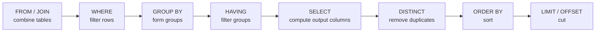

SQL is the language through which almost every program talks to a relational database. It puts the relational model of the previous chapter, [4.13.2](/4.13.2), into practice: a table is a relation (with the difference that a table may hold duplicate rows), and a query is a declarative description of the result from which the system derives a relational-algebra plan. This chapter covers the part of SQL that every user needs: defining tables with their data types and constraints, and writing queries with selection, projection, joins, ordering and aggregation. It also introduces the *running example* of the course, a small gene-expression database that the later chapters use for advanced queries ([4.13.4](/4.13.4)), design ([4.13.5](/4.13.5), [4.13.6](/4.13.6)) and implementation ([4.13.7](/4.13.7)–[4.13.12](/4.13.12)). Readers who know pandas ([4.4.5](/4.4.5)) will recognize most operations: a `merge` is a **join**, and `groupby(...).agg(...)` is `GROUP BY` with aggregate functions.

## 3.1. The SQL Language

### 3.1.1. Standard and Dialects

**Definition 3.1.1 (SQL)** **SQL** is the standard language for defining, querying and modifying relational databases. It is specified by the international standard ISO/IEC 9075, whose current edition is SQL:2023.

SQL began as SEQUEL in IBM's System R project in the mid-1970s. The first standard appeared in 1986 (SQL-86), followed by SQL-92, which fixed the core still taught today; later editions added recursive queries and triggers (SQL:1999), window functions (SQL:2003), XML (SQL:2006), temporal tables (SQL:2011), JSON functions (SQL:2016) and, in SQL:2023, a native JSON type and property-graph queries (Part 16, SQL/PGQ).

No product implements the whole standard, and every product adds extensions. This course uses PostgreSQL as the reference dialect because it follows the standard closely and is the most widely used open-source server system; the examples are executed with SQLite and DuckDB, which are embedded libraries that need no server.

| System | Kind | Notes for this course |
|---|---|---|
| PostgreSQL 18 | client–server, open source | reference dialect; strict typing; rich types (`jsonb`, arrays, ranges) |
| SQLite | embedded library, one file per database | most deployed database engine; dynamic typing unless tables are declared `STRICT`; foreign keys must be enabled per connection |
| DuckDB | embedded, analytical, column-oriented | PostgreSQL-like syntax; fast aggregation over large tables and Parquet / CSV files |
| MySQL 8.4 / 9 | client–server, open source | case-insensitive string comparison by default; `\|\|` is logical OR unless configured otherwise |
| Oracle, SQL Server | commercial servers | own procedural languages (PL/SQL, T-SQL) and many extensions |

### 3.1.2. Parts of the Language

SQL contains several sublanguages:

- the data-definition language (DDL): `CREATE`, `ALTER` and `DROP` for tables, views, indexes and other schema objects;
- the data-manipulation language (DML): `SELECT` for queries, and `INSERT`, `UPDATE`, `DELETE` and `MERGE` for modifications ([4.13.4](/4.13.4#sec-4.5));
- statements for access control (`GRANT`, `REVOKE`, [4.13.4](/4.13.4#sec-4.8)) and for transaction control (`BEGIN`, `COMMIT`, `ROLLBACK`, [4.13.4](/4.13.4#sec-4.7)).

SQL is *declarative*: a query states which rows the result contains, not how to compute them. Keywords are case-insensitive and are written in upper case in this course; unquoted identifiers are case-insensitive too (PostgreSQL folds them to lower case, the standard to upper case), while identifiers in double quotes, such as `"Sample ID"`, are case-sensitive and may contain spaces. String literals use single quotes: `'liver'`. A comment starts with `--` and extends to the end of the line.

### 3.1.3. Running the Examples

Every query in this chapter was executed, and its output is shown below it. Unless stated otherwise the output comes from SQLite 3.45 (command-line shell with `.mode table` and `.nullvalue NULL`, so that a null value is printed as `NULL`); outputs marked as DuckDB come from DuckDB 1.5 through its Python API. PostgreSQL's `psql` prints the same rows in a slightly different frame. The three clients are started as follows:

```bash
psql -d expr              # PostgreSQL: connect to the database "expr" on a server
sqlite3 expr.db           # SQLite: open (or create) the file expr.db
duckdb expr.duckdb        # DuckDB command-line client
```

## 3.2. Data Definition

### 3.2.1. Data Types

Each column of a table has a data type, which determines the domain of the corresponding attribute ([4.13.2](/4.13.2#sec-2.1)). The most common types are:

| Standard type | PostgreSQL | Values | Remarks |
|---|---|---|---|
| `smallint`, `integer`, `bigint` | same (`int` = `integer`) | 2-, 4- and 8-byte integers | `integer` reaches $2^{31}-1 \approx 2.1\times 10^9$, enough for chromosome positions |
| `numeric(p, s)`, `decimal(p, s)` | same | exact decimal with $p$ digits, $s$ after the point | use for money and for values that must round exactly |
| `real`, `double precision` | same (`float8`) | IEEE 754 binary floating point | approximate; `0.1 + 0.2 = 0.3` is false |
| `char(n)`, `varchar(n)` | same, plus `text` | strings, fixed or bounded length | in PostgreSQL `text` and `varchar` perform the same; `char(n)` pads with blanks |
| `boolean` | same | `TRUE`, `FALSE` (and null) | SQLite and MySQL store 1 and 0 |
| `date`, `time`, `timestamp` | same | calendar date, time of day, both | literals `DATE '2025-03-04'`, `TIMESTAMP '2025-03-04 09:30'` |
| `timestamp with time zone` | `timestamptz` | an instant | stored in UTC and displayed in the session's time zone; the usual choice for event times |
| `interval` | same | a duration | `collected_on + INTERVAL '7 days'` |
| `json` (SQL:2023) | `json`, `jsonb` | JSON documents | `jsonb` is a parsed binary form that can be indexed |
| — | `uuid`, arrays (`integer[]`), ranges, `bytea` | extensions | `uuidv7()` (PostgreSQL 18) generates time-ordered identifiers |

The systems differ in how strictly they enforce types. PostgreSQL rejects a value that cannot be converted to the column type. SQLite uses *type affinity*: a column's declared type is a preference, and an ordinary table stores a value that cannot be converted as it is. A table declared `STRICT` (SQLite 3.37 and later) enforces the declared types:

```sql
CREATE TABLE t (x integer);
INSERT INTO t VALUES ('abc'), ('12');
SELECT x, typeof(x) FROM t;

CREATE TABLE s (x integer) STRICT;
INSERT INTO s VALUES ('abc');
```

```text
+-----+-----------+
|  x  | typeof(x) |
+-----+-----------+
| abc | text      |
| 12  | integer   |
+-----+-----------+
Runtime error near line 6: cannot store TEXT value in INTEGER column s.x (19)
```

SQLite has no date type: dates are stored as ISO-8601 text such as `'2025-03-04'`, which sorts correctly as a string, and are manipulated with the functions `date`, `julianday` and `strftime`.

### 3.2.2. Creating Tables

A table is created by `CREATE TABLE`, which lists the columns with their types and the integrity constraints that every row must satisfy:

```sql
CREATE TABLE table_name (
    column_1  type_1  [column_constraint ...],
    ...,
    [table_constraint, ...]
);
```

The constraints used in this course are:

| Constraint | Meaning |
|---|---|
| `NOT NULL` | the column may not contain the null value |
| `PRIMARY KEY (A, ...)` | the listed columns form the primary key: unique and not null; at most one per table |
| `UNIQUE (A, ...)` | no two rows agree on all listed columns (rows with a null in them are exempt, §3.7) |
| `REFERENCES t (B)` / `FOREIGN KEY (A) REFERENCES t (B)` | a foreign key: every non-null value of `A` must occur in column `B` of table `t` |
| `CHECK (condition)` | every row must make the condition true or unknown |
| `DEFAULT expr` | the value used when an `INSERT` does not supply one |

A constraint written after a column applies to that column; one written as a separate item can involve several columns. Constraints, their actions on deletion (`ON DELETE CASCADE` and others) and their enforcement are the subject of [4.13.6](/4.13.6#sec-6.1).

A surrogate key, a meaningless number generated by the system, is declared in standard SQL (and PostgreSQL 10 and later) as an *identity column*:

```sql
CREATE TABLE run (
    run_id     bigint GENERATED ALWAYS AS IDENTITY PRIMARY KEY,
    started_at timestamptz NOT NULL DEFAULT now()
);
```

The older PostgreSQL shorthand is `serial`; MySQL writes `AUTO_INCREMENT`, and in SQLite a column declared `INTEGER PRIMARY KEY` is an alias for the internal row number and is filled automatically.

Two SQLite defaults differ from the standard and catch many users. Foreign keys are not enforced unless each connection executes `PRAGMA foreign_keys = ON`; and a `PRIMARY KEY` column of an ordinary table accepts nulls unless it is also declared `NOT NULL` (an old bug kept for compatibility; `STRICT` and `WITHOUT ROWID` tables do not have it):

```sql
CREATE TABLE p (k text PRIMARY KEY);
INSERT INTO p VALUES (NULL), (NULL);
SELECT count(*) AS rows_with_null_key FROM p;
```

```text
+--------------------+
| rows_with_null_key |
+--------------------+
| 2                  |
+--------------------+
```

### 3.2.3. The Running Example

The examples of this course use a small gene-expression database of the kind produced by an RNA-sequencing experiment: tissue samples from donors, some treated with a drug and some not, in each of which the expression of a set of genes was measured. Genes are annotated with the biological pathways they belong to, and pathways form a hierarchy. The gene identifiers and coordinates are those of the human reference genome (Ensembl, GRCh38); the expression values are invented for illustration.

| Table | One row per | Primary key | Foreign keys |
|---|---|---|---|
| `gene` | gene: Ensembl identifier, symbol, chromosome, start and end position, strand | `gene_id` | — |
| `sample` | tissue sample: tissue, treatment (`control` or `treated`), donor age (may be unknown), collection date | `sample_id` | — |
| `measurement` | expression of one gene in one sample, in transcripts per million (TPM) | `(sample_id, gene_id)` | `sample_id` → `sample`, `gene_id` → `gene` |
| `pathway` | pathway with its name and parent pathway (null for a top-level pathway) | `pathway_id` | `parent_id` → `pathway` |
| `gene_pathway` | membership of a gene in a pathway | `(gene_id, pathway_id)` | `gene_id` → `gene`, `pathway_id` → `pathway` |

The relationships are many-to-many: a sample has many measurements and a gene is measured in many samples, so `measurement` connects the two; likewise `gene_pathway` connects genes and pathways. [4.13.5](/4.13.5#sec-5.8) derives exactly this schema from an entity–relationship diagram.

```sql
CREATE TABLE gene (
    gene_id    text PRIMARY KEY,              -- Ensembl stable identifier
    symbol     text NOT NULL UNIQUE,          -- HGNC symbol
    chrom      text NOT NULL,
    start_pos  integer NOT NULL CHECK (start_pos >= 1),
    end_pos    integer NOT NULL,
    strand     char(1) NOT NULL CHECK (strand IN ('+', '-')),
    CHECK (start_pos <= end_pos)
);

CREATE TABLE sample (
    sample_id    text PRIMARY KEY,
    tissue       text NOT NULL,
    treatment    text NOT NULL CHECK (treatment IN ('control', 'treated')),
    donor_age    integer CHECK (donor_age BETWEEN 0 AND 120),  -- NULL: not recorded
    collected_on date NOT NULL
);

CREATE TABLE measurement (
    sample_id  text REFERENCES sample (sample_id),
    gene_id    text REFERENCES gene (gene_id),
    tpm        numeric(10, 2) NOT NULL CHECK (tpm >= 0),
    PRIMARY KEY (sample_id, gene_id)
);

CREATE TABLE pathway (
    pathway_id text PRIMARY KEY,
    name       text NOT NULL UNIQUE,
    parent_id  text REFERENCES pathway (pathway_id)   -- NULL for a top-level pathway
);

CREATE TABLE gene_pathway (
    gene_id    text REFERENCES gene (gene_id),
    pathway_id text REFERENCES pathway (pathway_id),
    PRIMARY KEY (gene_id, pathway_id)
);
```

A few choices deserve comment. The column is called `treatment` rather than `condition` because `CONDITION` is a reserved word in standard SQL and MySQL. `tpm` is `numeric` because PostgreSQL defines `round(x, digits)` only for `numeric`. In MySQL, `text` columns cannot be keys without a prefix length; there the identifier columns would be declared `varchar(20)`. The data are loaded with `INSERT` ([4.13.4](/4.13.4#sec-4.5) treats it fully); the last statement inserts measurements listed by gene symbol and looks up each `gene_id` with a join, a form that the following sections explain:

```sql
INSERT INTO gene VALUES
    ('ENSG00000141510', 'TP53',   'chr17',   7661779,   7687538, '-'),
    ('ENSG00000012048', 'BRCA1',  'chr17',  43044295,  43125483, '-'),
    ('ENSG00000136997', 'MYC',    'chr8',  127735434, 127742951, '+'),
    ('ENSG00000111640', 'GAPDH',  'chr12',   6534512,   6538374, '+'),
    ('ENSG00000075624', 'ACTB',   'chr7',    5526409,   5563902, '-'),
    ('ENSG00000146648', 'EGFR',   'chr7',   55019017,  55211628, '+'),
    ('ENSG00000124762', 'CDKN1A', 'chr6',   36676460,  36687339, '+'),
    ('ENSG00000135679', 'MDM2',   'chr12',  68808177,  68850686, '+');

INSERT INTO sample VALUES
    ('S01', 'liver', 'control', 54,   '2025-03-04'),
    ('S02', 'liver', 'control', 61,   '2025-03-04'),
    ('S03', 'liver', 'treated', 58,   '2025-03-11'),
    ('S04', 'lung',  'control', 47,   '2025-03-18'),
    ('S05', 'lung',  'treated', NULL, '2025-03-18'),
    ('S06', 'lung',  'treated', 66,   '2025-03-25');

-- One statement per level of the hierarchy, parents first, so that every
-- parent_id refers to a row that already exists.
INSERT INTO pathway VALUES
    ('PW1', 'Cell cycle',              NULL),
    ('PW4', 'Signal transduction',     NULL),
    ('PW6', 'Metabolism',              NULL);
INSERT INTO pathway VALUES
    ('PW2', 'Cell cycle checkpoints',  'PW1'),
    ('PW5', 'EGFR signaling',          'PW4'),
    ('PW7', 'Glycolysis',              'PW6');
INSERT INTO pathway VALUES
    ('PW3', 'p53-dependent G1 arrest', 'PW2');

INSERT INTO gene_pathway VALUES
    ('ENSG00000141510', 'PW2'), ('ENSG00000141510', 'PW3'),
    ('ENSG00000124762', 'PW3'), ('ENSG00000135679', 'PW3'),
    ('ENSG00000012048', 'PW2'), ('ENSG00000136997', 'PW1'),
    ('ENSG00000136997', 'PW4'), ('ENSG00000146648', 'PW5'),
    ('ENSG00000111640', 'PW7');

-- Measurements are listed by gene symbol and translated to gene_id by a join.
WITH v (sample_id, symbol, tpm) AS (VALUES
    ('S01', 'GAPDH', 1520.4), ('S01', 'ACTB', 2210.0), ('S01', 'TP53', 35.2), ('S01', 'CDKN1A', 12.4),
    ('S01', 'MDM2', 8.1), ('S01', 'MYC', 5.3), ('S01', 'BRCA1', 1.8), ('S01', 'EGFR', 15.6),
    ('S02', 'GAPDH', 1488.0), ('S02', 'ACTB', 2305.6), ('S02', 'TP53', 31.8), ('S02', 'CDKN1A', 10.9),
    ('S02', 'MDM2', 7.6), ('S02', 'MYC', 6.1), ('S02', 'BRCA1', 2.2), ('S02', 'EGFR', 13.9),
    ('S03', 'GAPDH', 1610.2), ('S03', 'ACTB', 2150.3), ('S03', 'TP53', 42.6), ('S03', 'CDKN1A', 88.7),
    ('S03', 'MDM2', 30.2), ('S03', 'MYC', 3.2), ('S03', 'BRCA1', 2.9), ('S03', 'EGFR', 14.2),
    ('S04', 'GAPDH', 2034.5), ('S04', 'ACTB', 3120.4), ('S04', 'TP53', 48.9), ('S04', 'CDKN1A', 20.3),
    ('S04', 'MDM2', 9.4), ('S04', 'MYC', 22.7), ('S04', 'BRCA1', 4.1), ('S04', 'EGFR', 62.3),
    ('S05', 'GAPDH', 1987.3), ('S05', 'ACTB', 2988.1), ('S05', 'TP53', 55.3), ('S05', 'CDKN1A', 141.5),
    ('S05', 'MDM2', 36.8), ('S05', 'MYC', 14.9), ('S05', 'BRCA1', 5.6),
    ('S06', 'GAPDH', 2102.8), ('S06', 'ACTB', 3050.7), ('S06', 'TP53', 51.0), ('S06', 'CDKN1A', 120.8),
    ('S06', 'MDM2', 33.1), ('S06', 'MYC', 12.6), ('S06', 'BRCA1', 4.8))
INSERT INTO measurement (sample_id, gene_id, tpm)
SELECT v.sample_id, g.gene_id, v.tpm
FROM v JOIN gene AS g ON g.symbol = v.symbol;
```

The script runs unchanged in PostgreSQL, SQLite (with `PRAGMA foreign_keys = ON`) and DuckDB. Two details of the data matter later: EGFR was not measured in samples S05 and S06, so `measurement` has 46 rather than 48 rows; and the donor age of S05 is unknown. The constraints now protect the data:

```sql
INSERT INTO sample VALUES ('S07', 'kidney', 'treated', 150, '2025-04-01');
INSERT INTO measurement VALUES ('S99', 'ENSG00000141510', 10);
```

```text
Runtime error near line 1: CHECK constraint failed: donor_age BETWEEN 0 AND 120 (19)
Runtime error near line 2: FOREIGN KEY constraint failed (19)
```

### 3.2.4. Changing and Removing Tables

`ALTER TABLE` changes an existing table, and `DROP TABLE` removes it with its data. In PostgreSQL all four statements below succeed:

```sql
ALTER TABLE sample ADD COLUMN rin numeric(3, 1);   -- RNA integrity number, initially NULL
ALTER TABLE sample ADD CONSTRAINT rin_range CHECK (rin BETWEEN 1 AND 10);
ALTER TABLE sample DROP COLUMN rin;
DROP TABLE IF EXISTS gene_pathway;
```

```text
Parse error near line 2: near "CONSTRAINT": syntax error
  ALTER TABLE sample ADD CONSTRAINT rin_range CHECK (rin BETWEEN 1 AND 10);
                         ^--- error here
```

SQLite supports only some forms of `ALTER TABLE` (adding, renaming and dropping columns) and rejects the second statement; other changes are made there by creating a new table, copying the rows and renaming it. PostgreSQL refuses to drop a table that a foreign key or a view depends on (`DROP TABLE sample` fails while `measurement` refers to it); `DROP TABLE sample CASCADE` drops the dependent constraints and views as well.

A server database contains schemas in the sense of name spaces (`CREATE SCHEMA lab;` then `CREATE TABLE lab.sample ...`); PostgreSQL looks up unqualified names along the `search_path`, which starts with `public`. The description of all tables, columns and constraints is itself stored in tables, the system catalog ([4.13.1](/4.13.1#sec-1.4)). The standard view of it is `information_schema`, available in PostgreSQL, MySQL and DuckDB (output from DuckDB):

```sql
SELECT table_name, column_name, data_type, is_nullable
FROM information_schema.columns
WHERE table_name = 'sample'
ORDER BY ordinal_position;
```

```text
┌────────────┬──────────────┬───────────┬─────────────┐
│ table_name │ column_name  │ data_type │ is_nullable │
│  varchar   │   varchar    │  varchar  │   varchar   │
├────────────┼──────────────┼───────────┼─────────────┤
│ sample     │ sample_id    │ VARCHAR   │ NO          │
│ sample     │ tissue       │ VARCHAR   │ NO          │
│ sample     │ treatment    │ VARCHAR   │ NO          │
│ sample     │ donor_age    │ INTEGER   │ YES         │
│ sample     │ collected_on │ DATE      │ NO          │
└────────────┴──────────────┴───────────┴─────────────┘
```

PostgreSQL additionally has its own catalog tables (`pg_class`, `pg_attribute`, ...) and the `psql` command `\d sample`; SQLite keeps the `CREATE` statements in the table `sqlite_schema` and describes a table with `PRAGMA table_info(sample)`.

## 3.3. Basic Queries

### 3.3.1. SELECT–FROM–WHERE

The basic form of a query is

```sql
SELECT A1, A2, ..., An
FROM r1, r2, ..., rm
WHERE P;
```

where the $r_i$ are tables, the $A_j$ are expressions over their columns and $P$ is a condition. Its meaning is defined by the relational algebra ([4.13.2](/4.13.2#sec-2.3)): form the **Cartesian product** of the tables, keep the rows that satisfy $P$, and compute the listed expressions,

$$
\Pi_{A_1,\dots,A_n}\bigl(\sigma_P(r_1 \times r_2 \times \cdots \times r_m)\bigr),
$$

except that SQL does not remove duplicate rows from the result (§3.3.3). `SELECT *` selects all columns; `WHERE` may be omitted. An expression in the `SELECT` list may be named with `AS`:

```sql
SELECT symbol, chrom, end_pos - start_pos + 1 AS length_bp
FROM gene
WHERE chrom IN ('chr7', 'chr17') AND strand = '-'
ORDER BY length_bp DESC;
```

```text
+--------+-------+-----------+
| symbol | chrom | length_bp |
+--------+-------+-----------+
| BRCA1  | chr17 | 81189     |
| ACTB   | chr7  | 37494     |
| TP53   | chr17 | 25760     |
+--------+-------+-----------+
```

This is the evaluation the definition prescribes, not the one a system performs: a database system never materializes a Cartesian product when it can avoid it, and chooses among equivalent plans with an optimizer ([4.13.9](/4.13.9)). Declarativeness is what gives it this freedom.

### 3.3.2. Expressions and Predicates

The `WHERE` clause and the `SELECT` list may use

- comparisons `=`, `<>` (also `!=`), `<`, `<=`, `>`, `>=`, combined with `AND`, `OR`, `NOT`;
- `x BETWEEN a AND b` (meaning $a \le x \le b$), `x IN (v1, v2, ...)`, `x IS NULL`;
- arithmetic `+ - * / %` and functions such as `abs`, `round`, `length`, `lower`, `upper`, `substr`, `coalesce`;
- string concatenation `s || t` (MySQL: `concat(s, t)`);
- pattern matching `s LIKE p`, where `%` in `p` matches any string and `_` any single character;
- the conditional expression `CASE WHEN ... THEN ... ELSE ... END`, and type conversion `CAST(x AS type)` (PostgreSQL also `x::type`).

```sql
SELECT sample_id,
       tissue || '/' || treatment AS grp,
       CASE WHEN donor_age IS NULL THEN 'unknown'
            WHEN donor_age < 60   THEN 'under 60'
            ELSE '60 or over' END AS age_band
FROM sample;
```

```text
+-----------+---------------+------------+
| sample_id |      grp      |  age_band  |
+-----------+---------------+------------+
| S01       | liver/control | under 60   |
| S02       | liver/control | 60 or over |
| S03       | liver/treated | under 60   |
| S04       | lung/control  | under 60   |
| S05       | lung/treated  | unknown    |
| S06       | lung/treated  | 60 or over |
+-----------+---------------+------------+
```

Two portability traps are worth knowing. First, dividing two integers truncates in PostgreSQL and SQLite, so `7 / 2` is 3 there, whereas DuckDB and MySQL return 3.5 and write integer division as `//` and `DIV` respectively. Second, `LIKE` is case-sensitive in PostgreSQL and DuckDB (PostgreSQL has `ILIKE` for case-insensitive matching) but case-insensitive for ASCII letters in SQLite, and MySQL compares strings case-insensitively under its default collation. The same query gives different results:

```sql
SELECT name FROM pathway WHERE name LIKE 'cell%';
```

```text
+------------------------+
|          name          |
+------------------------+
| Cell cycle             |
| Cell cycle checkpoints |
+------------------------+
```

```sql
SELECT name FROM pathway WHERE name LIKE 'cell%';
SELECT 7 / 2 AS slash, 7 // 2 AS double_slash;
```

```text
┌─────────┐
│  name   │
│ varchar │
└─────────┘
  0 rows 

┌────────┬──────────────┐
│ slash  │ double_slash │
│ double │    int32     │
├────────┼──────────────┤
│    3.5 │            3 │
└────────┴──────────────┘
```

PostgreSQL returns no row for the first query, like DuckDB. Portable code compares `lower(name) LIKE 'cell%'`.

### 3.3.3. Duplicates

A relation is a set, but an SQL table and an SQL query result are *multisets* (bags): rows may repeat. SQL keeps duplicates because removing them costs a sort or a hash, and because counts are often wanted. `SELECT DISTINCT` removes them:

```sql
SELECT tissue FROM sample;
SELECT DISTINCT tissue, treatment FROM sample;
```

```text
+--------+
| tissue |
+--------+
| liver  |
| liver  |
| liver  |
| lung   |
| lung   |
| lung   |
+--------+
+--------+-----------+
| tissue | treatment |
+--------+-----------+
| liver  | control   |
| liver  | treated   |
| lung   | control   |
| lung   | treated   |
+--------+-----------+
```

`DISTINCT` applies to the whole row of the result, not to the first column. A table with a primary key cannot contain two equal rows, but a query result can, as soon as its columns do not include a key.

## 3.4. Joins

### 3.4.1. Inner Joins

Most queries combine tables. Listing several tables in `FROM` and the matching condition in `WHERE` works, but the explicit `JOIN` syntax of SQL-92 keeps the join conditions next to the tables they connect:

```sql
SELECT s.sample_id, s.tissue, s.treatment, m.tpm
FROM measurement AS m
     JOIN gene   AS g ON g.gene_id = m.gene_id
     JOIN sample AS s ON s.sample_id = m.sample_id
WHERE g.symbol = 'CDKN1A'
ORDER BY s.sample_id;
```

```text
+-----------+--------+-----------+-------+
| sample_id | tissue | treatment |  tpm  |
+-----------+--------+-----------+-------+
| S01       | liver  | control   | 12.4  |
| S02       | liver  | control   | 10.9  |
| S03       | liver  | treated   | 88.7  |
| S04       | lung   | control   | 20.3  |
| S05       | lung   | treated   | 141.5 |
| S06       | lung   | treated   | 120.8 |
+-----------+--------+-----------+-------+
```

The *aliases* `m`, `g`, `s` (also called correlation names or tuple variables) name the tables within the query; a column is qualified as `g.gene_id` whenever its name occurs in more than one table. `JOIN ... ON` is the **inner join**, the relational-algebra theta join $r \bowtie_\theta s$: it pairs the rows of the two tables that satisfy the condition, and drops rows without a partner. The output shows the effect of the treatment: CDKN1A (p21), a target gene of p53, is strongly induced in the treated samples.

When the join columns have the same name in both tables, two shorthands exist:

- `JOIN gene USING (gene_id)` equates the listed columns and keeps one copy of each;
- `NATURAL JOIN` equates *all* columns with the same name: it is the natural join of the relational algebra.

```sql
SELECT symbol, pathway_id FROM gene NATURAL JOIN gene_pathway WHERE chrom = 'chr17';
```

```text
+--------+------------+
| symbol | pathway_id |
+--------+------------+
| TP53   | PW2        |
| TP53   | PW3        |
| BRCA1  | PW2        |
+--------+------------+
```

`NATURAL JOIN` is convenient in examples but fragile in programs: if someone later adds a column `name` to `gene`, the natural join of `gene` and `pathway` silently starts to require equal names as well. Production code uses `ON` or `USING`.

### 3.4.2. Self Joins and Cross Joins

A table can be joined with itself under two aliases. Each pathway with the name of its parent:

```sql
SELECT child.name AS pathway, parent.name AS parent
FROM pathway AS child
     LEFT JOIN pathway AS parent ON parent.pathway_id = child.parent_id
ORDER BY child.pathway_id;
```

```text
+-------------------------+------------------------+
|         pathway         |         parent         |
+-------------------------+------------------------+
| Cell cycle              | NULL                   |
| Cell cycle checkpoints  | Cell cycle             |
| p53-dependent G1 arrest | Cell cycle checkpoints |
| Signal transduction     | NULL                   |
| EGFR signaling          | Signal transduction    |
| Metabolism              | NULL                   |
| Glycolysis              | Metabolism             |
+-------------------------+------------------------+
```

(The `LEFT JOIN`, explained next, keeps the top-level pathways, which have no parent.) A self join follows one level of the hierarchy; following all levels needs a recursive query ([4.13.4](/4.13.4#sec-4.3)).

`CROSS JOIN` is the Cartesian product. It is rarely what one wants, but it generates all combinations, for instance every (sample, gene) pair, from which the missing measurements can be found ([4.13.4](/4.13.4#sec-4.2)):

```sql
SELECT count(*) AS pairs FROM gene CROSS JOIN sample;
```

```text
+-------+
| pairs |
+-------+
| 48    |
+-------+
```

### 3.4.3. Outer Joins

An inner join loses the rows that have no partner. An outer join keeps them and fills the columns of the missing partner with nulls: the **left join** (`LEFT [OUTER] JOIN`) keeps all rows of the left table, the right join keeps those of the right table, and the **full outer join** (`FULL [OUTER] JOIN`) keeps both. ACTB belongs to no pathway, so it appears only in the outer join:

```sql
SELECT g.symbol, gp.pathway_id
FROM gene AS g LEFT JOIN gene_pathway AS gp ON gp.gene_id = g.gene_id
ORDER BY g.symbol;
```

```text
+--------+------------+
| symbol | pathway_id |
+--------+------------+
| ACTB   | NULL       |
| BRCA1  | PW2        |
| CDKN1A | PW3        |
| EGFR   | PW5        |
| GAPDH  | PW7        |
| MDM2   | PW3        |
| MYC    | PW1        |
| MYC    | PW4        |
| TP53   | PW2        |
| TP53   | PW3        |
+--------+------------+
```

A full outer join over three tables shows both kinds of unmatched rows, the gene without a pathway and the pathway (Metabolism) without a directly annotated gene:

```sql
SELECT p.name AS pathway, g.symbol
FROM pathway AS p
     FULL JOIN gene_pathway AS gp ON gp.pathway_id = p.pathway_id
     FULL JOIN gene         AS g  ON g.gene_id = gp.gene_id
ORDER BY p.name, g.symbol;
```

```text
+-------------------------+--------+
|         pathway         | symbol |
+-------------------------+--------+
| NULL                    | ACTB   |
| Cell cycle              | MYC    |
| Cell cycle checkpoints  | BRCA1  |
| Cell cycle checkpoints  | TP53   |
| EGFR signaling          | EGFR   |
| Glycolysis              | GAPDH  |
| Metabolism              | NULL   |
| Signal transduction     | MYC    |
| p53-dependent G1 arrest | CDKN1A |
| p53-dependent G1 arrest | MDM2   |
| p53-dependent G1 arrest | TP53   |
+-------------------------+--------+
```

SQLite sorts strings by their bytes, so lower-case `p53-...` comes after the capitalized names, and it places nulls first in ascending order; PostgreSQL sorts under the database's collation (typically case-insensitive at the first level) and places nulls last (§3.5). `RIGHT JOIN` and `FULL JOIN` are available in SQLite since version 3.39; MySQL has no `FULL JOIN`.

The placement of a condition matters in an outer join. A condition in `ON` decides which rows are partners; a condition in `WHERE` filters the joined result afterwards, and a `WHERE` condition on the right table rejects the null-extended rows, turning the outer join back into an inner join:

```sql
-- Every gene, with PW3 if the gene belongs to it
SELECT g.symbol, gp.pathway_id
FROM gene AS g LEFT JOIN gene_pathway AS gp
     ON gp.gene_id = g.gene_id AND gp.pathway_id = 'PW3'
ORDER BY g.symbol;

-- Only the genes in PW3: the WHERE clause removes the NULL rows
SELECT g.symbol, gp.pathway_id
FROM gene AS g LEFT JOIN gene_pathway AS gp ON gp.gene_id = g.gene_id
WHERE gp.pathway_id = 'PW3'
ORDER BY g.symbol;
```

```text
+--------+------------+
| symbol | pathway_id |
+--------+------------+
| ACTB   | NULL       |
| BRCA1  | NULL       |
| CDKN1A | PW3        |
| EGFR   | NULL       |
| GAPDH  | NULL       |
| MDM2   | PW3        |
| MYC    | NULL       |
| TP53   | PW3        |
+--------+------------+
+--------+------------+
| symbol | pathway_id |
+--------+------------+
| CDKN1A | PW3        |
| MDM2   | PW3        |
| TP53   | PW3        |
+--------+------------+
```

The anti-join pattern, "rows of $r$ without a partner in $s$", is a left join followed by `WHERE s.key IS NULL`:

```sql
SELECT g.symbol
FROM gene AS g LEFT JOIN gene_pathway AS gp ON gp.gene_id = g.gene_id
WHERE gp.gene_id IS NULL;
```

```text
+--------+
| symbol |
+--------+
| ACTB   |
+--------+
```

The same question can be asked with `NOT EXISTS` ([4.13.4](/4.13.4#sec-4.1)).

| Join | Rows of the result |
|---|---|
| `r CROSS JOIN s` | all pairs: $\lvert r\rvert \cdot \lvert s\rvert$ rows |
| `r JOIN s ON c` | the pairs satisfying `c` |
| `r NATURAL JOIN s`, `r JOIN s USING (A)` | the pairs agreeing on the common columns, which appear once |
| `r LEFT JOIN s ON c` | inner join, plus each row of `r` without partner, padded with nulls |
| `r RIGHT JOIN s ON c` | inner join, plus each row of `s` without partner |
| `r FULL JOIN s ON c` | inner join, plus the unmatched rows of both sides |

## 3.5. Ordering and Limiting

The rows of a table have no order, and neither do the rows of a query result unless the query ends with `ORDER BY`. A result that "came out sorted" yesterday may come out differently after the data grow or the plan changes. `ORDER BY` takes a list of expressions, each with `ASC` (the default) or `DESC`, and may refer to output names such as `length_bp` above.

Where nulls go is not portable: PostgreSQL treats null as larger than every value (last in ascending order, first in descending order), SQLite and MySQL treat it as smaller, and DuckDB puts nulls last in both directions. The standard clause `NULLS FIRST` / `NULLS LAST` (PostgreSQL, SQLite, DuckDB) makes the intent explicit:

```sql
SELECT sample_id, donor_age FROM sample ORDER BY donor_age DESC;
SELECT sample_id, donor_age FROM sample ORDER BY donor_age DESC NULLS FIRST LIMIT 3;
```

```text
+-----------+-----------+
| sample_id | donor_age |
+-----------+-----------+
| S06       | 66        |
| S02       | 61        |
| S03       | 58        |
| S01       | 54        |
| S04       | 47        |
| S05       | NULL      |
+-----------+-----------+
+-----------+-----------+
| sample_id | donor_age |
+-----------+-----------+
| S05       | NULL      |
| S06       | 66        |
| S02       | 61        |
+-----------+-----------+
```

In PostgreSQL the first query would list S05 first. `LIMIT n OFFSET k` (PostgreSQL, SQLite, MySQL, DuckDB) returns at most $n$ rows after skipping $k$; the standard spelling, supported by PostgreSQL and Oracle, is `OFFSET k ROWS FETCH FIRST n ROWS ONLY`. Without `ORDER BY`, which rows a limit returns is unspecified. For paging through a large result, `OFFSET` is inefficient because the skipped rows are still computed; *keyset pagination* remembers the last key shown and continues with `WHERE key > :last ORDER BY key LIMIT n`.

## 3.6. Aggregation and Grouping

### 3.6.1. Aggregate Functions

An *aggregate function* maps a multiset of values to a single value. The standard ones are `count`, `sum`, `avg`, `min` and `max`; PostgreSQL and DuckDB add many more (`stddev_samp`, `var_samp`, `string_agg`, `array_agg`, `percentile_cont`, `bool_and`, ...). Every aggregate except `count(*)` ignores nulls: `count(*)` counts rows, `count(e)` counts the rows in which `e` is not null, and `count(DISTINCT e)` counts distinct non-null values.

```sql
SELECT count(*) AS n_samples, count(donor_age) AS n_with_age,
       avg(donor_age) AS mean_age, min(collected_on) AS first_day
FROM sample;
```

```text
+-----------+------------+----------+------------+
| n_samples | n_with_age | mean_age | first_day  |
+-----------+------------+----------+------------+
| 6         | 5          | 57.2     | 2025-03-04 |
+-----------+------------+----------+------------+
```

The mean age is the mean of the five known ages. Dividing a sum by `count(*)` instead would treat the unknown age as zero and, in addition, use integer division:

```sql
SELECT sum(donor_age) / count(*) AS wrong_mean, avg(donor_age) AS mean FROM sample;
```

```text
+------------+------+
| wrong_mean | mean |
+------------+------+
| 47         | 57.2 |
+------------+------+
```

Over an empty input, `count` returns 0 and the other aggregates return null; in particular `sum` of no rows is null, not 0, and `coalesce(sum(x), 0)` is the usual remedy.

### 3.6.2. GROUP BY and HAVING

`GROUP BY` partitions the rows that pass `WHERE` into groups with equal values of the grouping expressions (all nulls form one group) and produces one output row per group. The mean expression of CDKN1A per tissue and treatment:

```sql
SELECT s.tissue, s.treatment, count(*) AS n, round(avg(m.tpm), 1) AS mean_tpm
FROM measurement AS m
     JOIN gene   AS g ON g.gene_id = m.gene_id
     JOIN sample AS s ON s.sample_id = m.sample_id
WHERE g.symbol = 'CDKN1A'
GROUP BY s.tissue, s.treatment
ORDER BY s.tissue, s.treatment;
```

```text
+--------+-----------+---+----------+
| tissue | treatment | n | mean_tpm |
+--------+-----------+---+----------+
| liver  | control   | 2 | 11.7     |
| liver  | treated   | 1 | 88.7     |
| lung   | control   | 1 | 20.3     |
| lung   | treated   | 2 | 131.2    |
+--------+-----------+---+----------+
```

`HAVING` is a condition on groups, evaluated after grouping; it may use aggregates, which `WHERE` may not. Genes with a mean expression above 20 TPM:

```sql
SELECT g.symbol, count(*) AS n_samples, round(avg(m.tpm), 1) AS mean_tpm
FROM gene AS g JOIN measurement AS m ON m.gene_id = g.gene_id
GROUP BY g.symbol
HAVING avg(m.tpm) > 20
ORDER BY mean_tpm DESC;
```

```text
+--------+-----------+----------+
| symbol | n_samples | mean_tpm |
+--------+-----------+----------+
| ACTB   | 6         | 2637.5   |
| GAPDH  | 6         | 1790.5   |
| CDKN1A | 6         | 65.8     |
| TP53   | 6         | 44.1     |
| EGFR   | 4         | 26.5     |
| MDM2   | 6         | 20.9     |
+--------+-----------+----------+
```

The count of 4 for EGFR shows the two missing measurements. Because one output row stands for a whole group, the `SELECT` list of a grouped query may contain only grouping expressions, aggregates, and expressions built from them. The standard relaxes this rule slightly: a column that is functionally determined by the grouping columns ([4.13.6](/4.13.6#sec-6.3)) is allowed, and PostgreSQL applies the relaxation when the grouping columns include a table's primary key (`GROUP BY g.gene_id` permits `g.symbol`). The systems differ on violations:

```sql
SELECT tissue, sample_id, max(donor_age) FROM sample GROUP BY tissue;
```

```text
Binder Error: column "sample_id" must appear in the GROUP BY clause or must be part of an aggregate function.
```

PostgreSQL, DuckDB and MySQL (with its default `ONLY_FULL_GROUP_BY` mode) reject the query. SQLite accepts it: a "bare" column takes its value from the row that produced the `max`, a documented SQLite extension:

```sql
SELECT tissue, sample_id, max(donor_age) FROM sample GROUP BY tissue;
```

```text
+--------+-----------+----------------+
| tissue | sample_id | max(donor_age) |
+--------+-----------+----------------+
| liver  | S02       | 61             |
| lung   | S06       | 66             |
+--------+-----------+----------------+
```

Portable code asks the question explicitly, for example with a window function ([4.13.4](/4.13.4#sec-4.4)).

### 3.6.3. Conditional Aggregation

The `FILTER` clause (SQL:2003; PostgreSQL, SQLite, DuckDB) restricts the rows that one aggregate sees. It turns a long table into a wide summary: the mean expression of each gene in control and treated samples, and the ratio, the *fold change*:

```sql
SELECT g.symbol,
       round(avg(m.tpm) FILTER (WHERE s.treatment = 'control'), 1) AS control,
       round(avg(m.tpm) FILTER (WHERE s.treatment = 'treated'), 1) AS treated,
       round(avg(m.tpm) FILTER (WHERE s.treatment = 'treated')
           / avg(m.tpm) FILTER (WHERE s.treatment = 'control'), 2) AS fold_change
FROM measurement AS m
     JOIN gene   AS g ON g.gene_id = m.gene_id
     JOIN sample AS s ON s.sample_id = m.sample_id
GROUP BY g.symbol
ORDER BY fold_change DESC;
```

```text
+--------+---------+---------+-------------+
| symbol | control | treated | fold_change |
+--------+---------+---------+-------------+
| CDKN1A | 14.5    | 117.0   | 8.05        |
| MDM2   | 8.4     | 33.4    | 3.99        |
| BRCA1  | 2.7     | 4.4     | 1.64        |
| TP53   | 38.6    | 49.6    | 1.28        |
| GAPDH  | 1681.0  | 1900.1  | 1.13        |
| ACTB   | 2545.3  | 2729.7  | 1.07        |
| MYC    | 11.4    | 10.2    | 0.9         |
| EGFR   | 30.6    | 14.2    | 0.46        |
+--------+---------+---------+-------------+
```

The two direct targets of p53, CDKN1A and MDM2, are induced; the housekeeping genes GAPDH and ACTB hardly change. (A real analysis would also normalize, take logarithms and test significance; this course only computes.) In MySQL, which lacks `FILTER`, the same result is obtained with `avg(CASE WHEN s.treatment = 'control' THEN m.tpm END)`: the `CASE` yields null for the other rows, and `avg` ignores nulls.

## 3.7. NULL in SQL

The null value `NULL` stands for a missing or inapplicable value, and comparisons with it follow the three-valued logic of [4.13.2](/4.13.2#sec-2.6): `x = NULL` is neither true nor false but *unknown*, even when `x` is null. `WHERE` and `HAVING` keep a row only when the condition is *true*, so a row with an unknown condition is dropped. Sample S05, whose donor age is unknown, satisfies neither `donor_age > 50` nor `NOT (donor_age > 50)`:

```sql
SELECT sample_id FROM sample WHERE donor_age > 50;
SELECT sample_id FROM sample WHERE NOT (donor_age > 50);
SELECT sample_id FROM sample WHERE donor_age IS NULL;
```

```text
+-----------+
| sample_id |
+-----------+
| S01       |
| S02       |
| S03       |
| S06       |
+-----------+
+-----------+
| sample_id |
+-----------+
| S04       |
+-----------+
+-----------+
| sample_id |
+-----------+
| S05       |
+-----------+
```

SQLite displays the truth values true, false and unknown as 1, 0 and NULL:

```sql
SELECT NULL = NULL AS eq, NULL IS NULL AS is_null,
       1 IS DISTINCT FROM NULL AS dist, NULL AND 0 AS and_false, NULL OR 1 AS or_true;
```

```text
+------+---------+------+-----------+---------+
|  eq  | is_null | dist | and_false | or_true |
+------+---------+------+-----------+---------+
| NULL | 1       | 1    | 0         | 1       |
+------+---------+------+-----------+---------+
```

The tools for nulls are:

| Expression | Meaning |
|---|---|
| `x IS NULL`, `x IS NOT NULL` | test for null; never unknown |
| `x IS DISTINCT FROM y` | `x <> y`, treating two nulls as equal and null as different from any value; `IS NOT DISTINCT FROM` is null-safe equality (MySQL: `x <=> y`) |
| `coalesce(x1, x2, ...)` | the first argument that is not null |
| `nullif(x, y)` | null if `x = y`, else `x`; `a / nullif(b, 0)` avoids division by zero |

Nulls also behave in specific ways in other clauses. In `GROUP BY`, `DISTINCT` and set operations, two nulls are treated as equal ("not distinct"). A `UNIQUE` constraint, by contrast, allows any number of rows with a null in the constrained column, because no two of them are known to be equal; PostgreSQL 15 and later can declare `UNIQUE NULLS NOT DISTINCT` to forbid this. A `CHECK` constraint is satisfied when its condition is unknown, which is why `CHECK (donor_age BETWEEN 0 AND 120)` admits a null age. And `x NOT IN (subquery)` is never true when the subquery returns a null, a frequent bug discussed in [4.13.4](/4.13.4#sec-4.1).

## 3.8. How a Query Is Evaluated

The clauses of a query are written in the order `SELECT`, `FROM`, `WHERE`, `GROUP BY`, `HAVING`, `ORDER BY`, `LIMIT`, but their meaning is defined in a different, *logical* order:



Many rules follow from this order:

- `WHERE` cannot use aggregates (groups do not exist yet) and, in standard SQL and PostgreSQL, cannot use output names defined in `SELECT`; `ORDER BY` can use both. SQLite and DuckDB accept `WHERE length_bp > 50000` with `length_bp` defined in the `SELECT` list, as an extension.
- A condition that does not involve aggregates belongs in `WHERE`, not in `HAVING`: the result is the same, but filtering early is clearer and lets the system discard rows before grouping.
- `LIMIT` applies to the sorted, final result.

The logical order specifies the result, not the execution: an optimizer may evaluate parts of `WHERE` inside a join, use an index to produce rows already sorted, or stop after the first $n$ rows of a `LIMIT`. How it does so is the subject of [4.13.9](/4.13.9).

## Summary

- SQL (ISO/IEC 9075, current edition SQL:2023) is declarative; PostgreSQL follows the standard closely, SQLite and DuckDB are embedded engines, and every system has its own extensions and defaults.
- `CREATE TABLE` declares columns with types and constraints: `NOT NULL`, `PRIMARY KEY`, `UNIQUE`, `REFERENCES`, `CHECK`, `DEFAULT`; identity columns generate surrogate keys. SQLite enforces types only in `STRICT` tables and foreign keys only after `PRAGMA foreign_keys = ON`.
- The running example has five tables: `gene`, `sample`, `measurement` (sample × gene), `pathway` (a hierarchy through `parent_id`) and `gene_pathway` (gene × pathway).
- `SELECT A FROM r WHERE P` means $\Pi_A(\sigma_P(r_1\times\cdots\times r_m))$ evaluated on multisets; `DISTINCT` removes duplicates.
- `JOIN ... ON` is the inner join; `USING` and `NATURAL JOIN` equate same-named columns; `LEFT`, `RIGHT` and `FULL` outer joins keep unmatched rows with nulls. Conditions on the optional side belong in `ON`.
- Only `ORDER BY` orders a result; null placement differs between systems unless `NULLS FIRST/LAST` is written.
- Aggregates ignore nulls (except `count(*)`); `GROUP BY` forms groups, `HAVING` filters them, and `FILTER` restricts one aggregate.
- Comparisons with null are unknown; `WHERE` keeps only true rows. Use `IS NULL`, `IS DISTINCT FROM`, `coalesce` and `nullif`.
- The logical evaluation order is FROM, WHERE, GROUP BY, HAVING, SELECT, DISTINCT, ORDER BY, LIMIT.
