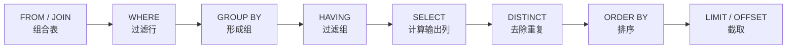

SQL 是几乎所有程序与关系**数据库**对话所用的语言。它把上一章 [4.13.2](/4.13.2) 的**关系模型**付诸实践：表就是**关系**（区别在于表可以含有重复的行），查询是对结果的声明式描述，系统由它导出关系代数计划。本章讲每个用户都需要的那部分 SQL：定义带有数据类型和约束的表，以及用选择、投影、连接、排序和聚集来编写查询。本章还引入本课程的*运行示例*，一个小型基因表达数据库，后面各章用它来讲高级查询（[4.13.4](/4.13.4)）、设计（[4.13.5](/4.13.5)、[4.13.6](/4.13.6)）和实现（[4.13.7](/4.13.7)–[4.13.12](/4.13.12)）。熟悉 pandas（[4.4.5](/4.4.5)）的读者会觉得大多数操作似曾相识：`merge` 就是**连接**，`groupby(...).agg(...)` 就是带聚集函数的 `GROUP BY`。

## 3.1. SQL 语言

### 3.1.1. 标准与方言

**定义 3.1.1（SQL）** **SQL** 是定义、查询和修改关系数据库的标准语言。它由国际标准 ISO/IEC 9075 规定，现行版本是 SQL:2023。

**SQL** 起源于 20 世纪 70 年代中期 IBM System R 项目中的 SEQUEL。第一个标准出现在 1986 年（SQL-86），随后是确立了今天仍在讲授的核心的 SQL-92；后续版本增加了递归查询和触发器（SQL:1999）、窗口函数（SQL:2003）、XML（SQL:2006）、时态表（SQL:2011）、JSON 函数（SQL:2016），以及 SQL:2023 中的原生 JSON 类型和属性图查询（第 16 部分，SQL/PGQ）。

没有哪个产品实现了整个标准，而且每个产品都增加了扩展。本课程以 PostgreSQL 作为参考方言，因为它与标准结合紧密，并且是使用最广泛的开源服务器系统；示例用 SQLite 和 DuckDB 执行，它们是不需要服务器的嵌入式库。

| 系统 | 类型 | 本课程的说明 |
|---|---|---|
| PostgreSQL 18 | 客户端–服务器，开源 | 参考方言；强类型；丰富的类型（`jsonb`、数组、范围） |
| SQLite | 嵌入式库，每个数据库一个文件 | 部署最广泛的数据库引擎；除非表声明为 `STRICT`，否则是动态类型；外码须在每个连接上单独启用 |
| DuckDB | 嵌入式，分析型，列式 | 类 PostgreSQL 语法；对大表以及 Parquet / CSV 文件的聚集很快 |
| MySQL 8.4 / 9 | 客户端–服务器，开源 | 默认的字符串比较不区分大小写；除非另行配置，`\|\|` 是逻辑或 |
| Oracle、SQL Server | 商用服务器 | 有各自的过程式语言（PL/SQL、T-SQL）和许多扩展 |

### 3.1.2. 语言的组成部分

SQL 包含几种子语言：

- **数据定义语言**（**DDL**）：用 `CREATE`、`ALTER` 和 `DROP` 处理表、视图、索引及其他**模式**对象；
- 数据操纵语言（DML）：用 `SELECT` 查询，用 `INSERT`、`UPDATE`、`DELETE` 和 `MERGE` 修改（[4.13.4](/4.13.4#sec-4.5)）；
- 访问控制语句（`GRANT`、`REVOKE`，[4.13.4](/4.13.4#sec-4.8)）和事务控制语句（`BEGIN`、`COMMIT`、`ROLLBACK`，[4.13.4](/4.13.4#sec-4.7)）。

SQL 是*声明式*的：查询说明结果包含哪些行，而不说明如何计算它们。关键字不区分大小写，本课程中一律大写；不加引号的标识符同样不区分大小写（PostgreSQL 折成小写，标准折成大写），而双引号中的标识符，如 `"Sample ID"`，区分大小写且可以含空格。字符串字面量用单引号：`'liver'`。注释以 `--` 开始，延伸到行末。

### 3.1.3. 运行示例

本章的每个查询都实际执行过，输出显示在查询下方。除非另有说明，输出来自 SQLite 3.45（命令行 shell，设置了 `.mode table` 和 `.nullvalue NULL`，使**空值**打印为 `NULL`）；标明 DuckDB 的输出来自 DuckDB 1.5 的 Python API。PostgreSQL 的 `psql` 用略有不同的边框打印同样的行。三个客户端的启动方式如下：

```bash
psql -d expr              # PostgreSQL: connect to the database "expr" on a server
sqlite3 expr.db           # SQLite: open (or create) the file expr.db
duckdb expr.duckdb        # DuckDB command-line client
```

## 3.2. 数据定义

### 3.2.1. 数据类型

表的每一列都有数据类型，它决定对应**属性**的**域**（[4.13.2](/4.13.2#sec-2.1)）。最常见的类型有：

| 标准类型 | PostgreSQL | 取值 | 说明 |
|---|---|---|---|
| `smallint`、`integer`、`bigint` | 相同（`int` = `integer`） | 2 字节、4 字节和 8 字节整数 | `integer` 可达 $2^{31}-1 \approx 2.1\times 10^9$，足以表示染色体位置 |
| `numeric(p, s)`、`decimal(p, s)` | 相同 | 精确的十进制数，共 $p$ 位数字，小数点后 $s$ 位 | 用于金额以及必须精确舍入的值 |
| `real`、`double precision` | 相同（`float8`） | IEEE 754 二进制浮点数 | 近似值；`0.1 + 0.2 = 0.3` 为假 |
| `char(n)`、`varchar(n)` | 相同，另有 `text` | 字符串，定长或有界长度 | 在 PostgreSQL 中 `text` 与 `varchar` 性能相同；`char(n)` 用空格填充 |
| `boolean` | 相同 | `TRUE`、`FALSE`（以及空值） | SQLite 和 MySQL 存储 1 和 0 |
| `date`、`time`、`timestamp` | 相同 | 日历日期、一天中的时刻、两者兼有 | 字面量 `DATE '2025-03-04'`、`TIMESTAMP '2025-03-04 09:30'` |
| `timestamp with time zone` | `timestamptz` | 一个时刻 | 以 UTC 存储，按会话的时区显示；事件时间的常规选择 |
| `interval` | 相同 | 一段时长 | `collected_on + INTERVAL '7 days'` |
| `json`（SQL:2023） | `json`、`jsonb` | JSON 文档 | `jsonb` 是解析后的二进制形式，可以建索引 |
| — | `uuid`、数组（`integer[]`）、范围、`bytea` | 扩展 | `uuidv7()`（PostgreSQL 18）生成按时间有序的标识符 |

各系统执行类型检查的严格程度不同。PostgreSQL 拒绝无法转换为列类型的值。SQLite 采用*类型亲和性*：列的声明类型只是一种偏好，普通表会原样存储无法转换的值。声明为 `STRICT` 的表（SQLite 3.37 及以后）则强制执行声明的类型：

```sql
CREATE TABLE t (x integer);
INSERT INTO t VALUES ('abc'), ('12');
SELECT x, typeof(x) FROM t;

CREATE TABLE s (x integer) STRICT;
INSERT INTO s VALUES ('abc');
```

```text
+-----+-----------+
|  x  | typeof(x) |
+-----+-----------+
| abc | text      |
| 12  | integer   |
+-----+-----------+
Runtime error near line 6: cannot store TEXT value in INTEGER column s.x (19)
```

SQLite 没有日期类型：日期存储为 ISO-8601 文本，如 `'2025-03-04'`，按字符串排序时顺序正确，并用函数 `date`、`julianday` 和 `strftime` 处理。

### 3.2.2. 创建表

表用 `CREATE TABLE` 创建，它列出各列及其类型，以及每一行都必须满足的完整性约束：

```sql
CREATE TABLE table_name (
    column_1  type_1  [column_constraint ...],
    ...,
    [table_constraint, ...]
);
```

本课程用到的约束有：

| 约束 | 含义 |
|---|---|
| `NOT NULL` | 该列不得含有空值 |
| `PRIMARY KEY (A, ...)` | 所列的列构成主码：唯一且不为空；每个表至多一个 |
| `UNIQUE (A, ...)` | 没有两行在所列的全部列上取值相同（含空值的行除外，§3.7） |
| `REFERENCES t (B)` / `FOREIGN KEY (A) REFERENCES t (B)` | 外码：`A` 的每个非空值都必须出现在表 `t` 的 `B` 列中 |
| `CHECK (condition)` | 每一行都必须使条件为真或未知 |
| `DEFAULT expr` | `INSERT` 未提供值时使用的值 |

写在某一列之后的约束作用于该列；作为单独一项写出的约束可以涉及多个列。约束、它们在删除时的动作（`ON DELETE CASCADE` 等）及其执行，是 [4.13.6](/4.13.6#sec-6.1) 的主题。

**代理键**是由系统生成的、没有含义的数，在标准 **SQL**（以及 PostgreSQL 10 及以后）中声明为标识列（identity column）：

```sql
CREATE TABLE run (
    run_id     bigint GENERATED ALWAYS AS IDENTITY PRIMARY KEY,
    started_at timestamptz NOT NULL DEFAULT now()
);
```

PostgreSQL 旧的简写是 `serial`；MySQL 写作 `AUTO_INCREMENT`，在 SQLite 中，声明为 `INTEGER PRIMARY KEY` 的列是内部行号的别名，会自动填充。

SQLite 有两个默认行为与标准不同，让许多用户上当。除非每个连接都执行 `PRAGMA foreign_keys = ON`，否则**外码**不会被强制执行；并且普通表的 `PRIMARY KEY` 列接受**空值**，除非同时声明了 `NOT NULL`（这是为兼容而保留的一个旧缺陷；`STRICT` 表和 `WITHOUT ROWID` 表没有这个问题）：

```sql
CREATE TABLE p (k text PRIMARY KEY);
INSERT INTO p VALUES (NULL), (NULL);
SELECT count(*) AS rows_with_null_key FROM p;
```

```text
+--------------------+
| rows_with_null_key |
+--------------------+
| 2                  |
+--------------------+
```

### 3.2.3. 运行示例

本课程的示例使用一个小型基因表达**数据库**，类似 RNA 测序实验所产生的数据：来自供体的组织样本，其中一些用药物处理过，另一些没有，在每个样本中测量了一组基因的表达量。基因带有它们所属生物学通路的注释，通路构成层次结构。基因标识符与坐标取自人类参考基因组（Ensembl，GRCh38）；表达量是为说明而虚构的。

| 表 | 每行代表 | 主码 | 外码 |
|---|---|---|---|
| `gene` | 一个基因：Ensembl 标识符、符号、染色体、起止位置、链 | `gene_id` | — |
| `sample` | 一个组织样本：组织、处理方式（`control` 或 `treated`）、供体年龄（可能未知）、采集日期 | `sample_id` | — |
| `measurement` | 一个基因在一个样本中的表达量，单位为每百万转录本数（TPM） | `(sample_id, gene_id)` | `sample_id` → `sample`，`gene_id` → `gene` |
| `pathway` | 一条通路及其名称和父通路（顶层通路为空） | `pathway_id` | `parent_id` → `pathway` |
| `gene_pathway` | 基因在通路中的成员关系 | `(gene_id, pathway_id)` | `gene_id` → `gene`，`pathway_id` → `pathway` |

这里的联系是多对多的：一个样本有许多测量值，一个基因在许多样本中被测量，所以 `measurement` 把两者连起来；同样，`gene_pathway` 连接基因与通路。[4.13.5](/4.13.5#sec-5.8) 从实体–联系图推导出的正是这个**模式**。

```sql
CREATE TABLE gene (
    gene_id    text PRIMARY KEY,              -- Ensembl stable identifier
    symbol     text NOT NULL UNIQUE,          -- HGNC symbol
    chrom      text NOT NULL,
    start_pos  integer NOT NULL CHECK (start_pos >= 1),
    end_pos    integer NOT NULL,
    strand     char(1) NOT NULL CHECK (strand IN ('+', '-')),
    CHECK (start_pos <= end_pos)
);

CREATE TABLE sample (
    sample_id    text PRIMARY KEY,
    tissue       text NOT NULL,
    treatment    text NOT NULL CHECK (treatment IN ('control', 'treated')),
    donor_age    integer CHECK (donor_age BETWEEN 0 AND 120),  -- NULL: not recorded
    collected_on date NOT NULL
);

CREATE TABLE measurement (
    sample_id  text REFERENCES sample (sample_id),
    gene_id    text REFERENCES gene (gene_id),
    tpm        numeric(10, 2) NOT NULL CHECK (tpm >= 0),
    PRIMARY KEY (sample_id, gene_id)
);

CREATE TABLE pathway (
    pathway_id text PRIMARY KEY,
    name       text NOT NULL UNIQUE,
    parent_id  text REFERENCES pathway (pathway_id)   -- NULL for a top-level pathway
);

CREATE TABLE gene_pathway (
    gene_id    text REFERENCES gene (gene_id),
    pathway_id text REFERENCES pathway (pathway_id),
    PRIMARY KEY (gene_id, pathway_id)
);
```

有几个选择值得说明。列名取为 `treatment` 而不是 `condition`，因为 `CONDITION` 在标准 SQL 和 MySQL 中是保留字。`tpm` 取 `numeric`，因为 PostgreSQL 只对 `numeric` 定义了 `round(x, digits)`。在 MySQL 中，`text` 列没有前缀长度就不能作码；在那里标识符列要声明为 `varchar(20)`。数据用 `INSERT` 装入（[4.13.4](/4.13.4#sec-4.5) 完整讲述它）；最后一条语句插入按基因符号列出的测量值，并用**连接**查出每个 `gene_id`，这种形式将在后面几节解释：

```sql
INSERT INTO gene VALUES
    ('ENSG00000141510', 'TP53',   'chr17',   7661779,   7687538, '-'),
    ('ENSG00000012048', 'BRCA1',  'chr17',  43044295,  43125483, '-'),
    ('ENSG00000136997', 'MYC',    'chr8',  127735434, 127742951, '+'),
    ('ENSG00000111640', 'GAPDH',  'chr12',   6534512,   6538374, '+'),
    ('ENSG00000075624', 'ACTB',   'chr7',    5526409,   5563902, '-'),
    ('ENSG00000146648', 'EGFR',   'chr7',   55019017,  55211628, '+'),
    ('ENSG00000124762', 'CDKN1A', 'chr6',   36676460,  36687339, '+'),
    ('ENSG00000135679', 'MDM2',   'chr12',  68808177,  68850686, '+');

INSERT INTO sample VALUES
    ('S01', 'liver', 'control', 54,   '2025-03-04'),
    ('S02', 'liver', 'control', 61,   '2025-03-04'),
    ('S03', 'liver', 'treated', 58,   '2025-03-11'),
    ('S04', 'lung',  'control', 47,   '2025-03-18'),
    ('S05', 'lung',  'treated', NULL, '2025-03-18'),
    ('S06', 'lung',  'treated', 66,   '2025-03-25');

-- One statement per level of the hierarchy, parents first, so that every
-- parent_id refers to a row that already exists.
INSERT INTO pathway VALUES
    ('PW1', 'Cell cycle',              NULL),
    ('PW4', 'Signal transduction',     NULL),
    ('PW6', 'Metabolism',              NULL);
INSERT INTO pathway VALUES
    ('PW2', 'Cell cycle checkpoints',  'PW1'),
    ('PW5', 'EGFR signaling',          'PW4'),
    ('PW7', 'Glycolysis',              'PW6');
INSERT INTO pathway VALUES
    ('PW3', 'p53-dependent G1 arrest', 'PW2');

INSERT INTO gene_pathway VALUES
    ('ENSG00000141510', 'PW2'), ('ENSG00000141510', 'PW3'),
    ('ENSG00000124762', 'PW3'), ('ENSG00000135679', 'PW3'),
    ('ENSG00000012048', 'PW2'), ('ENSG00000136997', 'PW1'),
    ('ENSG00000136997', 'PW4'), ('ENSG00000146648', 'PW5'),
    ('ENSG00000111640', 'PW7');

-- Measurements are listed by gene symbol and translated to gene_id by a join.
WITH v (sample_id, symbol, tpm) AS (VALUES
    ('S01', 'GAPDH', 1520.4), ('S01', 'ACTB', 2210.0), ('S01', 'TP53', 35.2), ('S01', 'CDKN1A', 12.4),
    ('S01', 'MDM2', 8.1), ('S01', 'MYC', 5.3), ('S01', 'BRCA1', 1.8), ('S01', 'EGFR', 15.6),
    ('S02', 'GAPDH', 1488.0), ('S02', 'ACTB', 2305.6), ('S02', 'TP53', 31.8), ('S02', 'CDKN1A', 10.9),
    ('S02', 'MDM2', 7.6), ('S02', 'MYC', 6.1), ('S02', 'BRCA1', 2.2), ('S02', 'EGFR', 13.9),
    ('S03', 'GAPDH', 1610.2), ('S03', 'ACTB', 2150.3), ('S03', 'TP53', 42.6), ('S03', 'CDKN1A', 88.7),
    ('S03', 'MDM2', 30.2), ('S03', 'MYC', 3.2), ('S03', 'BRCA1', 2.9), ('S03', 'EGFR', 14.2),
    ('S04', 'GAPDH', 2034.5), ('S04', 'ACTB', 3120.4), ('S04', 'TP53', 48.9), ('S04', 'CDKN1A', 20.3),
    ('S04', 'MDM2', 9.4), ('S04', 'MYC', 22.7), ('S04', 'BRCA1', 4.1), ('S04', 'EGFR', 62.3),
    ('S05', 'GAPDH', 1987.3), ('S05', 'ACTB', 2988.1), ('S05', 'TP53', 55.3), ('S05', 'CDKN1A', 141.5),
    ('S05', 'MDM2', 36.8), ('S05', 'MYC', 14.9), ('S05', 'BRCA1', 5.6),
    ('S06', 'GAPDH', 2102.8), ('S06', 'ACTB', 3050.7), ('S06', 'TP53', 51.0), ('S06', 'CDKN1A', 120.8),
    ('S06', 'MDM2', 33.1), ('S06', 'MYC', 12.6), ('S06', 'BRCA1', 4.8))
INSERT INTO measurement (sample_id, gene_id, tpm)
SELECT v.sample_id, g.gene_id, v.tpm
FROM v JOIN gene AS g ON g.symbol = v.symbol;
```

这段脚本在 PostgreSQL、SQLite（带 `PRAGMA foreign_keys = ON`）和 DuckDB 中不加修改即可运行。数据中有两处细节在后面会用到：EGFR 在样本 S05 和 S06 中没有测量，所以 `measurement` 有 46 行而不是 48 行；以及 S05 的供体年龄未知。现在约束已经在保护数据：

```sql
INSERT INTO sample VALUES ('S07', 'kidney', 'treated', 150, '2025-04-01');
INSERT INTO measurement VALUES ('S99', 'ENSG00000141510', 10);
```

```text
Runtime error near line 1: CHECK constraint failed: donor_age BETWEEN 0 AND 120 (19)
Runtime error near line 2: FOREIGN KEY constraint failed (19)
```

### 3.2.4. 修改与删除表

`ALTER TABLE` 修改已有的表，`DROP TABLE` 把表连同数据一并删除。在 PostgreSQL 中，下面四条语句都能成功：

```sql
ALTER TABLE sample ADD COLUMN rin numeric(3, 1);   -- RNA integrity number, initially NULL
ALTER TABLE sample ADD CONSTRAINT rin_range CHECK (rin BETWEEN 1 AND 10);
ALTER TABLE sample DROP COLUMN rin;
DROP TABLE IF EXISTS gene_pathway;
```

```text
Parse error near line 2: near "CONSTRAINT": syntax error
  ALTER TABLE sample ADD CONSTRAINT rin_range CHECK (rin BETWEEN 1 AND 10);
                         ^--- error here
```

SQLite 只支持某些形式的 `ALTER TABLE`（添加、重命名和删除列），因而拒绝第二条语句；在那里，其他修改要靠新建一个表、复制各行再重命名来完成。PostgreSQL 拒绝删除被外码或视图依赖的表（只要 `measurement` 还引用 `sample`，`DROP TABLE sample` 就会失败）；`DROP TABLE sample CASCADE` 会连同依赖的约束和视图一并删除。

服务器数据库含有名字空间意义上的模式（`CREATE SCHEMA lab;` 然后 `CREATE TABLE lab.sample ...`）；PostgreSQL 沿着 `search_path` 查找不带限定的名字，`search_path` 以 `public` 开头。对所有表、列和约束的描述本身存储在表中，即**系统目录**（[4.13.1](/4.13.1#sec-1.4)）。它的标准视图是 `information_schema`，在 PostgreSQL、MySQL 和 DuckDB 中可用（输出来自 DuckDB）：

```sql
SELECT table_name, column_name, data_type, is_nullable
FROM information_schema.columns
WHERE table_name = 'sample'
ORDER BY ordinal_position;
```

```text
┌────────────┬──────────────┬───────────┬─────────────┐
│ table_name │ column_name  │ data_type │ is_nullable │
│  varchar   │   varchar    │  varchar  │   varchar   │
├────────────┼──────────────┼───────────┼─────────────┤
│ sample     │ sample_id    │ VARCHAR   │ NO          │
│ sample     │ tissue       │ VARCHAR   │ NO          │
│ sample     │ treatment    │ VARCHAR   │ NO          │
│ sample     │ donor_age    │ INTEGER   │ YES         │
│ sample     │ collected_on │ DATE      │ NO          │
└────────────┴──────────────┴───────────┴─────────────┘
```

PostgreSQL 另有自己的目录表（`pg_class`、`pg_attribute` 等）和 `psql` 命令 `\d sample`；SQLite 把 `CREATE` 语句保存在表 `sqlite_schema` 中，并用 `PRAGMA table_info(sample)` 描述表。

## 3.3. 基本查询

### 3.3.1. SELECT–FROM–WHERE

查询的基本形式是

```sql
SELECT A1, A2, ..., An
FROM r1, r2, ..., rm
WHERE P;
```

其中 $r_i$ 是表，$A_j$ 是列上的表达式，$P$ 是条件。它的含义由**关系代数**（[4.13.2](/4.13.2#sec-2.3)）定义：先做各表的**笛卡儿积**，保留满足 $P$ 的行，再计算所列的表达式，

$$
\Pi_{A_1,\dots,A_n}\bigl(\sigma_P(r_1 \times r_2 \times \cdots \times r_m)\bigr),
$$

不同之处是 **SQL** 不从结果中去除重复行（§3.3.3）。`SELECT *` 选出所有列；`WHERE` 可以省略。`SELECT` 列表中的表达式可以用 `AS` 命名：

```sql
SELECT symbol, chrom, end_pos - start_pos + 1 AS length_bp
FROM gene
WHERE chrom IN ('chr7', 'chr17') AND strand = '-'
ORDER BY length_bp DESC;
```

```text
+--------+-------+-----------+
| symbol | chrom | length_bp |
+--------+-------+-----------+
| BRCA1  | chr17 | 81189     |
| ACTB   | chr7  | 37494     |
| TP53   | chr17 | 25760     |
+--------+-------+-----------+
```

这是定义所规定的求值方式，而不是系统实际执行的方式：**数据库系统**只要能避免，就从不物化**笛卡儿积**，并用优化器在等价的计划中做选择（[4.13.9](/4.13.9)）。声明式正是它拥有这种自由的原因。

### 3.3.2. 表达式与谓词

`WHERE` 子句和 `SELECT` 列表可以使用

- 比较 `=`、`<>`（也可写 `!=`）、`<`、`<=`、`>`、`>=`，并用 `AND`、`OR`、`NOT` 组合；
- `x BETWEEN a AND b`（意为 $a \le x \le b$）、`x IN (v1, v2, ...)`、`x IS NULL`；
- 算术运算 `+ - * / %` 以及 `abs`、`round`、`length`、`lower`、`upper`、`substr`、`coalesce` 等函数；
- 字符串连接 `s || t`（MySQL：`concat(s, t)`）；
- 模式匹配 `s LIKE p`，其中 `p` 里的 `%` 匹配任意字符串，`_` 匹配任意单个字符；
- 条件表达式 `CASE WHEN ... THEN ... ELSE ... END` 和类型转换 `CAST(x AS type)`（PostgreSQL 还可写 `x::type`）。

```sql
SELECT sample_id,
       tissue || '/' || treatment AS grp,
       CASE WHEN donor_age IS NULL THEN 'unknown'
            WHEN donor_age < 60   THEN 'under 60'
            ELSE '60 or over' END AS age_band
FROM sample;
```

```text
+-----------+---------------+------------+
| sample_id |      grp      |  age_band  |
+-----------+---------------+------------+
| S01       | liver/control | under 60   |
| S02       | liver/control | 60 or over |
| S03       | liver/treated | under 60   |
| S04       | lung/control  | under 60   |
| S05       | lung/treated  | unknown    |
| S06       | lung/treated  | 60 or over |
+-----------+---------------+------------+
```

有两个可移植性陷阱值得了解。第一，两个整数相除在 PostgreSQL 和 SQLite 中会截断，所以 `7 / 2` 在那里是 3，而 DuckDB 和 MySQL 返回 3.5，并分别把整数除法写作 `//` 和 `DIV`。第二，`LIKE` 在 PostgreSQL 和 DuckDB 中区分大小写（PostgreSQL 用 `ILIKE` 做不区分大小写的匹配），但在 SQLite 中对 ASCII 字母不区分大小写，MySQL 在默认的排序规则下比较字符串也不区分大小写。同一个查询会给出不同的结果：

```sql
SELECT name FROM pathway WHERE name LIKE 'cell%';
```

```text
+------------------------+
|          name          |
+------------------------+
| Cell cycle             |
| Cell cycle checkpoints |
+------------------------+
```

```sql
SELECT name FROM pathway WHERE name LIKE 'cell%';
SELECT 7 / 2 AS slash, 7 // 2 AS double_slash;
```

```text
┌─────────┐
│  name   │
│ varchar │
└─────────┘
  0 rows 

┌────────┬──────────────┐
│ slash  │ double_slash │
│ double │    int32     │
├────────┼──────────────┤
│    3.5 │            3 │
└────────┴──────────────┘
```

PostgreSQL 对第一个查询不返回任何行，与 DuckDB 相同。可移植的代码比较 `lower(name) LIKE 'cell%'`。

### 3.3.3. 重复

**关系**是集合，但 SQL 的表和 SQL 的查询结果是多重集（multiset），也叫包：行可以重复。SQL 保留重复，是因为去重需要排序或散列，也因为计数常常是需要的。`SELECT DISTINCT` 去除重复：

```sql
SELECT tissue FROM sample;
SELECT DISTINCT tissue, treatment FROM sample;
```

```text
+--------+
| tissue |
+--------+
| liver  |
| liver  |
| liver  |
| lung   |
| lung   |
| lung   |
+--------+
+--------+-----------+
| tissue | treatment |
+--------+-----------+
| liver  | control   |
| liver  | treated   |
| lung   | control   |
| lung   | treated   |
+--------+-----------+
```

`DISTINCT` 作用于结果的整行，而不是第一列。带**主码**的表不可能含有两个相同的行，但只要查询结果的列中不含码，结果就可以含有。

## 3.4. 连接

### 3.4.1. 内连接

大多数查询要组合多个表。在 `FROM` 中列出多个表、在 `WHERE` 中写匹配条件也行得通，但 SQL-92 的显式 `JOIN` 语法把**连接**条件放在它所连接的表旁边：

```sql
SELECT s.sample_id, s.tissue, s.treatment, m.tpm
FROM measurement AS m
     JOIN gene   AS g ON g.gene_id = m.gene_id
     JOIN sample AS s ON s.sample_id = m.sample_id
WHERE g.symbol = 'CDKN1A'
ORDER BY s.sample_id;
```

```text
+-----------+--------+-----------+-------+
| sample_id | tissue | treatment |  tpm  |
+-----------+--------+-----------+-------+
| S01       | liver  | control   | 12.4  |
| S02       | liver  | control   | 10.9  |
| S03       | liver  | treated   | 88.7  |
| S04       | lung   | control   | 20.3  |
| S05       | lung   | treated   | 141.5 |
| S06       | lung   | treated   | 120.8 |
+-----------+--------+-----------+-------+
```

*别名* `m`、`g`、`s`（也叫相关名或**元组**变量）在查询内部给表命名；只要某列的名字出现在多个表中，就要把它限定为 `g.gene_id`。`JOIN ... ON` 是**内连接**，即关系代数的 **θ 连接** $r \bowtie_\theta s$：它把两个表中满足条件的行配对，丢弃没有配对对象的行。输出显示了处理的效果：p53 的靶基因 CDKN1A（p21）在处理过的样本中被强烈诱导。

当连接列在两个表中同名时，有两种简写：

- `JOIN gene USING (gene_id)` 使所列的列相等，并且每列只保留一份；
- `NATURAL JOIN` 使*所有*同名列相等：它就是**关系代数**的**自然连接**。

```sql
SELECT symbol, pathway_id FROM gene NATURAL JOIN gene_pathway WHERE chrom = 'chr17';
```

```text
+--------+------------+
| symbol | pathway_id |
+--------+------------+
| TP53   | PW2        |
| TP53   | PW3        |
| BRCA1  | PW2        |
+--------+------------+
```

`NATURAL JOIN` 在示例中很方便，在程序中却很脆弱：如果以后有人给 `gene` 添加一个列 `name`，`gene` 与 `pathway` 的自然连接就会悄悄地开始同时要求名字相等。生产代码使用 `ON` 或 `USING`。

### 3.4.2. 自连接与交叉连接

一个表可以用两个别名与自身连接。每条通路及其父通路的名称：

```sql
SELECT child.name AS pathway, parent.name AS parent
FROM pathway AS child
     LEFT JOIN pathway AS parent ON parent.pathway_id = child.parent_id
ORDER BY child.pathway_id;
```

```text
+-------------------------+------------------------+
|         pathway         |         parent         |
+-------------------------+------------------------+
| Cell cycle              | NULL                   |
| Cell cycle checkpoints  | Cell cycle             |
| p53-dependent G1 arrest | Cell cycle checkpoints |
| Signal transduction     | NULL                   |
| EGFR signaling          | Signal transduction    |
| Metabolism              | NULL                   |
| Glycolysis              | Metabolism             |
+-------------------------+------------------------+
```

（接下来要解释的 `LEFT JOIN` 保留了没有父通路的顶层通路。）自连接只沿层次结构走一层；要走遍所有层需要递归查询（[4.13.4](/4.13.4#sec-4.3)）。

`CROSS JOIN` 就是**笛卡儿积**。它很少是人们想要的，但可以生成所有组合，例如每个（样本，基因）对，从中可以找出缺失的测量值（[4.13.4](/4.13.4#sec-4.2)）：

```sql
SELECT count(*) AS pairs FROM gene CROSS JOIN sample;
```

```text
+-------+
| pairs |
+-------+
| 48    |
+-------+
```

### 3.4.3. 外连接

**内连接**会丢掉没有配对对象的行。外连接保留它们，并用**空值**填充缺失一方的列：**左连接**（`LEFT [OUTER] JOIN`）保留左表的所有行，右连接保留右表的所有行，**全外连接**（`FULL [OUTER] JOIN`）两者都保留。ACTB 不属于任何通路，所以它只出现在外连接中：

```sql
SELECT g.symbol, gp.pathway_id
FROM gene AS g LEFT JOIN gene_pathway AS gp ON gp.gene_id = g.gene_id
ORDER BY g.symbol;
```

```text
+--------+------------+
| symbol | pathway_id |
+--------+------------+
| ACTB   | NULL       |
| BRCA1  | PW2        |
| CDKN1A | PW3        |
| EGFR   | PW5        |
| GAPDH  | PW7        |
| MDM2   | PW3        |
| MYC    | PW1        |
| MYC    | PW4        |
| TP53   | PW2        |
| TP53   | PW3        |
+--------+------------+
```

对三个表做**全外连接**，可以同时看到两种不匹配的行，即没有通路的基因和没有直接注释基因的通路（Metabolism）：

```sql
SELECT p.name AS pathway, g.symbol
FROM pathway AS p
     FULL JOIN gene_pathway AS gp ON gp.pathway_id = p.pathway_id
     FULL JOIN gene         AS g  ON g.gene_id = gp.gene_id
ORDER BY p.name, g.symbol;
```

```text
+-------------------------+--------+
|         pathway         | symbol |
+-------------------------+--------+
| NULL                    | ACTB   |
| Cell cycle              | MYC    |
| Cell cycle checkpoints  | BRCA1  |
| Cell cycle checkpoints  | TP53   |
| EGFR signaling          | EGFR   |
| Glycolysis              | GAPDH  |
| Metabolism              | NULL   |
| Signal transduction     | MYC    |
| p53-dependent G1 arrest | CDKN1A |
| p53-dependent G1 arrest | MDM2   |
| p53-dependent G1 arrest | TP53   |
+-------------------------+--------+
```

SQLite 按字节对字符串排序，所以小写的 `p53-...` 排在首字母大写的名字之后，并且升序时把空值放在最前；PostgreSQL 按**数据库**的排序规则排序（通常在第一级不区分大小写），并把空值放在最后（§3.5）。SQLite 自 3.39 版起支持 `RIGHT JOIN` 和 `FULL JOIN`；MySQL 没有 `FULL JOIN`。

条件放在外连接的什么位置很重要。`ON` 中的条件决定哪些行是配对对象；`WHERE` 中的条件在之后过滤连接的结果，而对右表的 `WHERE` 条件会拒绝补了空值的行，使外连接变回内连接：

```sql
-- Every gene, with PW3 if the gene belongs to it
SELECT g.symbol, gp.pathway_id
FROM gene AS g LEFT JOIN gene_pathway AS gp
     ON gp.gene_id = g.gene_id AND gp.pathway_id = 'PW3'
ORDER BY g.symbol;

-- Only the genes in PW3: the WHERE clause removes the NULL rows
SELECT g.symbol, gp.pathway_id
FROM gene AS g LEFT JOIN gene_pathway AS gp ON gp.gene_id = g.gene_id
WHERE gp.pathway_id = 'PW3'
ORDER BY g.symbol;
```

```text
+--------+------------+
| symbol | pathway_id |
+--------+------------+
| ACTB   | NULL       |
| BRCA1  | NULL       |
| CDKN1A | PW3        |
| EGFR   | NULL       |
| GAPDH  | NULL       |
| MDM2   | PW3        |
| MYC    | NULL       |
| TP53   | PW3        |
+--------+------------+
+--------+------------+
| symbol | pathway_id |
+--------+------------+
| CDKN1A | PW3        |
| MDM2   | PW3        |
| TP53   | PW3        |
+--------+------------+
```

反连接模式，即“$r$ 中在 $s$ 里没有配对对象的行”，就是**左连接**后接 `WHERE s.key IS NULL`：

```sql
SELECT g.symbol
FROM gene AS g LEFT JOIN gene_pathway AS gp ON gp.gene_id = g.gene_id
WHERE gp.gene_id IS NULL;
```

```text
+--------+
| symbol |
+--------+
| ACTB   |
+--------+
```

同样的问题也可以用 `NOT EXISTS` 提出（[4.13.4](/4.13.4#sec-4.1)）。

| 连接 | 结果的行 |
|---|---|
| `r CROSS JOIN s` | 所有的对：$\lvert r\rvert \cdot \lvert s\rvert$ 行 |
| `r JOIN s ON c` | 满足 `c` 的对 |
| `r NATURAL JOIN s`、`r JOIN s USING (A)` | 在公共列上取值相同的对，公共列只出现一次 |
| `r LEFT JOIN s ON c` | 内连接，再加上 `r` 中每个没有配对对象的行，用空值补齐 |
| `r RIGHT JOIN s ON c` | 内连接，再加上 `s` 中每个没有配对对象的行 |
| `r FULL JOIN s ON c` | 内连接，再加上两边不匹配的行 |

## 3.5. 排序与限制行数

表的行没有顺序，查询结果的行也没有，除非查询以 `ORDER BY` 结尾。昨天“出来时是排好序的”结果，在数据增长或计划改变之后可能以不同的顺序出来。`ORDER BY` 接受一个表达式列表，每个表达式带有 `ASC`（默认）或 `DESC`，并且可以引用输出名，如上面的 `length_bp`。

**空值**排在哪里是不可移植的：PostgreSQL 把空值当作比任何值都大（升序时最后，降序时最前），SQLite 和 MySQL 把它当作比任何值都小，DuckDB 则在两个方向上都把空值放在最后。标准子句 `NULLS FIRST` / `NULLS LAST`（PostgreSQL、SQLite、DuckDB）使意图明确：

```sql
SELECT sample_id, donor_age FROM sample ORDER BY donor_age DESC;
SELECT sample_id, donor_age FROM sample ORDER BY donor_age DESC NULLS FIRST LIMIT 3;
```

```text
+-----------+-----------+
| sample_id | donor_age |
+-----------+-----------+
| S06       | 66        |
| S02       | 61        |
| S03       | 58        |
| S01       | 54        |
| S04       | 47        |
| S05       | NULL      |
+-----------+-----------+
+-----------+-----------+
| sample_id | donor_age |
+-----------+-----------+
| S05       | NULL      |
| S06       | 66        |
| S02       | 61        |
+-----------+-----------+
```

在 PostgreSQL 中，第一个查询会把 S05 列在最前面。`LIMIT n OFFSET k`（PostgreSQL、SQLite、MySQL、DuckDB）跳过 $k$ 行后至多返回 $n$ 行；标准写法是 `OFFSET k ROWS FETCH FIRST n ROWS ONLY`，PostgreSQL 和 Oracle 支持。没有 `ORDER BY` 时，限制行数返回哪些行是未规定的。对大结果分页时，`OFFSET` 效率很低，因为被跳过的行仍然要计算；*键集分页*则记住上一次显示的最后一个键，并用 `WHERE key > :last ORDER BY key LIMIT n` 继续。

## 3.6. 聚集与分组

### 3.6.1. 聚集函数

聚集函数（aggregate function）把一个值的多重集映射为单个值。标准的聚集函数是 `count`、`sum`、`avg`、`min` 和 `max`；PostgreSQL 和 DuckDB 还增加了许多（`stddev_samp`、`var_samp`、`string_agg`、`array_agg`、`percentile_cont`、`bool_and` 等）。除 `count(*)` 外，每个聚集函数都忽略**空值**：`count(*)` 数行数，`count(e)` 数 `e` 不为空的行数，`count(DISTINCT e)` 数不同的非空值的个数。

```sql
SELECT count(*) AS n_samples, count(donor_age) AS n_with_age,
       avg(donor_age) AS mean_age, min(collected_on) AS first_day
FROM sample;
```

```text
+-----------+------------+----------+------------+
| n_samples | n_with_age | mean_age | first_day  |
+-----------+------------+----------+------------+
| 6         | 5          | 57.2     | 2025-03-04 |
+-----------+------------+----------+------------+
```

平均年龄是五个已知年龄的平均值。如果改用和除以 `count(*)`，就会把未知的年龄当作零，而且还会做整数除法：

```sql
SELECT sum(donor_age) / count(*) AS wrong_mean, avg(donor_age) AS mean FROM sample;
```

```text
+------------+------+
| wrong_mean | mean |
+------------+------+
| 47         | 57.2 |
+------------+------+
```

对空输入，`count` 返回 0，其他聚集函数返回空值；特别地，没有行的 `sum` 是空值而不是 0，通常的补救办法是 `coalesce(sum(x), 0)`。

### 3.6.2. GROUP BY 与 HAVING

`GROUP BY` 把通过 `WHERE` 的行按分组表达式的取值相同划分成组（所有空值构成一组），每组产生一个输出行。CDKN1A 在每种组织和处理方式下的平均表达量：

```sql
SELECT s.tissue, s.treatment, count(*) AS n, round(avg(m.tpm), 1) AS mean_tpm
FROM measurement AS m
     JOIN gene   AS g ON g.gene_id = m.gene_id
     JOIN sample AS s ON s.sample_id = m.sample_id
WHERE g.symbol = 'CDKN1A'
GROUP BY s.tissue, s.treatment
ORDER BY s.tissue, s.treatment;
```

```text
+--------+-----------+---+----------+
| tissue | treatment | n | mean_tpm |
+--------+-----------+---+----------+
| liver  | control   | 2 | 11.7     |
| liver  | treated   | 1 | 88.7     |
| lung   | control   | 1 | 20.3     |
| lung   | treated   | 2 | 131.2    |
+--------+-----------+---+----------+
```

`HAVING` 是对组的条件，在分组之后求值；它可以使用聚集，而 `WHERE` 不可以。平均表达量高于 20 TPM 的基因：

```sql
SELECT g.symbol, count(*) AS n_samples, round(avg(m.tpm), 1) AS mean_tpm
FROM gene AS g JOIN measurement AS m ON m.gene_id = g.gene_id
GROUP BY g.symbol
HAVING avg(m.tpm) > 20
ORDER BY mean_tpm DESC;
```

```text
+--------+-----------+----------+
| symbol | n_samples | mean_tpm |
+--------+-----------+----------+
| ACTB   | 6         | 2637.5   |
| GAPDH  | 6         | 1790.5   |
| CDKN1A | 6         | 65.8     |
| TP53   | 6         | 44.1     |
| EGFR   | 4         | 26.5     |
| MDM2   | 6         | 20.9     |
+--------+-----------+----------+
```

EGFR 的计数为 4，显示出缺失的两个测量值。由于一个输出行代表整个组，分组查询的 `SELECT` 列表只能包含分组表达式、聚集，以及由它们构造的表达式。标准把这条规则略为放宽：被分组列函数确定（[4.13.6](/4.13.6#sec-6.3)）的列是允许的，而当分组列包含某个表的**主码**时，PostgreSQL 就应用这一放宽（`GROUP BY g.gene_id` 允许 `g.symbol`）。对于违反规则的情形，各系统的做法不同：

```sql
SELECT tissue, sample_id, max(donor_age) FROM sample GROUP BY tissue;
```

```text
Binder Error: column "sample_id" must appear in the GROUP BY clause or must be part of an aggregate function.
```

PostgreSQL、DuckDB 和 MySQL（在其默认的 `ONLY_FULL_GROUP_BY` 模式下）会拒绝该查询。SQLite 接受它：“裸”列取自产生 `max` 的那一行，这是 SQLite 文档中说明的一项扩展：

```sql
SELECT tissue, sample_id, max(donor_age) FROM sample GROUP BY tissue;
```

```text
+--------+-----------+----------------+
| tissue | sample_id | max(donor_age) |
+--------+-----------+----------------+
| liver  | S02       | 61             |
| lung   | S06       | 66             |
+--------+-----------+----------------+
```

可移植的代码会把问题明确地提出来，例如用窗口函数（[4.13.4](/4.13.4#sec-4.4)）。

### 3.6.3. 条件聚集

`FILTER` 子句（SQL:2003；PostgreSQL、SQLite、DuckDB）限制某个聚集函数所看到的行。它把长表变成宽表式的汇总：每个基因在对照样本和处理样本中的平均表达量，以及二者之比，即*倍数变化*：

```sql
SELECT g.symbol,
       round(avg(m.tpm) FILTER (WHERE s.treatment = 'control'), 1) AS control,
       round(avg(m.tpm) FILTER (WHERE s.treatment = 'treated'), 1) AS treated,
       round(avg(m.tpm) FILTER (WHERE s.treatment = 'treated')
           / avg(m.tpm) FILTER (WHERE s.treatment = 'control'), 2) AS fold_change
FROM measurement AS m
     JOIN gene   AS g ON g.gene_id = m.gene_id
     JOIN sample AS s ON s.sample_id = m.sample_id
GROUP BY g.symbol
ORDER BY fold_change DESC;
```

```text
+--------+---------+---------+-------------+
| symbol | control | treated | fold_change |
+--------+---------+---------+-------------+
| CDKN1A | 14.5    | 117.0   | 8.05        |
| MDM2   | 8.4     | 33.4    | 3.99        |
| BRCA1  | 2.7     | 4.4     | 1.64        |
| TP53   | 38.6    | 49.6    | 1.28        |
| GAPDH  | 1681.0  | 1900.1  | 1.13        |
| ACTB   | 2545.3  | 2729.7  | 1.07        |
| MYC    | 11.4    | 10.2    | 0.9         |
| EGFR   | 30.6    | 14.2    | 0.46        |
+--------+---------+---------+-------------+
```

p53 的两个直接靶基因 CDKN1A 和 MDM2 被诱导；管家基因 GAPDH 和 ACTB 几乎没有变化。（真实的分析还要做归一化、取对数并检验显著性；本课程只做计算。）在没有 `FILTER` 的 MySQL 中，可以用 `avg(CASE WHEN s.treatment = 'control' THEN m.tpm END)` 得到相同的结果：`CASE` 对其他行产生空值，而 `avg` 忽略空值。

## 3.7. SQL 中的 NULL

**空值** `NULL` 表示缺失或不适用的值，与它的比较遵循 [4.13.2](/4.13.2#sec-2.6) 的**三值逻辑**：`x = NULL` 既不是真也不是假，而是*未知*，即使 `x` 本身是**空值**也是如此。`WHERE` 和 `HAVING` 只在条件为*真*时保留一行，所以条件未知的行被丢弃。样本 S05 的供体年龄未知，它既不满足 `donor_age > 50`，也不满足 `NOT (donor_age > 50)`：

```sql
SELECT sample_id FROM sample WHERE donor_age > 50;
SELECT sample_id FROM sample WHERE NOT (donor_age > 50);
SELECT sample_id FROM sample WHERE donor_age IS NULL;
```

```text
+-----------+
| sample_id |
+-----------+
| S01       |
| S02       |
| S03       |
| S06       |
+-----------+
+-----------+
| sample_id |
+-----------+
| S04       |
+-----------+
+-----------+
| sample_id |
+-----------+
| S05       |
+-----------+
```

SQLite 把真值真、假、未知显示为 1、0 和 NULL：

```sql
SELECT NULL = NULL AS eq, NULL IS NULL AS is_null,
       1 IS DISTINCT FROM NULL AS dist, NULL AND 0 AS and_false, NULL OR 1 AS or_true;
```

```text
+------+---------+------+-----------+---------+
|  eq  | is_null | dist | and_false | or_true |
+------+---------+------+-----------+---------+
| NULL | 1       | 1    | 0         | 1       |
+------+---------+------+-----------+---------+
```

处理空值的工具有：

| 表达式 | 含义 |
|---|---|
| `x IS NULL`、`x IS NOT NULL` | 空值测试；从不为未知 |
| `x IS DISTINCT FROM y` | `x <> y`，但把两个空值视为相等，并把空值视为不同于任何值；`IS NOT DISTINCT FROM` 是对空值安全的相等（MySQL：`x <=> y`） |
| `coalesce(x1, x2, ...)` | 第一个不为空的参数 |
| `nullif(x, y)` | 若 `x = y` 则为空值，否则为 `x`；`a / nullif(b, 0)` 可避免除以零 |

空值在其他子句中也有特定的表现。在 `GROUP BY`、`DISTINCT` 和集合运算中，两个空值被视为相等（“不相异”）。相反，`UNIQUE` 约束允许任意多行在受约束的列上为空值，因为其中任何两个都不能确知相等；PostgreSQL 15 及以后可以声明 `UNIQUE NULLS NOT DISTINCT` 来禁止这种情况。`CHECK` 约束在条件为未知时视为满足，这就是 `CHECK (donor_age BETWEEN 0 AND 120)` 允许年龄为空值的原因。而当子查询返回空值时，`x NOT IN (subquery)` 永远不为真，这是一个常见的缺陷，[4.13.4](/4.13.4#sec-4.1) 对此有讨论。

## 3.8. 查询如何求值

查询的各个子句按 `SELECT`、`FROM`、`WHERE`、`GROUP BY`、`HAVING`、`ORDER BY`、`LIMIT` 的顺序书写，但它们的含义是按另一种*逻辑*顺序定义的：



许多规则都由这个顺序推出：

- `WHERE` 不能使用聚集（组尚不存在），并且在标准 **SQL** 和 PostgreSQL 中不能使用 `SELECT` 中定义的输出名；`ORDER BY` 两者都可以使用。SQLite 和 DuckDB 作为一项扩展，接受用 `SELECT` 列表中定义的 `length_bp` 写成的 `WHERE length_bp > 50000`。
- 不涉及聚集的条件应放在 `WHERE` 而不是 `HAVING` 中：结果相同，但尽早过滤更清晰，并且使系统可以在分组之前丢弃行。
- `LIMIT` 作用于排序后的最终结果。

逻辑顺序规定的是结果，而不是执行：优化器可以在**连接**内部求值 `WHERE` 的某些部分，可以用索引直接产生已经排好序的行，也可以在 `LIMIT` 的前 $n$ 行产生后就停止。它如何做到这些，是 [4.13.9](/4.13.9) 的主题。

## 小结

- **SQL**（ISO/IEC 9075，现行版本 SQL:2023）是声明式的；PostgreSQL 与标准结合紧密，SQLite 和 DuckDB 是嵌入式引擎，每个系统都有自己的扩展和默认行为。
- `CREATE TABLE` 声明带有类型和约束的列：`NOT NULL`、`PRIMARY KEY`、`UNIQUE`、`REFERENCES`、`CHECK`、`DEFAULT`；**标识列**生成**代理键**。SQLite 只在 `STRICT` 表中强制类型，只在 `PRAGMA foreign_keys = ON` 之后才强制外码。
- 运行示例有五个表：`gene`、`sample`、`measurement`（样本 × 基因）、`pathway`（通过 `parent_id` 构成层次）和 `gene_pathway`（基因 × 通路）。
- `SELECT A FROM r WHERE P` 的含义是在多重集上求值的 $\Pi_A(\sigma_P(r_1\times\cdots\times r_m))$；`DISTINCT` 去除重复。
- `JOIN ... ON` 是内连接；`USING` 和 `NATURAL JOIN` 使同名列相等；`LEFT`、`RIGHT` 和 `FULL` 外连接保留不匹配的行并补空值。对可选一侧的条件应放在 `ON` 中。
- 只有 `ORDER BY` 才能使结果有序；除非写出 `NULLS FIRST/LAST`，空值的位置因系统而异。
- 聚集函数忽略空值（`count(*)` 除外）；`GROUP BY` 形成组，`HAVING` 过滤组，`FILTER` 限制单个聚集函数。
- 与空值的比较为未知；`WHERE` 只保留为真的行。使用 `IS NULL`、`IS DISTINCT FROM`、`coalesce` 和 `nullif`。
- 逻辑求值顺序是 FROM、WHERE、GROUP BY、HAVING、SELECT、DISTINCT、ORDER BY、LIMIT。
