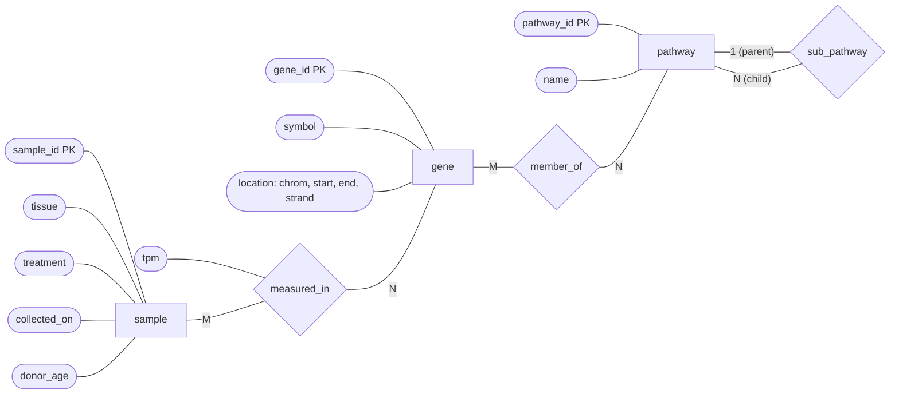
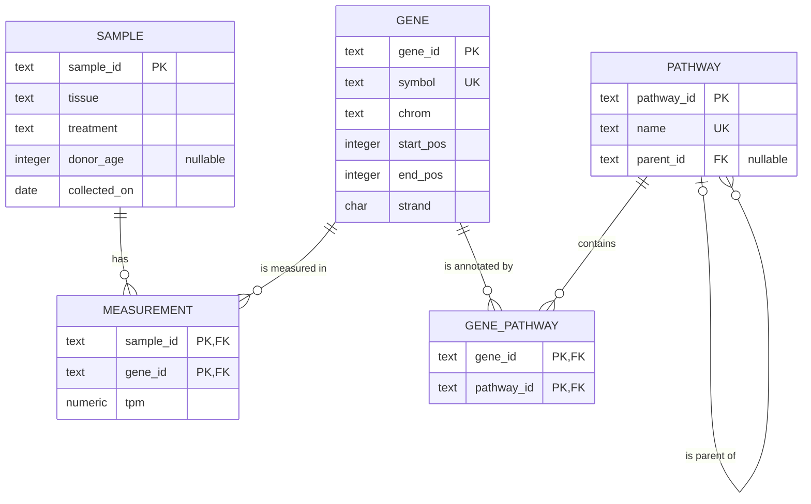

The relational model says how data are represented, but not which relations a database should have. Before writing `CREATE TABLE`, a designer must understand which things the application is about, which facts about them are recorded and how they are connected. The *entity–relationship model* (E-R model), introduced by Peter Chen in 1976, is the standard tool for this conceptual stage: it describes the world as entities and relationships among them, in diagrams that domain experts can read and discuss, and it translates mechanically into relation schemas. This chapter presents the model, its diagram notations and the translation, and derives the schema of the running example ([4.13.3](/4.13.3#sec-3.2.3)) from an E-R design. The next chapter, [4.13.6](/4.13.6), gives the complementary, formal criterion of a good design, normalization. Readers who know UML class diagrams ([4.2](/4.2)) will find the same ideas in a notation adapted to data.

## 5.1. The Design Process

A database is designed in phases, each producing a more concrete description:

| Phase | Question | Result |
|---|---|---|
| requirements analysis | What data must be stored, and which operations and queries must the database support? | a written specification, interviews with users, sample forms and reports |
| conceptual design | Which entities, attributes and relationships describe the domain, and what constraints hold? | an E-R diagram (this chapter) |
| logical design | Which relation schemas implement the conceptual design in the chosen data model? | relation schemas with keys, refined by normalization ([4.13.6](/4.13.6)) |
| physical design | How are the relations stored, and which indexes support the workload? | storage parameters and indexes ([4.13.7](/4.13.7), [4.13.8](/4.13.8)) |

The conceptual design is independent of the DBMS and of performance; it should be a faithful model of the domain. Two dangers must be avoided at this stage. *Redundancy* stores the same fact in several places, which wastes space and, worse, allows the copies to disagree; *incompleteness* makes some aspect of the domain impossible to record, or forces it to be recorded in an awkward form (for instance, a sample that cannot be entered until its first measurement exists).

The requirements for the running example might read: *The laboratory collects tissue samples from donors; each sample has an identifier, a tissue, a treatment status and a collection date, and the donor's age at collection is recorded when known. The expression of each gene in each sample is measured once, in TPM. A gene has a stable identifier, a unique symbol and a position on a chromosome. Genes are annotated to pathways, a gene may belong to several pathways, and pathways are organized in a hierarchy in which each pathway has at most one parent.*

## 5.2. Entity Sets and Attributes

**Definition 5.2.1 (Entity and Entity Set)** An **entity** is a thing or object in the domain that is distinguishable from all other objects: a particular gene, a particular sample. An **entity set** is a set of entities of the same type that share the same properties: the set of all genes. Each entity is described by **attributes**, functions from the entity set to a value set (domain) of the attribute.

An entity set corresponds to a class, an entity to an object; the set of entities in the database at a moment is the *extension* of the entity set. Like relations, entity sets need keys: a set of attributes whose values identify each entity uniquely (Definition 2.2.1 applies verbatim). The entity set *gene* has the attributes *gene_id*, *symbol*, *location* and others, with key *gene_id*.

The E-R model distinguishes several kinds of attributes:

**Definition 5.2.2 (Kinds of Attributes)** A **composite attribute** is an attribute whose values consist of component attributes; other attributes are *simple*. A **multivalued attribute** is one for which an entity may have a set of values; other attributes are *single-valued*. A **derived attribute** is one whose value can be computed from other attributes or entities; other attributes are *stored*.

**Example 5.2.1** The genomic location of a gene is a composite attribute with the components chromosome, start, end and strand; the length of a gene is derived ($\mathit{end} - \mathit{start} + 1$); the alternative symbols of a gene (TP53 is also known as p53 and LFS1) form a multivalued attribute. A donor's age at collection is derived from the date of birth and the collection date. An attribute takes the null value when the entity has no value for it or the value is unknown ([4.13.2](/4.13.2#sec-2.6)).

Composite attributes let the design be read at different levels of detail; multivalued attributes cannot be stored in a single column of a relation in first normal form and become separate relations (§5.8.2). Derived attributes are usually not stored, so that they cannot become inconsistent with their sources; when a derived value is expensive to compute or legally required in its recorded form (such as the age recorded at collection), storing it is a deliberate decision.

## 5.3. Relationship Sets

**Definition 5.3.1 (Relationship and Relationship Set)** A **relationship** is an association among several entities. A **relationship set** $R$ among the entity sets $E_1, \dots, E_n$ (not necessarily distinct) is a set of relationships, that is, a subset of $\{\, (e_1, \dots, e_n) \mid e_1 \in E_1, \dots, e_n \in E_n \,\}$. The entity sets *participate* in $R$, and $n$ is the *degree* of $R$.

Most relationship sets are *binary* ($n = 2$): *measured_in* associates genes with samples, *member_of* genes with pathways. Each relationship is determined by the entities it relates, so a relationship set is a mathematical relation among entity sets, and the same pair of entities can be related at most once.

A relationship set may have *descriptive attributes* that describe the association rather than either entity: the TPM value describes the pair (gene, sample), not the gene alone or the sample alone. When the same entity set participates more than once, each participation is given a role: the relationship set *sub_pathway* relates the entity set *pathway* to itself, with the roles *parent* and *child*. Such a relationship set is called *recursive*.

Relationship sets of degree three or more are rarer, and §5.9.3 discusses when they are needed.

## 5.4. Constraints

### 5.4.1. Mapping Cardinalities

**Definition 5.4.1 (Mapping Cardinality)** For a binary relationship set $R$ between $A$ and $B$, the **mapping cardinality** states with how many entities of the other set an entity can be associated:

- *one-to-one*: each entity of $A$ is associated with at most one entity of $B$, and each entity of $B$ with at most one entity of $A$;
- *one-to-many* (from $A$ to $B$): each entity of $A$ is associated with any number of entities of $B$, and each entity of $B$ with at most one entity of $A$;
- *many-to-one* (from $A$ to $B$): the converse;
- *many-to-many*: each entity of either set may be associated with any number of entities of the other.

In the running example, *sub_pathway* is one-to-many from parent to child (a parent has many children, a child at most one parent), and *measured_in* and *member_of* are many-to-many. A new requirement "each sample comes from exactly one donor" makes *taken_from* many-to-one from *sample* to *donor*. The cardinality is a constraint on all legal databases, a property of the domain, like a key; it cannot be read off the current data.

### 5.4.2. Participation and Numerical Bounds

**Definition 5.4.2 (Participation)** The participation of an entity set $E$ in a relationship set $R$ is a **total participation** if every entity of $E$ participates in at least one relationship of $R$, and a **partial participation** otherwise.

Every sample comes from a donor, so the participation of *sample* in *taken_from* is total; a gene need not belong to a pathway (ACTB belongs to none in the example data), so the participation of *gene* in *member_of* is partial. Mapping cardinality and participation are combined in a single notation of *numerical bounds* $l..h$ on each participation: each entity of $E$ takes part in at least $l$ and at most $h$ relationships of $R$, where $h = {*}$ means no limit. Thus $1..1$ means exactly one, $0..1$ at most one, $1..{*}$ total and many, and $0..{*}$ unrestricted. In this notation, the bound of *sample* in *taken_from* is $1..1$ and that of *donor* is $1..{*}$ if a donor is entered only together with a first sample.

### 5.4.3. Keys of Relationship Sets

A relationship is identified by the entities it relates. If $K_1, \dots, K_n$ are the primary keys of the participating entity sets, then $K_1 \cup \cdots \cup K_n$ is a superkey of the relationship set (renaming attributes with the role names where an entity set occurs twice). The mapping cardinality determines the candidate keys of a binary relationship set between $A$ and $B$:

| Mapping cardinality | Candidate keys of the relationship set |
|---|---|
| many-to-many | $K_A \cup K_B$ |
| one-to-many from $A$ to $B$ | $K_B$ (each $B$-entity occurs at most once) |
| many-to-one from $A$ to $B$ | $K_A$ |
| one-to-one | $K_A$ and $K_B$ |

This table is what the reduction to relations (§5.8) uses to choose the primary keys and to decide where a relationship set can be folded into an entity set.

## 5.5. Weak Entity Sets

Some entities cannot be identified by their own attributes alone. A sample is divided into *aliquots*, portions stored in separate tubes, which the laboratory numbers 1, 2, 3 within each sample; aliquot 2 means nothing without the sample it belongs to.

**Definition 5.5.1 (Weak Entity Set)** A **weak entity set** is an entity set whose existence depends on another entity set, its *identifying entity set* (or owner), through a total, many-to-one **identifying relationship** from the weak entity set to the owner. The **discriminator** (or partial key) of the weak entity set is a set of attributes that distinguishes the entities belonging to the same owner. The primary key of a weak entity set consists of the primary key of the owner together with the discriminator. An entity set that is not weak is a *strong* entity set.

The primary key of *aliquot* is $(\mathit{sample\_id}, \mathit{aliquot\_no})$. The identifying relationship has no attributes of its own and is drawn with a double outline. A weak entity set is preferred to giving the aliquot its own key attribute when the aliquot is meaningful only together with its sample: deleting a sample deletes its aliquots.

The measurements could also be modeled as a weak entity set owned by both *sample* and *gene*, with an empty discriminator; this is equivalent to the relationship set *measured_in* with the descriptive attribute *tpm*. The relationship-set formulation is simpler and is used here; the weak-entity formulation becomes natural when the measured object needs relationships of its own.

## 5.6. Specialization and Generalization

An entity set may contain subgroupings whose members have attributes or relationships that others do not have. Samples from a tissue biopsy record the tissue and the donor, whereas samples grown from a cell line record the cell line and the passage number.

**Definition 5.6.1 (Specialization and Generalization)** **Specialization** is the designation of subgroupings, the *lower-level* entity sets, within an entity set, the *higher-level* entity set; **generalization** is the inverse process of combining entity sets with common features into a higher-level entity set. The relationship between a lower-level and a higher-level entity set is called ISA ("is a"), and a lower-level entity set *inherits* all attributes and relationship participations of its higher-level entity set.

Specialization proceeds top down during design (we notice that some samples differ), generalization bottom up (we notice that tissue samples and cell-line samples share most attributes); the result is the same hierarchy. Inheritance is the same idea as in object-oriented programming ([4.2](/4.2)). Two constraints describe a specialization:

- *disjoint* (an entity belongs to at most one lower-level entity set) or *overlapping* (it may belong to several): tissue samples and cell-line samples are disjoint, whereas the specialization of a person into *donor* and *staff* would be overlapping;
- *total* (every higher-level entity belongs to some lower-level entity set) or *partial*: if every sample is either a tissue sample or a cell-line sample, the specialization is total.

The E-R model has one more construct, aggregation, which treats a relationship set together with its entities as a higher-level entity set so that it can take part in further relationships. For example, a quality-control flag that a curator attaches to a particular (sample, gene) measurement relates the curator to the relationship *measured_in*. In the relational translation, the aggregated relationship set simply becomes a relation whose primary key the new relationship references.

## 5.7. E-R Diagrams

### 5.7.1. Chen Notation

**Definition 5.7.1 (E-R Diagram)** An **E-R diagram** represents an E-R design graphically: entity sets, relationship sets and attributes are drawn as shapes, connected by lines that indicate participation, with symbols for keys, cardinalities and participation constraints.

Chen's original notation, still common in textbooks, draws entity sets as rectangles, relationship sets as diamonds and attributes as ellipses; key attributes are underlined, multivalued attributes have a double ellipse, derived attributes a dashed one, and weak entity sets and their identifying relationships a double outline. Cardinalities are written on the lines (1, N, M) and total participation is a double line. Silberschatz et al. use a compact variant in which the attributes are listed inside the entity rectangle. The core of the running example in Chen style (key attributes marked "PK", since the diagram tool cannot underline):



### 5.7.2. Crow's-Foot Notation

Most database design tools, and most diagrams in industry, use the *crow's-foot* (information engineering) notation instead. It has no diamonds: a binary relationship set without attributes is a line between two entity boxes, labeled with a verb, and each end of the line carries two symbols. The symbol nearer the entity gives the maximum (a bar for one, a three-pronged "crow's foot" for many), the outer one the minimum (a bar for one, a circle for zero):

| End symbol | Bounds | Mermaid `erDiagram` syntax |
|---|---|---|
| bar, bar | exactly one ($1..1$) | `\|\|` |
| circle, bar | zero or one ($0..1$) | `\|o` / `o\|` |
| bar, crow's foot | one or more ($1..{*}$) | `\|{` / `}\|` |
| circle, crow's foot | zero or more ($0..{*}$) | `o{` / `}o` |

A many-to-many relationship set with attributes, such as *measured_in*, is drawn as an *associative entity* (a box of its own) connected to both sides; this already anticipates its translation into a relation. The full running example, with the attributes listed inside the boxes (the boxes here show the relation schemas that §5.8 derives, including the foreign keys):



Read each line in both directions: a sample has zero or more measurements, and a measurement belongs to exactly one sample; a pathway has zero or more child pathways, and a pathway has zero or one parent. UML class diagrams express the same information with multiplicities such as `0..*` and `1` at the ends of an association.

| Concept | Chen | Crow's foot | UML class diagram |
|---|---|---|---|
| entity set | rectangle | box | class |
| attribute | ellipse | row in the box | attribute |
| relationship set | diamond | line (associative entity if it has attributes) | association (association class) |
| cardinality | 1, N, M on the lines | crow's foot or bar | multiplicity `1`, `*` |
| minimum participation | double line for total | circle or bar | multiplicity `0..` or `1..` |
| weak entity set | double rectangle | dependent box (identifying line drawn solid) | composition |
| specialization | triangle or ISA arrow | subtype boxes | generalization arrow |

## 5.8. Reduction to Relational Schemas

### 5.8.1. Entity Sets and Relationship Sets

An E-R design is translated into relation schemas by a small set of rules. Let primary keys be underlined in the E-R design.

| Construct | Relation schema |
|---|---|
| strong entity set $E$ with simple attributes | one relation $E$ with the same attributes and primary key |
| weak entity set $W$ with owner $E$ | one relation with the attributes of $W$ plus the primary key of $E$; primary key = key of $E$ ∪ discriminator; foreign key to $E$ (usually `ON DELETE CASCADE`) |
| many-to-many relationship set $R$ | one relation with the primary keys of all participating entity sets and the descriptive attributes of $R$; primary key = union of those keys; a foreign key to each entity set |
| one-to-many or many-to-one relationship set | no relation of its own if the "many" side participates: the primary key of the "one" side and the descriptive attributes are added to the "many" side's relation as a foreign key |
| one-to-one relationship set | as above, on either side (preferably the side with total participation) |
| identifying relationship set of a weak entity set | no relation (already contained in the weak entity's relation) |
| relationship set of degree $n > 2$ | one relation with the keys of all participants; its primary key follows from the cardinality constraints |

The folding rule for one-to-many relationship sets needs a comment. A separate relation $\mathit{sub\_pathway}(\underline{\mathit{child\_id}}, \mathit{parent\_id})$ would be correct (its key is $\mathit{child\_id}$ by §5.4.3), but it has the same key as $\mathit{pathway}$ and can be merged with it. If the participation of the many side is partial, the merged foreign key is nullable: top-level pathways have $\mathit{parent\_id}$ null. When most entities do not participate, a separate relation avoids a mostly null column; either design is correct.

**Example 5.8.1** Applying the rules to the core design of §5.7:

- the strong entity sets *gene*, *sample* and *pathway* become the relations $\mathit{gene}$, $\mathit{sample}$ and $\mathit{pathway}$; the composite attribute *location* is flattened into its components $\mathit{chrom}$, $\mathit{start\_pos}$, $\mathit{end\_pos}$ and $\mathit{strand}$ (§5.8.2);
- the many-to-many relationship set *measured_in* with the attribute *tpm* becomes $\mathit{measurement}(\underline{\mathit{sample\_id}, \mathit{gene\_id}}, \mathit{tpm})$;
- the many-to-many relationship set *member_of* becomes $\mathit{gene\_pathway}(\underline{\mathit{gene\_id}, \mathit{pathway\_id}})$;
- the recursive one-to-many relationship set *sub_pathway* is folded into $\mathit{pathway}$ as the nullable foreign key $\mathit{parent\_id}$, with the role name *parent* as the prefix of the column name.

The result is exactly the schema created in [4.13.3](/4.13.3#sec-3.2.3).

### 5.8.2. Attributes

A composite attribute is replaced by its simple components (a column per component, prefixed if necessary: $\mathit{location\_chrom}$, or simply $\mathit{chrom}$). A multivalued attribute $M$ of an entity set $E$ becomes a relation of its own, with the primary key of $E$ and one column for a value of $M$; its primary key is the combination, and it has a foreign key to $E$. The alternative symbols of a gene become

$$
\mathit{gene\_alias}(\underline{\mathit{gene\_id}, \mathit{alias}}),
$$

with one row per alias. A derived attribute is not stored; it is computed in queries or by a view (the length of a gene) or, in PostgreSQL, declared as a *generated column* `length_bp integer GENERATED ALWAYS AS (end_pos - start_pos + 1)`, which PostgreSQL 18 computes on read by default (`VIRTUAL`) and earlier versions store (`STORED`).

### 5.8.3. Specialization

A specialization of $E$ into $E_1, \dots, E_k$ can be translated in three ways:

| Strategy | Relations | Advantages and drawbacks |
|---|---|---|
| one relation per entity set | $E$ with the common attributes; each $E_i$ with the primary key of $E$ (also a foreign key to $E$) and its own attributes | works for every kind of specialization; reading a full lower-level entity needs a join |
| one relation per lower-level entity set | each $E_i$ with all inherited and its own attributes | no joins, but only for disjoint and total specializations; queries over all of $E$ need a union, and a foreign key cannot reference "any $E_i$" |
| a single relation | $E$ with all attributes of all $E_i$, nullable, plus a *type* column | no joins; many nulls; constraints of one subtype ("a tissue sample has a tissue") need `CHECK` constraints depending on the type |

ORMs call these strategies joined-table, concrete-table and single-table inheritance. For the two kinds of samples, the first strategy gives

$$
\begin{aligned}
&\mathit{sample}(\underline{\mathit{sample\_id}}, \mathit{treatment}, \mathit{collected\_on}, \mathit{kind}),\\
&\mathit{tissue\_sample}(\underline{\mathit{sample\_id}}, \mathit{tissue}, \mathit{donor\_id}),\\
&\mathit{cell\_line\_sample}(\underline{\mathit{sample\_id}}, \mathit{cell\_line}, \mathit{passage}),
\end{aligned}
$$

where $\mathit{sample\_id}$ in the two lower-level relations is a foreign key to $\mathit{sample}$, and the discriminating column $\mathit{kind}$ makes it cheap to tell which subtype a sample belongs to.

### 5.8.4. An Extended Design

Putting the additional requirements together (donors, aliquots as a weak entity set, alternative gene symbols as a multivalued attribute) gives the following extension of the running example, here in SQL. The statements were executed with SQLite on top of the running example and create the tables without error (DuckDB 1.5 rejects two of them: it supports neither `ON DELETE CASCADE` nor adding a column with a foreign key); [4.13.6](/4.13.6#sec-6.1.2) explains the `ON DELETE` actions.

```sql
CREATE TABLE donor (
    donor_id   text PRIMARY KEY,
    sex        text CHECK (sex IN ('female', 'male')),
    birth_year integer
);

-- many-to-one sample -> donor, total on the sample side, but added as a
-- nullable column because the existing samples were entered without donors
ALTER TABLE sample ADD COLUMN donor_id text REFERENCES donor (donor_id);

-- weak entity set: identified by its sample and a number within the sample
CREATE TABLE aliquot (
    sample_id  text REFERENCES sample (sample_id) ON DELETE CASCADE,
    aliquot_no integer CHECK (aliquot_no >= 1),
    volume_ul  numeric(6, 1),
    freezer    text,
    PRIMARY KEY (sample_id, aliquot_no)
);

-- multivalued attribute of gene
CREATE TABLE gene_alias (
    gene_id text REFERENCES gene (gene_id) ON DELETE CASCADE,
    alias   text,
    PRIMARY KEY (gene_id, alias)
);
```

The extension changes no existing table except for the new column, which is the practical meaning of a good conceptual design: new requirements add entity sets and relationship sets rather than forcing a redesign of the existing ones.

## 5.9. Design Choices

### 5.9.1. Entity Set or Attribute

Should the tissue of a sample be an attribute, or an entity set *tissue* with a relationship *from_tissue*? An attribute suffices as long as nothing else is recorded about tissues. As soon as tissues have properties of their own (an ontology identifier such as UBERON:0002107 for liver, a parent tissue) or the set of permitted values must be controlled, *tissue* becomes an entity set, and the attribute is replaced by a relationship. A good rule: something is an entity if facts are recorded about it, or if it participates in relationships other than with the one entity it describes. Using the primary key of one entity set as an attribute of another (a column *gene_id* in the entity set *sample*) is a common mistake in E-R diagrams; the connection is a relationship set, and the foreign key appears only in the relational translation.

### 5.9.2. Entity Set or Relationship Set

A measurement can be modeled as a relationship between a sample and a gene or as an entity set *measurement* related to both. The relationship set is the natural choice when the measurement is determined by the pair and has a few descriptive attributes. An entity set is better when the same pair can be related several times (technical replicates, repeated runs, measurements on different platforms) or when the measurement itself takes part in other relationships (it was produced by a sequencing run, flagged by a curator): a relationship set contains each combination of entities at most once, whereas entities can be added freely.

### 5.9.3. Binary or Higher-Degree Relationship Sets

If expression is measured on several platforms, the measurement relates three entity sets: sample, gene and platform. A ternary relationship set *measured_on*(sample, gene, platform) records that a value was obtained for this gene in this sample on this platform. It is not equivalent to three binary relationship sets, (sample, gene), (gene, platform) and (sample, platform): from "S01 was measured on RNA-seq", "TP53 was measured in S01" and "TP53 is on the array" one cannot conclude that TP53 was measured in S01 on RNA-seq. Any $n$-ary relationship set can, however, be replaced by an entity set with a surrogate key and $n$ binary relationship sets, which is what the associative entity of the crow's-foot notation does. The entity form is easier to extend and is required by notations without $n$-ary relationships, but constraints that the ternary relationship states directly (such as "each sample–gene pair has at most one value per platform") then become an explicit `UNIQUE` constraint on the three foreign keys.

### 5.9.4. Placement of Attributes

The descriptive attribute of a one-to-many relationship set can be moved to the entity set on the many side, since each of those entities takes part in at most one relationship; the reduction rule of §5.8.1 does exactly this. For a many-to-many relationship set, an attribute such as *tpm* must stay with the relationship: it describes neither the sample nor the gene alone. Placing it in *gene* would require one value per gene, losing the dependence on the sample, which is precisely the kind of error that the normalization theory of [4.13.6](/4.13.6) detects formally.

## Summary

- Design proceeds from requirements to a conceptual (E-R), logical (relational) and physical design; the E-R design should be free of redundancy and complete.
- Entity sets have attributes, which may be composite, multivalued or derived, and keys. Relationship sets associate entities, have a degree and may carry descriptive attributes and roles.
- Mapping cardinalities (one-to-one, one-to-many, many-to-many) and participation (total or partial), or numerical bounds $l..h$, constrain relationship sets and determine their keys.
- A weak entity set is identified by its owner's key and a discriminator through a total, many-to-one identifying relationship. Specialization and generalization form ISA hierarchies with inheritance, disjoint or overlapping, total or partial.
- Chen diagrams use rectangles, diamonds and ellipses; crow's-foot diagrams use boxes and line ends that show minimum and maximum participation.
- Reduction: each strong entity set and each many-to-many relationship set becomes a relation; weak entity sets take their owner's key; one-to-many relationship sets become foreign keys on the many side; composite attributes are flattened, multivalued attributes become relations, specializations become one relation per entity set, per subtype, or one relation in total. Applied to the core design, the rules yield the running example of the course.
