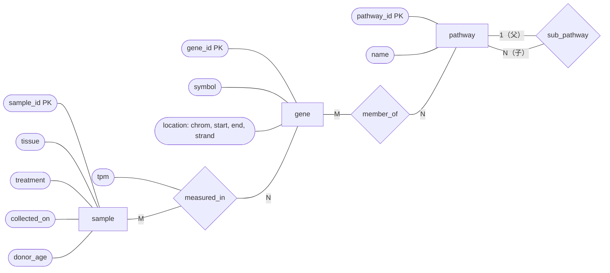
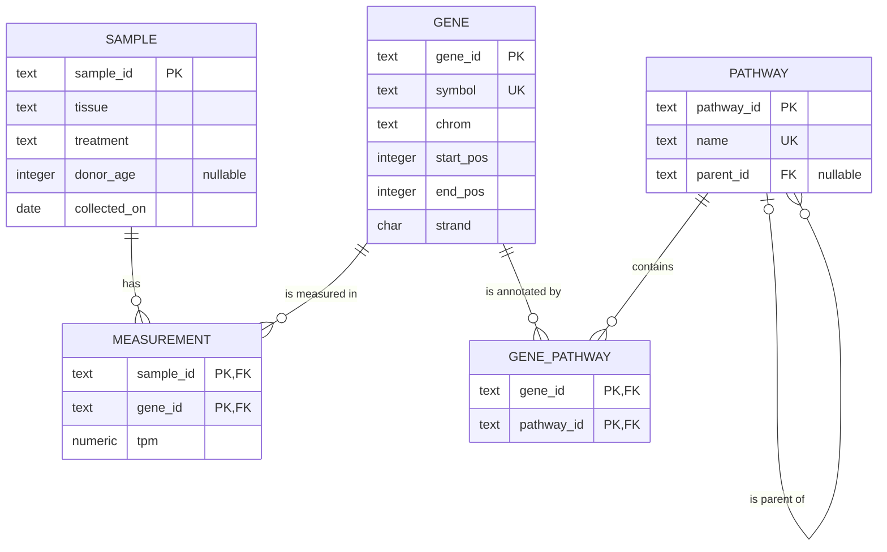

**关系模型**说明了数据如何表示，却没有说明一个**数据库**应当有哪些**关系**。在写 `CREATE TABLE` 之前，设计者必须弄清应用涉及哪些事物，记录这些事物的哪些事实，以及它们之间如何联系。*实体–联系模型*（*entity–relationship model*，简称 E-R 模型）由 Peter Chen 于 1976 年提出，是概念设计阶段的标准工具：它把现实世界描述为实体及实体之间的联系，用领域专家也能阅读和讨论的图表示，并能机械地转换为关系模式。本章介绍该模型、图的记法与转换规则，并由一个 E-R 设计推导出运行示例的模式（[4.13.3](/4.13.3#sec-3.2.3)）。下一章 [4.13.6](/4.13.6) 给出与之互补的好设计的形式化准则，即规范化。熟悉 UML 类图（[4.2](/4.2)）的读者会发现，这里是同样的思想换成了面向数据的记法。

## 5.1. 设计过程

**数据库**的设计分阶段进行，每个阶段产生更具体的描述：

| 阶段 | 问题 | 结果 |
|---|---|---|
| 需求分析 | 必须存储哪些数据，数据库必须支持哪些操作和查询？ | 书面规格说明、用户访谈、样例表单与报表 |
| 概念设计 | 哪些实体、属性和联系描述了该领域，成立哪些约束？ | E-R 图（本章） |
| 逻辑设计 | 在选定的数据模型中，用哪些关系模式实现概念设计？ | 带码的关系模式，经规范化（[4.13.6](/4.13.6)）改进 |
| 物理设计 | 关系如何存储，哪些索引支持工作负载？ | 存储参数与索引（[4.13.7](/4.13.7)、[4.13.8](/4.13.8)） |

概念设计与 **DBMS** 和性能无关，应当如实地为领域建模。这一阶段要避免两个危险。*冗余*把同一事实存放在多处，既浪费空间，更糟的是各份副本可能互相矛盾；*不完整*使领域的某个方面无法记录，或只能以别扭的形式记录（例如，在第一次测量出现之前无法录入样本）。

运行示例的需求可以这样叙述：*实验室从供体采集组织样本；每个样本有标识符、组织、处理状态和采集日期，已知时还记录供体在采集时的年龄。每个基因在每个样本中的表达量只测量一次，单位为 TPM。基因有稳定的标识符、唯一的符号和染色体上的位置。基因被注释到通路，一个基因可以属于多条通路，通路组织成层次结构，每条通路至多有一个父通路。*

## 5.2. 实体集与属性

**定义 5.2.1（实体与实体集）** **实体**是领域中可与其他所有对象区分开的事物或对象，如某个特定的基因、某个特定的样本。**实体集**是由具有相同性质的同类实体构成的集合，如全体基因的集合。每个实体由**属性**描述，属性是从实体集到该属性的值集（域）的函数。

**实体集**对应于类，**实体**对应于对象；某一时刻**数据库**中的实体集合称为该实体集的*外延*。与关系一样，实体集也需要码：一组属性，其取值能唯一标识每个实体（定义 2.2.1 原样适用）。实体集 *gene* 有属性 *gene_id*、*symbol*、*location* 等，码为 *gene_id*。

**E-R 模型**区分几种**属性**：

**定义 5.2.2（属性的种类）** **复合属性**是取值由若干分量属性组成的属性，其他属性称为*简单属性*。**多值属性**是一个实体可以取一组值的属性，其他属性称为*单值属性*。**派生属性**是其值可由其他属性或实体计算得到的属性，其他属性称为*存储属性*。

**例 5.2.1** 基因的基因组位置是**复合属性**，分量为染色体、起点、终点和链；基因的长度是派生的（$\mathit{end} - \mathit{start} + 1$）；基因的别名（TP53 也称 p53 和 LFS1）构成**多值属性**。供体在采集时的年龄由出生日期和采集日期派生。实体在某属性上没有值或值未知时，该属性取**空值**（[4.13.2](/4.13.2#sec-2.6)）。

复合属性使设计可以在不同的细节层次上阅读；多值属性不能存放在第一范式的**关系**的单个列中，需要成为单独的关系（§5.8.2）。**派生属性**通常不存储，以免与其来源不一致；当派生值的计算代价高昂，或法律要求保留其记录时的形式（如采集时记录的年龄）时，存储它是一个有意识的决定。

## 5.3. 联系集

**定义 5.3.1（联系与联系集）** **联系**是若干实体之间的关联。实体集 $E_1, \dots, E_n$（不必互异）之间的**联系集** $R$ 是联系的集合，即 $\{\, (e_1, \dots, e_n) \mid e_1 \in E_1, \dots, e_n \in E_n \,\}$ 的子集。这些实体集*参与* $R$，$n$ 称为 $R$ 的*度*。

大多数**联系集**是*二元*的（$n = 2$）：*measured_in* 把基因与样本关联起来，*member_of* 把基因与通路关联起来。每个**联系**由它所联系的实体决定，所以联系集是实体集之间的数学**关系**，同一对实体至多被联系一次。

联系集可以有描述性属性（descriptive attribute），它描述的是关联本身，而不是任何一方的**实体**：TPM 值描述的是（基因，样本）这一对，而不是单独的基因或样本。当同一个**实体集**多次参与时，每次参与要赋予一个角色：联系集 *sub_pathway* 把实体集 *pathway* 与自身联系起来，角色为 *parent* 和 *child*。这样的联系集称为*递归*的。

度为三或更高的联系集较少见，§5.9.3 讨论何时需要它们。

## 5.4. 约束

### 5.4.1. 映射基数

**定义 5.4.1（映射基数）** 对 $A$ 与 $B$ 之间的二元联系集 $R$，**映射基数**说明一个实体可以与另一个集合中多少个实体相关联：

- *一对一*：$A$ 的每个**实体**至多与 $B$ 的一个实体关联，$B$ 的每个实体至多与 $A$ 的一个实体关联；
- *一对多*（从 $A$ 到 $B$）：$A$ 的每个实体可以与 $B$ 的任意多个实体关联，$B$ 的每个实体至多与 $A$ 的一个实体关联；
- *多对一*（从 $A$ 到 $B$）：与上相反；
- *多对多*：任一集合的每个实体都可以与另一集合的任意多个实体关联。

在运行示例中，*sub_pathway* 从父通路到子通路是一对多（一个父通路有多个子通路，一个子通路至多有一个父通路），*measured_in* 和 *member_of* 是多对多。新需求“每个样本恰好来自一个供体”使 *taken_from* 从 *sample* 到 *donor* 成为多对一。基数是对所有合法**数据库**的约束，是领域的性质，与码一样；它不能从当前数据中读出。

### 5.4.2. 参与约束与数值界

**定义 5.4.2（参与）** 实体集 $E$ 在联系集 $R$ 中的参与，若 $E$ 的每个实体都至少参与 $R$ 的一个联系，称为**全部参与**，否则称为**部分参与**。

每个样本都来自某个供体，所以 *sample* 在 *taken_from* 中是全部参与；基因不必属于某条通路（示例数据中 ACTB 不属于任何通路），所以 *gene* 在 *member_of* 中是部分参与。**映射基数**与参与约束可以合并为对每个参与的*数值界* $l..h$ 这一种记法：$E$ 的每个实体在 $R$ 中至少参与 $l$ 个、至多参与 $h$ 个**联系**，其中 $h = {*}$ 表示没有上限。于是 $1..1$ 表示恰好一个，$0..1$ 表示至多一个，$1..{*}$ 表示全部参与且为多，$0..{*}$ 表示不受限制。用这种记法，若供体只随第一个样本一起录入，则 *sample* 在 *taken_from* 中的界为 $1..1$，*donor* 的界为 $1..{*}$。

### 5.4.3. 联系集的码

联系由它所联系的实体标识。设 $K_1, \dots, K_n$ 是各参与**实体集**的**主码**，则 $K_1 \cup \cdots \cup K_n$ 是该联系集的**超码**（实体集出现两次时，用角色名对属性重命名）。二元联系集（$A$ 与 $B$ 之间）的候选码由映射基数决定：

| 映射基数 | 联系集的候选码 |
|---|---|
| 多对多 | $K_A \cup K_B$ |
| 从 $A$ 到 $B$ 的一对多 | $K_B$（每个 $B$ 实体至多出现一次） |
| 从 $A$ 到 $B$ 的多对一 | $K_A$ |
| 一对一 | $K_A$ 与 $K_B$ |

向**关系**的转换（§5.8）正是用这张表选择主码，并决定**联系集**可以并入哪个实体集。

## 5.5. 弱实体集

有些实体不能仅凭自身的**属性**标识。一个样本被分成若干*等份*（aliquot），即存放在不同试管中的部分，实验室在每个样本内部将它们编号为 1、2、3；离开所属的样本，“2 号等份”没有任何意义。

**定义 5.5.1（弱实体集）** **弱实体集**是其存在依赖于另一个实体集（称为它的*标识实体集*，或属主）的实体集，依赖通过从弱实体集到属主的全部参与的多对一**标识性联系**实现。弱实体集的**分辨符**（或称部分码）是一组属性，用来区分属于同一属主的各个实体。弱实体集的主码由属主的主码与分辨符共同构成。不是弱实体集的实体集称为*强*实体集。

*aliquot* 的**主码**是 $(\mathit{sample\_id}, \mathit{aliquot\_no})$。**标识性联系**自身没有属性，用双线框画出。当等份只有与其样本一起才有意义时，用**弱实体集**比给等份单独设一个码属性更合适：删除样本就删除它的等份。

测量也可以建模为同时由 *sample* 和 *gene* 拥有的弱**实体集**，其**分辨符**为空；这等价于带描述性属性 *tpm* 的**联系集** *measured_in*。联系集的表述更简单，这里采用它；当被测量的对象需要有自己的联系时，弱实体的表述才变得自然。

## 5.6. 特化与概化

一个**实体集**可能包含若干子群，其成员具有其他成员没有的**属性**或**联系**。来自组织活检的样本记录组织和供体，而由细胞系培养得到的样本记录细胞系和传代数。

**定义 5.6.1（特化与概化）** **特化**是在一个实体集（*高层*实体集）内部划分出子群（*低层*实体集）；**概化**是相反的过程，把具有共同特征的实体集合并为一个高层实体集。低层与高层实体集之间的联系称为 ISA（“是一个”），低层实体集*继承*其高层实体集的全部属性和联系参与。

**特化**在设计中自顶向下进行（我们注意到有些样本不同），**概化**自底向上进行（我们注意到组织样本与细胞系样本有大部分属性相同）；结果是同一个层次结构。继承与面向对象编程（[4.2](/4.2)）中的是同一个思想。特化有两类约束：

- *不相交*（一个**实体**至多属于一个低层实体集）或*可重叠*（可以属于多个）：组织样本与细胞系样本不相交，而把人特化为 *donor* 和 *staff* 则是可重叠的；
- *全部*（每个高层实体都属于某个低层实体集）或*部分*：若每个样本不是组织样本就是细胞系样本，则该特化是全部的。

**E-R 模型**还有一种构造，聚合（aggregation），它把一个**联系集**连同其实体看作一个高层实体集，使它可以参与进一步的联系。例如，策展人给某个（样本，基因）测量加上的质量控制标记，联系的是策展人与联系 *measured_in*。在关系转换中，被聚合的联系集只是成为一个关系，新的联系引用它的主码。

## 5.7. E-R 图

### 5.7.1. Chen 记法

**定义 5.7.1（E-R 图）** **E-R 图**用图形表示 E-R 设计：实体集、联系集和属性画成各种图形，用表示参与的线连接，并用符号标出码、基数和参与约束。

Chen 的原始记法至今仍常见于教材：用矩形画**实体集**，用菱形画**联系集**，用椭圆画**属性**；码属性加下划线，多值属性用双椭圆，派生属性用虚椭圆，弱实体集及其标识性联系用双线框。基数写在线上（1、N、M），全部参与用双线。Silberschatz 等人使用一种紧凑的变体，把属性列在实体矩形内部。下面是运行示例核心部分的 Chen 风格图（因为绘图工具无法加下划线，码属性标注为“PK”）：



### 5.7.2. 鸟足记法

大多数**数据库**设计工具和业界的多数图改用*鸟足*（信息工程）记法。它没有菱形：不带属性的二元**联系**集是两个**实体**框之间的一条线，用动词标注，线的每一端带两个符号。靠近实体的符号给出最大值（一用竖线，多用三叉的“鸟足”），外侧的符号给出最小值（一用竖线，零用圆圈）：

| 端点符号 | 界 | Mermaid `erDiagram` 语法 |
|---|---|---|
| 竖线，竖线 | 恰好一个（$1..1$） | `\|\|` |
| 圆圈，竖线 | 零个或一个（$0..1$） | `\|o` / `o\|` |
| 竖线，鸟足 | 一个或多个（$1..{*}$） | `\|{` / `}\|` |
| 圆圈，鸟足 | 零个或多个（$0..{*}$） | `o{` / `}o` |

带属性的多对多联系集（如 *measured_in*）画成*关联实体*（*associative entity*，自成一个框）并与两侧相连；这已经预示了它向**关系**的转换。下面是完整的运行示例，属性列在框内（这里的框给出的是 §5.8 导出的**关系模式**，包括**外码**）：



每条线要从两个方向读：一个样本有零个或多个测量，一个测量恰好属于一个样本；一条通路有零个或多个子通路，一条通路有零个或一个父通路。UML 类图用关联两端的多重性（如 `0..*` 和 `1`）表达同样的信息。

| 概念 | Chen | 鸟足 | UML 类图 |
|---|---|---|---|
| 实体集 | 矩形 | 框 | 类 |
| 属性 | 椭圆 | 框内的一行 | 属性 |
| 联系集 | 菱形 | 线（有属性时用关联实体） | 关联（关联类） |
| 基数 | 线上的 1、N、M | 鸟足或竖线 | 多重性 `1`、`*` |
| 最小参与 | 全部参与用双线 | 圆圈或竖线 | 多重性 `0..` 或 `1..` |
| 弱实体集 | 双线矩形 | 依赖框（标识线画实线） | 组合 |
| 特化 | 三角形或 ISA 箭头 | 子类型框 | 泛化箭头 |

## 5.8. 向关系模式的转换

### 5.8.1. 实体集与联系集

E-R 设计由少量规则转换为**关系模式**。设 E-R 设计中的**主码**带下划线。

| 构造 | 关系模式 |
|---|---|
| 带简单属性的强实体集 $E$ | 一个关系 $E$，属性与主码相同 |
| 属主为 $E$ 的弱实体集 $W$ | 一个关系，含 $W$ 的属性加上 $E$ 的主码；主码 = $E$ 的码 ∪ 分辨符；指向 $E$ 的外码（通常带 `ON DELETE CASCADE`） |
| 多对多联系集 $R$ | 一个关系，含所有参与实体集的主码和 $R$ 的描述性属性；主码 = 这些码的并集；对每个实体集各有一个外码 |
| 一对多或多对一联系集 | 若“多”的一方参与，则没有自己的关系：把“一”的一方的主码和描述性属性作为外码加入“多”的一方的关系 |
| 一对一联系集 | 同上，加到任一方均可（宜选全部参与的一方） |
| 弱实体集的标识性联系集 | 没有关系（已包含在弱实体的关系中） |
| 度 $n > 2$ 的联系集 | 一个关系，含所有参与者的码；主码由基数约束决定 |

一对多**联系集**的合并规则需要说明一下。单独的**关系** $\mathit{sub\_pathway}(\underline{\mathit{child\_id}}, \mathit{parent\_id})$ 是正确的（由 §5.4.3，其码为 $\mathit{child\_id}$），但它与 $\mathit{pathway}$ 的码相同，可以与之合并。若“多”的一方是部分参与，则合并后的**外码**可为空：顶层通路的 $\mathit{parent\_id}$ 为空。当多数实体不参与时，单独的关系可以避免出现大部分为空的列；两种设计都正确。

**例 5.8.1** 把这些规则用于 §5.7 的核心设计：

- 强**实体集** *gene*、*sample* 和 *pathway* 成为关系 $\mathit{gene}$、$\mathit{sample}$ 和 $\mathit{pathway}$；**复合属性** *location* 被展平为分量 $\mathit{chrom}$、$\mathit{start\_pos}$、$\mathit{end\_pos}$ 和 $\mathit{strand}$（§5.8.2）；
- 带属性 *tpm* 的多对多**联系**集 *measured_in* 成为 $\mathit{measurement}(\underline{\mathit{sample\_id}, \mathit{gene\_id}}, \mathit{tpm})$；
- 多对多联系集 *member_of* 成为 $\mathit{gene\_pathway}(\underline{\mathit{gene\_id}, \mathit{pathway\_id}})$；
- 递归的一对多联系集 *sub_pathway* 并入 $\mathit{pathway}$，成为可为空的外码 $\mathit{parent\_id}$，列名以角色名 *parent* 为前缀。

结果恰好就是 [4.13.3](/4.13.3#sec-3.2.3) 中创建的**模式**。

### 5.8.2. 属性

复合**属性**由其简单分量替换（每个分量一列，必要时加前缀：$\mathit{location\_chrom}$，或直接用 $\mathit{chrom}$）。**实体**集 $E$ 的**多值属性** $M$ 成为单独的关系，含 $E$ 的主码和存放 $M$ 的一个取值的一列；其主码是这两者的组合，并有指向 $E$ 的外码。基因的别名成为

$$
\mathit{gene\_alias}(\underline{\mathit{gene\_id}, \mathit{alias}}),
$$

每个别名一行。**派生属性**不存储；它在查询中或通过视图计算（如基因的长度），或者在 PostgreSQL 中声明为生成列（generated column）`length_bp integer GENERATED ALWAYS AS (end_pos - start_pos + 1)`，PostgreSQL 18 默认在读取时计算（`VIRTUAL`），更早的版本则存储它（`STORED`）。

### 5.8.3. 特化

把 $E$ 特化为 $E_1, \dots, E_k$ 可以用三种方式转换：

| 策略 | 关系 | 优缺点 |
|---|---|---|
| 每个实体集一个关系 | $E$ 含公共属性；每个 $E_i$ 含 $E$ 的主码（同时是指向 $E$ 的外码）和自己的属性 | 适用于所有种类的特化；读取完整的低层实体需要连接 |
| 每个低层实体集一个关系 | 每个 $E_i$ 含所有继承的属性和自己的属性 | 无需连接，但仅适用于不相交且全部的特化；对整个 $E$ 的查询需要并，外码也不能引用“任一 $E_i$” |
| 单个关系 | $E$ 含所有 $E_i$ 的全部属性（可为空），外加一个*类型*列 | 无需连接；空值多；某个子类型的约束（“组织样本有组织”）需要依赖类型的 `CHECK` 约束 |

ORM 把这些策略分别称为联接表继承、具体表继承和单表继承。对于这两类样本，第一种策略给出

$$
\begin{aligned}
&\mathit{sample}(\underline{\mathit{sample\_id}}, \mathit{treatment}, \mathit{collected\_on}, \mathit{kind}),\\
&\mathit{tissue\_sample}(\underline{\mathit{sample\_id}}, \mathit{tissue}, \mathit{donor\_id}),\\
&\mathit{cell\_line\_sample}(\underline{\mathit{sample\_id}}, \mathit{cell\_line}, \mathit{passage}),
\end{aligned}
$$

其中两个低层关系里的 $\mathit{sample\_id}$ 是指向 $\mathit{sample}$ 的外码，区分列 $\mathit{kind}$ 使得判断样本属于哪个子类型的代价很低。

### 5.8.4. 一个扩展的设计

把额外的需求合在一起（供体、作为**弱实体集**的等份、作为多值属性的基因别名），得到运行示例的如下扩展，这里用 **SQL** 表示。这些语句在运行示例之上用 SQLite 执行过，建表均无错误（DuckDB 1.5 拒绝其中两条：它既不支持 `ON DELETE CASCADE`，也不支持添加带外码的列）；`ON DELETE` 的各种动作见 [4.13.6](/4.13.6#sec-6.1.2)。

```sql
CREATE TABLE donor (
    donor_id   text PRIMARY KEY,
    sex        text CHECK (sex IN ('female', 'male')),
    birth_year integer
);

-- many-to-one sample -> donor, total on the sample side, but added as a
-- nullable column because the existing samples were entered without donors
ALTER TABLE sample ADD COLUMN donor_id text REFERENCES donor (donor_id);

-- weak entity set: identified by its sample and a number within the sample
CREATE TABLE aliquot (
    sample_id  text REFERENCES sample (sample_id) ON DELETE CASCADE,
    aliquot_no integer CHECK (aliquot_no >= 1),
    volume_ul  numeric(6, 1),
    freezer    text,
    PRIMARY KEY (sample_id, aliquot_no)
);

-- multivalued attribute of gene
CREATE TABLE gene_alias (
    gene_id text REFERENCES gene (gene_id) ON DELETE CASCADE,
    alias   text,
    PRIMARY KEY (gene_id, alias)
);
```

这一扩展除新增的一列外不改动任何已有的表，这正是好的概念设计的实际含义：新需求增加实体集和联系集，而不是迫使已有的设计重做。

## 5.9. 设计选择

### 5.9.1. 实体集还是属性

样本的组织应当是**属性**，还是带有**联系** *from_tissue* 的**实体集** *tissue*？只要不记录组织的其他信息，属性就足够了。一旦组织有了自己的性质（如本体标识符，肝脏为 UBERON:0002107；或父组织），或者必须控制允许的取值集合，*tissue* 就成为实体集，属性由联系取代。一条好的经验：如果要记录关于某事物的事实，或者它参与的联系不止与它所描述的那一个实体之间的联系，它就是实体。把一个实体集的主码用作另一个实体集的属性（在实体集 *sample* 中设列 *gene_id*）是 E-R 图中常见的错误；这种连接是联系集，外码只出现在关系转换之后。

### 5.9.2. 实体集还是联系集

测量可以建模为样本与基因之间的联系，也可以建模为与两者都相关的**实体**集 *measurement*。当测量由这一对决定且只有少量描述性属性时，**联系集**是自然的选择。当同一对可以多次相联系（技术重复、重复运行、不同平台上的测量），或测量本身参与其他联系（由某次测序运行产生、被策展人标记）时，实体集更好：联系集对每种实体组合至多包含一次，而实体可以自由添加。

### 5.9.3. 二元还是高度数的联系集

若表达量在多个平台上测量，测量就联系三个实体集：样本、基因和平台。三元联系集 *measured_on*（sample, gene, platform）记录了在这个平台上得到了这个样本中这个基因的一个值。它不等价于三个二元联系集（sample, gene）、（gene, platform）和（sample, platform）：由“S01 用 RNA-seq 测量过”“TP53 在 S01 中被测量过”和“TP53 在芯片上”，不能推出 TP53 在 S01 中用 RNA-seq 测量过。不过，任何 $n$ 元联系集都可以用带**代理键**的实体集和 $n$ 个二元联系集代替，鸟足记法中的**关联实体**就是这样做的。实体形式更易扩展，也是没有 $n$ 元联系的记法所必需的，但三元联系直接表述的约束（如“每个样本–基因对在每个平台上至多有一个值”）此时要变成对三个**外码**的显式 `UNIQUE` 约束。

### 5.9.4. 属性的位置

一对多联系集的描述性属性可以移到“多”一方的实体集中，因为这些实体各自至多参与一个联系；§5.8.1 的转换规则正是这样做的。对于多对多联系集，*tpm* 这样的属性必须留在联系上：它既不描述样本，也不单独描述基因。把它放进 *gene* 就要求每个基因只有一个值，丢失了对样本的依赖，这恰是 [4.13.6](/4.13.6) 的规范化理论能够形式化地检出的那类错误。

## 小结

- 设计从需求出发，经过概念（E-R）、逻辑（关系）和物理设计；E-R 设计应当没有冗余且完整。
- **实体集**有**属性**（可以是复合、多值或派生的）和码。**联系集**关联实体，有度，并可带描述性属性和角色。
- 映射基数（一对一、一对多、多对多）与参与（全部或部分），或数值界 $l..h$，约束联系集并决定它们的码。
- 弱实体集由属主的码和分辨符通过全部参与的多对一标识性联系标识。特化与概化形成带继承的 ISA 层次，可不相交或可重叠，可全部或部分。
- Chen 图使用矩形、菱形和椭圆；鸟足图使用框和显示最小、最大参与的线端。
- 转换：每个强实体集和每个多对多联系集成为一个关系；弱实体集取属主的码；一对多联系集成为“多”一方的外码；复合属性被展平，多值属性成为关系，特化成为每个实体集一个关系、每个子类型一个关系或总共一个关系。把这些规则用于核心设计，就得到本课程的运行示例。
