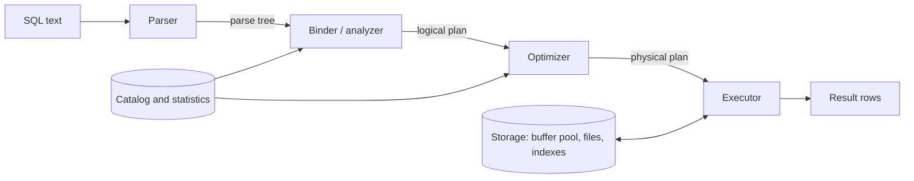
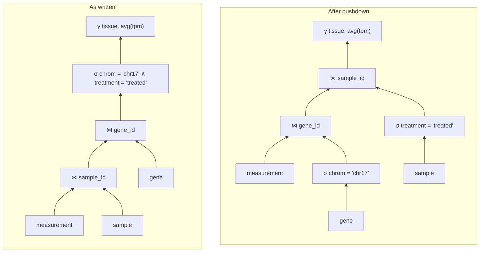

SQL says what result is wanted, not how to compute it. Between the query text and the result lies the query processor, which translates the query into relational algebra ([4.13.2](/4.13.2)), considers the many algebraically equivalent ways of computing it and the many algorithms available for each operator, estimates the cost of each alternative, and executes the cheapest one it finds. The difference between a good and a bad plan for the same query is often several orders of magnitude, which is why query optimization is one of the central achievements of database research and one of the reasons why a declarative language could succeed. This chapter follows a query through the processor: the overall pipeline and execution models (§9.1), the cost model (§9.2), algorithms for selection, sorting, joins and the other operators (§9.3–§9.6), the estimation of result sizes from statistics (§9.7), and the search for a good plan (§9.8), ending with the plans that real systems print (§9.9). It builds on the storage structures of [4.13.7](/4.13.7) and the indexes of [4.13.8](/4.13.8); sorting reuses **merge sort** from [4.3](/4.3), and hash joins use the **hash table** of [4.3.9](/4.3.9) on a larger scale.

## 9.1. Overview

### 9.1.1. The Steps of Query Processing



1. *Parsing* checks the syntax and produces a **parse tree** of the statement ([4.13.12](/4.13.12) builds a parser).
2. *Binding* (semantic analysis) resolves table and column names against the catalog, checks types and privileges, expands views and `*`, and produces a *logical plan*: an expression of an extended relational algebra (with grouping, sorting and outer joins).
3. *Optimization* rewrites the logical plan, chooses the order of joins and an algorithm for each operator, and produces a *physical plan*.
4. *Execution* runs the physical plan and returns the result.

**Definition 9.1.1 (Query Evaluation Plan)** A **query evaluation plan** (physical plan) is a tree whose leaves are accesses to stored relations (a sequential scan, an index scan) and whose internal nodes are **physical operators**: concrete algorithms such as a hash join or an external sort, each annotated with its parameters (join condition, sort key, index used). Its value is the result of the query.

For example, the query

```sql
SELECT s.tissue, avg(m.tpm) AS mean_tpm
FROM measurement AS m
JOIN sample AS s ON s.sample_id = m.sample_id
JOIN gene AS g ON g.gene_id = m.gene_id
WHERE g.chrom = 'chr17' AND s.treatment = 'treated'
GROUP BY s.tissue;
```

corresponds to the algebra expression (with the aggregation operator $\gamma$ of [4.13.2](/4.13.2#sec-2.3.3))

$$
{}_{\mathit{tissue}}\gamma_{\mathrm{avg}(\mathit{tpm})}\Bigl(\sigma_{\mathit{chrom} = \text{'chr17'} \land \mathit{treatment} = \text{'treated'}}\bigl(\mathit{measurement} \bowtie \mathit{sample} \bowtie \mathit{gene}\bigr)\Bigr),
$$

and one physical plan scans `gene` filtering `chrom = 'chr17'`, builds a hash table on the result, scans `measurement` and probes the table, joins with the treated samples by a second hash join, and aggregates by hashing on `tissue`. This is the plan DuckDB chooses (§9.9).

### 9.1.2. Execution Models

How do the operators of a plan pass data to each other?

**Definition 9.1.2 (Iterator Model)** In the **iterator model** (Volcano model, after Graefe's Volcano system), every physical operator implements the interface `open()`, `next()` and `close()`. A call of `next()` returns the next output tuple of the operator, or an end marker, and the operator obtains its input by calling `next()` on its children. The root of the plan is called repeatedly until it is exhausted.

The iterator model is the database form of the **iterator** pattern of programming languages: a join pulls tuples from its inputs on demand, and tuples flow up the tree one at a time without being stored, an arrangement called *pipelining*. Some operators cannot produce any output before they have consumed their entire input; these *blocking operators* include sorting, the build phase of a hash join, and hash aggregation. Their inputs are pipelined, but their output starts only after all input has arrived. The alternative to pipelining is *materialization*: each operator writes its full result to a temporary relation, which the next operator reads.

The cost of one virtual function call per tuple per operator is negligible when a query waits for disk, but dominant when the data is in memory. Two modern execution models remove it.

| Model | Unit of work | Systems |
|---|---|---|
| Iterator (Volcano) | one tuple per `next()` call | PostgreSQL, MySQL, SQLite (as a bytecode program with a similar structure) |
| Vectorized | a *vector* (batch) of about 1,000–2,000 values per column per call; operators are tight loops over arrays | MonetDB/X100, DuckDB (vectors of 2,048 values), ClickHouse, Velox, Snowflake |
| Compiled | the plan is compiled to machine code that fuses the operators of a pipeline into one loop | HyPer, Umbra; PostgreSQL compiles expressions with LLVM (JIT) for expensive queries |

Vectorized execution is the natural partner of the column stores of [4.13.7](/4.13.7#sec-7.5): a vector is a slice of a column, as in the array programming of NumPy ([4.4](/4.4)).

## 9.2. The Cost Model

The optimizer compares plans by an estimated cost. Following [4.13.7](/4.13.7#sec-7.1.2), the classical model counts page transfers and, where relevant, random accesses. We use the following notation throughout.

| Symbol | Meaning |
|---|---|
| $n_r$ | number of tuples of relation $r$ |
| $b_r$ | number of pages of $r$ |
| $f_r$ | blocking factor, tuples per page ($b_r = \lceil n_r / f_r \rceil$) |
| $V(A, r)$ | number of distinct values of attribute $A$ in $r$ |
| $M$ | number of buffer pages available to the operator |
| $h_i$ | height of index $i$ (levels of the B+ tree) |
| $t_T$, $t_S$ | time to transfer a page, time of one random access (seek) |

Costs ignore the final write of the result, which is the same for every plan, and assume the worst case that no page of the input is in the buffer pool initially. Real optimizers add CPU costs per tuple and per operator evaluation and use parameters rather than device times: PostgreSQL's defaults are `seq_page_cost = 1.0`, `random_page_cost = 4.0`, `cpu_tuple_cost = 0.01`, `cpu_index_tuple_cost = 0.005` and `cpu_operator_cost = 0.0025`, in units of one sequential page read; on SSDs `random_page_cost` is often lowered to about 1.1.

## 9.3. Selection

For $\sigma_\theta(r)$ the access path depends on $\theta$ and on the available indexes.

| Algorithm | Applicable when | Cost (transfers, seeks) |
|---|---|---|
| Linear scan | always | $b_r$ transfers, 1 seek; $b_r/2$ on average for an equality on a key (stop at the match) |
| Clustering B+ tree, equality on a key | $\theta$ is $A = v$, $A$ a key, index on $A$ clustering | $h_i + 1$ transfers and seeks |
| Clustering B+ tree, equality on a non-key or range | $\theta$ is $A = v$ or $A \ge v$ | $h_i$ seeks and transfers, then $b$ consecutive pages of matching records: $h_i + b$ transfers, $h_i + 1$ seeks |
| Secondary B+ tree | as above, index not clustering | $h_i + m$ transfers and seeks for $m$ matching records (each may be on a different page), plus the leaves of the range |
| Conjunction $\theta_1 \land \theta_2 \land \dots$ | one condition has an index | use that index, test the others on the fetched tuples |
| Conjunction via record identifiers | several conditions have indexes | intersect the sets of RIDs (or bitmaps) from each index, then fetch; disjunctions by union |

The secondary-index row is the reason why a full scan beats an index for unselective conditions: $m$ random fetches cost more than $b_r$ sequential ones once $m$ exceeds a small fraction of $n_r$, as measured in [4.13.8](/4.13.8#sec-8.6.2). PostgreSQL's *bitmap heap scan* sorts the matching RIDs by page before fetching, so that each page is read at most once and in physical order; the cost then lies between the two extremes.

## 9.4. Sorting

Sorting is needed for `ORDER BY`, for sort-merge joins, for duplicate elimination and grouping by sorting, and for building B+ trees bottom-up. A relation that fits in memory is sorted by quicksort or a similar algorithm; a relation larger than $M$ pages requires an external algorithm.

**Algorithm 9.4.1 (External Merge Sort)** To sort a relation of $b$ pages with $M$ buffer pages:

1. *Run generation.* Read $M$ pages at a time, sort them in memory and write them out as a sorted *run*. This produces $\lceil b / M \rceil$ runs.
2. *Merging.* While more than one run remains, merge groups of $M - 1$ runs into one run, using one input buffer page per run and one output page: repeatedly move the smallest of the current first tuples of the inputs to the output, as in **merge sort**, reading the next page of a run when its buffer is exhausted and writing the output page when it is full. Each such *merge pass* reduces the number of runs by a factor of $M - 1$.

**Theorem 9.4.1 (Cost of External Merge Sort)** External merge sort of a relation of $b > M$ pages with $M \ge 3$ buffer pages performs $\lceil \log_{M-1} \lceil b/M \rceil \rceil$ merge passes. Counting the writing of the final sorted output, it transfers

$$
2b\left(1 + \left\lceil \log_{M-1} \lceil b/M \rceil \right\rceil\right)
$$

pages; without the final write, $b\left(2\lceil \log_{M-1} \lceil b/M \rceil \rceil + 1\right)$.

**Proof** Run generation reads and writes every page once ($2b$ transfers) and leaves $R_0 = \lceil b/M \rceil$ runs. A merge pass that starts with $R$ runs leaves $\lceil R/(M-1) \rceil$ runs, so after $j$ passes there are $\lceil R_0 / (M-1)^j \rceil$ runs (using $\lceil \lceil x \rceil / a \rceil = \lceil x/a \rceil$ for positive integers $a$), and this is 1 exactly when $(M-1)^j \ge R_0$, that is, after $\lceil \log_{M-1} R_0 \rceil$ passes. Every merge pass reads and writes every page once, $2b$ transfers. Adding up gives the first formula, and the second subtracts the $b$ writes of the last pass. $\square$

Seeks matter too: with one page per input run, every buffer refill is a random access. Systems therefore read runs in larger chunks (several pages per input buffer), which reduces the fan-in of a merge pass but makes the I/O sequential. In practice, memory is large enough for almost all sorts to need at most one merge pass: with $M = 10{,}000$ pages of 8 KiB (80 MB of sort memory), one merge pass sorts up to $M(M-1) \approx 10^8$ pages, 800 GB.

The following simulation sorts a file of 5,000 pages of 100 keys each and counts page transfers.

```python
import heapq, math, random


def external_sort(pages, M):
    """Sort a file given as a list of pages (lists of keys) with M buffer pages.
    Returns the sorted pages and the number of page reads and writes."""
    reads = writes = 0
    # Pass 0: read M pages at a time, sort them in memory, write a run.
    runs = []
    for i in range(0, len(pages), M):
        chunk = pages[i:i + M]
        reads += len(chunk)
        keys = sorted(k for page in chunk for k in page)
        run = [keys[j:j + PAGE] for j in range(0, len(keys), PAGE)]
        writes += len(run)
        runs.append(run)
    passes = 1
    # Merge passes: M - 1 input buffers, 1 output buffer.
    while len(runs) > 1:
        merged = []
        for i in range(0, len(runs), M - 1):
            group = runs[i:i + M - 1]
            reads += sum(len(r) for r in group)
            keys = list(heapq.merge(*([k for page in r for k in page] for r in group)))
            run = [keys[j:j + PAGE] for j in range(0, len(keys), PAGE)]
            writes += len(run)
            merged.append(run)
        runs = merged
        passes += 1
    return runs[0], passes, reads, writes


PAGE = 100                       # records per page
random.seed(0)
for b, M in [(5000, 12), (5000, 101), (5000, 3)]:
    keys = random.sample(range(10**9), b * PAGE)
    pages = [keys[i:i + PAGE] for i in range(0, len(keys), PAGE)]
    out, passes, reads, writes = external_sort(pages, M)
    assert [k for p in out for k in p] == sorted(keys)
    predicted = 1 + math.ceil(math.log(math.ceil(b / M), M - 1))
    print(f"b = {b}, M = {M:3d}: {passes} passes (formula {predicted}), "
          f"{reads} reads + {writes} writes = {reads + writes} I/Os")
```

```text
b = 5000, M =  12: 4 passes (formula 4), 20000 reads + 20000 writes = 40000 I/Os
b = 5000, M = 101: 2 passes (formula 2), 10000 reads + 10000 writes = 20000 I/Os
b = 5000, M =   3: 12 passes (formula 12), 60000 reads + 60000 writes = 120000 I/Os
```

The pass counts include run generation. With $M = 101$, the 50 runs are merged in a single pass; with the minimum $M = 3$, two-way merging needs $\lceil \log_2 1667 \rceil = 11$ merge passes.

## 9.5. Join Algorithms

The **join** is the most important and most expensive operator. We study $r \bowtie_\theta s$, mostly for equijoins $r.A = s.B$, and call $r$ the *outer* and $s$ the *inner* relation.

### 9.5.1. Nested-Loop Joins

**Algorithm 9.5.1 (Nested-Loop Join)** For each tuple $t_r$ of $r$, scan $s$, and for each tuple $t_s$ output $t_r \cdot t_s$ if the pair satisfies $\theta$.

It works for any condition $\theta$ but in the worst case (one buffer page per relation) costs $n_r \cdot b_s + b_r$ transfers: the inner relation is read once per tuple of the outer. Reading the inner relation once per page of the outer is much better, and once per chunk of $M - 2$ pages better still.

**Algorithm 9.5.2 (Block Nested-Loop Join)** Read the outer relation $r$ in chunks of $M - 2$ pages. For each chunk, scan $s$ page by page (one input buffer), and join every tuple of the page with every tuple of the chunk (one page is the output buffer). The cost is $\lceil b_r / (M-2) \rceil \cdot b_s + b_r$ transfers and $2\lceil b_r/(M-2) \rceil$ seeks.

The smaller relation should be the outer one. If it fits in $M - 2$ pages, the cost drops to $b_r + b_s$, the minimum for any join algorithm that reads both inputs; with an in-memory hash table on the chunk instead of comparing all pairs, this is the in-memory hash join.

**Algorithm 9.5.3 (Index Nested-Loop Join)** If $s$ has an index on the join attribute, then for each tuple $t_r$ of $r$ look up the matching tuples of $s$ in the index. The cost is $b_r + n_r \cdot c$ transfers, where $c$ is the cost of one index lookup including the fetches of the matching tuples ($h_i + 1$ for a clustering index on a key).

Index nested-loop joins are the best choice when the outer side is small after selection, as in an OLTP query that joins one order with its order lines. SQLite implements only nested-loop joins, and creates a temporary *automatic index* on the inner relation when none exists, which turns a block nested-loop join into an index nested-loop join (§9.9).

### 9.5.2. Sort-Merge Join

**Algorithm 9.5.4 (Sort-Merge Join)** For an equijoin $r.A = s.B$: sort $r$ on $A$ and $s$ on $B$ (unless they are already sorted, for example by a clustering index), then scan both in parallel. Advance the input with the smaller current value; when the values agree, output the join of the group of $r$-tuples with that value with the group of $s$-tuples with that value.

If every group of equal values of one input fits in memory, each input is read once in the merge phase, and the cost is the cost of sorting both inputs plus $b_r + b_s$ transfers. The output is sorted on the join attribute, which can make a later `ORDER BY` or merge join free; optimizers track such interesting orders (§9.8.3). Sort-merge joins also handle inequality joins with bands, such as joining genomic intervals by position.

### 9.5.3. Hash Join

**Algorithm 9.5.5 (Hash Join)** For an equijoin $r.A = s.B$, where $s$ is the smaller relation, called the *build* input, and $r$ the *probe* input:

1. *Partition.* Choose a number $n_h$ of partitions and a hash function $h$ with values in $\{1, \dots, n_h\}$. Scan $s$ and write each tuple to partition $s_i$ with $i = h(t[B])$, using one output buffer per partition; do the same for $r$ with $h(t[A])$. Matching tuples land in partitions with the same number.
2. *Build and probe.* For each $i$: read $s_i$ into memory and build an in-memory hash table on $B$ with a second hash function; then read $r_i$ and, for each tuple, look up the matching tuples of $s_i$ in the hash table.

The build partitions must fit in memory, $\lceil b_s / n_h \rceil \le M - 2$, and partitioning needs $n_h + 1 \le M$ buffers, so one partitioning pass suffices if $M$ is larger than about $\sqrt{b_s}$. Each partitioning pass reads and writes both relations, and the build-and-probe phase reads them once more: the cost is about $3(b_r + b_s)$ transfers with one partitioning pass. If $s$ fits in memory, no partitioning is needed and the cost is $b_r + b_s$. If $s$ is very large, partitions are partitioned again (*recursive partitioning*), and each extra pass adds $2(b_r + b_s)$. *Hybrid hash join* keeps the first partition of $s$ in memory during partitioning, so that its tuples, and the matching tuples of $r$, are never written to disk; with $M$ somewhat smaller than $b_s$ this saves a large part of the I/O.

Skew is the main practical difficulty: if many tuples share a join value, their partition does not fit in memory however many partitions are used, and systems fall back to a nested-loop strategy for that partition. Hash joins are the default for large equijoins in analytical systems; PostgreSQL chooses among nested-loop, merge and hash joins by cost, and MySQL added hash joins in version 8.0.18.

### 9.5.4. A Worked Comparison

**Example 9.5.1** Consider $\mathit{measurement} \bowtie \mathit{gene}$ on `gene_id` for a realistic human data set: 60,000 genes stored 40 per page ($b_{\mathit{gene}} = 1{,}500$), and 100 samples with a measurement for every gene, 6,000,000 rows stored 100 per page ($b_{\mathit{measurement}} = 60{,}000$). We count page transfers for $M = 102$ and $M = 1{,}502$ buffer pages.

- *Nested-loop join*, `gene` outer: $n_{\mathit{gene}} \cdot b_{\mathit{measurement}} + b_{\mathit{gene}} = 60{,}000 \cdot 60{,}000 + 1{,}500 \approx 3.6 \times 10^9$, about 40 hours at $t_T = 0.04\,\mathrm{ms}$.
- *Block nested-loop join*, `gene` outer: for $M = 102$, $\lceil 1500/100 \rceil \cdot 60{,}000 + 1{,}500 = 901{,}500$; for $M = 1{,}502$ the outer relation fits in one chunk, and the cost is $60{,}000 + 1{,}500 = 61{,}500$.
- *Index nested-loop join*, `measurement` outer, using the clustering primary-key B+ tree of `gene` with $h = 3$: $60{,}000 + 6{,}000{,}000 \cdot 3 = 18{,}060{,}000$ transfers in the worst case. With the upper two levels of the index cached it is still $6 \times 10^6$ random reads: index nested loops are for small outer inputs.
- *Sort-merge join*, $M = 102$: sorting `measurement` produces 589 runs and needs $\lceil \log_{101} 589 \rceil = 2$ merge passes, $2 \cdot 60{,}000 \cdot 3 = 360{,}000$ transfers with the output written; sorting `gene` (15 runs, 1 merge pass) costs $2 \cdot 1{,}500 \cdot 2 = 6{,}000$; the merge reads both, $61{,}500$. Total $427{,}500$; if the last merge passes feed the join directly instead of writing and rereading, $304{,}500$.
- *Hash join*, `gene` as build input, $M = 102$: $n_h = 15$ partitions of 100 pages each fit, and the cost is $3 \cdot 61{,}500 = 184{,}500$. With $M = 1{,}502$, `gene` fits in memory and the cost is $61{,}500$.

The plot shows these costs over the whole range of $M$.


The hash join is never worse than the others for this equijoin, and once the smaller relation fits in memory both the hash join and the block nested-loop join reach the minimum of reading each input once. The block nested-loop join degrades fastest when memory is short; the sort-merge join is competitive when its inputs are already sorted or when the sorted output is needed.

### 9.5.5. Other Operators

- *Duplicate elimination* (`DISTINCT`, `UNION`) and *grouping with aggregation* (`GROUP BY`) are done by sorting (equal values become adjacent) or by hashing (equal values land in the same partition and the same hash table entry). Aggregates such as `count`, `sum`, `min` and `max` are computed incrementally while the groups are formed; `avg` is computed from a running sum and count.
- **Projection** without `DISTINCT` is applied on the fly. *Set operations* (`INTERSECT`, `EXCEPT`) are join-like and use sort-merge or hashing.
- Outer joins are variants of the join algorithms that also emit unmatched tuples padded with nulls; for example, in a hash join the probe tuples without a match are emitted for a left outer join with the probe side as the left input.

## 9.6. Evaluating Expressions

A plan with several operators is evaluated by pipelining wherever possible. In the iterator model, a pipeline is a maximal chain of non-blocking operators; for the example of §9.1.1, the scan of `measurement`, the two probes of hash tables and the insertion into the aggregation hash table form one pipeline, while the scans of `gene` and `sample` feed the builds of the hash tables in separate pipelines that must complete first. Vectorized engines such as DuckDB schedule each pipeline as tasks over chunks of the input, which also parallelizes the query across cores (*morsel-driven* parallelism, after the HyPer system).

## 9.7. Statistics and Cardinality Estimation

### 9.7.1. Statistics in the Catalog

The cost of every algorithm depends on the sizes of its inputs, and the inputs of most operators are intermediate results. The optimizer estimates their sizes from statistics in the catalog, collected by `ANALYZE` (in PostgreSQL also by the autovacuum daemon). PostgreSQL samples $300 \times$ `default_statistics_target` rows (30,000 with the default target of 100) and stores, per column, in the view `pg_stats`: the fraction of nulls, the average width, the number of distinct values (`n_distinct`), the most common values with their frequencies, a histogram of the remaining values with up to 100 buckets, and the correlation between the column order and the physical row order. `CREATE STATISTICS` adds multicolumn statistics (functional dependencies, distinct counts of combinations, multicolumn most-common values) for correlated columns.

**Definition 9.7.1 (Selectivity)** The **selectivity** of a condition $\theta$ on a relation $r$ is the fraction of tuples of $r$ that satisfy it, $\lvert \sigma_\theta(r) \rvert / n_r$. The estimated size of $\sigma_\theta(r)$ is $n_r$ times the estimated selectivity.

Standard estimates, in the absence of better information:

| Condition | Estimated selectivity |
|---|---|
| $A = v$ | $1 / V(A, r)$ (or the frequency of $v$ if it is a most common value) |
| $A \le v$ | $\dfrac{v - \min(A)}{\max(A) - \min(A)}$ under a uniform distribution, or from a histogram |
| $\theta_1 \land \theta_2$ | $s_1 s_2$ (independence) |
| $\theta_1 \lor \theta_2$ | $s_1 + s_2 - s_1 s_2$ |
| $\lnot\theta$ | $1 - s$ |

### 9.7.2. Histograms

**Definition 9.7.2 (Equi-Depth Histogram)** An **equi-width histogram** divides the range of an attribute into buckets of equal width and stores the number of values in each bucket. An **equi-depth histogram** (equi-height histogram) chooses the bucket boundaries so that every bucket contains the same number of values, and stores the boundaries.

Equi-depth histograms adapt to skewed distributions: dense regions receive narrow buckets. PostgreSQL stores an equi-depth histogram (`histogram_bounds`) of the values that are not among the most common ones. The values of `tpm` in the synthetic data set follow a log-normal distribution, typical of expression data; the script compares estimates of the selectivity of `tpm > 100`.

```python
import sqlite3

con = sqlite3.connect("big.db")
tpm = sorted(v for (v,) in con.execute("SELECT tpm FROM measurement"))
n, lo, hi = len(tpm), tpm[0], tpm[-1]


def equi_depth(n_buckets):
    """Bucket boundaries such that each bucket holds about n / n_buckets values."""
    return [tpm[i * n // n_buckets] for i in range(n_buckets)] + [hi]


def estimate_greater(bounds, c):
    """Fraction of values > c: whole buckets above c, linear interpolation inside."""
    per_bucket = 1 / (len(bounds) - 1)
    est = 0.0
    for a, b in zip(bounds, bounds[1:]):
        if a >= c:
            est += per_bucket
        elif b > c:
            est += per_bucket * (b - c) / (b - a)
    return est


print("min", lo, "max", hi)
print("10 equi-depth buckets:", equi_depth(10))
print(f"actual fraction with tpm > 100: {sum(v > 100 for v in tpm) / n:.4f}")
print(f"uniform between min and max:    {(hi - 100) / (hi - lo):.4f}")
for b in (10, 100):
    print(f"histogram, {b:3d} buckets:         {estimate_greater(equi_depth(b), 100):.4f}")
```

```text
min 0.0 max 9678.55
10 equi-depth buckets: [0.0, 1.08, 2.09, 3.36, 5.05, 7.38, 10.76, 16.18, 26.08, 50.38, 9678.55]
actual fraction with tpm > 100: 0.0409
uniform between min and max:    0.9897
histogram,  10 buckets:         0.0995
histogram, 100 buckets:         0.0411
```

The uniform assumption is useless for such data (it predicts 99% instead of 4%), a 10-bucket histogram is off by a factor of 2.4 because the last bucket spans almost the whole range, and 100 buckets, PostgreSQL's default, give an accurate estimate.

### 9.7.3. Join Sizes

For a natural join on attribute $A$ of relations $r$ and $s$:

- if $A$ is a key of $s$ and $r.A$ a foreign key referencing it, every tuple of $r$ matches exactly one tuple of $s$, and $\lvert r \bowtie s \rvert = n_r$;
- in general, under the *containment assumption* (the values of $A$ in the relation with fewer distinct values all occur in the other) and uniformity,

$$
\lvert r \bowtie s \rvert \approx \frac{n_r \, n_s}{\max\bigl(V(A, r), V(A, s)\bigr)}.
$$

The reasoning: each tuple of $r$ matches on average $n_s / V(A, s)$ tuples of $s$ if $V(A, r) \le V(A, s)$, giving $n_r n_s / V(A, s)$; symmetrically in the other case; the smaller estimate is the right one, and it is the one with the larger denominator.

Estimation errors multiply along a plan: under the independence assumption, the error of a five-way join is roughly the product of the errors of its inputs and predicates. The study of Leis and others ("How Good Are Query Optimizers, Really?", 2015) found errors of several orders of magnitude for multi-join queries on real data in every system tested, and that the quality of cardinality estimates matters more than the details of the cost model. Correlated columns (tissue and expression, chromosome and gene density) are the usual cause.

## 9.8. Query Optimization

### 9.8.1. Equivalence Rules

Two relational-algebra expressions are *equivalent* if they produce the same result on every database instance (as multisets, when SQL semantics with duplicates is intended). The optimizer generates alternatives from equivalence rules, some of which were listed in [4.13.2](/4.13.2#sec-2.4). The most important ones, for expressions $E, E_1, E_2, E_3$ and conditions $\theta, \theta_1, \theta_2$:

1. Cascade of selections: $\sigma_{\theta_1 \land \theta_2}(E) = \sigma_{\theta_1}(\sigma_{\theta_2}(E))$; hence selections commute.
2. Cascade of projections: $\Pi_{L_1}(\Pi_{L_2}(\dots(E))) = \Pi_{L_1}(E)$ when $L_1 \subseteq L_2 \subseteq \dots$.
3. Selections combine with products into joins: $\sigma_\theta(E_1 \times E_2) = E_1 \bowtie_\theta E_2$.
4. Joins are commutative: $E_1 \bowtie_\theta E_2 = E_2 \bowtie_\theta E_1$ (up to the order of attributes).
5. Natural joins are associative: $(E_1 \bowtie E_2) \bowtie E_3 = E_1 \bowtie (E_2 \bowtie E_3)$; for theta joins, $(E_1 \bowtie_{\theta_1} E_2) \bowtie_{\theta_2 \land \theta_3} E_3 = E_1 \bowtie_{\theta_1 \land \theta_3} (E_2 \bowtie_{\theta_2} E_3)$ when $\theta_2$ involves only attributes of $E_2$ and $E_3$.
6. Selection pushdown: $\sigma_{\theta}(E_1 \bowtie E_2) = \sigma_{\theta}(E_1) \bowtie E_2$ when $\theta$ involves only attributes of $E_1$.
7. Projection pushdown: $\Pi_{L}(E_1 \bowtie_\theta E_2) = \Pi_{L}\bigl(\Pi_{L_1}(E_1) \bowtie_\theta \Pi_{L_2}(E_2)\bigr)$, where $L_i$ consists of the attributes of $E_i$ that occur in $L$ or in $\theta$.
8. Set operations: $\sigma_\theta(E_1 \cup E_2) = \sigma_\theta(E_1) \cup \sigma_\theta(E_2)$, and similarly for $\cap$ and $\setminus$.

The following theorem extends Proposition 2.4.1 from natural joins to arbitrary theta joins.

**Theorem 9.8.1 (Selection Pushdown)** Let $\theta$ be a condition that involves only attributes of $E_1$. Then $\sigma_{\theta}(E_1 \bowtie_{\varphi} E_2) = \sigma_{\theta}(E_1) \bowtie_{\varphi} E_2$ for every join condition $\varphi$.

**Proof** A tuple $t$ belongs to the left side if and only if $t = t_1 \cdot t_2$ with $t_1 \in E_1$, $t_2 \in E_2$, $\varphi(t_1 \cdot t_2)$ true and $\theta(t_1 \cdot t_2)$ true. Since $\theta$ refers only to attributes of $E_1$, $\theta(t_1 \cdot t_2) = \theta(t_1)$. So the conditions are equivalent to $t_1 \in \sigma_\theta(E_1)$, $t_2 \in E_2$ and $\varphi(t_1 \cdot t_2)$, which is membership in the right side. The same argument with multiplicities shows the equality for multisets. $\square$

Pushing selections down is almost always beneficial, since it shrinks the inputs of the expensive operators; it is the core of heuristic (rule-based) optimization, together with pushing projections down and replacing products followed by selections with joins. Note that rule 6 is not valid for outer joins in general: a condition on the right input of a left outer join cannot be pushed below it, because it would change which tuples are padded with nulls.



### 9.8.2. The Space of Join Orders

**Proposition 9.8.1** A join of $n$ relations can be evaluated by $n!$ *left-deep* join trees (in which the right input of every join is a base relation) and by $\dfrac{(2n-2)!}{(n-1)!}$ binary join trees in all.

**Proof** A left-deep tree is determined by the order in which the relations are added, $n!$ choices. A general binary tree with $n$ leaves has $n - 1$ internal nodes, and the number of such tree shapes is the **Catalan number** $C_{n-1} = \frac{1}{n}\binom{2n-2}{n-1}$; the $n$ relations can be assigned to the leaves in $n!$ ways, giving $n! \cdot \frac{(2n-2)!}{n!\,(n-1)!} = \frac{(2n-2)!}{(n-1)!}$ trees. $\square$

For $n = 4$ there are 24 left-deep and 120 general trees; for $n = 10$, $3.6 \times 10^6$ and $1.8 \times 10^{10}$. Exhaustive enumeration is out of the question, but the problem has optimal substructure.

### 9.8.3. Dynamic Programming

**Algorithm 9.8.1 (System R Join Ordering)** For a join of relations $R_1, \dots, R_n$: for every subset $S$ of the relations, in order of increasing size, compute the cheapest plan for joining the relations of $S$, as the cheapest way of joining the best plan for $S \setminus \{R\}$ with $R$, over all $R \in S$ (for left-deep trees), or of joining the best plans of $S_1$ and $S \setminus S_1$ over all nonempty proper subsets $S_1$ (for bushy trees). Subsets that would require a Cartesian product are skipped unless no other plan exists. The plan for the full set is the answer.

This is **dynamic programming** over subsets, introduced by Selinger and others for IBM's System R (1979). Left-deep enumeration takes time $O(n\,2^n)$ instead of $O(n!)$. A refinement keeps, for each subset, not only the cheapest plan but also the cheapest plan for each *interesting order* (a sort order useful later, for a merge join, `GROUP BY` or `ORDER BY`), because a slightly more expensive plan with sorted output may win overall.

**Example 9.8.1** A query asks for the mean expression of the genes of one pathway in liver samples, joining `sample` ($S$, 20 rows after the selection `tissue = 'liver'`), `measurement` ($M$, $6 \times 10^6$ rows), `gene_pathway` ($GP$, 120,000 rows over 20,000 genes and 2,000 pathways) and `pathway` ($P$, 1 row after selecting the pathway by name). The program estimates join sizes with the formula of §9.7.3 and takes as cost the sum of the sizes of all intermediate results, a simple stand-in for I/O cost often written $C_{\mathrm{out}}$.

```python
from itertools import combinations

# Estimated cardinalities after the selections, and join predicates with
# their selectivities 1 / max(V(A, R), V(A, S)).
card = {"S": 20, "M": 6_000_000, "GP": 120_000, "P": 1}
preds = {frozenset({"S", "M"}): 1 / 100,       # sample_id
         frozenset({"M", "GP"}): 1 / 60_000,   # gene_id
         frozenset({"GP", "P"}): 1 / 2_000}    # pathway_id


def size(rels):
    """Estimated size of the join of a set of relations (independence assumed)."""
    n = 1.0
    for r in rels:
        n *= card[r]
    for pair, sel in preds.items():
        if pair <= rels:
            n *= sel
    return n


def connected(a, b):
    return any(len(p & a) == 1 and len(p & b) == 1 for p in preds)


# best[subset] = (cost, plan); cost = sum of the sizes of all intermediate
# results (C_out), a simple stand-in for I/O cost; only left-deep trees,
# no Cartesian products, as in System R.
best = {frozenset({r}): (0.0, r) for r in card}
rels = list(card)
for k in range(2, len(rels) + 1):
    for subset in map(frozenset, combinations(rels, k)):
        options = []
        for r in subset:
            rest = subset - {r}
            if rest in best and connected(rest, frozenset({r})):
                cost = best[rest][0] + size(subset)
                options.append((cost, f"({best[rest][1]} ⋈ {r})"))
        if options:
            best[subset] = min(options)
        if k == 2 and options:
            print(f"{'{' + ', '.join(sorted(subset)) + '}':10s} size {size(subset):>12,.0f}")

cost, plan = best[frozenset(rels)]
print("best left-deep plan:", plan, f"C_out = {cost:,.0f}")
naive = size(frozenset({"S", "M"})) + size(frozenset({"S", "M", "GP"})) + size(frozenset(rels))
print(f"order of the FROM clause, ((S ⋈ M) ⋈ GP) ⋈ P: C_out = {naive:,.0f}")
```

```text
{M, S}     size    1,200,000
{GP, M}    size   12,000,000
{GP, P}    size           60
best left-deep plan: (((GP ⋈ P) ⋈ M) ⋈ S) C_out = 7,260
order of the FROM clause, ((S ⋈ M) ⋈ GP) ⋈ P: C_out = 3,601,200
```

The best order starts from the most selective join, the one pathway with its 60 genes; joining these with `measurement` (preferably by an index nested-loop join on `gene_id`) gives 6,000 rows, and the liver samples leave 1,200. Joining in the order of the `FROM` clause produces 1.2 million and then 2.4 million intermediate rows: about 500 times more work for the same result.

### 9.8.4. Optimizers in Practice

- *PostgreSQL* uses System R-style dynamic programming with bushy trees, considering sequential, index, index-only and bitmap scans, nested-loop, merge and hash joins, and sort orders ("pathkeys"). Above `geqo_threshold` (12) relations it switches to GEQO, a genetic search; `join_collapse_limit` and `from_collapse_limit` (both 8) limit how far explicit `JOIN` syntax and subqueries are reordered. It also rewrites `IN` and `EXISTS` subqueries into semi-joins and anti-joins.
- *DuckDB* reorders joins by dynamic programming over the join graph (an algorithm called DPhyp) with a greedy fallback for very large queries, decorrelates arbitrary subqueries, and pushes filters and projections into the scans.
- *SQLite* uses a cost-based search ("next generation query planner") over nested-loop orders, with the statistics in `sqlite_stat1`; each join is a nested loop over an index or a full scan.
- Many systems follow the *Volcano/Cascades* framework (SQL Server, Apache Calcite, CockroachDB): rules transform a memo structure of equivalent expressions top-down, with costs computed as the search proceeds.
- Optimization is increasingly *adaptive*: plans are re-optimized when observed cardinalities deviate from estimates (SQL Server, Oracle), and learned cardinality models are a research topic.

## 9.9. Plans in Real Systems

Every system prints its chosen plan with `EXPLAIN`. For the query of §9.1.1 on the synthetic data set (5,000 genes, 100 samples, 500,000 measurements), SQLite 3.45 reports:

```sql
EXPLAIN QUERY PLAN
SELECT s.tissue, round(avg(m.tpm), 2) AS mean_tpm, count(*) AS n
FROM measurement AS m
JOIN sample AS s ON s.sample_id = m.sample_id
JOIN gene AS g ON g.gene_id = m.gene_id
WHERE g.chrom = 'chr17' AND s.treatment = 'treated'
GROUP BY s.tissue
ORDER BY s.tissue;
```

```text
QUERY PLAN
|--SCAN g
|--SEARCH s USING AUTOMATIC PARTIAL COVERING INDEX (treatment=?)
|--SEARCH m USING INDEX sqlite_autoindex_measurement_1 (sample_id=? AND gene_id=?)
`--USE TEMP B-TREE FOR GROUP BY
```

The plan is a nested loop of three levels: scan `gene` and keep the genes on chromosome 17; for each, find the treated samples through an automatic index that SQLite builds on `sample(treatment)` for this query; for each pair, look up the measurement through the primary-key index; finally group the results with a temporary B-tree, which also produces the order required by `ORDER BY`.

DuckDB 1.5, a vectorized column store, chooses hash joins. The tables were loaded from the same data as the SQLite database, and the optimizer that compresses strings in intermediate results was disabled to shorten the output.

```python
import duckdb
con = duckdb.connect("col.duckdb")
for t in ("gene", "sample"):
    con.execute(f"CREATE OR REPLACE TABLE {t} AS SELECT * FROM read_csv('{t[0]}.csv')")
con.execute("SET disabled_optimizers = 'compressed_materialization'")
q = """
SELECT s.tissue, round(avg(m.tpm), 2) AS mean_tpm, count(*) AS n
FROM measurement AS m
JOIN sample AS s ON s.sample_id = m.sample_id
JOIN gene AS g ON g.gene_id = m.gene_id
WHERE g.chrom = 'chr17' AND s.treatment = 'treated'
GROUP BY s.tissue
ORDER BY s.tissue"""
print(con.sql(q))
print(con.sql("EXPLAIN" + q).fetchall()[0][1])
```

```text
┌─────────┬──────────┬───────┐
│ tissue  │ mean_tpm │   n   │
│ varchar │  double  │ int64 │
├─────────┼──────────┼───────┤
│ brain   │    22.37 │  1719 │
│ heart   │    20.25 │  1146 │
│ kidney  │    24.91 │  1337 │
│ liver   │    24.15 │  2483 │
│ lung    │    23.42 │  2292 │
└─────────┴──────────┴───────┘

┌───────────────────────────┐
│          ORDER_BY         │
│    ────────────────────   │
│        s.tissue ASC       │
└─────────────┬─────────────┘
┌─────────────┴─────────────┐
│         PROJECTION        │
│    ────────────────────   │
│           tissue          │
│          mean_tpm         │
│             n             │
│                           │
│        ~4,990 rows        │
└─────────────┬─────────────┘
┌─────────────┴─────────────┐
│       HASH_GROUP_BY       │
│    ────────────────────   │
│         Groups: #0        │
│                           │
│        Aggregates:        │
│          avg(#1)          │
│        count_star()       │
│                           │
│        ~4,990 rows        │
└─────────────┬─────────────┘
┌─────────────┴─────────────┐
│         PROJECTION        │
│    ────────────────────   │
│           tissue          │
│            tpm            │
│                           │
│        ~6,858 rows        │
└─────────────┬─────────────┘
┌─────────────┴─────────────┐
│         HASH_JOIN         │
│    ────────────────────   │
│      Join Type: INNER     │
│                           │
│        Conditions:        ├───────────────────────────────────────────┐
│   sample_id = sample_id   │                                           │
│                           │                                           │
│        ~6,858 rows        │                                           │
└─────────────┬─────────────┘                                           │
┌─────────────┴─────────────┐                             ┌─────────────┴─────────────┐
│         HASH_JOIN         │                             │          SEQ_SCAN         │
│    ────────────────────   │                             │    ────────────────────   │
│      Join Type: INNER     │                             │           Table:          │
│                           │                             │     col.main."sample"     │
│        Conditions:        │                             │                           │
│     gene_id = gene_id     │                             │   Type: Sequential Scan   │
│                           │                             │                           │
│                           ├──────────────┐              │        Projections:       │
│                           │              │              │         sample_id         │
│                           │              │              │           tissue          │
│                           │              │              │                           │
│                           │              │              │          Filters:         │
│                           │              │              │    treatment='treated'    │
│                           │              │              │                           │
│        ~14,677 rows       │              │              │          ~50 rows         │
└─────────────┬─────────────┘              │              └───────────────────────────┘
┌─────────────┴─────────────┐┌─────────────┴─────────────┐
│          SEQ_SCAN         ││          SEQ_SCAN         │
│    ────────────────────   ││    ────────────────────   │
│           Table:          ││    Table: col.main.gene   │
│    col.main.measurement   ││   Type: Sequential Scan   │
│                           ││    Projections: gene_id   │
│   Type: Sequential Scan   ││                           │
│                           ││          Filters:         │
│        Projections:       ││       chrom='chr17'       │
│         sample_id         ││                           │
│          gene_id          ││                           │
│            tpm            ││                           │
│                           ││                           │
│       ~500,000 rows       ││         ~200 rows         │
└───────────────────────────┘└───────────────────────────┘
```

The tree is read bottom-up; in each hash join the left child is the probe side and the right child the build side. The filters have been pushed into the scans (equivalence rule 6), and only the needed columns are read ("Projections"). The estimates (`~` rows) can be checked against the data: 191 genes lie on chromosome 17 (estimated 200), 47 samples are treated (estimated 50), the first join produces 19,100 rows (estimated 14,677), the second 8,977 (estimated 6,858), and the grouping produces 5 groups, estimated as 4,990. The last error is harmless here but illustrates §9.7.3: estimates of the number of groups and of join sizes are the weakest part of every optimizer.

PostgreSQL prints plans as indented text, one node per line, with the estimated startup cost (before the first row), total cost, number of rows and average row width. The documentation's examples use the regression-test tables `tenk1` and `tenk2` (10,000 rows each):

```text
EXPLAIN SELECT * FROM tenk1;

                         QUERY PLAN
-------------------------------------------------------------
 Seq Scan on tenk1  (cost=0.00..445.00 rows=10000 width=244)
```

The table has 345 pages, so the cost is $345 \cdot \mathtt{seq\_page\_cost} + 10000 \cdot \mathtt{cpu\_tuple\_cost} = 345 + 100 = 445$. A selective condition on an indexed column, joined with the second table, produces a plan with a bitmap heap scan as the build input of a hash join:

```text
EXPLAIN SELECT * FROM tenk1 t1, tenk2 t2
WHERE t1.unique1 < 100 AND t1.unique2 = t2.unique2;

 Hash Join  (cost=226.23..709.73 rows=100 width=488)
   Hash Cond: (t2.unique2 = t1.unique2)
   ->  Seq Scan on tenk2 t2  (cost=0.00..445.00 rows=10000 width=244)
   ->  Hash  (cost=224.98..224.98 rows=100 width=244)
         ->  Bitmap Heap Scan on tenk1 t1  (cost=5.06..224.98 rows=100 width=244)
               Recheck Cond: (unique1 < 100)
               ->  Bitmap Index Scan on tenk1_unique1  (cost=0.00..5.04 rows=100 width=0)
                     Index Cond: (unique1 < 100)
```

`EXPLAIN ANALYZE` executes the query and adds the actual time and row count of every node, so that estimation errors become visible; since PostgreSQL 18 it also reports buffer usage (shared buffers hit and read) by default, which was previously the `BUFFERS` option. Reading plans is the first step of every performance investigation: find the node where estimated and actual rows diverge, then ask whether statistics, an index or the query formulation is to blame.

## Summary

- A query is parsed, bound against the catalog into a logical plan, optimized into a physical plan, and executed; operators exchange tuples by pipelining in the iterator model, or vectors of values in vectorized engines.
- Costs are counted in page transfers and seeks. Selection uses scans or indexes; secondary indexes pay one random read per match.
- External merge sort needs $1 + \lceil \log_{M-1} \lceil b/M \rceil \rceil$ passes over the data, and with today's memory usually two.
- Joins: nested loops for arbitrary conditions and small inputs, index nested loops for selective outer inputs, sort-merge for sorted inputs and sorted output, hash joins (about $3(b_r + b_s)$, or $b_r + b_s$ when the build input fits) for large equijoins.
- Result sizes are estimated from distinct counts, most common values and equi-depth histograms under uniformity, independence and containment assumptions; the errors grow with the number of joins.
- Equivalence rules such as selection pushdown generate alternatives; join orders are chosen by dynamic programming over subsets (System R), with interesting orders and heuristics or randomized search for very large queries.
- `EXPLAIN` shows the chosen plan, and `EXPLAIN ANALYZE` compares estimates with reality.
