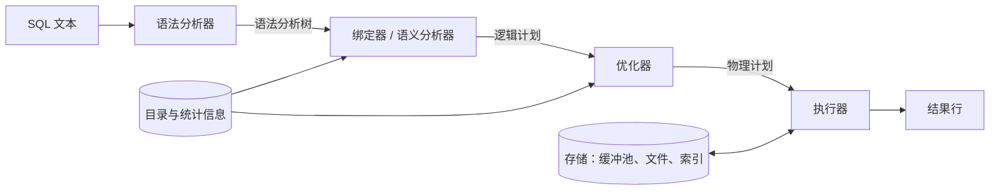
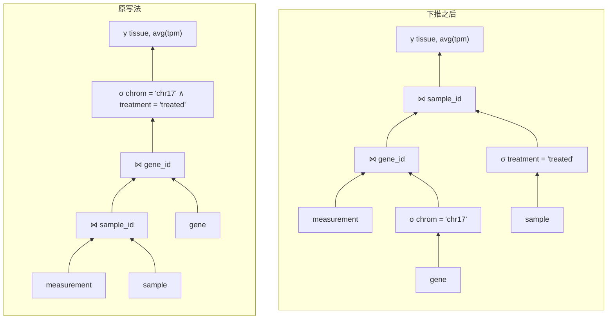

**SQL** 只说明想要什么结果，不说明如何计算。在查询文本与结果之间是**查询处理器**：它把查询翻译成**关系代数**（[4.13.2](/4.13.2)），考虑计算它的众多代数等价形式以及每个算子的多种可用算法，估计每种方案的代价，并执行找到的最便宜的一种。对同一个查询，好计划与坏计划之间的差距常常是几个数量级，这正是查询优化成为数据库研究的核心成就之一、也是声明式语言得以成功的原因之一。本章沿着一个查询穿过处理器的全过程：整体流程与执行模型（§9.1）、代价模型（§9.2）、选择、排序、连接及其他算子的算法（§9.3–§9.6）、由统计信息估计结果大小（§9.7）、对好计划的搜索（§9.8），最后看真实系统打印出的计划（§9.9）。本章建立在 [4.13.7](/4.13.7) 的存储结构和 [4.13.8](/4.13.8) 的索引之上；排序复用 [4.3](/4.3) 的**归并排序**，散列连接则是 [4.3.9](/4.3.9) 的**散列表**在更大规模上的应用。

## 9.1. 概览

### 9.1.1. 查询处理的步骤



1. *语法分析*（parsing）检查语法并生成语句的**语法分析树**（[4.13.12](/4.13.12) 会构造一个语法分析器）。
2. *绑定*（binding，语义分析）依据目录解析表名与列名，检查类型和**权限**，展开视图与 `*`，并生成*逻辑计划*：一个扩展的**关系代数**表达式（带分组、排序和外**连接**）。
3. *优化*重写逻辑计划，选定连接顺序和每个算子的算法，生成*物理计划*。
4. *执行*运行物理计划并返回结果。

**定义 9.1.1（查询执行计划）** **查询执行计划**（物理计划）是一棵树，其叶子是对存储关系的访问（顺序扫描、索引扫描），内部结点是**物理算子**：哈希连接、外部排序等具体算法，并标注各自的参数（连接条件、排序键、所用索引）。它的值就是查询的结果。

例如，查询

```sql
SELECT s.tissue, avg(m.tpm) AS mean_tpm
FROM measurement AS m
JOIN sample AS s ON s.sample_id = m.sample_id
JOIN gene AS g ON g.gene_id = m.gene_id
WHERE g.chrom = 'chr17' AND s.treatment = 'treated'
GROUP BY s.tissue;
```

对应的代数表达式为（其中**聚集**算子 $\gamma$ 见 [4.13.2](/4.13.2#sec-2.3.3)）

$$
{}_{\mathit{tissue}}\gamma_{\mathrm{avg}(\mathit{tpm})}\Bigl(\sigma_{\mathit{chrom} = \text{'chr17'} \land \mathit{treatment} = \text{'treated'}}\bigl(\mathit{measurement} \bowtie \mathit{sample} \bowtie \mathit{gene}\bigr)\Bigr),
$$

而一种**查询执行计划**是：扫描 `gene` 并过滤 `chrom = 'chr17'`，在结果上建立**散列表**，扫描 `measurement` 并探测该表，再用第二次散列连接与经过处理的样本连接，最后按 `tissue` 做散列聚集。这正是 DuckDB 选择的计划（§9.9）。

### 9.1.2. 执行模型

计划中的算子如何相互传递数据？

**定义 9.1.2（迭代器模型）** 在**迭代器模型**（Volcano 模型，得名于 Graefe 的 Volcano 系统）中，每个物理算子都实现 `open()`、`next()` 和 `close()` 接口。调用 `next()` 返回该算子的下一个输出元组或一个结束标记，算子通过调用其子结点的 `next()` 获得输入。计划的根被反复调用，直到耗尽。

**迭代器模型**是程序设计语言中**迭代器**模式的**数据库**形式：连接按需从其输入拉取**元组**，元组一次一个地沿树向上流动而无需存储，这种安排称为*流水线执行*（pipelining）。有些算子在消耗完全部输入之前不能产生任何输出，称为*阻塞算子*（blocking operator），包括排序、散列连接的建表阶段和散列聚集。它们的输入是流水线式的，但输出要在全部输入到达之后才开始。流水线的替代方案是*物化*（materialization）：每个算子把完整结果写入临时关系，由下一个算子读取。

每个算子对每个元组各调用一次虚函数的开销，在查询等待磁盘时可以忽略，但在数据位于内存时却成为主导。两种现代执行模型消除了这一开销。

| 模型 | 工作单位 | 系统 |
|---|---|---|
| 迭代器（Volcano） | 每次 `next()` 调用一个元组 | PostgreSQL、MySQL、SQLite（以结构类似的字节码程序实现） |
| 向量化 | 每次调用每列约 1,000–2,000 个值构成的*向量*（批）；算子是对数组的紧凑循环 | MonetDB/X100、DuckDB（向量含 2,048 个值）、ClickHouse、Velox、Snowflake |
| 编译式 | 把计划编译成机器码，将一条流水线的算子融合为一个循环 | HyPer、Umbra；PostgreSQL 对代价高的查询用 LLVM 编译表达式（JIT） |

向量化执行是 [4.13.7](/4.13.7#sec-7.5) 中的**列存储**的天然搭档：一个向量就是一列的一个切片，正如 NumPy 的数组编程（[4.4](/4.4)）。

## 9.2. 代价模型

优化器按估计代价比较各个计划。沿用 [4.13.7](/4.13.7#sec-7.1.2) 的做法，经典模型统计**页**的传输次数，并在相关时统计**随机访问**。全章使用如下记号。

| 符号 | 含义 |
|---|---|
| $n_r$ | 关系 $r$ 的元组数 |
| $b_r$ | $r$ 的页数 |
| $f_r$ | 块因子，每页的元组数（$b_r = \lceil n_r / f_r \rceil$） |
| $V(A, r)$ | $r$ 中属性 $A$ 的不同取值个数 |
| $M$ | 算子可用的缓冲页数 |
| $h_i$ | 索引 $i$ 的高度（B+ 树的层数） |
| $t_T$、$t_S$ | 传输一页的时间、一次随机访问（寻道）的时间 |

代价不计最终结果的写出（它对所有计划都相同），并假设最坏情形，即输入的所有页起初都不在**缓冲池**中。真实的优化器还会加入每个**元组**和每次算子求值的 CPU 代价，并且用参数而不是设备时间：PostgreSQL 的默认值是 `seq_page_cost = 1.0`、`random_page_cost = 4.0`、`cpu_tuple_cost = 0.01`、`cpu_index_tuple_cost = 0.005` 和 `cpu_operator_cost = 0.0025`，单位是一次顺序读页；在 SSD 上 `random_page_cost` 常调低到约 1.1。

## 9.3. 选择

对 $\sigma_\theta(r)$，访问路径取决于 $\theta$ 和可用的**索引**。

| 算法 | 适用条件 | 代价（传输次数，寻道次数） |
|---|---|---|
| 线性扫描 | 总是适用 | $b_r$ 次传输，1 次寻道；对码上的等值条件平均为 $b_r/2$（找到匹配即停） |
| 聚集 B+ 树，码上的等值条件 | $\theta$ 为 $A = v$，$A$ 是码，$A$ 上有聚集索引 | $h_i + 1$ 次传输和寻道 |
| 聚集 B+ 树，非码上的等值条件或范围条件 | $\theta$ 为 $A = v$ 或 $A \ge v$ | $h_i$ 次寻道和传输，然后读取 $b$ 个连续的匹配记录页：$h_i + b$ 次传输，$h_i + 1$ 次寻道 |
| 辅助 B+ 树 | 同上，索引不聚集 | 对 $m$ 条匹配记录为 $h_i + m$ 次传输和寻道（每条可能在不同的页上），另加范围涉及的叶结点 |
| 合取 $\theta_1 \land \theta_2 \land \dots$ | 其中一个条件有索引 | 用该索引，在取回的元组上检验其余条件 |
| 通过记录标识符的合取 | 若干条件都有索引 | 对各索引得到的 RID（或位图）集合求交，再取记录；析取则求并 |

辅助索引一行说明了为什么对选择性差的条件，全表扫描胜过索引：一旦 $m$ 超过 $n_r$ 的一小部分，$m$ 次随机读取的代价就超过 $b_r$ 次顺序读取，这已在 [4.13.8](/4.13.8#sec-8.6.2) 中测量过。PostgreSQL 的*位图堆扫描*（bitmap heap scan）在取记录之前先把匹配的 **RID** 按**页**排序，使每页至多读一次且按物理顺序读取，其代价介于两个极端之间。

## 9.4. 排序

`ORDER BY`、排序归并连接、基于排序的去重与分组，以及自底向上构建 **B+ 树**，都需要排序。能放进内存的**关系**用快速排序之类的算法排序；大于 $M$ 页的关系则需要外部算法。

**算法 9.4.1（外部归并排序）** 用 $M$ 个缓冲页对 $b$ 页的关系排序：

1. *生成顺串。* 每次读入 $M$ 页，在内存中排序，写出为一个有序的*顺串*（run）。这产生 $\lceil b / M \rceil$ 个顺串。
2. *归并。* 只要还剩多于一个顺串，就把每 $M - 1$ 个顺串归并成一个，每个顺串用一个输入缓冲页，另用一个输出页：重复地把各输入当前首元组中最小的移到输出，如同**归并排序**；某个顺串的缓冲页用完时读取它的下一页，输出页写满时写出。每一趟这样的*归并趟*把顺串数缩减为原来的 $1/(M - 1)$。

**定理 9.4.1（外部归并排序的代价）** 用 $M \ge 3$ 个缓冲页对 $b > M$ 页的关系做外部归并排序，需要 $\lceil \log_{M-1} \lceil b/M \rceil \rceil$ 趟归并。计入最终有序输出的写出，共传输

$$
2b\left(1 + \left\lceil \log_{M-1} \lceil b/M \rceil \right\rceil\right)
$$

页；不计最终写出则为 $b\left(2\lceil \log_{M-1} \lceil b/M \rceil \rceil + 1\right)$。

**证明** 生成顺串读写每页各一次（$2b$ 次传输），留下 $R_0 = \lceil b/M \rceil$ 个顺串。从 $R$ 个顺串开始的一趟归并留下 $\lceil R/(M-1) \rceil$ 个顺串，所以 $j$ 趟之后有 $\lceil R_0 / (M-1)^j \rceil$ 个顺串（用到对正整数 $a$ 有 $\lceil \lceil x \rceil / a \rceil = \lceil x/a \rceil$），它恰在 $(M-1)^j \ge R_0$ 时为 1，即经过 $\lceil \log_{M-1} R_0 \rceil$ 趟之后。每趟归并读写每页各一次，共 $2b$ 次传输。相加得到第一个公式，第二个公式再减去最后一趟的 $b$ 次写出。$\square$

寻道同样重要：每个输入顺串只分配一页时，每次缓冲区重新填充都是一次**随机访问**。因此系统以较大的块读取顺串（每个输入缓冲区含若干页），这会降低一趟归并的扇入，但使 I/O 变成顺序的。实际上，内存大到几乎所有排序至多需要一趟归并：当 $M = 10{,}000$ 个 8 KiB 的页（80 MB 排序内存）时，一趟归并可排序至多 $M(M-1) \approx 10^8$ 页，即 800 GB。

下面的模拟对一个每页 100 个键、共 5,000 页的文件排序，并统计页传输次数。

```python
import heapq, math, random


def external_sort(pages, M):
    """Sort a file given as a list of pages (lists of keys) with M buffer pages.
    Returns the sorted pages and the number of page reads and writes."""
    reads = writes = 0
    # Pass 0: read M pages at a time, sort them in memory, write a run.
    runs = []
    for i in range(0, len(pages), M):
        chunk = pages[i:i + M]
        reads += len(chunk)
        keys = sorted(k for page in chunk for k in page)
        run = [keys[j:j + PAGE] for j in range(0, len(keys), PAGE)]
        writes += len(run)
        runs.append(run)
    passes = 1
    # Merge passes: M - 1 input buffers, 1 output buffer.
    while len(runs) > 1:
        merged = []
        for i in range(0, len(runs), M - 1):
            group = runs[i:i + M - 1]
            reads += sum(len(r) for r in group)
            keys = list(heapq.merge(*([k for page in r for k in page] for r in group)))
            run = [keys[j:j + PAGE] for j in range(0, len(keys), PAGE)]
            writes += len(run)
            merged.append(run)
        runs = merged
        passes += 1
    return runs[0], passes, reads, writes


PAGE = 100                       # records per page
random.seed(0)
for b, M in [(5000, 12), (5000, 101), (5000, 3)]:
    keys = random.sample(range(10**9), b * PAGE)
    pages = [keys[i:i + PAGE] for i in range(0, len(keys), PAGE)]
    out, passes, reads, writes = external_sort(pages, M)
    assert [k for p in out for k in p] == sorted(keys)
    predicted = 1 + math.ceil(math.log(math.ceil(b / M), M - 1))
    print(f"b = {b}, M = {M:3d}: {passes} passes (formula {predicted}), "
          f"{reads} reads + {writes} writes = {reads + writes} I/Os")
```

```text
b = 5000, M =  12: 4 passes (formula 4), 20000 reads + 20000 writes = 40000 I/Os
b = 5000, M = 101: 2 passes (formula 2), 10000 reads + 10000 writes = 20000 I/Os
b = 5000, M =   3: 12 passes (formula 12), 60000 reads + 60000 writes = 120000 I/Os
```

这里的趟数包含生成顺串那一趟。$M = 101$ 时，50 个顺串在一趟中归并完毕；取最小的 $M = 3$ 时，二路归并需要 $\lceil \log_2 1667 \rceil = 11$ 趟归并。

## 9.5. 连接算法

**连接**是最重要也最昂贵的算子。我们研究 $r \bowtie_\theta s$，主要是**等值连接** $r.A = s.B$，并称 $r$ 为*外*关系，$s$ 为*内*关系。

### 9.5.1. 嵌套循环连接

**算法 9.5.1（嵌套循环连接）** 对 $r$ 的每个**元组** $t_r$ 扫描 $s$，对每个元组 $t_s$，若这一对满足 $\theta$，就输出 $t_r \cdot t_s$。

它适用于任意条件 $\theta$，但在最坏情形（每个关系只有一个缓冲**页**）下代价为 $n_r \cdot b_s + b_r$ 次传输：外关系的每个元组都要读一遍内关系。改为外关系每页读一遍内关系要好得多，每 $M - 2$ 页读一遍则更好。

**算法 9.5.2（块嵌套循环连接）** 把外关系 $r$ 按每块 $M - 2$ 页读入。对每一块，逐页扫描 $s$（一个输入缓冲区），并把该页的每个元组与块中的每个元组连接（一页作输出缓冲区）。代价为 $\lceil b_r / (M-2) \rceil \cdot b_s + b_r$ 次传输和 $2\lceil b_r/(M-2) \rceil$ 次寻道。

应让较小的关系作外关系。若它能放进 $M - 2$ 页，代价降为 $b_r + b_s$，这是任何读取两个输入的**连接**算法的最小值；若不对所有元组对比较，而在块上建立内存**散列表**，就得到内存中的散列连接。

**算法 9.5.3（索引嵌套循环连接）** 若 $s$ 在连接**属性**上有索引，则对 $r$ 的每个元组 $t_r$，在索引中查找 $s$ 的匹配元组。代价为 $b_r + n_r \cdot c$ 次传输，其中 $c$ 是一次索引查找的代价，含取回匹配元组（对码上的**聚集索引**为 $h_i + 1$）。

当外侧在**选择**之后很小时，**索引**嵌套循环连接是最佳选择，例如在一个 **OLTP** 查询中把一张订单与它的订单行连接。SQLite 只实现嵌套循环连接，并且在内关系上没有索引时临时建立一个*自动索引*，把块嵌套循环连接变成索引嵌套循环连接（§9.9）。

### 9.5.2. 排序归并连接

**算法 9.5.4（排序归并连接）** 对等值连接 $r.A = s.B$：把 $r$ 按 $A$、$s$ 按 $B$ 排序（除非它们已经有序，例如由聚集索引保证），然后并行扫描二者。让当前值较小的输入前进；当两值相等时，输出 $r$ 中该值的元组组与 $s$ 中该值的元组组的连接。

若某一输入中每组相等值都能放进内存，则归并阶段每个输入只读一次，代价为对两个输入排序的代价加 $b_r + b_s$ 次传输。输出按连接属性有序，这可以使后续的 `ORDER BY` 或归并连接不必再付代价；优化器会跟踪这样的感兴趣的序（§9.8.3）。排序归并连接也能处理带区间的不等连接，例如按位置连接基因组区间。

### 9.5.3. 散列连接

**算法 9.5.5（散列连接）** 对等值连接 $r.A = s.B$，设 $s$ 是较小的关系，称为*构建*输入（build input），$r$ 为*探测*输入（probe input）：

1. *划分。* 选定划分数 $n_h$ 和取值于 $\{1, \dots, n_h\}$ 的**散列函数** $h$。扫描 $s$，把每个元组写入划分 $s_i$，其中 $i = h(t[B])$，每个划分用一个输出缓冲区；对 $r$ 用 $h(t[A])$ 同样处理。匹配的元组落入编号相同的划分。
2. *构建与探测。* 对每个 $i$：把 $s_i$ 读入内存，用第二个散列函数在 $B$ 上建立内存散列表；然后读入 $r_i$，对每个元组在散列表中查找 $s_i$ 的匹配元组。

构建划分必须能放进内存，$\lceil b_s / n_h \rceil \le M - 2$，而**划分**需要 $n_h + 1 \le M$ 个缓冲区，因此只要 $M$ 大于约 $\sqrt{b_s}$，一趟划分就够了。每趟划分都要读写两个关系，构建与探测阶段再把它们读一遍：一趟划分时代价约为 $3(b_r + b_s)$ 次传输。若 $s$ 能放进内存，则无需划分，代价为 $b_r + b_s$。若 $s$ 非常大，则要对划分再划分（*递归划分*），每多一趟增加 $2(b_r + b_s)$。*混合散列连接*（hybrid hash join）在划分期间把 $s$ 的第一个划分保留在内存中，使它的元组以及 $r$ 中与之匹配的元组都不必写到磁盘；当 $M$ 略小于 $b_s$ 时，这能节省大部分 I/O。

数据倾斜是主要的实际困难：若许多元组共享同一连接值，则无论用多少个划分，它们所在的划分都放不进内存，系统便对该划分退回到嵌套循环策略。散列连接是分析型系统中大型等值连接的默认选择；PostgreSQL 按代价在嵌套循环、归并和散列连接之间选择，MySQL 在 8.0.18 版本加入了散列连接。

### 9.5.4. 一个完整的比较

**例 9.5.1** 考虑一个真实的人类数据集上 $\mathit{measurement} \bowtie \mathit{gene}$ 在 `gene_id` 上的连接：60,000 个基因，每页存 40 个（$b_{\mathit{gene}} = 1{,}500$）；100 个样本，每个基因都有测量值，共 6,000,000 行，每页存 100 行（$b_{\mathit{measurement}} = 60{,}000$）。我们在缓冲页数 $M = 102$ 和 $M = 1{,}502$ 时统计页传输次数。

- 嵌套循环连接（nested-loop join），`gene` 作外关系：$n_{\mathit{gene}} \cdot b_{\mathit{measurement}} + b_{\mathit{gene}} = 60{,}000 \cdot 60{,}000 + 1{,}500 \approx 3.6 \times 10^9$，按 $t_T = 0.04\,\mathrm{ms}$ 约为 40 小时。
- 块嵌套循环连接（block nested-loop join），`gene` 作外关系：$M = 102$ 时为 $\lceil 1500/100 \rceil \cdot 60{,}000 + 1{,}500 = 901{,}500$；$M = 1{,}502$ 时外关系装得进一块，代价为 $60{,}000 + 1{,}500 = 61{,}500$。
- 索引嵌套循环连接（index nested-loop join），`measurement` 作外关系，使用 `gene` 的聚集主码 **B+ 树**，$h = 3$：最坏情形为 $60{,}000 + 6{,}000{,}000 \cdot 3 = 18{,}060{,}000$ 次传输。即使索引的上两层已被缓存，仍有 $6 \times 10^6$ 次随机读：索引嵌套循环适用于小的外输入。
- 排序归并连接（sort-merge join），$M = 102$：对 `measurement` 排序产生 589 个顺串，需要 $\lceil \log_{101} 589 \rceil = 2$ 趟归并，写出输出时共 $2 \cdot 60{,}000 \cdot 3 = 360{,}000$ 次传输；对 `gene` 排序（15 个顺串，1 趟归并）代价为 $2 \cdot 1{,}500 \cdot 2 = 6{,}000$；归并读取两者，$61{,}500$。总计 $427{,}500$；若最后的归并趟直接供给连接而不写出再读回，则为 $304{,}500$。
- 散列连接（hash join），`gene` 作构建输入，$M = 102$：$n_h = 15$ 个各 100 页的划分可以放入内存，代价为 $3 \cdot 61{,}500 = 184{,}500$。$M = 1{,}502$ 时，`gene` 装得进内存，代价为 $61{,}500$。

图中给出了这些代价在整个 $M$ 范围内的变化。


对于这个等值连接，散列连接从不比其他算法差；一旦较小的关系能放进内存，散列连接与块嵌套循环连接都达到每个输入只读一次的最小值。内存紧张时块嵌套循环连接退化最快；当输入已经有序或需要有序输出时，排序归并连接有竞争力。

### 9.5.5. 其他算子

- *去重*（`DISTINCT`、`UNION`）和*带聚集的分组*（`GROUP BY`）通过排序（相等的值变得相邻）或散列（相等的值落入同一划分和同一散列表项）完成。`count`、`sum`、`min`、`max` 等聚集函数在形成分组的同时增量计算；`avg` 由运行中的和与计数算出。
- 不带 `DISTINCT` 的**投影**即时完成。*集合运算*（`INTERSECT`、`EXCEPT`）类似连接，用排序归并或散列实现。
- 外连接是连接算法的变体，它们还输出用**空值**填充的未匹配元组；例如在散列连接中，若以探测侧作为**左连接**的左输入，则没有匹配的探测元组会被输出。

## 9.6. 表达式的求值

含多个算子的计划尽可能用**流水线执行**求值。在**迭代器模型**中，一条流水线是由非阻塞算子构成的极大链；对 §9.1.1 的例子，`measurement` 的扫描、对两个**散列表**的探测以及向聚集散列表的插入构成一条流水线，而 `gene` 与 `sample` 的扫描分别在各自的流水线中为散列表的构建提供输入，这些流水线必须先完成。DuckDB 等向量化引擎把每条流水线调度成对输入分块的任务，这也使查询可以跨核并行（*morsel 驱动*的并行，得名于 HyPer 系统）。

## 9.7. 统计信息与基数估计

### 9.7.1. 目录中的统计信息

每个算法的代价都取决于其输入的大小，而大多数算子的输入是中间结果。优化器根据目录中的统计信息估计它们的大小，这些信息由 `ANALYZE` 收集（在 PostgreSQL 中也由 autovacuum 守护进程收集）。PostgreSQL 抽样 $300 \times$ `default_statistics_target` 行（默认目标 100 时为 30,000 行），并对每一列在视图 `pg_stats` 中存储：**空值**所占比例、平均宽度、不同值的个数（`n_distinct`）、最常见的值及其频率、其余值的至多 100 个桶的直方图，以及列顺序与物理行顺序之间的相关性。`CREATE STATISTICS` 为相关的列加入多列统计信息（函数依赖、组合的不同值个数、多列最常见值）。

**定义 9.7.1（选择率）** 关系 $r$ 上条件 $\theta$ 的**选择率**是 $r$ 中满足它的元组所占的比例，$\lvert \sigma_\theta(r) \rvert / n_r$。$\sigma_\theta(r)$ 的估计大小是 $n_r$ 乘以估计的选择率。

在没有更好信息时的标准估计：

| 条件 | 估计的选择率 |
|---|---|
| $A = v$ | $1 / V(A, r)$（若 $v$ 是最常见值，则为其频率） |
| $A \le v$ | 均匀分布下为 $\dfrac{v - \min(A)}{\max(A) - \min(A)}$，或由直方图得到 |
| $\theta_1 \land \theta_2$ | $s_1 s_2$（独立性） |
| $\theta_1 \lor \theta_2$ | $s_1 + s_2 - s_1 s_2$ |
| $\lnot\theta$ | $1 - s$ |

### 9.7.2. 直方图

**定义 9.7.2（等深直方图）** **等宽直方图**把属性的取值范围分成等宽的桶，并存储每个桶中值的个数。**等深直方图**（等高直方图）选取桶的边界，使每个桶含有相同个数的值，并存储这些边界。

**等深直方图**能适应偏斜的分布：稠密区域得到窄的桶。PostgreSQL 对不属于最常见值的那些值存储等深直方图（`histogram_bounds`）。合成数据集中 `tpm` 的值服从对数正态分布，这是表达量数据的典型分布；下面的脚本比较对 `tpm > 100` 的**选择率**的几种估计。

```python
import sqlite3

con = sqlite3.connect("big.db")
tpm = sorted(v for (v,) in con.execute("SELECT tpm FROM measurement"))
n, lo, hi = len(tpm), tpm[0], tpm[-1]


def equi_depth(n_buckets):
    """Bucket boundaries such that each bucket holds about n / n_buckets values."""
    return [tpm[i * n // n_buckets] for i in range(n_buckets)] + [hi]


def estimate_greater(bounds, c):
    """Fraction of values > c: whole buckets above c, linear interpolation inside."""
    per_bucket = 1 / (len(bounds) - 1)
    est = 0.0
    for a, b in zip(bounds, bounds[1:]):
        if a >= c:
            est += per_bucket
        elif b > c:
            est += per_bucket * (b - c) / (b - a)
    return est


print("min", lo, "max", hi)
print("10 equi-depth buckets:", equi_depth(10))
print(f"actual fraction with tpm > 100: {sum(v > 100 for v in tpm) / n:.4f}")
print(f"uniform between min and max:    {(hi - 100) / (hi - lo):.4f}")
for b in (10, 100):
    print(f"histogram, {b:3d} buckets:         {estimate_greater(equi_depth(b), 100):.4f}")
```

```text
min 0.0 max 9678.55
10 equi-depth buckets: [0.0, 1.08, 2.09, 3.36, 5.05, 7.38, 10.76, 16.18, 26.08, 50.38, 9678.55]
actual fraction with tpm > 100: 0.0409
uniform between min and max:    0.9897
histogram,  10 buckets:         0.0995
histogram, 100 buckets:         0.0411
```

均匀假设对这样的数据毫无用处（它预测 99%，而实际为 4%）；10 桶直方图偏差为 2.4 倍，因为最后一个桶几乎跨越整个取值范围；100 个桶（PostgreSQL 的默认值）则给出准确的估计。

### 9.7.3. 连接的大小

对关系 $r$ 与 $s$ 在**属性** $A$ 上的**自然连接**：

- 若 $A$ 是 $s$ 的码，且 $r.A$ 是引用它的**外码**，则 $r$ 的每个**元组**恰与 $s$ 的一个元组匹配，$\lvert r \bowtie s \rvert = n_r$；
- 一般地，在*包含假设*（不同值较少的那个关系中 $A$ 的值全部出现在另一个关系中）和均匀性假设下，

$$
\lvert r \bowtie s \rvert \approx \frac{n_r \, n_s}{\max\bigl(V(A, r), V(A, s)\bigr)}.
$$

道理是：若 $V(A, r) \le V(A, s)$，则 $r$ 的每个元组平均匹配 $s$ 的 $n_s / V(A, s)$ 个元组，得到 $n_r n_s / V(A, s)$；另一种情形对称；较小的估计才是正确的，它对应分母较大的那个。

估计误差沿计划相乘：在独立性假设下，五路**连接**的误差大致是其输入与谓词误差之积。Leis 等人的研究（《How Good Are Query Optimizers, Really?》，2015）发现，在真实数据上，所测试的每个系统对多连接查询都有几个数量级的误差，并且基数估计的质量比代价模型的细节更重要。相关的列（组织与表达量、染色体与基因密度）是通常的原因。

## 9.8. 查询优化

### 9.8.1. 等价规则

两个关系代数表达式是*等价*的，若它们在每个**数据库**实例上产生相同的结果（当要表达带重复的 **SQL** 语义时，按**多重集**理解）。优化器根据等价规则生成备选方案，其中一些已在 [4.13.2](/4.13.2#sec-2.4) 中列出。对表达式 $E, E_1, E_2, E_3$ 和条件 $\theta, \theta_1, \theta_2$，最重要的有：

1. **选择**的串联：$\sigma_{\theta_1 \land \theta_2}(E) = \sigma_{\theta_1}(\sigma_{\theta_2}(E))$；因此选择可交换。
2. **投影**的串联：当 $L_1 \subseteq L_2 \subseteq \dots$ 时，$\Pi_{L_1}(\Pi_{L_2}(\dots(E))) = \Pi_{L_1}(E)$。
3. 选择与乘积合并为**连接**：$\sigma_\theta(E_1 \times E_2) = E_1 \bowtie_\theta E_2$。
4. 连接可交换：$E_1 \bowtie_\theta E_2 = E_2 \bowtie_\theta E_1$（属性顺序除外）。
5. 自然连接可结合：$(E_1 \bowtie E_2) \bowtie E_3 = E_1 \bowtie (E_2 \bowtie E_3)$；对 θ 连接，当 $\theta_2$ 只涉及 $E_2$ 与 $E_3$ 的属性时，$(E_1 \bowtie_{\theta_1} E_2) \bowtie_{\theta_2 \land \theta_3} E_3 = E_1 \bowtie_{\theta_1 \land \theta_3} (E_2 \bowtie_{\theta_2} E_3)$。
6. 选择下推：当 $\theta$ 只涉及 $E_1$ 的属性时，$\sigma_{\theta}(E_1 \bowtie E_2) = \sigma_{\theta}(E_1) \bowtie E_2$。
7. 投影下推：$\Pi_{L}(E_1 \bowtie_\theta E_2) = \Pi_{L}\bigl(\Pi_{L_1}(E_1) \bowtie_\theta \Pi_{L_2}(E_2)\bigr)$，其中 $L_i$ 由 $E_i$ 中出现在 $L$ 或 $\theta$ 里的属性组成。
8. 集合运算：$\sigma_\theta(E_1 \cup E_2) = \sigma_\theta(E_1) \cup \sigma_\theta(E_2)$，对 $\cap$ 和 $\setminus$ 类似。

下面的定理把命题 2.4.1 从**自然连接**推广到任意 **θ 连接**。

**定理 9.8.1（选择下推）** 设 $\theta$ 是只涉及 $E_1$ 的**属性**的条件。则对每个连接条件 $\varphi$，都有 $\sigma_{\theta}(E_1 \bowtie_{\varphi} E_2) = \sigma_{\theta}(E_1) \bowtie_{\varphi} E_2$。

**证明** **元组** $t$ 属于左端，当且仅当 $t = t_1 \cdot t_2$，其中 $t_1 \in E_1$、$t_2 \in E_2$，且 $\varphi(t_1 \cdot t_2)$ 与 $\theta(t_1 \cdot t_2)$ 均为真。由于 $\theta$ 只涉及 $E_1$ 的属性，$\theta(t_1 \cdot t_2) = \theta(t_1)$。于是这些条件等价于 $t_1 \in \sigma_\theta(E_1)$、$t_2 \in E_2$ 且 $\varphi(t_1 \cdot t_2)$，这正是属于右端。带重数的同样论证说明对多重集等式也成立。$\square$

把选择下推几乎总是有益的，因为它缩小了昂贵算子的输入；连同投影下推以及把乘积后接选择替换为连接，它是启发式（基于规则的）优化的核心。注意规则 6 对外连接一般不成立：**左连接**右输入上的条件不能下推到它之下，因为那样会改变哪些元组被用**空值**填充。



### 9.8.2. 连接顺序的空间

**命题 9.8.1** $n$ 个**关系**的连接可以用 $n!$ 棵*左深*连接树（每个连接的右输入都是基本关系）求值，总共有 $\dfrac{(2n-2)!}{(n-1)!}$ 棵二叉连接树。

**证明** 左深树由关系加入的顺序决定，有 $n!$ 种选择。具有 $n$ 个叶子的一般**二叉树**有 $n - 1$ 个内部结点，这样的树形个数是 **Catalan 数** $C_{n-1} = \frac{1}{n}\binom{2n-2}{n-1}$；$n$ 个关系可以用 $n!$ 种方式分配到叶子上，得到 $n! \cdot \frac{(2n-2)!}{n!\,(n-1)!} = \frac{(2n-2)!}{(n-1)!}$ 棵树。$\square$

$n = 4$ 时有 24 棵左深树和 120 棵一般树；$n = 10$ 时分别为 $3.6 \times 10^6$ 和 $1.8 \times 10^{10}$。穷举枚举不可行，但这个问题具有最优子结构。

### 9.8.3. 动态规划

**算法 9.8.1（System R 连接排序）** 对关系 $R_1, \dots, R_n$ 的连接：对关系的每个子集 $S$，按大小递增的顺序，计算连接 $S$ 中各关系的最便宜计划，它是下述方式中最便宜的一种：对所有 $R \in S$，把 $S \setminus \{R\}$ 的最佳计划与 $R$ 连接（对左深树）；或者对所有非空真子集 $S_1$，把 $S_1$ 与 $S \setminus S_1$ 的最佳计划连接（对丛状树，bushy tree）。除非没有别的计划，否则跳过需要**笛卡儿积**的子集。全集的计划就是答案。

这是对子集的**动态规划**，由 Selinger 等人为 IBM 的 System R（1979）提出。左深枚举的时间为 $O(n\,2^n)$，而不是 $O(n!)$。一种改进是，对每个子集不仅保留最便宜的计划，还对每种感兴趣的序（interesting order），即之后有用的排序顺序，用于归并连接、`GROUP BY` 或 `ORDER BY`保留最便宜的计划，因为稍贵但输出有序的计划可能总体上更优。

**例 9.8.1** 一个查询要求某条通路的基因在肝脏样本中的平均表达量，连接 `sample`（$S$，经 `tissue = 'liver'` 选择后 20 行）、`measurement`（$M$，$6 \times 10^6$ 行）、`gene_pathway`（$GP$，涵盖 20,000 个基因和 2,000 条通路的 120,000 行）和 `pathway`（$P$，按名称选定通路后 1 行）。程序用 §9.7.3 的公式估计连接大小，并取所有中间结果大小之和为代价，这是 I/O 代价的一个简单替代，常记作 $C_{\mathrm{out}}$。

```python
from itertools import combinations

# Estimated cardinalities after the selections, and join predicates with
# their selectivities 1 / max(V(A, R), V(A, S)).
card = {"S": 20, "M": 6_000_000, "GP": 120_000, "P": 1}
preds = {frozenset({"S", "M"}): 1 / 100,       # sample_id
         frozenset({"M", "GP"}): 1 / 60_000,   # gene_id
         frozenset({"GP", "P"}): 1 / 2_000}    # pathway_id


def size(rels):
    """Estimated size of the join of a set of relations (independence assumed)."""
    n = 1.0
    for r in rels:
        n *= card[r]
    for pair, sel in preds.items():
        if pair <= rels:
            n *= sel
    return n


def connected(a, b):
    return any(len(p & a) == 1 and len(p & b) == 1 for p in preds)


# best[subset] = (cost, plan); cost = sum of the sizes of all intermediate
# results (C_out), a simple stand-in for I/O cost; only left-deep trees,
# no Cartesian products, as in System R.
best = {frozenset({r}): (0.0, r) for r in card}
rels = list(card)
for k in range(2, len(rels) + 1):
    for subset in map(frozenset, combinations(rels, k)):
        options = []
        for r in subset:
            rest = subset - {r}
            if rest in best and connected(rest, frozenset({r})):
                cost = best[rest][0] + size(subset)
                options.append((cost, f"({best[rest][1]} ⋈ {r})"))
        if options:
            best[subset] = min(options)
        if k == 2 and options:
            print(f"{'{' + ', '.join(sorted(subset)) + '}':10s} size {size(subset):>12,.0f}")

cost, plan = best[frozenset(rels)]
print("best left-deep plan:", plan, f"C_out = {cost:,.0f}")
naive = size(frozenset({"S", "M"})) + size(frozenset({"S", "M", "GP"})) + size(frozenset(rels))
print(f"order of the FROM clause, ((S ⋈ M) ⋈ GP) ⋈ P: C_out = {naive:,.0f}")
```

```text
{M, S}     size    1,200,000
{GP, M}    size   12,000,000
{GP, P}    size           60
best left-deep plan: (((GP ⋈ P) ⋈ M) ⋈ S) C_out = 7,260
order of the FROM clause, ((S ⋈ M) ⋈ GP) ⋈ P: C_out = 3,601,200
```

最佳顺序从选择性最强的连接开始，即那一条通路及其 60 个基因；把它们与 `measurement` 连接（最好用 `gene_id` 上的**索引**嵌套循环连接）得到 6,000 行，肝脏样本再把它减到 1,200 行。按 `FROM` 子句的顺序连接则产生 120 万行、继而 240 万行的中间结果：对同一个结果，工作量约多 500 倍。

### 9.8.4. 实际中的优化器

- *PostgreSQL* 采用 System R 风格、带丛状树的**动态规划**，考虑顺序扫描、索引扫描、仅索引扫描和**位图**扫描，嵌套循环、归并和散列连接，以及排序顺序（“pathkeys”）。关系数超过 `geqo_threshold`（12）时转为 GEQO，一种遗传搜索；`join_collapse_limit` 和 `from_collapse_limit`（均为 8）限制显式 `JOIN` 语法和子查询被重排的范围。它还把 `IN` 和 `EXISTS` 子查询改写为**半连接**与反连接。
- *DuckDB* 对连接图用动态规划重排连接（算法称为 DPhyp），对特别大的查询退回贪心算法，能对任意子查询去相关，并把过滤和投影下推到扫描中。
- *SQLite* 对嵌套循环的顺序做基于代价的搜索（“下一代查询规划器”），统计信息存于 `sqlite_stat1`；每个连接都是对索引或全表扫描的嵌套循环。
- 许多系统沿用 *Volcano/Cascades* 框架（SQL Server、Apache Calcite、CockroachDB）：规则自顶向下地变换由等价表达式构成的 memo 结构，代价在搜索过程中计算。
- 优化越来越多地是*自适应*的：当观察到的基数与估计偏离时重新优化计划（SQL Server、Oracle），而学习式的基数模型是一个研究课题。

## 9.9. 真实系统中的计划

每个系统都用 `EXPLAIN` 打印它选定的计划。对 §9.1.1 的查询，在合成数据集（5,000 个基因、100 个样本、500,000 条测量）上，SQLite 3.45 报告：

```sql
EXPLAIN QUERY PLAN
SELECT s.tissue, round(avg(m.tpm), 2) AS mean_tpm, count(*) AS n
FROM measurement AS m
JOIN sample AS s ON s.sample_id = m.sample_id
JOIN gene AS g ON g.gene_id = m.gene_id
WHERE g.chrom = 'chr17' AND s.treatment = 'treated'
GROUP BY s.tissue
ORDER BY s.tissue;
```

```text
QUERY PLAN
|--SCAN g
|--SEARCH s USING AUTOMATIC PARTIAL COVERING INDEX (treatment=?)
|--SEARCH m USING INDEX sqlite_autoindex_measurement_1 (sample_id=? AND gene_id=?)
`--USE TEMP B-TREE FOR GROUP BY
```

该计划是三层嵌套循环：扫描 `gene`，保留位于 17 号染色体上的基因；对每个基因，通过 SQLite 为本次查询在 `sample(treatment)` 上建立的自动**索引**找到经过处理的样本；对每一对，通过主码索引查找测量值；最后用临时 **B 树**对结果分组，这同时产生了 `ORDER BY` 所需的顺序。

DuckDB 1.5 是一个向量化的**列存储**系统，它选择散列**连接**。这些表由与 SQLite **数据库**相同的数据载入，并且为缩短输出，关闭了压缩中间结果中字符串的优化器。

```python
import duckdb
con = duckdb.connect("col.duckdb")
for t in ("gene", "sample"):
    con.execute(f"CREATE OR REPLACE TABLE {t} AS SELECT * FROM read_csv('{t[0]}.csv')")
con.execute("SET disabled_optimizers = 'compressed_materialization'")
q = """
SELECT s.tissue, round(avg(m.tpm), 2) AS mean_tpm, count(*) AS n
FROM measurement AS m
JOIN sample AS s ON s.sample_id = m.sample_id
JOIN gene AS g ON g.gene_id = m.gene_id
WHERE g.chrom = 'chr17' AND s.treatment = 'treated'
GROUP BY s.tissue
ORDER BY s.tissue"""
print(con.sql(q))
print(con.sql("EXPLAIN" + q).fetchall()[0][1])
```

```text
┌─────────┬──────────┬───────┐
│ tissue  │ mean_tpm │   n   │
│ varchar │  double  │ int64 │
├─────────┼──────────┼───────┤
│ brain   │    22.37 │  1719 │
│ heart   │    20.25 │  1146 │
│ kidney  │    24.91 │  1337 │
│ liver   │    24.15 │  2483 │
│ lung    │    23.42 │  2292 │
└─────────┴──────────┴───────┘

┌───────────────────────────┐
│          ORDER_BY         │
│    ────────────────────   │
│        s.tissue ASC       │
└─────────────┬─────────────┘
┌─────────────┴─────────────┐
│         PROJECTION        │
│    ────────────────────   │
│           tissue          │
│          mean_tpm         │
│             n             │
│                           │
│        ~4,990 rows        │
└─────────────┬─────────────┘
┌─────────────┴─────────────┐
│       HASH_GROUP_BY       │
│    ────────────────────   │
│         Groups: #0        │
│                           │
│        Aggregates:        │
│          avg(#1)          │
│        count_star()       │
│                           │
│        ~4,990 rows        │
└─────────────┬─────────────┘
┌─────────────┴─────────────┐
│         PROJECTION        │
│    ────────────────────   │
│           tissue          │
│            tpm            │
│                           │
│        ~6,858 rows        │
└─────────────┬─────────────┘
┌─────────────┴─────────────┐
│         HASH_JOIN         │
│    ────────────────────   │
│      Join Type: INNER     │
│                           │
│        Conditions:        ├───────────────────────────────────────────┐
│   sample_id = sample_id   │                                           │
│                           │                                           │
│        ~6,858 rows        │                                           │
└─────────────┬─────────────┘                                           │
┌─────────────┴─────────────┐                             ┌─────────────┴─────────────┐
│         HASH_JOIN         │                             │          SEQ_SCAN         │
│    ────────────────────   │                             │    ────────────────────   │
│      Join Type: INNER     │                             │           Table:          │
│                           │                             │     col.main."sample"     │
│        Conditions:        │                             │                           │
│     gene_id = gene_id     │                             │   Type: Sequential Scan   │
│                           │                             │                           │
│                           ├──────────────┐              │        Projections:       │
│                           │              │              │         sample_id         │
│                           │              │              │           tissue          │
│                           │              │              │                           │
│                           │              │              │          Filters:         │
│                           │              │              │    treatment='treated'    │
│                           │              │              │                           │
│        ~14,677 rows       │              │              │          ~50 rows         │
└─────────────┬─────────────┘              │              └───────────────────────────┘
┌─────────────┴─────────────┐┌─────────────┴─────────────┐
│          SEQ_SCAN         ││          SEQ_SCAN         │
│    ────────────────────   ││    ────────────────────   │
│           Table:          ││    Table: col.main.gene   │
│    col.main.measurement   ││   Type: Sequential Scan   │
│                           ││    Projections: gene_id   │
│   Type: Sequential Scan   ││                           │
│                           ││          Filters:         │
│        Projections:       ││       chrom='chr17'       │
│         sample_id         ││                           │
│          gene_id          ││                           │
│            tpm            ││                           │
│                           ││                           │
│       ~500,000 rows       ││         ~200 rows         │
└───────────────────────────┘└───────────────────────────┘
```

该树自底向上阅读；在每个散列连接中，左子结点是探测侧，右子结点是构建侧。过滤条件已被下推到扫描中（等价规则 6），并且只读取所需的列（“Projections”）。估计值（`~` 行）可以与数据核对：17 号染色体上有 191 个基因（估计 200），47 个样本经过处理（估计 50），第一次连接产生 19,100 行（估计 14,677），第二次产生 8,977 行（估计 6,858），分组产生 5 组，估计为 4,990。最后一处误差在这里无害，但它说明了 §9.7.3：对分组数和连接大小的估计是每个优化器中最薄弱的部分。

PostgreSQL 把计划打印成缩进的文本，每个结点一行，附有估计的启动代价（第一行之前）、总代价、行数和平均行宽。文档中的例子使用回归测试表 `tenk1` 和 `tenk2`（各 10,000 行）：

```text
EXPLAIN SELECT * FROM tenk1;

                         QUERY PLAN
-------------------------------------------------------------
 Seq Scan on tenk1  (cost=0.00..445.00 rows=10000 width=244)
```

该表有 345 个**页**，所以代价为 $345 \cdot \mathtt{seq\_page\_cost} + 10000 \cdot \mathtt{cpu\_tuple\_cost} = 345 + 100 = 445$。对有索引列上的选择性条件，与第二张表连接，得到的计划以**位图**堆扫描作为散列连接的构建输入：

```text
EXPLAIN SELECT * FROM tenk1 t1, tenk2 t2
WHERE t1.unique1 < 100 AND t1.unique2 = t2.unique2;

 Hash Join  (cost=226.23..709.73 rows=100 width=488)
   Hash Cond: (t2.unique2 = t1.unique2)
   ->  Seq Scan on tenk2 t2  (cost=0.00..445.00 rows=10000 width=244)
   ->  Hash  (cost=224.98..224.98 rows=100 width=244)
         ->  Bitmap Heap Scan on tenk1 t1  (cost=5.06..224.98 rows=100 width=244)
               Recheck Cond: (unique1 < 100)
               ->  Bitmap Index Scan on tenk1_unique1  (cost=0.00..5.04 rows=100 width=0)
                     Index Cond: (unique1 < 100)
```

`EXPLAIN ANALYZE` 会执行查询，并为每个结点加上实际的时间和行数，使估计误差变得可见；自 PostgreSQL 18 起，它还默认报告缓冲区使用情况（共享缓冲区命中与读取），这原先是 `BUFFERS` 选项。读计划是每次性能调查的第一步：找到估计行数与实际行数出现分歧的结点，再判断是统计信息、索引还是查询写法的问题。

## 小结

- 查询经语法分析、依据目录绑定为逻辑计划、优化为**查询执行计划**后执行；在迭代器模型中，算子通过**流水线执行**交换**元组**，在向量化引擎中则交换值的向量。
- 代价按页传输和寻道计数。选择用扫描或索引；辅助索引每个匹配要付一次随机读。
- 外部归并排序对数据需要 $1 + \lceil \log_{M-1} \lceil b/M \rceil \rceil$ 趟，以今天的内存通常是两趟。
- 连接：嵌套循环用于任意条件和小输入，索引嵌套循环用于选择性强的外输入，排序归并用于已排序的输入和需要有序输出的情形，散列连接（约 $3(b_r + b_s)$，构建输入能放进内存时为 $b_r + b_s$）用于大型等值连接。
- 结果大小由不同值个数、最常见值和等深直方图在均匀性、独立性和包含假设下估计；误差随连接数增长。
- 选择下推等等价规则生成备选方案；连接顺序通过对子集的动态规划选定（System R），并借助感兴趣的序，对特别大的查询则用启发式或随机搜索。
- `EXPLAIN` 显示选定的计划，`EXPLAIN ANALYZE` 把估计与实际比较。
