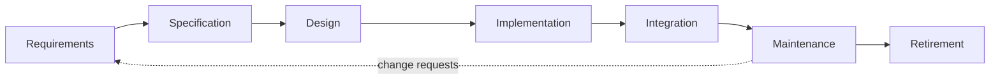

Writing a program that works for its author is a matter of programming: the earlier courses taught how to express algorithms in C++ and Python, how to structure code with classes and **design patterns**, and how to check it with **unit testing**. Building software that many people develop together, that thousands or millions of people use, and that keeps changing for years is a different problem. It needs agreement about what to build, a process for building it, ways of keeping the work of many people consistent, systematic testing, and care for the system after it is released. Software engineering is the discipline that studies these problems. This chapter explains why the discipline exists, defines it, surveys its body of knowledge as organized by SWEBOK, and sets out the plan of the course: the next chapter treats the software process, [4.14.3](/4.14.3) version control, and the later chapters follow the life cycle from requirements ([4.14.4](/4.14.4)) through architecture, implementation and testing to operations ([4.14.13](/4.14.13)), ending with software engineering with AI ([4.14.14](/4.14.14)).

## 1.1. Software and Its Difficulties

### 1.1.1. Software as Systems

The course has two objectives: to understand software as systems, and to build software as engineers. Real software is large and densely connected. In a call graph of a subset of the Linux kernel, 630 functions are linked by 1,841 call relations; in the application server Tomcat, 1,019 classes are linked by 2,109 inheritance and aggregation relations. A modern product, such as a railway ticketing service built from dozens of cooperating services, is larger still: no single person can hold it in mind, and every change must be made without breaking parts its author has never read.

Fred Brooks, in his essay *No Silver Bullet* (1986), distinguished the *essential* difficulties of software from the *accidental* ones that better languages and tools remove. The essential ones remain:

| Difficulty | Meaning |
|---|---|
| complexity | software has more distinct parts and states than any other human construct; complexity grows faster than size, because parts interact |
| conformity | software must conform to interfaces, laws and conventions designed by others, which follow no unifying principle |
| changeability | because software is "only text", it is constantly asked to change, and successful software is changed the most |
| invisibility | software has no natural geometric representation; diagrams show one aspect at a time |

Changeability is also software's strength. A system that can evolve can follow its users, which is why approaches that fix everything in a "big design up front" (BDUF) fit software poorly. The old joke expresses the risk on the other side: users who receive exactly what they specified often exclaim, "It's just what we asked for, but not what we want."

### 1.1.2. The Software Crisis and the Birth of the Discipline

In the 1960s computers became powerful enough for large programs, such as operating systems (IBM OS/360), airline reservation systems and the Apollo flight software. Projects were late, over budget, unreliable and hard to change. The term *software crisis* names these difficulties of developing large, complex systems with methods that had worked for small programs.

The NATO Science Committee organized a conference in Garmisch, Germany, in October 1968 to discuss the crisis, under the deliberately provocative title "Software Engineering"; a second conference followed in Rome in 1969. The name expressed a program: software should be built with the discipline of the established engineering fields. Margaret Hamilton, who led the team that wrote the on-board flight software of the Apollo program, used the same term in that period to claim the status of an engineering discipline for her team's work. The famous photograph of 1969 shows her next to a printout of that code, as tall as she is.

Two remarks capture what distinguishes software engineering from programming. David Parnas described it as the "multi-person development of multi-version programs". Brooks pointed to "combining separately written programs and making them suitable for use by people who had not written them", topics that "usually received little or no attention in traditional programming courses". A more recent formulation from Google is that software engineering is programming integrated over time: the question is not whether code works today, but whether it can be understood, changed and run for as long as it is needed.

### 1.1.3. Failures Caused by Software

**Example 1.1.1 (Ariane 5 Flight 501)** On 4 June 1996, the first Ariane 5 rocket veered off course about 37 seconds after lift-off, broke up under aerodynamic loads and was destroyed by its self-destruct system. The inquiry board found that both inertial reference systems had failed with the same software exception: a 64-bit floating-point value related to the horizontal velocity was converted to a 16-bit signed integer, and the value was too large. The conversion was not protected because the code had been reused from Ariane 4, whose trajectory could not produce such values; the function concerned served no purpose after lift-off at all. The on-board computer then interpreted the diagnostic bit pattern of the failed unit as flight data and commanded full deflection of the nozzles. No line of the code was "wrong" in Ariane 4; the failure lay in reusing it without re-examining its assumptions against the new requirements, and in a design that treated any exception as a hardware fault and shut the unit down.

Much more common than such design errors are failures caused by changes to software that is already running. Large Internet companies change their production systems constantly: software upgrades that introduce features, improve performance or fix bugs, and configuration changes, such as shifting traffic between data centers for load balancing. At Baidu, for example, they numbered more than 10,000 per day, and every one of them can break a service.

| Date | System | Change | Effect |
|---|---|---|---|
| December 2012 | Google (Gmail, Drive) | an update to load-balancing software misjudged parts of the data centers as unavailable | Gmail unavailable for about 18 minutes in total |
| January 2014 | Dropbox | a planned operating-system upgrade was applied to machines in service | service down for hours |
| June 2014 | Facebook | a configuration change to software systems | site down for about 30 minutes |
| November 2014 | Microsoft Azure | a performance update to Azure Storage, deployed widely at once | storage and dependent services degraded or down for hours in many regions |
| July 2024 | CrowdStrike Falcon | a faulty content update to an endpoint-security product | about 8.5 million Windows machines crashed, grounding flights and disrupting hospitals |

The lessons recur throughout this course. Changes should be small, tested before release ([4.14.11](/4.14.11)), rolled out gradually to a fraction of machines first, observed through monitoring, and reversible. When the assessment of a change is left to operators who inspect key performance indicators by hand after customers complain, troubleshooting takes hours (about 1.5 hours per incident in one reported study); automating this assessment is a theme of operations and site reliability engineering ([4.14.13](/4.14.13)).

## 1.2. What Software Engineering Is

### 1.2.1. Definitions

Friedrich L. Bauer, one of the organizers of the 1968 conference, gave a classic definition: software engineering is "the establishment and use of sound engineering principles in order to obtain economically software that is reliable and works efficiently on real machines". The IEEE standard glossary (IEEE Std 610.12-1990, now superseded by ISO/IEC/IEEE 24765) gives the definition used today.

**Definition 1.2.1 (Software Engineering)** **Software engineering** is the application of a systematic, disciplined, quantifiable approach to the development, operation and maintenance of software; that is, the application of engineering to software.

Each adjective matters. *Systematic* means that work follows a defined process rather than improvisation; *disciplined* means that the team keeps to it under pressure; *quantifiable* means that effort, size, defects and reliability are measured, so that the process can be planned and improved. The definition also covers operation and maintenance, not only development. Alistair Cockburn, one of the initiators of the agile movement, adds two observations: software development is a resource-limited cooperative game of invention and communication, and doing engineering is creating a trade-off solution in the face of conflicting demands, such as cost, time, quality and features.

### 1.2.2. A Layered Technology

A common picture (due to Pressman) presents software engineering as four layers, each resting on the one below:

| Layer | Content | Examples in this course |
|---|---|---|
| tools | automated support for methods and process | Git, CI services, test frameworks, linters, monitoring systems |
| methods | technical how-to for each task | requirements elicitation, architectural styles, test design techniques |
| process | the framework that ties tasks together and controls them | waterfall, Scrum, DevOps ([4.14.2](/4.14.2)) |
| quality focus | the bedrock: a commitment to quality and its continuous improvement | reviews, testing, measurement, postmortems |

Watts Humphrey, founder of the software process program at the Software Engineering Institute of Carnegie Mellon University, which developed the Capability Maturity Model, summarized the link between the layers: "the quality of a software system is governed by the quality of the process used to develop and evolve it."

### 1.2.3. The Software Life Cycle

**Definition 1.2.2 (Software Life Cycle)** The **software life cycle** is the period from the conception of a software product to its retirement, together with the activities carried out in it. Its typical phases are requirements, specification (analysis), design, implementation, integration, maintenance and retirement.

The phases describe kinds of activity, not necessarily an order in time: the next chapter shows that process models differ precisely in how they arrange and repeat these activities. The longest phase by far is maintenance.

**Definition 1.2.3 (Software Maintenance)** **Software maintenance** is the modification of a software product after delivery. ISO/IEC/IEEE 14764 distinguishes four kinds: **corrective maintenance** fixes discovered faults; **adaptive maintenance** keeps the software usable in a changed environment (a new operating system, library or regulation); **perfective maintenance** adds features and improves performance or maintainability; **preventive maintenance** fixes latent faults before they cause failures.

Robert Glass's "60/60 rule" summarizes the economics: about 60% of the cost of software over its life is spent on maintenance, and about 60% of maintenance is enhancement rather than bug fixing. Software that is still valuable but hard to change, because its design has decayed, its documentation is missing and its authors have left, is called a *legacy system*. Working with legacy code (understanding it, testing it, changing it safely) is one of the main practical challenges of the profession, next to choosing a development process, working with non-technical customers, and testing.

## 1.3. The Body of Knowledge: SWEBOK

### 1.3.1. The Knowledge Areas

The *Software Engineering Body of Knowledge* (SWEBOK) is the generally accepted knowledge of the discipline, described in the *Guide to the Software Engineering Body of Knowledge* published by the IEEE Computer Society. Its fourth edition (SWEBOK v4.0, 2024) organizes it into 18 knowledge areas. Compared with version 3 (2014), it adds Software Architecture, Software Engineering Operations and Software Security as areas of their own, and updates the rest for agile and DevOps practice. The grouping below is a convenient one for this course.

| Group | Knowledge areas |
|---|---|
| life cycle (8) | Software Requirements, Software Architecture, Software Design, Software Construction, Software Testing, Software Engineering Operations, Software Maintenance, Software Configuration Management |
| management and support (4) | Software Engineering Management, Software Engineering Process, Software Quality, Software Security |
| professional practice (3) | Software Engineering Models and Methods, Software Engineering Professional Practice, Software Engineering Economics |
| foundations (3) | Computing Foundations, Mathematical Foundations, Engineering Foundations |

### 1.3.2. The Areas in This Course

| Knowledge area | Main concerns | Chapter |
|---|---|---|
| Software Requirements | what the software must do (functions) and what standards it must meet (non-functional requirements); elicitation, analysis, specification, validation and management | [4.14.4](/4.14.4) |
| Software Architecture | high-level structure: core components, their interactions and principles chosen to meet quality attributes such as scalability and availability; architectural styles and their trade-offs | [4.14.5](/4.14.5), [4.14.6](/4.14.6) |
| Software Design | the bridge from architecture to code: module decomposition, interface design, design principles (SOLID, DRY) and patterns, UML diagrams | [4.14.7](/4.14.7), [4.14.10](/4.14.10); patterns in [4.2.13](/4.2.13) |
| Software Construction | turning design into code: coding, unit testing, debugging, code review, refactoring | [4.14.8](/4.14.8)–[4.14.10](/4.14.10) |
| Software Testing | checking that software meets its requirements and finding defects: unit, integration, system and acceptance testing | [4.14.11](/4.14.11), [4.14.12](/4.14.12) |
| Software Engineering Operations | continuous delivery and deployment, containerization and orchestration, monitoring and alerting | [4.14.13](/4.14.13) |
| Software Maintenance | modification after delivery (§1.2.3) | [4.14.10](/4.14.10), [4.14.13](/4.14.13) |
| Software Configuration Management | identifying configuration items, version control, change control, auditing | [4.14.3](/4.14.3) |
| Software Engineering Management | planning, estimation, risk management, team management, progress tracking | [4.14.2](/4.14.2) |
| Software Engineering Process | choosing process models, documenting and improving the process | [4.14.2](/4.14.2) |
| Software Quality | quality assurance and quality control | [4.14.10](/4.14.10)–[4.14.12](/4.14.12) |
| Software Engineering Models and Methods | process models, development methods, modeling languages and tools | throughout |

## 1.4. Plan of the Course

The course follows two lines. *Towards good code* covers the practices of an individual developer that keep code correct and readable: version control ([4.14.3](/4.14.3)), coding style and code quality ([4.14.10](/4.14.10)), and automated tests in the xUnit tradition ([4.14.12](/4.14.12)). *Towards good systems* covers the practices of a team that keep a product useful and dependable: requirements, architecture and design, testing, the development process and operations. Both lines meet in a team project, because these practices are learned by doing them: the aim is disciplined, customer-focused and agile software engineering, practiced as a member of a professional community.

The chapters follow the life cycle. After the process ([4.14.2](/4.14.2)) and version control ([4.14.3](/4.14.3)), which a team needs from its first day, come requirements ([4.14.4](/4.14.4)), architecture ([4.14.5](/4.14.5)–[4.14.6](/4.14.6)), the construction of a web application with a separate front end and back end ([4.14.7](/4.14.7)–[4.14.9](/4.14.9)), code quality ([4.14.10](/4.14.10)), testing ([4.14.11](/4.14.11)–[4.14.12](/4.14.12)) and operations ([4.14.13](/4.14.13)).

## 1.5. Software Engineering When AI Writes Code

**Coding agents** ([4.2.14](/4.2.14)) now write a large share of the code in many projects. This lowers the cost of construction, but not of the other activities, and in some respects raises their importance. An agent implements what it is told: a vague requirement produces plausible code for the wrong problem, so precise specifications with acceptance criteria become the main input. An agent can produce changes faster than people can read them, so automated tests, type checks and static analysis act as guardrails that every change must pass, and version control makes each change reviewable and reversible. Responsibility does not move to the tool: someone must still decide what to build, review the design and the diff, and own the system in operation. Each chapter of this course ends, where it is natural, with a short note on how its practice changes in this setting; [4.14.14](/4.14.14) treats the topic systematically.

## Summary

- Software is large, interconnected and constantly changing; its essential difficulties are complexity, conformity, changeability and invisibility.
- The software crisis of the 1960s led to the 1968 NATO conference and the name "software engineering"; the discipline concerns multi-person, multi-version development over time.
- Many failures come from reused code whose assumptions were not rechecked (Ariane 5) and from changes to running systems; small, tested, gradual and reversible changes reduce the risk.
- Software engineering is the systematic, disciplined, quantifiable approach to the development, operation and maintenance of software; maintenance dominates the cost of the life cycle.
- SWEBOK v4 (2024) organizes the discipline into 18 knowledge areas; this course covers the life-cycle areas from requirements to operations, together with process, management and quality.
