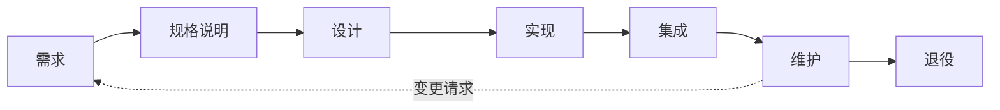

写出一个能让作者自己用起来的程序，是编程问题：前面的课程讲过如何用 C++ 和 Python 表达算法，如何用类与**设计模式**组织代码，如何用**单元测试**检查代码。而要构建由许多人共同开发、被成千上万乃至数百万人使用、并且多年持续变化的软件，则是另一类问题。这需要就"做什么"达成一致，需要一套构建软件的过程，需要让许多人的工作保持一致的办法，需要系统的测试，还需要在发布之后继续照看系统。软件工程就是研究这些问题的学科。本章说明这门学科为什么存在，给出它的定义，按 SWEBOK 的组织方式概览其知识体系，并交代课程安排：下一章讲软件过程，[4.14.3](/4.14.3) 讲版本控制，之后的各章沿着生命周期，从需求（[4.14.4](/4.14.4)）经架构、实现与测试，直到运维（[4.14.13](/4.14.13)），最后以 **AI** 时代的软件工程（[4.14.14](/4.14.14)）收尾。

## 1.1. 软件及其困难

### 1.1.1. 作为系统的软件

本课程有两个目标：把软件理解为系统，并像工程师那样构建软件。真实的软件规模庞大、联系紧密。在 Linux 内核一个子集的调用图中，630 个函数由 1,841 条调用关系相连；在应用服务器 Tomcat 中，1,019 个类由 2,109 条继承与聚合关系相连。现代产品，例如由几十个相互协作的服务构成的铁路售票系统，规模更大：没有任何一个人能把它完整地记在脑子里，而每一次修改都必须做到不破坏作者从未读过的部分。

Fred Brooks 在 1986 年的文章 *No Silver Bullet*（《没有银弹》）中，把软件的*本质*困难与更好的语言和工具能够消除的*偶然*困难区分开来。本质困难依然存在：

| 困难 | 含义 |
|---|---|
| 复杂性 | 软件的不同部分与状态比人类任何其他构造物都多；由于各部分相互作用，复杂性的增长快于规模的增长 |
| 一致性 | 软件必须遵从他人设计的接口、法规与惯例，而这些并无统一的原则 |
| 可变性 | 软件"只是文本"，因而不断被要求修改，越成功的软件被改动得越多 |
| 不可见性 | 软件没有天然的几何表示；图示每次只能显示它的一个侧面 |

可变性也是软件的长处。能够演化的系统可以跟随用户，因此把一切都在"大规模预先设计"（big design up front，BDUF）中定死的做法并不适合软件。另一边的风险则由一个老笑话道出：用户拿到的恰好是他们所规定的东西时，常常会感叹："这正是我们要求的，但不是我们想要的。"

### 1.1.2. 软件危机与学科的诞生

20 世纪 60 年代，计算机的能力强大到足以运行大型程序，例如**操作系统**（IBM OS/360）、航空订票系统和 Apollo 飞行软件。项目延期、超支、不可靠，而且难以修改。软件危机（software crisis）这一术语指的就是：用适用于小程序的方法去开发大型复杂系统时遇到的这些困难。

1968 年 10 月，NATO 科学委员会在德国 Garmisch 召开会议讨论这场危机，会议标题特意取得颇有挑衅意味，就叫"软件工程"；1969 年又在罗马召开了第二次会议。这个名称表达的是一种主张：软件应当以成熟工程领域的规范来构建。Margaret Hamilton 领导团队编写 Apollo 计划的机载飞行软件，她在那个时期也使用这一术语，主张自己团队的工作属于一门工程学科。1969 年的那张著名照片中，她站在一摞与她等高的代码打印稿旁边。

两种说法抓住了软件工程与编程的区别。David Parnas 把它描述为"多人开发多版本程序"。Brooks 则指出"把分别写成的程序组合起来，并使它们适合没有参与编写的人使用"，这些话题"在传统的编程课程中往往很少受到或完全没有受到关注"。Google 近来的一种表述是：软件工程是在时间上积分的编程：问题不在于代码今天能否工作，而在于它在需要的整个期间内能否被理解、被修改、被运行。

### 1.1.3. 由软件引起的故障

**例 1.1.1（Ariane 5 的 501 号飞行）** 1996 年 6 月 4 日，首飞的 Ariane 5 火箭在起飞后约 37 秒偏离航线，在气动载荷下解体，并被自毁系统销毁。调查委员会发现，两套惯性基准系统因同一个软件异常而失效：一个与水平速度有关的 64 位浮点值被转换成 16 位有符号整数，而该值过大。这一转换之所以没有保护，是因为代码沿用自 Ariane 4，而 Ariane 4 的弹道不可能产生这样的值；而且这个函数在起飞之后根本没有任何用处。随后，机载计算机把失效单元的诊断位模式当作飞行数据来解释，并指令喷管偏转到极限。这段代码在 Ariane 4 中没有任何一行是"错"的；失败在于沿用时没有对照新需求重新检查它的假设，也在于设计把任何异常都当作硬件故障并关闭该单元。

比这类设计错误常见得多的，是由对已在运行的软件所做的变更引起的故障。大型互联网公司不断地修改它们的生产系统：既有引入功能、提升性能或修复缺陷的软件升级，也有配置变更，例如为负载均衡而在数据中心之间切换流量。以百度为例，这类变更每天超过 10,000 次，每一次都可能使服务出故障。

| 日期 | 系统 | 变更 | 影响 |
|---|---|---|---|
| 2012 年 12 月 | Google（Gmail、Drive） | 负载均衡软件的一次更新把部分数据中心误判为不可用 | Gmail 累计约 18 分钟不可用 |
| 2014 年 1 月 | Dropbox | 对在役机器实施了一次计划内的操作系统升级 | 服务中断数小时 |
| 2014 年 6 月 | Facebook | 对软件系统的一次配置变更 | 网站中断约 30 分钟 |
| 2014 年 11 月 | Microsoft Azure | 对 Azure Storage 的一次性能更新，一次性大范围部署 | 许多区域的存储及依赖服务降级或中断数小时 |
| 2024 年 7 月 | CrowdStrike Falcon | 对一款终端安全产品的错误内容更新 | 约 850 万台 Windows 机器崩溃，航班停飞，医院运行受扰 |

这些教训在本课程中反复出现。变更应当小，发布前要经过测试（[4.14.11](/4.14.11)），先逐步推到一部分机器上，通过监控来观察，并且可以回退。如果对变更的评估留给运维人员，由他们在客户投诉之后人工查看关键性能指标，排查就要花数小时（一项研究报告中平均每起事件约 1.5 小时）；把这种评估自动化，是运维与站点可靠性工程（[4.14.13](/4.14.13)）的一个主题。

## 1.2. 什么是软件工程

### 1.2.1. 定义

Friedrich L. Bauer 是 1968 年会议的组织者之一，他给出了一个经典的定义：软件工程是"建立并使用合理的工程原则，以经济地获得可靠且能在真实机器上高效运行的软件"。IEEE 标准术语表（IEEE Std 610.12-1990，现已被 ISO/IEC/IEEE 24765 取代）给出了如今通用的定义。

**定义 1.2.1（软件工程）** **软件工程**（software engineering）是把系统化的、规范的、可度量的方法应用于软件的开发、运行与维护；也就是把工程应用于软件。

每个形容词都有分量。*系统化*指工作遵循既定的过程而不是即兴发挥；*规范*指团队在压力之下也坚持这一过程；*可度量*指工作量、规模、缺陷和可靠性都被度量，从而过程可以被计划和改进。这一定义还涵盖运行与维护，而不仅是开发。敏捷运动的发起人之一 Alistair Cockburn 补充了两点观察：软件开发是一场资源受限的、关于发明与沟通的合作博弈；做工程就是在成本、时间、质量、功能等相互冲突的要求面前创造出权衡的解决方案。

### 1.2.2. 一种分层的技术

一幅常见的图景（出自 Pressman）把软件工程表示为四层，每一层都建立在下一层之上：

| 层 | 内容 | 本课程中的例子 |
|---|---|---|
| 工具 | 对方法与过程的自动化支持 | Git、CI 服务、测试框架、linter、监控系统 |
| 方法 | 每项任务的技术做法 | 需求获取、架构风格、测试设计技术 |
| 过程 | 把各项任务联系起来并加以控制的框架 | 瀑布、Scrum、DevOps（[4.14.2](/4.14.2)） |
| 质量关注 | 基石：对质量及其持续改进的承诺 | 评审、测试、度量、事后复盘 |

Watts Humphrey 创立了卡内基梅隆大学软件工程研究所的软件过程项目，该项目开发了能力成熟度模型；他这样概括各层之间的联系："软件系统的质量取决于开发和演化它的过程的质量。"

### 1.2.3. 软件生命周期

**定义 1.2.2（软件生命周期）** **软件生命周期**（software life cycle）是从软件产品的构思到退役的整个时期，以及其间开展的各项活动。典型的阶段有需求、规格说明（分析）、设计、实现、集成、维护和退役。

这些阶段描述的是活动的种类，不一定是时间上的先后：下一章将说明，各种过程模型的区别恰恰在于如何安排并重复这些活动。迄今为止最长的阶段是维护。

**定义 1.2.3（软件维护）** **软件维护**（software maintenance）是产品交付之后对它的修改。ISO/IEC/IEEE 14764 区分了四种：**纠正性维护**修复已发现的故障；**适应性维护**使软件在变化了的环境（新的操作系统、库或法规）中仍可使用；**完善性维护**增加功能并改进性能或可维护性；**预防性维护**在潜在故障引起失效之前加以修复。

Robert Glass 的"60/60 规则"概括了其中的经济学：软件在整个生命期内约 60% 的成本花在维护上，而维护中约 60% 是功能增强，而不是修复缺陷。仍有价值、却因设计退化、文档缺失、作者离开而难以修改的软件，称为遗留系统（legacy system）。与遗留代码打交道（理解它、测试它、安全地修改它），是这个职业主要的实际挑战之一，其余的还有选择开发过程、与非技术背景的客户合作，以及测试。

## 1.3. 知识体系：SWEBOK

### 1.3.1. 知识领域

软件工程知识体系（Software Engineering Body of Knowledge），简称 SWEBOK，是这门学科公认的知识，记载于 IEEE 计算机学会出版的《软件工程知识体系指南》。其第四版（SWEBOK v4.0，2024）把它组织为 18 个知识领域。与第 3 版（2014）相比，它把软件架构、软件工程运维和软件安全各自列为独立的领域，并按敏捷与 DevOps 的实践更新了其余部分。下面的分组是为本课程方便而做的。

| 分组 | 知识领域 |
|---|---|
| 生命周期（8） | 软件需求、软件架构、软件设计、软件构造、软件测试、软件工程运维、软件维护、软件配置管理 |
| 管理与支持（4） | 软件工程管理、软件工程过程、软件质量、软件安全 |
| 专业实践（3） | 软件工程模型与方法、软件工程职业实践、软件工程经济学 |
| 基础（3） | 计算基础、数学基础、工程基础 |

### 1.3.2. 本课程涉及的领域

| 知识领域 | 主要关注 | 章节 |
|---|---|---|
| 软件需求 | 软件必须做什么（功能），必须满足什么标准（非功能需求）；获取、分析、规约、确认与管理 | [4.14.4](/4.14.4) |
| 软件架构 | 高层结构：核心构件、它们之间的交互，以及为满足可伸缩性、可用性等质量属性而选定的原则；架构风格及其权衡 | [4.14.5](/4.14.5)、[4.14.6](/4.14.6) |
| 软件设计 | 从架构到代码的桥梁：模块分解、接口设计、设计原则（SOLID、DRY）与模式、UML 图 | [4.14.7](/4.14.7)、[4.14.10](/4.14.10)；模式见 [4.2.13](/4.2.13) |
| 软件构造 | 把设计变成代码：编码、**单元测试**、**调试**、代码评审、重构 | [4.14.8](/4.14.8)–[4.14.10](/4.14.10) |
| 软件测试 | 检查软件是否满足需求并发现缺陷：单元、集成、系统与验收测试 | [4.14.11](/4.14.11)、[4.14.12](/4.14.12) |
| 软件工程运维 | 持续交付与部署、容器化与编排、监控与告警 | [4.14.13](/4.14.13) |
| 软件维护 | 交付之后的修改（§1.2.3） | [4.14.10](/4.14.10)、[4.14.13](/4.14.13) |
| 软件配置管理 | 识别配置项、版本控制、变更控制、审计 | [4.14.3](/4.14.3) |
| 软件工程管理 | 计划、估算、风险管理、团队管理、进度跟踪 | [4.14.2](/4.14.2) |
| 软件工程过程 | 选择过程模型，记录并改进过程 | [4.14.2](/4.14.2) |
| 软件质量 | 质量保证与质量控制 | [4.14.10](/4.14.10)–[4.14.12](/4.14.12) |
| 软件工程模型与方法 | 过程模型、开发方法、建模语言与工具 | 贯穿全课程 |

## 1.4. 课程安排

课程沿两条线展开。*走向好代码*讲个人开发者保持代码正确、易读的实践：版本控制（[4.14.3](/4.14.3)）、编码风格与代码质量（[4.14.10](/4.14.10)），以及 xUnit 传统的自动化测试（[4.14.12](/4.14.12)）。*走向好系统*讲团队保持产品有用、可靠的实践：需求、架构与设计、测试、开发过程与运维。两条线在团队项目中汇合，因为这些实践要在动手中学会：目标是作为专业社群的一员，践行规范的、以客户为中心的、敏捷的软件工程。

各章沿着生命周期展开。团队从第一天起就需要过程（[4.14.2](/4.14.2)）和版本控制（[4.14.3](/4.14.3)），之后依次是需求（[4.14.4](/4.14.4)）、架构（[4.14.5](/4.14.5)–[4.14.6](/4.14.6)）、前后端分离的 Web 应用的构建（[4.14.7](/4.14.7)–[4.14.9](/4.14.9)）、代码质量（[4.14.10](/4.14.10)）、测试（[4.14.11](/4.14.11)–[4.14.12](/4.14.12)）和运维（[4.14.13](/4.14.13)）。

## 1.5. AI 写代码时的软件工程

**编程智能体**（[4.2.14](/4.2.14)）如今写出了许多项目中的大部分代码。这降低了构造的成本，却没有降低其他活动的成本，在某些方面还提高了它们的重要性。智能体只实现被告知的内容：含糊的需求会产出针对错误问题的、看似合理的代码，所以带验收标准的精确规格成为主要的输入。智能体产出变更的速度可以超过人阅读的速度，因此自动化测试、类型检查和静态分析就成为每个变更都必须通过的护栏，而版本控制使每个变更可评审、可回退。责任并不会转移给工具：仍然要有人决定做什么、评审设计与差异（diff）、并对运行中的系统负责。本课程的每一章在合适的地方都以一小段说明收尾，讲这一章的实践在这种情境下会发生什么变化；[4.14.14](/4.14.14) 则系统地讨论这一主题。

## 小结

- 软件规模大、联系紧密、持续变化；它的本质困难是复杂性、一致性、可变性和不可见性。
- 20 世纪 60 年代的**软件危机**促成了 1968 年的 NATO 会议和"软件工程"这一名称；这门学科关心的是多人、多版本、跨越时间的开发。
- 许多故障源于沿用而未重新检查其假设的代码（Ariane 5），以及对运行中系统的变更；小的、经过测试的、逐步推进且可回退的变更能降低风险。
- 软件工程是把系统化的、规范的、可度量的方法用于软件的开发、运行与维护；维护在生命周期成本中占主导。
- SWEBOK v4（2024）把这门学科组织为 18 个知识领域；本课程覆盖从需求到运维的生命周期领域，以及过程、管理与质量。
