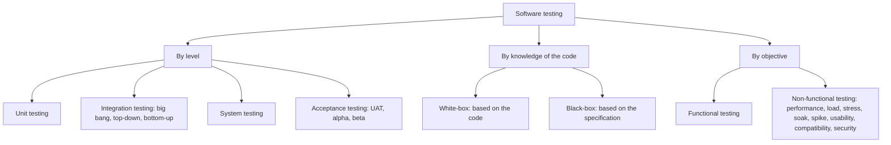
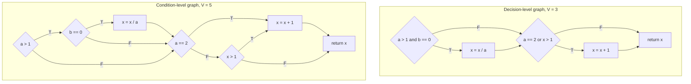
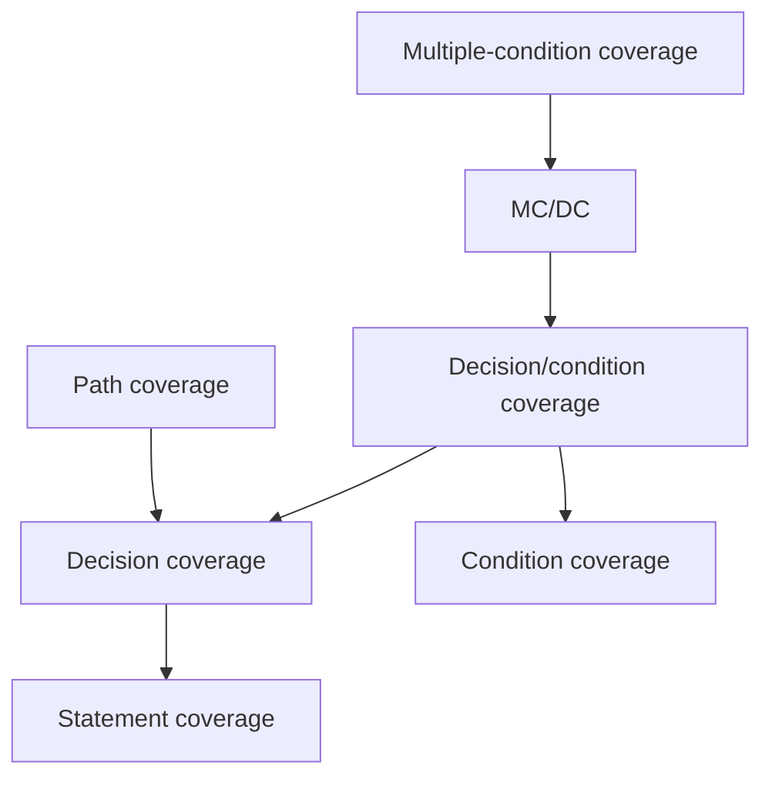

Testing is the main way in which software engineers find out whether a program does what it should. It cannot prove that a program is correct, and it is never complete: even a small function has more inputs than could be tried in the lifetime of the universe. The craft of testing therefore lies in choosing, from the infinitely many possible test cases, a small set that is likely to reveal faults. This chapter treats this choice, test design; the next chapter ([4.14.12](/4.14.12)) treats how tests are automated and organized into levels from unit tests to acceptance tests. We begin with the place of testing within quality assurance (11.1) and its basic concepts and principles (11.2). The two families of design techniques follow: white-box testing, which derives tests from the structure of the code and measures them by coverage (11.3), and black-box testing, which derives them from the specification by equivalence partitioning, boundary value analysis and decision tables (11.4). Section 11.5 combines the two into a strategy, and 11.6 considers what changes when AI agents write both code and tests. The introductory treatment of **test cases**, boundary conditions and **unit testing** in [4.1.5](/4.1.5) is assumed. The Python examples were run with Python 3.14, pytest 9.1 and coverage.py 7.16.

## 11.1. Software Quality Assurance

### 11.1.1. Quality

Joseph Juran defined quality as *fitness for use*: a product has quality if it serves the needs of those who use it, which creates business value both for the customer and for the manufacturer. For software, this has two sides. For customers, quality means that the software satisfies their needs: it is easy to use, gives correct answers and does not crash. For developers, it means that the software is easy to debug and to enhance. The product quality model of ISO/IEC 25010 refines these into nine characteristics, among them functional suitability, reliability, security and maintainability (5.2.1, [4.14.5](/4.14.5)).

*Quality assurance* (QA) comprises the processes and standards by which an organization produces products of the required quality and improves their quality over time. It includes testing, but also reviews, process definitions, coding standards ([4.14.10](/4.14.10)), measurement, and the analysis of past defects to prevent their recurrence. Testing measures quality; quality assurance is about building it in.

### 11.1.2. Verification and Validation

Barry Boehm summarized the two questions that every quality activity answers in one of two ways:

**Definition 11.1.1 (Verification and Validation)** **Verification** is the evaluation of whether a product of a development activity satisfies its specified requirements: "Are we building the product right?" **Validation** is the evaluation of whether the product fulfills its intended use, that is, the true needs and expectations of its stakeholders: "Are we building the right product?" Together they are abbreviated V&V (IEEE Std 1012; ISO/IEC/IEEE 24765).

Verification compares the product with the specification; validation questions the specification itself. A program can pass every verification step and still fail validation, because the requirements were wrong ([4.14.4](/4.14.4)). Verification is sometimes described as "proving" that a system meets its requirements; testing cannot do that, as 11.2.1 explains. Verification by testing and review provides evidence, not proof; only a formal proof of correctness proves.

There are three main families of V&V techniques:

| Family | Kind | How | Examples |
|---|---|---|---|
| Software testing | dynamic | execute the software with test data and examine the outputs | unit, integration, system and acceptance tests ([4.14.12](/4.14.12)) |
| Peer review | static, informal to semi-formal | people other than the author read the work product | **code review** of pull requests ([4.14.3](/4.14.3)); pair programming, in which one programmer (the driver) writes code while the other (the observer) reviews each line as it is typed; a walkthrough, in which the author leads colleagues through the product; a technical review by a team |
| Inspection and analysis | static, formal | analyze representations of the system (specification, models, code) | Fagan inspections, a review process with defined roles, checklists and metrics (Michael Fagan, IBM, 1976); static analysis tools ([4.14.10](/4.14.10)); formal verification, proving properties mathematically or by model checking |

"Formal" in an inspection refers to its defined process, not to formal methods in the mathematical sense. Static techniques can be applied before any code runs, to requirements and designs, and they find faults that testing finds only late or never, such as violations of coding rules or unreachable code. Testing finds what static review overlooks, such as the actual behavior of the code on real inputs and its interaction with the environment. They complement each other.

## 11.2. Basic Testing Concepts

### 11.2.1. What Testing Is

The view of testing has changed over time:

| Year | Contribution | View of testing |
|---|---|---|
| 1947 | Grace Hopper's team finds a moth in a relay of the Harvard Mark II and records it in the log as the "first actual case of bug being found" | debugging: removing bugs from a program that does not work |
| 1969–1970 | Edsger W. Dijkstra: "Program testing can be used to show the presence of bugs, but never to show their absence" | the limits of testing |
| 1972–1973 | Bill Hetzel organizes the first conference on software testing and edits *Program Test Methods* | demonstration: testing establishes confidence that a program does what it is supposed to do |
| 1979 | Glenford J. Myers, *The Art of Software Testing* | destruction: testing tries to show that the program does not work |
| 1990 | IEEE Std 610.12, glossary of software engineering terminology | evaluation of a system under specified conditions |
| 2013– | ISO/IEC/IEEE 29119, software testing standards | testing as a managed process with risk-based planning |

Myers's view is the one that guides test design. Testing is the process of executing a program with the intent of finding errors. A good test case is one that has a high probability of finding an as yet undiscovered error, and a successful test is one that uncovers such an error. The point of this negative formulation is psychological: a tester who sets out to show that a program works will, consciously or not, choose inputs on which it works.

**Definition 11.2.1 (Software Testing)** **Software testing** is the process of operating a system or component under specified conditions, observing or recording the results, and making an evaluation of some aspect of the system or component (IEEE Std 610.12-1990). Its purpose is to find failures, so that the faults causing them can be removed, and to provide evidence about the quality of the software.

A **test case**, in the fuller form of the testing standards, documents the inputs, the predicted results and the execution conditions (preconditions, environment) for a test item. Running it and comparing the actual results with the predicted ones may reveal a **failure**, the observable symptom of a **fault** in the code (Definition 5.2.5). The mechanism that decides whether an observed result is correct is called a *test oracle*: usually the expected output written in the test, sometimes a reference implementation, an invariant, or a person.

**Example 11.2.1** The NextDate function takes three integers, a month, a day and a year, and returns the date of the following day. Three test cases:

| Test case | Month | Day | Year | Expected output |
|---|---|---|---|---|
| 1 | 1 | 31 | 1812 | 1812-02-01 |
| 2 | 2 | 28 | 2000 | 2000-02-29 |
| 3 | 2 | 20 | 2001 | 2001-02-21 |

Each tests something different: the end of a month, the leap day of a year divisible by 400, and the middle of February in a common year. How to choose such cases systematically, and when one has enough of them, are the two central questions of this chapter.

### 11.2.2. Kinds of Testing

Tests are classified along several independent dimensions:



**Definition 11.2.2 (Black-Box and White-Box Testing)** **Black-box testing** (specification-based testing) derives test cases from the specification of the functions a product is designed to perform, without regard to its internal structure; it tests through the interface. **White-box testing** (structure-based or glass-box testing) derives test cases from the internal structure of the code, with knowledge of how the product works.

The levels are the subject of [4.14.12](/4.14.12). They form a pyramid: unit tests are cheap, fast and independent of other components, so there are many of them, and they can be written in either the white-box or the black-box style; tests at higher levels exercise more of the system at once, take longer, cost more and depend on more components, so there are fewer of them, and they are almost always black-box tests.

### 11.2.3. Principles of Testing

Alan Davis's *201 Principles of Software Development* (1995) lists the classical principles:

- All tests should be traceable to customer requirements: the most severe defects are those that make the program fail its requirements.
- Tests should be planned long before testing begins: test planning can start as soon as the requirements are known, and test design as soon as the design is fixed.
- The Pareto principle applies to testing. Defects cluster: roughly 80% of the defects are found in 20% of the modules, so modules with many defects found so far deserve more testing, not less. A related observation concerns failures in the field: in 2002 Microsoft reported that fixing the top 20% of the most frequently reported bugs eliminated about 80% of the errors and crashes users experienced.
- Testing should begin "in the small" and progress toward testing "in the large": from individual units to integrated clusters to the whole system.
- Exhaustive testing is not possible.

The last principle deserves a calculation. A program that reads two 32-bit integers $X$ and $Y$ has $2^{32} \cdot 2^{32} = 2^{64} \approx 1.8 \times 10^{19}$ possible inputs; at one millisecond per test case, running all of them would take about $1.8 \times 10^{16}$ seconds, or about 580 million years. Testing all paths is no easier: a loop executed 20 times whose body contains 5 alternative paths has $5^{20} \approx 9.5 \times 10^{13}$ paths, which at one millisecond each take about 3000 years. (The often quoted figure of 3170 years corresponds to rounding $5^{20}$ up to $10^{14}$.) A test set is therefore always a tiny sample, and test design is the art of choosing the sample.

Tests that are automated and run continuously should also have the FIRST properties:

| Property | Meaning |
|---|---|
| Fast | a test, or the relevant subset, runs in seconds, since it is run all the time |
| Independent | no test depends on another, so that any subset can run in any order |
| Repeatable | the result is the same on every run, which allows automation and isolates bugs; no dependence on the clock, randomness or the network |
| Self-checking | the test decides by itself whether it passed; nobody has to inspect its output |
| Timely | written at about the same time as the code under test, or, in test-driven development, before it |

### 11.2.4. Test Adequacy and Coverage

How do we know when we have tested enough? Since exhaustive testing is impossible, the adequacy of a test set is judged by how much of the product it covers.

**Definition 11.2.3 (Test Coverage)** The **test coverage** of a test set with respect to a criterion is the fraction of the items required by the criterion that the test set exercises: for example the percentage of statements executed, of branches taken, or of requirements tested. A *coverage criterion* specifies the items; a test set that exercises all of them *satisfies* the criterion.

Typical criteria fall into three groups: control-flow coverage and data-flow coverage, which are white-box criteria (11.3); and requirements coverage, which is a black-box criterion (11.4). The relation between the two approaches can be pictured with three sets of behaviors: $S$, the behavior specified; $P$, the behavior actually programmed; and $T$, the behavior exercised by the test cases.

| Region | Meaning |
|---|---|
| $S \cap P \cap T$ | specified, implemented and tested: the behavior that has been verified |
| $(S \cap P) \setminus T$ | specified and implemented, but not tested: possible undetected faults |
| $(S \cap T) \setminus P$ | specified and tested, but not implemented: tests that fail and reveal missing functions |
| $(P \cap T) \setminus S$ | implemented and tested, but not specified: tests of behavior nobody asked for |
| $S \setminus (P \cup T)$ | specified only: missing functionality that no test reveals |
| $P \setminus (S \cup T)$ | implemented only: unspecified, untested behavior, the classic hiding place of security holes |
| $T \setminus (S \cup P)$ | tested only: tests of behavior neither specified nor implemented |

The goal of testing is to make $S \cap P \cap T$ as large as possible. White-box tests are derived from $P$, so they cannot discover $S \setminus P$, specified behavior that is missing from the code. Black-box tests are derived from $S$, so they cannot target $P \setminus S$, code that does something unspecified. Each approach covers a blind spot of the other.

## 11.3. White-Box Testing

### 11.3.1. Control-Flow Graphs

White-box criteria are defined on a graph of the code.

**Definition 11.3.1 (Control-Flow Graph)** The **control-flow graph** of a program is a directed graph whose nodes represent one or more statements executed in sequence (basic blocks) or decisions, and whose edges represent possible transfers of control between them. The out-degree of a node is the number of edges leaving it, the in-degree the number of edges entering it; a decision node has out-degree at least 2. The edges and nodes of a planar drawing divide the plane into regions, the outer region included.

Each structured statement has a characteristic shape: a sequence is a chain; an `if`–`then`–`else` splits into two branches that rejoin; a `while` loop tests before the body and returns to the test; a repeat–until loop tests after the body; a `switch` splits into several branches. The cyclomatic complexity $V(G)$ (Definition 10.6.2) counts the decisions plus one, equivalently the regions.

Throughout this section we use a classical example of Myers, written in Python:

```python
def update(a, b, x):
    if a > 1 and b == 0:
        x = x / a
    if a == 2 or x > 1:
        x = x + 1
    return x
```

Its control-flow graph has two decisions; on the right, each compound decision is split into its atomic conditions, as the evaluation actually proceeds in a language with short-circuit `and` and `or`:



### 11.3.2. Control-Flow Coverage Criteria

The criteria below are ordered roughly from weakest to strongest.

**Definition 11.3.2 (Statement Coverage)** A test set achieves **statement coverage** if every statement of the program is executed at least once.

One test suffices for `update`: with $a = 2$, $b = 0$, $x = 4$ both conditions are true, so both assignments execute. Yet a test set with only this case would not notice if the first `and` were mistakenly an `or`, nor if the second decision were wrong whenever it is false: statement coverage says nothing about the branches that are not taken.

**Definition 11.3.3 (Decision Coverage)** A test set achieves **decision coverage**, also called **branch coverage**, if every decision of the program takes each of its possible outcomes at least once: both the true and the false branch of each `if` and loop condition, and every case of each `switch`.

Two tests suffice: $(a, b, x) = (2, 0, 4)$ makes both decisions true; $(1, 1, 1)$ makes both false. Decision coverage implies statement coverage (every statement lies on some branch), but it still does not examine the individual conditions: in the second test, the false outcome of `a > 1 and b == 0` is caused by `a > 1` alone, and `b == 0` is never even evaluated.

**Definition 11.3.4 (Condition Coverage)** A test set achieves **condition coverage** (also called predicate coverage) if every atomic condition, a Boolean expression containing no `and` or `or`, takes both the value true and the value false at least once.

The tests $(2, 1, 1)$ and $(1, 0, 3)$ give each of the four conditions both values: `a > 1` is T, F; `b == 0` is F, T; `a == 2` is T, F; `x > 1` is F, T. But both tests make the first decision false and the second true, so the division and the false branch of the second `if` are never taken: condition coverage does not imply decision coverage. Short-circuit evaluation makes matters worse: in the test $(1, 0, 3)$, `b == 0` is never evaluated, because `a > 1` is already false; on the condition-level graph, condition coverage requires covering every edge, which needs more tests.

**Definition 11.3.5 (Decision/Condition Coverage)** A test set achieves **decision/condition coverage** if it achieves both decision coverage and condition coverage.

**Definition 11.3.6 (Multiple-Condition Coverage)** A test set achieves **multiple-condition coverage** if, for each decision, every combination of the values of its atomic conditions occurs at least once.

For `update`, each decision has $2^2 = 4$ combinations, and four tests cover all eight:

| Test $(a, b, x)$ | `a > 1` | `b == 0` | `a == 2` | `x > 1` (after the division) | Path |
|---|---|---|---|---|---|
| $(2, 0, 4)$ | T | T | T | T | divide, then increment |
| $(2, 1, 1)$ | T | F | T | F | increment only |
| $(1, 0, 2)$ | F | T | F | T | increment only |
| $(1, 1, 1)$ | F | F | F | F | neither |

Multiple-condition coverage grows as $2^n$ for a decision with $n$ conditions, which becomes impractical for complex decisions. The standard compromise is the criterion required by the aviation software standard DO-178C for the most critical (level A) software:

**Definition 11.3.7 (MC/DC)** A test set achieves **modified condition/decision coverage** (MC/DC) if it achieves decision coverage, every condition in each decision takes all possible outcomes, and each condition is shown to *independently affect* the outcome of its decision: for each condition there are two tests that differ in the value of that condition, with the other conditions fixed (or not evaluated), and that produce different outcomes of the decision.

For `a > 1 and b == 0`, the pair TT, FT shows the effect of the first condition and the pair TT, TF that of the second, so three combinations TT, FT, TF suffice; for an `or`, the combinations FF, TF, FT. In general MC/DC needs at least $n + 1$ tests for $n$ conditions, instead of $2^n$. For `update`, four tests achieve it:

| Test $(a, b, x)$ | first decision | second decision |
|---|---|---|
| $(2, 0, 4)$ | TT → T | TT → T |
| $(1, 0, 1)$ | FT → F | FF → F |
| $(2, 1, 1)$ | TF → F | TF → T |
| $(1, 0, 3)$ | FT → F | FT → T |

The first decision shows TT/FT (rows 1, 2) and TT/TF (rows 1, 3); the second FF/TF (rows 2, 3) and FF/FT (rows 2, 4).

**Definition 11.3.8 (Path Coverage)** A test set achieves **path coverage** if every complete path from the entry to the exit of the control-flow graph is executed.

`update` has four paths on the decision level (each decision true or false), covered for example by $(2, 0, 4)$, $(3, 0, 3)$ (divide, then $x = 1$, so no increment), $(1, 0, 3)$ and $(1, 1, 1)$. With loops, the number of paths is unbounded, so path coverage is typically infeasible; a usual approximation treats each loop as having two paths, one in which the loop body is executed (normally once) and one in which it is skipped. Some paths are also *infeasible*: no input executes them. On the condition-level graph of `update`, the path on which `a > 1` is false but `a == 2` is true is infeasible, since $a = 2$ implies $a > 1$. Deciding whether a path is feasible is undecidable in general, which is one reason why 100% coverage of a strong criterion is often unattainable.

The criteria are related by *subsumption*: a criterion subsumes another if every test set that satisfies the first also satisfies the second.



Edward F. Miller's classification (1977) names a hierarchy of such metrics, still used in testing tools:

| Metric | Coverage |
|---|---|
| $C_0$ | every statement |
| $C_1$ | every decision-to-decision path (DD-path), that is, every branch |
| $C_{1p}$ | every predicate of each decision (condition coverage) |
| $C_2$ | $C_1$ plus loop coverage |
| $C_d$ | $C_1$ plus every dependent pair of DD-paths |
| $C_{\mathrm{MCC}}$ | multiple-condition coverage |
| $C_{ik}$ | every program path that contains up to $k$ repetitions of a loop |
| $C_{\mathrm{stat}}$ | a "statistically significant" fraction of the paths |
| $C_\infty$ | all possible execution paths |

Data-flow criteria are a different family: they follow each variable from each definition (an assignment) to each use that the definition can reach, and require tests that exercise such definition–use pairs. They target faults in how values are passed around, which control-flow criteria can miss.

### 11.3.3. Basis Path Testing

*Basis path testing* (McCabe, 1976) uses the cyclomatic complexity to pick a set of paths of manageable size that still exercises the decision structure thoroughly. A set of paths is linearly independent if each introduces at least one edge not contained in the others; a maximal such set, a basis, has exactly $V(G)$ paths, and every path through the graph is a combination of basis paths. The procedure:

1. Draw the control-flow graph and compute $V(G)$.
2. Choose a baseline path, typically the most important functional path.
3. Generate the other basis paths by flipping one decision of the baseline at a time.
4. Choose inputs that execute each path, and determine the expected outputs from the specification.

For the decision-level graph of `update`, $V(G) = 6 - 5 + 2 = 3$. The baseline path divides and increments: $(2, 0, 4)$. Flipping the first decision gives the path that only increments, $(1, 0, 3)$; flipping the second decision of the baseline gives the path that only divides, $(3, 0, 3)$. Three tests achieve decision coverage and exercise each decision independently. On the condition-level graph, $V(G) = 5$ and basis path testing yields five tests.

### 11.3.4. Measuring Coverage

Coverage is measured by tools that instrument the program and record what executes. For Python, coverage.py is the standard; it is invoked directly or through the pytest plug-in pytest-cov. With the single test that achieves statement coverage of `update`:

```python
from example import update


def test_all_statements():
    assert update(2, 0, 4) == 3
```

statement coverage is complete, while branch measurement (`--branch`) reveals the branches never taken:

```text
$ coverage run -m pytest -q test_statement.py && coverage report -m
1 passed in 0.00s
Name         Stmts   Miss  Cover   Missing
------------------------------------------
example.py       6      0   100%
------------------------------------------
TOTAL            6      0   100%

$ pytest -q test_statement.py --cov=example --cov-branch --cov-report=term-missing
Name         Stmts   Miss Branch BrPart  Cover   Missing
--------------------------------------------------------
example.py       6      0      4      2    80%   2->4, 4->6
--------------------------------------------------------
TOTAL            6      0      4      2    80%
1 passed in 0.01s
```

The report counts 4 branches (two per `if`) of which 2 are partial (`BrPart`), and lists the missing jumps: from line 2 directly to line 4 (the first condition false) and from line 4 to line 6 (the second false). Adding the test $(1, 1, 1)$ brings branch coverage to 100%. Coverage.py measures statement and branch coverage; condition-level criteria such as MC/DC need specialized tools, mostly used for C, C++ and Ada in safety-critical domains.

Coverage measures what the tests execute, not what they check. A test without assertions achieves the same coverage as a good one, and a fault of omission, a missing condition or a missing case, leaves no uncovered code behind. 11.4.4 shows a concrete instance. Coverage is therefore best used, like the metrics of [4.14.10](/4.14.10), to find untested code rather than to certify tested code; a common practice is to require that coverage does not decrease with a change, rather than to require a fixed percentage.

## 11.4. Black-Box Testing

### 11.4.1. Equivalence Partitioning

**Definition 11.4.1 (Equivalence Partitioning)** **Equivalence partitioning** divides the input domain of a program into classes of data, called equivalence classes, such that the classes are mutually exclusive and cover the domain, and the program is expected to behave equivalently, from the viewpoint of revealing defects, on all data in one class; test cases are then derived from each class.

The key step is identifying the classes. They come from the specification: ranges of values, sets of allowed values, conditions that must hold, and different kinds of processing. Both valid classes, which the program should accept, and invalid classes, which it should reject, are identified. When there are several inputs, there are four standard ways of combining the classes (Jorgensen), along two dimensions:

- *Weak* testing makes the single-fault assumption, that failures are rarely caused by two faults acting together: every class of every variable is covered, but not every combination. *Strong* testing makes the multiple-fault assumption and covers every combination of classes, the Cartesian product.
- *Normal* testing covers only the valid classes; *robust* testing covers invalid classes as well.

**Example 11.4.1** A program $F$ has two inputs with $a \le x_1 \le d$ and $e \le x_2 \le g$, and the specification distinguishes the valid classes $[a, b)$, $[b, c)$, $[c, d]$ for $x_1$ and $[e, f)$, $[f, g]$ for $x_2$. The invalid classes are $x_1 < a$, $x_1 > d$, $x_2 < e$ and $x_2 > g$.

| Variant | Test cases | Number |
|---|---|---|
| Weak normal | one value from each valid class of each variable, combined so that each class appears at least once | $\max(3, 2) = 3$ |
| Strong normal | one test for each element of the product of the valid classes | $3 \times 2 = 6$ |
| Weak robust | the weak normal tests, plus one test per invalid class, with the other variable valid | $3 + 4 = 7$ |
| Strong robust | one test for each element of the product of all classes, valid and invalid | $5 \times 4 = 20$ |

**Example 11.4.2** Let NextDate (Example 11.2.1) accept integers with $1 \le \mathrm{month} \le 12$, $1 \le \mathrm{day} \le 31$ and $1812 \le \mathrm{year} \le 2020$. Partitioning each input by validity gives three classes each: $M_1 = \{\mathrm{month} < 1\}$, $M_2 = \{1 \le \mathrm{month} \le 12\}$, $M_3 = \{\mathrm{month} > 12\}$; similarly $D_1, D_2, D_3$ and $Y_1, Y_2, Y_3$. Strong robust testing then has $3^3 = 27$ test cases, a few of which are:

| Classes | Month | Day | Year | Expected output |
|---|---|---|---|---|
| $M_1, D_1, Y_1$ | 0 | 0 | 1800 | invalid |
| $M_1, D_1, Y_2$ | −2 | −1 | 2000 | invalid |
| $M_2, D_2, Y_2$ | 1 | 30 | 1985 | 1985-01-31 |
| $M_2, D_2, Y_3$ | 4 | 12 | 2045 | invalid |
| $M_3, D_3, Y_3$ | 15 | 35 | 2024 | invalid |

This partition captures validity but not the processing of NextDate, whose behavior depends on the length of the month and on leap years. All 26 invalid combinations test the same check, while the whole logic of the function is represented by a single valid test. A partition by behavior is far more effective: months with 30 days, months with 31 days, December and February; days 1–27, 28, 29, 30 and 31; years that are common, leap years not divisible by 100, century years that are not leap years (1900) and years divisible by 400 (2000). Equivalence classes should reflect how the program processes its inputs, not only which inputs it accepts.

### 11.4.2. Boundary Value Analysis

Experience shows that a large number of errors occur at the boundaries of the input domain rather than in its center: a comparison written `<` instead of `<=`, a loop that runs once too often, an **off-by-one error** ([4.1.5](/4.1.5)).

**Definition 11.4.2 (Boundary Value Analysis)** **Boundary value analysis** is a black-box technique that selects test inputs at and around the boundaries of the equivalence classes, rather than arbitrary representatives; it considers the boundaries of the output domain as well as of the input domain.

For a variable with range $[\min, \max]$, *normal* boundary value analysis uses the values $\min$, $\min^+$ (just above the minimum), a nominal value, $\max^-$ and $\max$; *robust* boundary value analysis adds $\min^-$ and $\max^+$, just outside the range, to check that invalid values are rejected. Under the single-fault assumption, one variable at a time takes its boundary values while the others stay nominal, which gives $4n + 1$ test cases for $n$ variables in the normal case and $6n + 1$ in the robust case. *Worst-case* boundary value analysis drops the single-fault assumption and takes the product, $5^n$ (or $7^n$ robust) test cases. For the two inputs of Example 11.4.1, these are 9, 13, 25 and 49 tests.

Boundary value analysis complements equivalence partitioning: instead of choosing an arbitrary element of a class, it chooses the elements at its edges. For NextDate, the important boundaries are those of the output: the last day of each kind of month, the leap day, and the end of the year, where the result moves to the next month or year.

| Month | Day | Year | Expected output | Boundary |
|---|---|---|---|---|
| 2 | 28 | 2000 | 2000-02-29 | leap year divisible by 400 |
| 2 | 29 | 2000 | 2000-03-01 | leap day |
| 2 | 28 | 2007 | 2007-03-01 | common year |
| 2 | 29 | 2007 | invalid | no such date |
| 12 | 31 | 1999 | 2000-01-01 | end of year |
| 12 | 31 | 2020 | out of range | the result exceeds the last valid year |
| 12 | 31 | 1825 | 1826-01-01 | end of year, early year |
| 1 | 1 | 1983 | 1983-01-02 | first day of the year |
| 1 | 1 | 2004 | 2004-01-02 | first day of a leap year |

### 11.4.3. Decision Table Testing

When the output depends on combinations of conditions, the specification is best captured in a **decision table** (Definition 4.3.3), and the table itself becomes a test design: each rule (column) yields at least one test case, whose inputs satisfy the rule's conditions and whose expected result is the rule's action. A complete and consistent table guarantees that every combination of conditions is tested once; rules with "don't care" entries reduce the number of tests, and combinations that cannot occur (a day 31 in a 30-day month that is also the last day of the month) are marked as impossible rather than tested. For NextDate, the conditions are the class of the month, the class of the day and the kind of year from the behavioral partition of Example 11.4.2, and the actions are "increment the day", "reset the day and increment the month", "reset the day and month and increment the year" and "invalid input". Decision table testing is the black-box technique closest to multiple-condition coverage: it covers combinations of conditions derived from the specification rather than from the code. [4.14.4](/4.14.4) turns a decision table into an executable parameterized test (4.6.3).

### 11.4.4. A Worked Example in pytest

The following implementation of NextDate has a subtle fault:

```python
MIN_YEAR, MAX_YEAR = 1812, 2020
DAYS_IN_MONTH = [31, 28, 31, 30, 31, 30, 31, 31, 30, 31, 30, 31]


def is_leap(year: int) -> bool:
    return year % 4 == 0


def days_in_month(month: int, year: int) -> int:
    if month == 2 and is_leap(year):
        return 29
    return DAYS_IN_MONTH[month - 1]


def next_date(month: int, day: int, year: int) -> tuple[int, int, int]:
    """Return the (month, day, year) after the given date."""
    if not (1 <= month <= 12 and 1 <= day <= 31 and MIN_YEAR <= year <= MAX_YEAR):
        raise ValueError("input out of range")
    if day > days_in_month(month, year):
        raise ValueError("no such date")
    if day < days_in_month(month, year):
        return month, day + 1, year
    if month < 12:
        return month + 1, 1, year
    if year == MAX_YEAR:
        raise ValueError("result out of range")
    return 1, 1, year + 1
```

The tests combine weak robust equivalence classes with boundary values, in one parameterized test ([4.14.12](/4.14.12) explains `parametrize`); `None` marks an input that must be rejected:

```python
import pytest

from nextdate import next_date

# Weak normal equivalence classes: one representative of the valid classes.
# Weak robust: in addition, one invalid class at a time.
EQUIVALENCE = [
    ((6, 15, 1912), (6, 16, 1912)),   # M2, D2, Y2: valid
    ((0, 15, 1912), None),            # M1: month < 1
    ((13, 15, 1912), None),           # M3: month > 12
    ((6, 0, 1912), None),             # D1: day < 1
    ((6, 32, 1912), None),            # D3: day > 31
    ((6, 15, 1811), None),            # Y1: year < 1812
    ((6, 15, 2021), None),            # Y3: year > 2020
]

# Boundary values of the domain and of the output (ends of months and years).
BOUNDARY = [
    ((2, 28, 2000), (2, 29, 2000)),   # leap year divisible by 400
    ((2, 29, 2000), (3, 1, 2000)),
    ((2, 28, 2007), (3, 1, 2007)),    # common year
    ((2, 29, 2007), None),            # no such date
    ((2, 28, 1900), (3, 1, 1900)),    # century year, not a leap year
    ((4, 30, 2001), (5, 1, 2001)),    # 30-day month
    ((4, 31, 2001), None),
    ((12, 31, 1999), (1, 1, 2000)),   # end of year
    ((12, 31, 2020), None),           # result beyond the last year
    ((1, 1, 1812), (1, 2, 1812)),     # first valid date
]


@pytest.mark.parametrize(("date", "expected"), EQUIVALENCE + BOUNDARY, ids=str)
def test_next_date(date, expected):
    if expected is None:
        with pytest.raises(ValueError):
            next_date(*date)
    else:
        assert next_date(*date) == expected
```

```text
$ pytest -q test_nextdate.py
...
>           assert next_date(*date) == expected
E           assert (2, 29, 1900) == (3, 1, 1900)
E
E             At index 0 diff: 2 != 3
E             Use -v to get more diff

test_nextdate.py:38: AssertionError
=========================== short test summary info ============================
FAILED test_nextdate.py::test_next_date[(2, 28, 1900)-(3, 1, 1900)] - assert ...
1 failed, 16 passed in 0.01s
```

The fault is the leap-year rule: 1900 is divisible by 4 but not a leap year, since century years are leap years only when divisible by 400. Only the test chosen from the behavioral partition (century years) reveals it: in the valid range 1812–2020, 1900 is the only year on which the simplified rule and the Gregorian rule disagree (they agree on 2000, which is divisible by 400). After the fix, `return year % 4 == 0 and (year % 100 != 0 or year % 400 == 0)`, all tests pass with full branch coverage:

```text
$ pytest -q test_nextdate.py --cov=nextdate --cov-branch --cov-report=term-missing
Name          Stmts   Miss Branch BrPart  Cover   Missing
---------------------------------------------------------
nextdate.py      20      0     12      0   100%
---------------------------------------------------------
TOTAL            20      0     12      0   100%
17 passed in 0.02s
```

Now the instance of 11.3.4: if we run the faulty version against the tests without the 1900 case, all 16 tests pass and the report is the same, 100% of statements and branches. The faulty `is_leap` has no branch that a test could miss; the fault is a missing condition, which coverage cannot detect and which only a black-box test derived from the specification of the Gregorian calendar finds.

## 11.5. Designing a Test Suite

The techniques are complementary, and a practical test design uses them in sequence:

1. Start from the specification: identify the equivalence classes of each input and output, valid and invalid, preferably by behavior; add boundary values for each class; and where conditions combine, write a decision table. Trace each test to the requirement it checks.
2. Add special values from experience and error guessing: empty and one-element collections, zero and negative numbers, duplicates, very long inputs, the null value, unusual characters, concurrent access.
3. Run the tests with coverage measurement and examine the uncovered code. Each uncovered statement or branch is either untested behavior, for which a black-box test is designed from the specification, or dead code, which is removed. For critical code, use stronger criteria (decision, MC/DC).
4. Judge the strength of the tests, not only their coverage. *Mutation testing* does this mechanically: a tool introduces small faults (mutants) into the code, such as replacing `<` by `<=` or `and` by `or`, and runs the tests against each mutant; the fraction of mutants that some test detects, the *mutation score*, measures how well the tests check what they execute. Tools such as mutmut for Python and PIT for Java automate this.

A test case is documented by its identifier, the requirement it traces to, its preconditions, its inputs, its expected result and, after execution, its actual result and verdict. In automated tests, the test function is the documentation: its name, its parameters and its assertions record the same information, and the test framework records the results.

## 11.6. Test Design When Agents Write Code

Agents can generate tests quickly, and so the bottleneck shifts from writing tests to designing them and checking that they are right. A test written by looking at the implementation tends to confirm it: it asserts what the code does, including its faults. An agent asked to "add tests for this function" after writing the function is especially prone to this, because its expected values come from the same understanding that produced the code. Three practices counter it.

- Derive tests from the specification, separately from the implementation. Give the agent the requirements and **acceptance criteria** ([4.14.4](/4.14.4)) and ask it first for the test design: the equivalence classes, the boundary values and the decision table, as a table that a person reviews before any test code is written. Reviewing a table of partitions is much faster than reviewing a hundred test functions, and it is where omissions such as the century years of 11.4.4 are noticed.
- Keep the oracle independent. Expected values should come from the specification, from worked examples supplied by people, or from an independent reference implementation (differential testing, [4.1.5](/4.1.5)), not from running the code under test and copying its output.
- Use coverage and mutation testing as feedback, not as targets. They show an agent where its tests are weak, and it can add tests until uncovered branches and surviving mutants are explained. Treated as a target, coverage invites tests that execute code without checking it; the review question is always what each test asserts.

## Summary

- Quality is fitness for use; quality assurance builds it in through processes, reviews and standards, and testing measures it. Verification asks whether we build the product right, validation whether we build the right product; testing, peer review and inspection are the main V&V techniques.
- Testing executes a program to find failures; it can show the presence of faults, never their absence. Exhaustive testing is impossible, so test design selects a small set of revealing test cases; tests should be fast, independent, repeatable, self-checking and timely.
- White-box criteria on the control-flow graph: statement ⊂ decision (branch) coverage; condition coverage does not imply decision coverage; decision/condition, MC/DC ($\ge n+1$ tests) and multiple-condition coverage ($2^n$) are progressively stronger; path coverage is usually infeasible, and basis path testing uses $V(G)$ independent paths.
- Black-box techniques: equivalence partitioning (weak or strong, normal or robust), boundary value analysis ($4n+1$, $6n+1$, $5^n$ test cases) and decision tables. Classes should follow the processing of the inputs, not only their validity.
- Coverage finds untested code but does not certify tests: faults of omission leave no uncovered code. Combine specification-based design with coverage and mutation analysis.
