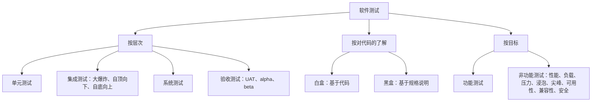
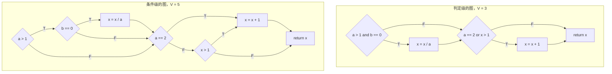
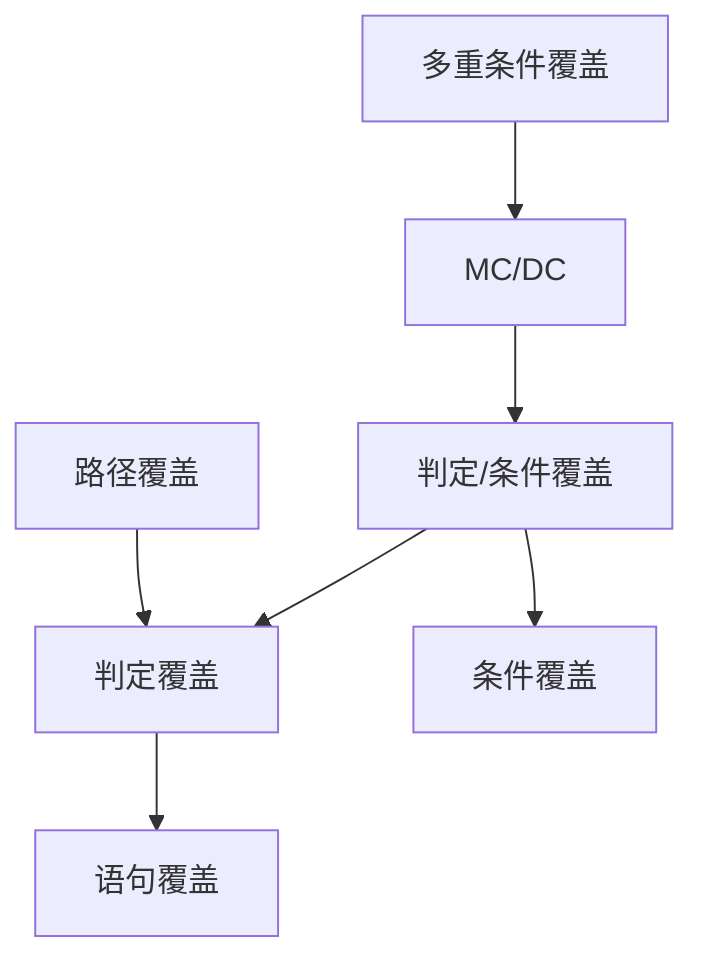

测试是软件工程师判断程序是否做了它该做的事的主要手段。它不能证明程序正确，也永远不会完备：即使是一个很小的函数，其输入的数目也多到在宇宙的寿命之内都试不完。因此，测试的技艺在于从无穷多个可能的**测试用例**中，选出一小组很可能揭示故障的用例。本章讨论这种选择，即测试设计；下一章（[4.14.12](/4.14.12)）讨论如何把测试自动化，并按从**单元测试**到验收测试的层次组织起来。我们先讲测试在质量保证中的位置（11.1）及其基本概念与原则（11.2）。随后是两大类设计技术：白盒测试，从代码的结构导出测试，并用覆盖率来度量（11.3）；黑盒测试，从规格说明出发，用等价类划分、边界值分析与判定表导出测试（11.4）。11.5 节把两者结合成一种策略，11.6 节讨论当 AI 智能体同时编写代码与测试时有什么变化。[4.1.5](/4.1.5) 中对**测试用例**、边界条件与**单元测试**的入门介绍是本章的前提。Python 示例的运行环境为 Python 3.14、pytest 9.1 与 coverage.py 7.16。

## 11.1. 软件质量保证

### 11.1.1. 质量

Joseph Juran 把质量定义为*适用性*（fitness for use）：产品若能满足使用者的需要，它就有质量，这为客户和制造者都创造了商业价值。对软件而言，这有两个方面。对客户，质量意味着软件满足他们的需要：易于使用、给出正确的答案、不会崩溃。对开发者，质量意味着软件易于调试和改进。ISO/IEC 25010 的产品质量模型把这些细化为九个特性，其中有功能适用性、可靠性、安全性与可维护性（5.2.1，[4.14.5](/4.14.5)）。

质量保证（Quality Assurance），简称 QA，包括组织用来生产达到所需质量的产品、并随时间改进其质量的过程与标准。它包括测试，但也包括评审、过程定义、**编码规范**（[4.14.10](/4.14.10)）、度量，以及对以往缺陷的分析以防止其再次出现。测试度量质量；质量保证则关乎把质量构建进去。

### 11.1.2. 验证与确认

Barry Boehm 用两种说法概括了每一项质量活动所回答的两个问题：

**定义 11.1.1（验证与确认）** **验证**是评价某项开发活动的产物是否满足其规定的需求："我们是否正确地构建了产品？"**确认**是评价产品是否实现了其预期用途，即干系人的真实需要和期望："我们是否构建了正确的产品？"两者合称 V&V（IEEE Std 1012；ISO/IEC/IEEE 24765）。

验证把产品与规格说明相比较；确认则质疑规格说明本身。程序可以通过每一个验证步骤，却仍然通不过确认，因为**需求**本身就是错的（[4.14.4](/4.14.4)）。验证有时被描述为"证明"系统满足其需求；测试做不到这一点，11.2.1 将说明原因。通过测试和评审进行的验证提供的是证据，而不是证明；只有正确性的形式化证明才是证明。

V&V 技术主要有三类：

| 类别 | 性质 | 方式 | 例子 |
|---|---|---|---|
| 软件测试 | 动态 | 用测试数据执行软件并检查输出 | 单元、集成、系统与验收测试（[4.14.12](/4.14.12)） |
| 同行评审 | 静态，非正式到半正式 | 作者之外的人阅读工作产品 | 对**拉取请求**的**代码评审**（[4.14.3](/4.14.3)）；结对编程，一位程序员（驾驶员）写代码，另一位（观察员）在代码输入时审查每一行；走查，作者带领同事过一遍产品；由团队进行的技术评审 |
| 检查与分析 | 静态，正式 | 分析系统的各种表示（规格说明、模型、代码） | Fagan 检查，一种有明确角色、检查表和度量的评审过程（Michael Fagan，IBM，1976 年）；**静态分析**工具（[4.14.10](/4.14.10)）；形式化验证，用数学方法或模型检验证明性质 |

检查中的"正式"指的是它有明确定义的过程，而不是数学意义上的形式化方法。静态技术可以在任何代码运行之前就应用于需求和设计，能发现测试很晚才发现或者根本发现不了的故障，例如违反编码规则或不可达的代码。测试则发现静态评审所忽略的东西，例如代码在真实输入上的实际行为及其与环境的交互。两者互为补充。

## 11.2. 测试的基本概念

### 11.2.1. 什么是测试

人们对测试的看法随时间而变化：

| 年份 | 贡献 | 对测试的看法 |
|---|---|---|
| 1947 | Grace Hopper 的团队在 Harvard Mark II 的一个继电器中发现一只飞蛾，并在日志中记为"第一个真正发现 bug 的实例" | **调试**：从不能工作的程序中清除 bug |
| 1969–1970 | Edsger W. Dijkstra："程序测试可以用来表明 bug 的存在，却永远不能表明它们不存在" | 测试的局限 |
| 1972–1973 | Bill Hetzel 组织了第一次软件测试会议，并编辑《Program Test Methods》 | 证明：测试建立起对程序做了它该做的事的信心 |
| 1979 | Glenford J. Myers，《The Art of Software Testing》 | 破坏：测试试图表明程序不能工作 |
| 1990 | IEEE Std 610.12，软件工程术语表 | 在规定条件下对系统的评价 |
| 2013– | ISO/IEC/IEEE 29119，软件测试标准 | 测试是基于风险计划的受管理过程 |

Myers 的观点指导着测试设计。测试是为了发现错误而执行程序的过程。好的测试用例是有很高概率发现尚未被发现的错误的用例，成功的测试是揭示出这种错误的测试。这种否定式表述的意义在于心理上：一个着手证明程序能工作的测试者，会有意无意地选择程序能工作的输入。

**定义 11.2.1（软件测试）** **软件测试**是在规定条件下运行系统或组件、观察或记录结果，并对系统或组件的某一方面作出评价的过程（IEEE Std 610.12-1990）。它的目的是发现失效，从而消除引起失效的故障，并提供有关软件质量的证据。

**测试用例**，按测试标准中较完整的形式，记录针对某个测试项的输入、预期结果与执行条件（前置条件、环境）。运行它并把实际结果与预期结果相比较，可能揭示出**失效**，即代码中**故障**的可观察症状（定义 5.2.5）。判定观察到的结果是否正确的机制称为测试预言（test oracle）：通常是测试中写出的预期输出，有时是参考实现、不变式，或者一个人。

**例 11.2.1** NextDate 函数接收三个整数，即月、日、年，返回后一天的日期。三个测试用例：

| 测试用例 | 月 | 日 | 年 | 预期输出 |
|---|---|---|---|---|
| 1 | 1 | 31 | 1812 | 1812-02-01 |
| 2 | 2 | 28 | 2000 | 2000-02-29 |
| 3 | 2 | 20 | 2001 | 2001-02-21 |

每一个测试的东西不同：月末，能被 400 整除的年份的闰日，以及平年二月的中间。如何系统地选择这样的用例，以及用例何时算够，是本章的两个中心问题。

### 11.2.2. 测试的种类

测试可以沿几个相互独立的维度分类：



**定义 11.2.2（黑盒测试与白盒测试）** **黑盒测试**（基于规格说明的测试）根据产品设计时要完成的功能的规格说明导出测试用例，不考虑其内部结构；它通过接口进行测试。**白盒测试**（基于结构的测试，或称玻璃盒测试）根据代码的内部结构导出测试用例，了解产品如何工作。

各个层次是 [4.14.12](/4.14.12) 的内容。它们构成一座金字塔：单元测试便宜、快速，且不依赖其他组件，因此数量多，既可以用白盒风格写，也可以用黑盒风格写；较高层次的测试一次执行系统的更多部分，耗时更长、成本更高、依赖更多的组件，因此数量较少，而且几乎都是黑盒测试。

### 11.2.3. 测试原则

Alan Davis 的《201 Principles of Software Development》（1995 年）列出了经典的原则：

- 所有测试都应当可追溯到客户需求：最严重的缺陷是使程序不能满足其需求的缺陷。
- 测试应当在测试开始之前很早就计划好：需求一经明确，就可以开始测试计划；设计一经确定，就可以开始测试设计。
- Pareto 原理适用于测试。缺陷是成簇的：大约 80% 的缺陷出现在 20% 的模块中，因此到目前为止发现缺陷多的模块值得更多测试，而不是更少。一个相关的观察涉及现场的失效：2002 年 Microsoft 报告称，修复最常被报告的 20% 的 bug，消除了用户遇到的约 80% 的错误与崩溃。
- 测试应当从"小"处开始，向"大"处推进：从单个单元到集成的簇，再到整个系统。
- 穷尽测试是不可能的。

最后一条原则值得算一笔账。读入两个 32 位整数 $X$ 与 $Y$ 的程序有 $2^{32} \cdot 2^{32} = 2^{64} \approx 1.8 \times 10^{19}$ 种可能的输入；每个测试用例一毫秒，运行全部输入要约 $1.8 \times 10^{16}$ 秒，即约 5.8 亿年。测试所有路径也不容易：一个执行 20 次的循环，其循环体含 5 条备选路径，就有 $5^{20} \approx 9.5 \times 10^{13}$ 条路径，每条一毫秒，需要约 3000 年。（常被引用的 3170 年这个数字，对应把 $5^{20}$ 上取整为 $10^{14}$。）因此，测试集永远只是一个微小的样本，测试设计就是选择样本的艺术。

自动化并持续运行的测试还应具备 FIRST 性质：

| 性质 | 含义 |
|---|---|
| Fast（快速） | 一个测试或相关的子集在几秒内运行完，因为它一直在被运行 |
| Independent（独立） | 没有测试依赖另一个测试，所以任何子集都可以按任意顺序运行 |
| Repeatable（可重复） | 每次运行结果相同，这使自动化成为可能，并能隔离 bug；不依赖时钟、随机性或网络 |
| Self-checking（自检） | 测试自己判定是否通过；无需任何人查看其输出 |
| Timely（及时） | 与被测代码大约同时编写，或者在测试驱动开发中先于代码编写 |

### 11.2.4. 测试的充分性与覆盖率

我们怎么知道测试得够不够？既然穷尽测试不可能，测试集的充分性就根据它覆盖产品的多少来判断。

**定义 11.2.3（测试覆盖率）** 测试集关于某个准则的**测试覆盖率**，是该测试集所执行的、准则所要求的项目所占的比例：例如被执行的语句、被走过的分支或被测试的需求所占的百分比。覆盖准则（coverage criterion）规定这些项目；执行了全部项目的测试集*满足*该准则。

典型的准则分成三组：控制流覆盖与数据流覆盖，它们是白盒准则（11.3）；以及需求覆盖，它是黑盒准则（11.4）。这两种方法之间的关系可以用三个行为集合来描绘：$S$，规格说明规定的行为；$P$，程序实际实现的行为；$T$，测试用例所执行的行为。

| 区域 | 含义 |
|---|---|
| $S \cap P \cap T$ | 已规定、已实现且已测试：已经得到验证的行为 |
| $(S \cap P) \setminus T$ | 已规定、已实现，但未测试：可能有未被发现的故障 |
| $(S \cap T) \setminus P$ | 已规定、已测试，但未实现：失败的测试，揭示缺失的功能 |
| $(P \cap T) \setminus S$ | 已实现、已测试，但未规定：对无人要求的行为的测试 |
| $S \setminus (P \cup T)$ | 只有规定：缺失的功能，没有任何测试能揭示 |
| $P \setminus (S \cup T)$ | 只有实现：未规定、未测试的行为，安全漏洞的经典藏身之处 |
| $T \setminus (S \cup P)$ | 只有测试：对既未规定也未实现的行为的测试 |

测试的目标是使 $S \cap P \cap T$ 尽可能大。白盒测试从 $P$ 导出，所以它们发现不了 $S \setminus P$，即规格说明规定了但代码中缺失的行为。黑盒测试从 $S$ 导出，所以它们无法针对 $P \setminus S$，即做了未规定之事的代码。每种方法都覆盖了对方的盲区。

## 11.3. 白盒测试

### 11.3.1. 控制流图

白盒准则是在代码的图上定义的。

**定义 11.3.1（控制流图）** 程序的**控制流图**是一个有向图，其结点表示依次执行的一条或多条语句（基本块）或判定，其边表示它们之间可能的控制转移。结点的出度是离开它的边数，入度是进入它的边数；判定结点的出度至少为 2。平面画法中的边和结点把平面分成若干区域，包括外部区域。

每种结构化语句都有特征性的形状：顺序是一条链；`if`–`then`–`else` 分成两个分支后再汇合；`while` 循环在循环体之前测试，并回到测试处；repeat–until 循环在循环体之后测试；`switch` 分成多个分支。**圈复杂度** $V(G)$（定义 10.6.2）计算判定数加一，等价于区域数。

本节始终使用 Myers 的一个经典例子，用 Python 写成：

```python
def update(a, b, x):
    if a > 1 and b == 0:
        x = x / a
    if a == 2 or x > 1:
        x = x + 1
    return x
```

它的控制流图有两个判定；在右边，每个复合判定都拆成了原子条件，因为在带短路 `and` 与 `or` 的语言中，求值实际上就是这样进行的：



### 11.3.2. 控制流覆盖准则

下面的准则大致按从弱到强的顺序排列。

**定义 11.3.2（语句覆盖）** 若程序的每条语句至少被执行一次，则称测试集达到**语句覆盖**。

对 `update` 一个测试就够了：取 $a = 2$、$b = 0$、$x = 4$，两个条件都为真，所以两条赋值语句都会执行。然而，只有这一个用例的测试集不会发现第一个 `and` 被错写成 `or`，也不会发现第二个判定在为假时总是出错：语句覆盖对没有被走过的分支一无所知。

**定义 11.3.3（判定覆盖）** 若程序的每个判定的每种可能结果至少出现一次，即每个 `if` 与循环条件的真分支和假分支，以及每个 `switch` 的每个 case，则称测试集达到**判定覆盖**，也称**分支覆盖**。

两个测试就够了：$(a, b, x) = (2, 0, 4)$ 使两个判定都为真；$(1, 1, 1)$ 使两个判定都为假。判定覆盖蕴含语句覆盖（每条语句都在某个分支上），但它仍然不检查各个条件：在第二个测试中，`a > 1 and b == 0` 的假结果仅由 `a > 1` 引起，`b == 0` 甚至从未被求值。

**定义 11.3.4（条件覆盖）** 若每个原子条件（不含 `and` 或 `or` 的布尔表达式）至少取一次真值和一次假值，则称测试集达到**条件覆盖**（也称谓词覆盖）。

测试 $(2, 1, 1)$ 与 $(1, 0, 3)$ 使四个条件都取到了两个值：`a > 1` 为 T、F；`b == 0` 为 F、T；`a == 2` 为 T、F；`x > 1` 为 F、T。但这两个测试都使第一个判定为假、第二个判定为真，所以除法以及第二个 `if` 的假分支从未被走到：条件覆盖不蕴含判定覆盖。短路求值使情况更糟：在测试 $(1, 0, 3)$ 中，`b == 0` 从未被求值，因为 `a > 1` 已经为假；在条件级的图上，条件覆盖要求覆盖每条边，这需要更多的测试。

**定义 11.3.5（判定/条件覆盖）** 若测试集既达到判定覆盖又达到条件覆盖，则称它达到**判定/条件覆盖**。

**定义 11.3.6（多重条件覆盖）** 若对每个判定，其原子条件的值的每种组合至少出现一次，则称测试集达到**多重条件覆盖**。

对 `update`，每个判定有 $2^2 = 4$ 种组合，四个测试就覆盖了全部八种：

| 测试 $(a, b, x)$ | `a > 1` | `b == 0` | `a == 2` | `x > 1`（除法之后） | 路径 |
|---|---|---|---|---|---|
| $(2, 0, 4)$ | T | T | T | T | 先除，再加一 |
| $(2, 1, 1)$ | T | F | T | F | 只加一 |
| $(1, 0, 2)$ | F | T | F | T | 只加一 |
| $(1, 1, 1)$ | F | F | F | F | 都不做 |

对含有 $n$ 个条件的判定，多重条件覆盖按 $2^n$ 增长，对复杂的判定就不切实际了。通行的折中是航空软件标准 DO-178C 对最关键（A 级）软件所要求的准则：

**定义 11.3.7（MC/DC）** 若测试集达到判定覆盖，每个判定中的每个条件都取到所有可能的结果，并且每个条件都被证明*独立地影响*其判定的结果，则称它达到**修正条件/判定覆盖**（MC/DC）：对每个条件，有两个测试，它们在该条件的取值上不同，其他条件固定（或不被求值），并产生该判定的不同结果。

对 `a > 1 and b == 0`，一对 TT、FT 显示了第一个条件的影响，一对 TT、TF 显示了第二个条件的影响，所以三种组合 TT、FT、TF 就够了；对于 `or`，组合是 FF、TF、FT。一般而言，对 $n$ 个条件，MC/DC 至少需要 $n + 1$ 个测试，而不是 $2^n$ 个。对 `update`，四个测试即可达到：

| 测试 $(a, b, x)$ | 第一个判定 | 第二个判定 |
|---|---|---|
| $(2, 0, 4)$ | TT → T | TT → T |
| $(1, 0, 1)$ | FT → F | FF → F |
| $(2, 1, 1)$ | TF → F | TF → T |
| $(1, 0, 3)$ | FT → F | FT → T |

第一个判定显示了 TT/FT（第 1、2 行）与 TT/TF（第 1、3 行）；第二个判定显示了 FF/TF（第 2、3 行）与 FF/FT（第 2、4 行）。

**定义 11.3.8（路径覆盖）** 若控制流图中从入口到出口的每条完整路径都被执行，则称测试集达到**路径覆盖**。

`update` 在判定级有四条路径（每个判定为真或为假），例如可由 $(2, 0, 4)$、$(3, 0, 3)$（先除，得 $x = 1$，所以不加一）、$(1, 0, 3)$ 与 $(1, 1, 1)$ 覆盖。有循环时路径数是无界的，所以路径覆盖通常不可行；通常的近似是把每个循环当作有两条路径，一条执行循环体（通常一次），另一条跳过它。有些路径还是*不可行的*：没有任何输入能执行它们。在 `update` 的条件级的图上，`a > 1` 为假而 `a == 2` 为真的那条路径就是不可行的，因为 $a = 2$ 蕴含 $a > 1$。判定一条路径是否可行一般是不可判定的，这是强准则的 100% 覆盖往往无法达到的原因之一。

这些准则之间有*包含*关系：若满足第一个准则的每个测试集也满足第二个准则，则称第一个准则包含第二个。



Edward F. Miller 的分类（1977 年）给出了这类度量的一个层次结构，至今仍在测试工具中使用：

| 度量 | 覆盖 |
|---|---|
| $C_0$ | 每条语句 |
| $C_1$ | 每条判定到判定的路径（DD 路径），即每个分支 |
| $C_{1p}$ | 每个判定的每个谓词（条件覆盖） |
| $C_2$ | $C_1$ 加上循环覆盖 |
| $C_d$ | $C_1$ 加上每个相依的 DD 路径对 |
| $C_{\mathrm{MCC}}$ | 多重条件覆盖 |
| $C_{ik}$ | 循环重复至多 $k$ 次的每条程序路径 |
| $C_{\mathrm{stat}}$ | "统计上显著"的一部分路径 |
| $C_\infty$ | 所有可能的执行路径 |

数据流准则是另一类：它们沿着每个变量，从每个定义（赋值）追踪到该定义所能到达的每个使用，并要求测试执行这样的定义–使用对。它们针对值在传递过程中出现的故障，这类故障是控制流准则可能漏掉的。

### 11.3.3. 基本路径测试

基本路径测试（basis path testing）由 McCabe 于 1976 年提出，利用圈复杂度挑选出规模可控、但仍能彻底执行判定结构的一组路径。若一组路径中每条路径都至少引入一条其他路径不含的边，则这组路径线性无关；这样的极大集合，即一组基，恰好有 $V(G)$ 条路径，图中的每条路径都是基路径的组合。步骤如下：

1. 画出控制流图并计算 $V(G)$。
2. 选择一条基线路径，通常是最重要的功能路径。
3. 每次翻转基线路径的一个判定，生成其他基路径。
4. 选择能执行每条路径的输入，并根据规格说明确定预期输出。

对 `update` 判定级的图，$V(G) = 6 - 5 + 2 = 3$。基线路径是先除再加一：$(2, 0, 4)$。翻转第一个判定，得到只加一的路径 $(1, 0, 3)$；翻转基线路径的第二个判定，得到只做除法的路径 $(3, 0, 3)$。三个测试达到了判定覆盖，并独立地执行了每个判定。在条件级的图上，$V(G) = 5$，基本路径测试产生五个测试。

### 11.3.4. 度量覆盖率

覆盖率由对程序插桩并记录执行内容的工具来度量。对 Python，标准工具是 coverage.py；可以直接调用，也可以通过 pytest 插件 pytest-cov 调用。对于达到 `update` 语句覆盖的那一个测试：

```python
from example import update


def test_all_statements():
    assert update(2, 0, 4) == 3
```

语句覆盖是完全的，而分支度量（`--branch`）则揭示了从未走过的分支：

```text
$ coverage run -m pytest -q test_statement.py && coverage report -m
1 passed in 0.00s
Name         Stmts   Miss  Cover   Missing
------------------------------------------
example.py       6      0   100%
------------------------------------------
TOTAL            6      0   100%

$ pytest -q test_statement.py --cov=example --cov-branch --cov-report=term-missing
Name         Stmts   Miss Branch BrPart  Cover   Missing
--------------------------------------------------------
example.py       6      0      4      2    80%   2->4, 4->6
--------------------------------------------------------
TOTAL            6      0      4      2    80%
1 passed in 0.01s
```

报告统计出 4 个分支（每个 `if` 两个），其中 2 个是部分覆盖的（`BrPart`），并列出缺失的跳转：从第 2 行直接到第 4 行（第一个条件为假），以及从第 4 行到第 6 行（第二个条件为假）。加上测试 $(1, 1, 1)$ 后，分支覆盖率达到 100%。Coverage.py 度量语句覆盖与分支覆盖；MC/DC 之类的条件级准则需要专门的工具，主要用于安全关键领域的 C、C++ 与 Ada。

覆盖率度量的是测试执行了什么，而不是检查了什么。没有断言的测试与好的测试取得相同的覆盖率，而遗漏型故障，即缺失的条件或缺失的情形，不会留下任何未覆盖的代码。11.4.4 给出了一个具体的例子。因此，覆盖率最好像 [4.14.10](/4.14.10) 中的度量一样，用来找出未测试的代码，而不是用来证明已测试代码的质量；常见的做法是要求一次改动不使覆盖率下降，而不是要求固定的百分比。

## 11.4. 黑盒测试

### 11.4.1. 等价类划分

**定义 11.4.1（等价类划分）** **等价类划分**把程序的输入域划分成若干数据类，称为等价类，这些类两两互斥且覆盖整个输入域，并且从发现缺陷的角度看，预期程序对同一类中的所有数据表现等价；然后从每个类导出测试用例。

关键的一步是识别这些类。它们来自规格说明：取值范围、允许值的集合、必须成立的条件，以及不同种类的处理。有效类（程序应当接受的）和无效类（程序应当拒绝的）都要识别出来。当有多个输入时，组合这些类有四种标准方式（Jorgensen），沿两个维度：

- *弱*测试做单故障假设，即失效很少由两个故障共同作用引起：覆盖每个变量的每个类，但不覆盖每种组合。*强*测试做多故障假设，覆盖类的每种组合，即笛卡儿积。
- *一般*测试只覆盖有效类；*健壮*测试也覆盖无效类。

**例 11.4.1** 程序 $F$ 有两个输入，$a \le x_1 \le d$，$e \le x_2 \le g$，规格说明对 $x_1$ 区分出有效类 $[a, b)$、$[b, c)$、$[c, d]$，对 $x_2$ 区分出 $[e, f)$、$[f, g]$。无效类是 $x_1 < a$、$x_1 > d$、$x_2 < e$ 与 $x_2 > g$。

| 变体 | 测试用例 | 个数 |
|---|---|---|
| 弱一般 | 每个变量的每个有效类各取一个值，组合起来使每个类至少出现一次 | $\max(3, 2) = 3$ |
| 强一般 | 对有效类的乘积的每个元素各一个测试 | $3 \times 2 = 6$ |
| 弱健壮 | 弱一般的测试，加上每个无效类一个测试，另一个变量取有效值 | $3 + 4 = 7$ |
| 强健壮 | 对全部类（有效与无效）的乘积的每个元素各一个测试 | $5 \times 4 = 20$ |

**例 11.4.2** 设 NextDate（例 11.2.1）接受满足 $1 \le \mathrm{month} \le 12$、$1 \le \mathrm{day} \le 31$ 与 $1812 \le \mathrm{year} \le 2020$ 的整数。按有效性划分每个输入，各得三个类：$M_1 = \{\mathrm{month} < 1\}$，$M_2 = \{1 \le \mathrm{month} \le 12\}$，$M_3 = \{\mathrm{month} > 12\}$；$D_1, D_2, D_3$ 与 $Y_1, Y_2, Y_3$ 类似。于是强健壮测试有 $3^3 = 27$ 个测试用例，其中几个是：

| 类 | 月 | 日 | 年 | 预期输出 |
|---|---|---|---|---|
| $M_1, D_1, Y_1$ | 0 | 0 | 1800 | 无效 |
| $M_1, D_1, Y_2$ | −2 | −1 | 2000 | 无效 |
| $M_2, D_2, Y_2$ | 1 | 30 | 1985 | 1985-01-31 |
| $M_2, D_2, Y_3$ | 4 | 12 | 2045 | 无效 |
| $M_3, D_3, Y_3$ | 15 | 35 | 2024 | 无效 |

这种划分抓住了有效性，却没有抓住 NextDate 的处理过程，而后者的行为取决于月份的长度和闰年。全部 26 个无效组合测试的是同一项检查，而函数的全部逻辑只由一个有效测试来代表。按行为划分有效得多：30 天的月份、31 天的月份、十二月与二月；第 1–27 日、28 日、29 日、30 日与 31 日；平年、不能被 100 整除的闰年、不是闰年的世纪年（1900）以及能被 400 整除的年份（2000）。等价类应当反映程序如何处理其输入，而不只是接受哪些输入。

### 11.4.2. 边界值分析

经验表明，大量错误出现在输入域的边界上，而不是在它的中部：把 `<=` 写成了 `<` 的比较，多运行了一次的循环，**差一错误**（off-by-one error，[4.1.5](/4.1.5)）。

**定义 11.4.2（边界值分析）** **边界值分析**是一种黑盒技术，它在等价类的边界上和边界附近选取测试输入，而不是任意的代表；它既考虑输入域的边界，也考虑输出域的边界。

对取值范围为 $[\min, \max]$ 的变量，*一般*边界值分析使用取值 $\min$、$\min^+$（刚好高于最小值）、一个标称值、$\max^-$ 与 $\max$；*健壮*边界值分析再加上刚好在范围之外的 $\min^-$ 与 $\max^+$，以检查无效值是否被拒绝。在单故障假设下，每次只让一个变量取其边界值，其余变量保持标称值，这对 $n$ 个变量在一般情形下给出 $4n + 1$ 个测试用例，健壮情形下给出 $6n + 1$ 个。*最坏情形*边界值分析放弃单故障假设，取乘积，即 $5^n$（健壮时 $7^n$）个测试用例。对例 11.4.1 的两个输入，分别是 9、13、25 与 49 个测试。

边界值分析是等价类划分的补充：它不是任意选取类中的一个元素，而是选取处于类边缘的元素。对 NextDate，重要的边界是输出的边界：每种月份的最后一天、闰日，以及年末，此时结果进入下一个月或下一年。

| 月 | 日 | 年 | 预期输出 | 边界 |
|---|---|---|---|---|
| 2 | 28 | 2000 | 2000-02-29 | 能被 400 整除的闰年 |
| 2 | 29 | 2000 | 2000-03-01 | 闰日 |
| 2 | 28 | 2007 | 2007-03-01 | 平年 |
| 2 | 29 | 2007 | 无效 | 没有这个日期 |
| 12 | 31 | 1999 | 2000-01-01 | 年末 |
| 12 | 31 | 2020 | 超出范围 | 结果超过最后一个有效年份 |
| 12 | 31 | 1825 | 1826-01-01 | 年末，较早的年份 |
| 1 | 1 | 1983 | 1983-01-02 | 一年的第一天 |
| 1 | 1 | 2004 | 2004-01-02 | 闰年的第一天 |

### 11.4.3. 判定表测试

当输出取决于若干条件的组合时，最好用**判定表**（定义 4.3.3）来记录规格说明，而表本身就成为一种测试设计：每条规则（列）至少产生一个测试用例，其输入满足该规则的条件，其预期结果就是该规则的动作。完整且一致的表保证每种条件组合都被测试一次；带"无关"项的规则减少测试数，而不可能出现的组合（在 30 天的月份中，既是 31 日又是该月最后一天）被标为不可能，而不是被测试。对 NextDate，条件是例 11.4.2 的行为划分中月份的类、日的类与年份的种类，动作是"日加一"、"日归一并且月加一"、"日与月都归一并且年加一"以及"无效输入"。判定表测试是最接近多重条件覆盖的黑盒技术：它覆盖的是由规格说明而不是由代码导出的条件组合。[4.14.4](/4.14.4) 把判定表变成一个可执行的参数化测试（4.6.3）。

### 11.4.4. 一个用 pytest 完成的例子

下面这个 NextDate 的实现有一个隐蔽的故障：

```python
MIN_YEAR, MAX_YEAR = 1812, 2020
DAYS_IN_MONTH = [31, 28, 31, 30, 31, 30, 31, 31, 30, 31, 30, 31]


def is_leap(year: int) -> bool:
    return year % 4 == 0


def days_in_month(month: int, year: int) -> int:
    if month == 2 and is_leap(year):
        return 29
    return DAYS_IN_MONTH[month - 1]


def next_date(month: int, day: int, year: int) -> tuple[int, int, int]:
    """Return the (month, day, year) after the given date."""
    if not (1 <= month <= 12 and 1 <= day <= 31 and MIN_YEAR <= year <= MAX_YEAR):
        raise ValueError("input out of range")
    if day > days_in_month(month, year):
        raise ValueError("no such date")
    if day < days_in_month(month, year):
        return month, day + 1, year
    if month < 12:
        return month + 1, 1, year
    if year == MAX_YEAR:
        raise ValueError("result out of range")
    return 1, 1, year + 1
```

测试把弱健壮等价类与边界值结合起来，放在一个参数化测试中（`parametrize` 见 [4.14.12](/4.14.12)）；`None` 标记必须被拒绝的输入：

```python
import pytest

from nextdate import next_date

# Weak normal equivalence classes: one representative of the valid classes.
# Weak robust: in addition, one invalid class at a time.
EQUIVALENCE = [
    ((6, 15, 1912), (6, 16, 1912)),   # M2, D2, Y2: valid
    ((0, 15, 1912), None),            # M1: month < 1
    ((13, 15, 1912), None),           # M3: month > 12
    ((6, 0, 1912), None),             # D1: day < 1
    ((6, 32, 1912), None),            # D3: day > 31
    ((6, 15, 1811), None),            # Y1: year < 1812
    ((6, 15, 2021), None),            # Y3: year > 2020
]

# Boundary values of the domain and of the output (ends of months and years).
BOUNDARY = [
    ((2, 28, 2000), (2, 29, 2000)),   # leap year divisible by 400
    ((2, 29, 2000), (3, 1, 2000)),
    ((2, 28, 2007), (3, 1, 2007)),    # common year
    ((2, 29, 2007), None),            # no such date
    ((2, 28, 1900), (3, 1, 1900)),    # century year, not a leap year
    ((4, 30, 2001), (5, 1, 2001)),    # 30-day month
    ((4, 31, 2001), None),
    ((12, 31, 1999), (1, 1, 2000)),   # end of year
    ((12, 31, 2020), None),           # result beyond the last year
    ((1, 1, 1812), (1, 2, 1812)),     # first valid date
]


@pytest.mark.parametrize(("date", "expected"), EQUIVALENCE + BOUNDARY, ids=str)
def test_next_date(date, expected):
    if expected is None:
        with pytest.raises(ValueError):
            next_date(*date)
    else:
        assert next_date(*date) == expected
```

```text
$ pytest -q test_nextdate.py
...
>           assert next_date(*date) == expected
E           assert (2, 29, 1900) == (3, 1, 1900)
E
E             At index 0 diff: 2 != 3
E             Use -v to get more diff

test_nextdate.py:38: AssertionError
=========================== short test summary info ============================
FAILED test_nextdate.py::test_next_date[(2, 28, 1900)-(3, 1, 1900)] - assert ...
1 failed, 16 passed in 0.01s
```

故障出在闰年规则：1900 能被 4 整除，但不是闰年，因为世纪年只有能被 400 整除时才是闰年。只有从行为划分（世纪年）选出的测试才揭示了它：在有效范围 1812–2020 内，1900 是简化规则与格里高利历规则不一致的唯一年份（两者在能被 400 整除的 2000 年上一致）。修复之后，`return year % 4 == 0 and (year % 100 != 0 or year % 400 == 0)`，全部测试通过，分支覆盖率达到 100%：

```text
$ pytest -q test_nextdate.py --cov=nextdate --cov-branch --cov-report=term-missing
Name          Stmts   Miss Branch BrPart  Cover   Missing
---------------------------------------------------------
nextdate.py      20      0     12      0   100%
---------------------------------------------------------
TOTAL            20      0     12      0   100%
17 passed in 0.02s
```

现在回到 11.3.4 的那个例子：如果我们用没有 1900 这个用例的测试去运行有故障的版本，全部 16 个测试都通过，报告也相同，语句与分支都是 100%。有故障的 `is_leap` 没有任何测试可能漏掉的分支；故障是缺失的条件，覆盖率无法检测它，只有根据格里高利历的规格说明导出的黑盒测试才能发现。

## 11.5. 设计测试套件

这些技术是互补的，实际的测试设计按顺序使用它们：

1. 从规格说明出发：识别每个输入与输出的等价类，包括有效的与无效的，最好按行为划分；为每个类添加边界值；当条件相互组合时，写出判定表。把每个测试追溯到它所检查的需求。
2. 凭经验和错误推测添加特殊值：空集合与单元素集合，零与负数，重复项，很长的输入，空值，不寻常的字符，并发访问。
3. 带覆盖率度量地运行测试，并检查未被覆盖的代码。每条未覆盖的语句或分支，要么是未测试的行为，此时应根据规格说明设计黑盒测试，要么是死代码，应将其删除。对关键代码，使用更强的准则（判定、MC/DC）。
4. 评判测试的强度，而不只是它们的覆盖率。变异测试（mutation testing）机械地做到这一点：工具向代码中引入小的故障（变异体），例如把 `<` 换成 `<=`、把 `and` 换成 `or`，并针对每个变异体运行测试；被某个测试检测出的变异体所占的比例，即变异分数（mutation score），衡量测试对它们所执行的东西检查得有多好。Python 的 mutmut 与 Java 的 PIT 等工具可将此自动化。

测试用例的文档包括它的标识符、所追溯的需求、前置条件、输入、预期结果，以及执行之后的实际结果与结论。在自动化测试中，测试函数就是文档：它的名字、参数与断言记录了同样的信息，而测试框架记录结果。

## 11.6. 智能体编写代码时的测试设计

智能体能迅速生成测试，因此瓶颈从编写测试转移到了设计测试并检查它们是否正确。对着实现去写的测试倾向于确认这个实现：它断言代码做了什么，包括它的故障。在写完函数之后被要求"给这个函数添加测试"的智能体特别容易如此，因为它的预期值来自产生代码的同一份理解。有三种做法可以对付这个问题。

- 与实现分开，从规格说明导出测试。把需求和**验收标准**（[4.14.4](/4.14.4)）交给智能体，先要求它给出测试设计：等价类、边界值与判定表，写成一张在任何测试代码写出之前由人评审的表。评审一张划分表比评审一百个测试函数快得多，而且 11.4.4 的世纪年之类的遗漏正是在这里被注意到的。
- 保持预言独立。预期值应当来自规格说明、人提供的算例或独立的参考实现（**差分测试**，[4.1.5](/4.1.5)），而不是运行被测代码并抄下它的输出。
- 把覆盖率与变异测试用作反馈，而不是目标。它们向智能体表明其测试薄弱之处，它可以添加测试，直到未覆盖的分支和存活的变异体都得到解释。若把覆盖率当作目标，就会诱发只执行代码而不检查代码的测试；评审的问题始终是每个测试断言了什么。

## 小结

- 质量是适用性；质量保证通过过程、评审与标准把质量构建进去，测试则度量质量。验证问的是我们是否正确地构建了产品，确认问的是我们是否构建了正确的产品；测试、同行评审与检查是主要的 V&V 技术。
- 测试执行程序以发现失效；它可以表明故障的存在，永远不能表明故障不存在。穷尽测试不可能，所以测试设计选出一小组有揭示力的测试用例；测试应当快速、独立、可重复、自检且及时。
- 控制流图上的白盒准则：语句 ⊂ 判定（分支）覆盖；条件覆盖不蕴含判定覆盖；判定/条件、MC/DC（$\ge n+1$ 个测试）与多重条件覆盖（$2^n$）依次增强；路径覆盖通常不可行，基本路径测试使用 $V(G)$ 条独立路径。
- 黑盒技术：等价类划分（弱或强，一般或健壮）、边界值分析（$4n+1$、$6n+1$、$5^n$ 个测试用例）与判定表。类的划分应当遵循输入的处理过程，而不只是它们的有效性。
- 覆盖率能发现未测试的代码，但不能证明测试的质量：遗漏型故障不会留下未覆盖的代码。把基于规格说明的设计与覆盖率分析、变异分析结合起来。
