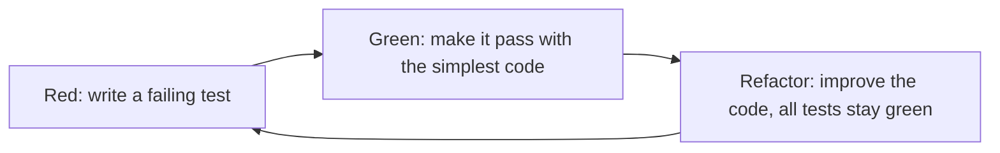

The previous chapter ([4.14.11](/4.14.11)) asked which **test cases** to choose. This chapter asks how to run them, again and again, at every level of a system. Tests that are run by hand are run rarely; tests that are code run on every change, in seconds, and turn testing from a phase at the end of a project into a continuous activity. We begin with the frameworks that make **unit tests** cheap to write and run (12.1) and the test doubles that isolate a unit from its dependencies (12.2), and then with test-driven development, which writes the tests first (12.3). The rest of the chapter climbs the levels of testing: integration testing, which checks that units work together (12.4); system testing, including the non-functional tests of performance and load (12.5); and acceptance testing, which decides whether the customer accepts the system (12.6). Section 12.7 surveys other kinds of tests (smoke, regression, fuzz, canary, A/B), 12.8 shows how all of them fit into a continuous integration pipeline, and 12.9 discusses testing when coding agents write the code. Examples were run with Python 3.14, pytest 9.1 and Hypothesis 6.170.

## 12.1. Unit Testing Frameworks

### 12.1.1. The xUnit Family

**Unit testing** ([4.1.5](/4.1.5)) tests individual functions, methods and classes in isolation. The *xUnit* family of test frameworks is designed to automate such programmer tests. Its goals are to let developers write tests in the language they already use, without learning a separate test language; to make it easy to test individual functions, classes and objects without needing the rest of the application, testing the software from the inside; to run one test or many with a single action; and to keep the cost of running tests so low that programmers are not discouraged from running all existing tests after every change.

The family began with SUnit, which Kent Beck wrote for Smalltalk around 1989 in the spirit of "each object should be able to test itself". In 1997 Kent Beck and Erich Gamma ported it to Java as JUnit, which became very popular, and since then frameworks modeled on it have been written for practically every language; they are collectively called xUnit. Examples are `unittest` in the Python standard library, NUnit and xUnit.net for .NET, and GoogleTest for C++. pytest for Python, Jest and Vitest for JavaScript, and Go's `testing` package keep the ideas while dropping the class-based structure.

### 12.1.2. The Four-Phase Test

Every automated test talks to the *system under test* (SUT), the unit being tested, and the SUT usually depends on other components, called *depended-on components* (DOCs): a database, a mail server, a clock, another class. The test controls the SUT through two kinds of inputs and observes it through two kinds of outputs:

| | Direct (through the SUT's interface) | Indirect (through a DOC) |
|---|---|---|
| Inputs, the *control points* | arguments of the call | values the SUT receives from DOCs, such as the current time or a query result |
| Outputs, the *observation points* | return values, exceptions, the SUT's state | calls the SUT makes to DOCs, such as an e-mail sent or a row written |

An xUnit test proceeds in four phases (Meszaros, *xUnit Test Patterns*, 2007):

1. *Setup*: set up the test fixture, the state the test needs;
2. *Exercise*: interact with the system under test;
3. *Verify*: determine whether the expected outcome has been obtained;
4. *Teardown*: tear down the fixture, to return to the original state.

The same structure is often called Arrange–Act–Assert, with teardown left implicit.

**Definition 12.1.1 (Test Fixture)** A **test fixture** is everything that must be in place to exercise the system under test: a fixed, known state of the SUT and its environment used as a baseline for running a test, and the code that creates and removes it. Examples are loading a database with a specific, known set of data; copying a specific known set of files; preparing input data; and creating test doubles (12.2). In xUnit, *setup* creates the fixture and *teardown* cleans it up.

A large part of making tests repeatable and robust is ensuring that the fixture is torn down after each test and a fresh one created for the next, so that no test sees what an earlier one left behind. This is the Independent and Repeatable of the FIRST properties ([4.14.11](/4.14.11)).

### 12.1.3. unittest and pytest

With Python's built-in `unittest`, a test case is a subclass of `unittest.TestCase`; `setUp()` runs before and `tearDown()` after each test method; test methods are named `test_…`; and assertion methods such as `assertEqual()` check results and `assertRaises()` that an expected exception is raised. Given a small class:

```python
class InsufficientFunds(Exception):
    pass


class Account:
    def __init__(self, owner: str, balance: int = 0) -> None:
        self.owner = owner
        self.balance = balance

    def deposit(self, amount: int) -> None:
        if amount <= 0:
            raise ValueError("amount must be positive")
        self.balance += amount

    def withdraw(self, amount: int) -> None:
        if amount > self.balance:
            raise InsufficientFunds(f"balance {self.balance} < {amount}")
        self.balance -= amount
```

the tests read:

```python
import unittest

from account import Account, InsufficientFunds


class AccountTest(unittest.TestCase):
    def setUp(self):                      # runs before each test: build the fixture
        self.account = Account("alice", balance=100)

    def tearDown(self):                   # runs after each test: clean up
        self.account = None

    def test_deposit_increases_balance(self):
        self.account.deposit(50)                      # exercise
        self.assertEqual(self.account.balance, 150)   # verify

    def test_withdraw_more_than_balance_raises(self):
        with self.assertRaises(InsufficientFunds):
            self.account.withdraw(101)


if __name__ == "__main__":
    unittest.main()
```

```text
$ python -m unittest -v test_account_unittest
test_deposit_increases_balance (test_account_unittest.AccountTest.test_deposit_increases_balance) ... ok
test_withdraw_more_than_balance_raises (test_account_unittest.AccountTest.test_withdraw_more_than_balance_raises) ... ok

----------------------------------------------------------------------
Ran 2 tests in 0.000s

OK
```

pytest, the most widely used Python test framework, removes the boilerplate: tests are plain functions in files named `test_*.py`, assertions are plain `assert` statements, and fixtures are functions that tests request by naming them as parameters. It runs `unittest` tests as well. The same tests, extended by two boundary cases, a parameterized test and the `match` argument, which checks the exception message against a regular expression:

```python
import pytest

from account import Account, InsufficientFunds


@pytest.fixture
def account():
    return Account("alice", balance=100)


def test_deposit_increases_balance(account):
    account.deposit(50)
    assert account.balance == 150


@pytest.mark.parametrize("amount", [0, -5])
def test_deposit_rejects_non_positive_amounts(account, amount):
    with pytest.raises(ValueError, match="positive"):
        account.deposit(amount)


def test_withdraw_entire_balance(account):
    account.withdraw(100)
    assert account.balance == 0


def test_withdraw_more_than_balance_raises(account):
    with pytest.raises(InsufficientFunds):
        account.withdraw(101)
```

`@pytest.mark.parametrize` runs one test function once per parameter value, each as a separate test with its own identifier. Suppose the comparison in `withdraw` is mistakenly written `>=`. pytest reports the failing test, the line, and the values involved, because it rewrites `assert` statements to record their operands:

```text
$ pytest test_account.py
============================= test session starts ==============================
platform linux -- Python 3.14.5, pytest-9.1.1, pluggy-1.7.0
collected 5 items

test_account.py ...F.                                                    [100%]

=================================== FAILURES ===================================
_________________________ test_withdraw_entire_balance _________________________

account = <account.Account object at 0x7b34ec56e650>

    def test_withdraw_entire_balance(account):
>       account.withdraw(100)

test_account.py:23:
_ _ _ _ _ _ _ _ _ _ _ _ _ _ _ _ _ _ _ _ _ _ _ _ _ _ _ _ _ _ _ _ _ _ _ _ _ _ _ _

self = <account.Account object at 0x7b34ec56e650>, amount = 100

    def withdraw(self, amount: int) -> None:
        if amount >= self.balance:
>           raise InsufficientFunds(f"balance {self.balance} < {amount}")
E           account.InsufficientFunds: balance 100 < 100

account.py:17: InsufficientFunds
=========================== short test summary info ============================
FAILED test_account.py::test_withdraw_entire_balance - account.InsufficientFu...
========================= 1 failed, 4 passed in 0.01s ==========================
```

The boundary value test (withdrawing exactly the balance, [4.14.11](/4.14.11)) caught the off-by-one fault; the test that withdraws more than the balance passes with either comparison. Useful options are `-q` (quiet), `-v` (one line per test), `-x` (stop at the first failure), `-k expression` (run tests whose names match), `--lf` (rerun the last failures) and `--pdb` (open the debugger at a failure).

### 12.1.4. Fixtures in pytest

A pytest fixture is a function decorated with `@pytest.fixture`. A test receives the fixture's value by naming it as a parameter; a fixture can itself request other fixtures; and a fixture that `yield`s its value runs the code after `yield` as teardown, even if the test fails. The scope of a fixture says how often it is created: for each test (`function`, the default), or once per `class`, `module`, `package` or `session`. Fixtures shared by several test files are placed in a file named `conftest.py`. Here a fresh in-memory SQLite database is created for each test, while the schema is computed once per session:

```python
# conftest.py
import sqlite3

import pytest

SCHEMA = "CREATE TABLE users (id INTEGER PRIMARY KEY, name TEXT UNIQUE NOT NULL)"


@pytest.fixture(scope="session")
def schema():
    return SCHEMA


@pytest.fixture
def db(schema):
    conn = sqlite3.connect(":memory:")   # set up a fresh database for each test
    conn.execute(schema)
    conn.execute("INSERT INTO users (name) VALUES ('alice')")
    yield conn                           # the test runs here
    conn.close()                         # tear down, even if the test failed
```

```python
# test_users.py
import sqlite3

import pytest


def test_insert_user(db):
    db.execute("INSERT INTO users (name) VALUES ('bob')")
    assert db.execute("SELECT COUNT(*) FROM users").fetchone()[0] == 2


def test_duplicate_name_rejected(db):
    with pytest.raises(sqlite3.IntegrityError):
        db.execute("INSERT INTO users (name) VALUES ('alice')")


def test_export(db, tmp_path):
    out = tmp_path / "users.csv"
    rows = db.execute("SELECT name FROM users").fetchall()
    out.write_text("\n".join(name for (name,) in rows))
    assert out.read_text() == "alice"
```

The option `--setup-show` displays when each fixture is set up and torn down (`S` for session scope, `F` for function scope):

```text
$ pytest -q --setup-show test_users.py
SETUP    S schema
        SETUP    F db (fixtures used: schema)
        test_users.py::test_insert_user (fixtures used: db, schema) .
        TEARDOWN F db
        SETUP    F db (fixtures used: schema)
        test_users.py::test_duplicate_name_rejected (fixtures used: db, schema) .
        TEARDOWN F db
SETUP    S tmp_path_factory
        SETUP    F db (fixtures used: schema)
        SETUP    F tmp_path (fixtures used: tmp_path_factory)
        test_users.py::test_export (fixtures used: db, request, schema, tmp_path, tmp_path_factory) .
        TEARDOWN F tmp_path
        TEARDOWN F db
TEARDOWN S tmp_path_factory
TEARDOWN S schema
3 passed in 0.01s
```

The first test inserts `bob`, yet the second sees only `alice`: each test gets its own database. pytest has many built-in fixtures: `tmp_path`, a fresh temporary directory per test; `monkeypatch`, which temporarily replaces attributes, dictionary items and environment variables and restores them afterward; `capsys`, which captures standard output; and others. A fixture with a wide scope (a database server started once per session) saves time, but tests then share its state, which must be reset between tests, for example by running each test in a transaction that is rolled back.

## 12.2. Test Doubles

### 12.2.1. Why Test Doubles

How can we test a unit when a component it depends on cannot be used in a test? The DOC may not exist yet; it may not be able to produce the results the test needs (an error from a payment service, a particular time of day); or executing it may have undesirable side effects (sending real e-mail, charging a credit card) or be slow (a network service).

**Definition 12.2.1 (Test Double)** A **test double** is a test-specific replacement for a component on which the system under test depends. It need not behave exactly like the real DOC; it merely has to provide the same interface, so that the SUT cannot tell the difference.

The name comes from the stunt double of the film industry (Meszaros). Test doubles can be substituted only if the SUT lets them in: through **dependency injection** of its collaborators (10.8.2, [4.14.10](/4.14.10)), through a factory, or, in dynamic languages, by patching the module where the SUT looks the dependency up.

### 12.2.2. Kinds of Test Doubles

| Kind | Purpose | Example |
|---|---|---|
| *Dummy object* | passed around but never actually used; only fills a parameter list | `None` or an empty object for an argument the tested path ignores |
| *Test stub* | provides the SUT's indirect inputs, giving the test a control point for them | a clock that always returns 08:00; a payment gateway that always declines |
| *Test spy* | captures the indirect outputs of the SUT, the calls it makes, for later verification by the test | a mailer that records every message instead of sending it |
| *Mock object* | replaces a DOC with an object that verifies it is used correctly: it holds a specification of the calls it expects to receive and fails the test otherwise | a mailer that asserts it was called exactly once with the right address |
| *Fake object* | has a working implementation, but takes a shortcut that makes it unsuitable for production | an in-memory hash table instead of a database; an in-memory file system |

Stubs and fakes control what goes into the SUT; spies and mocks observe what comes out. The difference between a spy and a mock is where the verification lives: a test inspects a spy after the exercise phase, while a mock is told its expectations in advance (in some frameworks) and checks them itself.

### 12.2.3. Test Doubles in Python

The class `DailyReport` of 10.8.2 ([4.14.10](/4.14.10)) receives a `Clock` and a `Mailer` through its constructor:

```python
class DailyReport:
    def __init__(self, clock: Clock, mailer: Mailer) -> None:
        self.clock = clock
        self.mailer = mailer

    def send_to(self, manager: str) -> None:
        today = self.clock.now().date()
        self.mailer.send(manager, f"Sales report for {today}")
```

A hand-written stub and spy, and a mock from the standard library's `unittest.mock`:

```python
from datetime import datetime
from unittest.mock import Mock

from report import DailyReport, Mailer


class FixedClock:                          # stub: controls an indirect input
    def __init__(self, moment):
        self.moment = moment

    def now(self):
        return self.moment


class RecordingMailer:                     # spy: records indirect outputs
    def __init__(self):
        self.sent = []

    def send(self, to, body):
        self.sent.append((to, body))


def test_report_with_stub_and_spy():
    mailer = RecordingMailer()
    report = DailyReport(FixedClock(datetime(2026, 10, 21, 8, 0)), mailer)
    report.send_to("li@example.com")
    assert mailer.sent == [("li@example.com", "Sales report for 2026-10-21")]


def test_report_with_mock():
    mailer = Mock(spec=Mailer)             # mock: verifies the expected call
    report = DailyReport(FixedClock(datetime(2026, 10, 21, 8, 0)), mailer)
    report.send_to("li@example.com")
    mailer.send.assert_called_once_with("li@example.com", "Sales report for 2026-10-21")
```

A `Mock` accepts any call and records it; `spec=Mailer` restricts it to the methods of `Mailer`, so that a misspelled method name fails instead of silently passing. If the report text changes, the mock's verification reports the difference:

```text
E           AssertionError: expected call not found.
E           Expected: send('li@example.com', 'Sales report for 2026-10-21')
E             Actual: send('li@example.com', 'Report 2026-10-21')
...
FAILED test_report.py::test_report_with_mock - AssertionError: expected call ...
1 failed in 0.04s
```

When a dependency is not injected but imported, `unittest.mock.patch` or pytest's `monkeypatch` replace it where the SUT looks it up, for example `monkeypatch.setattr("report.send_email", fake_send)`. Patching is convenient but couples the test to the internal structure of the SUT; injecting dependencies is usually the cleaner design.

Test doubles have costs. A test that mocks everything checks only that the SUT makes the calls the test author expected, not that the system works: if the real DOC behaves differently from the double, all unit tests pass and the system fails. Long chains of mocks (`mock.a.return_value.b.return_value.c`) indicate a violation of the **law of Demeter** (10.8.2). The usual guidance is to use real objects where they are fast and deterministic, fakes for slow infrastructure such as databases, stubs and mocks for components outside one's control (third-party services, the clock, randomness), and to cover the real interactions with integration tests (12.4).

## 12.3. Test-Driven Development

### 12.3.1. The Cycle

**Definition 12.3.1 (Test-Driven Development)** **Test-driven development** (TDD) is a development practice in which each small increment of functionality is preceded by an automated test that specifies it, in a short repeated cycle: write a test that fails (*red*); write the simplest code that makes it pass (*green*); then improve the structure of the code while keeping all tests passing (*refactor*). It was popularized by Kent Beck as part of Extreme Programming (*Test-Driven Development: By Example*, 2002).



- Red phase. Each new feature begins with writing a test. This makes the developer focus on the requirement, on what the code should do and how it will be called, before writing the code; the test describes "the code you wish you had". Seeing the test fail also checks the test itself: a test that passes before the feature exists tests nothing.
- Green phase. Implement code to make the test pass. The goal is to find a solution, without worrying yet about elegance or efficiency.
- Refactor phase. Move code from where it was convenient for passing the test to where it logically belongs, remove duplication, and improve the implementation (**refactoring**, Definition 10.7.1); the tests make each step safe.

Robert C. Martin summarized the discipline in three laws:

1. You are not allowed to write any production code unless it is to make a failing unit test pass.
2. You are not allowed to write any more of a unit test than is sufficient to fail; and compilation failures are failures.
3. You are not allowed to write any more production code than is sufficient to pass the one failing unit test.

The first law enforces test first; the second and third limit redundant test code and production code, so that the cycle takes minutes. TDD produces, as a by-product, a regression test suite that covers every behavior that was deliberately implemented. Students who practiced it in team projects reported that it is hard at first but gets easier, that it made bugs and regressions quick to notice and easy to fix, and that it helped them organize their thoughts as well as their code; the most common regret was not having committed to it earlier. Controlled studies of TDD show mixed effects on productivity and generally fewer defects; much of the benefit appears to come from the short cycles and from having tests at all, whether written just before or just after the code.

### 12.3.2. A Worked Session

We develop a function `parse_duration` that converts strings such as `"1h30m"` to seconds. The first test:

```python
from duration import parse_duration


def test_minutes():
    assert parse_duration("45m") == 45 * 60
```

Red: the module does not exist yet, and by the second law, this counts as a failure.

```text
$ pytest -q --tb=line test_duration.py
    from duration import parse_duration
E   ModuleNotFoundError: No module named 'duration'
=========================== short test summary info ============================
ERROR test_duration.py
1 error in 0.05s
```

Green, with the simplest code that passes:

```python
def parse_duration(text):
    return int(text[:-1]) * 60
```

```text
$ pytest -q test_duration.py
1 passed in 0.00s
```

The next test, `assert parse_duration("2h") == 2 * 3600`, fails with `assert 120 == (2 * 3600)`; a check for the suffix `h` makes it pass. The third test, `assert parse_duration("1h30m") == 90 * 60`, fails with `ValueError: invalid literal for int() with base 10: '1h30'`, which shows that the special cases have reached their limit. Now the design generalizes, and the new code passes all three tests:

```python
import re

UNIT_SECONDS = {"h": 3600, "m": 60, "s": 1}
TOKEN = re.compile(r"(\d+)([hms])")


def parse_duration(text: str) -> int:
    """Convert a duration such as '1h30m' or '45s' to seconds."""
    return sum(int(n) * UNIT_SECONDS[unit] for n, unit in TOKEN.findall(text))
```

The specification also says that malformed input is rejected. A parameterized test lists the invalid inputs, chosen as in [4.14.11](/4.14.11): empty, missing unit, unknown unit, unit before number, embedded space.

```python
@pytest.mark.parametrize("text", ["", "90", "1x", "h1", "1h 30m"])
def test_invalid_input_rejected(text):
    with pytest.raises(ValueError):
        parse_duration(text)
```

```text
$ pytest -q --tb=no test_duration.py
=========================== short test summary info ============================
FAILED test_duration.py::test_invalid_input_rejected[] - Failed: DID NOT RAIS...
FAILED test_duration.py::test_invalid_input_rejected[90] - Failed: DID NOT RA...
FAILED test_duration.py::test_invalid_input_rejected[1x] - Failed: DID NOT RA...
FAILED test_duration.py::test_invalid_input_rejected[h1] - Failed: DID NOT RA...
FAILED test_duration.py::test_invalid_input_rejected[1h 30m] - Failed: DID NO...
5 failed, 3 passed in 0.01s
```

`findall` silently skips what it does not recognize. Matching the whole string against a grammar of the format fixes all five:

```python
import re

UNIT_SECONDS = {"h": 3600, "m": 60, "s": 1}
DURATION = re.compile(r"(?:(\d+)h)?(?:(\d+)m)?(?:(\d+)s)?")


def parse_duration(text: str) -> int:
    """Convert a duration such as '1h30m' or '45s' to seconds."""
    match = DURATION.fullmatch(text)
    if not text or match is None:
        raise ValueError(f"invalid duration: {text!r}")
    hours, minutes, seconds = (int(g) if g else 0 for g in match.groups())
    return hours * 3600 + minutes * 60 + seconds
```

```text
$ pytest -q test_duration.py
8 passed in 0.01s
```

In the refactor phase, `UNIT_SECONDS` is now unused and is removed; the eight tests still pass. Each cycle took a minute or two, and at every moment there was exactly one reason for the code to change: the one failing test.

## 12.4. Integration Testing

### 12.4.1. Why Units That Work Fail Together

"If they all work individually, why do you doubt that they will work when we put them together?" The problems lie in the interfaces. One module can have an inadvertent effect on another; sub-functions, when combined, may not produce the desired major function; imprecision that is acceptable in each unit may be magnified to unacceptable levels; global data structures can cause interference; and data can be lost or misinterpreted across an interface.

**Example 12.4.1 (Mars Climate Orbiter)** On 23 September 1999, NASA lost the Mars Climate Orbiter, a spacecraft of about 125 million US dollars, as it entered orbit around Mars. Ground software supplied by Lockheed Martin reported the impulse of the thruster firings in pound-force seconds, while the navigation software of NASA's Jet Propulsion Laboratory, according to the interface specification, expected newton-seconds; since one pound-force second is about 4.45 newton-seconds, the impulses were underestimated by that factor. The trajectory corrections computed from these data brought the spacecraft far closer to Mars than planned, and it was destroyed in the atmosphere. Each piece of software worked as its developers intended; the fault was in the interface between them, and no end-to-end test had compared the two teams' data.

**Definition 12.4.1 (Integration Testing)** **Integration testing** is testing in which software components, hardware components or both are combined and tested to evaluate the interaction between them (IEEE Std 610.12).

### 12.4.2. Integration Strategies

In *big bang integration*, all components are combined at once and the system is tested as a whole. This needs no extra test code, but when tests fail, there are usually several failures at once, which are hard to isolate and to trace to their defects. *Incremental* integration constructs and tests the program in small increments, so that a new failure points to the component just added. The order of increments can follow the functional decomposition (the hierarchy of modules), the call graph, or usage scenarios; along the module hierarchy, the strategies are top-down, bottom-up and their combination, sandwich integration.

*Top-down integration* starts with the high-level components and works down the control hierarchy. Components not yet integrated are replaced by stubs, test doubles that represent the interfaces of the subordinate modules. In the hierarchy below, $A$ calls $B$, $C$ and $D$, and $D$ calls $E$:

| Step | Integrated and tested | Stubs |
|---|---|---|
| 1 | $A$ | $s_B, s_C, s_D$ |
| 2 | $A, B$ (replace $s_B$ by $B$) | $s_C, s_D$ |
| 3 | $A, B, C, D$ (replace $s_C, s_D$) | $s_E$ for $D$ |
| 4 | $A, B, C, D, E$ (replace $s_E$) | none |

The structure can be expanded *depth-first*, integrating all components on a major control path (for example $A$, $D$, $E$ before $B$ and $C$), or *breadth-first*, incorporating all components directly subordinate at each level before moving down.

*Bottom-up integration* starts with the low-level modules and progresses up the hierarchy. Modules whose callers are not yet integrated are exercised by *test drivers*, control programs that feed test inputs to the modules and check their outputs. In a hierarchy where $D$ calls $A$ and $B$, and $E$ calls $D$ and $C$: first $A$, $B$ and $C$ are tested with drivers $d_A, d_B, d_C$; then $D$ is tested with $A$ and $B$, replacing $d_A$ and $d_B$, using a driver $d_D$; finally $E$ is tested with $D$ and $C$, replacing $d_C$ and $d_D$.

| | Top-down | Bottom-up |
|---|---|---|
| Test code needed | stubs | drivers |
| Advantages | verifies the major control and decision logic early; allows early recognition of major problems; an early skeleton version can be demonstrated | no stubs; the operational, low-level modules are tested thoroughly; suits real-time systems and systems with strict performance requirements, where the low-level modules are critical |
| Disadvantages | stubs are hard to write, since they must allow all relevant conditions to be tested; many stubs may be needed if the lowest level contains many modules; some interfaces are not tested separately | tests the important subsystems and the control logic last; drivers are needed |

*Sandwich integration* (hybrid integration) combines the two: top-down for the upper layers and bottom-up for the lower ones, meeting at a middle layer.

In modern service-based systems ([4.14.6](/4.14.6)), the same ideas take other forms. Integration tests run a component against real instances of its dependencies, often in **containers** started by the test itself (the Testcontainers libraries start a database or message broker in Docker for each test session; containers are treated in [4.11.9](/4.11.9)). *Contract testing* checks the interface between two services without deploying both: the consumer's tests record the requests it makes and the responses it expects as a contract, and the provider's tests verify that it fulfills the contract (Pact is a common tool). Had the units of the Mars Climate Orbiter's interface been part of a checked contract, the mismatch would have been found on the ground.

## 12.5. System Testing

### 12.5.1. Testing the Whole System

*System testing* is a systematic process to test the complete, integrated computer-based system against its requirements. Software is only one element of a larger system that includes hardware, networks, data, people and other software; system testing therefore takes place in an environment as close to production as possible, and it verifies and validates the system from various perspectives. It distinguishes *functional testing*, which checks what the system does against the functional requirements, typically through end-to-end scenarios that drive the system through its user interface or API, from *non-functional* (property) testing, which checks how well it does it: performance, security, usability, compatibility, recoverability and the other **quality attributes** of [4.14.5](/4.14.5).

### 12.5.2. Performance Testing

The factors with the most impact on system performance are the raw capabilities of the hardware platform; the maturity of the underlying software platform (operating system, runtime, database); the design and implementation of the application; and third-party services and APIs. Even well-designed software may not perform and scale optimally on fast hardware without a full cycle of measurement, optimization and tuning, and understanding the performance of a system quantitatively requires understanding how it is built inside out.

Performance tests measure response time (often as percentiles, such as the 95th or 99th percentile, not only the mean), **throughput** (transactions per second), and resource utilization (CPU, memory, disk and network) as functions of the load. A typical result is that throughput does not scale linearly with the number of threads. In one measurement, the throughput with 8 threads was about 4 times the single-threaded throughput, with no substantial gain beyond 8 threads. By **Amdahl's law**, a speedup of 4 on 8 processors corresponds to a serial fraction $s$ with
$$
\frac{1}{s + (1 - s)/8} = 4, \quad\text{that is,}\quad s = \frac{1}{7} \approx 14\%,
$$
which limits the speedup to $1/s = 7$ no matter how many threads are added; in practice, contention for locks, memory bandwidth or the database lowers the limit further. For an online transaction processing (OLTP) system, performance tests also measure the number of active users the system can support as a function of user think time (the pause between a user's actions), and the average response time per type of user action.

**Definition 12.5.1 (Load Testing and Stress Testing)** **Load testing** examines the behavior of a system under a specific expected load: the expected number of concurrent users performing a specific number of transactions within a given duration, to verify that performance requirements are met. **Stress testing** examines the system beyond its expected load, to find the upper limits of its capacity and to determine its robustness under extreme load: where it breaks, and how it fails and recovers.

| Test | Objective | Load | Key concern |
|---|---|---|---|
| Load testing | verify compliance with the requirements under the expected load | fixed, normal expected load | whether performance indicators meet the targets |
| Stress testing | find the upper capacity limit | gradually increasing to an extreme load | bottlenecks, points of failure, graceful degradation |
| Soak (endurance) testing | test long-term stability | continuous expected load over a long duration (hours or days) | **memory leaks**, resource exhaustion, gradual performance degradation |
| Spike testing | test the response to sudden changes in load | abrupt increases and decreases, such as a flash sale | whether performance suffers, whether the system fails, how fast it adapts and recovers |
| Configuration testing | find the best configuration of components | fixed load, compared across configurations | the effect of configuration changes, such as the load-balancing strategy or pool sizes, on performance and behavior |

Load is generated by tools that simulate many users, such as JMeter, Gatling, k6 and Locust; their scripts describe user scenarios, the number of virtual users and the ramp-up profile. Performance tests need a dedicated environment with production-like data volumes, because results on a developer's laptop say little about production.

## 12.6. Acceptance Testing

### 12.6.1. Definition and Kinds

**Definition 12.6.1 (Acceptance Testing)** **Acceptance testing** is formal testing with respect to user needs, requirements and business processes, conducted to determine whether a system satisfies its acceptance criteria and to enable the users, customers or another authorized entity to determine whether to accept the system. It is the last level of testing, performed after system testing and before the system is made available for actual use.

*Functional acceptance testing* verifies that the system satisfies its prescribed functional requirements; *non-functional acceptance testing* validates its **quality attributes**, such as performance, security and usability, against the agreed criteria. Several further kinds are distinguished, and in some references alpha, beta, operational, contract, regulation and business acceptance testing together make up user acceptance testing:

- *User acceptance testing* (UAT), also called end-user testing, verifies that a solution works for its users. It is not system testing, which ensures that the software does not crash and meets the documented requirements; it ensures that the users accept the solution. It concentrates on the functions the users actually use most often, in their business processes.
- *Alpha testing* is performed in the development organization's environment by a specialized team of testers, internal employees who simulate real users. Its aim is to find as many problems as possible before release, by identifying the tasks that a typical user might perform and testing them.
- *Beta testing* exposes the product to real end users, the beta testers, in their own environments. Their feedback is collected and the defects found are fixed, which also helps to improve the user experience.
- *Operational acceptance testing* checks operational readiness: backup and restore, failover, monitoring, maintenance procedures ([4.14.13](/4.14.13)). *Contract* and *regulation acceptance testing* check the criteria of a contract or of laws and regulations.

| Aspect | System testing | Acceptance testing |
|---|---|---|
| Purpose | checks whether the product meets its specified requirements | checks whether it meets the customer's needs |
| Performed by | developers and testers | testers, **stakeholders** and customers |
| Kinds of test | functional and non-functional | mainly functional, sometimes non-functional |
| Order | before acceptance testing | after system testing |
| Test cases | positive and negative test cases | mainly positive test cases, in realistic scenarios |
| Inputs | test data chosen by the testing team | real data and scenarios supplied by users |
| Defects found | expected and fixed as part of development | regarded as product failures |

### 12.6.2. Automated Acceptance Tests

In **agile development**, the **acceptance criteria** of each **user story** ([4.14.2](/4.14.2)) are written so that they can be automated, and the automated acceptance tests are run in the **CI** pipeline like any other test. The Given–When–Then form of *behavior-driven development* (BDD) maps directly onto the phases of a test: *given* sets up the fixture, *when* exercises the system, *then* verifies the outcome. The third acceptance criterion of Example 2.3.1, "Given an account without orders, when the report is generated, then it lists the account with zero revenue", becomes:

```python
from datetime import date

from sales import Order, daily_report


def test_account_without_orders_is_listed_with_zero_revenue():
    # Given an account without orders
    accounts = ["ACME", "Globex"]
    orders = [Order("ACME", date(2026, 10, 20), 1200)]
    # When the report is generated
    report = daily_report(accounts, orders, day=date(2026, 10, 20))
    # Then it lists the account with zero revenue
    assert report["Globex"] == 0
    assert report["ACME"] == 1200
```

```text
$ pytest -q
1 passed in 0.00s
```

BDD tools such as Cucumber, behave and pytest-bdd go one step further: the scenarios are written in plain-language feature files (the Gherkin language), which customers can read and review, and each `Given`, `When` and `Then` line is bound to a step function in code. End-to-end acceptance tests of web applications drive a real browser with tools such as Playwright or Selenium. Automated acceptance tests do not replace UAT: they verify that the agreed criteria hold, while UAT validates that the criteria were the right ones.

## 12.7. Other Kinds of Testing

### 12.7.1. Benchmarks

A benchmark is the act of running a program, a set of programs or other operations in order to assess the relative performance of an object, normally by running a number of standard tests and trials against it; the term also denotes the standard programs themselves. Two organizations founded in 1988 maintain the best-known benchmarks: the Standard Performance Evaluation Corporation (SPEC), an umbrella organization with groups for open systems (SPEC CPU and others), high-performance computing, graphics and workstations, and research, which publishes results on performance, price-performance and energy-performance; and the Transaction Processing Performance Council (TPC), which defines transaction processing and database benchmarks such as TPC-C and TPC-H. Within a project, micro-benchmarks of critical functions (with tools such as pytest-benchmark or Google Benchmark) are run regularly to detect performance regressions.

### 12.7.2. Smoke and Regression Testing

*Smoke testing* is a preliminary test to reveal failures severe enough to reject a prospective build or release. Smoke tests are a small subset of the test cases that cover the most important functions of a component or system, used to check whether the main functions appear to work at all: does the program start, does the user interface open, does clicking the main button do anything. Their purpose is to determine whether the application is so badly broken that further testing is pointless. A daily build with a smoke test is a long-standing industry practice; in a deployment pipeline, a smoke test runs right after each deployment.

**Definition 12.7.1 (Regression Testing)** **Regression testing** is the re-running of existing tests after a modification of the software, to make sure that the modification has not introduced faults into parts that previously worked (a *regression*).

Any change can cause a regression: new functionality, a change of existing functionality, a bug fix, a performance improvement, and the integration of components. Automated test suites make full regression testing cheap, and CI runs them on every change. When the full suite is too slow, regression tests are selected and prioritized:

| Priority | Test cases |
|---|---|
| High | the critical functions of the software, areas highly visible to users, defect-prone areas, and areas that underwent many changes |
| Medium | exceptional conditions (negative tests, boundary value tests), especially test cases that repeatedly detected bugs in previous releases |
| Low | the rest of the functionality, run before a major release to ensure full coverage |

Every fixed bug should leave behind a regression test that reproduces it, written before the fix (the red phase of 12.3), so that the same bug cannot return unnoticed.

### 12.7.3. Fuzzing and Property-Based Testing

**Definition 12.7.2 (Fuzzing)** **Fuzzing** (fuzz testing) is an automated testing technique that provides invalid, unexpected or random data as inputs to a program and monitors it for exceptions such as crashes, failing built-in assertions or memory leaks.

Barton Miller of the University of Wisconsin introduced the idea in 1988 as a class project, in which random input crashed or hung a quarter to a third of the Unix utilities tested. Fuzzing is sometimes equated with monkey testing; some distinguish them by saying that fuzzing emphasizes random input data, monkey testing random user actions. An effective fuzzer generates semi-valid inputs: valid enough not to be rejected immediately by the parser, so that they reach deeper into the program, and invalid enough to expose corner cases that have not been handled properly. Modern *coverage-guided* fuzzers, such as AFL++ and libFuzzer, mutate inputs and keep those that reach new code; Google's OSS-Fuzz runs them continuously on more than a thousand open-source projects and has found tens of thousands of bugs, many of them security vulnerabilities.

*Property-based testing* (QuickCheck, Claessen and Hughes, 2000) brings the idea to unit tests: instead of individual examples, the test states a property that must hold for all inputs, and the framework generates many inputs, tries to falsify the property and, when it succeeds, shrinks the failing input to a minimal one. Python's Hypothesis is the standard implementation. Suppose we add to `parse_duration` (12.3.2) its inverse, `format_duration`, which writes `5400` as `"1h30m"` and omits zero components. A natural property is that parsing undoes formatting:

```python
from hypothesis import given
from hypothesis import strategies as st

from duration import format_duration, parse_duration


@given(st.integers(min_value=0, max_value=10**6))
def test_parse_inverts_format(seconds):
    assert parse_duration(format_duration(seconds)) == seconds
```

```text
$ pytest -q test_roundtrip.py
...
E           ValueError: invalid duration: ''
E           Failing test case: test_parse_inverts_format(
E               seconds=0,
E           )
...
FAILED test_roundtrip.py::test_parse_inverts_format - ValueError: invalid dur...
1 failed in 0.13s
```

Hypothesis found in a fraction of a second that `format_duration(0)` returns the empty string, which `parse_duration` rightly rejects; the specification of the formatter must say what zero looks like (`"0s"`). Hypothesis tries boundary values such as 0 deliberately. Random generation is no substitute for test design, however: a property test that compared the faulty NextDate of [4.14.11](/4.14.11) with Python's `datetime` on 100 random dates between 1812 and 2020 passed, because the one failing date, 28 February 1900, is one of about 76 000. Properties and generators widen the search; boundary analysis aims it.

### 12.7.4. Testing in Production

Some questions can be answered only with real users and real traffic. Two techniques make this safe.

**Definition 12.7.3 (Canary Release)** A **canary release** reduces the risk of introducing a new software version in production by rolling the change out to a small subset of users or servers first, monitoring it, and only then rolling it out to the entire infrastructure; if the canary shows problems, the change is rolled back before most users are affected.

The name comes from the canaries that coal miners took into mines as an early warning of toxic gases such as carbon monoxide: the birds, being more sensitive, became sick before the miners, who then had a chance to escape. Canary releases rely on monitoring that compares the error rates and latencies of the canary with those of the rest of the fleet ([4.14.13](/4.14.13)).

**Definition 12.7.4 (A/B Testing)** **A/B testing** is a controlled experiment that determines whether a proposed change is more effective than the current approach: users are randomly assigned to two versions (A and B) that are identical except for one variation that might affect their behavior, and a metric such as conversion or engagement is compared between the groups.

A/B tests answer questions about user engagement and satisfaction that no test suite can, but they are experiments, and the usual statistical care applies: the sample size is fixed in advance, and repeatedly checking the results and stopping as soon as the difference looks significant inflates the rate of false positives.

## 12.8. Testing in Continuous Integration

**Continuous integration** ([4.14.3](/4.14.3)) is where automated tests pay off: every push and **pull request** triggers a pipeline that builds the system and runs the tests, and a failure blocks the merge. A pipeline is organized by speed and scope, following the test pyramid:

| Stage | When | Tests | Duration |
|---|---|---|---|
| Local and pre-commit | before each commit | formatter, **linter**, the fast unit tests of the changed code | seconds |
| Pull request | on every push | all unit tests, integration tests with containers, static analysis, coverage | minutes |
| Main branch, after merge | on every merge | the above plus end-to-end and acceptance tests, then deployment to a staging environment and a smoke test | tens of minutes |
| Scheduled | nightly or weekly | long performance, soak and fuzzing runs, dependency and security scans | hours |

pytest supports this organization with markers. Since pytest 9 the configuration can be written as a native TOML table:

```toml
# pyproject.toml
[tool.pytest]
testpaths = ["tests"]
addopts = ["--strict-markers", "--durations=5"]
markers = [
    "slow: tests that take more than a second",
    "integration: tests that need external services",
]
```

A test is marked with `@pytest.mark.slow`; the pull-request stage runs `pytest -m "not slow and not integration"`, and `--strict-markers` turns a misspelled marker into an error instead of a silently unselected test. `--durations=5` lists the slowest tests, so that slow tests are noticed before they slow down everyone. Plug-ins such as pytest-xdist (`pytest -n auto`) run tests in parallel on all cores.

Two problems undermine a test suite in **CI**. A *flaky test* is a test that passes and fails on the same code, typically because it depends on timing, ordering, shared state, randomness or the network. Flaky tests teach a team to ignore red builds, so they are fixed or quarantined immediately, never simply rerun until green. And a slow suite is run less often: keeping the unit tests fast (the F of FIRST) is a requirement, not a luxury.

## 12.9. Testing When Agents Write Code

For a **coding agent** ([4.2.14](/4.2.14)), the test suite is the most important source of feedback: the agent can run it after each change and repair its own mistakes, which makes tests the guardrails of agent-written code ([4.14.4](/4.14.4) shows **acceptance criteria** turned into such a test). This raises the stakes on the properties of this chapter.

- Fast, deterministic tests. An agent runs the tests many times per task; a suite that takes minutes or fails randomly wastes its effort and teaches it to ignore failures. Markers that select the relevant fast subset, and a documented command for running it, belong in the project instructions the agent reads.
- Test first, in the **TDD** rhythm. Asking the agent first for a failing test that reproduces a bug or specifies a feature, and reviewing that test before the implementation, gives the person a cheap checkpoint: the test states in code what the agent understood the task to be. A test that already passes before the change tests nothing.
- Protect the tests. An agent that cannot make a test pass may be tempted, like a hurried person, to weaken an assertion, mark a test as skipped, mock away the code under test, or special-case the test inputs. Instructions should forbid modifying existing tests without approval, and reviewers should read changes to test files and fixtures with special care.
- Keep real interactions in the suite. Mocks written by the same agent that wrote the code encode its assumptions about the dependencies twice; integration tests against real databases in containers, contract tests and end-to-end tests check those assumptions against reality.
- Let CI have the last word. The agent's own report that the tests pass is a claim; the pipeline run on the pushed commit is the evidence.

[4.14.14](/4.14.14) places these practices in a general workflow for engineering with agents.

## Summary

- xUnit frameworks automate unit tests in four phases: setup, exercise, verify, teardown. pytest uses plain functions and `assert`, parameterization, and fixtures with scopes and `yield`-based teardown; a fresh fixture per test keeps tests independent.
- Test doubles replace depended-on components: dummies fill parameters, stubs supply indirect inputs, spies record indirect outputs, mocks verify expected calls, fakes are simplified working implementations. Inject dependencies to make doubles possible, and do not mock what can be tested for real.
- TDD repeats red, green, refactor in minutes; its three laws allow production code only to pass a failing test.
- Integration testing checks interfaces: big bang, or incremental top-down (stubs), bottom-up (drivers) and sandwich; today also containers and contract tests.
- System testing checks the whole system, functionally and non-functionally: load, stress, soak, spike and configuration tests measure performance and robustness.
- Acceptance testing decides whether the customer accepts the system: UAT, alpha and beta testing; Given–When–Then criteria become automated acceptance tests.
- Smoke tests check that a build is worth testing; regression tests protect what worked; fuzzing and property-based testing search large input spaces; canary releases and A/B tests test in production.
- CI runs the tests in stages by speed; flaky and slow tests must be fixed immediately. For coding agents, fast and protected tests are the guardrails, and CI is the final arbiter.
