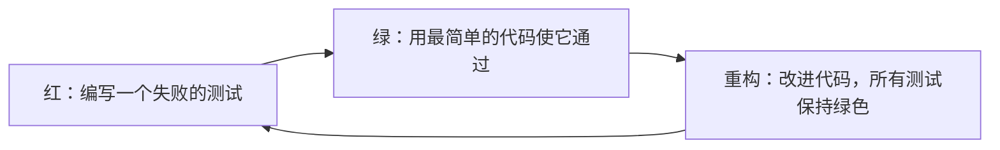

上一章（[4.14.11](/4.14.11)）讨论了如何选择**测试用例**。本章讨论如何在系统的各个层次上反复运行它们。手工运行的测试很少被运行；写成代码的测试则在每次修改时运行，只需几秒，使测试从项目末尾的一个阶段变成持续进行的活动。我们先介绍让**单元测试**编写和运行都很廉价的框架（12.1），以及把被测单元与其依赖隔离开的测试替身（12.2），再介绍先写测试的测试驱动开发（12.3）。本章其余部分沿测试的层次逐级上升：检查各单元能否协同工作的集成测试（12.4）；系统测试，包括性能与负载等非功能测试（12.5）；决定客户是否接受系统的验收测试（12.6）。12.7 节概述其他类型的测试（冒烟、回归、模糊、金丝雀、A/B），12.8 节说明它们如何纳入持续集成流水线，12.9 节讨论由编程智能体编写代码时的测试。示例运行于 Python 3.14、pytest 9.1 与 Hypothesis 6.170。

## 12.1. 单元测试框架

### 12.1.1. xUnit 家族

**单元测试**（[4.1.5](/4.1.5)）在隔离的条件下测试单个函数、方法和类。*xUnit* 测试框架家族正是为自动化这类程序员测试而设计的。它的目标是：让开发者用已经在用的语言编写测试，而不必另学一门测试语言；让人们无需应用程序的其余部分就能方便地测试单个函数、类和对象，也就是从内部测试软件；用一个动作运行一个或全部测试；并使运行测试的成本低到不会让程序员在每次修改后不愿运行全部已有测试。

这个家族始于 SUnit，由 Kent Beck 于 1989 年前后为 Smalltalk 编写，秉持“每个对象都应能测试自己”的精神。1997 年 Kent Beck 与 Erich Gamma 把它移植到 Java，成为 JUnit 并广为流行；此后几乎每种语言都有了仿照它的框架，统称 xUnit。例如 Python 标准库中的 `unittest`、.NET 的 NUnit 与 xUnit.net，以及 C++ 的 GoogleTest。Python 的 pytest、JavaScript 的 Jest 与 Vitest，以及 Go 的 `testing` 包保留了这些思想，但抛弃了基于类的结构。

### 12.1.2. 四阶段测试

每个自动化测试都要面对*被测系统*（system under test），简称 SUT，即被测试的单元；SUT 通常依赖其他组件，称为*被依赖组件*（depended-on component），简称 DOC，例如数据库、邮件服务器、时钟、另一个类。测试通过两类输入控制 SUT，并通过两类输出观察它：

| | 直接（经 SUT 的接口） | 间接（经 DOC） |
|---|---|---|
| 输入，即*控制点*（control point） | 调用的参数 | SUT 从 DOC 收到的值，如当前时间或查询结果 |
| 输出，即*观察点*（observation point） | 返回值、异常、SUT 的状态 | SUT 对 DOC 发出的调用，如发出的电子邮件或写入的一行数据 |

xUnit 测试分四个阶段进行（Meszaros，*xUnit Test Patterns*，2007）：

1. *Setup*（准备）：建立测试夹具，即测试所需的状态；
2. *Exercise*（执行）：与被测系统交互；
3. *Verify*（验证）：判断是否得到预期结果；
4. *Teardown*（清理）：拆除夹具，恢复原状。

同样的结构常被称为 Arrange–Act–Assert，其中清理阶段被省略不提。

**定义 12.1.1（测试夹具）** **测试夹具**是执行被测系统所必须就位的一切：作为运行测试基线的、固定且已知的 SUT 及其环境的状态，以及创建和移除这一状态的代码。例如向数据库加载一组特定的已知数据，复制一组特定的已知文件，准备输入数据，以及创建测试替身（12.2）。在 xUnit 中，*setup* 创建夹具，*teardown* 清理夹具。

要让测试可重复且稳健，很大一部分工作是保证每个测试之后都拆除夹具，并为下一个测试创建全新的夹具，使任何测试都看不到前一个测试遗留的东西。这就是 FIRST 性质中的 Independent（独立）与 Repeatable（可重复）（[4.14.11](/4.14.11)）。

### 12.1.3. unittest 与 pytest

使用 Python 内置的 `unittest` 时，测试用例是 `unittest.TestCase` 的子类；`setUp()` 在每个测试方法之前运行，`tearDown()` 在之后运行；测试方法名为 `test_…`；`assertEqual()` 等断言方法检查结果，`assertRaises()` 检查是否抛出预期的异常。给定一个小类：

```python
class InsufficientFunds(Exception):
    pass


class Account:
    def __init__(self, owner: str, balance: int = 0) -> None:
        self.owner = owner
        self.balance = balance

    def deposit(self, amount: int) -> None:
        if amount <= 0:
            raise ValueError("amount must be positive")
        self.balance += amount

    def withdraw(self, amount: int) -> None:
        if amount > self.balance:
            raise InsufficientFunds(f"balance {self.balance} < {amount}")
        self.balance -= amount
```

测试写作：

```python
import unittest

from account import Account, InsufficientFunds


class AccountTest(unittest.TestCase):
    def setUp(self):                      # runs before each test: build the fixture
        self.account = Account("alice", balance=100)

    def tearDown(self):                   # runs after each test: clean up
        self.account = None

    def test_deposit_increases_balance(self):
        self.account.deposit(50)                      # exercise
        self.assertEqual(self.account.balance, 150)   # verify

    def test_withdraw_more_than_balance_raises(self):
        with self.assertRaises(InsufficientFunds):
            self.account.withdraw(101)


if __name__ == "__main__":
    unittest.main()
```

```text
$ python -m unittest -v test_account_unittest
test_deposit_increases_balance (test_account_unittest.AccountTest.test_deposit_increases_balance) ... ok
test_withdraw_more_than_balance_raises (test_account_unittest.AccountTest.test_withdraw_more_than_balance_raises) ... ok

----------------------------------------------------------------------
Ran 2 tests in 0.000s

OK
```

pytest 是使用最广的 Python 测试框架，它去掉了样板代码：测试是名为 `test_*.py` 的文件中的普通函数，断言是普通的 `assert` 语句，fixture 是测试通过把函数名写成参数来请求的函数。它也能运行 `unittest` 测试。下面是同样的测试，增加了两个边界用例、一个参数化测试，以及用正则表达式检查异常信息的 `match` 参数：

```python
import pytest

from account import Account, InsufficientFunds


@pytest.fixture
def account():
    return Account("alice", balance=100)


def test_deposit_increases_balance(account):
    account.deposit(50)
    assert account.balance == 150


@pytest.mark.parametrize("amount", [0, -5])
def test_deposit_rejects_non_positive_amounts(account, amount):
    with pytest.raises(ValueError, match="positive"):
        account.deposit(amount)


def test_withdraw_entire_balance(account):
    account.withdraw(100)
    assert account.balance == 0


def test_withdraw_more_than_balance_raises(account):
    with pytest.raises(InsufficientFunds):
        account.withdraw(101)
```

`@pytest.mark.parametrize` 对每个参数值各运行一次测试函数，每次都是独立的测试，有自己的标识。假设 `withdraw` 中的比较被误写成 `>=`。pytest 会报告失败的测试、所在行和涉及的值，因为它改写 `assert` 语句以记录其操作数：

```text
$ pytest test_account.py
============================= test session starts ==============================
platform linux -- Python 3.14.5, pytest-9.1.1, pluggy-1.7.0
collected 5 items

test_account.py ...F.                                                    [100%]

=================================== FAILURES ===================================
_________________________ test_withdraw_entire_balance _________________________

account = <account.Account object at 0x7b34ec56e650>

    def test_withdraw_entire_balance(account):
>       account.withdraw(100)

test_account.py:23:
_ _ _ _ _ _ _ _ _ _ _ _ _ _ _ _ _ _ _ _ _ _ _ _ _ _ _ _ _ _ _ _ _ _ _ _ _ _ _ _

self = <account.Account object at 0x7b34ec56e650>, amount = 100

    def withdraw(self, amount: int) -> None:
        if amount >= self.balance:
>           raise InsufficientFunds(f"balance {self.balance} < {amount}")
E           account.InsufficientFunds: balance 100 < 100

account.py:17: InsufficientFunds
=========================== short test summary info ============================
FAILED test_account.py::test_withdraw_entire_balance - account.InsufficientFu...
========================= 1 failed, 4 passed in 0.01s ==========================
```

边界值测试（恰好取出全部余额，[4.14.11](/4.14.11)）发现了这个差一错误；而取出超过余额的测试在两种比较下都能通过。常用选项有 `-q`（安静）、`-v`（每个测试一行）、`-x`（在第一个失败处停止）、`-k expression`（运行名称匹配的测试）、`--lf`（重跑上次失败的测试）和 `--pdb`（在失败处打开调试器）。

### 12.1.4. pytest 中的 fixture

pytest 的 fixture 是用 `@pytest.fixture` 装饰的函数。测试通过把 fixture 名写成参数来获得它的值；fixture 本身可以请求其他 fixture；用 `yield` 返回值的 fixture 会把 `yield` 之后的代码当作清理代码运行，即使测试失败也是如此。fixture 的作用域说明它被创建的频率：每个测试一次（`function`，默认），或每个 `class`、`module`、`package`、`session` 一次。由多个测试文件共享的 fixture 放在名为 `conftest.py` 的文件里。下面为每个测试创建一个全新的内存 SQLite 数据库，而模式（schema）在每个会话中只计算一次：

```python
# conftest.py
import sqlite3

import pytest

SCHEMA = "CREATE TABLE users (id INTEGER PRIMARY KEY, name TEXT UNIQUE NOT NULL)"


@pytest.fixture(scope="session")
def schema():
    return SCHEMA


@pytest.fixture
def db(schema):
    conn = sqlite3.connect(":memory:")   # set up a fresh database for each test
    conn.execute(schema)
    conn.execute("INSERT INTO users (name) VALUES ('alice')")
    yield conn                           # the test runs here
    conn.close()                         # tear down, even if the test failed
```

```python
# test_users.py
import sqlite3

import pytest


def test_insert_user(db):
    db.execute("INSERT INTO users (name) VALUES ('bob')")
    assert db.execute("SELECT COUNT(*) FROM users").fetchone()[0] == 2


def test_duplicate_name_rejected(db):
    with pytest.raises(sqlite3.IntegrityError):
        db.execute("INSERT INTO users (name) VALUES ('alice')")


def test_export(db, tmp_path):
    out = tmp_path / "users.csv"
    rows = db.execute("SELECT name FROM users").fetchall()
    out.write_text("\n".join(name for (name,) in rows))
    assert out.read_text() == "alice"
```

选项 `--setup-show` 显示每个 fixture 何时建立和拆除（`S` 表示会话作用域，`F` 表示函数作用域）：

```text
$ pytest -q --setup-show test_users.py
SETUP    S schema
        SETUP    F db (fixtures used: schema)
        test_users.py::test_insert_user (fixtures used: db, schema) .
        TEARDOWN F db
        SETUP    F db (fixtures used: schema)
        test_users.py::test_duplicate_name_rejected (fixtures used: db, schema) .
        TEARDOWN F db
SETUP    S tmp_path_factory
        SETUP    F db (fixtures used: schema)
        SETUP    F tmp_path (fixtures used: tmp_path_factory)
        test_users.py::test_export (fixtures used: db, request, schema, tmp_path, tmp_path_factory) .
        TEARDOWN F tmp_path
        TEARDOWN F db
TEARDOWN S tmp_path_factory
TEARDOWN S schema
3 passed in 0.01s
```

第一个测试插入了 `bob`，第二个测试看到的却只有 `alice`：每个测试都有自己的数据库。pytest 有许多内置 fixture：`tmp_path` 为每个测试提供一个全新的临时目录；`monkeypatch` 临时替换属性、字典项和环境变量，并在事后恢复；`capsys` 捕获标准输出；等等。作用域宽的 fixture（每个会话启动一次的数据库服务器）能节省时间，但测试会因此共享它的状态，这些状态必须在测试之间重置，例如让每个测试在一个最后回滚的事务中运行。

## 12.2. 测试替身

### 12.2.1. 为什么需要测试替身

当被测单元依赖的组件无法在测试中使用时，如何测试这个单元？DOC 可能尚不存在；它可能无法产生测试所需的结果（支付服务返回的错误、一天中的某个特定时刻）；执行它可能带来不希望的副作用（真的发送电子邮件、真的扣信用卡）或者很慢（网络服务）。

**定义 12.2.1（测试替身）** **测试替身**是对被测系统所依赖组件的、专用于测试的替代品。它不必与真实的 DOC 行为完全一致，只需提供相同的接口，使 SUT 无法分辨二者。

这个名称来自电影业的特技替身（Meszaros）。只有 SUT 允许时才能换入测试替身：通过对协作对象的**依赖注入**（10.8.2，[4.14.10](/4.14.10)）、通过工厂，或者在动态语言中，通过在 SUT 查找依赖的位置给模块打补丁。

### 12.2.2. 测试替身的种类

| 种类 | 用途 | 例子 |
|---|---|---|
| *哑对象*（dummy object） | 被传来传去但从不真正使用，只用来填满参数列表 | 为被测路径忽略的参数传入 `None` 或一个空对象 |
| *测试桩*（test stub） | 提供 SUT 的间接输入，使测试对这些输入有控制点 | 始终返回 08:00 的时钟；始终拒绝付款的支付网关 |
| *测试间谍*（test spy） | 捕获 SUT 的间接输出，即它发出的调用，供测试日后验证 | 记录每条消息而不真正发送的邮件发送器 |
| *模拟对象*（mock object） | 用一个验证自己是否被正确使用的对象替换 DOC：它持有对预期收到的调用的说明，否则使测试失败 | 断言自己恰好被以正确地址调用一次的邮件发送器 |
| *伪对象*（fake object） | 有可工作的实现，但走了捷径，不适合用于生产 | 用内存中的散列表代替数据库；内存文件系统 |

测试桩和伪对象控制进入 SUT 的东西；测试间谍和模拟对象观察 SUT 输出的东西。测试间谍与模拟对象的区别在于验证发生在哪里：测试在执行阶段之后检查测试间谍，而模拟对象（在有些框架中）预先被告知期望，并自己检查它们。

### 12.2.3. Python 中的测试替身

10.8.2（[4.14.10](/4.14.10)）中的类 `DailyReport` 通过构造函数接收一个 `Clock` 和一个 `Mailer`：

```python
class DailyReport:
    def __init__(self, clock: Clock, mailer: Mailer) -> None:
        self.clock = clock
        self.mailer = mailer

    def send_to(self, manager: str) -> None:
        today = self.clock.now().date()
        self.mailer.send(manager, f"Sales report for {today}")
```

手写的测试桩和测试间谍，以及标准库 `unittest.mock` 中的模拟对象：

```python
from datetime import datetime
from unittest.mock import Mock

from report import DailyReport, Mailer


class FixedClock:                          # stub: controls an indirect input
    def __init__(self, moment):
        self.moment = moment

    def now(self):
        return self.moment


class RecordingMailer:                     # spy: records indirect outputs
    def __init__(self):
        self.sent = []

    def send(self, to, body):
        self.sent.append((to, body))


def test_report_with_stub_and_spy():
    mailer = RecordingMailer()
    report = DailyReport(FixedClock(datetime(2026, 10, 21, 8, 0)), mailer)
    report.send_to("li@example.com")
    assert mailer.sent == [("li@example.com", "Sales report for 2026-10-21")]


def test_report_with_mock():
    mailer = Mock(spec=Mailer)             # mock: verifies the expected call
    report = DailyReport(FixedClock(datetime(2026, 10, 21, 8, 0)), mailer)
    report.send_to("li@example.com")
    mailer.send.assert_called_once_with("li@example.com", "Sales report for 2026-10-21")
```

`Mock` 接受任何调用并记录下来；`spec=Mailer` 把它限制为 `Mailer` 的方法，因此拼错的方法名会失败而不是悄悄通过。如果报告文本改变，模拟对象的验证会报告差异：

```text
E           AssertionError: expected call not found.
E           Expected: send('li@example.com', 'Sales report for 2026-10-21')
E             Actual: send('li@example.com', 'Report 2026-10-21')
...
FAILED test_report.py::test_report_with_mock - AssertionError: expected call ...
1 failed in 0.04s
```

当依赖不是被注入而是被导入时，`unittest.mock.patch` 或 pytest 的 `monkeypatch` 会在 SUT 查找它的位置替换它，例如 `monkeypatch.setattr("report.send_email", fake_send)`。打补丁很方便，但会使测试与 SUT 的内部结构耦合；注入依赖通常是更干净的设计。

测试替身是有代价的。一个把一切都模拟掉的测试，只能检查 SUT 发出了测试作者预期的调用，而不能说明系统能工作：如果真实 DOC 的行为与替身不同，所有单元测试都通过，系统却会失败。很长的模拟链（`mock.a.return_value.b.return_value.c`）说明违反了**迪米特法则**（10.8.2）。通常的建议是：在真实对象又快又确定的地方使用真实对象，对数据库之类缓慢的基础设施使用伪对象，对不受自己控制的组件（第三方服务、时钟、随机性）使用测试桩和模拟对象，并用集成测试（12.4）覆盖真实的交互。

## 12.3. 测试驱动开发

### 12.3.1. 循环

**定义 12.3.1（测试驱动开发）** **测试驱动开发**（TDD）是这样一种开发实践：每个功能的小增量之前，都先有一个说明它的自动化测试，并按一个短小的循环反复进行：编写一个会失败的测试（*红*）；编写使它通过的最简单代码（*绿*）；然后在保持所有测试通过的前提下改进代码的结构（*重构*）。它由 Kent Beck 作为极限编程的一部分推广开来（*Test-Driven Development: By Example*，2002）。



- 红阶段。每个新功能都从编写测试开始。这使开发者在写代码之前先专注于需求，即代码应该做什么、将如何被调用；测试描述的是“你希望拥有的代码”。看到测试失败也是对测试本身的检查：在功能存在之前就通过的测试什么也没有测试。
- 绿阶段。实现使测试通过的代码。目标是找到一个解，暂时不必在意优雅或效率。
- 重构阶段。把代码从为通过测试而方便放置的位置移到它在逻辑上应在的位置，消除重复，改进实现（**重构**，定义 10.7.1）；测试使每一步都是安全的。

Robert C. Martin 把这套纪律概括为三条定律：

1. 除非是为了使一个失败的单元测试通过，否则不允许编写任何生产代码。
2. 单元测试只允许写到刚好失败为止；编译失败也算失败。
3. 生产代码只允许写到刚好使这一个失败的单元测试通过为止。

第一条定律强制先写测试；第二、三条限制多余的测试代码与生产代码，使一个循环只需几分钟。TDD 的副产品是一套回归测试，覆盖所有被有意实现的行为。在团队项目中实践过它的学生反映，一开始很难，但会越来越容易；它让缺陷和回归很快被发现、容易修复，也帮助他们整理思路和代码；最常见的遗憾是没有早点坚持下来。对 TDD 的对照研究显示它对生产率的影响不一，通常缺陷更少；大部分好处似乎来自短循环以及有测试这件事本身，无论测试写在代码之前还是之后。

### 12.3.2. 一次完整的过程

我们开发一个函数 `parse_duration`，把 `"1h30m"` 之类的字符串转换成秒数。第一个测试：

```python
from duration import parse_duration


def test_minutes():
    assert parse_duration("45m") == 45 * 60
```

红：模块尚不存在，按第二条定律，这算作失败。

```text
$ pytest -q --tb=line test_duration.py
    from duration import parse_duration
E   ModuleNotFoundError: No module named 'duration'
=========================== short test summary info ============================
ERROR test_duration.py
1 error in 0.05s
```

绿，用能通过的最简单代码：

```python
def parse_duration(text):
    return int(text[:-1]) * 60
```

```text
$ pytest -q test_duration.py
1 passed in 0.00s
```

下一个测试 `assert parse_duration("2h") == 2 * 3600` 失败，报错 `assert 120 == (2 * 3600)`；加上对后缀 `h` 的检查就能使它通过。第三个测试 `assert parse_duration("1h30m") == 90 * 60` 失败，报错 `ValueError: invalid literal for int() with base 10: '1h30'`，这说明特例已经到了极限。现在设计得以一般化，新代码通过了全部三个测试：

```python
import re

UNIT_SECONDS = {"h": 3600, "m": 60, "s": 1}
TOKEN = re.compile(r"(\d+)([hms])")


def parse_duration(text: str) -> int:
    """Convert a duration such as '1h30m' or '45s' to seconds."""
    return sum(int(n) * UNIT_SECONDS[unit] for n, unit in TOKEN.findall(text))
```

规格还要求拒绝格式错误的输入。一个参数化测试列出了无效输入，选择方法同 [4.14.11](/4.14.11)：空串、缺少单位、未知单位、单位在数字之前、内嵌空格。

```python
@pytest.mark.parametrize("text", ["", "90", "1x", "h1", "1h 30m"])
def test_invalid_input_rejected(text):
    with pytest.raises(ValueError):
        parse_duration(text)
```

```text
$ pytest -q --tb=no test_duration.py
=========================== short test summary info ============================
FAILED test_duration.py::test_invalid_input_rejected[] - Failed: DID NOT RAIS...
FAILED test_duration.py::test_invalid_input_rejected[90] - Failed: DID NOT RA...
FAILED test_duration.py::test_invalid_input_rejected[1x] - Failed: DID NOT RA...
FAILED test_duration.py::test_invalid_input_rejected[h1] - Failed: DID NOT RA...
FAILED test_duration.py::test_invalid_input_rejected[1h 30m] - Failed: DID NO...
5 failed, 3 passed in 0.01s
```

`findall` 悄悄跳过它不认识的部分。把整个字符串与该格式的文法匹配就能修复这五个失败：

```python
import re

UNIT_SECONDS = {"h": 3600, "m": 60, "s": 1}
DURATION = re.compile(r"(?:(\d+)h)?(?:(\d+)m)?(?:(\d+)s)?")


def parse_duration(text: str) -> int:
    """Convert a duration such as '1h30m' or '45s' to seconds."""
    match = DURATION.fullmatch(text)
    if not text or match is None:
        raise ValueError(f"invalid duration: {text!r}")
    hours, minutes, seconds = (int(g) if g else 0 for g in match.groups())
    return hours * 3600 + minutes * 60 + seconds
```

```text
$ pytest -q test_duration.py
8 passed in 0.01s
```

在重构阶段，`UNIT_SECONDS` 已不再使用，将其删除；八个测试仍然通过。每个循环花一两分钟，而在任何时刻，代码都只有一个需要修改的理由：那一个失败的测试。

## 12.4. 集成测试

### 12.4.1. 为什么各自能工作的单元合在一起会失败

“如果它们单独都能工作，你为什么怀疑把它们放在一起就不行？”问题出在接口上。一个模块可能对另一个模块产生意外影响；子功能组合起来可能得不到预期的主功能；单个单元中可以接受的不精确，可能被放大到不可接受的程度；全局数据结构可能造成干扰；数据也可能在跨越接口时丢失或被误解。

**例 12.4.1（火星气候轨道器）** 1999 年 9 月 23 日，NASA 在火星气候轨道器进入火星轨道时失去了这艘价值约 1.25 亿美元的航天器。Lockheed Martin 提供的地面软件以磅力秒（pound-force second）为单位报告推进器点火的冲量，而 NASA 喷气推进实验室的导航软件按接口规格预期的是牛顿秒；由于 1 磅力秒约等于 4.45 牛顿秒，冲量被低估了这一倍数。据此算出的轨道修正使航天器比计划近得多地接近火星，最终在大气层中被毁。每一块软件都按开发者的意图工作；故障出在两者之间的接口上，没有任何端到端测试比对过两个团队的数据。

**定义 12.4.1（集成测试）** **集成测试**是把软件组件、硬件组件或二者组合起来并加以测试，以评估它们之间相互作用的测试（IEEE Std 610.12）。

### 12.4.2. 集成策略

在*大爆炸集成*（big bang integration）中，所有组件一次性组合，系统作为一个整体接受测试。这不需要额外的测试代码，但测试失败时，通常同时出现多个故障，难以隔离，也难以追溯到各自的缺陷。*增量*集成分小步构造并测试程序，因此新出现的故障指向刚加入的组件。增量的顺序可以遵循功能分解（模块的层次）、调用图或使用场景；沿模块层次，策略有自顶向下、自底向上以及二者的结合，即三明治集成。

*自顶向下集成*（top-down integration）从高层组件开始，沿控制层次向下推进。尚未集成的组件由测试桩代替，测试桩是代表下级模块接口的测试替身。在下面的层次中，$A$ 调用 $B$、$C$ 和 $D$，$D$ 调用 $E$：

| 步骤 | 已集成并测试 | 测试桩 |
|---|---|---|
| 1 | $A$ | $s_B, s_C, s_D$ |
| 2 | $A, B$（用 $B$ 替换 $s_B$） | $s_C, s_D$ |
| 3 | $A, B, C, D$（替换 $s_C, s_D$） | 为 $D$ 的 $s_E$ |
| 4 | $A, B, C, D, E$（替换 $s_E$） | 无 |

结构可以*深度优先*展开，即先集成一条主要控制路径上的所有组件（例如先 $A$、$D$、$E$，再 $B$ 和 $C$）；也可以*广度优先*展开，即先纳入每一层所有直接下属的组件，再向下一层推进。

*自底向上集成*（bottom-up integration）从低层模块开始，沿层次向上推进。其调用者尚未集成的模块，由*测试驱动程序*（test driver）来执行；它是向模块提供测试输入并检查其输出的控制程序。在 $D$ 调用 $A$ 和 $B$、$E$ 调用 $D$ 和 $C$ 的层次中：先用驱动程序 $d_A, d_B, d_C$ 测试 $A$、$B$、$C$；再用驱动程序 $d_D$ 测试 $D$ 与 $A$、$B$，替换 $d_A$ 和 $d_B$；最后测试 $E$ 与 $D$、$C$，替换 $d_C$ 和 $d_D$。

| | 自顶向下 | 自底向上 |
|---|---|---|
| 所需测试代码 | 测试桩 | 驱动程序 |
| 优点 | 及早验证主要的控制与判定逻辑；能及早发现重大问题；可以演示早期的骨架版本 | 不需要测试桩；充分测试可运行的低层模块；适合实时系统和性能要求严格的系统，这些系统中低层模块至关重要 |
| 缺点 | 测试桩难写，因为它们必须允许测试所有相关情形；若最低层包含许多模块，可能需要很多测试桩；有些接口没有被单独测试 | 最后才测试重要的子系统和控制逻辑；需要驱动程序 |

*三明治集成*（sandwich integration），又称混合集成，把两者结合起来：上层自顶向下，下层自底向上，在中间一层会合。

在现代基于服务的系统（[4.14.6](/4.14.6)）中，同样的思想有其他形式。集成测试让一个组件对着其依赖的真实实例运行，常常在由测试自己启动的**容器**中进行（Testcontainers 库为每个测试会话在 Docker 中启动一个数据库或消息代理；容器见 [4.11.9](/4.11.9)）。*契约测试*（contract testing）无需同时部署两个服务就能检查它们之间的接口：消费者的测试把它发出的请求和预期的响应记录为契约，提供者的测试验证它履行了该契约（Pact 是常用工具）。如果火星气候轨道器接口两端的单位属于一份经过检查的契约，这一不匹配本可以在地面上发现。

## 12.5. 系统测试

### 12.5.1. 测试整个系统

*系统测试*（system testing）是对完整的、已集成的计算机系统按其需求进行测试的系统化过程。软件只是更大系统的一个要素，该系统还包括硬件、网络、数据、人员和其他软件；因此系统测试在尽可能接近生产的环境中进行，并从多个角度验证和确认系统。它区分*功能测试*（functional testing）与*非功能*（性质）测试：前者对照功能需求检查系统做什么，通常通过经由用户界面或 API 驱动系统的端到端场景进行；后者检查系统做得有多好，即性能、安全性、易用性、兼容性、可恢复性，以及 [4.14.5](/4.14.5) 中的其他**质量属性**。

### 12.5.2. 性能测试

对系统性能影响最大的因素有：硬件平台的原始能力；底层软件平台（操作系统、运行时、数据库）的成熟度；应用的设计与实现；以及第三方服务和 API。即使设计良好的软件，如果没有完整的测量、优化与调优循环，也未必能在高速硬件上实现最优的性能与伸缩；而要定量地理解一个系统的性能，就需要从里到外理解它是如何构成的。

性能测试把响应时间（常用百分位数表示，如第 95 或第 99 百分位数，而不仅仅是平均值）、**吞吐率**（每秒事务数）和资源利用率（CPU、内存、磁盘和网络）作为负载的函数来测量。一个典型的结果是吞吐率不随线程数线性增长。在一次测量中，8 个线程的吞吐率约为单线程的 4 倍，超过 8 个线程后没有明显提高。根据 **Amdahl 定律**，8 个处理器上 4 倍的加速比对应的串行比例 $s$ 满足
$$
\frac{1}{s + (1 - s)/8} = 4, \quad\text{即}\quad s = \frac{1}{7} \approx 14\%,
$$
这使加速比无论加多少线程都被限制在 $1/s = 7$ 以内；实际上，对锁、内存带宽或数据库的争用会把上限压得更低。对联机事务处理（OLTP）系统，性能测试还测量系统能支持的活跃用户数（作为用户思考时间，即用户两次操作之间的停顿的函数），以及每种用户操作的平均响应时间。

**定义 12.5.1（负载测试与压力测试）** **负载测试**考察系统在特定预期负载下的行为：在给定时间内，预期数量的并发用户执行特定数量的事务，以验证满足性能需求。**压力测试**考察系统超出预期负载时的情况，以找出其容量的上限，并确定它在极端负载下的稳健性：在哪里崩溃，以及如何失效和恢复。

| 测试 | 目标 | 负载 | 关注点 |
|---|---|---|---|
| 负载测试 | 验证在预期负载下符合需求 | 固定的、正常的预期负载 | 性能指标是否达到目标 |
| 压力测试 | 找出容量上限 | 逐渐增加到极端负载 | 瓶颈、失效点、优雅降级 |
| 浸泡（耐久）测试 | 测试长期稳定性 | 长时间（数小时或数天）持续的预期负载 | **内存泄漏**、资源耗尽、性能逐渐下降 |
| 尖峰测试 | 测试对负载突变的响应 | 突然升高和降低，如限时抢购 | 性能是否受损、系统是否失效、适应和恢复有多快 |
| 配置测试 | 找出各组件的最佳配置 | 固定负载，在不同配置之间比较 | 配置变化（如负载均衡策略或池的大小）对性能和行为的影响 |

负载由模拟大量用户的工具产生，如 JMeter、Gatling、k6 和 Locust；它们的脚本描述用户场景、虚拟用户数和加压曲线。性能测试需要专用的环境和接近生产的数据量，因为在开发者笔记本上的结果很难说明生产环境的情况。

## 12.6. 验收测试

### 12.6.1. 定义与种类

**定义 12.6.1（验收测试）** **验收测试**是针对用户需要、需求和业务流程进行的正式测试，目的是判定系统是否满足其验收标准，并使用户、客户或其他有权实体能够决定是否接受该系统。它是测试的最后一个层次，在系统测试之后、系统投入实际使用之前进行。

*功能验收测试*验证系统满足其规定的功能需求；*非功能验收测试*对照约定的标准确认其**质量属性**，如性能、安全性和易用性。此外还区分出若干种类，在有些文献中，Alpha、Beta、运行、合同、法规和业务验收测试合起来构成用户验收测试：

- *用户验收测试*（user acceptance testing），简称 UAT，也称最终用户测试，验证某个解决方案对其用户可用。它不同于系统测试：系统测试确保软件不会崩溃并满足文档化的需求，而它确保用户接受这一解决方案。它集中在用户在业务流程中实际最常用的功能上。
- *Alpha 测试*（alpha testing）在开发组织的环境中由一支专门的测试团队进行，团队成员是模拟真实用户的内部员工。其目的是在发布之前发现尽可能多的问题，做法是找出典型用户可能执行的任务并加以测试。
- *Beta 测试*（beta testing）让真实的最终用户，即 Beta 测试者，在自己的环境中使用产品。收集他们的反馈并修复发现的缺陷，这也有助于改善用户体验。
- *运行验收测试*检查运行就绪情况：备份与恢复、故障切换、监控、维护流程（[4.14.13](/4.14.13)）。*合同验收测试*与*法规验收测试*检查合同或法律法规的标准。

| 方面 | 系统测试 | 验收测试 |
|---|---|---|
| 目的 | 检查产品是否满足规定的需求 | 检查它是否满足客户的需要 |
| 执行者 | 开发者和测试人员 | 测试人员、**干系人**和客户 |
| 测试种类 | 功能与非功能 | 以功能为主，有时包括非功能 |
| 顺序 | 在验收测试之前 | 在系统测试之后 |
| 测试用例 | 正例与反例 | 主要是正例，在真实的场景中 |
| 输入 | 测试团队选择的测试数据 | 用户提供的真实数据和场景 |
| 发现的缺陷 | 预期之中，作为开发的一部分修复 | 视为产品的失败 |

### 12.6.2. 自动化的验收测试

在**敏捷开发**中，每个**用户故事**（[4.14.2](/4.14.2)）的**验收标准**都写成可以自动化的形式，自动化的验收测试像其他测试一样在 **CI** 流水线中运行。*行为驱动开发*（behavior-driven development），简称 BDD，其 Given–When–Then 形式与测试的各阶段直接对应：*given* 建立夹具，*when* 执行系统，*then* 验证结果。例 2.3.1 的第三条验收标准“给定一个没有订单的账户，当生成报告时，则报告列出该账户且收入为零”变成：

```python
from datetime import date

from sales import Order, daily_report


def test_account_without_orders_is_listed_with_zero_revenue():
    # Given an account without orders
    accounts = ["ACME", "Globex"]
    orders = [Order("ACME", date(2026, 10, 20), 1200)]
    # When the report is generated
    report = daily_report(accounts, orders, day=date(2026, 10, 20))
    # Then it lists the account with zero revenue
    assert report["Globex"] == 0
    assert report["ACME"] == 1200
```

```text
$ pytest -q
1 passed in 0.00s
```

Cucumber、behave 和 pytest-bdd 等 BDD 工具更进一步：场景写在用自然语言写的特性文件中（Gherkin 语言），客户可以阅读和评审，每一行 `Given`、`When` 和 `Then` 都绑定到代码中的一个步骤函数。Web 应用的端到端验收测试用 Playwright 或 Selenium 等工具驱动真实的浏览器。自动化的验收测试不能取代 UAT：前者验证约定的标准成立，而 UAT 确认这些标准本身是否正确。

## 12.7. 其他类型的测试

### 12.7.1. 基准测试

基准测试（benchmark）是运行一个程序、一组程序或其他操作，以评估某个对象的相对性能的行为，通常通过对它运行一批标准测试和试验来进行；这个词也指这些标准程序本身。两个 1988 年成立的组织维护着最知名的基准：标准性能评估公司（SPEC），它是一个伞形组织，下设开放系统（SPEC CPU 等）、高性能计算、图形与工作站以及研究方面的小组，发布性能、性价比和能效方面的结果；以及事务处理性能委员会（TPC），它定义事务处理和数据库基准，如 TPC-C 和 TPC-H。在项目内部，对关键函数的微基准测试（使用 pytest-benchmark 或 Google Benchmark 等工具）会定期运行，以发现性能回归。

### 12.7.2. 冒烟测试与回归测试

*冒烟测试*（smoke testing）是一种初步测试，用来揭示严重到足以拒绝候选构建或发布的失败。冒烟测试是一小部分测试用例，覆盖组件或系统最重要的功能，用来检查主要功能看起来是否能工作：程序能不能启动，用户界面能不能打开，点击主按钮有没有反应。其目的是判断应用是否已经坏到继续测试毫无意义。带冒烟测试的每日构建是业界长期的做法；在部署流水线中，冒烟测试在每次部署之后立即运行。

**定义 12.7.1（回归测试）** **回归测试**是在修改软件之后重新运行已有的测试，以确保这一修改没有给原先能工作的部分引入故障（即*回归*）。

任何改动都可能引起回归：新功能、对现有功能的更改、缺陷修复、性能改进以及组件的集成。自动化的测试套件使完整的回归测试变得廉价，CI 在每次改动时都运行它们。当完整的套件太慢时，要对回归测试进行选择和排序：

| 优先级 | 测试用例 |
|---|---|
| 高 | 软件的关键功能、用户高度可见的区域、易出缺陷的区域，以及经历过许多改动的区域 |
| 中 | 异常情形（反例测试、边界值测试），尤其是在以前的版本中屡次检出缺陷的测试用例 |
| 低 | 其余功能，在重大发布之前运行以确保完整覆盖 |

每个被修复的缺陷都应留下一个重现它的回归测试，并在修复之前写好（12.3 的红阶段），使同样的缺陷无法悄悄重现。

### 12.7.3. 模糊测试与基于属性的测试

**定义 12.7.2（模糊测试）** **模糊测试**（fuzz testing）是一种自动化测试技术，它向程序提供无效的、非预期的或随机的数据作为输入，并监视程序的异常，如崩溃、内置断言失败或内存泄漏。

威斯康星大学的 Barton Miller 于 1988 年在一个课程项目中提出了这一想法，其中随机输入使所测试的 Unix 实用程序有四分之一到三分之一崩溃或挂起。模糊测试有时被等同于猴子测试（monkey testing）；也有人区分二者，认为模糊测试强调随机的输入数据，猴子测试强调随机的用户操作。有效的模糊测试器生成半有效的输入：足够有效，不会被解析器立即拒绝，从而深入程序内部；又足够无效，能暴露没有被妥善处理的边角情形。现代的*覆盖率引导*模糊测试器，如 AFL++ 和 libFuzzer，对输入进行变异并保留能到达新代码的输入；Google 的 OSS-Fuzz 在一千多个开源项目上持续运行它们，已发现数万个缺陷，其中许多是安全漏洞。

*基于属性的测试*（property-based testing），其代表是 QuickCheck（Claessen 与 Hughes，2000）把这一想法带到单元测试中：测试不再给出个别示例，而是陈述一条对所有输入都必须成立的性质，由框架生成大量输入，设法证伪该性质，成功时再把失败的输入收缩（shrink）为最小的输入。Python 的 Hypothesis 是标准的实现。假设我们给 `parse_duration`（12.3.2）添加它的逆函数 `format_duration`，它把 `5400` 写成 `"1h30m"`，并省略为零的部分。一个自然的性质是：解析能还原格式化的结果：

```python
from hypothesis import given
from hypothesis import strategies as st

from duration import format_duration, parse_duration


@given(st.integers(min_value=0, max_value=10**6))
def test_parse_inverts_format(seconds):
    assert parse_duration(format_duration(seconds)) == seconds
```

```text
$ pytest -q test_roundtrip.py
...
E           ValueError: invalid duration: ''
E           Failing test case: test_parse_inverts_format(
E               seconds=0,
E           )
...
FAILED test_roundtrip.py::test_parse_inverts_format - ValueError: invalid dur...
1 failed in 0.13s
```

Hypothesis 在不到一秒的时间里发现 `format_duration(0)` 返回空串，而 `parse_duration` 理应拒绝空串；格式化函数的规格必须说明零是什么样子（`"0s"`）。Hypothesis 会刻意尝试 0 之类的边界值。但随机生成不能代替测试设计：把 [4.14.11](/4.14.11) 中有缺陷的 NextDate 与 Python 的 `datetime` 在 1812 年到 2020 年的 100 个随机日期上比较，这样的性质测试通过了，因为唯一失败的日期 1900 年 2 月 28 日只是约 76 000 个日期中的一个。性质与生成器扩大了搜索范围，边界分析则给搜索指明方向。

### 12.7.4. 生产环境中的测试

有些问题只有用真实用户和真实流量才能回答。有两种技术使这样做是安全的。

**定义 12.7.3（金丝雀发布）** **金丝雀发布**降低了在生产环境中引入新软件版本的风险：先把改动推出给一小部分用户或服务器，对其监控，之后才推出到整个基础设施；如果金丝雀出现问题，就在大多数用户受影响之前回滚这一改动。

这个名称来自煤矿工人带入矿井的金丝雀，用作一氧化碳等有毒气体的早期预警：鸟更敏感，会先于矿工生病，矿工因此有机会逃生。金丝雀发布依赖监控，把金丝雀的错误率和延迟与其余机群比较（[4.14.13](/4.14.13)）。

**定义 12.7.4（A/B 测试）** **A/B 测试**是一种受控实验，用来判断所提议的改动是否比现有做法更有效：用户被随机分配到两个版本（A 和 B），两者除了一个可能影响其行为的变化之外完全相同，并在两组之间比较转化率或参与度等指标。

A/B 测试能回答任何测试套件都无法回答的用户参与度和满意度问题，但它们是实验，需要照常讲究统计上的谨慎：样本量事先确定，而反复查看结果、一旦差异看起来显著就停止，会抬高假阳性率。

## 12.8. 持续集成中的测试

**持续集成**（[4.14.3](/4.14.3)）是自动化测试发挥价值的地方：每次推送和**拉取请求**都触发一条构建系统并运行测试的流水线，失败会阻止合并。流水线按速度和范围组织，遵循测试金字塔：

| 阶段 | 时机 | 测试 | 时长 |
|---|---|---|---|
| 本地与提交前 | 每次提交之前 | 格式化工具、**代码检查工具**、被改动代码的快速单元测试 | 几秒 |
| 拉取请求 | 每次推送 | 全部单元测试、带容器的集成测试、静态分析、覆盖率 | 几分钟 |
| 主分支，合并之后 | 每次合并 | 上述各项，加上端到端测试和验收测试，然后部署到预发布环境并做冒烟测试 | 几十分钟 |
| 定时 | 每晚或每周 | 长时间的性能、浸泡和模糊测试，依赖与安全扫描 | 数小时 |

pytest 用标记（marker）支持这种组织方式。自 pytest 9 起，配置可以写成原生的 TOML 表：

```toml
# pyproject.toml
[tool.pytest]
testpaths = ["tests"]
addopts = ["--strict-markers", "--durations=5"]
markers = [
    "slow: tests that take more than a second",
    "integration: tests that need external services",
]
```

测试用 `@pytest.mark.slow` 标记；拉取请求阶段运行 `pytest -m "not slow and not integration"`，`--strict-markers` 把拼错的标记变成错误，而不是一个悄悄未被选中的测试。`--durations=5` 列出最慢的 5 个测试，使慢测试在拖慢所有人之前就被注意到。pytest-xdist 等插件（`pytest -n auto`）可在所有核上并行运行测试。

有两个问题会损害 **CI** 中的测试套件。*不稳定测试*（flaky test）是在同一份代码上有时通过有时失败的测试，通常是因为它依赖时序、顺序、共享状态、随机性或网络。不稳定测试会让团队学会无视红色构建，因此必须立即修复或隔离，绝不能反复重跑直到变绿。另外，慢的套件运行得更少：保持单元测试快速（FIRST 中的 F）是一项要求，不是奢侈。

## 12.9. 智能体编写代码时的测试

对**编程智能体**（[4.2.14](/4.2.14)）来说，测试套件是最重要的反馈来源：智能体可以在每次修改之后运行它，并修复自己的错误，这使测试成为智能体所写代码的护栏（[4.14.4](/4.14.4) 展示了把**验收标准**变成这样一个测试）。这抬高了本章所讲各项性质的重要性。

- 快速、确定的测试。智能体每个任务要多次运行测试；需要几分钟或随机失败的套件会浪费它的精力，并教它无视失败。选出相关快速子集的标记，以及运行它的有文档的命令，应写进智能体阅读的项目说明里。
- 先写测试，遵循 **TDD** 的节奏。先要求智能体写出重现缺陷或说明功能的失败测试，并在实现之前评审这个测试，这给人提供了一个廉价的检查点：测试用代码说明了智能体对任务的理解。在改动之前就已通过的测试什么也没有测试。
- 保护测试。无法让测试通过的智能体，可能像匆忙的人一样受到诱惑：削弱断言、把测试标为跳过、把被测代码模拟掉，或者对测试输入做特殊处理。指令应当禁止未经批准修改已有测试，评审者应格外仔细地阅读对测试文件和 fixture 的改动。
- 在套件中保留真实的交互。由编写代码的同一个智能体写出的模拟对象，把它对依赖的假设重复编码了两次；对容器中真实数据库的集成测试、契约测试和端到端测试，则把这些假设拿去对照现实。
- 让 CI 说了算。智能体自己报告测试通过只是一种说法；对已推送提交运行的流水线才是证据。

[4.14.14](/4.14.14) 把这些做法放进了与智能体协作进行工程的一般工作流程中。

## 小结

- xUnit 框架分四个阶段自动化单元测试：setup、exercise、verify、teardown。pytest 使用普通函数和 `assert`、参数化，以及带作用域和基于 `yield` 的清理的 fixture；每个测试一个全新的 fixture 使测试保持独立。
- 测试替身代替被依赖组件：哑对象填充参数，测试桩提供间接输入，测试间谍记录间接输出，模拟对象验证预期的调用，伪对象是简化的可工作实现。注入依赖使替身成为可能，能真实测试的就不要模拟。
- TDD 在几分钟内重复红、绿、重构；它的三条定律只允许为使失败的测试通过而写生产代码。
- 集成测试检查接口：大爆炸，或增量的自顶向下（测试桩）、自底向上（驱动程序）与三明治；如今还有容器和契约测试。
- 系统测试从功能和非功能两方面检查整个系统：负载、压力、浸泡、尖峰和配置测试衡量性能与稳健性。
- 验收测试决定客户是否接受系统：UAT、Alpha 与 Beta 测试；Given–When–Then 的标准变成自动化的验收测试。
- 冒烟测试检查构建是否值得测试；回归测试保护原先能工作的部分；模糊测试和基于属性的测试搜索巨大的输入空间；金丝雀发布和 A/B 测试在生产环境中测试。
- CI 按速度分阶段运行测试；不稳定的测试和慢测试必须立即修复。对编程智能体来说，快速且受保护的测试是护栏，CI 是最终裁决者。
