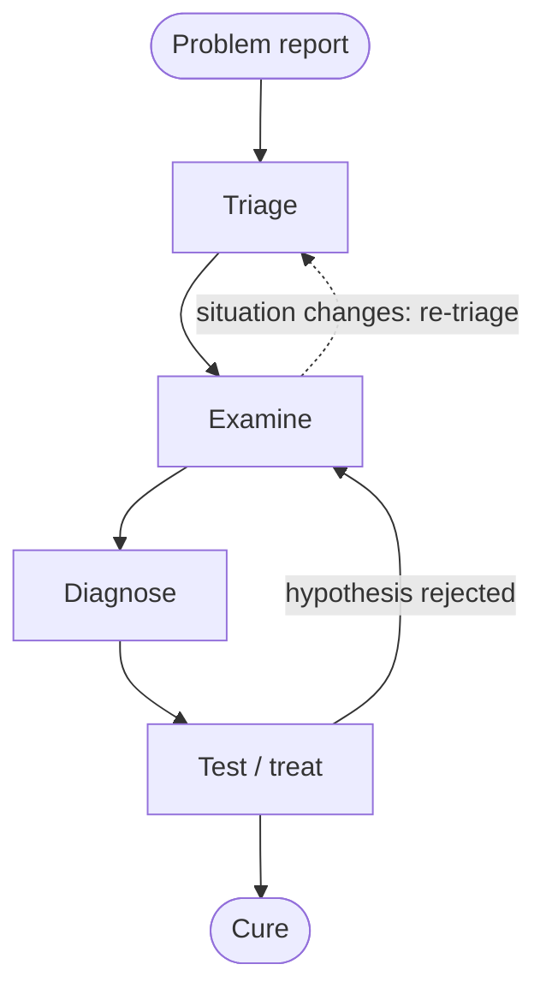
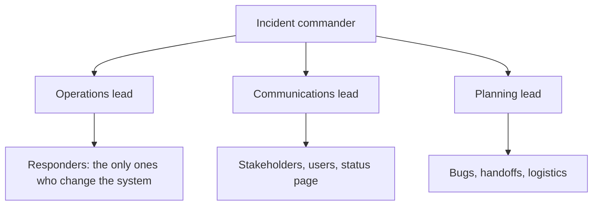

A service spends most of its life in production. Requirements, design, implementation and testing ([4.14.4](/4.14.4)–[4.14.12](/4.14.12)) produce a system that works on the day of its release; operations keep it working for years while its code, its configuration, its load and the machines under it all change. This chapter treats operations as an engineering discipline. It follows the approach of *site reliability engineering* (SRE) as described by Google's engineers in Beyer et al., *Site Reliability Engineering: How Google Runs Production Systems* (2016), the main reference of the chapter. The first part explains why operations need engineering at all and what SRE is; the second gives the principles: embracing risk, service level objectives and error budgets, eliminating toil, and monitoring; the third covers practice: alerting, on-call, troubleshooting, incident management and postmortems, and the safe release of changes. **DevOps** and the practices of **continuous integration**, **continuous delivery** and **continuous deployment**, introduced in [4.14.2](/4.14.2#sec-2.4.2) and [4.14.3](/4.14.3#sec-3.8), are the background: they bring changes to production quickly, and this chapter is about keeping production healthy while they do. Containers ([4.11.9](/4.11.9)) and clusters ([4.11.11](/4.11.11)) are the platform on which the services run.

## 13.1. Software Operations and SRE

### 13.1.1. Why Operations Matter

As [4.14.1](/4.14.1#sec-1.2) showed, **software maintenance** dominates the cost of software: by Glass's "60/60 rule", about 60% of the life-cycle cost is maintenance. The SRE book puts the share of a system's total cost incurred after its "birth" at 40% to 90%, and compares software with children: the labor before the birth is painful and difficult, but the labor after the birth is where most of the effort goes. For an Internet service, much of this later effort is operation: deploying new versions, watching the service, responding to failures and planning capacity.

The stakes are high because whole industries (finance, telecommunications, energy, manufacturing, government) now run on online services. Two well-documented outages illustrate the scale:

| Date | Service | What happened | Effect |
|---|---|---|---|
| 14 December 2020 | Google | an automated quota system reduced the storage quota of the central user-identity service, so authentication failed | Gmail, Calendar, YouTube and most other services requiring sign-in failed worldwide for about 45 minutes |
| 8 November 2023 | ChatGPT and the OpenAI API | abnormal traffic overloaded the service | both were down or degraded for about two hours, declared a major outage |

Operating such systems is hard for four reasons. Users expect ever better experience; the systems are large, complex, distributed across many protocol layers and constantly evolving; they must survive a stream of hardware and software failures, bugs, changes, traffic shifts and attacks; and operators must analyze huge volumes of monitoring data in real time to make fast and correct decisions. The raw signals (alerts from many components, key performance indicators, logs, traces, the dependency graph of applications and the physical network) have a low signal-to-noise ratio, are incomplete, and show the trees rather than the forest; a human must fuse them. Operations have accordingly evolved from human-driven work, through automation with human decisions (the subject of this chapter), toward systems that heal themselves, roll out changes unattended and scale automatically, with machine-learning methods (often called AIOps) taking over more of the decisions.

### 13.1.2. The Sysadmin Model and Its Costs

Traditionally, operations (Ops) was a separate job from development (Dev), with a different skill set. A team of system administrators assembled existing software components, deployed them to produce a service, and ran it, responding to events and updates as they occurred. The team was responsible for availability, latency, performance, efficiency, change management, monitoring, emergency response and capacity planning.

This model has two kinds of cost:

- Direct cost: the size of the team grows linearly with the size of the service, because each new machine and each new event needs human attention. A rule of thumb of one operator per 100 servers means 500 operators for 50,000 servers. Failures are routine at this scale: if 20% of servers fail each year, a fleet of 50,000 sees $50\,000 \times 0.2 / 365 \approx 27$ server failures per day.
- Indirect cost, which is larger: developers and operators differ in background, skills, incentives, vocabulary, assumptions about risk and stability, and goals, and communication and trust between the two groups suffer.

The deepest conflict is about change. Most outages are caused by some kind of change: a new configuration, a new feature launch, a new type of traffic. Developers want to launch anything at any time without hindrance; operators, judged by stability, want nothing to change once the system works. Each side then defends its goal with procedure (launch reviews, change freezes) or with workarounds (splitting a launch into many "small" changes), and the organization pays for the friction.

### 13.1.3. Site Reliability Engineering

**Definition 13.1.1 (Site Reliability Engineering)** **Site reliability engineering** (SRE) is an approach to running production services in which software engineers design and carry out the operations function: they automate the work that operators would otherwise do by hand, are responsible for the reliability of the services they run, and spend a bounded share of their time on operational work so that the rest goes to engineering that makes the services more reliable and easier to run.

In the words of Ben Treynor Sloss, who founded Google's SRE team in 2003, SRE "is what happens when you ask a software engineer to design an operations function." Google hires mostly ordinary software engineers, with additional Unix and networking skills, and gives them the goal of making the service run and repair itself. The key organizational rule is a cap: at most 50% of an SRE team's aggregate time may go to "ops" work (tickets, on-call, manual tasks). When operational load exceeds the cap, the excess is sent back to the development team, which keeps both teams motivated to automate. Because work that grows with the service is automated away, the SRE team grows sublinearly with the service.

SREs run *services*: sets of related systems operated for users, internal or external, and they are ultimately responsible for the health of these services. This involves developing monitoring, planning capacity, responding to incidents, making sure that the root causes of outages are fixed, and more.

SRE and **DevOps** ([4.14.2](/4.14.2#sec-2.4.2)) arose independently and share their main ideas: shared ownership of production between developers and operators, automation, small and frequent changes, and measurement. DevOps is a broad set of principles and cultural values; SRE is one concrete way of implementing them, with specific practices (service level objectives, error budgets, the cap on toil, blameless postmortems). Google's *Site Reliability Workbook* (2018) summarizes the relation with a programmer's joke: "class SRE implements interface DevOps".

### 13.1.4. Tenets of SRE

| Tenet | Practice |
|---|---|
| a durable focus on engineering | at most 50% of time on ops work; at most two events per 8–12-hour on-call shift, so that each gets a thorough response; a postmortem for every significant incident |
| maximum change velocity without violating the service's SLO | the business sets a non-100% availability target; the remaining error budget is spent on launches, so an outage is an expected part of innovation rather than a "bad" event (§13.2) |
| monitoring | software interprets the signals and notifies humans only when they must act; outputs in order of urgency: alerts (act now), tickets (act within days), logging (for information only) |
| emergency response | reliability depends on mean time to failure and mean time to repair; humans add latency, so automate what can be automated; playbooks for on-call engineers gave about a threefold improvement in MTTR over improvising; "Disaster Role Playing" trains for incidents |
| change management | roughly 70% of outages are due to changes in a live system; remove humans from the loop with progressive rollouts, fast and accurate detection of problems, and safe rollback (§13.10) |
| demand forecasting and capacity planning | an accurate forecast of organic demand that extends beyond the lead time of acquiring capacity; the inclusion of inorganic demand (launches, marketing campaigns); regular load tests that relate raw capacity (servers, disks) to service capacity |
| provisioning | adding capacity combines change management and capacity planning, and must be quick and correct |
| efficiency and performance | resource use determines cost, and the response time of a service must be monitored and maintained; SREs provision to meet a target response speed at minimum cost |

## 13.2. Embracing Risk and Service Level Objectives

### 13.2.1. Embracing Risk

One might think that a service should be as reliable as possible. It should not. The cost of reliability grows very fast as reliability increases: each additional "nine" needs more redundant machines and, more importantly, more opportunity cost, because engineers who harden the system do not build features. Meanwhile, users typically cannot tell the difference between high and extreme reliability of a service, because the path between them and the service (their phone, Wi-Fi, mobile network) is itself much less reliable. SRE therefore manages reliability by managing risk: it chooses a target that balances the risk of unavailability against the goals of rapid innovation and efficient operation, aims to meet it, and aims not to exceed it by much.

To manage risk one must measure it. The **availability** of a system ([4.14.5](/4.14.5#def-5.2.6)) can be measured in two ways:

$$
\text{time-based availability} = \frac{\text{uptime}}{\text{uptime} + \text{downtime}}, \qquad
\text{aggregate availability} = \frac{\text{successful requests}}{\text{total requests}}.
$$

Time-based availability suits a single machine that is either up or down. A globally distributed service is rarely completely up or down: some requests fail somewhere almost all the time. Google therefore measures aggregate (request-based) availability, which also handles services without requests (a batch pipeline can count successfully processed records) and weights each failure by how many users it affects. The table of allowed downtime for each number of nines is given in [4.14.5](/4.14.5#def-5.2.6): 99.9% allows 43.2 minutes per 30 days, 99.99% only 4.3 minutes.

The target depends on what users expect and on what an improvement is worth. Paid services, services tied to revenue, enterprise services and services with strong competitors need higher targets. Google set 99.99% for Gmail, Calendar and Docs, but for YouTube, at the time of its acquisition, rapid feature development mattered more and the target was lower. A simple economic test decides whether to raise a target.

**Example 13.2.1** A service earns 1 million US dollars per year, and its availability target is 99.9%. Raising the target to 99.99% would make 0.09% more of its requests succeed, so the improvement is worth at most

$$
1\,000\,000 \times 0.0009 = 900 \text{ dollars per year}.
$$

If the extra replicas, engineering time and slower releases needed for the fourth nine cost more than 900 dollars per year, the improvement is not worth making.

Availability is not the only dimension of risk. The two Google advertising systems of the SRE book differ in latency requirements: ads shown next to search results must not slow down the search page, while ads served on publishers' websites can tolerate more latency. Infrastructure services, which have many clients with different needs, can expose several explicit levels of service and let clients choose: a low-latency cluster provisioned with spare capacity for interactive users and a cheaper high-throughput cluster for batch users, as with Google's Bigtable deployments.

### 13.2.2. Service Level Indicators, Objectives and Agreements

**Definition 13.2.1 (Service Level Indicator)** A **service level indicator** (SLI) is a carefully defined quantitative measure of some aspect of the level of service provided, such as request latency, error rate, throughput or availability, usually aggregated over a time window as a rate, an average or a percentile.

**Definition 13.2.2 (Service Level Objective)** A **service level objective** (SLO) is a target value or range of values for a service level measured by an SLI, over a stated period: for example, "99.95% of requests succeed, measured over 28 days", or "99% of `Get` requests complete in less than 10 ms".

**Definition 13.2.3 (Service Level Agreement)** A **service level agreement** (SLA) is an explicit or implicit contract with users that includes the consequences of meeting or missing the SLOs it contains, typically financial (service credits or refunds).

The test that distinguishes an SLO from an SLA is the question "what happens if it is missed?" If nothing contractual happens, it is an SLO. An SLA's objective is usually looser than the internal SLO, so that the team reacts long before the contract is violated. Public cloud providers publish SLAs for their services; the SRE book cites 99.95% availability for Google Compute Engine.

Which indicators to choose depends on what users care about. A handful of representative indicators is enough:

| Kind of system | Typical SLIs |
|---|---|
| user-facing serving systems (web front ends, APIs) | availability, latency, throughput |
| storage systems | latency, availability, durability |
| big-data pipelines | throughput, end-to-end latency (data freshness) |
| all systems | correctness, often measured by probing with known inputs |

Indicators are collected on the server side by a monitoring system (Prometheus, Zabbix; Google's Borgmon, §13.5), by periodic log analysis, or by instrumenting clients, which sees problems the server cannot see, such as slow page rendering.

Most indicators are better summarized by percentiles than by averages (**quantiles**, in the language of probability). A latency distribution is typically skewed: most requests are fast and a few are very slow, and the slow ones are the ones users remember. An SLO on latency is therefore stated at several percentiles:

- 90% of `Get` calls complete in less than 1 ms;
- 99% of `Get` calls complete in less than 10 ms;
- 99.9% of `Get` calls complete in less than 100 ms.

Good SLOs follow a few rules. Start from what users need, not from what is easy to measure. Keep them simple, without complicated aggregations, and as few as possible: an SLO that no one can use to decide anything should be dropped. Perfection can wait: it is easier to start loose and tighten than to relax a target users rely on. Keep a safety margin between the internal SLO and any advertised SLA, and do not overachieve: if a service is much more reliable than its SLO, users come to depend on the actual level. Google's lock service Chubby was so reliable that other services began to assume it never failed; the SRE team now takes its global instance down deliberately in quarters where it would otherwise exceed its SLO, which flushes out the unjustified dependencies.

### 13.2.3. Error Budgets

**Definition 13.2.4 (Error Budget)** The **error budget** of a service for a period is the amount of unreliability its SLO permits: $1 - \text{SLO}$, expressed as a number of failed requests (or minutes of downtime) over the SLO period. It is spent by outages, by failed changes and by background errors; while budget remains, the team may release changes; when it is exhausted, releases stop except for reliability fixes until the service is back within its SLO.

The error budget turns the conflict of §13.1.2 into a shared, objective number. Product developers and SREs no longer argue about whether a release is "too risky": the SLO is agreed with the product owners, the monitoring system measures how much budget is left, and the remaining budget decides. Both sides gain an incentive to balance speed and stability: a team that wants to release often has a reason to invest in testing and gradual rollouts, which make releases cheaper in budget. Error budgets also defuse discussions about outages with stakeholders, since a planned amount of unreliability is not a failure but the price of innovation.

**Example 13.2.2** A web service handles on average 200 requests per second and has an SLO of 99.9% successful requests over 30 days. In one window it has a background error rate of 0.05% and one incident in which 25% of requests failed for 30 minutes:

```python
# Error budget of a request-based availability SLO over a 30-day window
slo = 0.999                      # 99.9% of requests succeed
rate = 200                       # average requests per second
window = 30 * 24 * 3600          # seconds in the window
total = rate * window
budget = (1 - slo) * total       # failed requests allowed

background = 0.0005 * total      # steady 0.05% error rate
incident = 30 * 60 * rate * 0.25 # 30 minutes with 25% of requests failing
spent = background + incident

print(f"requests in window : {total:,.0f}")
print(f"error budget       : {budget:,.0f} failed requests")
print(f"background errors  : {background:,.0f} ({background / budget:.1%} of budget)")
print(f"incident errors    : {incident:,.0f} ({incident / budget:.1%} of budget)")
print(f"budget remaining   : {budget - spent:,.0f} ({1 - spent / budget:.1%})")
```

```text
requests in window : 518,400,000
error budget       : 518,400 failed requests
background errors  : 259,200 (50.0% of budget)
incident errors    : 90,000 (17.4% of budget)
budget remaining   : 169,200 (32.6%)
```

The background errors alone spend half the budget, more than the incident. This is typical: chronic small problems often cost more than the outage everyone remembers, and the budget makes them visible. With a third of the budget left, the team may continue to release, but fixing the background error rate is a better use of the next sprint than a risky launch.

The rate at which a service spends its budget is called the *burn rate*: a burn rate of 1 spends exactly the budget over the SLO period, a burn rate of $b$ exhausts it in $1/b$ of the period. Alerting on the burn rate, rather than on the raw error rate, connects alerts directly to the SLO. The *Site Reliability Workbook* recommends paging when 2% of a 30-day budget is spent within one hour, which is a burn rate of

$$
b = \frac{0.02 \times 30 \times 24\ \text{h}}{1\ \text{h}} = 14.4,
$$
and opening a ticket when 10% is spent within three days ($b = 1$). At $b = 14.4$, the whole budget would be gone in $720/14.4 = 50$ hours. To avoid paging on a burst that has already ended, the alert also requires the burn rate over a short window (for example 5 minutes) to be high; §13.5.3 shows such a rule.

## 13.3. Eliminating Toil

**Definition 13.3.1 (Toil)** **Toil** is the kind of work tied to running a production service that tends to be manual, repetitive, automatable, tactical (interrupt-driven and reactive), devoid of enduring value, and that scales linearly as the service grows.

Not all operational work is toil. Toil is the work that leaves the service in the same state after it is done; *engineering* work is novel, intrinsically requires human judgment, and produces a permanent improvement. Resetting a stuck job by hand every week is toil; finding why it gets stuck and fixing it is engineering. The SRE organization has an advertised goal of keeping toil below 50% of each SRE's time; at least half of the time goes to engineering projects that reduce future toil or add service features.

Typical SRE activities fall into four categories:

| Category | Examples |
|---|---|
| software engineering | writing or modifying code, with its design and documentation: automation scripts, tools, frameworks, adding scalability features to a service |
| systems engineering | configuring production systems and changing their configurations, documenting them, with a lasting effect: monitoring setup, load-balancer configuration, server tuning |
| toil | work directly tied to running a service that is repetitive and manual: handling routine requests, manual deployments, responding to non-actionable alerts |
| overhead | administrative work not tied directly to running a service: meetings, hiring, training, performance reviews |

Some toil is unavoidable, and a small amount can even be calming. In excess it is harmful: it stalls careers, lowers morale, slows the team's progress, and, because people make mistakes when doing repetitive work, causes outages. The answer is to treat recurring toil as an engineering problem: measure it, and automate or eliminate its sources.

## 13.4. Monitoring Distributed Systems

### 13.4.1. Terminology

**Definition 13.4.1 (Monitoring)** **Monitoring** is the collection, processing, aggregation and display of real-time quantitative data about a system, such as query counts and types, error counts and types, processing times and server lifetimes.

**Definition 13.4.2 (White-Box and Black-Box Monitoring)** **White-box monitoring** is based on metrics exposed by the internals of the system, including logs, interfaces such as the Java Virtual Machine profiling interface, and HTTP handlers that emit internal statistics. **Black-box monitoring** tests externally visible behavior as a user would see it, for example by sending probe requests.

Further terms:

- *Dashboard*: a (usually web) application that summarizes a view of a service's core metrics.
- *Alert*: a notification intended to be read by a human and pushed to a system such as a ticket queue, e-mail or a pager. A notification that wakes someone is a *page*.
- *Root cause*: a defect in a software or human system that, if repaired, gives confidence that the event will not happen again in the same way. An incident may have several root causes, all of which should be fixed.
- *Node* (or machine): a single instance of a running kernel, on a physical server, a virtual machine or a container ([4.11.9](/4.11.9#def-9.4.1)).

### 13.4.2. Why Monitor

Monitoring serves several purposes:

- analyzing long-term trends (how big the database is and how fast it grows, how fast daily active users increase);
- comparing over time or between experiment groups (is a query faster with the new version of a library? how much better is the cache hit rate with an extra node?);
- alerting: something is broken, and somebody needs to fix it right now, or something might break soon, and somebody should look at it soon;
- building dashboards that answer basic questions about the service;
- ad hoc retrospective analysis, that is, debugging: latency just went up; what else happened at the same time?

Alerting must be done carefully. Effective alerting systems have good signal and very low noise. Paging a human is an expensive use of an employee's time, and pages that come too often, or for things that need no action, cause *pager fatigue*: people start to ignore alerts, and real outages last longer. Dashboards should not require someone to stare at a screen to find problems; that is what alerts are for.

A monitoring system should answer two questions: what is broken, and why. The "what" is the *symptom*, the "why" a (possibly intermediate) *cause*:

| Symptom (what) | Cause (why) |
|---|---|
| the service returns HTTP 500 or 404 errors | the database servers are refusing connections |
| responses are slow | CPUs are overloaded by a bogosort, or an Ethernet cable is crimped under a rack, visible as partial packet loss |
| users in Antarctica receive no animated cat GIFs | the content distribution network hates scientists and felines, and has denylisted some client IP addresses |
| private content is world-readable | a new software push made the access control lists be forgotten, so all requests are allowed |

Black-box monitoring is symptom-oriented and shows active, not predicted, problems: "the system isn't working correctly, right now." White-box monitoring inspects the internals of the system, so it can detect imminent problems (a disk filling up), failures masked by retries, and causes rather than symptoms. Black-box monitoring should drive pages, because a symptom means users are affected now; white-box monitoring is essential for diagnosis and for problems that are about to happen. One system's symptom is another's cause: slow database reads are a symptom for the database SRE and a cause for the front-end SRE.

### 13.4.3. The Four Golden Signals

**Definition 13.4.3 (Four Golden Signals)** The **four golden signals** of monitoring a user-facing system are:

1. Latency: the time it takes to serve a request, measured separately for successful and failed requests, since a fast error is not a fast success;
2. Traffic: how much demand is placed on the system, in a high-level, system-specific metric such as HTTP requests per second, concurrent sessions, or transactions per second;
3. Errors: the rate of requests that fail, explicitly (HTTP 500), implicitly (a success response with the wrong content) or by policy (a response slower than the committed latency counts as an error);
4. Saturation: how "full" the service is, measured on the resources that are most constrained (memory, I/O, CPU), with a target utilization below 100% because performance degrades well before it.

If one can measure only four metrics of a user-facing system, these are the four. Saturation is also predictive: a high 99th-percentile response time over a short window (for example one minute) is often an early signal of saturation. Two related checklists are widely used: *USE* (utilization, saturation, errors), proposed by Brendan Gregg for resources such as CPUs and disks, and *RED* (rate, errors, duration), proposed by Tom Wilkie for request-driven services. RED is the golden signals without saturation; USE looks at the same system from the side of its resources.

Monitoring must worry about the tail. A web service with an average latency of 100 ms at 1,000 requests per second may well have 1% of requests taking 5 seconds; if users load several resources per page, most of them meet the slow tail sooner or later. The mean hides this, as the following simulation shows: 98% of requests take about 80 ms, and 2% are cache misses that take about a second.

```python
import numpy as np

rng = np.random.default_rng(0)
n = 100_000
# 98% fast requests around 80 ms, 2% slow requests (cache misses) around 1 s
fast = rng.lognormal(mean=np.log(80), sigma=0.3, size=int(n * 0.98))
slow = rng.lognormal(mean=np.log(1000), sigma=0.5, size=n - fast.size)
latency = np.concatenate([fast, slow])  # milliseconds

print(f"mean   {latency.mean():7.1f} ms")
for p in (50, 90, 99, 99.9):
    print(f"p{p:<5} {np.percentile(latency, p):7.1f} ms")
```

```text
mean     105.2 ms
p50       80.6 ms
p90      121.2 ms
p99     1003.9 ms
p99.9   2374.6 ms
```

The mean of 105 ms looks healthy, but one request in a hundred takes a second. Collecting latencies in histogram buckets (0–10 ms, 10–30 ms, 30–100 ms, …, roughly exponentially spaced) keeps the distribution visible at a low cost.

Two further design rules complete the picture:

- Choose an appropriate resolution. Different metrics need different granularity: CPU load per second may matter for one service, while disk fullness checked every few minutes is enough for a service with a 99.9% SLO. High resolution does not require low collection latency: a machine can sample its CPU every second and export only an aggregated histogram every minute.
- As simple as possible, no simpler. Rules that catch real incidents most often should be simple, predictable and reliable. Data collection, aggregation and alerting configuration that is rarely exercised (for some SRE teams, less than once a quarter) should be up for removal, and signals that are collected but appear on no dashboard and in no alert are candidates for deletion.

### 13.4.4. Rules for Alerting

When creating rules for monitoring and alerting, the following questions help avoid false positives and pager burnout:

- Does this rule detect an otherwise undetected condition that is urgent, actionable, and actively or imminently user-visible?
- Will I ever be able to ignore this alert, knowing it is benign? When and why, and how can the rule avoid that case?
- Does this alert definitely indicate that users are being negatively affected? Are there detectable cases in which they are not, such as drained traffic or test deployments, that should be filtered out?
- Can I take action in response to this alert? Is the action urgent, or could it wait until morning? Could it be safely automated? Will it be a long-term fix or just a short-term workaround?
- Are other people getting paged for this issue, which makes at least one of the pages unnecessary?

The answers reflect a philosophy of pages:

- Every time the pager goes off, the on-call engineer should be able to react with a sense of urgency, and one can do that only a few times a day before becoming fatigued.
- Every page should be actionable.
- Every page response should require intelligence. If a page merely merits a robotic response, it should not be a page; it should be automated.
- Pages should be about a novel problem or an event that has not been seen before.
- Someone should find and eliminate the root causes of the problem; if that is impossible, the response deserves to be fully automated.

## 13.5. Practical Alerting from Time-Series Data

### 13.5.1. From Scripts to Time Series

Monitoring a very large system is hard because of the sheer number of components, the need to keep the maintenance burden of monitoring itself low, and the need to alert on high-level service objectives while keeping the granularity to inspect individual components. The traditional model, custom scripts that check responses and send alerts, does not scale to this. Google's Borgmon, built for the cluster manager Borg, made the collection of *time series* the first-class role of the monitoring system: alerts are rules evaluated over time series, not scripts. Google has since replaced Borgmon internally with Monarch, a globally distributed time-series database (described in a 2020 paper), but the open-source Prometheus, started at SoundCloud in 2012 by engineers who had worked at Google, follows the Borgmon model closely and is the de facto standard today (version 3.x, a graduated project of the Cloud Native Computing Foundation). Zabbix is an older open-source system based on agents and checks.

To make mass collection possible, the format of metrics is standardized and every target exposes all its metrics in one HTTP fetch. Borgmon fetched the `/varz` page of each target; a Prometheus target serves `/metrics` in a plain-text exposition format. The official Python client library produces it; the following program counts four simulated requests and records their latencies in a histogram (run with `prometheus-client` 0.26):

```python
from prometheus_client import CollectorRegistry, Counter, Histogram, generate_latest

registry = CollectorRegistry()
REQUESTS = Counter("http_requests", "HTTP requests handled",
                   ["method", "code"], registry=registry)
LATENCY = Histogram("http_request_duration_seconds", "Request latency",
                    buckets=(0.05, 0.1, 0.25, 1.0), registry=registry)

# Simulate a few requests
for code, seconds in [("200", 0.04), ("200", 0.08), ("200", 0.12), ("500", 0.9)]:
    REQUESTS.labels(method="GET", code=code).inc()
    LATENCY.observe(seconds)

print(generate_latest(registry).decode())
```

```text
# HELP http_requests_total HTTP requests handled
# TYPE http_requests_total counter
http_requests_total{code="200",method="GET"} 3.0
http_requests_total{code="500",method="GET"} 1.0
# HELP http_request_duration_seconds Request latency
# TYPE http_request_duration_seconds histogram
http_request_duration_seconds_bucket{le="0.05"} 1.0
http_request_duration_seconds_bucket{le="0.1"} 2.0
http_request_duration_seconds_bucket{le="0.25"} 3.0
http_request_duration_seconds_bucket{le="1.0"} 4.0
http_request_duration_seconds_bucket{le="+Inf"} 4.0
http_request_duration_seconds_count 4.0
http_request_duration_seconds_sum 1.1400000000000001
```

A counter only increases; the histogram counts observations at or below each bucket bound `le`, which lets the server estimate percentiles later. In a real service the same objects are updated in the request handlers, and a web framework integration serves the text at `/metrics`.

### 13.5.2. Collection and Storage

A monitoring server is configured with a list of targets (static, or discovered from the cluster manager). At a fixed interval, typically 10 to 60 seconds, it fetches the metrics page of each target, parses it and stores the values. Borgmon also recorded "synthetic" variables for each target: whether its name resolved to a host and port, whether it responded to the collection and to a health check, and when the collection finished. Prometheus records the same idea as the series `up`, which is 1 if the last scrape succeeded and 0 otherwise; alerting on `up == 0` is the simplest black-box-like check of a target.

Values are stored in a time-series database. A *time series* is identified by its name and a set of *labels* (key–value pairs), such as

```text
{var=http_requests, job=webserver, instance=host0:80, service=web, zone=us-west}
```

in Borgmon's notation, or `http_requests_total{job="webserver", instance="host0:80"}` in Prometheus's. Its data points are pairs (timestamp, value). Borgmon kept recent data in memory and periodically archived it to an external time-series database (TSDB); Prometheus stores data in a local TSDB on disk and can forward it to long-term storage. Queries select series by name and labels and a time range. Open-source TSDBs outside Google include OpenTSDB, InfluxDB, and the long-term stores for Prometheus (Thanos, Cortex and Grafana Mimir, VictoriaMetrics).

### 13.5.3. Rules and Alerts

*Rules* are simple algebraic expressions that compute new time series from existing ones. The error ratio is the rate of errors divided by the rate of requests; *aggregation* sums the series of all tasks of a job so that the job can be treated as a whole, and in turn sums the queries per second of all clusters to give the rate of a data center. Results of rules are stored as new time series and can be queried and alerted on like any others. An *alerting rule* is a rule whose result is true or false; when it is true, the alert fires. To deal with flapping, a rule can require the condition to hold for a minimum duration (in Borgmon two evaluation cycles, in Prometheus the `for` clause) before the alert is sent.

The following Prometheus rule file implements the fast-burn alert of §13.2.3 for an SLO of 99.9%. Two *recording rules* compute the error ratio over 5 minutes and over 1 hour; the alerting rule pages when both exceed $14.4 \times 0.001$ for two minutes:

```yaml
groups:
  - name: web-slo
    rules:
      # Recording rules: error ratio of the web job over two windows
      - record: job:http_errors:ratio_rate5m
        expr: |
          sum by (job) (rate(http_requests_total{code=~"5.."}[5m]))
            / sum by (job) (rate(http_requests_total[5m]))
      - record: job:http_errors:ratio_rate1h
        expr: |
          sum by (job) (rate(http_requests_total{code=~"5.."}[1h]))
            / sum by (job) (rate(http_requests_total[1h]))

      # Alerting rule: SLO 99.9%, budget burning 14.4 times too fast
      - alert: ErrorBudgetFastBurn
        expr: |
          job:http_errors:ratio_rate1h > (14.4 * 0.001)
            and job:http_errors:ratio_rate5m > (14.4 * 0.001)
        for: 2m
        labels:
          severity: page
        annotations:
          summary: "{{ $labels.job }} is burning its error budget fast"
          description: "Error ratio over 1 h is {{ $value | humanizePercentage }}."
```

Alerting rules are code and can be unit-tested. The test below feeds the rules synthetic counters: 100 requests per minute, of which 5 fail from minute 10 on (an error ratio of 5%, a burn rate of 50). At minute 12 the 5-minute window is already high but the 1-hour window is not, so no page is sent; at minute 80 the alert fires.

```yaml
rule_files: [slo-rules.yml]
evaluation_interval: 1m
tests:
  - interval: 1m
    input_series:
      # 100 requests per minute; from minute 10 on, 5 of them fail
      - series: 'http_requests_total{job="web", code="200"}'
        values: '0+100x9 1000+95x80'
      - series: 'http_requests_total{job="web", code="500"}'
        values: '0x9 0+5x80'
    alert_rule_test:
      - eval_time: 5m
        alertname: ErrorBudgetFastBurn
        exp_alerts: []
      - eval_time: 12m
        alertname: ErrorBudgetFastBurn
        exp_alerts: []
      - eval_time: 80m
        alertname: ErrorBudgetFastBurn
        exp_alerts:
          - exp_labels: {severity: page, job: web}
            exp_annotations:
              summary: "web is burning its error budget fast"
              description: "Error ratio over 1 h is 5%."
```

```text
$ promtool check rules slo-rules.yml
Checking slo-rules.yml
  SUCCESS: 3 rules found

$ promtool test rules slo-rules-test.yml
  SUCCESS
```

Alerts are sent to a central Alertmanager (Borgmon's was called the same), which routes each notification to the right recipients (the on-call pager for `severity: page`, a ticket queue for lower severities), groups related alerts into one notification, silences alerts during planned maintenance, and *inhibits* dependent alerts: when a whole data center is down, the hundreds of per-service alerts it causes are suppressed in favor of the one that names the cause.

For scale, monitoring is *sharded* hierarchically. Each data center runs one monitoring server per shard of targets and a data-center-level server that aggregates them; a global level aggregates the data centers. Each level keeps the detail its users need: the global view shows service-level rates, the cluster level keeps per-task series for debugging.

### 13.5.4. Logs, Traces and Observability

Metrics answer "how much" and "how often"; they cannot say what happened to one particular request. Two further kinds of telemetry complement them: *logs*, records of discrete events, best emitted as structured key–value records rather than free text so that they can be searched and aggregated (for example in Elasticsearch, OpenSearch or Grafana Loki); and traces, which follow one request through all the services it touches, recording a span for each step with its timing, so that the slow or failing service on a request's path can be found. The open standard OpenTelemetry (a CNCF project formed in 2019 by merging OpenTracing and OpenCensus) defines APIs, libraries and a wire protocol for all three signals, so that instrumentation is independent of the monitoring vendor.

**Definition 13.5.1 (Observability)** **Observability** is the degree to which the internal state of a running system can be inferred from its external outputs (metrics, logs and traces), including for questions that were not anticipated when the system was built.

Monitoring tells whether a known condition holds; observability lets an engineer ask new questions during an incident without first deploying new code. Both are designed in, not added later (§13.7.4).

## 13.6. Being On-Call

**Definition 13.6.1 (On-Call)** Being **on-call** means being available, during both working and nonworking hours, to respond to pages about a service within an agreed time (minutes for user-facing services), in order to keep the service reliable and available.

On-call duty is a critical responsibility of SRE teams, and its quality depends on balance in two respects:

- Balance in quantity: at least 50% of SRE time goes into engineering; of the remainder, no more than 25% is spent on-call, and up to another 25% on other operational work. With one engineer on-call at a time and a 25% share, a single-site rotation needs at least eight engineers (each on-call one week in four, with a primary and a secondary); a dual-site team in two time zones needs six per site, and avoids night shifts.
- Balance in quality: for each shift, an engineer must have enough time to deal with incidents and their follow-up (root-cause analysis, remediation, writing the postmortem, fixing bugs). Google's experience is that this takes about 6 hours per *incident*, a sequence of events and alerts related to the same root cause that would be discussed in one postmortem. Hence the maximum of two incidents per 12-hour shift. Too few incidents is also a problem: engineers who are rarely paged lose touch with production and become overconfident, and teams counter this with exercises such as the "Wheel of Misfortune" (§13.9).

During an incident, the on-call engineer should think rationally, focused and deliberately, rather than act on intuition. Under stress people tend to take immediate, unconsidered action and to over-rely on heuristics, which can send them down a line of reasoning that is wrong from the start. The on-call engineer is not alone; the organization provides:

- clear escalation paths to developers and to other teams;
- well-defined incident-management procedures and tools (§13.8);
- a blameless postmortem culture (§13.9), with the obligation to write a postmortem for significant incidents that details a full timeline of events.

Operational overload, more than 50% of the time on operational work, has typical causes and remedies. Misconfigured monitoring is a common one: when a single incident triggers many alerts, the alerts should be deduplicated and grouped so that one incident produces one page, and alerts that fire without any needed action should be fixed or removed. The SRE team can work with the developers to set common reliability goals. As a last resort, SREs can "give back the pager": the developers take over on-call for the service until it meets SRE standards.

## 13.7. Effective Troubleshooting

### 13.7.1. A Model of Troubleshooting

> Be warned that being an expert is more than understanding how a system is supposed to work. Expertise is gained by investigating why a system doesn't work. (Brian Redman)

Troubleshooting is a critical skill for anyone who operates distributed systems. It needs two things: an understanding of how to troubleshoot generically, without particular knowledge of the system, and solid knowledge of the system. The generic method is the hypothetico-deductive method of science. Given a set of observations about a system and a theoretical basis for understanding its behavior, the troubleshooter iteratively hypothesizes potential causes of the failure and tests those hypotheses, by comparing them with further observations, or by treating the system (changing it) and observing the result, until a root cause is identified.



Common pitfalls are:

- looking at symptoms that are not relevant, or misunderstanding the meaning of system metrics;
- misunderstanding how to change the system or its inputs to test a hypothesis safely;
- coming up with wildly improbable theories about what is wrong, or latching on to the causes of past problems, reasoning that since it happened once it must be happening again; all things being equal, prefer simpler explanations (Occam's razor);
- hunting down spurious correlations that are coincidences or have a shared cause: correlation is not causation. With thousands of metrics, some pair will always move together by chance.

### 13.7.2. From Report to Triage

Every problem starts with a *problem report*, from an automated alert or a colleague. An effective report states the expected behavior, the actual behavior and, if possible, how to reproduce it. Reports should be filed in a searchable issue tracker, and the investigation and remediation should be logged there for future reference.

*Triage* assesses the severity of the problem. The first priority in a serious outage is not to find the cause but to stop the bleeding: make the system work as well as it can under the circumstances. Emergency options include diverting traffic from a broken cluster to others that still work, dropping traffic wholesale to prevent a cascading failure, and disabling subsystems to lighten the load. Evidence for the root cause should be preserved (logs, a snapshot of a broken instance) while doing so. A novice who starts debugging while users suffer has the priorities backwards; mitigation first, diagnosis afterward.

### 13.7.3. Examine, Diagnose, Test and Treat

To *examine* the system, the troubleshooter looks at each component's behavior:

- the monitoring system: all metrics of the components involved, as graphs over time;
- system and application logs, searched and filtered in a log store;
- call traces through the services (§13.5.4);
- change logs: deployments, configuration changes, flag flips;
- workflow logs of automation that acts on the system.

In a typical enterprise setup these data sit in layers: business metrics (transaction volume, response time, number of failed transactions) at the top; middleware and module metrics (database reads and writes, response times, custom checks) in the middle; server and network metrics (CPU, memory, disk, network) at the bottom; and the change information (configuration changes, new releases) across all of them. Sources include agents such as Zabbix, packet capture, instrumentation in the application, web server logs (Apache, Nginx) and syslog.

To *diagnose*, several techniques narrow the search:

- Simplify and reduce. Look at the connections between components, or equivalently at the data flowing between them, to decide whether each component works. Starting systematically from one end of the stack and working toward the other, examining each component in turn, is reliable; for long chains a bisection over the components is faster. Injecting known test data and checking the output of each step is the most direct test.
- Ask "what", "where" and "why". Find out what the malfunctioning system is doing, then ask why it is doing that and where its resources are being used or its output is going.
- Ask what touched it last. Systems have inertia: a working system tends to remain working until an external force acts on it, such as a configuration change or a shift in the type of load. Correlating the system's behavior with other events helps, which is why dashboards should annotate error-rate graphs with the start and end times of each deployment.

**Example 13.7.1** "What, where and why", from the SRE book:

| Step | Question and answer |
|---|---|
| symptom | a Spanner cluster has high latency, and RPCs to its servers time out |
| why? | the Spanner server tasks use all their CPU time and cannot make progress on all client requests |
| where in the server is the CPU time used? | profiling shows it is sorting entries in logs checkpointed to disk |
| where in the log-sorting code? | when evaluating a regular expression against paths to log files |
| solutions | rewrite the regular expression to avoid backtracking; look for similar patterns in the code base; consider RE2, which does not backtrack and guarantees running time linear in the input size |

Finally, *test and treat*. A good test should distinguish between hypotheses (its possible results point in different directions); ideal tests come first in order of likelihood and cost; and a test can have side effects, so changing the system to test a hypothesis must itself be done with care. Notes of what was tested, and what the result was, keep the team from repeating work and become the timeline of the postmortem. A cure is confirmed only when the problem can be shown to have gone away for the right reason; ideally, the failure is reproduced in a test environment.

### 13.7.4. Making Troubleshooting Easier

The most effective way to speed up troubleshooting is to design for it:

- build observability, with both white-box metrics and structured logs, into each component from the ground up;
- log workflows and changes, so that "what touched it last" has an answer;
- design systems with well-understood and observable interfaces between components;
- make information available in a consistent way throughout the system, for example with a request identifier carried through every service and logged with every event.

A systematic approach to troubleshooting, as opposed to relying on luck or experience, bounds a service's time to recovery and so improves the users' experience.

## 13.8. Emergency Response and Incident Management

### 13.8.1. Emergency Response

What to do when systems break? First, do not panic: you are not alone, and the sky is not falling. If the situation is overwhelming, pull in more people. Time and experience show that systems not only break, but break in ways no one could previously imagine; all problems have solutions, but they must be found quickly, with as much help as needed. Once the emergency is mitigated, set aside time to clean up and write up the incident.

The second rule is to learn from the past and not repeat it. Keep a history of outages, with prevention tactics and strategy. Encourage proactive testing: a failure induced in a controlled test is much cheaper than one at 3 a.m. Google's annual Disaster Recovery Testing (DiRT) exercises deliberately take down systems and even data centers; Netflix's Chaos Monkey (2011) randomly terminates production instances, the beginning of what is now called *chaos engineering*. And ask the big, even improbable questions: what if the building's power fails? What if the network equipment racks are under water? What if the primary data center goes dark?

### 13.8.2. An Unmanaged Incident

The SRE book illustrates the need for structure with a story. Mary, the on-call engineer, is paged on a Friday afternoon: one of her service's five data centers has stopped serving. Minutes later a second fails, then a third, and the remaining two overload. She stares at the logs, sees errors in a recently updated module and rolls back the release, which does not help. She calls Josephine, who wrote most of the code and for whom it is 3:30 a.m.; two colleagues start "just looking" from their own terminals. An executive phones Mary's manager to complain that he was not informed; vice presidents repeatedly ask for an estimate and suggest irrelevant fixes. Meanwhile, unknown to Mary, Josephine calls Malcolm, who is certain that a change to CPU affinity will help and deploys it straight to production; the servers restart with the change, and die.

The failure has three components, each typical:

- A sharp focus on the technical problem: Mary, the only person with the full picture, spends her attention on debugging and has none left for coordination.
- Poor communication: the people who need to know (executives, users, other teams) get no updates, so they interrupt the responder.
- Freelancing: well-meaning people make changes to the system without coordination, which can make things much worse and destroys the investigators' ability to reason about the system.

### 13.8.3. Incident Management

**Definition 13.8.1 (Incident Management)** **Incident management** is the process of responding to an incident (an unplanned disruption or degradation of a service) with a predefined structure of roles, communication and documentation, so as to limit the disruption and restore normal operation as quickly as possible.

A well-designed process has the following elements, modeled on the Incident Command System used by emergency services:

- Recursive separation of responsibilities. Each person has one role and full autonomy within it:
  - the *incident commander* holds the high-level state of the incident, assigns all roles, and does everything not assigned to someone else;
  - the *operations* team, under an ops lead, works with the commander to respond by applying tools to the system; it is the only group that modifies the system during the incident;
  - the *communication* lead is the public face of the response: issues periodic updates to stakeholders and keeps the incident document current;
  - the *planning* lead supports operations with longer-term work: filing bugs, ordering dinner, arranging handoffs, tracking how the system has diverged from its normal state so that it can be restored.
- A recognized command post: a room, or today a dedicated chat channel or video call, where everyone involved meets.
- A live incident state document, owned by the commander: summary, status, command hierarchy, exit criteria, a to-do list with bugs filed, and a timeline with the most recent entries first.
- A clear, live handoff of the commander role at the end of the working day or shift, stated explicitly ("you are now the incident commander, okay?") and acknowledged.



Replayed with incident management, Mary's afternoon goes differently. When the second data center fails, she recognizes a growing incident and asks Sabrina to take command. Sabrina gets a rundown, sends a summary to a prearranged mailing list, and records Mary's assessment of the user impact in the live incident document. When the third alert fires, she updates the e-mail thread, which keeps the vice presidents informed without bogging them down, asks a communications representative to draft a message to users, and, with Mary's agreement, brings in Josephine. Robin volunteers; Sabrina reminds him and Josephine that their tasks come from Mary and that they must tell her of anything they do. They catch up by reading the incident document. At 5 p.m. Sabrina arranges replacements, a short call at 5:45 brings everyone up to date, and at 6 p.m. the incident is handed off to the sister office in another time zone, which mitigates the problem, closes the incident and starts the postmortem.

When to declare an incident? It is better to declare early and close it when it proves small than to start managing an incident that is already out of control. Google's guideline declares an incident if any of the following holds: a second team must be involved; the outage is visible to customers; or the issue is unsolved after an hour of concentrated analysis.

The best practices are summarized as follows:

| Practice | Meaning |
|---|---|
| prioritize | stop the bleeding, restore service, and preserve the evidence for root-causing |
| prepare | develop and document the procedures in advance, together with the people who will take part |
| trust | give all participants full autonomy within their assigned roles |
| introspect | pay attention to your emotional state; if you feel panicky or overwhelmed, ask for more support |
| consider alternatives | periodically re-evaluate whether the current course still makes sense |
| change it around | take a different role each time, so that everyone is familiar with every role |
| practice | use the process routinely, also for small incidents, so that it becomes second nature |

## 13.9. Postmortem Culture: Learning from Failure

**Definition 13.9.1 (Postmortem)** A **postmortem** is a written record of an incident: its impact, the actions taken to mitigate or resolve it, its root causes, and the follow-up actions to prevent it from recurring.

Unless an organization has a formal process of learning from incidents, they may recur indefinitely, multiply in complexity or cascade. The goals of a postmortem are that the incident is documented, that all contributing root causes are well understood, and, most importantly, that effective preventive actions are put in place to reduce the likelihood or impact of recurrence. Teams agree in advance on the triggers for a postmortem; common ones are:

- user-visible downtime or degradation beyond a threshold;
- data loss of any kind;
- intervention by the on-call engineer (a release rollback, rerouting of traffic, and the like);
- a resolution time above a threshold;
- a monitoring failure, which usually means that the incident was discovered manually.

**Definition 13.9.2 (Blameless Postmortem)** A postmortem is **blameless** when it focuses on identifying the contributing causes of an incident without indicting any individual or team for bad or inappropriate behavior: it assumes that everyone acted with good intentions on the information they had, and asks how the system, including its processes and tools, allowed the mistake.

Blamelessness is not a matter of politeness. If people are punished for mistakes, they hide them, and the organization loses the information it needs to fix its systems; a culture in which incidents are reported fully is safer, as in medicine and aviation, where the practice originated. The tone matters too. Compare:

| Pointing fingers | Blameless |
|---|---|
| "We need to rewrite the entire complicated backend system! It's been breaking weekly for the last three quarters and I'm sure we're all tired of fixing things onesy-twosy. Seriously, if I get paged one more time I'll rewrite it myself…" | "An action item to rewrite the entire backend system might actually prevent these annoying pages from continuing to happen, and the maintenance manual for this version is quite long and really difficult to be fully trained up on. I'm sure our future on-callers will thank us!" |

Postmortems are reviewed, because an unreviewed postmortem might as well not exist. Reviewers ask: was key incident data collected for posterity? Are the impact assessments complete? Was the root cause analyzed deeply enough? Is the action plan appropriate, and are the bug fixes at the right priority? Did we share the outcome with the relevant stakeholders? A good postmortem has clarity (a glossary for outsiders, quantified metrics), concrete action items (prioritized, preventive, with an owner and measurable), blamelessness, depth (impact, root cause and trigger, data-driven conclusions), and is prompt and concise. A typical template:

```markdown
# Postmortem: <title> (incident #<number>)
Date: … Authors: … Status: complete, action items in progress

## Summary            one paragraph: what happened, for how long, to whom
## Impact             quantified: failed requests, users affected, revenue, SLO budget spent
## Root causes        the conditions that made the failure possible
## Trigger            the event that made the latent problem active
## Resolution         what was done to mitigate and to repair
## Detection          how the problem was found, and how long it took
## Action items       | item | type (mitigate / prevent / detect) | owner | bug |
## Lessons learned    what went well; what went wrong; where we got lucky
## Timeline           times in UTC, most important events, linked to the incident document
```

The SRE book's example postmortem, for a fictional outage of a Shakespeare search service, shows the distinction between root cause and trigger: the latent root cause was a resource leak that occurred only when a search term was not in the corpus; the trigger was a newly discovered sonnet containing a word that was not, which, when it became popular, sent a flood of such searches and caused a cascading failure.

A postmortem culture is built deliberately. Practices include a "postmortem of the month" shared across the organization; internal groups and reading clubs that discuss past postmortems; visibly rewarding people for doing the right thing, such as writing an honest postmortem of their own mistake; and the *Wheel of Misfortune*, a role-playing exercise in which a previous postmortem is reenacted, with engineers playing the roles described in it and a new on-call engineer responding as if live. Organizations with many postmortems build tools to aggregate them, find recurring patterns and, increasingly, use machine learning to predict weaknesses, support real-time investigation and reduce duplicate incidents.

## 13.10. Releasing Changes Safely

### 13.10.1. Progressive Rollouts

Since roughly 70% of outages are due to changes in a live system (§13.1.4), the safest change is one that reaches users gradually, is watched automatically, and can be undone in seconds. Continuous delivery and deployment ([4.14.3](/4.14.3#sec-3.8)) make changes small and frequent; the techniques of this section make each one safe to release.

**Definition 13.10.1 (Progressive Rollout)** A **progressive rollout** releases a change to production in stages, to an increasing fraction of servers or users, with a check of the service's health (its SLIs) between stages, and stops and rolls back automatically when the check fails.

Its main forms are:

| Strategy | How it works | Rollback | Cost |
|---|---|---|---|
| rolling update | replace the instances of the old version a few at a time, waiting for each new instance to pass a readiness check | roll forward the old version, again a few at a time | no extra capacity; both versions serve during the rollout, so they must be compatible |
| **canary release** | first deploy the new version to a small fraction (say 1%) of instances or users, compare its SLIs with the old version for a while, then continue | remove the canary | needs per-version metrics and enough traffic for the comparison to be meaningful |
| *blue–green deployment* | run two complete environments; deploy the new version to the idle one ("green"), test it, then switch all traffic from "blue" to "green" at the load balancer | switch the traffic back | twice the capacity during the release |
| feature flag | ship code paths switched off, then turn them on by configuration, for a growing share of users | turn the flag off | flags accumulate and must be removed when the rollout is complete |

A canary is a small experiment: a change that breaks 1% of instances for ten minutes spends a small part of the error budget, while the same change rolled out everywhere at once might spend all of it. Since both versions run side by side during most rollouts, changes to data formats and APIs must be backward compatible (expand first, migrate, then contract), and database schema changes are released separately from the code that depends on them.

### 13.10.2. Containers and Orchestration

Modern services are packaged as container images ([4.11.9](/4.11.9#def-9.4.4)) and run as containers on a **computing cluster** ([4.11.11](/4.11.11)) managed by an orchestrator, almost always Kubernetes, an open-source system designed by Google engineers on the experience of Borg. An image built once in the CI pipeline is the same artifact in testing, staging and production, which removes a whole class of "works on my machine" failures; the orchestrator places containers on nodes, restarts failed ones, and carries out rollouts. In contrast to the batch jobs of an HPC cluster ([4.11.11](/4.11.11)), which run to completion, a service runs indefinitely as a set of identical replicas behind a load balancer.

A Kubernetes *Deployment* declares the desired state: which image, how many replicas, and how to replace them. The following manifest (written after the Kubernetes documentation; not run here) declares a rolling update that adds at most one new pod at a time and never reduces the number of ready pods; a pod receives traffic only after its readiness probe succeeds:

```yaml
apiVersion: apps/v1
kind: Deployment
metadata:
  name: web
spec:
  replicas: 10
  selector:
    matchLabels: {app: web}
  strategy:
    type: RollingUpdate
    rollingUpdate:
      maxSurge: 1          # at most one pod above the desired count
      maxUnavailable: 0    # never fewer ready pods than desired
  template:
    metadata:
      labels: {app: web}
    spec:
      containers:
        - name: web
          image: registry.example.com/web:1.4.2
          ports:
            - containerPort: 8000
          readinessProbe:          # traffic only after this succeeds
            httpGet: {path: /healthz, port: 8000}
            periodSeconds: 5
          resources:
            requests: {cpu: "500m", memory: 256Mi}
            limits: {memory: 512Mi}
```

Changing the image tag starts a rollout; `kubectl rollout status deployment/web` follows it, and `kubectl rollout undo deployment/web` returns to the previous version. The memory limit is enforced by a **control group** ([4.11.9](/4.11.9#def-9.4.3)). Canary analysis with automatic promotion or rollback is added by tools such as Argo Rollouts or Flagger, which shift traffic in steps and query the monitoring system (for example the error ratio of §13.5.3) between them.

## 13.11. Operations When Agents Make the Changes

When **coding agents** ([4.2.14](/4.2.14)) write much of the code, the rate of changes rises, and since most outages are caused by changes, the safeguards of this chapter carry more weight. The error budget becomes the natural limit on the velocity of agent-made changes: it measures whether the system can absorb them, independently of who or what wrote them. Every change, however it was produced, passes the same progressive rollout with automatic rollback on SLO-based signals, so that a plausible-looking but wrong change is stopped by measurement rather than by a reviewer's intuition. Agents are also useful operators of a limited kind: they can reduce toil by writing the automation that removes it, summarize logs, traces and change histories during an incident, and draft postmortems from the incident document. The boundaries follow from the incident-management roles. An agent that reads production telemetry needs read-only credentials; an agent must not freelance (§13.8.2) by changing production during an incident outside the operations role; and actions on production go through the same reviewed, logged and reversible paths as human ones, with a human incident commander deciding. Runbooks and alert descriptions written for agents are the same documents that serve a new on-call engineer, and benefit from the same precision. [4.14.14](/4.14.14) treats the engineering of such guardrails in general.

## Summary

- Most of a service's life and cost come after its release. The sysadmin model scales linearly and sets developers (who want change) against operators (who want stability); most outages are caused by changes.
- SRE has software engineers run services and automate operations, with at most 50% of their time on ops work; it is one concrete implementation of DevOps.
- 100% is the wrong reliability target. SLIs measure the service, SLOs set targets for them, SLAs attach consequences. The error budget $1 - \text{SLO}$ decides how fast changes may be released; burn-rate alerts page when it is spent too fast.
- Toil is manual, repetitive, automatable, tactical work without enduring value that scales with the service; SRE keeps it below half of each engineer's time.
- Monitoring distinguishes symptoms from causes and black-box from white-box signals; the four golden signals are latency, traffic, errors and saturation; percentiles, not means, describe latency. Every page must be urgent, actionable and require intelligence.
- Time-series monitoring (Borgmon, now Prometheus) collects labeled metrics, computes new series with rules, and alerts with rules that can be unit-tested; logs and traces complete observability.
- On-call needs balance in quantity (at most 25% of time) and quality (at most two incidents per shift). Troubleshooting follows the hypothetico-deductive method: triage and stop the bleeding, examine, diagnose ("what, where, why", "what touched it last"), test and treat.
- Incident management separates roles (commander, operations, communication, planning), keeps a live incident document and hands off explicitly; blameless postmortems record impact, root causes, trigger and action items, and are reviewed and shared.
- Changes reach production through progressive rollouts (rolling updates, canaries, blue–green, feature flags) of container images on orchestrated clusters, with automatic rollback.
