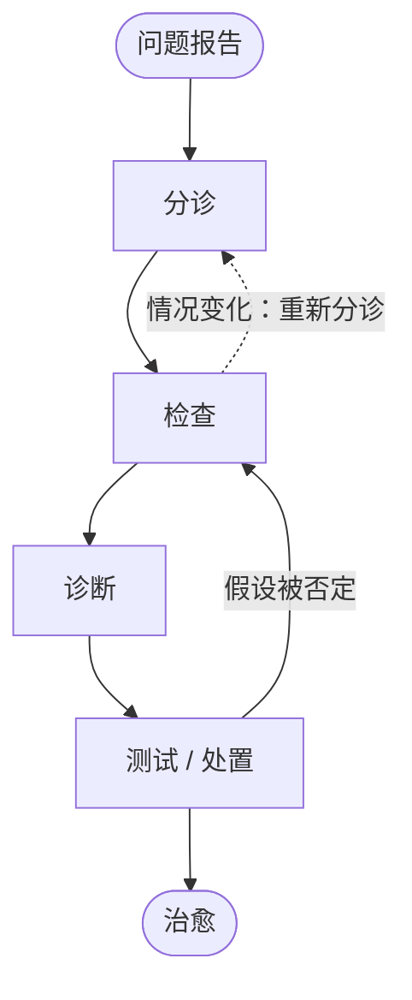
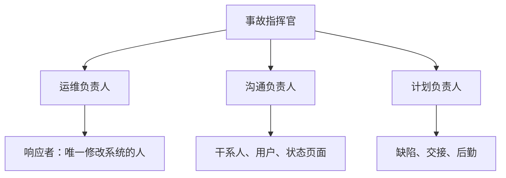

一项服务的大部分生命是在生产环境中度过的。需求、设计、实现和测试（[4.14.4](/4.14.4)–[4.14.12](/4.14.12)）产出一个在发布当天能工作的系统；运维则要让它在数年里持续工作，而它的代码、配置、负载和底层的机器都在变化。本章把运维当作一门工程学科来讨论。它遵循 Google 工程师在 Beyer 等人所著 *Site Reliability Engineering: How Google Runs Production Systems*（2016）中描述的*站点可靠性工程*（SRE）方法，该书是本章的主要参考文献。第一部分说明为什么运维需要工程，以及 SRE 是什么；第二部分给出原则：拥抱风险、服务等级目标与错误预算、消除琐事，以及监控；第三部分讲实践：告警、值班、故障排查、事故管理与事后复盘，以及变更的安全发布。**DevOps** 以及**持续集成**、**持续交付**和**持续部署**的实践已在 [4.14.2](/4.14.2#sec-2.4.2) 和 [4.14.3](/4.14.3#sec-3.8) 中介绍，它们是背景：它们让变更快速到达生产环境，而本章讲的是在这样做的同时如何保持生产环境的健康。**容器**（[4.11.9](/4.11.9)）与集群（[4.11.11](/4.11.11)）是服务运行的平台。

## 13.1. 软件运维与 SRE

### 13.1.1. 为什么运维重要

如 [4.14.1](/4.14.1#sec-1.2) 所示，**软件维护**主宰了软件的成本：按 Glass 的“60/60 规则”，生命周期成本的约 60% 是维护。SRE 一书认为，系统总成本中在其“诞生”之后发生的部分占 40% 到 90%，并把软件比作孩子：出生前的劳动痛苦而艰难，但出生之后才是大部分精力的去处。对一项互联网服务而言，后期的大量精力就是运维：部署新版本、监视服务、应对故障和规划容量。

风险很高，因为金融、电信、能源、制造、政府等整个行业如今都运行在线上服务之上。两次有详细记录的故障说明了其规模：

| 日期 | 服务 | 发生了什么 | 影响 |
|---|---|---|---|
| 2020 年 12 月 14 日 | Google | 一个自动化配额系统降低了中央用户身份服务的存储配额，导致身份认证失败 | Gmail、日历、YouTube 以及其他大多数需要登录的服务在全球范围内失效约 45 分钟 |
| 2023 年 11 月 8 日 | ChatGPT 与 OpenAI API | 异常流量使服务过载 | 两者中断或性能下降约两小时，被宣布为重大故障 |

运维这类系统之所以困难，有四个原因。用户期望越来越好的体验；系统庞大、复杂，分布在许多协议层上，并不断演进；它们必须经受接连不断的硬件和软件故障、缺陷、变更、流量变化和攻击；运维人员还必须实时分析海量监控数据，才能做出又快又正确的决策。原始信号（来自许多组件的告警、关键绩效指标、日志、追踪、应用的依赖图以及物理网络）信噪比低、不完整，只见树木不见森林；必须由人把它们融合起来。因此运维已经从人工驱动的工作，经由由人做决策的自动化（本章的主题），朝着能自愈、无人值守地推出变更并自动伸缩的系统发展，机器学习方法（常称 AIOps）承担了越来越多的决策。

### 13.1.2. 系统管理员模式及其代价

传统上，运维（Ops）是与开发（Dev）分开的一份工作，技能组合也不同。一队系统管理员把现成的软件组件装配起来，部署成一项服务并运行它，在事件和更新发生时作出响应。这个团队负责可用性、延迟、性能、效率、变更管理、监控、应急响应和容量规划。

这种模式有两种代价：

- 直接成本：团队规模随服务规模线性增长，因为每台新机器、每个新事件都需要人来关注。按每 100 台服务器配 1 名运维人员的经验法则，50 000 台服务器就需要 500 名运维人员。在这样的规模下故障是家常便饭：如果每年有 20% 的服务器出故障，一个 50 000 台的机群每天会遇到 $50\,000 \times 0.2 / 365 \approx 27$ 次服务器故障。
- 间接成本，且更大：开发者与运维人员在背景、技能、激励、词汇、对风险与稳定性的假设以及目标上各不相同，两个群体之间的沟通和信任都因此受损。

最深的冲突在于变更。大多数故障是由某种变更引起的：新的配置、新功能的上线、新类型的流量。开发者想在任何时候毫无阻碍地发布任何东西；运维人员以稳定性来考核，希望系统一旦能工作就什么都不要变。于是双方各自用流程（发布评审、变更冻结）或变通办法（把一次发布拆成许多“小”变更）捍卫自己的目标，组织为这种摩擦付出代价。

### 13.1.3. 站点可靠性工程

**定义 13.1.1（站点可靠性工程）** **站点可靠性工程**（SRE）是一种运行生产服务的方法：由软件工程师设计并执行运维职能，他们把运维人员原本要手工完成的工作自动化，对自己所运行服务的可靠性负责，并且只把有限比例的时间用于运维工作，其余时间用于使服务更可靠、更易运行的工程工作。

用 2003 年创立 Google SRE 团队的 Ben Treynor Sloss 的话说，SRE “就是你让一位软件工程师去设计运维职能时发生的事”。Google 招聘的大多是普通的软件工程师，另外具备一些 Unix 和网络技能，并给他们设定目标：让服务自己运行、自己修复。关键的组织规则是一个上限：SRE 团队总时间中至多 50% 可用于“运维”工作（工单、值班、手工任务）。当运维负载超过上限时，超出的部分被送回开发团队，这使两个团队都有动力去自动化。由于随服务增长的工作被自动化掉了，SRE 团队的规模随服务呈亚线性增长。

SRE 运行*服务*：为内部或外部用户运营的一组相关系统，并最终对这些服务的健康负责。这包括开发监控、规划容量、响应事故、确保修复故障的根本原因，等等。

SRE 与 **DevOps**（[4.14.2](/4.14.2#sec-2.4.2)）各自独立产生，并有共同的主要思想：开发者与运维人员共同拥有生产环境、自动化、小而频繁的变更以及度量。**DevOps** 是一套宽泛的原则和文化价值观；SRE 是落实它们的一种具体方式，有具体的实践（服务等级目标、错误预算、对琐事的上限、无责复盘）。Google 的 *Site Reliability Workbook*（2018）用一个程序员的玩笑概括了二者的关系：“class SRE implements interface DevOps”。

### 13.1.4. SRE 的信条

| 信条 | 实践 |
|---|---|
| 持久地专注于工程 | 至多 50% 的时间用于运维工作；每个 8–12 小时的值班班次至多两起事件，使每起事件都得到彻底的响应；每起重大事故都有事后复盘 |
| 在不违反服务 SLO 的前提下最大化变更速度 | 业务设定一个小于 100% 的可用性目标；剩余的错误预算用在发布上，因此故障是创新中预期的一部分，而不是“坏”事件（§13.2） |
| 监控 | 由软件解读信号，只在人必须采取行动时才通知人；按紧急程度输出：告警（立即行动）、工单（数日内行动）、日志（仅供参考） |
| 应急响应 | 可靠性取决于平均失效时间和平均修复时间；人会增加延迟，所以能自动化的就自动化；为值班工程师准备的应急手册使 MTTR 比临场发挥改善了约三倍；“灾难角色扮演”用于训练应对事故 |
| 变更管理 | 约 70% 的故障源于对线上系统的变更；通过渐进式发布、快速而准确的问题检测以及安全回滚，把人从循环中移除（§13.10） |
| 需求预测与容量规划 | 对自然需求作出准确预测，且预测范围超过获取容量的提前期；纳入非自然需求（发布、营销活动）；定期做负载测试，把原始容量（服务器、磁盘）与服务容量联系起来 |
| 资源供给 | 增加容量兼有变更管理与容量规划的性质，必须又快又对 |
| 效率与性能 | 资源使用决定成本，服务的响应时间必须被监控和维持；SRE 以最低成本供给资源，以达到目标响应速度 |

## 13.2. 拥抱风险与服务等级目标

### 13.2.1. 拥抱风险

人们可能以为服务应当尽可能可靠。其实不然。可靠性的成本随可靠性的提高增长得非常快：每多一个“9”都需要更多冗余机器，更重要的是更多机会成本，因为加固系统的工程师就不能去开发功能。同时，用户通常分辨不出一项服务的高可靠性与极高可靠性之间的差别，因为他们与服务之间的路径（手机、Wi-Fi、移动网络）本身可靠得多。因此 SRE 通过管理风险来管理可靠性：它选择一个目标，在不可用的风险与快速创新、高效运营的目标之间取得平衡，力求达到该目标，而不要大幅超过它。

要管理风险就必须度量风险。系统的**可用性**（[4.14.5](/4.14.5#def-5.2.6)）有两种度量方式：

$$
\text{基于时间的可用性} = \frac{\text{正常运行时间}}{\text{正常运行时间} + \text{停机时间}}, \qquad
\text{聚合可用性} = \frac{\text{成功的请求数}}{\text{总请求数}}.
$$

基于时间的可用性适合要么运行、要么停机的单台机器。全球分布的服务很少完全运行或完全停机：几乎任何时候都有请求在某处失败。因此 Google 度量聚合（基于请求的）可用性，它也能处理没有请求的服务（批处理流水线可以统计成功处理的记录数），并按每次失败影响的用户数加权。每个“9”的数量所对应的允许停机时间见 [4.14.5](/4.14.5#def-5.2.6)：99.9% 每 30 天允许 43.2 分钟，99.99% 只允许 4.3 分钟。

目标取决于用户的期望和改进的价值。付费服务、与收入挂钩的服务、企业服务以及有强劲竞争者的服务需要更高的目标。Google 为 Gmail、日历和文档设定了 99.99%，但对于 YouTube，在被收购时快速开发功能更重要，目标也就较低。一个简单的经济学检验可以决定是否提高目标。

**例 13.2.1** 一项服务每年收入 100 万美元，其可用性目标为 99.9%。把目标提高到 99.99% 会使多 0.09% 的请求成功，所以这一改进的价值至多是

$$
1\,000\,000 \times 0.0009 = 900 \text{ 美元/年}.
$$

如果为第四个 9 所需的额外副本、工程时间和变慢的发布每年的成本超过 900 美元，这一改进就不值得做。

可用性不是风险的唯一维度。SRE 一书中 Google 的两个广告系统在延迟要求上不同：显示在搜索结果旁边的广告不能拖慢搜索页面，而投放在发布者网站上的广告可以容忍更高的延迟。拥有许多需求各异的客户的基础设施服务，可以对外提供若干明确的服务等级，让客户选择：为交互式用户提供预留了富余容量的低延迟集群，为批处理用户提供更便宜的高吞吐集群，Google 的 Bigtable 部署就是这样。

### 13.2.2. 服务等级指标、目标与协议

**定义 13.2.1（服务等级指标）** **服务等级指标**（SLI）是对所提供服务水平某一方面的、经过仔细定义的定量度量，如请求延迟、错误率、吞吐率或可用性，通常在一个时间窗口内聚合为比率、平均值或百分位数。

**定义 13.2.2（服务等级目标）** **服务等级目标**（SLO）是在规定时期内，由某个 SLI 度量的服务水平的目标值或目标取值范围：例如“99.95% 的请求成功，在 28 天内度量”，或“99% 的 `Get` 请求在 10 毫秒内完成”。

**定义 13.2.3（服务等级协议）** **服务等级协议**（SLA）是与用户之间明示或默示的合同，其中包括达成或未达成所含 SLO 的后果，通常是经济上的（服务抵扣额或退款）。

区分 SLO 与 SLA 的检验是问：“如果没达成会怎样？”如果合同上什么也不会发生，它就是 SLO。SLA 的目标通常比内部 SLO 宽松，使团队远在违反合同之前就作出反应。公有云提供商会公布其服务的 SLA；SRE 一书引用了 Google Compute Engine 的 99.95% 可用性。

选择哪些指标取决于用户关心什么。少数几个有代表性的指标就足够了：

| 系统类型 | 典型 SLI |
|---|---|
| 面向用户的服务系统（Web 前端、API） | 可用性、延迟、吞吐率 |
| 存储系统 | 延迟、可用性、持久性 |
| 大数据流水线 | 吞吐率、端到端延迟（数据新鲜度） |
| 所有系统 | 正确性，常通过用已知输入探测来度量 |

指标由监控系统（Prometheus、Zabbix；Google 的 Borgmon，§13.5）在服务器端收集，或通过定期的日志分析收集，或通过给客户端埋点收集，后者能看到服务器看不到的问题，如页面渲染缓慢。

大多数指标用百分位数概括比用平均值更好（即概率论语言中的**分位数**）。延迟分布通常是偏斜的：大多数请求很快，少数请求非常慢，而用户记住的正是慢的那些。因此延迟的 SLO 要在多个百分位数上陈述：

- 90% 的 `Get` 调用在 1 毫秒内完成；
- 99% 的 `Get` 调用在 10 毫秒内完成；
- 99.9% 的 `Get` 调用在 100 毫秒内完成。

好的 SLO 遵循几条规则。从用户需要什么出发，而不是从什么容易度量出发。保持简单，不做复杂的聚合，并尽量少：没有人能用来做任何决策的 SLO 应当舍弃。不必追求完美：先宽松后收紧，比放宽用户已经依赖的目标要容易。在内部 SLO 与任何对外公布的 SLA 之间保留安全余量，并且不要超额完成：如果服务比其 SLO 可靠得多，用户就会开始依赖实际达到的水平。Google 的锁服务 Chubby 曾经可靠到其他服务开始假定它永远不会失效；如今 SRE 团队会在某些季度主动让它的全球实例停机，这些季度里它否则会超过自己的 SLO，这样就把没有道理的依赖逼了出来。

### 13.2.3. 错误预算

**定义 13.2.4（错误预算）** 一项服务在某一时期内的**错误预算**是其 SLO 所允许的不可靠程度：$1 - \text{SLO}$，表示为 SLO 时期内失败的请求数（或停机分钟数）。它被故障、失败的变更和背景错误消耗；只要还有预算，团队就可以发布变更；预算耗尽时，除可靠性修复之外停止发布，直到服务重新回到其 SLO 之内。

错误预算把 §13.1.2 的冲突变成一个共同的、客观的数字。产品开发者与 SRE 不再争论某次发布是否“太冒险”：SLO 经与**产品负责人**商定，监控系统度量还剩多少预算，由剩余预算说了算。双方都有了平衡速度与稳定性的动力：想频繁发布的团队有理由投入测试和渐进式发布，它们使发布消耗的预算更少。错误预算还能化解与干系人之间关于故障的争论，因为有计划的不可靠不是失败，而是创新的代价。

**例 13.2.2** 一项 Web 服务平均每秒处理 200 个请求，SLO 为 30 天内 99.9% 的请求成功。在某个窗口内，它有 0.05% 的背景错误率，并发生过一次事故，其中 25% 的请求失败了 30 分钟：

```python
# Error budget of a request-based availability SLO over a 30-day window
slo = 0.999                      # 99.9% of requests succeed
rate = 200                       # average requests per second
window = 30 * 24 * 3600          # seconds in the window
total = rate * window
budget = (1 - slo) * total       # failed requests allowed

background = 0.0005 * total      # steady 0.05% error rate
incident = 30 * 60 * rate * 0.25 # 30 minutes with 25% of requests failing
spent = background + incident

print(f"requests in window : {total:,.0f}")
print(f"error budget       : {budget:,.0f} failed requests")
print(f"background errors  : {background:,.0f} ({background / budget:.1%} of budget)")
print(f"incident errors    : {incident:,.0f} ({incident / budget:.1%} of budget)")
print(f"budget remaining   : {budget - spent:,.0f} ({1 - spent / budget:.1%})")
```

```text
requests in window : 518,400,000
error budget       : 518,400 failed requests
background errors  : 259,200 (50.0% of budget)
incident errors    : 90,000 (17.4% of budget)
budget remaining   : 169,200 (32.6%)
```

仅背景错误就花掉了一半的预算，比事故还多。这很典型：长期存在的小问题往往比人人记得的故障代价更大，而预算使它们显现出来。还剩三分之一的预算，团队可以继续发布，但下一个冲刺中，修复背景错误率比一次冒险的上线更值得。

服务消耗预算的速率称为*消耗速率*（burn rate）：消耗速率为 1，恰好在 SLO 时期内用完预算；消耗速率为 $b$，则在时期的 $1/b$ 内耗尽。按消耗速率告警，而不是按原始错误率告警，使告警直接与 SLO 相连。*Site Reliability Workbook* 建议：当 30 天预算的 2% 在一小时内被消耗时发出寻呼，这对应的消耗速率是

$$
b = \frac{0.02 \times 30 \times 24\ \text{h}}{1\ \text{h}} = 14.4,
$$
当 10% 在三天内被消耗时开一张工单（$b = 1$）。在 $b = 14.4$ 时，全部预算将在 $720/14.4 = 50$ 小时内用完。为了避免因已经结束的突发而发出寻呼，告警还要求短窗口（例如 5 分钟）内的消耗速率也很高；§13.5.3 给出了这样一条规则。

## 13.3. 消除琐事

**定义 13.3.1（琐事）** **琐事**是与运行生产服务相关的这样一类工作：它往往是手工的、重复的、可自动化的、战术性的（被中断驱动的、被动的），没有持久价值，并且随服务增长而线性增长。

并非所有运维工作都是琐事。琐事是做完之后服务仍处于同样状态的工作；*工程*工作则是新颖的，本质上需要人的判断，并产生永久的改进。每周手工重置一个卡住的作业是琐事；找出它为什么卡住并修复它是工程。SRE 组织公开宣称的目标是让琐事低于每位 SRE 时间的 50%；至少一半时间用于减少未来琐事或增加服务功能的工程项目。

典型的 SRE 活动分为四类：

| 类别 | 例子 |
|---|---|
| 软件工程 | 编写或修改代码及其设计与文档：自动化脚本、工具、框架，为服务增加**可伸缩性**功能 |
| 系统工程 | 配置生产系统并修改其配置、为其编写文档，具有持久的效果：监控设置、负载均衡器配置、服务器调优 |
| 琐事 | 与运行服务直接相关的重复性手工工作：处理例行请求、手工部署、响应无需处理的告警 |
| 管理开销 | 与运行服务没有直接关系的行政工作：会议、招聘、培训、绩效评估 |

有些琐事不可避免，少量琐事甚至能让人平静。过多则有害：它阻碍职业发展，降低士气，拖慢团队的进展，并且因为人在做重复性工作时会犯错，还会导致故障。对策是把反复出现的琐事当作工程问题：度量它，并把它的来源自动化或消除。

## 13.4. 分布式系统的监控

### 13.4.1. 术语

**定义 13.4.1（监控）** **监控**是对系统实时定量数据的收集、处理、聚合和显示，如查询的数量与类型、错误的数量与类型、处理时间以及服务器的存活时间。

**定义 13.4.2（白盒监控与黑盒监控）** **白盒监控**基于系统内部暴露的指标，包括日志、Java 虚拟机性能分析接口之类的接口，以及输出内部统计信息的 HTTP 处理程序。**黑盒监控**像用户那样测试外部可见的行为，例如发送探测请求。

其他术语：

- *仪表盘*（dashboard）：概括服务核心指标视图的（通常是 Web）应用。
- *告警*（alert）：旨在由人阅读、被推送到工单队列、电子邮件或寻呼机之类系统的通知。把人叫醒的通知是一次*寻呼*（page）。
- *根本原因*（root cause）：软件或人的系统中的一个缺陷，修复它就有信心该事件不会再以同样的方式发生。一起事故可能有多个根本原因，都应当修复。
- *节点*（node，或称机器）：一个运行中内核的单个实例，位于物理服务器、**虚拟机**或**容器**（[4.11.9](/4.11.9#def-9.4.1)）上。

### 13.4.2. 为什么要监控

监控有多种用途：

- 分析长期趋势（数据库有多大、增长多快，日活跃用户增长多快）；
- 随时间或在实验组之间比较（用新版本的库查询是否更快？多一个节点后缓存命中率提高了多少？）；
- 告警：某处坏了，需要有人马上修复，或者某处可能很快就要坏，需要有人尽快去看；
- 构建回答服务基本问题的仪表盘；
- 临时的回溯分析，即**调试**：延迟刚刚升高了，同一时间还发生了什么？

告警必须谨慎。有效的告警系统信号好、噪声极低。寻呼一个人是对员工时间的昂贵使用，过于频繁的寻呼或为无需处理的事情寻呼，会造成*寻呼疲劳*（pager fatigue）：人们开始忽视告警，真正的故障持续得更久。仪表盘不应要求有人盯着屏幕去发现问题；那是告警的工作。

监控系统应当回答两个问题：什么坏了，以及为什么。“什么”是*症状*，“为什么”是（可能是中间的）*原因*：

| 症状（什么） | 原因（为什么） |
|---|---|
| 服务返回 HTTP 500 或 404 错误 | 数据库服务器拒绝连接 |
| 响应缓慢 | CPU 被一个 bogosort 压垮，或者机架下面有根以太网线被压坏，表现为部分丢包 |
| 南极洲的用户收不到动画猫咪 GIF | 内容分发网络讨厌科学家和猫科动物，把一些客户端 IP 地址列入了黑名单 |
| 私有内容全世界可读 | 一次新的软件推送使访问控制列表被遗忘，于是所有请求都被允许 |

黑盒监控面向症状，显示的是正在发生而非预测的问题：“系统此刻没有正确工作。”白盒监控检查系统内部，因此能检测到迫在眉睫的问题（磁盘即将写满）、被重试掩盖的失败，以及原因而不是症状。应由黑盒监控驱动寻呼，因为出现症状就意味着用户此刻已受影响；白盒监控对诊断以及即将发生的问题至关重要。一个系统的症状是另一个系统的原因：数据库读取缓慢，对数据库 SRE 是症状，对前端 SRE 则是原因。

### 13.4.3. 四个黄金信号

**定义 13.4.3（四个黄金信号）** 监控面向用户的系统的**四个黄金信号**是：

1. 延迟：服务一个请求所需的时间，成功请求与失败请求分开度量，因为快速的错误不是快速的成功；
2. 流量：系统承受多少需求，用高层的、针对系统的指标度量，如每秒 HTTP 请求数、并发会话数或每秒事务数；
3. 错误：失败请求的比率，包括显式的（HTTP 500）、隐式的（成功响应但内容错误）或按策略判定的（慢于承诺延迟的响应算作错误）；
4. 饱和度：服务有多“满”，在约束最强的资源（内存、I/O、CPU）上度量，目标利用率低于 100%，因为性能在此之前很早就会下降。

如果只能度量面向用户系统的四个指标，就是这四个。饱和度还有预测性：短窗口（例如一分钟）内较高的第 99 百分位数响应时间，往往是饱和的早期信号。两个相关的检查清单也被广泛使用：*USE*（利用率、饱和度、错误），由 Brendan Gregg 针对 CPU 和磁盘之类的资源提出；以及 *RED*（速率、错误、持续时间），由 Tom Wilkie 针对请求驱动的服务提出。RED 就是去掉饱和度的黄金信号；USE 则从资源的角度来看同一个系统。

监控必须关注尾部。一个每秒 1 000 个请求、平均延迟为 100 毫秒的 Web 服务，完全可能有 1% 的请求要花 5 秒；如果用户每个页面加载多个资源，他们中的大多数迟早会遇到慢的尾部。平均值掩盖了这一点，下面的模拟说明了这一点：98% 的请求耗时约 80 毫秒，2% 是缓存未命中，耗时约一秒。

```python
import numpy as np

rng = np.random.default_rng(0)
n = 100_000
# 98% fast requests around 80 ms, 2% slow requests (cache misses) around 1 s
fast = rng.lognormal(mean=np.log(80), sigma=0.3, size=int(n * 0.98))
slow = rng.lognormal(mean=np.log(1000), sigma=0.5, size=n - fast.size)
latency = np.concatenate([fast, slow])  # milliseconds

print(f"mean   {latency.mean():7.1f} ms")
for p in (50, 90, 99, 99.9):
    print(f"p{p:<5} {np.percentile(latency, p):7.1f} ms")
```

```text
mean     105.2 ms
p50       80.6 ms
p90      121.2 ms
p99     1003.9 ms
p99.9   2374.6 ms
```

105 毫秒的平均值看起来很健康，但每一百个请求中就有一个要花一秒。把延迟收集到直方图的桶里（0–10 毫秒、10–30 毫秒、30–100 毫秒，……，大致按指数间隔）能以很低的成本保持分布可见。

另有两条设计规则使图景更完整：

- 选择合适的分辨率。不同的指标需要不同的粒度：对某项服务，每秒的 CPU 负载也许重要，而对 SLO 为 99.9% 的服务，每隔几分钟检查一次磁盘占满程度就够了。高分辨率并不要求低的收集延迟：机器可以每秒采样一次 CPU，而每分钟只导出聚合后的直方图。
- 尽可能简单，但不过分简单。最常捕获真实事故的规则应当简单、可预测、可靠。很少被用到的数据收集、聚合与告警配置（对一些 SRE 团队而言，一个季度不到一次）应当考虑移除，收集了却没有出现在任何仪表盘和任何告警中的信号，是删除的候选。

### 13.4.4. 告警的规则

在制定监控与告警规则时，下列问题有助于避免误报和寻呼倦怠：

- 这条规则是否检测到一个否则不会被发现的、紧急的、可处理的、并且正在或即将对用户可见的情况？
- 我是否会在知道这条告警无害的情况下忽略它？何时、为什么，规则又如何避免这种情况？
- 这条告警是否确定表明用户正受到负面影响？是否存在可检测到的、用户并未受影响的情形，如已排空的流量或测试部署，应当被过滤掉？
- 我能对这条告警采取行动吗？行动是紧急的，还是可以等到明天早上？能否安全地自动化？它是长期的修复，还是只是短期的变通办法？
- 是否还有别人因同一个问题被寻呼，这使至少有一次寻呼是不必要的？

这些回答体现了一种关于寻呼的理念：

- 每次寻呼机响起，值班工程师都应当能带着紧迫感作出反应，而一天只能这样做几次，否则就会疲劳。
- 每次寻呼都应当是可处理的。
- 每次寻呼的响应都应当需要智力。如果一次寻呼只值得机械的响应，它就不该是寻呼；应当把它自动化。
- 寻呼应当针对新问题或以前没见过的事件。
- 应有人找出并消除问题的根本原因；如果做不到，这种响应就值得被完全自动化。

## 13.5. 基于时间序列数据的实用告警

### 13.5.1. 从脚本到时间序列

监控一个非常大的系统很难：组件数量庞大，需要把监控本身的维护负担保持在较低水平，还要既针对高层的服务目标告警，又保留检查单个组件的粒度。传统的模式，即检查响应并发送告警的自定义脚本，无法扩展到这个规模。Google 为集群管理器 Borg 构建的 Borgmon，使*时间序列*的收集成为监控系统的首要角色：告警是对时间序列求值的规则，而不是脚本。Google 此后在内部以 Monarch 取代了 Borgmon，这是一个全球分布的时间序列数据库（2020 年的一篇论文对其作了描述），但开源的 Prometheus 由曾在 Google 工作过的工程师于 2012 年在 SoundCloud 创立，紧密遵循 Borgmon 模型，如今已是事实标准（3.x 版，云原生计算基金会的毕业项目）。Zabbix 是一个较老的、基于代理和检查的开源系统。

为了使大规模收集成为可能，指标的格式是标准化的，每个目标在一次 HTTP 获取中暴露其全部指标。Borgmon 获取每个目标的 `/varz` 页面；Prometheus 目标则以纯文本的暴露格式提供 `/metrics`。官方的 Python 客户端库可以生成它；下面的程序统计四个模拟请求，并把它们的延迟记录在一个直方图中（用 `prometheus-client` 0.26 运行）：

```python
from prometheus_client import CollectorRegistry, Counter, Histogram, generate_latest

registry = CollectorRegistry()
REQUESTS = Counter("http_requests", "HTTP requests handled",
                   ["method", "code"], registry=registry)
LATENCY = Histogram("http_request_duration_seconds", "Request latency",
                    buckets=(0.05, 0.1, 0.25, 1.0), registry=registry)

# Simulate a few requests
for code, seconds in [("200", 0.04), ("200", 0.08), ("200", 0.12), ("500", 0.9)]:
    REQUESTS.labels(method="GET", code=code).inc()
    LATENCY.observe(seconds)

print(generate_latest(registry).decode())
```

```text
# HELP http_requests_total HTTP requests handled
# TYPE http_requests_total counter
http_requests_total{code="200",method="GET"} 3.0
http_requests_total{code="500",method="GET"} 1.0
# HELP http_request_duration_seconds Request latency
# TYPE http_request_duration_seconds histogram
http_request_duration_seconds_bucket{le="0.05"} 1.0
http_request_duration_seconds_bucket{le="0.1"} 2.0
http_request_duration_seconds_bucket{le="0.25"} 3.0
http_request_duration_seconds_bucket{le="1.0"} 4.0
http_request_duration_seconds_bucket{le="+Inf"} 4.0
http_request_duration_seconds_count 4.0
http_request_duration_seconds_sum 1.1400000000000001
```

计数器只增不减；直方图统计小于等于每个桶边界 `le` 的观测数，使服务器日后能估计百分位数。在真实的服务中，同样的对象在请求处理程序中更新，由 Web 框架的集成在 `/metrics` 提供这段文本。

### 13.5.2. 收集与存储

监控服务器配置有一个目标列表（静态的，或从集群管理器发现的）。它每隔固定的时间（通常 10 到 60 秒）获取每个目标的指标页面，解析并存储这些值。Borgmon 还为每个目标记录“合成”变量：其名称是否解析为主机和端口，是否响应了收集和健康检查，以及收集何时完成。Prometheus 用序列 `up` 记录同样的想法，上一次抓取成功则为 1，否则为 0；对 `up == 0` 告警是对目标最简单的类黑盒检查。

数值存储在时间序列数据库中。一个*时间序列*由它的名称和一组*标签*（键值对）标识，例如

```text
{var=http_requests, job=webserver, instance=host0:80, service=web, zone=us-west}
```

这是 Borgmon 的记法，Prometheus 的记法则是 `http_requests_total{job="webserver", instance="host0:80"}`。它的数据点是（时间戳，值）对。Borgmon 把近期数据保存在内存中，并定期归档到外部的时间序列数据库（TSDB）；Prometheus 把数据存储在磁盘上的本地 TSDB 中，并可转发到长期存储。查询按名称、标签和时间范围选择序列。Google 之外的开源 TSDB 有 OpenTSDB、InfluxDB，以及 Prometheus 的长期存储（Thanos、Cortex 与 Grafana Mimir、VictoriaMetrics）。

### 13.5.3. 规则与告警

*规则*是从已有时间序列计算出新时间序列的简单代数表达式。错误率是错误速率除以请求速率；*聚合*把一个作业所有任务的序列相加，使该作业可以被作为整体对待，并进而把所有集群每秒的查询数相加，得到一个数据中心的速率。规则的结果被存储为新的时间序列，可以像其他序列一样被查询和告警。*告警规则*是结果为真或假的规则；为真时，告警触发。为了应对抖动，规则可以要求条件持续一个最短时间（在 Borgmon 中是两个求值周期，在 Prometheus 中是 `for` 子句）后才发送告警。

下面的 Prometheus 规则文件对 99.9% 的 SLO 实现了 §13.2.3 的快速消耗告警。两条*记录规则*计算 5 分钟和 1 小时上的错误率；告警规则在两者都超过 $14.4 \times 0.001$ 并持续两分钟时发出寻呼：

```yaml
groups:
  - name: web-slo
    rules:
      # Recording rules: error ratio of the web job over two windows
      - record: job:http_errors:ratio_rate5m
        expr: |
          sum by (job) (rate(http_requests_total{code=~"5.."}[5m]))
            / sum by (job) (rate(http_requests_total[5m]))
      - record: job:http_errors:ratio_rate1h
        expr: |
          sum by (job) (rate(http_requests_total{code=~"5.."}[1h]))
            / sum by (job) (rate(http_requests_total[1h]))

      # Alerting rule: SLO 99.9%, budget burning 14.4 times too fast
      - alert: ErrorBudgetFastBurn
        expr: |
          job:http_errors:ratio_rate1h > (14.4 * 0.001)
            and job:http_errors:ratio_rate5m > (14.4 * 0.001)
        for: 2m
        labels:
          severity: page
        annotations:
          summary: "{{ $labels.job }} is burning its error budget fast"
          description: "Error ratio over 1 h is {{ $value | humanizePercentage }}."
```

告警规则是代码，可以做单元测试。下面的测试给这些规则输入合成的计数器：每分钟 100 个请求，从第 10 分钟起其中 5 个失败（错误率 5%，消耗速率 50）。在第 12 分钟，5 分钟窗口的错误率已经很高，但 1 小时窗口的还不高，所以不发出寻呼；在第 80 分钟告警触发。

```yaml
rule_files: [slo-rules.yml]
evaluation_interval: 1m
tests:
  - interval: 1m
    input_series:
      # 100 requests per minute; from minute 10 on, 5 of them fail
      - series: 'http_requests_total{job="web", code="200"}'
        values: '0+100x9 1000+95x80'
      - series: 'http_requests_total{job="web", code="500"}'
        values: '0x9 0+5x80'
    alert_rule_test:
      - eval_time: 5m
        alertname: ErrorBudgetFastBurn
        exp_alerts: []
      - eval_time: 12m
        alertname: ErrorBudgetFastBurn
        exp_alerts: []
      - eval_time: 80m
        alertname: ErrorBudgetFastBurn
        exp_alerts:
          - exp_labels: {severity: page, job: web}
            exp_annotations:
              summary: "web is burning its error budget fast"
              description: "Error ratio over 1 h is 5%."
```

```text
$ promtool check rules slo-rules.yml
Checking slo-rules.yml
  SUCCESS: 3 rules found

$ promtool test rules slo-rules-test.yml
  SUCCESS
```

告警被发送到一个中心的 Alertmanager（Borgmon 的也叫这个名字），它把每条通知路由给正确的接收者（`severity: page` 交给值班寻呼机，较低的严重级别交给工单队列），把相关的告警合并成一条通知，在计划内的维护期间使告警静默，并*抑制*依赖的告警：当整个数据中心宕机时，它引起的数百条按服务的告警会被抑制，只留下指明原因的那一条。

为了扩展规模，监控按层次*分片*。每个数据中心为每个目标**分片**运行一个监控服务器，外加一个聚合它们的数据中心级服务器；全局一级聚合各个数据中心。每一级保留其用户所需的细节：全局视图显示服务级别的速率，集群一级保留供调试用的按任务的序列。

### 13.5.4. 日志、追踪与可观测性

指标回答“多少”和“多频繁”；它们说不出某一个具体请求发生了什么。还有两类遥测数据对它们作补充：*日志*，即离散事件的记录，最好以结构化的键值记录而不是自由文本输出，以便被检索和聚合（例如在 Elasticsearch、OpenSearch 或 Grafana Loki 中）；以及追踪，它跟踪一个请求经过的所有服务，为每一步记录一个带时间的 span，从而能找出请求路径上缓慢或失败的服务。开放标准 OpenTelemetry（一个 CNCF 项目，2019 年由 OpenTracing 与 OpenCensus 合并而成）为这三种信号定义了 API、库和传输协议，使埋点与监控供应商无关。

**定义 13.5.1（可观测性）** **可观测性**是能够从运行中系统的外部输出（指标、日志和追踪）推断其内部状态的程度，包括回答构建系统时没有预料到的问题。

监控说明某个已知条件是否成立；可观测性则让工程师在事故中无需先部署新代码就能提出新问题。两者都要在设计时就内置，而不是事后添加（§13.7.4）。

## 13.6. 值班

**定义 13.6.1（值班）** **值班**是指在工作时间和非工作时间都随时待命，在约定的时间内（面向用户的服务为几分钟）响应有关某项服务的寻呼，以保持服务可靠、可用。

值班是 SRE 团队的一项关键职责，其质量取决于两方面的平衡：

- 数量上的平衡：至少 50% 的 SRE 时间用于工程；其余部分中，值班至多占 25%，其他运维工作至多再占 25%。每次只有一名工程师值班、占 25% 的情况下，单站点轮值至少需要八名工程师（每人每四周值班一周，有主值班和副值班）；位于两个时区的双站点团队，每个站点需要六名，并且可以避免夜班。
- 质量上的平衡：在每个班次中，工程师必须有足够的时间处理事故及其后续工作（根本原因分析、补救、编写复盘、修复缺陷）。Google 的经验是，每起*事故*（incident）大约需要 6 小时，事故指与同一个根本原因相关、会在一份复盘中讨论的一系列事件和告警。因此每个 12 小时的班次最多两起事故。事故太少也是个问题：很少被寻呼的工程师会与生产环境脱节、变得过于自信，团队用“厄运之轮”（Wheel of Misfortune）之类的演练来应对（§13.9）。

事故期间，值班工程师应当理性、专注、审慎地思考，而不是凭直觉行动。在压力下，人们倾向于立刻采取未经考虑的行动，并过度依赖启发式，这会把他们引上一条一开始就错了的推理路线。值班工程师并不孤单；组织提供：

- 通往开发者和其他团队的清晰升级路径；
- 定义明确的事故管理流程与工具（§13.8）；
- 无责的复盘文化（§13.9），以及为重大事故编写详述完整事件时间线的复盘的义务。

运维过载，即超过 50% 的时间用于运维工作，有典型的原因和对策。监控配置不当是常见原因：当一起事故触发许多告警时，应当对告警去重并分组，使一起事故只产生一次寻呼，没有任何必要行动就触发的告警应当修复或移除。SRE 团队可以与开发者合作设定共同的可靠性目标。作为最后的手段，SRE 可以“交还寻呼机”：由开发者接手该服务的值班，直到它达到 SRE 的标准。

## 13.7. 有效的故障排查

### 13.7.1. 故障排查的模型

> 要注意，成为专家不只是理解系统应当如何工作。专业知识来自调查系统为什么不工作。（Brian Redman）

故障排查是任何运维分布式系统的人的一项关键技能。它需要两样东西：对如何进行一般性故障排查的理解，不需要对系统的特定知识；以及对系统扎实的了解。一般的方法是科学的假说演绎法。给定对系统的一组观察和理解其行为的理论基础，排查者反复提出故障潜在原因的假设并检验这些假设，方法是把假设与进一步的观察比较，或者对系统进行处置（改变它）并观察结果，直到找到根本原因。



常见的陷阱有：

- 查看不相关的症状，或误解系统指标的含义；
- 不了解如何安全地改变系统或其输入来检验假设；
- 提出极不可能的关于故障原因的理论，或抓住过去问题的原因不放，认为既然发生过一次就一定又发生了；在其他条件相同的情况下，更倾向于较简单的解释（奥卡姆剃刀）；
- 追查偶然巧合或有共同原因的虚假相关：相关不等于因果。有成千上万个指标时，总会有某一对指标碰巧一起变动。

### 13.7.2. 从报告到分诊

每个问题都始于一份*问题报告*，来自自动告警或同事。有效的报告陈述预期的行为、实际的行为，并在可能时说明如何重现。报告应当提交到可检索的问题跟踪系统，调查和补救也应当记录在其中以备将来参考。

*分诊*评估问题的严重程度。在严重故障中，第一要务不是找出原因，而是止血：让系统在当前情况下尽可能好地工作。紧急措施包括把流量从坏掉的集群转移到仍然正常的集群、成批丢弃流量以防止级联失效，以及禁用子系统以减轻负载。这样做的同时应当保留根本原因的证据（日志、故障实例的快照）。新手在用户受苦时开始调试，是把优先级弄反了；先缓解，后诊断。

### 13.7.3. 检查、诊断、测试与处置

要*检查*系统，排查者查看每个组件的行为：

- 监控系统：涉及组件的所有指标，作为随时间变化的图；
- 系统与应用日志，在日志存储中检索和过滤；
- 经过各服务的调用追踪（§13.5.4）；
- 变更日志：部署、配置变更、开关切换；
- 对系统执行操作的自动化的工作流日志。

在典型的企业环境中，这些数据是分层的：最上层是业务指标（交易量、响应时间、失败交易数）；中间是**中间件**和模块指标（数据库读写、响应时间、自定义检查）；最下层是服务器与网络指标（CPU、内存、磁盘、网络）；变更信息（配置变更、新版本发布）则贯穿所有层次。来源包括 Zabbix 之类的代理、抓包、应用中的埋点、Web 服务器日志（Apache、Nginx）和 syslog。

要*诊断*，有几种技术可以缩小搜索范围：

- 简化与缩减。查看组件之间的连接，或者等价地，查看它们之间流动的数据，以判断每个组件是否工作。从栈的一端出发，系统地向另一端推进，逐个检查每个组件，是可靠的；对于很长的链，对组件做二分更快。注入已知的测试数据并检查每一步的输出是最直接的测试。
- 问“什么”“哪里”和“为什么”。先弄清出故障的系统在做什么，再问它为什么这样做，以及它的资源被用在哪里或其输出去了哪里。
- 问最近是什么动了它。系统有惯性：工作中的系统倾向于保持工作，直到外力作用其上，如配置变更或负载类型的变化。把系统的行为与其他事件关联起来有帮助，这就是为什么仪表盘应当在错误率曲线上标注每次部署的开始和结束时间。

**例 13.7.1** “什么、哪里与为什么”，来自 SRE 一书：

| 步骤 | 问题与回答 |
|---|---|
| 症状 | 一个 Spanner 集群延迟很高，对其服务器的 **RPC** 超时 |
| 为什么？ | Spanner 服务器任务用尽了全部 CPU 时间，无法推进所有客户端请求 |
| 服务器中的 CPU 时间用在哪里？ | **性能分析**表明，它们在对写入磁盘的检查点日志中的条目排序 |
| 在日志排序代码的哪里？ | 在针对日志文件路径求值一个正则表达式时 |
| 解决方案 | 重写正则表达式以避免回溯；在代码库中寻找类似的模式；考虑 RE2，它不回溯，并保证运行时间与输入大小成线性关系 |

最后是*测试与处置*。好的测试应当能区分各个假设（它可能的结果指向不同的方向）；理想的测试按可能性和成本排序在先；测试可能有副作用，所以为检验假设而改变系统本身也必须小心进行。记下测试了什么、结果如何，能避免团队重复工作，并成为复盘的时间线。只有在能证明问题是因为正确的原因而消失时，才算确认治愈；理想情况下，在测试环境中重现该故障。

### 13.7.4. 让故障排查更容易

加快故障排查最有效的方式是为它而设计：

- 在每个组件中从一开始就构建可观测性，既有白盒指标也有结构化日志；
- 记录工作流和变更，使“最近是什么动了它”有答案；
- 设计组件之间接口得到充分理解、可观测的系统；
- 使信息在整个系统中以一致的方式提供，例如让一个请求标识符贯穿每个服务，并随每个事件一同记录。

系统化的故障排查方法，与依靠运气或经验相对，限定了服务的恢复时间，从而改善用户的体验。

## 13.8. 应急响应与事故管理

### 13.8.1. 应急响应

系统坏了该怎么办？首先，不要惊慌：你并不孤单，天也没有塌下来。如果情况让人应接不暇，就拉更多人进来。时间和经验表明，系统不仅会坏，而且会以以前没人能想象的方式坏；所有问题都有解决办法，但必须在尽可能多的帮助下尽快找到。一旦紧急情况得到缓解，就留出时间收拾并写出事故记录。

第二条规则是从过去学习，不要重蹈覆辙。保留一份故障的历史，附上预防的战术和策略。鼓励主动测试：在受控测试中诱发的故障，比凌晨 3 点发生的故障便宜得多。Google 每年的灾难恢复测试（DiRT）演练会故意让系统甚至数据中心宕机；Netflix 的 Chaos Monkey（2011）随机终止生产实例，这是如今称为*混沌工程*（chaos engineering）的开端。还要提出重大的、甚至不太可能的问题：如果大楼断电怎么办？如果网络设备机架泡在水里怎么办？如果主数据中心陷入黑暗怎么办？

### 13.8.2. 一起未经管理的事故

SRE 一书用一个故事来说明结构的必要性。值班工程师 Mary 在一个周五下午被寻呼：她服务的五个数据中心中有一个停止了服务。几分钟后第二个也失效了，接着是第三个，剩下的两个过载了。她盯着日志，看到一个最近更新的模块里有错误，便回滚了该版本，但无济于事。她给 Josephine 打电话，Josephine 写了大部分代码，对她来说此刻是凌晨 3:30；还有两位同事开始在自己的终端上“只是看看”。一位高管打电话给 Mary 的经理抱怨自己没有被告知；副总裁们一再要求给出估计，并提出无关的修复建议。与此同时，Mary 不知道的是，Josephine 给 Malcolm 打了电话，Malcolm 确信修改 CPU 亲和性会有帮助，并把它直接部署到了生产环境；服务器带着这一改动重启，然后死掉了。

这次失败有三个成分，每个都很典型：

- 过分聚焦于技术问题：Mary 是唯一掌握全局的人，却把注意力都花在调试上，没有精力去协调。
- 沟通不良：需要知情的人（高管、用户、其他团队）得不到更新，于是来打扰响应者。
- 擅自行动：出于好意的人们不经协调就修改系统，这可能使情况糟得多，并且破坏了调查者对系统进行推理的能力。

### 13.8.3. 事故管理

**定义 13.8.1（事故管理）** **事故管理**是以预先定义好的角色、沟通与文档结构，响应一起事故（服务的计划外中断或降级）的过程，以限制中断并尽快恢复正常运行。

一个设计良好的流程具有以下要素，参照应急服务使用的事故指挥系统：

- 职责的递归分离。每个人有一个角色，并在其中拥有充分的自主权：
  - *事故指挥官*掌握事故的高层状态，分配所有角色，并做所有没有分配给别人的事情；
  - *运维*团队在运维负责人的带领下，与指挥官一起通过对系统使用工具来响应；它是事故期间唯一修改系统的小组；
  - *沟通*负责人是响应工作的对外窗口：向干系人定期发布更新，并保持事故文档为最新；
  - *计划*负责人以较长期的工作支持运维：提交缺陷、订晚餐、安排交接、跟踪系统偏离其正常状态的情况，以便恢复。
- 一个公认的指挥所：一个房间，或如今一个专用的聊天频道或视频通话，所有相关人员在其中会合。
- 一份实时的事故状态文档，由指挥官负责：摘要、状态、指挥层级、退出标准、记录已提交缺陷的待办列表，以及最新条目在前的时间线。
- 在工作日或班次结束时，对指挥官角色进行清晰的当面交接，明确说出（“你现在是事故指挥官了，好吗？”）并得到确认。



用事故管理来重放，Mary 的下午就大不相同了。第二个数据中心失效时，她意识到这是一起正在扩大的事故，请 Sabrina 来接管指挥。Sabrina 听取情况介绍，向一个事先安排好的邮件列表发送摘要，并把 Mary 对用户影响的评估记录在实时的事故文档中。第三条告警触发时，她更新了邮件线程，这既让副总裁们知情，又不会使他们陷入琐事，她请一位沟通代表起草给用户的消息，并在 Mary 同意后叫来了 Josephine。Robin 自告奋勇；Sabrina 提醒他和 Josephine，他们的任务来自 Mary，并且他们必须告诉她自己所做的任何事。他们通过阅读事故文档来跟上进度。下午 5 点，Sabrina 安排了替换人员，5:45 的一次简短通话使所有人了解最新情况，下午 6 点事故被交接给另一时区的姊妹办公室，后者缓解了问题，关闭了事故，并开始了复盘。

何时宣布一起事故？宁可早宣布、在事故被证明很小时再关闭，也不要等到事故已经失控才开始管理。Google 的准则是，只要符合下列任一条件就宣布事故：必须有第二个团队介入；故障对客户可见；或经过一小时集中分析问题仍未解决。

最佳实践概括如下：

| 实践 | 含义 |
|---|---|
| 排定优先级 | 止血，恢复服务，并保留证据以便追查根本原因 |
| 做好准备 | 提前与将要参与的人一起制定并记录流程 |
| 信任 | 给予所有参与者在其被分配角色内的充分自主权 |
| 自省 | 留意自己的情绪状态；如果感到惊慌或不堪重负，就请求更多支持 |
| 考虑替代方案 | 定期重新评估当前的做法是否仍然合理 |
| 轮换角色 | 每次承担不同的角色，使每个人都熟悉每一种角色 |
| 练习 | 经常使用这套流程，也用于小事故，使它成为第二天性 |

## 13.9. 复盘文化：从失败中学习

**定义 13.9.1（事后复盘）** **事后复盘**是对一起事故的书面记录：它的影响、为缓解或解决它而采取的行动、它的根本原因，以及防止其再次发生的后续行动。

除非组织有从事故中学习的正式流程，否则事故可能无限期地重复发生，复杂度成倍增加，或者引起连锁反应。复盘的目标是：事故得到记录，所有促成的根本原因都得到充分理解，而最重要的是，落实有效的预防措施，以降低再次发生的可能性或影响。团队事先约定触发复盘的条件；常见的有：

- 用户可见的停机或性能下降超过某个阈值；
- 任何形式的数据丢失；
- 值班工程师的介入（回滚版本、重新路由流量等）；
- 解决时间超过某个阈值；
- 监控失效，这通常意味着事故是靠人工发现的。

**定义 13.9.2（无责复盘）** 若一份事后复盘着重找出事故的促成原因，而不指责任何个人或团队有不良或不当的行为，则称它为**无责复盘**：它假定每个人都出于善意，依据当时掌握的信息行事，并追问系统，包括其流程与工具，是怎样允许这一错误发生的。

无责不是礼貌问题。如果人们因犯错而受到惩罚，他们就会隐瞒错误，组织就失去了修复其系统所需的信息；事故被充分报告的文化更安全，医学和航空就是如此，这一做法正源于它们。语气也很重要。比较：

| 指指点点 | 无责 |
|---|---|
| “我们需要重写整个复杂的后端系统！过去三个季度它每周都出问题，我相信我们都厌倦了一点一点地修修补补。说真的，要是我再被寻呼一次，我就自己把它重写了……” | “重写整个后端系统这一行动项，也许真的能防止这些烦人的寻呼继续发生，而且这个版本的维护手册相当长，要完全培训到位真的很难。我相信我们将来的值班人员会感谢我们！” |

复盘要经过评审，因为未经评审的复盘形同不存在。评审者会问：关键的事故数据是否为后世收集了？影响评估是否完整？根本原因是否分析得足够深入？行动计划是否合适，缺陷修复的优先级是否恰当？我们是否把结果分享给了相关干系人？一份好的复盘清晰（为外人提供术语表、量化的指标）、行动项具体（有优先级、偏预防、有负责人、可度量）、无责、有深度（影响、根本原因与触发因素、数据驱动的结论），并且及时、简洁。一个典型的模板：

```markdown
# Postmortem: <title> (incident #<number>)
Date: … Authors: … Status: complete, action items in progress

## Summary            one paragraph: what happened, for how long, to whom
## Impact             quantified: failed requests, users affected, revenue, SLO budget spent
## Root causes        the conditions that made the failure possible
## Trigger            the event that made the latent problem active
## Resolution         what was done to mitigate and to repair
## Detection          how the problem was found, and how long it took
## Action items       | item | type (mitigate / prevent / detect) | owner | bug |
## Lessons learned    what went well; what went wrong; where we got lucky
## Timeline           times in UTC, most important events, linked to the incident document
```

SRE 一书中的示例复盘针对一个虚构的莎士比亚搜索服务的故障，展示了根本原因与触发因素的区别：潜在的根本原因是一处只在搜索词不在语料库中时才发生的资源泄漏；触发因素是新发现的一首十四行诗，其中含有一个不在语料库中的词，当它变得流行时，涌入大量这样的搜索，造成了级联失效。

复盘文化是刻意建立起来的。做法包括在整个组织中分享的“本月复盘”；讨论过往复盘的内部小组和读书会；公开奖励做了正确事情的人，例如为自己的错误撰写诚实的复盘；以及*厄运之轮*，一种角色扮演演练，重演一份以前的复盘，由工程师扮演其中描述的角色，并由一位新的值班工程师像真实情况一样响应。拥有大量复盘的组织会构建工具来聚合它们、发现反复出现的模式，并越来越多地使用机器学习来预测薄弱环节、支持实时调查并减少重复事故。

## 13.10. 安全地发布变更

### 13.10.1. 渐进式发布

由于约 70% 的故障源于对线上系统的变更（§13.1.4），最安全的变更是逐步到达用户、被自动监视并能在几秒内撤销的变更。**持续交付**与持续部署（[4.14.3](/4.14.3#sec-3.8)）使变更小而频繁；本节的技术使每一次变更都能安全地发布。

**定义 13.10.1（渐进式发布）** **渐进式发布**是分阶段把变更发布到生产环境：面向不断增加的服务器或用户比例，在各阶段之间检查服务的健康状况（它的 SLI），检查失败时自动停止并回滚。

它的主要形式有：

| 策略 | 工作方式 | 回滚 | 成本 |
|---|---|---|---|
| 滚动更新 | 每次替换几个旧版本的实例，等待每个新实例通过就绪检查 | 向前滚动到旧版本，同样每次几个 | 无需额外容量；发布期间两个版本都在提供服务，所以它们必须兼容 |
| **金丝雀发布** | 先把新版本部署到一小部分（比如 1%）实例或用户，把它的 SLI 与旧版本比较一段时间，再继续 | 移除金丝雀 | 需要按版本的指标，以及足够的流量使比较有意义 |
| *蓝绿部署*（blue–green deployment） | 运行两套完整的环境；把新版本部署到空闲的那套（“绿”），测试它，然后在负载均衡器上把全部流量从“蓝”切换到“绿” | 把流量切换回去 | 发布期间需要两倍的容量 |
| 功能开关 | 把代码路径关闭状态下发布，然后通过配置对越来越多的用户开启 | 关闭开关 | 开关会累积，发布完成后必须移除 |

金丝雀是一个小实验：一次让 1% 的实例坏了十分钟的变更，只消耗一小部分错误预算，而同样的变更若一次性推向各处，可能耗尽全部预算。由于在大多数发布期间两个版本并行运行，数据格式和 API 的变更必须向后兼容（先扩展，再迁移，最后收缩），数据库模式变更要与依赖它的代码分开发布。

### 13.10.2. 容器与编排

现代服务被打包成**容器镜像**（[4.11.9](/4.11.9#def-9.4.4)），作为容器运行在由编排器管理的**计算集群**（[4.11.11](/4.11.11)）上，编排器几乎总是 Kubernetes，一个由 Google 工程师基于 Borg 的经验设计的开源系统。在 **CI** 流水线中构建一次的镜像，在测试、预发布和生产中是同一个制品，这消除了一整类“在我机器上能跑”的故障；编排器把容器放置到节点上，重启失败的容器，并执行发布。与 HPC 集群（[4.11.11](/4.11.11)）中运行至结束的批处理作业不同，服务以一组相同副本的形式在负载均衡器之后无限期地运行。

Kubernetes 的 *Deployment* 声明期望的状态：用哪个镜像、多少个副本，以及如何替换它们。下面的清单（依据 Kubernetes 文档编写；此处未运行）声明了一次滚动更新：每次最多增加一个新的 pod，并且绝不减少就绪 pod 的数量；pod 只有在就绪探针成功之后才接收流量：

```yaml
apiVersion: apps/v1
kind: Deployment
metadata:
  name: web
spec:
  replicas: 10
  selector:
    matchLabels: {app: web}
  strategy:
    type: RollingUpdate
    rollingUpdate:
      maxSurge: 1          # at most one pod above the desired count
      maxUnavailable: 0    # never fewer ready pods than desired
  template:
    metadata:
      labels: {app: web}
    spec:
      containers:
        - name: web
          image: registry.example.com/web:1.4.2
          ports:
            - containerPort: 8000
          readinessProbe:          # traffic only after this succeeds
            httpGet: {path: /healthz, port: 8000}
            periodSeconds: 5
          resources:
            requests: {cpu: "500m", memory: 256Mi}
            limits: {memory: 512Mi}
```

修改镜像标签即启动一次发布；`kubectl rollout status deployment/web` 跟踪它，`kubectl rollout undo deployment/web` 回到上一版本。内存限制由**控制组**（[4.11.9](/4.11.9#def-9.4.3)）强制执行。带自动晋升或回滚的金丝雀分析，由 Argo Rollouts 或 Flagger 之类的工具添加，它们分步转移流量，并在各步之间查询监控系统（例如 §13.5.3 的错误率）。

## 13.11. 由智能体做出变更时的运维

当**编程智能体**（[4.2.14](/4.2.14)）编写大部分代码时，变更的速率上升，而由于大多数故障是由变更引起的，本章的各项保障措施分量更重。错误预算成为智能体所做变更速度的天然限制：它度量系统能否承受这些变更，与是谁或什么写了它们无关。每一项变更，无论如何产生，都要经过同样的渐进式发布，并在基于 SLO 的信号上自动回滚，使一个看似合理却是错误的变更，被度量而不是被评审者的直觉所拦下。智能体也是某种有限意义上的有用运维者：它们可以编写消除琐事的自动化来减少琐事，在事故期间汇总日志、追踪和变更历史，并根据事故文档起草复盘。边界由事故管理的角色推出。读取生产遥测数据的智能体需要只读凭据；智能体不得擅自行动（§13.8.2），在事故期间在运维角色之外修改生产环境；对生产环境的操作与人类的操作走同样的、经过评审、有日志并且可逆的路径，由人类事故指挥官做决定。为智能体编写的运行手册和告警描述，与服务新值班工程师的是同样的文档，也同样得益于精确。[4.14.14](/4.14.14) 一般性地讨论这类护栏的工程。

## 小结

- 一项服务的大部分生命与成本都在发布之后。系统管理员模式线性扩展，并使开发者（想要变更）与运维人员（想要稳定）对立；大多数故障由变更引起。
- SRE 让软件工程师运行服务并把运维自动化，至多 50% 的时间用于运维工作；它是 **DevOps** 的一种具体实现。
- 100% 是错误的可靠性目标。SLI 度量服务，SLO 为之设定目标，SLA 附上后果。错误预算 $1 - \text{SLO}$ 决定变更能发布得多快；消耗速率告警在预算消耗过快时发出寻呼。
- 琐事是手工的、重复的、可自动化的、战术性的、没有持久价值并随服务增长的工作；SRE 把它保持在每位工程师时间的一半以下。
- 监控区分症状与原因、黑盒与白盒信号；四个黄金信号是延迟、流量、错误和饱和度；用百分位数而不是平均值描述延迟。每次寻呼都必须紧急、可处理、并且需要智力。
- 时间序列监控（Borgmon，现为 Prometheus）收集带标签的指标，用规则计算新序列，并用可做单元测试的规则告警；日志和追踪使可观测性完整。
- 值班需要数量上（至多 25% 的时间）和质量上（每班至多两起事故）的平衡。故障排查遵循假说演绎法：分诊并止血、检查、诊断（“什么、哪里、为什么”，“最近是什么动了它”）、测试与处置。
- 事故管理把角色分开（指挥官、运维、沟通、计划），保持实时的事故文档，并明确交接；无责复盘记录影响、根本原因、触发因素和行动项，并经过评审和分享。
- 变更通过渐进式发布（滚动更新、金丝雀、蓝绿、功能开关）经由编排集群上的容器镜像到达生产环境，并带自动回滚。
