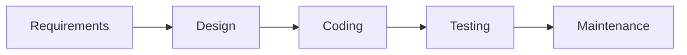
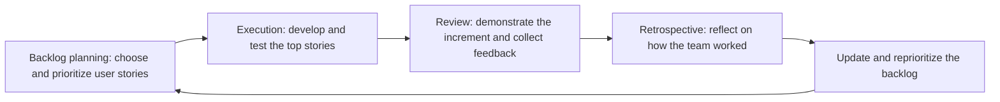
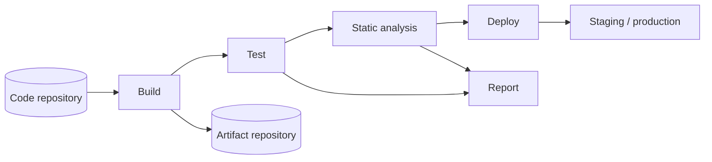
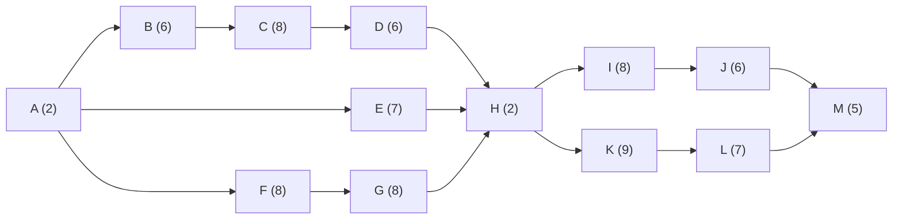
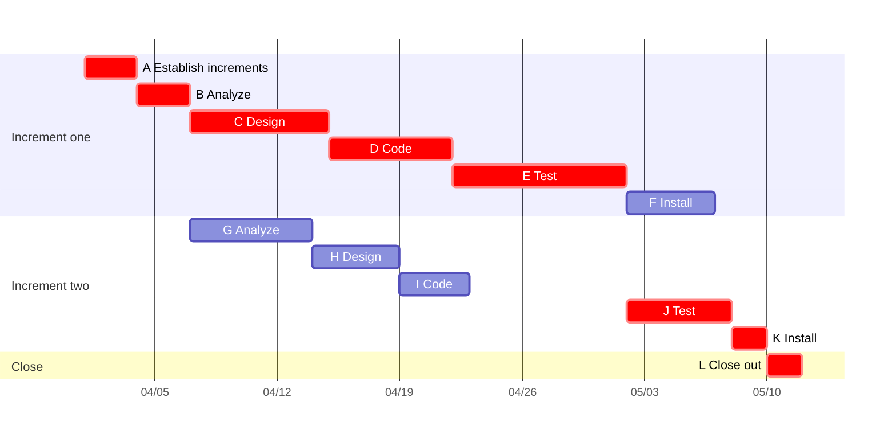

A team of programmers who start coding as soon as they hear an idea will, sooner or later, build the wrong thing, build it twice, or never finish. A process answers the questions that this approach leaves open: what is done in which order, who decides what to build next, how progress is measured, and how the team reacts when requirements change. This chapter follows the evolution of process models from the plan-driven waterfall model to agile methods, describes Scrum and Kanban in enough detail to run a team project with them, introduces DevOps, which extends the process to delivery and operation, and ends with the classical tools of project planning: work breakdown, estimation and the **critical path**. It builds on the life cycle of [4.14.1](/4.14.1); the next chapter adds the tool that every process relies on, version control.

## 2.1. Software Process Models

### 2.1.1. From Ad Hoc to Defined Processes

**Definition 2.1.1 (Software Process)** A **software process** is a set of related activities, together with their order, their inputs and outputs (artifacts) and the roles that perform them, that leads to the production and evolution of a software product. A **software process model** is a simplified, abstract description of a class of software processes.

Processes range along a spectrum. At one end is *ad hoc* development, with no defined process: it works for a single person writing a small program and fails as soon as several people must coordinate. At the other end are heavyweight processes with extensive documentation and formal assessment, such as those measured by the Capability Maturity Model (CMM) and ISO/IEC 15504 (SPICE, now continued by the ISO/IEC 330xx series). Between them lie the classical process models (waterfall, incremental, prototyping, spiral) and the lightweight agile methods.

The first idea of software engineering was to make building software like building a bridge: safe, with predictable cost and quality (although, as studies of megaprojects show, about nine out of ten large infrastructure projects themselves run late or over budget). This leads to *plan-and-document* processes:

- before coding, the project manager makes a plan;
- every phase of the plan produces detailed documentation;
- progress is measured against the plan;
- changes to the project must be reflected in the documentation and possibly in the plan.

### 2.1.2. The Waterfall Model

**Definition 2.1.2 (Waterfall Model)** The **waterfall model** is a plan-driven process model in which development passes through a fixed sequence of phases (requirements analysis and specification, architectural design, implementation and integration, verification, operation and maintenance), and each phase is completed and its documents approved before the next one starts.



Two arguments support finishing each phase first. The earlier a defect is caught, the cheaper it is to fix: an error in the requirements found during requirements review costs a fraction of the same error found after release, when design, code and tests built on it must all change. And the extensive documentation of each phase lets new people join the project. Winston Royce, whose 1970 paper is usually cited as the origin of the model, in fact presented the purely sequential version as risky and recommended feedback between phases and building a pilot version first; the strict waterfall was mainly a later reading of his figure.

| | Waterfall |
|---|---|
| advantages | clear structure and defined phases with milestones; comprehensive documentation that helps maintenance; efficient when requirements are stable; easy to monitor |
| disadvantages | requirement changes are rigid and expensive; testing comes late, so defects are expensive to fix; users see the product only at the end, risking poor product fit; risks show up late; unsuitable for large, complex or uncertain projects |

| Suitable for waterfall | Better avoided |
|---|---|
| small projects with clear, stable requirements (an internal office tool) | complex, large systems (enterprise resource planning software) |
| software tied to hardware whose requirements are fixed early (firmware of a thermostat) | projects with frequent requirement changes (consumer apps, start-up products) |
| industries with strict compliance and documentation (medical devices, aerospace) | innovative or experimental projects whose requirements evolve (AI tools) |
| inexperienced teams, for whom the structure gives guidance | projects that must reach the market fast (seasonal e-commerce features) |

The waterfall model is not obsolete: for simple, predictable projects it remains a valid choice. For most modern software, which demands flexibility, attention to users and speed, iterative models work better.

### 2.1.3. Incremental, Prototyping and Spiral Models

Three classical models relax the strict sequence in different ways.

- In *incremental development*, the system is delivered in a series of increments, each adding functionality to the previous one; the most important features come first, and users work with early increments while later ones are built. Each increment may itself be developed in a small waterfall.
- In *prototyping*, a quick, partial version of the system (a *prototype*) is built to clarify requirements or test a design idea with users. A throwaway prototype is discarded once it has answered its question; an evolutionary prototype is refined into the product.
- The *spiral model* (Barry Boehm, 1986) organizes development as a sequence of loops, each with four quadrants: determine objectives and constraints, identify and resolve risks (often with prototypes), develop and verify the next level of the product, and plan the next loop. Its distinctive feature is that the largest remaining risk decides what the next loop does.

| Model | Order of activities | Feedback from users | Main strength | Main risk |
|---|---|---|---|---|
| waterfall | one pass through all phases | at the end | predictability, documentation | building the wrong product |
| incremental | repeated passes, each adds features | after each increment | early value, easier change | architecture that does not accommodate later increments |
| prototyping | prototype first, then the product | on the prototype | clarifies unclear requirements | prototype code ending up in production |
| spiral | risk-driven loops | at each loop | explicit risk management | depends on skilled risk assessment; heavy for small projects |

### 2.1.4. Process Maturity

Watts Humphrey's observation that product quality follows process quality led to models that assess how mature an organization's process is. The current one is *Capability Maturity Model Integration* (CMMI, version 3.0 of 2023, maintained by ISACA), whose maturity levels are:

| Level | Name | Characteristic |
|---|---|---|
| 1 | Initial | work is unpredictable and reactive; success depends on individuals |
| 2 | Managed | projects are planned, performed, measured and controlled |
| 3 | Defined | the organization has standard processes that projects tailor |
| 4 | Quantitatively Managed | processes are controlled with statistical and quantitative data |
| 5 | Optimizing | the organization continuously improves its processes |

Such assessments matter for government and large enterprise contracts. Agile methods, discussed next, share the goal of continuous improvement but reach it with lightweight, team-level feedback rather than organization-wide documentation.

## 2.2. Agile Development

### 2.2.1. The Agile Manifesto

In February 2001, seventeen developers who practiced lightweight methods met in Snowbird, Utah, and wrote the *Manifesto for Agile Software Development*:

> We are uncovering better ways of developing software by doing it and helping others do it. Through this work we have come to value: individuals and interactions over processes and tools; working software over comprehensive documentation; customer collaboration over contract negotiation; responding to change over following a plan. That is, while there is value in the items on the right, we value the items on the left more.

The manifesto is accompanied by twelve principles, among them delivering working software frequently (from a couple of weeks to a couple of months, with a preference for the shorter timescale), welcoming changing requirements even late in development, daily cooperation between business people and developers, working software as the primary measure of progress, a sustainable pace, simplicity ("the art of maximizing the amount of work not done"), self-organizing teams, and regular reflection on how to become more effective. The last sentence of the manifesto is often forgotten: agile does not mean no planning and no documentation, only that they serve working software rather than replace it.

**Definition 2.2.1 (Agile Software Development)** **Agile software development** is a family of software processes, based on the values and principles of the Agile Manifesto, in which a self-organizing, cross-functional team develops software in short, fixed-length iterations, each of which delivers a usable, tested increment of the product, and the plan is adapted continually from the feedback of users and stakeholders.

### 2.2.2. Iterative and Incremental Cycles

Agile development views software development as adaptive: learning and feedback drive continuous improvement. Work is divided into iterations of fixed length (typically one to four weeks; called sprints in Scrum), and each iteration runs through the same loop:



In a retrospective, the team names what worked ("daily stand-ups kept us aligned") and what to improve ("we underestimated testing time").

| | Waterfall | Agile |
|---|---|---|
| advantages | clear structure and milestones; comprehensive documentation aids maintenance; easy to manage with fixed requirements | flexible under change; early and frequent delivery of usable software; continuous feedback improves product fit |
| disadvantages | inflexible to requirement changes; testing late, so bugs cost more; users see the product only at the end | requires active stakeholder involvement; risk of *scope creep* (uncontrolled growth of the scope) without strict backlog management; less documentation can hinder long-term maintenance |

### 2.2.3. Agile Methods

Agile is an umbrella term; the best-known methods are:

| Method | Origin | Characteristic practices |
|---|---|---|
| Scrum | Ken Schwaber and Jeff Sutherland, 1995 | fixed-length sprints, defined accountabilities, events and artifacts (§2.3) |
| Extreme Programming (XP) | Kent Beck, 1999 | pair programming, test-driven development, continuous integration, refactoring, small releases, collective code ownership |
| Kanban | adapted from lean manufacturing by David Anderson, 2000s | visualized workflow, limits on work in progress, continuous flow without iterations (§2.4.1) |
| Adaptive Software Development (ASD) | Jim Highsmith, 2000 | speculate–collaborate–learn cycles |
| Dynamic Systems Development Method (DSDM) | DSDM Consortium, 1994 | fixed time and cost with variable scope, MoSCoW prioritization |

The Agile Alliance, a non-profit organization founded by authors of the manifesto, promotes agile development. In practice teams mix methods: Scrum for the rhythm of planning and review, XP for engineering practices, a Kanban board for visualizing work.

## 2.3. Scrum

### 2.3.1. Characteristics and Accountabilities

**Definition 2.3.1 (Scrum)** **Scrum** is a lightweight agile framework in which a small team delivers value in a series of time-boxed iterations called **sprints**, each lasting one month or less, using a fixed set of accountabilities, events and artifacts. Its definitive description is *The Scrum Guide* by Ken Schwaber and Jeff Sutherland, whose current version dates from November 2020.

Scrum is characterized by strong adaptability (short iterations and adjustments based on feedback), self-organizing (in the 2020 guide, self-managing) cross-functional teams, transparency (the state of the work is visible to all), continuous improvement after every iteration, and value-driven ordering of the work. A Scrum Team, typically ten people or fewer, has three accountabilities:

| Accountability | Responsibility |
|---|---|
| *Product Owner* | one person who maximizes the value of the product: develops the Product Goal, orders the Product Backlog and decides what is worked on next |
| *Scrum Master* | establishes Scrum as defined, coaches the team, removes impediments and helps the organization understand Scrum; serves the team rather than managing it |
| Developers | the people who create the increment in each sprint: plan the sprint, keep to the Definition of Done, and adapt their plan daily |

Stakeholders (users, customers, managers) are not part of the Scrum Team; they take part in the Sprint Review. Older descriptions call the Developers the "Development Team" or "team members"; the 2020 guide uses one team with three accountabilities.

### 2.3.2. Events

The sprint is a container for the other four events, each time-boxed (the maxima below are for a one-month sprint and are shorter for shorter sprints):

| Event | Time box | Purpose |
|---|---|---|
| *Sprint Planning* | up to 8 hours | answer why this sprint is valuable (the Sprint Goal), what can be done (items selected from the Product Backlog) and how the work will be done (a plan, usually broken into tasks) |
| *Daily Scrum* | 15 minutes | the Developers inspect progress toward the Sprint Goal and adapt the plan for the next day |
| *Sprint Review* | up to 4 hours | the team presents the results to stakeholders, collects feedback and adapts the Product Backlog |
| *Sprint Retrospective* | up to 3 hours | the team inspects how the sprint went (people, interactions, processes, tools, Definition of Done) and chooses improvements for the next sprint |

Many teams structure the Daily Scrum around the three classic questions (what did I do yesterday, what will I do today, what is in my way). The 2020 guide no longer prescribes them: any structure is acceptable as long as it focuses on progress toward the Sprint Goal. Product Backlog refinement (formerly called "grooming"), in which items are clarified, split and estimated, is an ongoing activity rather than an event.

### 2.3.3. Artifacts and Commitments

Each artifact has a commitment that gives it focus:

| Artifact | Content | Commitment |
|---|---|---|
| *Product Backlog* | the ordered list of everything that might be needed in the product, maintained by the Product Owner and ordered by value | *Product Goal*: the long-term objective of the product |
| *Sprint Backlog* | the Sprint Goal, the items selected for the sprint and the plan for delivering them; owned by the Developers and updated throughout the sprint | *Sprint Goal*: the single objective of the sprint |
| *Increment* | a usable step toward the Product Goal; several increments may be created in one sprint | *Definition of Done*: the shared quality standard an item must meet to count as part of the increment |

A typical Definition of Done for a web application reads: code reviewed and merged into the main branch, unit and integration tests passing in the CI pipeline, acceptance criteria verified, documentation updated, deployed to the staging environment. Work that does not meet it is not done and returns to the Product Backlog.

### 2.3.4. User Stories, Epics and INVEST

A Product Backlog contains items of several kinds: user stories, technical stories (work that users do not see directly, such as upgrading a framework), spikes (time-boxed experiments to answer a question, such as which library to use) and defects.

**Definition 2.3.2 (User Story)** A **user story** is a short requirement written from the perspective of an end user, in the form "As a ⟨role⟩, I want ⟨goal⟩, so that ⟨benefit⟩", together with **acceptance criteria** that state when the story is fulfilled. A story is small enough to be completed within one sprint.

**Example 2.3.1** A story for a sales system:

```text
As an account manager,
I want a sales report of my accounts to be sent to my inbox daily,
so that I can monitor the sales progress of my customer portfolio.

Acceptance criteria:
1. The report is sent to my inbox every day at 08:00.
2. The report contains, for each account, yesterday's orders, revenue and open quotes.
3. Given an account without orders, when the report is generated, then it lists the account with zero revenue.
```

The third criterion is written in the Given–When–Then form of behavior-driven development, which translates directly into an automated acceptance test ([4.14.12](/4.14.12)). A story is a placeholder for a conversation, not a complete specification: the details are agreed when the team works on it. Requirements engineering ([4.14.4](/4.14.4)) compares stories with use cases and other forms of specification.

Stories are grouped in a hierarchy of scope. An *epic* is a large body of work that is broken down into stories and delivered over several sprints, typically within a month or a quarter; its scope is flexible, as stories are added or removed. An *initiative* is a collection of epics that drive toward a common goal over several quarters to a year. Bill Wake's mnemonic INVEST lists the properties of a good story:

| Letter | Property | Meaning |
|---|---|---|
| I | Independent | conceptually separate from other stories, so that it can be scheduled in any order |
| N | Negotiable | details evolve in conversation until the team arrives at a balanced solution |
| V | Valuable | its completion meets an actual need of a user or customer |
| E | Estimable | detailed enough for the team to estimate its relative size |
| S | Small | can be completed within a sprint without losing its value |
| T | Testable | has clear acceptance criteria that can be checked |

### 2.3.5. A Worked Sprint

Teams usually estimate stories in *story points*, a relative measure of effort, complexity and uncertainty (commonly on the scale 1, 2, 3, 5, 8, 13), rather than in hours. The *velocity* of a team is the number of story points it completes per sprint; its average over recent sprints is used to decide how much to take into the next sprint.

**Example 2.3.2** A team of four develops a chat application in two-week sprints (ten working days). Its velocity in the last three sprints was 16, 19 and 18 points, on average about 17.7, so it plans about 17 points. Sprint Planning produces the following Sprint Backlog.

Sprint Goal: users can register, sign in and exchange one-to-one text messages.

| Item | Type | Points | Tasks |
|---|---|---|---|
| S1: as a new user, I want to register with my email, so that I get an account | story | 3 | registration API; form with validation; confirmation email; tests |
| S2: as a user, I want to sign in and out, so that my messages are private | story | 3 | session handling; sign-in page; tests |
| S3: as a user, I want to send a text message to a friend, so that we can talk | story | 5 | message model and API; WebSocket delivery; chat view; tests |
| S4: as a user, I want to see the history of a conversation, so that I can follow it | story | 5 | paginated history API; scrolling view; tests |
| S5: evaluate two WebSocket libraries | spike | time box of 1 day | prototype with each; write a one-page comparison |
| S6: an empty password is accepted at registration | defect | 1 | add a failing test; fix validation |

A *burndown chart* plots the work remaining in the sprint against time; comparing it with the ideal straight line shows early whether the Sprint Goal is at risk.


The flat stretch in the first days is typical, because stories are only counted when done; a team whose chart stays flat until the last day has probably taken stories that are too large. This team finished all 17 points, so its next velocity estimate rises slightly.

## 2.4. Tools for Agility and DevOps

### 2.4.1. Kanban

**Definition 2.4.1 (Kanban)** **Kanban** is a method for managing knowledge work as a continuous flow: the work items are shown as cards on a board whose columns are the stages of the workflow, and each stage has a **work-in-progress limit** (WIP limit) on the number of items it may hold, so that new work is pulled into a stage only when capacity becomes free.

| Backlog | Ready (WIP 3) | In progress (WIP 3) | Review (WIP 2) | Done |
|---|---|---|---|---|
| S7, S8, S9, … | S4, S6 | S3, S5 | S2 | S1 |

WIP limits make bottlenecks visible: if Review is full, developers stop starting new items and help review instead. The quantitative basis is *Little's law* from queueing theory: in a stable system, the average number of items in progress equals **throughput** times average cycle time, so

$$
\text{average cycle time} = \frac{\text{average WIP}}{\text{average throughput}}.
$$

A team that finishes 5 items per week with 15 items in progress has an average cycle time of 3 weeks; lowering the WIP to 5 items, with the same throughput, makes each item flow through in about 1 week. Kanban has no sprints, so it suits work that arrives continuously, such as maintenance and operations; **Scrum** teams often use a Kanban-style board for their Sprint Backlog. Platforms such as GitLab and GitHub combine boards, issues, code repositories and pipelines in one tool.

### 2.4.2. DevOps

In traditional organizations, development teams hand finished software to a separate operations team, which runs it. The two groups have opposite incentives (change versus stability), and releases are rare, large and risky.

**Definition 2.4.2 (DevOps)** **DevOps** is a set of practices, cultural values and tools that integrates software development (Dev), quality assurance and IT operations (Ops): shared responsibility for the running system, communication and collaboration across the former boundaries, and automation of building, testing, releasing and monitoring, so that changes reach users quickly and reliably.

The core of the automation is a pipeline that every change passes through. Developers integrate their work into the shared repository many times a day; each integration is automatically built, tested and analyzed, and produces a deployable artifact. This practice is continuous integration, and its extension to automatic release is continuous delivery or deployment, both treated in [4.14.3](/4.14.3).



The DORA research program (DevOps Research and Assessment, now part of Google Cloud) measures software delivery performance with five metrics. Three measure throughput: *change lead time* (from commit to production), *deployment frequency*, and *failed deployment recovery time*. Two measure instability: *change fail rate* (the share of deployments that need immediate remediation, such as a rollback) and *deployment rework rate* (the share of deployments that are unplanned fixes for production incidents, added in 2024). Its central finding, repeated across years of surveys, is that speed and stability are not a trade-off: the best teams deploy on demand, several times a day, and also fail least and recover fastest, because small changes are easier to test, review and undo.

## 2.5. Project Planning

### 2.5.1. Work Breakdown and Estimation

The answer to the question "How does a project get to be a year late?" is "One day at a time" (Brooks). Planning makes the delays visible while they are still small. A plan relates tasks to resources (people, time, money) and is built in three steps: break the work down, estimate each part, and schedule the parts according to their dependencies.

A *work breakdown structure* (WBS) decomposes the product hierarchically (product → subsystems → features → tasks) until each leaf is a task that one person or a pair can finish in a few days and whose completion can be checked. In agile projects, the hierarchy initiative → epic → story → task plays the same role.

Estimation methods fall into three groups:

| Method | Idea | Use |
|---|---|---|
| expert judgment and analogy | compare with similar past work | quick estimates; *planning poker*: each developer reveals a card with a story-point value at the same time, outliers explain their reasoning, and the team re-votes until it converges |
| decomposition | estimate the leaves of the WBS and add up, with a buffer | detailed plans for the next weeks |
| algorithmic models | fit effort to size from historical data | early, large-scale estimates of whole projects |

The best-known algorithmic model is COCOMO II (Boehm, 2000). Its basic post-architecture equations are

$$
\mathrm{PM} = 2.94 \times \mathrm{KSLOC}^{E} \times \prod_i \mathrm{EM}_i, \qquad E = 0.91 + 0.01 \sum_{j=1}^{5} \mathrm{SF}_j,
$$

where PM is effort in person-months, KSLOC the size in thousands of source lines, $\mathrm{EM}_i$ are effort multipliers (product complexity, team capability, tool use and so on; 1 for nominal) and $\mathrm{SF}_j$ are five scale factors (precedentedness, flexibility, architecture and risk resolution, team cohesion, process maturity). Because $E > 1$ for most projects, effort grows faster than size: large projects have diseconomies of scale. The nominal schedule is $\mathrm{TDEV} = 3.67 \times \mathrm{PM}^{F}$ months with $F = 0.28 + 0.2\,(E - 0.91)$.

**Example 2.5.1** For a 50 KSLOC project with all factors nominal ($\sum \mathrm{SF}_j = 18.97$, all $\mathrm{EM}_i = 1$): $E = 1.0997$, $\mathrm{PM} = 2.94 \times 50^{1.0997} \approx 217$ person-months, $F \approx 0.318$, $\mathrm{TDEV} \approx 3.67 \times 217^{0.318} \approx 20$ months, which corresponds to an average team of about 11 people.

Two cautions apply to every estimate. Early estimates are very uncertain: at the stage of the initial concept, actual effort commonly ends up anywhere from a quarter to four times the estimate (the *cone of uncertainty*), and the range narrows only as requirements and design are settled. And people and months are not interchangeable: *Brooks's law* states that adding manpower to a late software project makes it later, because new members need training and the number of communication paths among $n$ people grows as $n(n-1)/2$.

### 2.5.2. Activity Networks and the Critical Path

**Definition 2.5.1 (Activity Network)** An **activity network** (task network diagram) of a project is a directed acyclic graph whose vertices are the tasks, each labeled with its duration, and whose edges are the precedence relations: an edge from task $u$ to task $v$ means that $v$ cannot start before $u$ has finished. It depicts the length, sequence, concurrency and dependencies of the tasks.

**Definition 2.5.2 (Critical Path)** In an activity network, a **critical path** is a path from a start task to an end task whose total duration is the largest. Its length is the shortest possible duration of the whole project, and its tasks are the critical tasks: delaying any of them delays the project.

To shorten the project, one must shorten tasks on the critical path; shortening other tasks has no effect. The critical path is found by two passes over the tasks in a **topological sorting** order of the network, which is a **directed acyclic graph**. The forward pass computes for each task its earliest start $\mathrm{ES}(v) = \max_{u \to v} \mathrm{EF}(u)$ (0 for tasks without predecessors) and its earliest finish $\mathrm{EF}(v) = \mathrm{ES}(v) + d(v)$. The backward pass, starting from the project end $T = \max_v \mathrm{EF}(v)$, computes the latest finish $\mathrm{LF}(v) = \min_{v \to w} \mathrm{LS}(w)$ ($T$ for tasks without successors) and the latest start $\mathrm{LS}(v) = \mathrm{LF}(v) - d(v)$. The difference $\mathrm{LS}(v) - \mathrm{ES}(v)$ is the *slack* (float) of the task: how long it can be delayed without delaying the project. The critical tasks are exactly those with zero slack. This is the critical path method (CPM); both passes take time linear in the size of the graph.

**Example 2.5.2** The network below has 13 tasks (durations in days).



| Task | Duration | ES | EF | LS | LF | Slack |
|---|---|---|---|---|---|---|
| A | 2 | 0 | 2 | 0 | 2 | 0 |
| B | 6 | 2 | 8 | 2 | 8 | 0 |
| C | 8 | 8 | 16 | 8 | 16 | 0 |
| D | 6 | 16 | 22 | 16 | 22 | 0 |
| E | 7 | 2 | 9 | 15 | 22 | 13 |
| F | 8 | 2 | 10 | 6 | 14 | 4 |
| G | 8 | 10 | 18 | 14 | 22 | 4 |
| H | 2 | 22 | 24 | 22 | 24 | 0 |
| I | 8 | 24 | 32 | 26 | 34 | 2 |
| J | 6 | 32 | 38 | 34 | 40 | 2 |
| K | 9 | 24 | 33 | 24 | 33 | 0 |
| L | 7 | 33 | 40 | 33 | 40 | 0 |
| M | 5 | 40 | 45 | 40 | 45 | 0 |

The project takes 45 days, and the critical path is A–B–C–D–H–K–L–M. Speeding up E, which has 13 days of slack, gains nothing. Shortening C by 3 days shortens the project by 3 days, but shortening it by 5 days gains only 4, because the path through F and G (slack 4) then becomes critical.

A *Gantt chart* (after Henry Gantt, 1861–1919) shows the same schedule as horizontal bars on a calendar, which makes it the usual way to communicate a plan.

**Example 2.5.3** A project delivers a system in two increments; durations are in calendar days and the project starts on 1 April.

| Task | Name | Duration | Predecessors | Start | Finish |
|---|---|---|---|---|---|
| A | Establish increments | 3 | none | 4/1 | 4/3 |
| B | Analyze increment one | 3 | A | 4/4 | 4/6 |
| C | Design increment one | 8 | B | 4/7 | 4/14 |
| D | Code increment one | 7 | C | 4/15 | 4/21 |
| E | Test increment one | 10 | D | 4/22 | 5/1 |
| F | Install increment one | 5 | E | 5/2 | 5/6 |
| G | Analyze increment two | 7 | A, B | 4/7 | 4/13 |
| H | Design increment two | 5 | G | 4/14 | 4/18 |
| I | Code increment two | 4 | H | 4/19 | 4/22 |
| J | Test increment two | 6 | E, I | 5/2 | 5/7 |
| K | Install increment two | 2 | J | 5/8 | 5/9 |
| L | Close out project | 2 | F, K | 5/10 | 5/11 |



The project ends on 11 May, after 41 days. The critical path is A–B–C–D–E–J–K–L ($3 + 3 + 8 + 7 + 10 + 6 + 2 + 2 = 41$). Increment two's analysis, design and coding (G, H, I) finish on 22 April but testing it (J) also depends on the testing of increment one (E), which ends on 1 May, so these three tasks have 9 days of slack; installing increment one (F) has 3 days. The chart also exposes the real bottleneck: testing increment one is the longest task, and it is on the critical path.

In agile projects the critical path matters less inside an iteration, where the Daily Scrum reveals dependencies every day. It matters between teams and over longer horizons. Teams on multi-team projects end their Sprint Planning with a five-minute *rolling lookahead* at the next one to three sprints to identify dependencies between teams. On a very complex project, the first defense is to write mostly independent backlog items: if items can be developed in any order, critical-path problems disappear. Only when that is impossible is it worth drawing a task network of the next three to six months of stories and analyzing its critical path.

## 2.6. Process When Agents Do the Implementation

With **coding agents** ([4.2.14](/4.2.14)) the cost of implementing a well-specified story drops sharply, while the costs of deciding what to build, specifying it and verifying the result stay. The process adapts accordingly. Backlog items need sharper **acceptance criteria**, because an agent cannot negotiate a vague story in conversation the way a team member can; the INVEST properties, especially Small and Testable, become prerequisites for delegating an item at all. The **Definition of Done** becomes executable: tests, type checks and linters in the pipeline are the part of the standard that an agent can check by itself, and human review of design and diffs is the part it cannot. Estimates in **story points** lose some meaning when implementation is fast, and the bottleneck moves to review and integration, which is exactly where Kanban's WIP limits and Little's law apply: generating more changes than reviewers can absorb lengthens the cycle time of every change. Finally, the DORA finding that small batches give both speed and stability holds more strongly when changes are cheap to produce; [4.14.14](/4.14.14) develops these points.

## Summary

- A **software process** orders the activities of the life cycle; models range from ad hoc to heavyweight plan-and-document processes and lightweight agile ones.
- The **waterfall model** completes each phase before the next; it suits small, stable, compliance-heavy projects and fails under changing requirements. Incremental, prototyping and spiral models introduce early feedback and risk management; CMMI assesses process maturity.
- The Agile Manifesto values individuals, working software, collaboration and responding to change; agile teams deliver tested increments in short iterations.
- Scrum (2020 guide): Product Owner, Scrum Master and Developers; sprints with Planning, Daily Scrum, Review and Retrospective; Product Backlog, Sprint Backlog and Increment with their commitments Product Goal, Sprint Goal and Definition of Done.
- User stories ("As a…, I want…, so that…") carry acceptance criteria and should satisfy INVEST; velocity and burndown charts track progress.
- Kanban limits work in progress; by Little's law, lower WIP means shorter cycle time. DevOps automates the path from commit to production and is measured by the DORA metrics.
- Planning combines work breakdown, estimation (planning poker, COCOMO II, with the cone of uncertainty and Brooks's law in mind) and scheduling by the critical path of the activity network.
