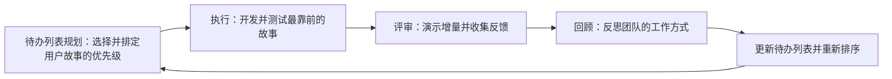
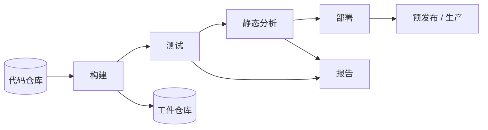
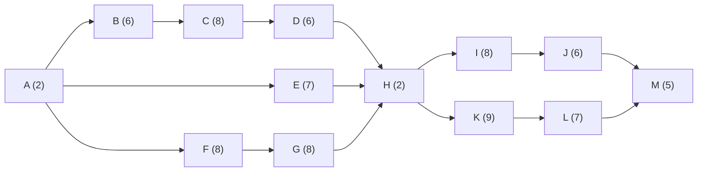
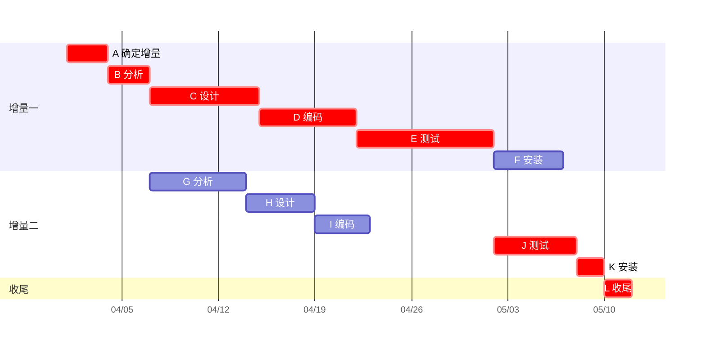

一个团队听到一个想法就动手编码，迟早会做错东西、把同一个东西做两遍，或者永远做不完。过程回答的，正是这种做法留下的问题：什么事按什么顺序做，谁决定下一步做什么，进度如何度量，需求变化时团队如何应对。本章沿着过程模型的演化，从计划驱动的瀑布模型讲到敏捷方法；对 Scrum 和看板的描述详细到足以用它们来运行一个团队项目；接着介绍把过程延伸到交付与运行的 DevOps；最后讲项目计划的经典工具：工作分解、估算与**关键路径**。本章以 [4.14.1](/4.14.1) 的生命周期为基础；下一章加入每个过程都要依赖的工具，即版本控制。

## 2.1. 软件过程模型

### 2.1.1. 从随意开发到定义明确的过程

**定义 2.1.1（软件过程）** **软件过程**（software process）是一组相互关联的活动，连同它们的顺序、输入与输出（工件）以及承担它们的角色，导向软件产品的产生与演化。**软件过程模型**（software process model）是对一类软件过程的简化的抽象描述。

过程分布在一条谱带上。一端是没有既定过程的*随意*（ad hoc）开发：一个人写小程序时可行，一旦需要几个人协调就失败。另一端是文档繁多、有正式评估的重量级过程，例如用能力成熟度模型（CMM）和 ISO/IEC 15504（SPICE，现由 ISO/IEC 330xx 系列延续）来度量的过程。两者之间是经典的过程模型（瀑布、增量、原型、螺旋）和轻量的敏捷方法。

软件工程最初的想法，是让构建软件像建造桥梁一样：安全，成本与质量可预测（不过，巨型项目的研究表明，大型基础设施项目本身也约有十分之九会延期或超支）。由此产生了*计划加文档*（plan-and-document）的过程：

- 编码之前，项目经理先制订计划；
- 计划的每个阶段都产出详细的文档；
- 进度按计划来度量；
- 对项目的变更必须反映到文档中，并可能反映到计划中。

### 2.1.2. 瀑布模型

**定义 2.1.2（瀑布模型）** **瀑布模型**（waterfall model）是一种计划驱动的过程模型，开发依次经过一系列固定的阶段（需求分析与规格说明、架构设计、实现与集成、验证、运行与维护），每个阶段完成、其文档获得批准之后，下一阶段才开始。


先完成每个阶段，有两条理由。缺陷发现得越早，修复越便宜：需求评审中发现的需求错误，其代价只是同一个错误在发布之后才发现的一小部分，因为那时建立在它之上的设计、代码和测试都必须修改。此外，每个阶段详尽的文档使新人能够加入项目。Winston Royce 1970 年的论文通常被引为这一模型的起源，但他其实把纯顺序的版本视为有风险的做法，并建议在阶段之间设置反馈，先构建一个试验版本；严格的瀑布主要是后人对他那幅图的解读。

| | 瀑布 |
|---|---|
| 优点 | 结构清晰，阶段明确且有里程碑；完整的文档有助于维护；需求稳定时效率高；易于监控 |
| 缺点 | 需求变更僵硬而昂贵；测试靠后，缺陷修复代价高；用户到最后才见到产品，产品可能不合用；风险暴露得晚；不适合大型、复杂或不确定的项目 |

| 适合瀑布 | 最好避免 |
|---|---|
| 需求清晰稳定的小项目（内部办公工具） | 复杂的大型系统（企业资源计划软件） |
| 与硬件绑定、需求早早确定的软件（恒温器固件） | 需求频繁变化的项目（消费类应用、创业产品） |
| 有严格合规与文档要求的行业（医疗器械、航空航天） | 需求不断演化的创新或实验性项目（AI 工具） |
| 经验不足的团队，结构能给他们指引 | 必须尽快上市的项目（季节性电商功能） |

瀑布模型并未过时：对简单、可预测的项目，它仍是有效的选择。对大多数要求灵活、关注用户、讲究速度的现代软件，迭代式模型效果更好。

### 2.1.3. 增量、原型与螺旋模型

三种经典模型以不同的方式放松严格的顺序。

- *增量开发*（incremental development）中，系统分成一系列增量交付，每个增量在前一个的基础上增加功能；最重要的功能最先做，用户在后面的增量构建期间使用早期的增量。每个增量本身可以按一个小瀑布来开发。
- *原型法*（prototyping）中，先构建系统的一个快速、局部的版本（*原型*），用来澄清需求，或与用户一起检验某个设计想法。抛弃式原型在回答了它的问题之后就丢弃；演化式原型则被逐步精化为产品。
- *螺旋模型*（spiral model），由 Barry Boehm 于 1986 年提出，把开发组织为一连串循环，每个循环有四个象限：确定目标与约束，识别并化解风险（常借助原型），开发并验证产品的下一层次，规划下一个循环。它的特色在于，剩余的最大风险决定下一个循环做什么。

| 模型 | 活动顺序 | 用户反馈 | 主要长处 | 主要风险 |
|---|---|---|---|---|
| 瀑布 | 遍历所有阶段一次 | 在结束时 | 可预测，有文档 | 做出错误的产品 |
| 增量 | 重复多遍，每遍增加功能 | 每个增量之后 | 价值早现，变更较容易 | 架构容纳不了后面的增量 |
| 原型 | 先做原型，再做产品 | 针对原型 | 澄清不清楚的需求 | 原型代码最终进入生产 |
| 螺旋 | 风险驱动的循环 | 每个循环 | 显式的风险管理 | 依赖熟练的风险评估；对小项目过重 |

### 2.1.4. 过程成熟度

Watts Humphrey 观察到产品质量取决于过程质量，由此产生了评估组织过程成熟度的模型。现行的是*能力成熟度模型集成*（Capability Maturity Model Integration），简称 CMMI（2023 年的 3.0 版，由 ISACA 维护），其成熟度等级如下：

| 等级 | 名称 | 特征 |
|---|---|---|
| 1 | 初始级（Initial） | 工作不可预测、被动应对；成败取决于个人 |
| 2 | 已管理级（Managed） | 项目有计划、被执行、被度量和控制 |
| 3 | 已定义级（Defined） | 组织有标准过程，各项目对其裁剪使用 |
| 4 | 量化管理级（Quantitatively Managed） | 用统计和量化数据控制过程 |
| 5 | 优化级（Optimizing） | 组织持续改进其过程 |

这类评估对政府和大企业的合同很重要。下面讨论的敏捷方法有同样的持续改进目标，但靠的是轻量的、团队层面的反馈，而不是全组织范围的文档。

## 2.2. 敏捷开发

### 2.2.1. 敏捷宣言

2001 年 2 月，十七位实践轻量方法的开发者在美国犹他州 Snowbird 聚会，写下了《敏捷软件开发宣言》，即敏捷宣言（Agile Manifesto）：

> 我们通过亲身实践以及帮助他人实践，正在揭示更好的软件开发方法。通过这项工作，我们开始重视：个体和互动高于流程和工具；可工作的软件高于详尽的文档；客户合作高于合同谈判；响应变化高于遵循计划。也就是说，尽管右项有其价值，我们更重视左项。

宣言附有十二条原则，其中包括：频繁交付可工作的软件（从几周到几个月，倾向于较短的周期）、即使在开发后期也欢迎需求变化、业务人员与开发者每天合作、以可工作的软件作为进度的主要度量、可持续的节奏、简单（"最大化未完成工作量的艺术"）、自组织的团队，以及定期反思如何提高效率。宣言的最后一句常被忘记：敏捷并不意味着不做计划、不写文档，只是它们要服务于可工作的软件，而不是取代它。

**定义 2.2.1（敏捷软件开发）** **敏捷软件开发**（agile software development）是基于敏捷宣言的价值观与原则的一族软件过程：自组织的跨职能团队以短而定长的迭代开发软件，每次迭代交付一个可用的、经过测试的产品增量，并根据用户和干系人的反馈不断调整计划。

### 2.2.2. 迭代与增量循环

敏捷开发把软件开发看作自适应的：学习与反馈驱动持续改进。工作被划分为定长的迭代（通常一到四周；在 Scrum 中称为冲刺），每次迭代都走同一个循环：



在回顾会议上，团队指出哪些做得好（"每日站会使我们保持同步"），哪些需要改进（"我们低估了测试时间"）。

| | 瀑布 | 敏捷 |
|---|---|---|
| 优点 | 结构与里程碑清晰；完整的文档有助于维护；需求固定时易于管理 | 面对变化灵活；尽早、频繁地交付可用的软件；持续的反馈使产品更合用 |
| 缺点 | 对需求变更不灵活；测试靠后，缺陷代价更高；用户到最后才见到产品 | 需要干系人积极参与；若待办列表管理不严，有范围蔓延（scope creep），即范围不受控制地增长的风险；文档较少可能妨碍长期维护 |

### 2.2.3. 敏捷方法

敏捷是一个总称；最著名的方法有：

| 方法 | 起源 | 特色实践 |
|---|---|---|
| Scrum | Ken Schwaber 与 Jeff Sutherland，1995 | 定长冲刺，明确的角色、事件与工件（§2.3） |
| 极限编程（Extreme Programming，XP） | Kent Beck，1999 | 结对编程、测试驱动开发、持续集成、重构、小版本发布、代码集体所有 |
| 看板 | David Anderson 于 21 世纪初从精益制造改造而来 | 可视化工作流、限制在制品、无迭代的连续流（§2.4.1） |
| 自适应软件开发（Adaptive Software Development，ASD） | Jim Highsmith，2000 | 推测—协作—学习循环 |
| 动态系统开发方法（Dynamic Systems Development Method，DSDM） | DSDM 联盟，1994 | 时间与成本固定、范围可变，MoSCoW 优先级排序 |

敏捷联盟（Agile Alliance）是由宣言作者创立的非营利组织，推广敏捷开发。实践中团队会混用各种方法：用 Scrum 提供计划与评审的节奏，用 XP 提供工程实践，用看板板来可视化工作。

## 2.3. Scrum

### 2.3.1. 特点与角色职责

**定义 2.3.1（Scrum）** **Scrum** 是一种轻量的敏捷框架：小团队在一连串限定时间的迭代中交付价值，这种迭代称为**冲刺**，每个冲刺不超过一个月，并使用一套固定的角色职责、事件与工件。它的权威描述是 Ken Schwaber 与 Jeff Sutherland 的《Scrum 指南》，现行版本为 2020 年 11 月版。

Scrum 的特点是：适应性强（迭代短，依据反馈调整），自组织（2020 年指南中称自我管理）的跨职能团队，透明（工作状态对所有人可见），每次迭代之后持续改进，以及按价值排序工作。Scrum 团队通常不超过十人，有三种角色职责：

| 角色职责 | 责任 |
|---|---|
| 产品负责人（Product Owner） | 一个人，使产品价值最大化：制定产品目标，为产品待办列表排序，并决定下一步做什么 |
| *Scrum Master* | 按定义建立 Scrum，辅导团队，排除障碍，帮助组织理解 Scrum；服务于团队而不是管理团队 |
| 开发人员 | 在每个冲刺中创建增量的人：规划冲刺，遵守完成的定义，并每天调整计划 |

干系人（用户、客户、管理者）不属于 Scrum 团队；他们参加冲刺评审。较早的描述把开发人员称为"开发团队"或"团队成员"；2020 年指南用同一个团队、三种角色职责。

### 2.3.2. 事件

冲刺是其余四个事件的容器，每个事件都有时间盒（下面的上限针对一个月的冲刺，冲刺较短时相应缩短）：

| 事件 | 时间盒 | 目的 |
|---|---|---|
| 冲刺计划会议（Sprint Planning） | 至多 8 小时 | 回答这个冲刺为何有价值（冲刺目标）、能做什么（从产品待办列表中选出的条目）、以及怎么做（一份计划，通常拆成任务） |
| 每日站会（Daily Scrum） | 15 分钟 | 开发人员检视朝向冲刺目标的进展，并调整第二天的计划 |
| 冲刺评审（Sprint Review） | 至多 4 小时 | 团队向干系人展示成果，收集反馈，并调整产品待办列表 |
| 冲刺回顾（Sprint Retrospective） | 至多 3 小时 | 团队检视这个冲刺如何进行（人员、互动、过程、工具、完成的定义），并为下一个冲刺选定改进措施 |

许多团队围绕三个经典问题组织每日站会（昨天做了什么，今天要做什么，遇到什么障碍）。2020 年指南不再规定这些问题：只要聚焦于朝向冲刺目标的进展，任何结构都可以。产品待办列表的梳理（refinement，以前叫"grooming"）是澄清、拆分并估算条目的工作，它是持续进行的活动，而不是一个事件。

### 2.3.3. 工件与承诺

每个工件都有一项承诺，使它有明确的焦点：

| 工件 | 内容 | 承诺 |
|---|---|---|
| 产品待办列表（Product Backlog） | 产品中可能需要的一切的有序列表，由产品负责人维护，按价值排序 | 产品目标（Product Goal）：产品的长期目标 |
| 冲刺待办列表（Sprint Backlog） | 冲刺目标、为冲刺选定的条目以及交付它们的计划；归开发人员所有，在冲刺中持续更新 | 冲刺目标（Sprint Goal）：这个冲刺唯一的目标 |
| 增量（Increment） | 朝向产品目标的一个可用的步骤；一个冲刺中可以创建多个增量 | 完成的定义（Definition of Done）：条目要算作增量的一部分所必须满足的共同质量标准 |

Web 应用典型的完成的定义是：代码已评审并合并到主分支，单元测试与集成测试在 CI 流水线中通过，验收标准已验证，文档已更新，已部署到预发布环境。不满足它的工作就没有完成，要回到产品待办列表。

### 2.3.4. 用户故事、史诗与 INVEST

产品待办列表包含几类条目：用户故事，技术故事（用户不直接看到的工作，例如升级框架），探针任务（spike，为回答某个问题而限定时间的实验，例如选用哪个库）和缺陷。

**定义 2.3.2（用户故事）** **用户故事**（user story）是从最终用户的视角写成的简短需求，形式为"作为〈角色〉，我想要〈目标〉，以便〈收益〉"，并附有说明故事何时算完成的**验收标准**。故事要小到能在一个冲刺内完成。

**例 2.3.1** 一个销售系统的故事：

```text
As an account manager,
I want a sales report of my accounts to be sent to my inbox daily,
so that I can monitor the sales progress of my customer portfolio.

Acceptance criteria:
1. The report is sent to my inbox every day at 08:00.
2. The report contains, for each account, yesterday's orders, revenue and open quotes.
3. Given an account without orders, when the report is generated, then it lists the account with zero revenue.
```

第三条标准用的是行为驱动开发的 Given–When–Then 形式，可以直接转化为自动化的验收测试（[4.14.12](/4.14.12)）。故事是一场对话的占位符，而不是完整的规格：细节在团队着手处理它时再商定。需求工程（[4.14.4](/4.14.4)）把故事与用例及其他规格形式作了比较。

故事按范围组成层次。*史诗*（epic）是一大块工作，被拆分为故事，历经多个冲刺交付，通常在一个月或一个季度之内；它的范围是弹性的，因为故事会被增加或移除。*倡议*（initiative）是一组史诗的集合，在几个季度到一年的时间里朝着共同目标推进。Bill Wake 的助记词 INVEST 列出了好故事的性质：

| 字母 | 性质 | 含义 |
|---|---|---|
| I | Independent（独立） | 在概念上与其他故事分离，因而可以按任意顺序排期 |
| N | Negotiable（可协商） | 细节在对话中演化，直到团队得到一个平衡的方案 |
| V | Valuable（有价值） | 它的完成满足用户或客户的实际需要 |
| E | Estimable（可估算） | 足够详细，使团队能估计它的相对规模 |
| S | Small（小） | 能在一个冲刺内完成而不失其价值 |
| T | Testable（可测试） | 有可以检查的明确验收标准 |

### 2.3.5. 一个冲刺的实例

团队通常用*故事点*（story points）来估算故事，而不是用小时。故事点是对工作量、复杂度和不确定性的相对度量（常用刻度 1、2、3、5、8、13）。团队的*速率*（velocity）是它每个冲刺完成的故事点数；用最近几个冲刺的平均值来决定下一个冲刺要接多少。

**例 2.3.2** 一个四人团队以两周（十个工作日）的冲刺开发一个聊天应用。它最近三个冲刺的速率是 16、19 和 18 点，平均约 17.7，因此计划约 17 点。冲刺计划会议产生如下的冲刺待办列表。

冲刺目标：用户可以注册、登录，并交换一对一的文本消息。

| 条目 | 类型 | 点数 | 任务 |
|---|---|---|---|
| S1：作为新用户，我想用邮箱注册，以便获得账号 | 故事 | 3 | 注册 API；带校验的表单；确认邮件；测试 |
| S2：作为用户，我想登录和退出，以便我的消息是私密的 | 故事 | 3 | 会话处理；登录页面；测试 |
| S3：作为用户，我想给朋友发文本消息，以便我们交谈 | 故事 | 5 | 消息模型与 API；WebSocket 投递；聊天视图；测试 |
| S4：作为用户，我想查看会话历史，以便跟上对话 | 故事 | 5 | 分页的历史 API；滚动视图；测试 |
| S5：评估两个 WebSocket 库 | 探针任务 | 时间盒 1 天 | 各做一个原型；写一页比较 |
| S6：注册时接受了空密码 | 缺陷 | 1 | 添加一个失败的测试；修复校验 |

*燃尽图*（burndown chart）画出冲刺中剩余的工作量随时间的变化；把它与理想的直线比较，可以及早看出冲刺目标是否有风险。


头几天的平坦段是典型现象，因为故事只有完成时才计入；图一直平到最后一天的团队，多半接了太大的故事。这个团队完成了全部 17 点，所以它下一次的速率估计略有上升。

## 2.4. 敏捷与 DevOps 的工具

### 2.4.1. 看板

**定义 2.4.1（看板）** **看板**（Kanban）是把知识工作作为连续流来管理的方法：工作条目以卡片的形式显示在板上，板的各列是工作流的各个阶段，每个阶段对其可容纳的条目数有一个**在制品限制**（WIP 限制），只有当产能空出时，新的工作才会被拉入该阶段。

| 待办 | 就绪（WIP 3） | 进行中（WIP 3） | 评审（WIP 2） | 完成 |
|---|---|---|---|---|
| S7, S8, S9, … | S4, S6 | S3, S5 | S2 | S1 |

WIP 限制使瓶颈显现出来：如果评审列已满，开发者就不再开始新的条目，转而帮助评审。其定量依据是排队论中的 Little 定律（Little's law）：在稳定的系统中，在制品的平均数量等于**吞吐率**乘以平均周期时间，因此

$$
\text{average cycle time} = \frac{\text{average WIP}}{\text{average throughput}}.
$$

一个团队每周完成 5 个条目、在制品有 15 个，平均周期时间就是 3 周；把 WIP 降到 5 个而吞吐率不变，每个条目流过全程只需约 1 周。看板没有冲刺，因此适合持续到来的工作，例如维护与运维；**Scrum** 团队也常用看板式的板来管理冲刺待办列表。GitLab、GitHub 等平台把看板、议题、代码仓库和流水线集成在一个工具里。

### 2.4.2. DevOps

在传统的组织中，开发团队把做好的软件交给另一个运维团队去运行。这两个群体的激励是相反的（变更与稳定），发布又少、大、风险高。

**定义 2.4.2（DevOps）** **DevOps** 是一套把软件开发（Dev）、质量保证与 IT 运维（Ops）整合起来的实践、文化价值观与工具：对运行中的系统共同负责，跨越原有的界限沟通协作，把构建、测试、发布与监控自动化，使变更快速而可靠地到达用户。

自动化的核心是每个变更都要经过的流水线。开发者每天多次把工作集成到共享仓库中；每次集成都被自动构建、测试、分析，并产出可部署的工件。这种实践是持续集成，把它延伸到自动发布，就是持续交付或持续部署，二者都在 [4.14.3](/4.14.3) 中讨论。



DORA 研究计划（DevOps Research and Assessment，现为 Google Cloud 的一部分）用五个指标度量软件交付绩效。三个度量吞吐：*变更前置时间*（从提交到进入生产）、*部署频率*和*失败部署的恢复时间*。两个度量不稳定性：*变更失败率*（需要立即补救（如回滚）的部署所占的比例）和*部署返工率*（属于为生产事故而做的计划外修复的部署所占的比例，2024 年新增）。多年调查反复得到的核心发现是：速度与稳定并不是此消彼长的权衡：最好的团队可以随时部署、每天部署多次，同时失败最少、恢复最快，因为小的变更更容易测试、评审和撤销。

## 2.5. 项目计划

### 2.5.1. 工作分解与估算

"一个项目怎么会晚了一年？"答案是"一次一天"（Brooks）。计划使延误在还很小的时候就显现出来。计划把任务与资源（人、时间、金钱）联系起来，分三步建立：分解工作，估算每一部分，并按依赖关系为各部分排期。

*工作分解结构*（work breakdown structure），简称 WBS，把产品逐级分解（产品 → 子系统 → 功能 → 任务），直到每个叶子都是一个人或一对人几天内就能完成、且完成与否可以检查的任务。在敏捷项目中，倡议 → 史诗 → 故事 → 任务这一层次起同样的作用。

估算方法分为三类：

| 方法 | 思路 | 用途 |
|---|---|---|
| 专家判断与类比 | 与过去类似的工作比较 | 快速估算；*计划扑克*（planning poker）：每个开发者同时亮出一张写有故事点数的牌，离群者解释理由，团队重新投票，直到收敛 |
| 分解 | 估算 WBS 的叶子并求和，加上缓冲 | 未来几周的详细计划 |
| 算法模型 | 用历史数据拟合工作量与规模的关系 | 整个项目早期的大规模估算 |

最著名的算法模型是 COCOMO II（Boehm，2000）。它的基本后架构方程是

$$
\mathrm{PM} = 2.94 \times \mathrm{KSLOC}^{E} \times \prod_i \mathrm{EM}_i, \qquad E = 0.91 + 0.01 \sum_{j=1}^{5} \mathrm{SF}_j,
$$

其中 PM 是以人月计的工作量，KSLOC 是以千行源代码计的规模，$\mathrm{EM}_i$ 是工作量乘数（产品复杂度、团队能力、工具使用等；标称值为 1），$\mathrm{SF}_j$ 是五个规模因子（先例性、灵活性、架构与风险化解、团队凝聚力、过程成熟度）。对大多数项目 $E > 1$，所以工作量的增长快于规模：大型项目有规模不经济。标称的进度是 $\mathrm{TDEV} = 3.67 \times \mathrm{PM}^{F}$ 个月，其中 $F = 0.28 + 0.2\,(E - 0.91)$。

**例 2.5.1** 对一个 50 KSLOC 的项目，所有因子取标称值（$\sum \mathrm{SF}_j = 18.97$，所有 $\mathrm{EM}_i = 1$）：$E = 1.0997$，$\mathrm{PM} = 2.94 \times 50^{1.0997} \approx 217$ 人月，$F \approx 0.318$，$\mathrm{TDEV} \approx 3.67 \times 217^{0.318} \approx 20$ 个月，对应平均约 11 人的团队。

每个估算都要注意两点。早期的估算很不确定：在最初的概念阶段，实际工作量常常落在估算的四分之一到四倍之间的任何位置，即不确定性锥（cone of uncertainty），只有随着需求和设计的确定，范围才会收窄。其次，人和月并不能互换：*Brooks 定律*（Brooks's law）指出，给已经延期的软件项目增加人手，只会使它更晚，因为新成员需要培训，而 $n$ 个人之间的沟通路径数按 $n(n-1)/2$ 增长。

### 2.5.2. 活动网络与关键路径

**定义 2.5.1（活动网络）** 项目的**活动网络**（activity network，任务网络图）是一个有向无环图，其顶点是任务，每个顶点标注其工期，其边是先后关系：从任务 $u$ 到任务 $v$ 的边表示 $v$ 不能在 $u$ 完成之前开始。它刻画任务的长度、顺序、并发与依赖。

**定义 2.5.2（关键路径）** 在活动网络中，**关键路径**（critical path）是从起始任务到终止任务的总工期最大的路径。它的长度就是整个项目可能的最短工期，它的任务就是关键任务：其中任何一个延误，项目就延误。

要缩短项目，必须缩短关键路径上的任务；缩短其他任务没有效果。关键路径通过对任务按网络的**拓扑排序**顺序做两遍扫描求得，该网络是一个**有向无环图**。前向扫描为每个任务计算最早开始时间 $\mathrm{ES}(v) = \max_{u \to v} \mathrm{EF}(u)$（没有前驱的任务取 0）和最早完成时间 $\mathrm{EF}(v) = \mathrm{ES}(v) + d(v)$。后向扫描从项目结束时间 $T = \max_v \mathrm{EF}(v)$ 开始，计算最晚完成时间 $\mathrm{LF}(v) = \min_{v \to w} \mathrm{LS}(w)$（没有后继的任务取 $T$）和最晚开始时间 $\mathrm{LS}(v) = \mathrm{LF}(v) - d(v)$。差 $\mathrm{LS}(v) - \mathrm{ES}(v)$ 是任务的*时差*（slack），又称浮动时间：它可以延误多久而不致延误项目。关键任务恰是时差为零的任务。这就是关键路径法（CPM）；两遍扫描的时间都与图的规模成线性关系。

**例 2.5.2** 下面的网络有 13 个任务（工期以天计）。



| 任务 | 工期 | ES | EF | LS | LF | 时差 |
|---|---|---|---|---|---|---|
| A | 2 | 0 | 2 | 0 | 2 | 0 |
| B | 6 | 2 | 8 | 2 | 8 | 0 |
| C | 8 | 8 | 16 | 8 | 16 | 0 |
| D | 6 | 16 | 22 | 16 | 22 | 0 |
| E | 7 | 2 | 9 | 15 | 22 | 13 |
| F | 8 | 2 | 10 | 6 | 14 | 4 |
| G | 8 | 10 | 18 | 14 | 22 | 4 |
| H | 2 | 22 | 24 | 22 | 24 | 0 |
| I | 8 | 24 | 32 | 26 | 34 | 2 |
| J | 6 | 32 | 38 | 34 | 40 | 2 |
| K | 9 | 24 | 33 | 24 | 33 | 0 |
| L | 7 | 33 | 40 | 33 | 40 | 0 |
| M | 5 | 40 | 45 | 40 | 45 | 0 |

项目需要 45 天，关键路径是 A–B–C–D–H–K–L–M。加速有 13 天时差的 E 毫无收益。把 C 缩短 3 天，项目缩短 3 天；但缩短 5 天只能得到 4 天，因为此时经过 F 和 G 的路径（时差 4）变成了关键路径。

*甘特图*（Gantt chart）得名于 Henry Gantt（1861–1919），它把同一份进度表示为日历上的横条，这使它成为传达计划的通常方式。

**例 2.5.3** 一个项目分两个增量交付一个系统；工期以日历日计，项目 4 月 1 日开始。

| 任务 | 名称 | 工期 | 前驱 | 开始 | 完成 |
|---|---|---|---|---|---|
| A | 确定增量 | 3 | 无 | 4/1 | 4/3 |
| B | 分析增量一 | 3 | A | 4/4 | 4/6 |
| C | 设计增量一 | 8 | B | 4/7 | 4/14 |
| D | 编码增量一 | 7 | C | 4/15 | 4/21 |
| E | 测试增量一 | 10 | D | 4/22 | 5/1 |
| F | 安装增量一 | 5 | E | 5/2 | 5/6 |
| G | 分析增量二 | 7 | A, B | 4/7 | 4/13 |
| H | 设计增量二 | 5 | G | 4/14 | 4/18 |
| I | 编码增量二 | 4 | H | 4/19 | 4/22 |
| J | 测试增量二 | 6 | E, I | 5/2 | 5/7 |
| K | 安装增量二 | 2 | J | 5/8 | 5/9 |
| L | 项目收尾 | 2 | F, K | 5/10 | 5/11 |



项目在 5 月 11 日结束，共 41 天。关键路径是 A–B–C–D–E–J–K–L（$3 + 3 + 8 + 7 + 10 + 6 + 2 + 2 = 41$）。增量二的分析、设计与编码（G、H、I）在 4 月 22 日完成，但对它的测试（J）还依赖于 5 月 1 日结束的增量一的测试（E），所以这三个任务有 9 天时差；安装增量一（F）有 3 天。图也暴露出真正的瓶颈：测试增量一是最长的任务，并且在关键路径上。

在敏捷项目中，关键路径在一次迭代内部不那么重要，因为每日站会每天都会揭示依赖。它在团队之间以及更长的时间跨度上才重要。多团队项目中的各团队在冲刺计划会议结束时，用五分钟对接下来一到三个冲刺做一次*滚动前瞻*，以识别团队之间的依赖。在非常复杂的项目中，第一道防线是把待办条目写得尽量相互独立：如果条目可以按任意顺序开发，关键路径问题就消失了。只有做不到这一点时，才值得为未来三到六个月的故事画一张任务网络并分析它的关键路径。

## 2.6. 由智能体实现时的过程

有了**编程智能体**（[4.2.14](/4.2.14)），实现一个规格明确的故事的成本急剧下降，而决定做什么、把它规约清楚、验证结果的成本依然存在。过程也相应调整。待办条目需要更尖锐的**验收标准**，因为智能体不能像团队成员那样通过对话去协商一个含糊的故事；INVEST 的各项性质，尤其是小和可测试，成了把一个条目委派出去的前提。**完成的定义**变成可执行的：流水线中的测试、类型检查和 linter 是标准中智能体能自己检查的部分，而对设计与差异的人工评审是它做不到的部分。当实现很快时，以**故事点**做的估算会失去一些意义，瓶颈转移到评审与集成，而这恰好是看板的 WIP 限制和 Little 定律适用之处：生成的变更多于评审者能消化的，会延长每个变更的周期时间。最后，DORA 的发现，即小批量既带来速度又带来稳定，在变更的产出成本低廉时更加成立；[4.14.14](/4.14.14) 将展开这些要点。

## 小结

- **软件过程**为生命周期的活动排序；模型从随意开发，到重量级的计划加文档过程，再到轻量的敏捷过程。
- **瀑布模型**完成每个阶段后才进入下一个；它适合小型、稳定、合规要求高的项目，在需求变化时失败。增量、原型和螺旋模型引入早期反馈与风险管理；CMMI 评估过程成熟度。
- 敏捷宣言重视个体、可工作的软件、协作与响应变化；敏捷团队以短迭代交付经过测试的增量。
- Scrum（2020 年指南）：产品负责人、Scrum Master 与开发人员；带有计划会议、每日站会、评审与回顾的冲刺；产品待办列表、冲刺待办列表与增量，及其承诺产品目标、冲刺目标和完成的定义。
- 用户故事（"作为……，我想要……，以便……"）带有验收标准，并应满足 INVEST；速率与燃尽图跟踪进展。
- 看板限制在制品；由 Little 定律，WIP 越低，周期时间越短。DevOps 把从提交到生产的路径自动化，并用 DORA 指标度量。
- 计划综合工作分解、估算（计划扑克、COCOMO II，同时留意不确定性锥与 Brooks 定律），以及按活动网络的关键路径排期。
