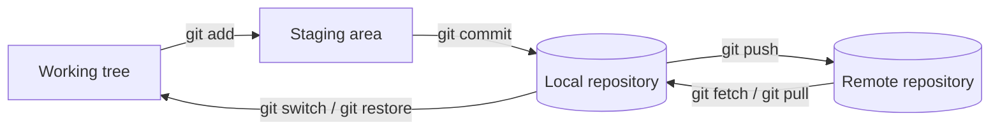
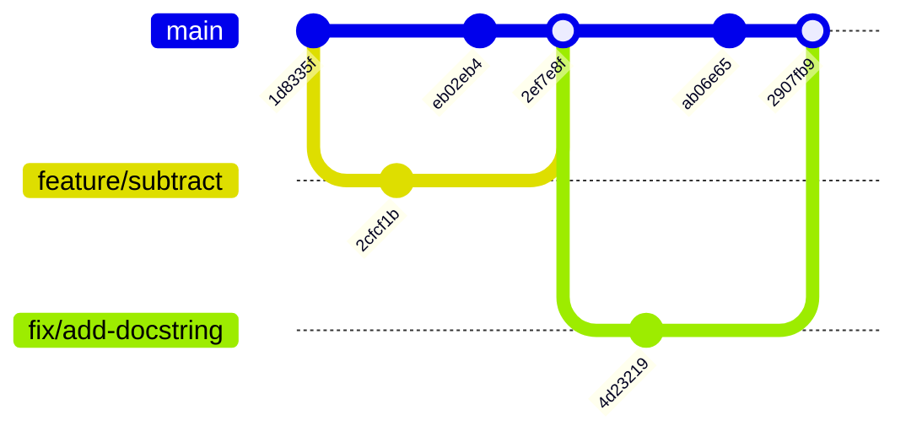

Every process of [4.14.2](/4.14.2), from a **sprint** to a **DevOps** pipeline, assumes that the team's work lives in one place where each change is recorded, attributed, reviewable and reversible. Version control provides this place. This chapter explains what problem version control solves and how it fits into software configuration management, then studies Git, the system used by almost all software projects today: first its data model, because Git's commands make sense only once one knows what they do to the history, then everyday commands, branching and merging, and collaboration through remote repositories. The second half turns to team practice: branching strategies, pull requests and code review, and continuous integration, the automated checks that every change passes. All Git sessions in this chapter were run in a throwaway repository (with Git 2.43; the commands and their output are essentially unchanged in the current 2.5x releases), with fixed dates so that the hashes are reproducible; the `$` is the shell prompt ([4.11.10](/4.11.10)).

## 3.1. Why Version Control

### 3.1.1. The Problems

Consider two students who work on a course project by sending each other code over a messaging app, or by syncing a cloud folder. Sooner or later:

- the code worked yesterday and is broken today, and nobody knows what changed;
- both edited the same file, and one silently overwrote the other's work;
- the sync client produced dozens of "conflicted copy" files, and nobody knows which one is current.

What they need is a system that records every version and the differences between versions, tells who changed what, when and why, and makes it easy to switch between versions or combine the work of several people.

**Definition 3.1.1 (Version Control System)** A **version control system** (VCS) is a system that records the successive versions of a set of files, together with metadata about each change (author, time, message), so that any earlier version can be retrieved and compared, changes by several people can be developed in parallel and combined, and the history of every line can be traced.

### 3.1.2. Configuration Management and Version Numbers

Version control is the core of a broader activity, one of the knowledge areas of **SWEBOK** ([4.14.1](/4.14.1)).

**Definition 3.1.2 (Software Configuration Management)** **Software configuration management** (SCM) is the discipline of identifying the configuration of a software system (its **configuration items**: source code, documents, test cases, build scripts, configuration files) at distinct points in time, controlling changes to it, and keeping its integrity and traceability throughout the life cycle. Its activities are configuration identification, version control, change control (proposing, evaluating, approving and tracking changes), status accounting and configuration auditing. An approved configuration that serves as the basis for further development and can be changed only through change control is a **baseline**.

Released versions need names. A classical three-part scheme $A.B.C$ (for example macOS 10.14.6) uses $A$ as the release number from the customer's perspective (a formal distribution of an approved version), $B$ as the version number from the developer's perspective, and $C$ as the revision number: a change that only corrects errors in the design or code and does not affect the documented functionality. Today most libraries and tools follow a precise convention instead.

**Definition 3.1.3 (Semantic Versioning)** **Semantic versioning** (SemVer 2.0.0) names a release of software with a public API as $\mathrm{MAJOR}.\mathrm{MINOR}.\mathrm{PATCH}$ and increments

- MAJOR when it makes incompatible API changes (and resets MINOR and PATCH to 0),
- MINOR when it adds functionality in a backward-compatible way (and resets PATCH),
- PATCH when it makes backward-compatible bug fixes.

A pre-release is marked with a hyphen (`2.0.0-rc.1`), build metadata with a plus sign (`2.0.0+20261021`). Versions $0.y.z$ are for initial development, in which anything may change.

The point of SemVer is that a version number becomes a promise that tools can act on: a dependency declared as `^4.2.0` in npm, or `>=4.2,<5` in Python, accepts every compatible update and excludes the next major version. Some projects use calendar versioning instead (Ubuntu 24.04, pip 25.2), which tells the date of a release but promises nothing about compatibility.

## 3.2. From SCCS to Git

| System | Year | Model | Notes |
|---|---|---|---|
| SCCS | 1972 | local files | Bell Labs; history of single files |
| RCS | 1982 | local files | stores reverse deltas of single files |
| CVS | 1986 (C version 1989–1990) | centralized | first widely used system for whole projects, built on RCS |
| Subversion (SVN) | 2000 (1.0 in 2004) | centralized | "CVS done right": atomic commits, versioned directories |
| BitKeeper | 2000 | distributed | proprietary; used for the Linux kernel 2002–2005 |
| Git | 2005 | distributed | written by Linus Torvalds for the Linux kernel after the free BitKeeper license was withdrawn |
| Mercurial | 2005 | distributed | started for the same reason as Git |

In a *centralized* system (CVS, Subversion, Perforce), one server holds the history; clients hold a working copy of one version and must contact the server to commit, view the log or compare versions. In a *distributed* system (Git, Mercurial), every clone is a complete repository with the full history; committing, branching, viewing history and comparing are local operations, and repositories exchange commits with each other when their owners choose.

| | Centralized | Distributed |
|---|---|---|
| history | only on the server | in every clone |
| offline work | checkout only | everything except exchanging commits |
| speed of log, diff, branch | network-bound | local, fast |
| single point of failure | the server | none; any clone can restore the others |
| access control, very large binary files | simpler | needs hosting features (protected branches, Git LFS) |

Git's design goals for the kernel were speed, a simple design, strong support for thousands of parallel branches, full distribution and the ability to handle a project of the kernel's size. Hosting platforms (GitHub, GitLab, Gitea, and campus instances of GitLab) add a shared remote repository and collaboration features on top.

## 3.3. How Git Stores History

### 3.3.1. Four Areas

A Git user works with four places:

| Area | Where | Content |
|---|---|---|
| working tree | the project directory | the files as you edit them |
| staging area (index) | `.git/index` | the snapshot that the next commit will record |
| local repository | the `.git` directory | all commits, branches and tags |
| remote repository | a server (GitHub, GitLab, …) or another directory | the shared copy that the team synchronizes with |



The staging area is what distinguishes Git from most earlier systems. A file in the working tree is *untracked* (unknown to Git), or tracked and then *unmodified*, *modified* or *staged*. Because the next commit is assembled explicitly, a developer who has made several unrelated edits can commit them separately, each with its own message.

### 3.3.2. Objects

Git is a content-addressable store: it stores every piece of data as an object whose name is a cryptographic hash of its content. There are four kinds of objects.

**Definition 3.3.1 (Git Objects)** A **blob** stores the content of one file (without its name). A **tree object** stores one directory: a list of entries, each with a mode, a name and the hash of a blob or of another tree. A **commit** stores the hash of the tree of the top-level directory (a complete snapshot of the project), the hashes of zero or more parent commits, the author and committer with timestamps, and a message. An annotated **tag** stores the hash of an object (usually a commit), a tag name, the tagger and a message. Each object is identified by the hash of its type, size and content, by default with SHA-1 (40 hexadecimal digits).

A first commit in a new repository:

```text
$ git init demo
Initialized empty Git repository in /…/demo/.git/
$ cd demo
$ printf 'def add(a, b):\n    return a + b\n' > calc.py
$ printf '# calc\n' > README.md
$ git status
On branch main

No commits yet

Untracked files:
  (use "git add <file>..." to include in what will be committed)
	README.md
	calc.py

nothing added to commit but untracked files present (use "git add" to track)
$ git add calc.py README.md
$ git status --short
A  README.md
A  calc.py
$ git commit -m "Add calculator with add()"
[main (root-commit) 1d8335f] Add calculator with add()
 2 files changed, 3 insertions(+)
 create mode 100644 README.md
 create mode 100644 calc.py
```

The plumbing command `git cat-file` shows the objects behind it:

```text
$ git cat-file -p HEAD
tree b84f5c660e44e46178325a5dea8469a9997dc2fb
author Ada Lee <ada@example.com> 1790820000 +0800
committer Ada Lee <ada@example.com> 1790820000 +0800

Add calculator with add()
$ git cat-file -p 'HEAD^{tree}'
100644 blob 4346fdb29f965050f4d476c7c78e7bb3b07db52e	README.md
100644 blob 4693ad3cf8b0903b98497fb89b8b524fbf1b93f4	calc.py
$ git cat-file -p HEAD:calc.py
def add(a, b):
    return a + b
```

The name of a blob is just the SHA-1 hash of the header `blob <size>\0` followed by the content, so it can be recomputed without Git:

```text
$ git hash-object README.md
4346fdb29f965050f4d476c7c78e7bb3b07db52e
$ printf 'blob 7\0# calc\n' | sha1sum
4346fdb29f965050f4d476c7c78e7bb3b07db52e  -
```

Content addressing has three consequences. Identical files are stored once, however many commits contain them: a new commit stores only the blobs and trees that changed and reuses the rest. History cannot be altered unnoticed: a commit's hash covers its tree and its parents, so changing anything in the past changes the hashes of all later commits (the same idea as a hash chain). And two repositories can tell which objects they have in common simply by comparing names, which makes synchronization efficient. Because practical collision attacks on SHA-1 exist (2017), Git uses a hardened SHA-1 that detects such attacks and supports SHA-256 repositories (`git init --object-format=sha256`); the planned Git 3.0 makes SHA-256 the default for new repositories, along with `main` as the default branch name.

### 3.3.3. References and the Commit Graph

Hashes are not meant for people. Git names commits with references.

**Definition 3.3.2 (Branch)** A **branch** in Git is a movable reference: a name (stored in `.git/refs/heads/`) that points to a commit, its tip. When a commit is made on the current branch, the branch moves forward to the new commit. **HEAD** is the reference to what is currently checked out: normally it points to a branch (it is a symbolic reference), and in the *detached HEAD* state it points directly to a commit.

```text
$ cat .git/HEAD
ref: refs/heads/main
$ cat .git/refs/heads/main
1d8335f8db514cedcf8705af077316b4899213e4
```

A tag (`refs/tags/v0.1.0`) is a reference that does not move; remote-tracking references (`refs/remotes/origin/main`) record where the branches of a remote repository were at the last synchronization. Since every commit points to its parents, the commits form a **directed acyclic graph**: an ordinary commit has one parent, the first commit none, and a merge commit two or more. (It is a **DAG** rather than a tree, because merges join lines of development.) Creating a branch costs one small file, which is why Git encourages many short-lived branches. Commits that are no longer reachable from any reference are not lost immediately: the *reflog* records where `HEAD` and each branch have been, so a commit "lost" by a bad reset can be found again with `git reflog` for weeks, until garbage collection removes it.

## 3.4. Everyday Commands

### 3.4.1. Setting Up and Recording Snapshots

| Task | Command |
|---|---|
| set identity (once per machine) | `git config --global user.name "Ada Lee"`, `git config --global user.email ada@example.com` |
| create a repository | `git init` (in an existing directory), `git clone <url>` (copy an existing one, including all history) |
| inspect | `git status`, `git diff` (working tree vs staging area), `git diff --staged` (staging area vs last commit), `git log --oneline --graph --all`, `git show <commit>`, `git blame <file>` (last change of each line) |
| record | `git add <paths>`, `git add -p` (stage selected parts of a file), `git commit -m "…"`, `git commit -am "…"` (stage all tracked modified files and commit) |
| ignore files | list patterns in `.gitignore` (build outputs, **virtual environments**, secrets) |
| switch | `git switch <branch>`, `git switch -c <new-branch>`, `git switch --detach <commit>` |

Since Git 2.23, `git switch` (change branches) and `git restore` (restore files) split the overloaded `git checkout`, which did both; older tutorials still use `checkout` for everything.

A repository should contain the sources needed to build the product and nothing that can be generated from them: compiled files, `node_modules/`, `.venv/` and data produced by the program belong in `.gitignore`, and secrets (passwords, API keys) must never be committed, because removing them later does not remove them from the history of every clone.

### 3.4.2. Commits and Commit Messages

A commit should be one logical change: small enough that its purpose fits in one sentence, complete enough that the project builds and its tests pass. Such commits can be reviewed, reverted and searched (`git bisect` finds the commit that introduced a bug by binary search over the history, which works only if every commit builds). Committing every two lines is too fine, since the messages become meaningless; committing a week of work at once loses the benefits of history.

The message says what changed and, more importantly, why. The usual form is a short summary line (about 50 characters, imperative mood: "Add", "Fix", not "Added"), a blank line, and a body explaining the motivation. It may cross-link an issue (`Ref #42`, or `Fixes #42`, which closes the issue on GitHub and GitLab when the commit reaches the default branch). Many projects follow *Conventional Commits* (version 1.0.0), a format that lets tools generate changelogs and choose the next semantic version:

```text
feat(chat): show unread message count in the sidebar

The count is computed on the server so that it stays consistent
across devices.

Fixes #128
```

The type is `feat` (a new feature, a MINOR release), `fix` (a bug fix, a PATCH release), or `docs`, `test`, `refactor`, `perf`, `build`, `ci`, `chore`; a `!` after the type or a `BREAKING CHANGE:` footer marks an incompatible change (a MAJOR release).

### 3.4.3. Undoing Changes

| Situation | Command | Effect |
|---|---|---|
| discard edits to a file in the working tree | `git restore <file>` | the file returns to its staged (or committed) state; the edits are lost |
| unstage a file | `git restore --staged <file>` | the staging area returns to the last commit; the working tree is kept |
| change the last commit (not yet pushed) | `git commit --amend` | replaces it by a new commit |
| undo a published commit | `git revert <commit>` | adds a new commit that applies the inverse change; history is preserved |
| move the current branch back (local work only) | `git reset --soft`, `--mixed` (default), `--hard <commit>` | moves the branch; `--soft` keeps the staging area and working tree, `--mixed` keeps the working tree, `--hard` discards both |
| put unfinished work aside | `git stash`, later `git stash pop` | saves and restores uncommitted changes |

The rule behind the table: commits that others may already have (pushed commits) are undone with new commits (`revert`); only local, unpublished history is rewritten (`amend`, `reset`, `rebase`).

## 3.5. Branching and Merging

### 3.5.1. Why Branches

The commands so far do not solve the problem of several people working at once. Suppose a feature takes seven days. If everyone works on one line of development, the half-finished feature breaks the build for everybody; if its developer does not commit for seven days, **version control** gives no protection (no rollback to yesterday); if they commit but do not push, there is no backup; and otherwise they must resolve conflicts constantly. Branches let each line of work proceed in isolation and be integrated when it is ready. The main branch should be stable, deployable and released at any time; new features are developed on their own branches and merged into the main branch when they are complete and tested.

### 3.5.2. Fast-Forward and Three-Way Merges

We create a feature branch, commit on it, and meanwhile commit on `main` as well:

```text
$ git switch -c feature/subtract
Switched to a new branch 'feature/subtract'
$ printf 'def add(a, b):\n    return a + b\n\n\ndef sub(a, b):\n    return a - b\n' > calc.py
$ git diff
diff --git a/calc.py b/calc.py
index 4693ad3..4c2d043 100644
--- a/calc.py
+++ b/calc.py
@@ -1,2 +1,6 @@
 def add(a, b):
     return a + b
+
+
+def sub(a, b):
+    return a - b
$ git commit -am "Add sub()"
[feature/subtract 2cfcf1b] Add sub()
 1 file changed, 4 insertions(+)
$ git switch main
Switched to branch 'main'
$ printf '# calc\n\nA tiny calculator.\n' > README.md
$ git commit -am "Describe the project in README"
[main eb02eb4] Describe the project in README
 1 file changed, 2 insertions(+)
$ git log --oneline --graph --all
* eb02eb4 Describe the project in README
| * 2cfcf1b Add sub()
|/  
* 1d8335f Add calculator with add()
```

The `git diff` output is a *unified diff*: the hunk header `@@ -1,2 +1,6 @@` says that lines 1–2 of the old file correspond to lines 1–6 of the new one, and lines starting with `+` and `-` are added and removed.

**Definition 3.5.1 (Merge)** Merging branch $B$ into the current branch $A$ combines the changes made on both since their **merge base**, the best common ancestor of the two tips. If $A$'s tip is itself the merge base (no new commits on $A$), Git performs a **fast-forward merge**: it simply moves $A$ to $B$'s tip, creating no commit. Otherwise it performs a **three-way merge**: it compares the merge base with each tip, applies both sets of changes, and records the result in a merge commit with two parents.

Here the branches have diverged, so the merge is three-way. Git's default merge strategy is called `ort`:

```text
$ git merge feature/subtract -m "Merge branch 'feature/subtract'"
Merge made by the 'ort' strategy.
 calc.py | 4 ++++
 1 file changed, 4 insertions(+)
$ git log --oneline --graph --all
*   2ef7e8f Merge branch 'feature/subtract'
|\  
| * 2cfcf1b Add sub()
* | eb02eb4 Describe the project in README
|/  
* 1d8335f Add calculator with add()
$ git cat-file -p HEAD | head -3
tree f11a15290ceb9166f5f733769da3a395cd6e42ff
parent eb02eb4c4eae4464f5a8acf7e0dcefbc8867a560
parent 2cfcf1b5eeeb22761334e41ecd5255f834fdd25e
```

Had there been no commit on `main` after the branch was created, Git would have printed `Fast-forward` and simply moved `main`. `git merge --no-ff` forces a merge commit even then, which some teams prefer because it keeps the boundaries of each feature visible.

### 3.5.3. Conflicts

A three-way merge succeeds automatically when the two sides changed different parts of the files. When both changed the same lines differently, Git cannot decide.

**Definition 3.5.2 (Merge Conflict)** A **merge conflict** occurs when the two branches being merged made different changes to the same region of a file (or one modified a file that the other deleted). Git stops the merge, writes both versions into the file between conflict markers, and leaves it to the user to edit the file into the correct result, stage it and commit.

On a branch, one developer documents `add`; on `main`, another adds type hints to the same line:

```text
$ git switch -c fix/add-docstring
Switched to a new branch 'fix/add-docstring'
$ # ... edit calc.py, then
$ git commit -qam "Document add()"
$ git switch -q main
$ # ... edit the same lines of calc.py, then
$ git commit -qam "Annotate add() with types"
$ git merge fix/add-docstring
Auto-merging calc.py
CONFLICT (content): Merge conflict in calc.py
Automatic merge failed; fix conflicts and then commit the result.
$ git status --short
UU calc.py
$ cat calc.py
<<<<<<< HEAD
def add(a: float, b: float) -> float:
=======
def add(a, b):
    """Return the sum of a and b."""
>>>>>>> fix/add-docstring
    return a + b


def sub(a, b):
    return a - b
```

The part between `<<<<<<<` and `=======` is the current branch's version, the part up to `>>>>>>>` the incoming one. The correct resolution here keeps both intentions:

```python
def add(a: float, b: float) -> float:
    """Return the sum of a and b."""
    return a + b
```

After editing, `git add calc.py` marks the conflict as resolved and `git commit` completes the merge (`git merge --abort` gives up instead). The resolution is a decision about the code, not about text: after resolving, run the tests. Conflicts are cheaper the smaller and more frequent the merges are, which is the main argument for short-lived branches.

The history of this section, drawn as a graph:



### 3.5.4. Rebasing

**Definition 3.5.3 (Rebase)** **Rebasing** a branch onto a commit $C$ replays the commits of the branch that are not in $C$'s history, one by one, on top of $C$. Each replayed commit is a new commit with the same changes and message but a different parent, hence a different hash; the branch is then moved to the last of them.

Merging preserves history exactly as it happened, with all its forks and merge commits; rebasing produces a linear history, as if the work had been started on the latest version. A common use is to bring a feature branch up to date before it is merged (`git rebase main`), so that the final merge is a **fast-forward** and the log reads as a sequence of complete changes. Interactive rebase (`git rebase -i`) also lets one reorder, edit, squash or drop commits to clean up a branch before review.

| | `git merge` | `git rebase` |
|---|---|---|
| history | true, non-linear, with merge commits | linear, rewritten |
| existing commits | unchanged | replaced by new ones |
| conflicts | resolved once, in the merge commit | possibly once per replayed commit |
| safe on shared branches | yes | no |

The golden rule of rebasing: do not rebase commits that others already have. Rewriting published commits forces everyone who based work on them to repair their history, and pushing a rewritten branch requires a force push (`git push --force-with-lease`, which at least refuses to overwrite commits one has not seen). Rebasing your own unpublished commits onto the latest `origin/main`, as in §3.6, is the normal case.

## 3.6. Working with Remote Repositories

A *remote* is a named URL of another repository; `git clone` creates one called `origin`. Exchanging commits takes four commands:

| Command | Effect |
|---|---|
| `git remote add <name> <url>`, `git remote -v` | add and list remotes |
| `git fetch` | download new commits and update the remote-tracking references (`origin/main`); does not touch your branches or files |
| `git pull` | `git fetch` followed by integrating the upstream branch into the current one (a merge by default; `git pull --rebase`, or the setting `pull.rebase true`, rebases instead) |
| `git push` | upload local commits and move the remote branch; refused unless it is a fast-forward of the remote branch |

Remote URLs are HTTPS (with a token as the password) or **SSH** (`git@github.com:org/repo.git`, authenticated with a key pair, [4.11.10](/4.11.10)). In the following session, the remote is a bare repository (one without a working tree, as on a server) in a neighboring directory. Ada publishes `main` and sets it as the upstream of her branch:

```text
$ git remote add origin ../origin.git
$ git push -u origin main
To ../origin.git
 * [new branch]      main -> main
branch 'main' set up to track 'origin/main'.
```

Her teammate Bob clones the repository and pushes a commit "Add mul()". Meanwhile Ada commits a README change. Her push is refused, because the remote branch has a commit that she does not have:

```text
$ git push
To ../origin.git
 ! [rejected]        main -> main (fetch first)
error: failed to push some refs to '../origin.git'
hint: Updates were rejected because the remote contains work that you do not
hint: have locally. This is usually caused by another repository pushing to
hint: the same ref. If you want to integrate the remote changes, use
hint: 'git pull' before pushing again.
hint: See the 'Note about fast-forwards' in 'git push --help' for details.
$ git fetch
From ../origin
   2907fb9..c91f72f  main       -> origin/main
$ git status -sb
## main...origin/main [ahead 1, behind 1]
$ git rebase origin/main
Successfully rebased and updated refs/heads/main.
$ git log --oneline --graph -n 3
* 08815cb Mention operations in README
* c91f72f Add mul()
*   2907fb9 Merge branch 'fix/add-docstring'
|\  
$ git push
To ../origin.git
   c91f72f..08815cb  main -> main
```

The rebased commit has a new hash (`08815cb`; before the rebase it was `0162efd`, which `git reflog` still shows). The refusal is a safety feature: Git never discards commits on the remote silently. Finally, Ada removes the merged branches and tags the release:

```text
$ git branch -d feature/subtract fix/add-docstring
Deleted branch feature/subtract (was 2cfcf1b).
Deleted branch fix/add-docstring (was 4d23219).
$ git tag -a v0.1.0 -m "First release"
$ git log --oneline --decorate -n 1
08815cb (HEAD -> main, tag: v0.1.0, origin/main) Mention operations in README
```

`git branch -d` refuses to delete a branch that has not been merged (`-D` forces it), and tags are pushed explicitly with `git push origin v0.1.0` (or `--tags`).

## 3.7. Collaboration Workflows

### 3.7.1. Branching Strategies

A team agrees on how branches are used. Three strategies are common:

| Strategy | Branches | Integration | Suits |
|---|---|---|---|
| GitHub flow | `main` is always deployable; every change on a short-lived topic branch | pull request with review and CI, then merge to `main` and deploy | web services with continuous deployment; most team projects |
| Git flow (Driessen, 2010) | long-lived `main` (releases) and `develop` (integration); feature, release and hotfix branches | features merge into `develop`; release branches stabilize and merge into `main` with a tag | products with scheduled, versioned releases and several supported versions |
| trunk-based development | everyone commits to `main` (the trunk) at least daily, directly or via branches that live for hours | small changes; unfinished features hidden behind feature flags | teams with strong automated testing; used at Google and recommended by the DORA research |

Git flow's author himself has since recommended simpler flows for continuously delivered software, because long-lived branches delay integration and make merges large. For a student team project, GitHub flow with an optional `dev` branch as a shared testing environment is usually the right choice; a large feature may get sub-branches of its own branch.

### 3.7.2. Pull Requests and Code Review

**Definition 3.7.1 (Pull Request)** A **pull request** (on GitLab: merge request) is a request, made on a hosting platform, to merge a branch into another (usually `main`). It presents the diff, the description of the change and its linked issues, the results of automated checks, and a discussion thread in which reviewers comment on lines and approve or request changes.

**Definition 3.7.2 (Code Review)** **Code review** is the systematic examination of a change by people other than its author before it is integrated, to find defects, keep the code consistent with the design and conventions of the project, and spread knowledge of the code through the team.

A typical GitHub flow cycle for one story:

```bash
git switch main && git pull                 # start from the latest main
git switch -c feat/unread-count             # topic branch
# ... edit, test, commit in small steps ...
git push -u origin feat/unread-count        # publish the branch
gh pr create --fill                         # open a pull request (GitHub CLI)
# ... CI runs, reviewers comment, the author pushes fixes ...
gh pr merge --squash --delete-branch        # merge after approval and green checks
```

What reviewers look at, roughly in order of importance: whether the change does what its issue requires and handles errors and edge cases; whether its design fits the system (or should be done differently); whether it is tested; readability, naming and comments; and only last, style, which a formatter and linter should enforce automatically ([4.14.10](/4.14.10)). Reviews are most effective when changes are small: a commonly cited guideline from industrial studies is a few hundred lines per review and at most an hour at a time, beyond which reviewers stop finding defects. Authors make review easy by keeping pull requests focused, describing why the change is needed and how it was tested, and answering every comment. Reviewers comment on the code, not the person, and distinguish required changes from suggestions.

Hosting platforms enforce the process with *protected branches*: `main` accepts changes only through pull requests that have the required number of approvals and passing status checks, and a `CODEOWNERS` file assigns reviewers by path. The merge button offers three ways to integrate: a merge commit, *squash and merge* (the whole branch becomes one commit on `main`) and *rebase and merge*.

## 3.8. Continuous Integration

**Definition 3.8.1 (Continuous Integration)** **Continuous integration** (CI) is the practice of merging every developer's work into the shared main line frequently, at least daily, where each integration is verified by an automated build and test run, so that integration problems are detected within minutes of being introduced and the main line is always in a working state.

Two practices extend it. In *continuous delivery*, every change that passes the pipeline is automatically prepared for release, so that the product can be released to production at any time by a decision of the team. In *continuous deployment*, every change that passes the pipeline is released to production automatically, without a human decision. Together they are called CI/CD; their operational side (staged rollouts, monitoring, rollback) is treated in [4.14.13](/4.14.13).

On GitHub, a CI pipeline is a workflow file in the repository. This one runs the tests and a linter of a Python project on every push and pull request:

```yaml
# .github/workflows/ci.yml
name: CI
on:
  push:
    branches: [main]
  pull_request:

jobs:
  test:
    runs-on: ubuntu-latest
    strategy:
      matrix:
        python-version: ["3.12", "3.13"]
    steps:
      - uses: actions/checkout@v7
      - uses: astral-sh/setup-uv@v10
        with:
          python-version: ${{ matrix.python-version }}
      - run: uv sync --locked          # install exactly the locked dependencies
      - run: uv run ruff check .       # static analysis
      - run: uv run pytest --cov       # tests with coverage (pytest-cov)
```

Each push triggers a run on fresh **virtual machines**, once per Python version in the matrix; the result appears as a status check on the commit and the pull request, and a protected `main` refuses to merge a pull request whose checks fail. GitLab CI works the same way with a `.gitlab-ci.yml` file and runners. For security, workflows from forks run without access to secrets, and many organizations pin third-party actions to a full commit hash instead of a movable tag such as `v10`.

A pipeline can also inspect code quality continuously: static analysis services such as SonarQube report, for every change, duplicated code, violations of coding standards, code complexity, missing comments, likely bugs and security vulnerabilities, and can block a merge that makes them worse (a *quality gate*). The rules of CI are simple and demanding: commit to the main line often; keep the build fast (minutes, not hours); fix a broken build immediately, before anything else; and never merge on a red build.

## 3.9. Version Control When Agents Write Code

For a **coding agent** ([4.2.14](/4.2.14)), Git is the safety net and the review interface at once. An agent should work on its own branch (or in a separate *worktree*, a second working directory of the same repository created with `git worktree add`, so that several agents can work in parallel without touching each other's files); every change it makes is then visible in `git diff`, reviewable as a pull request and reversible with one command. The practices of this chapter carry over with sharper reasons: small, single-purpose commits with messages that explain why let a human reviewer follow what the agent did; a CI pipeline that every branch must pass is the check that does not depend on the agent's own claim that "the tests pass"; and protected branches and the rule against force-pushing shared history guard against an agent "resolving" a rejected push by overwriting other people's work. **Merge conflicts** between parallel agents are avoided best in the same way as between people: by splitting the work into independent tasks that touch different files.

## Summary

- A **version control system** records versions with who, when and why, and supports parallel work; it is the core of **software configuration management** (configuration items, baselines, change control). Semantic versioning makes version numbers a compatibility promise.
- Git is distributed: every clone holds the full history. Files move from the working tree through the staging area into commits; the remote repository is shared.
- Git stores blobs, trees, commits and tags under the hash of their content; commits form a DAG; branches and HEAD are movable references, tags fixed ones.
- Merges are fast-forward or three-way; conflicts arise when both sides change the same lines and are resolved by editing, staging and committing. Rebasing rewrites commits into a linear history and must not be applied to shared commits.
- `fetch`, `pull` and `push` synchronize with remotes; a non-fast-forward push is refused.
- Teams choose GitHub flow, Git flow or trunk-based development; pull requests combine code review with automated checks.
- Continuous integration verifies every integration automatically; continuous delivery keeps the product releasable and continuous deployment releases every passing change.
