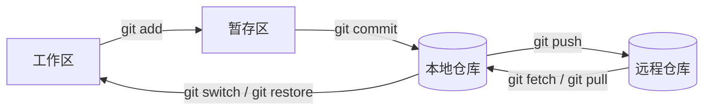
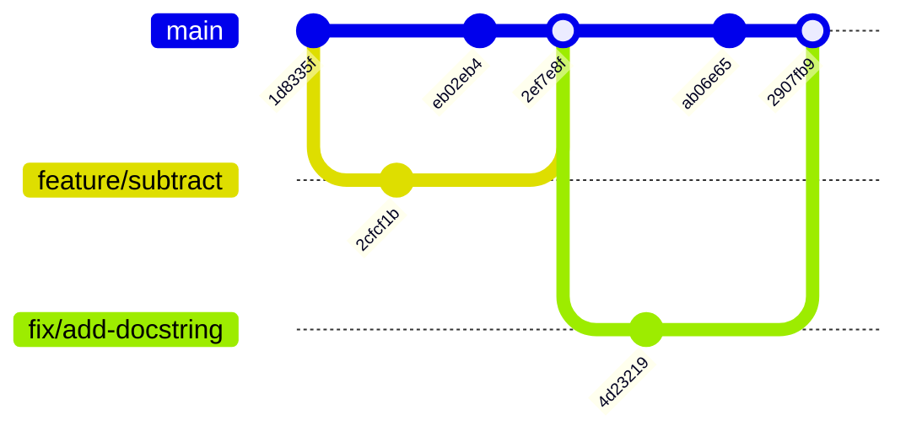

[4.14.2](/4.14.2) 中的每一种过程，从**冲刺**到 **DevOps** 流水线，都假定团队的工作放在一个地方，每一次变更在那里都被记录、署名，可以评审，也可以回退。版本控制提供的就是这样一个地方。本章先说明版本控制解决什么问题、它在软件配置管理中处于什么位置，然后研究 Git，即如今几乎所有软件项目使用的系统：先讲它的数据模型，因为只有知道 Git 的命令对历史做了什么，这些命令才说得通；再讲日常命令、分支与合并，以及通过远程仓库的协作。后半部分转向团队实践：分支策略、拉取请求与代码评审，以及持续集成，也就是每个变更都要通过的自动检查。本章所有的 Git 会话都是在一个一次性的仓库中运行的（Git 2.43；这些命令及其输出在当前的 2.5x 版本中基本没有变化），日期是固定的，因此哈希值可以复现；`$` 是 shell 提示符（[4.11.10](/4.11.10)）。

## 3.1. 为什么需要版本控制

### 3.1.1. 问题

设想两个同学做课程项目，靠聊天软件互相发送代码，或者同步一个云盘文件夹。迟早会出现这些情况：

- 代码昨天还能用，今天坏了，没有人知道改了什么；
- 两人编辑了同一个文件，其中一人的工作被悄悄覆盖；
- 同步客户端产生了几十个"冲突副本"文件，没有人知道哪一个是当前的。

他们需要的是这样一个系统：它记录每个版本以及版本之间的差异，说明谁在何时、为何改了什么，并且让人很容易在版本之间切换，或者把几个人的工作合在一起。

**定义 3.1.1（版本控制系统）** **版本控制系统**（version control system，VCS）记录一组文件相继的各个版本，以及每次变更的元数据（作者、时间、说明），使得任何较早的版本都能被取回和比较，多人的变更可以并行开发并合并，每一行的历史都可以追溯。

### 3.1.2. 配置管理与版本号

版本控制是一项更广泛的活动的核心，这项活动是 **SWEBOK**（[4.14.1](/4.14.1)）的知识领域之一。

**定义 3.1.2（软件配置管理）** **软件配置管理**（software configuration management，SCM）是这样一门学科：识别软件系统在各个不同时间点的配置（它的**配置项**：源代码、文档、测试用例、构建脚本、配置文件），控制对它的变更，并在整个生命周期内保持它的完整性与可追溯性。它的活动有配置标识、版本控制、变更控制（提出、评估、批准并跟踪变更）、状态记录和配置审计。经批准、作为进一步开发的基础、只能通过变更控制来改变的配置称为**基线**。

发布的版本需要名字。经典的三段式方案 $A.B.C$（例如 macOS 10.14.6）中，$A$ 是从客户角度看的发布号（对一个经批准的版本的正式分发），$B$ 是从开发者角度看的版本号，$C$ 是修订号：只改正设计或代码中的错误、不影响已记载功能的变更。如今大多数库和工具改为遵循一种精确的约定。

**定义 3.1.3（语义化版本）** **语义化版本**（SemVer 2.0.0）把带有公开 API 的软件的一次发布命名为 $\mathrm{MAJOR}.\mathrm{MINOR}.\mathrm{PATCH}$，并按以下规则递增：

- 做了不兼容的 API 变更时递增 MAJOR（并把 MINOR 和 PATCH 重置为 0），
- 以向后兼容的方式增加功能时递增 MINOR（并把 PATCH 重置为 0），
- 做了向后兼容的缺陷修复时递增 PATCH。

预发布版本用连字符标记（`2.0.0-rc.1`），构建元数据用加号标记（`2.0.0+20261021`）。版本 $0.y.z$ 用于初始开发，其间任何东西都可能改变。

SemVer 的要点在于，版本号成为一个工具可以据以行动的承诺：npm 中声明为 `^4.2.0`，或 Python 中声明为 `>=4.2,<5` 的依赖，接受所有兼容的更新，并排除下一个主版本。有些项目改用日历版本（Ubuntu 24.04、pip 25.2），它说明一次发布的日期，但对兼容性不作任何承诺。

## 3.2. 从 SCCS 到 Git

| 系统 | 年份 | 模型 | 说明 |
|---|---|---|---|
| SCCS | 1972 | 本地文件 | 贝尔实验室；单个文件的历史 |
| RCS | 1982 | 本地文件 | 存储单个文件的反向增量 |
| CVS | 1986（C 语言版 1989–1990） | 集中式 | 第一个被广泛使用的整个项目的系统，建立在 RCS 之上 |
| Subversion（SVN） | 2000（1.0 版在 2004） | 集中式 | "做对了的 CVS"：原子提交、有版本的目录 |
| BitKeeper | 2000 | 分布式 | 专有软件；2002–2005 年用于 Linux 内核 |
| Git | 2005 | 分布式 | 免费的 BitKeeper 许可被撤销之后，Linus Torvalds 为 Linux 内核编写 |
| Mercurial | 2005 | 分布式 | 出于与 Git 同样的原因而启动 |

在*集中式*系统（CVS、Subversion、Perforce）中，由一台服务器保存历史；客户端持有某一个版本的工作副本，提交、查看日志或比较版本都必须联系服务器。在*分布式*系统（Git、Mercurial）中，每个克隆都是带有完整历史的完整仓库；提交、建分支、查看历史和比较都是本地操作，仓库之间在其所有者选择的时候交换提交。

| | 集中式 | 分布式 |
|---|---|---|
| 历史 | 只在服务器上 | 在每个克隆中 |
| 离线工作 | 只能检出 | 除交换提交之外都可以 |
| 日志、diff、分支的速度 | 受网络限制 | 本地，很快 |
| 单点故障 | 服务器 | 无；任何克隆都能恢复其他克隆 |
| 访问控制、很大的二进制文件 | 较简单 | 需要托管平台的功能（受保护分支、Git LFS） |

Git 为内核设定的设计目标是速度、简单的设计、对成千上万个并行分支的有力支持、完全分布式，以及能够处理内核那样规模的项目。托管平台（GitHub、GitLab、Gitea，以及高校自建的 GitLab 实例）在此之上加入共享的远程仓库和协作功能。

## 3.3. Git 如何存储历史

### 3.3.1. 四个区域

Git 用户与四个地方打交道：

| 区域 | 位置 | 内容 |
|---|---|---|
| 工作区 | 项目目录 | 你正在编辑的文件 |
| 暂存区（索引） | `.git/index` | 下一次提交将要记录的快照 |
| 本地仓库 | `.git` 目录 | 所有提交、分支与标签 |
| 远程仓库 | 服务器（GitHub、GitLab 等）或另一个目录 | 团队与之同步的共享副本 |



暂存区是 Git 区别于多数早期系统之处。工作区中的文件是*未跟踪*的（Git 不认识它），或者已被跟踪，此时是*未修改*、*已修改*或*已暂存*。由于下一次提交是显式组装出来的，做了几处互不相关的编辑的开发者可以把它们分开提交，各带各的说明。

### 3.3.2. 对象

Git 是内容寻址的存储：它把每一份数据都存成一个对象，对象的名字是其内容的密码学哈希。对象共有四种。

**定义 3.3.1（Git 对象）** **数据对象**（blob）存储一个文件的内容（不含文件名）。**树对象**存储一个目录：一个条目列表，每个条目有模式、名字，以及一个数据对象或另一个树对象的哈希。**提交**存储顶层目录的树的哈希（项目的完整快照）、零个或多个父提交的哈希、带时间戳的作者与提交者，以及一条说明。带注释的**标签**存储一个对象（通常是一个提交）的哈希、标签名、打标签的人和一条说明。每个对象由其类型、大小与内容的哈希标识，默认使用 SHA-1（40 位十六进制数字）。

新仓库中的第一次提交：

```text
$ git init demo
Initialized empty Git repository in /…/demo/.git/
$ cd demo
$ printf 'def add(a, b):\n    return a + b\n' > calc.py
$ printf '# calc\n' > README.md
$ git status
On branch main

No commits yet

Untracked files:
  (use "git add <file>..." to include in what will be committed)
	README.md
	calc.py

nothing added to commit but untracked files present (use "git add" to track)
$ git add calc.py README.md
$ git status --short
A  README.md
A  calc.py
$ git commit -m "Add calculator with add()"
[main (root-commit) 1d8335f] Add calculator with add()
 2 files changed, 3 insertions(+)
 create mode 100644 README.md
 create mode 100644 calc.py
```

底层命令 `git cat-file` 可以显示其背后的对象：

```text
$ git cat-file -p HEAD
tree b84f5c660e44e46178325a5dea8469a9997dc2fb
author Ada Lee <ada@example.com> 1790820000 +0800
committer Ada Lee <ada@example.com> 1790820000 +0800

Add calculator with add()
$ git cat-file -p 'HEAD^{tree}'
100644 blob 4346fdb29f965050f4d476c7c78e7bb3b07db52e	README.md
100644 blob 4693ad3cf8b0903b98497fb89b8b524fbf1b93f4	calc.py
$ git cat-file -p HEAD:calc.py
def add(a, b):
    return a + b
```

数据对象的名字就是头部 `blob <size>\0` 加上内容的 SHA-1 哈希，因此不用 Git 也能重新算出来：

```text
$ git hash-object README.md
4346fdb29f965050f4d476c7c78e7bb3b07db52e
$ printf 'blob 7\0# calc\n' | sha1sum
4346fdb29f965050f4d476c7c78e7bb3b07db52e  -
```

内容寻址有三个后果。相同的文件只存一次，不论有多少个提交包含它：新的提交只存储变化了的数据对象和树，其余的重用。历史无法在不被察觉的情况下被篡改：提交的哈希覆盖它的树和它的父提交，所以改动过去的任何东西，都会改变其后所有提交的哈希（与哈希链是同一思想）。并且两个仓库只要比较名字，就能知道它们有哪些共同的对象，这使同步很高效。由于 SHA-1 存在实际的碰撞攻击（2017 年），Git 使用能检测此类攻击的加固版 SHA-1，并支持 SHA-256 仓库（`git init --object-format=sha256`）；计划中的 Git 3.0 将使 SHA-256 成为新仓库的默认值，同时把 `main` 作为默认分支名。

### 3.3.3. 引用与提交图

哈希不是给人用的。Git 用引用来给提交命名。

**定义 3.3.2（分支）** Git 中的**分支**（branch）是一个可移动的引用：一个名字（存储在 `.git/refs/heads/` 中），指向一个提交，即它的尖端。在当前分支上做出一个提交时，分支向前移动到新的提交。**HEAD** 是对当前检出内容的引用：通常它指向一个分支（它是符号引用），在*分离 HEAD*（detached HEAD）状态下则直接指向一个提交。

```text
$ cat .git/HEAD
ref: refs/heads/main
$ cat .git/refs/heads/main
1d8335f8db514cedcf8705af077316b4899213e4
```

标签（`refs/tags/v0.1.0`）是不会移动的引用；远程跟踪引用（`refs/remotes/origin/main`）记录远程仓库的各分支在上次同步时的位置。由于每个提交都指向它的父提交，这些提交构成一个**有向无环图**：普通提交有一个父提交，第一个提交没有，合并提交有两个或更多。（因为合并把各条开发线汇合起来，所以它是 **DAG** 而不是树。）创建分支只需要一个很小的文件，这就是 Git 鼓励大量短命分支的原因。不再能从任何引用到达的提交并不会立即丢失：*reflog*（引用日志）记录了 `HEAD` 和每个分支去过的位置，所以被一次错误的 reset"丢掉"的提交，可以在数周内用 `git reflog` 找回，直到垃圾回收把它清除。

## 3.4. 日常命令

### 3.4.1. 设置与记录快照

| 任务 | 命令 |
|---|---|
| 设置身份（每台机器一次） | `git config --global user.name "Ada Lee"`、`git config --global user.email ada@example.com` |
| 创建仓库 | `git init`（在已有目录中）、`git clone <url>`（复制一个已有的仓库，包括全部历史） |
| 查看 | `git status`、`git diff`（工作区与暂存区对比）、`git diff --staged`（暂存区与上次提交对比）、`git log --oneline --graph --all`、`git show <commit>`、`git blame <file>`（每一行最近一次的变更） |
| 记录 | `git add <paths>`、`git add -p`（暂存文件的选定部分）、`git commit -m "…"`、`git commit -am "…"`（暂存所有已跟踪的已修改文件并提交） |
| 忽略文件 | 在 `.gitignore` 中列出模式（构建产物、**虚拟环境**、密钥） |
| 切换 | `git switch <branch>`、`git switch -c <new-branch>`、`git switch --detach <commit>` |

自 Git 2.23 起，`git switch`（切换分支）和 `git restore`（恢复文件）把原来身兼二职的 `git checkout` 拆开了；较早的教程仍然用 `checkout` 做所有事。

仓库应当包含构建产品所需的源文件，而不包含任何能由它们生成的东西：编译出的文件、`node_modules/`、`.venv/` 和程序产生的数据都应放进 `.gitignore`；密钥（密码、API 密钥）绝不能提交，因为事后把它们删除，并不能把它们从每个克隆的历史中删除。

### 3.4.2. 提交与提交说明

一个提交应当是一个逻辑上完整的变更：小到它的目的一句话就能说清，完整到项目能够构建且测试通过。这样的提交可以被评审、回退和搜索（`git bisect` 通过对历史做二分查找，找出引入缺陷的提交，这只有在每个提交都能构建时才行得通）。每两行就提交一次太细，说明会变得毫无意义；把一周的工作一次提交，又会丧失历史的好处。

提交说明讲明改了什么，更重要的是为什么改。通常的形式是一行简短的摘要（约 50 个字符，祈使语气："Add"、"Fix"，而不是 "Added"）、一个空行，以及解释动机的正文。它可以链接一个议题（`Ref #42`，或 `Fixes #42`，当提交到达默认分支时会在 GitHub 和 GitLab 上关闭该议题）。许多项目遵循 *Conventional Commits*（1.0.0 版），这种格式让工具可以生成变更日志并选择下一个语义化版本：

```text
feat(chat): show unread message count in the sidebar

The count is computed on the server so that it stays consistent
across devices.

Fixes #128
```

类型是 `feat`（新功能，对应 MINOR 发布）、`fix`（缺陷修复，对应 PATCH 发布），或者 `docs`、`test`、`refactor`、`perf`、`build`、`ci`、`chore`；类型后面的 `!` 或 `BREAKING CHANGE:` 脚注标记不兼容的变更（对应 MAJOR 发布）。

### 3.4.3. 撤销变更

| 情形 | 命令 | 效果 |
|---|---|---|
| 丢弃工作区中对某个文件的编辑 | `git restore <file>` | 文件回到它已暂存（或已提交）的状态；编辑丢失 |
| 取消暂存某个文件 | `git restore --staged <file>` | 暂存区回到上次提交；工作区保留 |
| 修改最近一次提交（尚未推送） | `git commit --amend` | 用一个新的提交替换它 |
| 撤销已发布的提交 | `git revert <commit>` | 添加一个应用相反变更的新提交；历史得以保留 |
| 把当前分支移回去（仅限本地工作） | `git reset --soft`、`--mixed`（默认）、`--hard <commit>` | 移动分支；`--soft` 保留暂存区和工作区，`--mixed` 保留工作区，`--hard` 两者都丢弃 |
| 把未完成的工作放在一边 | `git stash`，之后 `git stash pop` | 保存并恢复未提交的变更 |

表后面的规则是：别人可能已经拥有的提交（已推送的提交），用新的提交来撤销（`revert`）；只有本地的、未发布的历史才被改写（`amend`、`reset`、`rebase`）。

## 3.5. 分支与合并

### 3.5.1. 为什么要有分支

到目前为止的命令并不能解决多人同时工作的问题。假设一个功能要花七天。如果每个人都在同一条开发线上工作，做了一半的功能会让所有人的构建失败；如果它的开发者七天不提交，**版本控制**就起不到保护作用（无法回滚到昨天）；如果提交了却不推送，就没有备份；否则就得不断地解决冲突。分支让每条工作线独立推进，并在准备好时再集成。主分支应当稳定、可部署、随时可以发布；新功能在各自的分支上开发，完成并测试之后才合并进主分支。

### 3.5.2. 快进合并与三方合并

我们创建一个功能分支，在上面提交，同时也在 `main` 上提交：

```text
$ git switch -c feature/subtract
Switched to a new branch 'feature/subtract'
$ printf 'def add(a, b):\n    return a + b\n\n\ndef sub(a, b):\n    return a - b\n' > calc.py
$ git diff
diff --git a/calc.py b/calc.py
index 4693ad3..4c2d043 100644
--- a/calc.py
+++ b/calc.py
@@ -1,2 +1,6 @@
 def add(a, b):
     return a + b
+
+
+def sub(a, b):
+    return a - b
$ git commit -am "Add sub()"
[feature/subtract 2cfcf1b] Add sub()
 1 file changed, 4 insertions(+)
$ git switch main
Switched to branch 'main'
$ printf '# calc\n\nA tiny calculator.\n' > README.md
$ git commit -am "Describe the project in README"
[main eb02eb4] Describe the project in README
 1 file changed, 2 insertions(+)
$ git log --oneline --graph --all
* eb02eb4 Describe the project in README
| * 2cfcf1b Add sub()
|/  
* 1d8335f Add calculator with add()
```

`git diff` 的输出是*统一 diff*（unified diff）：块头 `@@ -1,2 +1,6 @@` 表示旧文件的第 1–2 行对应新文件的第 1–6 行，以 `+` 和 `-` 开头的行分别是增加和删除的行。

**定义 3.5.1（合并）** 把分支 $B$ 合并进当前分支 $A$，是把两者自**合并基**（两个尖端的最佳公共祖先）以来所做的变更组合起来。如果 $A$ 的尖端本身就是合并基（$A$ 上没有新提交），Git 执行**快进合并**：只是把 $A$ 移到 $B$ 的尖端，不创建提交。否则它执行**三方合并**：把合并基与每个尖端分别比较，应用两组变更，并把结果记录在一个有两个父提交的合并提交中。

这里两个分支已经分叉，所以合并是三方合并。Git 默认的合并策略叫作 `ort`：

```text
$ git merge feature/subtract -m "Merge branch 'feature/subtract'"
Merge made by the 'ort' strategy.
 calc.py | 4 ++++
 1 file changed, 4 insertions(+)
$ git log --oneline --graph --all
*   2ef7e8f Merge branch 'feature/subtract'
|\  
| * 2cfcf1b Add sub()
* | eb02eb4 Describe the project in README
|/  
* 1d8335f Add calculator with add()
$ git cat-file -p HEAD | head -3
tree f11a15290ceb9166f5f733769da3a395cd6e42ff
parent eb02eb4c4eae4464f5a8acf7e0dcefbc8867a560
parent 2cfcf1b5eeeb22761334e41ecd5255f834fdd25e
```

如果创建分支之后 `main` 上没有提交，Git 就会打印 `Fast-forward`，并只是移动 `main`。`git merge --no-ff` 即便在这种情况下也强制创建合并提交，有些团队喜欢这样，因为它使每个功能的边界保持可见。

### 3.5.3. 冲突

当两方修改了文件的不同部分时，三方合并会自动成功。当两方以不同的方式修改了相同的行时，Git 无法决定。

**定义 3.5.2（合并冲突）** 当被合并的两个分支对文件的同一区域做了不同的修改（或者一方修改了另一方删除的文件）时，就发生**合并冲突**（merge conflict）。Git 停止合并，把两个版本都写进文件，用冲突标记隔开，由用户把文件编辑成正确的结果，暂存并提交。

在一个分支上，一位开发者为 `add` 写文档；在 `main` 上，另一位给同一行加类型注解：

```text
$ git switch -c fix/add-docstring
Switched to a new branch 'fix/add-docstring'
$ # ... edit calc.py, then
$ git commit -qam "Document add()"
$ git switch -q main
$ # ... edit the same lines of calc.py, then
$ git commit -qam "Annotate add() with types"
$ git merge fix/add-docstring
Auto-merging calc.py
CONFLICT (content): Merge conflict in calc.py
Automatic merge failed; fix conflicts and then commit the result.
$ git status --short
UU calc.py
$ cat calc.py
<<<<<<< HEAD
def add(a: float, b: float) -> float:
=======
def add(a, b):
    """Return the sum of a and b."""
>>>>>>> fix/add-docstring
    return a + b


def sub(a, b):
    return a - b
```

`<<<<<<<` 与 `=======` 之间的部分是当前分支的版本，直到 `>>>>>>>` 的部分是传入的版本。这里正确的解决办法是同时保留两方的意图：

```python
def add(a: float, b: float) -> float:
    """Return the sum of a and b."""
    return a + b
```

编辑之后，`git add calc.py` 把冲突标记为已解决，`git commit` 完成合并（`git merge --abort` 则是放弃）。解决冲突是关于代码的决定，而不是关于文本的决定：解决之后要运行测试。合并越小、越频繁，冲突的代价越低，这是支持短命分支的主要理由。

本节的历史，画成图是：



### 3.5.4. 变基

**定义 3.5.3（变基）** 把一个分支**变基**（rebase）到提交 $C$ 上，是把该分支中不在 $C$ 的历史里的提交，逐个在 $C$ 之上重放。每个被重放的提交都是新的提交，变更和说明相同，但父提交不同，因而哈希不同；然后分支被移到其中最后一个提交上。

合并如实保留历史的本来面貌，包括它所有的分叉与合并提交；变基产生线性的历史，就好像工作是从最新的版本开始的。常见的用法是在合并之前把功能分支更新到最新（`git rebase main`），这样最后的合并就是**快进合并**，日志读起来就是一连串完整的变更。交互式变基（`git rebase -i`）还允许重排、编辑、压缩或丢弃提交，以便在评审之前整理分支。

| | `git merge` | `git rebase` |
|---|---|---|
| 历史 | 真实的、非线性的，带合并提交 | 线性的，被改写过 |
| 已有的提交 | 不变 | 被新的提交替换 |
| 冲突 | 只解决一次，在合并提交中 | 可能每个被重放的提交解决一次 |
| 在共享分支上安全 | 是 | 否 |

变基的黄金法则：不要变基别人已经拥有的提交。改写已发布的提交，会迫使所有基于它们工作的人修复自己的历史，而推送被改写的分支需要强制推送（`git push --force-with-lease`，它至少会拒绝覆盖自己没有见过的提交）。把你自己未发布的提交变基到最新的 `origin/main` 上，如 §3.6 所示，是正常的情形。

## 3.6. 使用远程仓库

*远程*（remote）是另一个仓库的有名字的 URL；`git clone` 会创建一个叫 `origin` 的远程。交换提交需要四条命令：

| 命令 | 效果 |
|---|---|
| `git remote add <name> <url>`、`git remote -v` | 添加并列出远程 |
| `git fetch` | 下载新的提交并更新远程跟踪引用（`origin/main`）；不触动你的分支和文件 |
| `git pull` | `git fetch`，随后把上游分支集成到当前分支（默认是合并；`git pull --rebase` 或设置 `pull.rebase true` 则改为变基） |
| `git push` | 上传本地提交并移动远程分支；除非是远程分支的快进，否则被拒绝 |

远程 URL 是 HTTPS（用令牌作密码）或 **SSH**（`git@github.com:org/repo.git`，用密钥对认证，[4.11.10](/4.11.10)）。在下面的会话中，远程是相邻目录中的一个裸仓库（没有工作区的仓库，如同服务器上的那样）。Ada 发布 `main`，并把它设为自己分支的上游：

```text
$ git remote add origin ../origin.git
$ git push -u origin main
To ../origin.git
 * [new branch]      main -> main
branch 'main' set up to track 'origin/main'.
```

她的队友 Bob 克隆了仓库，并推送了一个提交 "Add mul()"。同时 Ada 提交了对 README 的修改。她的推送被拒绝，因为远程分支上有一个她没有的提交：

```text
$ git push
To ../origin.git
 ! [rejected]        main -> main (fetch first)
error: failed to push some refs to '../origin.git'
hint: Updates were rejected because the remote contains work that you do not
hint: have locally. This is usually caused by another repository pushing to
hint: the same ref. If you want to integrate the remote changes, use
hint: 'git pull' before pushing again.
hint: See the 'Note about fast-forwards' in 'git push --help' for details.
$ git fetch
From ../origin
   2907fb9..c91f72f  main       -> origin/main
$ git status -sb
## main...origin/main [ahead 1, behind 1]
$ git rebase origin/main
Successfully rebased and updated refs/heads/main.
$ git log --oneline --graph -n 3
* 08815cb Mention operations in README
* c91f72f Add mul()
*   2907fb9 Merge branch 'fix/add-docstring'
|\  
$ git push
To ../origin.git
   c91f72f..08815cb  main -> main
```

变基后的提交有了新的哈希（`08815cb`；变基前它是 `0162efd`，`git reflog` 仍然能显示）。拒绝是一种安全特性：Git 从不悄悄丢弃远程上的提交。最后，Ada 删除已合并的分支，并给发布打上标签：

```text
$ git branch -d feature/subtract fix/add-docstring
Deleted branch feature/subtract (was 2cfcf1b).
Deleted branch fix/add-docstring (was 4d23219).
$ git tag -a v0.1.0 -m "First release"
$ git log --oneline --decorate -n 1
08815cb (HEAD -> main, tag: v0.1.0, origin/main) Mention operations in README
```

`git branch -d` 拒绝删除尚未合并的分支（`-D` 强制删除），标签需要显式推送，用 `git push origin v0.1.0`（或 `--tags`）。

## 3.7. 协作工作流

### 3.7.1. 分支策略

团队要约定如何使用分支。常见的有三种策略：

| 策略 | 分支 | 集成 | 适用 |
|---|---|---|---|
| GitHub flow | `main` 始终可部署；每个变更都在一个短命的主题分支上 | 带评审和 CI 的拉取请求，然后合并到 `main` 并部署 | 持续部署的 Web 服务；大多数团队项目 |
| Git flow（Driessen，2010） | 长期存在的 `main`（发布）与 `develop`（集成）；功能、发布和热修复分支 | 功能合并进 `develop`；发布分支稳定后带标签合并进 `main` | 有计划的、带版本号的发布、且同时支持多个版本的产品 |
| 主干开发 | 每个人至少每天向 `main`（主干）提交，直接提交或经由只存活数小时的分支 | 小变更；未完成的功能藏在功能开关（feature flag）后面 | 自动化测试强的团队；Google 使用，DORA 研究也推荐 |

Git flow 的作者本人后来对持续交付的软件推荐更简单的工作流，因为长期存在的分支会推迟集成并使合并变大。对学生团队项目，通常的正确选择是 GitHub flow，另加一个可选的 `dev` 分支作为共享的测试环境；大的功能可以在它自己的分支下再建子分支。

### 3.7.2. 拉取请求与代码评审

**定义 3.7.1（拉取请求）** **拉取请求**（pull request，GitLab 上称合并请求）是在托管平台上发起的、把一个分支合并到另一个分支（通常是 `main`）的请求。它展示 diff、变更的描述及其关联的议题、自动检查的结果，以及一个讨论线程，评审者在其中对具体的行发表意见，并批准或要求修改。

**定义 3.7.2（代码评审）** **代码评审**（code review）是在变更被集成之前，由作者以外的人对它进行的系统检查，目的是发现缺陷，使代码与项目的设计和约定保持一致，并在团队中传播对代码的了解。

一个故事的典型 GitHub flow 周期：

```bash
git switch main && git pull                 # start from the latest main
git switch -c feat/unread-count             # topic branch
# ... edit, test, commit in small steps ...
git push -u origin feat/unread-count        # publish the branch
gh pr create --fill                         # open a pull request (GitHub CLI)
# ... CI runs, reviewers comment, the author pushes fixes ...
gh pr merge --squash --delete-branch        # merge after approval and green checks
```

评审者查看的内容，大致按重要性排列：变更是否做到了它的议题所要求的，是否处理了错误和边界情况；它的设计是否适合系统（还是应当换一种做法）；它是否经过测试；可读性、命名和注释；最后才是风格，风格应当由格式化工具和 linter 自动强制（[4.14.10](/4.14.10)）。变更小的时候评审最有效：工业界研究中常被引用的准则是每次评审几百行、一次最多一小时，超过这个限度评审者就发现不了缺陷了。作者通过保持拉取请求聚焦、说明为什么需要这个变更以及如何测试的、并回应每一条评论，使评审变得容易。评审者评论的是代码而不是人，并区分必须修改的和建议性的意见。

托管平台用*受保护分支*强制执行这套过程：`main` 只接受经由拉取请求的变更，且这些请求要有规定数量的批准和通过的状态检查，`CODEOWNERS` 文件按路径指派评审者。合并按钮提供三种集成方式：合并提交、*压缩合并*（squash and merge，整个分支成为 `main` 上的一个提交）和*变基合并*（rebase and merge）。

## 3.8. 持续集成

**定义 3.8.1（持续集成）** **持续集成**（continuous integration，CI）是频繁（至少每天）把每个开发者的工作合并到共享主线的实践，每次集成都由自动的构建与测试运行来验证，使集成问题在引入后几分钟内就被发现，并使主线始终处于可工作的状态。

有两种实践对它加以延伸。在持续交付（continuous delivery）中，每个通过流水线的变更都被自动准备好发布，因此团队可以随时决定把产品发布到生产环境。在持续部署（continuous deployment）中，每个通过流水线的变更都被自动发布到生产环境，无需人工决定。两者合称 CI/CD；它们的运行方面（分阶段发布、监控、回滚）在 [4.14.13](/4.14.13) 中讨论。

在 GitHub 上，CI 流水线是仓库中的一个工作流文件。下面这个在每次推送和拉取请求时运行一个 Python 项目的测试和 linter：

```yaml
# .github/workflows/ci.yml
name: CI
on:
  push:
    branches: [main]
  pull_request:

jobs:
  test:
    runs-on: ubuntu-latest
    strategy:
      matrix:
        python-version: ["3.12", "3.13"]
    steps:
      - uses: actions/checkout@v7
      - uses: astral-sh/setup-uv@v10
        with:
          python-version: ${{ matrix.python-version }}
      - run: uv sync --locked          # install exactly the locked dependencies
      - run: uv run ruff check .       # static analysis
      - run: uv run pytest --cov       # tests with coverage (pytest-cov)
```

每次推送都会在全新的**虚拟机**上触发一次运行，矩阵中的每个 Python 版本各一次；结果显示为提交和拉取请求上的状态检查，受保护的 `main` 拒绝合并检查失败的拉取请求。GitLab CI 的工作方式相同，用 `.gitlab-ci.yml` 文件和 runner。出于安全考虑，来自 fork 的工作流在运行时不能访问密钥，许多组织也把第三方 action 固定到完整的提交哈希，而不是 `v10` 这样可移动的标签。

流水线还可以持续地检查代码质量：SonarQube 等静态分析服务对每个变更报告重复代码、违反编码规范、代码复杂度、缺失的注释、可能的缺陷和安全漏洞，并可以阻止使它们变坏的合并（*质量门禁*，quality gate）。CI 的规则简单而严格：经常向主线提交；保持构建快（几分钟，而不是几小时）；构建一旦损坏，立即修复，先于其他一切；红色构建绝不合并。

## 3.9. 智能体写代码时的版本控制

对**编程智能体**（[4.2.14](/4.2.14)）来说，Git 既是安全网，又是评审界面。智能体应当在它自己的分支上工作（或者在单独的 *worktree* 中，即同一个仓库的第二个工作目录，用 `git worktree add` 创建，使多个智能体能够并行工作而互不触碰对方的文件）；它做的每个变更因此都可以在 `git diff` 中看到，可以作为拉取请求来评审，也可以用一条命令回退。本章的实践在这里有了更充分的理由：小的、单一目的的提交，附上解释原因的说明，让人类评审者能够跟上智能体做了什么；每个分支都必须通过的 CI 流水线，是不依赖智能体自己宣称"测试通过了"的检查；受保护分支，以及禁止强制推送共享历史的规则，防止智能体通过覆盖他人的工作来"解决"被拒绝的推送。并行的智能体之间的**合并冲突**，最好用与人之间同样的办法避免：把工作拆成触碰不同文件的独立任务。

## 小结

- **版本控制系统**记录各个版本及其责任人、时间和原因，并支持并行工作；它是**软件配置管理**（配置项、基线、变更控制）的核心。语义化版本使版本号成为兼容性的承诺。
- Git 是分布式的：每个克隆都持有完整历史。文件从工作区经暂存区进入提交；远程仓库是共享的。
- Git 把数据对象、树、提交和标签按其内容的哈希存储；提交构成 DAG；分支和 HEAD 是可移动的引用，标签是固定的引用。
- 合并是快进的或三方的；两方修改相同的行时产生冲突，通过编辑、暂存、提交来解决。变基把提交改写成线性的历史，不得用于共享的提交。
- `fetch`、`pull` 和 `push` 与远程同步；非快进的推送会被拒绝。
- 团队选择 GitHub flow、Git flow 或主干开发；拉取请求把代码评审与自动检查结合起来。
- 持续集成自动验证每一次集成；持续交付使产品始终可发布，持续部署则发布每个通过的变更。
