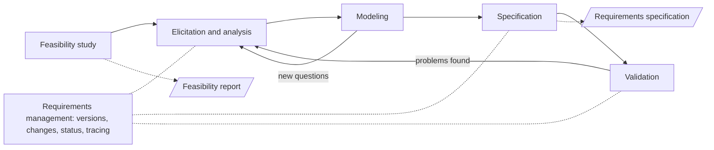
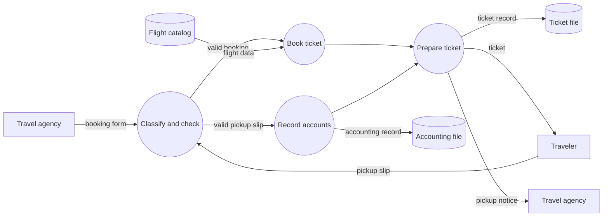
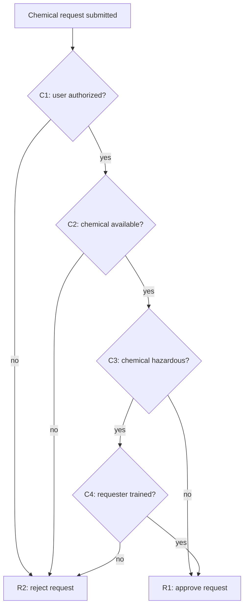
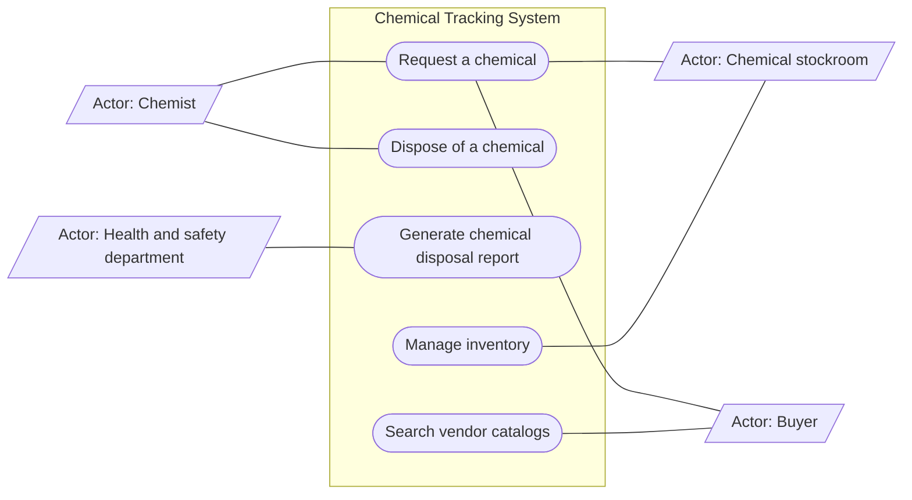
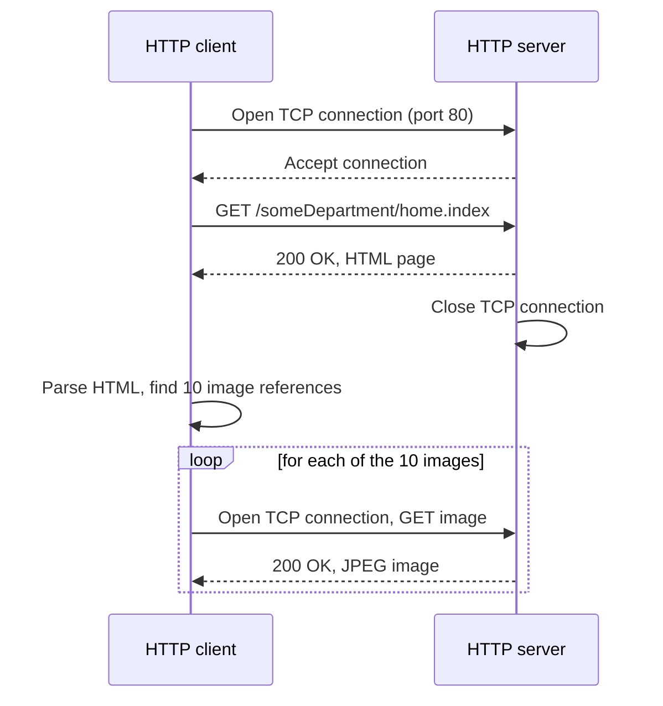
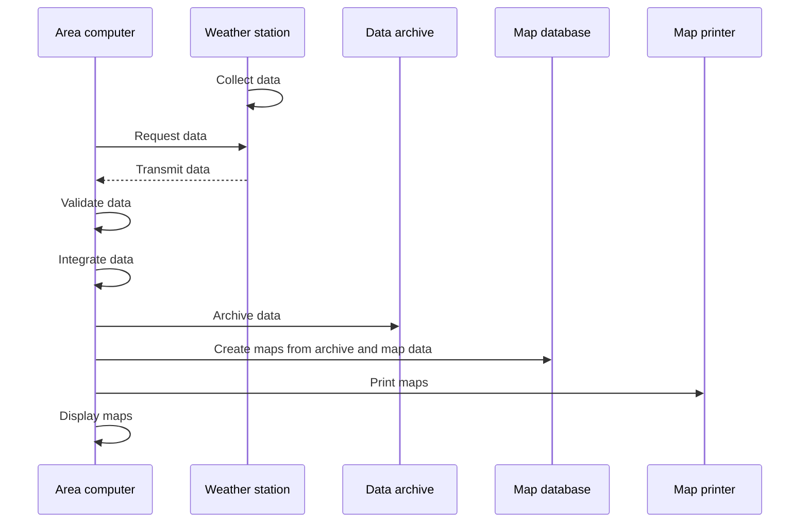
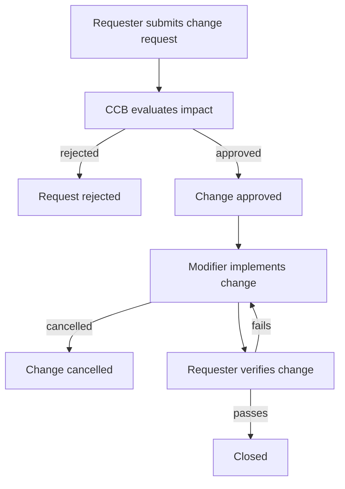

Every software project begins with someone wanting something, and most failed projects fail there: the team builds the wrong thing, or the right thing with the wrong constraints, and finds out only after the code is written. Requirements engineering is the part of **software engineering** that turns vague wishes into a precise, agreed and checkable description of what a system must do and how well it must do it. This chapter follows the activities in their usual order: what a requirement is and why it matters (4.1), how requirements are obtained from users and other stakeholders (4.2), how they are analyzed with models (4.3), how they are written down (4.4), and how they are kept under control while they change (4.5). The last section (4.6) applies the same ideas to a new reader of specifications, the AI **coding agent**, which implements exactly what it is told and therefore makes the quality of the specification more important, not less. Throughout the chapter we use one running case, the Chemical Tracking System from Wiegers and Beatty's *Software Requirements*. The process models in which requirements work is embedded (waterfall, **Scrum**, user stories) are the subject of [4.14.2](/4.14.2); the design that follows from the requirements is the subject of [4.14.5](/4.14.5); and requirements reappear in testing, where every test checks some requirement ([4.14.11](/4.14.11)).

## 4.1. Basic Concepts

### 4.1.1. What Is a Requirement

**Definition 4.1.1 (Requirement)** A **requirement** is a statement that expresses a need of a stakeholder together with its associated conditions and constraints: a description of a behavior or a property the system must have, which thereby constrains its development (Sommerville and Sawyer, 1997; ISO/IEC/IEEE 29148).

Requirements fall into two broad classes.

**Definition 4.1.2 (Functional and Non-Functional Requirements)** A **functional requirement** describes what the system should do: a function it performs or a service it provides to users and to other systems. A **non-functional requirement** describes a property or a constraint of the system rather than a behavior: business rules, external interfaces, design constraints, and quality attributes such as performance, reliability, maintainability and security.

Functional requirements are the core of a specification: a non-functional requirement is always a property of some function ("the search responds within 2 seconds" presupposes a search). In practice the two are mixed in whatever a customer says. Consider a manager asked by an analyst what the new employee information system should do:

> Well, the new system has to be faster than the old one. And when an employee's name is very long, the old system crashes and we have to call support to enter it for us, so the new one must not crash on long names. Also, a new regulation says we can no longer use national ID numbers as employee IDs, so we'll need to change all IDs. Oh, and a report of how many hours of training each employee has had this year would be great.

| Statement | Kind of requirement | What is still missing |
|---|---|---|
| "Faster than the old one" | Quality attribute (performance) | Which operations, measured how, how much faster |
| "Must not crash on long names" | Functional (input handling) plus reliability | Maximum name length, character set, behavior beyond the limit |
| "No national ID numbers as employee IDs" | Business rule (regulation), forcing a data migration | The new ID scheme, the migration and its deadline |
| "Training hours report" | Functional (a report) | Contents, period, who may see it, how often |

None of the four statements can be implemented as given. The customer is not at fault: people describe problems and wishes, not specifications. Turning the left column into the right one is the job of requirements engineering.

### 4.1.2. Why Requirements Matter

R. Young (*Effective Requirements Practices*, 2001) describes the developer's worst nightmare as a customer who says: "I know you think you understand what I said, but what you don't understand is what I said is not what I mean." The gap between what is said and what is wanted typically appears late, after deadlines have been promised and money spent.

Surveys of project outcomes point the same way. The Standish Group's first CHAOS report (a 1994 survey of 365 companies and 8,380 application projects) asked what made projects succeed, run into trouble, or be abandoned. The top factors in each list were about requirements and users:

| Success factors | % | Challenge factors | % | Failure factors | % |
|---|---|---|---|---|---|
| User involvement | 15.9 | Lack of user input | 12.8 | Incomplete requirements | 13.1 |
| Executive management support | 13.9 | Incomplete requirements and specifications | 12.3 | Lack of user involvement | 12.4 |
| Clear statement of requirements | 13.0 | Changing requirements and specifications | 11.8 | Lack of resources | 10.6 |
| Proper planning | 9.6 | Lack of executive support | 7.5 | Unrealistic expectations | 9.9 |

The CHAOS methodology has been criticized (its definition of "success" as on time, on budget and with all features, its unpublished data), so the percentages should not be taken literally; but the qualitative finding, that unclear and unstable requirements and missing user involvement dominate, has been confirmed by many later studies. As Capers Jones put it, the seeds of major software disasters are usually sown in the first three months of a project.

### 4.1.3. The Requirements Engineering Process

**Definition 4.1.3 (Requirements Engineering)** **Requirements engineering** is the systematic discovery, analysis, documentation, validation and management of the requirements of a system throughout its life cycle.

Requirements engineering mediates between three groups: users, who have goals and expectations; analysts, who turn them into a specification; and engineers, who build the system from it. Its activities are usually listed as follows.

| Activity | Question | Main output |
|---|---|---|
| Feasibility study | Is the system worth building, and can it be built within budget and schedule? | Feasibility report |
| *Requirements elicitation* and analysis | What do the stakeholders need? Which needs conflict? | Lists of needs, priorities, open issues |
| Requirements modeling | How do data and control flow, who interacts with the system and how? | Models: data flow diagrams, use cases, sequence diagrams |
| *Requirements specification* | How is each requirement stated precisely? | Software requirements specification (SRS) |
| *Requirements validation* | Do the written requirements describe what the stakeholders actually need? | Reviewed, approved requirements (a **baseline**) |
| Requirements management | How are changes controlled and requirements traced? | Change records, traceability information |



The activities are not phases done once. Elicitation, modeling, specification and validation form a loop that is repeated as understanding grows; in an agile process ([4.14.2](/4.14.2)) the loop runs again in every iteration for the part of the product being built next. Requirements management runs alongside the whole time.

## 4.2. Requirements Elicitation

### 4.2.1. Users and User Classes

"The biggest challenge in requirements gathering, and in much of software and systems project work, is how people interact with each other," write Wiegers and Beatty; no tool automates communication, and in software development communication matters more than operating computers. Elicitation therefore starts with the users: who they are, what they are trying to achieve, and also what the product should *not* do. A product defined by its users' goals can afford to leave things out: two messaging products with similar technology can serve opposite needs (one built around existing acquaintances, one around meeting strangers), and each would be worse if it tried to serve both.

Our running case begins the way many projects do. The sponsor, a manager at a chemical company, says:

> We need an information system that tracks all the chemicals in our stockroom and laboratories, so that chemists can use chemicals left over by others instead of always buying new ones. That will save us a lot of money. The health and safety department also wants the system to cut the work of preparing the chemical usage and disposal reports we owe the government. Can you deliver it in five months? The chemists are too busy to work out all the details before you start; can't your people figure out what to build? I've told you the requirements; please get going and keep me posted.

The sponsor has stated two business objectives (reuse chemicals, simplify regulatory reporting) and a schedule, but no requirements. The first step is to find out who will use the system.

**Definition 4.2.1 (User Class)** A **user class** is a group of users who use a system in a similar way: they share tasks, access privileges, frequency of use, experience with the domain and with computers, platforms, and language. Users interact with the system either directly or indirectly (by receiving its outputs).

| User class | Size | Description |
|---|---|---|
| Chemists | About 1,000, in six buildings | Request chemicals from vendors or from the stockroom; each uses the system several times a day |
| Buyers | 5 | Process purchase requests; place and track orders with external vendors |
| Chemical stockroom staff | 6 technicians, 1 supervisor | Manage more than 500,000 chemical containers in three stockrooms; supply containers, order new chemicals, track every container in and out |
| Health and safety department | 1 manager | Generate predefined quarterly reports that comply with federal and state regulations on chemical use and disposal |

Each user class becomes a source of requirements, and the classes differ in how much their needs weigh: the chemists are the largest and most frequent users, while the health and safety manager is a single user whose reports are legally required.

### 4.2.2. Stakeholders and Decisions

Users are not the only people with an interest in the system.

**Definition 4.2.2 (Stakeholder)** A **stakeholder** is a person, group or organization that is actively involved in a project, is affected by its process or outcome, or can influence its process or outcome.

Stakeholders are found at three distances from the project: outside the developing organization (customers, end users, regulators, suppliers of interfacing systems), inside it but outside the project (management, marketing, operations, legal), and within the project team (project manager, analysts, developers, testers, technical writers). In the Chemical Tracking System, the government agencies that receive the reports are stakeholders even though they never touch the software.

Stakeholders disagree, so a project must decide in advance *who* decides and *how*. A decision is needed whenever there is a conflict on the critical path, a change request to accept or reject, or a set of requirements to approve for a release. Common decision rules are:

- the decision leader decides alone (possibly after consultation);
- the group votes, with the majority winning, or with unanimity required;
- the group discusses until it reaches consensus, so that everyone owns and supports the decision;
- the decision leader delegates the decision to one person;
- the group decides, but some person holds a veto.

Typical disputes and the usual ways to resolve them (after Wiegers and Beatty) are:

| Disagreement between | Resolution |
|---|---|
| Individual users | The product champion or **product owner** decides |
| User classes | Favored user classes get priority |
| Market segments | The segment with the greatest impact on business success gets priority |
| Corporate customers | Business objectives dictate the direction |
| Users and their managers | The product owner or product manager decides for the user class |
| Developers and customers | Discuss, using the business objectives and the cost of each option |
| Developers and marketing | The product manager decides, informed by the cost of each option |

Agreement on the requirements is the core of the customer–developer relationship. Before development proceeds, the customers confirm that the requirements describe their needs, the developers that they understand them and can implement them, the testers that they are verifiable, and management that they serve the business objectives. What they agree on is recorded as a baseline.

**Definition 4.2.3 (Requirements Baseline)** A **requirements baseline** is a snapshot of a set of requirements at a particular point in time, reviewed and agreed upon, that serves as the basis for further development. Later changes to a baselined requirement go through change control (4.5).

### 4.2.3. Elicitation Techniques

Requirements are elicited, not collected: users rarely have them ready, so the analyst must draw them out. The main techniques, which are usually combined, are:

| Technique | How it works | Good for |
|---|---|---|
| Interviews | One-to-one or small-group conversations, prepared with questions | Understanding goals and problems of individual user classes |
| Workshops | Facilitated sessions with representatives of several user classes | Resolving conflicts and reaching shared definitions quickly |
| Focus groups | Moderated discussion with a group of typical users | Opinions and expectations of a large user population |
| Observation | Watching users do their real work in their real environment | Tacit knowledge that users would never mention in an interview |
| Questionnaires | Structured surveys sent to many users | Large or geographically distributed user populations |
| Document analysis | Reading regulations, manuals, forms, reports of the current system | Business rules, data definitions, required reports |
| System interface analysis | Examining the systems the new system must exchange data with | External interface requirements |
| Prototyping | Building a mock-up or a partial system for users to try | Exploring uncertain requirements, especially user interfaces |

A good interview asks about tasks and goals ("walk me through how you get a chemical today", "what goes wrong?") rather than features ("what buttons do you want?"), and the analyst writes up what was heard and asks the user to confirm it.

### 4.2.4. Why Elicitation Is Hard

The difficulties fall into two groups.

| Understanding the requirements | Recording and expressing them |
|---|---|
| Fixing the system boundary: what the system does and does not do, and where its interfaces to other systems lie | Recording the relations between requirements |
| Determining the functions: users are vague, different users want different things, statements are ambiguous | Decomposing functions from coarse to fine at a suitable granularity |
| Responding to change: users, their needs, technology and the market all change during the project | Recording dependencies: input and output data, order of execution |
| | Stating the non-functional constraints and the exception handling of every function |
| | Finding a common language between users and developers; different levels and types of requirements need different notations |

The last point explains why requirements engineering uses so many kinds of diagrams (4.3): a picture is often the fastest way to a shared understanding. It also explains why requirements are written at more than one level of detail. A single sentence written for the customer becomes several precise statements for the developers, as in this example from a patient management system for mental health clinics (Sommerville):

| Level | Text |
|---|---|
| User requirement | The system shall generate monthly reports showing the cost of drugs prescribed by each clinic during that month. |
| System requirement 1 | On the last working day of each month, a summary of the drugs prescribed, their cost and the prescribing clinics shall be generated. |
| System requirement 2 | The system shall generate the report for printing after 17:30 on the last working day of the month. |
| System requirement 3 | A report shall be created for each clinic, listing the individual drug names, the total number of prescriptions, the number of doses prescribed and the total cost of the drugs prescribed. |
| System requirement 4 | If drugs are available in different dose units (for example 10 mg, 20 mg), separate reports shall be created for each dose unit. |
| System requirement 5 | Access to all cost reports shall be restricted to authorized users listed on a management access control list. |

The user requirement is what the customer approves; the system requirements are what developers implement and testers check. Requirement 5, a security constraint, was nowhere in the user's sentence: it was found by asking who may see the report.

## 4.3. Requirements Modeling

Natural language is flexible but ambiguous, and long prose hides gaps. Models express one aspect of the requirements in a notation that makes certain mistakes visible. Each model answers a different question:

| Model | Aspect | Question it answers |
|---|---|---|
| Data flow diagram | Data flow | Where does data come from, how is it transformed, where is it stored? |
| Swimlane diagram | Cross-functional process | Who does which step of a business process, in what order? |
| Decision table, decision tree | Condition and response | What must the system do under each combination of conditions? |
| Use case diagram, **user story** | Functional decomposition from the user's view | Who uses the system, and for what goals? |
| Sequence diagram | Interaction between objects | In what order are messages exchanged in one scenario? |

### 4.3.1. Data Flow Diagrams

**Definition 4.3.1 (Data Flow Diagram)** A **data flow diagram** (DFD) shows how data moves through a system: where it enters, which processes transform it, where it is stored, and where it leaves. Its four elements are data flows (arrows labeled with the data), processes (circles or ovals, named with a verb and a noun), data stores (drawn between two parallel lines), and external entities (rectangles, the sources and destinations of data outside the system).

DFDs give an overview of the data in a system and suit transaction-processing and other function-centered systems; they are usually used together with flowcharts, which show control rather than data. A rule of thumb is to keep at most about ten processes in one diagram and to refine a complex process into a lower-level DFD of its own.

**Example 4.3.1** An airline ticket booking service. A travel agency sends booking forms; the system classifies and checks them, books tickets against the flight catalog, records the transaction in the accounting file, and prepares the tickets, which go to the travelers, while a pickup notice goes back to the agency. (Mermaid has no double-line shape, so the data stores are drawn as cylinders.)



The diagram says nothing about when or in which order processes run; that is what makes it a model of data, not of control.

### 4.3.2. Swimlane Diagrams

**Definition 4.3.2 (Swimlane Diagram)** A **swimlane diagram** (cross-functional diagram) describes the steps of a business process or of a system's operation, divided into visual lanes, one for each role, department or subsystem that performs steps in the process. Its elements are the lanes that partition the process, the process steps, the transitions between steps, and decision points.

In UML (4.3.4) the same idea is an *activity diagram* whose actions are grouped into partitions. A swimlane diagram shows not only the order of steps but the hand-offs between roles, which is where business processes most often go wrong.

**Example 4.3.2** Ordering a chemical from a vendor in the Chemical Tracking System involves three roles. The chemist submits a request; the buyer creates a vendor order; if the vendor accepts it, the vendor fills the order, ships the chemical and sends an invoice, while the buyer updates the order status, and the chemist and the buyer receive the chemical; finally the buyer reviews and approves the invoice and pays, and the vendor receives the payment.

```mermaid
flowchart TB
  subgraph Chemist
    A1[Submit chemical request]
    A2[Receive chemical]
  end
  subgraph Buyer
    B1[Create vendor order]
    B2{Order accepted?}
    B3[Update order status]
    B4[Receive chemical]
    B5[Review and approve invoice]
    B6[Pay]
  end
  subgraph Vendor
    C1[Fill order]
    C2[Ship chemical]
    C3[Create and send invoice]
    C4[Receive payment]
  end
  A1 --> B1 --> B2
  B2 -->|no| B1
  B2 -->|yes| C1
  C1 --> B3
  C1 --> C2 --> B4 --> A2
  C2 --> C3 --> B5 --> B6 --> C4
```



Drawing the diagram immediately raises questions that the sponsor's paragraph never answered, and each question is a requirement still to be elicited: What does a request contain, and how is it submitted? How are orders managed and their status reported? How are invoices received and managed, and does the system need an interface to the finance system?

### 4.3.3. Decision Tables and Decision Trees

Software is often governed by complex logic, in which many combinations of conditions lead to different behaviors. A functional requirement must describe the system's response under every possible combination; overlooking a combination means a missing requirement. When the logic becomes complex, a decision table or decision tree makes the correspondence between condition combinations and responses explicit.

**Definition 4.3.3 (Decision Table)** A **decision table** lists the conditions that affect a behavior, the possible actions, and a set of rules (columns); each rule gives a value (true, false, or "don't care", written –) for every condition and marks the actions taken when the conditions have these values. A decision table is *complete* if every combination of condition values matches some rule, and *consistent* if no combination matches two rules with different actions.

**Example 4.3.3** In the Chemical Tracking System, whether a new chemical request is approved or rejected depends on four conditions: C1, the requester is authorized to request chemicals; C2, the chemical is available in the stockroom or from a vendor; C3, the chemical is on the list of hazardous chemicals, which require special safety training; C4, the requester has been trained for this kind of hazardous chemical. A decision tree asks the questions in order:



Each path from the root to a leaf becomes one rule of the decision table:

| | Rule 1 | Rule 2 | Rule 3 | Rule 4 | Rule 5 |
|---|---|---|---|---|---|
| C1 User is authorized | F | T | T | T | T |
| C2 Chemical is available | – | F | T | T | T |
| C3 Chemical is hazardous | – | – | F | T | T |
| C4 Requester is trained | – | – | – | F | T |
| R1 Approve request | | | X | | X |
| R2 Reject request | X | X | | X | |

The table is complete and consistent: with four Boolean conditions there are $2^4 = 16$ combinations, and the rules cover $8 + 4 + 2 + 1 + 1 = 16$ of them, each exactly once (a rule with $k$ don't-care entries covers $2^k$ combinations). Checks of this kind are mechanical, which is one reason decision tables are also a standard source of black-box **test cases** ([4.14.11](/4.14.11)); 4.6.3 turns this very table into an executable test.

A decision tree is easier to read when the conditions are naturally asked in sequence; a decision table is easier to check for completeness and scales better when many conditions interact.

### 4.3.4. UML and Use Cases

**Definition 4.3.4 (UML)** The **Unified Modeling Language** (UML) is a standardized graphical language for specifying, visualizing, constructing and documenting the artifacts of software systems. It was created by Grady Booch, Ivar Jacobson and James Rumbaugh in the 1990s, is maintained by the Object Management Group (current version 2.5.1, 2017), and defines structure diagrams (class, component, deployment diagrams and others) and behavior diagrams (use case, activity, state machine, sequence diagrams and others).

Requirements work mainly uses two UML diagrams: use case diagrams, which give an overview of who uses the system for what, and sequence diagrams (4.3.6), which detail one scenario.

**Definition 4.3.5 (Use Case)** An **actor** is a person, or another software system or hardware device, that interacts with the system to carry out a use case. A **use case** is a sequence of interactions between the system and one or more actors that yields a result of value to an actor, described without revealing the internal structure of the system. A **use case diagram** is a high-level visual summary of the user requirements: the actors, the use cases, and the associations between them, within the boundary of the system.

A use case describes what the user expects to happen, not how the system does it, so it should not go into design details.

**Example 4.3.4** The use case diagram of the Chemical Tracking System (actors outside the system boundary, use cases inside):



Use cases are found in three steps:

1. Identify the actors and analyze their interactions with the system: "a chemist requests a chemical", "the health and safety department submits a chemical usage report".
2. Analyze the business processes and generalize scenarios into use cases: "use a chemical left over in the stockroom" and "buy a chemical from a vendor" are two scenarios of one use case, *Request a chemical*, involving the chemist, the stockroom and the buyer.
3. Identify external events and associate them with actors and use cases: the quarterly deadline triggers *Generate chemical disposal report*, whose output goes to a further actor, the government agency.

A use case model can then be checked against a short list:

| Actors | Use cases |
|---|---|
| Every role that interacts with the system is represented by an actor | Every major function of the system is represented by a use case |
| Every actor is associated with at least one use case | Commonalities among use cases have been analyzed, giving new use cases and the include, extend and generalization relationships among them |
| An actor that includes another is merged with it | Complex use cases are decomposed |
| An actor associated with unrelated groups of use cases is split | |

Choosing the granularity of use cases takes judgment. Similar requirements can be merged into one use case, and not every requirement needs to be forced into a use case (non-functional requirements in particular are written elsewhere). Conversely, a use case whose flow exceeds 10 to 15 steps should be split into several scenarios. Too many use cases overwhelm the users; too complex ones confuse them. A use case is not a user interface and not a system structure: it is about the interaction between the user and the system, so it distinguishes functions by their inputs and outputs but contains no data definitions and no design.

The diagram is only a summary; each use case is specified in a use case description.

**Definition 4.3.6 (Use Case Description)** A **use case description** records for one use case: a unique ID and a short name stating the user's goal; a brief description of its purpose; the **trigger**, the event that starts it; zero or more **preconditions**, conditions on the state of the system that must hold before it can start (and that the system checks first); one or more **postconditions**, the state of the system after it completes successfully; and a numbered sequence of steps, the interaction between actors and system, divided into the **normal flow**, **alternative flows** and **exception flows**.

The normal flow (also called the main or basic flow, or the happy path) is the default sequence of events. An alternative flow is a variation in which some steps differ but the use case still succeeds. An exception flow is a scenario in which the use case cannot succeed; it describes the error condition and how the system handles it. Postconditions can be observable by the user (an ATM displays the account balance), physical (it dispenses cash and prints a receipt), or internal changes of state (the account is debited with the amount and the fee); a precondition of the ATM use case *Withdraw cash* is that the machine contains cash.

**Example 4.3.5** The use case *Request a chemical*:

| Field | Content |
|---|---|
| ID and name | UC-4 Request a chemical |
| Description | A requester asks for a container of a chemical, either from the stockroom or from a vendor. |
| Actors | Requester (primary), chemical stockroom, buyer |
| Trigger | The requester needs a chemical. |
| Preconditions | 1. The user's identity has been authenticated. 2. The user is authorized to request chemicals. 3. The chemical inventory database is online. |
| Postconditions | 1. The request is stored in the Chemical Tracking System. 2. The request has been sent to the chemical stockroom or to a buyer. |
| Normal flow | 1. The requester specifies the desired chemical. 2. The system lists the containers of that chemical available in the stockroom. 3. The requester views the history of a container. 4. The requester selects a container. 5. The requester enters other information to complete the request. 6. The system stores the request and notifies the chemical stockroom. |
| Alternative flow 4.1 (order from a vendor) | At step 4, if no suitable container is in stock: 4.1 the requester searches the vendor catalogs; 4.2 the system displays a list of vendors; 4.3 the requester selects a vendor and a container; continue at step 5, and the request goes to a buyer. |
| Exception flow | At step 4.2, if no vendor supplies the chemical, the system informs the requester, and the use case ends without a request. |

Writing the description forces exactly the questions that the diagram hides: what happens when nothing is in stock, when no vendor sells the chemical, when the database is offline.

### 4.3.5. Use Cases and User Stories

Agile teams usually express user requirements as user stories rather than use cases ([4.14.2](/4.14.2)). A **user story** is written on a card in the form "As a ⟨role⟩, I can ⟨activity⟩ so that ⟨business value⟩", and is accompanied by **acceptance criteria**, the conditions that the implementation must meet for the story to count as done. For example:

> As an energy consumer, I want to see my daily energy use so that I can reduce my energy costs and usage.
>
> Acceptance criteria: the system reads the meter every 10 seconds and displays usage on the portal in 15-minute increments; …

A good story satisfies the INVEST criteria (independent, negotiable, valuable, estimable, small, testable). The two forms differ in purpose more than in content:

| | Use case | User story |
|---|---|---|
| What it is | A definition of a coherent unit of functionality, without exposing the system's internal structure | A short description of functionality valuable to a user; a placeholder for a conversation, not a detailed specification |
| Length and detail | Detailed: goal, trigger, preconditions, flows, alternative flows, postconditions | Short and succinct, one scenario |
| Main use | Developers implement features from the description; analysts derive functional requirements from it | Analysts and product owners determine needs in context and prioritize features on a story map |
| Typical process | Plan-driven processes; adaptable to agile as a blueprint | Agile processes, with fast decisions and frequent reprioritization |

The two are compatible. A story's acceptance criteria play the role of the postconditions and alternative flows of a use case, and a team can keep stories for planning while writing a use case description for an intricate interaction.

### 4.3.6. Sequence Diagrams

**Definition 4.3.7 (Sequence Diagram)** A **sequence diagram** is a UML interaction diagram that shows, for a single scenario within one use case, the messages exchanged between participants (objects or actors) and the order in which they occur. Its vertical dimension is time, running downward; its horizontal dimension lists the participants, each with a vertical lifeline.

**Example 4.3.6** A web browser fetches a page that references ten JPEG images over HTTP/1.0 without persistent connections. The client opens a TCP connection to port 80 of the server, which accepts it; the client sends a request for the page; the server returns the HTML and closes the connection; the client parses the HTML, finds ten referenced images, and repeats the whole exchange for each of them.



The diagram makes the cost of the design visible: eleven connection setups for one page, which is why HTTP/1.1 made connections persistent (and HTTP/2 and HTTP/3 multiplex requests on one connection).

Sequence diagrams can be derived systematically from a textual description by extracting subject–verb–object triples.

**Example 4.3.7** A requirements statement (after Sommerville) reads: "A weather data collection system generates weather maps on a regular basis, using data collected from remote, unattended weather stations and from other sources. Weather stations transmit their data to the area computer in response to a request from that machine. The area computer validates the collected data and integrates it with the data from other sources. The integrated data is archived and, using data from this archive and a digitized map database, a set of local weather maps is created. Maps may be printed on a special-purpose map printer or displayed in a number of formats." The actions are: weather stations collect data; the area computer requests data from the weather stations; the weather stations transmit their data; the area computer validates, integrates and archives the data; it uses the map database to create weather maps; the map printer prints maps; the area computer displays maps.



The nouns of the text become participants and the verbs become messages; anything the text leaves open (does the station collect continuously or only on request? who decides the display format?) shows up as a gap in the diagram.

## 4.4. Requirements Specification

### 4.4.1. Why Write a Specification

How requirements are recorded varies widely. Four projects described by Wiegers and Beatty illustrate the failure modes:

| Project | How requirements were recorded | Outcome |
|---|---|---|
| A complex process-control application, more than 100 people over several years | About 800 high-level requirements, 20 subprojects each with its own requirements, about 800 to 900 derived system requirements | A mass of documents |
| A medium-sized project | One guiding document per project containing everything: requirements, budget, schedule, quality plan, tests | An all-in-one document in which requirements are hard to find |
| A large agile project | Stories on sticky notes | After a few months, sticky notes scattered everywhere |
| A medium project, about 40 to 60 pages of requirements | Twelve separate files: one for batch processing, one for the report engine, one for ten reports… | Document explosion: changes hard to synchronize, no complete picture |

The goal is not more documentation but the right documentation: requirements recorded once, in a known place, at a level of detail suited to the project's risk. A software requirements specification is a contract that serves many readers at once:

| Reader | Uses the SRS to |
|---|---|
| Customers and marketing | Know what product will be delivered |
| Project managers | Estimate schedule, effort and resources |
| Development team | Know what to build |
| Testers | Develop requirements-based tests, test plans and test procedures |
| Maintenance and support staff | Understand what each part of the product does |
| Documentation writers | Write user manuals and online help |
| Trainers | Prepare training materials and plans |

### 4.4.2. StRS, SyRS and SRS

**Definition 4.4.1 (Software Requirements Specification)** A **software requirements specification** (SRS) is a document, or a structured collection of requirements in a tool, that states the functions, capabilities, performance, constraints and quality attributes the software must provide, in enough detail to design, build and verify it.

The international standard ISO/IEC/IEEE 29148 (first edition 2011, current edition 2018; it replaced IEEE 830 and related IEEE standards) describes three specifications at different levels and gives an outline for each. Condensed:

| Stakeholder requirements specification (StRS) | System requirements specification (SyRS) | Software requirements specification (SRS) |
|---|---|---|
| Business purpose, scope and overview | System purpose, scope and overview | Purpose, scope, product perspective |
| Stakeholders, business environment, goals and objectives | Functional, usability and performance requirements | Product functions, user characteristics, limitations |
| Business model, information environment, business processes | System interfaces, operations, modes and states | Assumptions and dependencies, apportioning of requirements |
| Business policies, rules and constraints | Physical characteristics, environmental conditions | Specific requirements: external interfaces, functions, usability, performance |
| User requirements, operational concepts and scenarios | Security, information management, policies and regulations | Logical database requirements, design constraints, standards compliance |
| Project constraints | Life-cycle sustainment, packaging, handling and transport, verification | Software system attributes, verification, supporting information |

The StRS describes the business view, the SyRS the system as a whole (hardware, software, people), and the SRS the software part. A small project merges them into one document; what matters is that each kind of information has a place.

### 4.4.3. Levels and Types of Requirements

The same system looks different from different distances. Wiegers and Beatty distinguish three levels of requirements, each recorded in its own kind of document and owned by different stakeholders.

**Definition 4.4.2 (Business, User and Functional Requirements)** A **business requirement** describes why an organization is building a system: the business objective or benefit it expects, recorded in a vision and scope document. A **user requirement** describes a goal or task that users must be able to perform with the system, or a product attribute important to user satisfaction, recorded for example as use cases or user stories. A **functional requirement**, at the software level, describes a behavior that developers must implement so that users can accomplish their tasks and thereby the business requirements are met, recorded in the SRS.

| Level | Example (an airline) | Document | Main sources |
|---|---|---|---|
| Business requirement | Reduce airport counter staff costs by 25% | Vision and scope document | Sponsor, customers, marketing, product management |
| User requirement | Passengers can check in for a flight on the airline's website or at an airport kiosk | User requirements document (use cases, stories) | User representatives, analysts, product managers |
| Functional requirement | The passenger shall be able to print boarding passes for all flight segments for which he or she has checked in. If the passenger's profile does not specify a seat preference, the reservation system shall assign a seat. | SRS | Analysts, developers, testers |

Each level should be traceable to the one above: the check-in function exists because kiosks reduce counter staff, and a feature that serves no business requirement is a candidate for removal.

Around the three levels lie the other kinds of requirements:

| Type | What it is | Example |
|---|---|---|
| *Business rule* | A policy, government regulation, industry standard or computational algorithm. Not itself a software requirement, since it exists beyond the scope of any one application, but it often dictates functions the system must include | Only trained staff may handle hazardous chemicals; reports must follow federal and state regulations |
| Quality attribute | A property of how well the system performs its functions: usability, performance, robustness, handling of exceptional situations. Correct functions alone do not make a product succeed | The system shall show the available containers within 2 seconds |
| *System requirement* | A requirement on a system that contains software together with hardware, people and processes, the environment the software depends on | A supermarket checkout station with card readers, a scale, a handheld barcode scanner and receipt printers |
| *External interface requirement* | A connection between the system and users, other software, hardware devices or communication protocols | Read container labels with the stockroom's barcode scanners; exchange orders with the vendors' systems |
| Constraint | A restriction on the design or implementation choices available to the developers | The system shall run on the company's existing database server |

Business rules, quality attributes, external interfaces and constraints together make up the non-functional requirements of Definition 4.1.2. Quality attributes and the design tactics that achieve them are treated in [4.14.5](/4.14.5).

### 4.4.4. Writing a Requirement Statement

ISO/IEC/IEEE 29148 defines a requirement statement as one that can be verified; that has to be met or possessed by the system to solve a stakeholder problem or achieve a stakeholder objective; that is qualified by measurable conditions and bounded by constraints; and that defines a capability or performance of the system, not a capability of the user or operator. It recommends a sentence structure with up to six parts:

$$
[\text{Condition}]\ [\text{Subject}]\ [\text{Action}]\ [\text{Object}]\ [\text{Constraint}]\ [\text{Value}]
$$

The subject is the system (or a part of it), the action is stated with "shall", and the condition, constraint and value turn an intention into something measurable. Each pair below shows a weak statement and its well-formed version:

| Weak | Well-formed |
|---|---|
| The system shall set the signal x. | *When signal x is received* [condition], the system [subject] shall set [action] the signal-x-received bit [object] within [constraint] 2 seconds [value]. |
| The radar system shall detect targets. | *At sea state 1* [condition], the radar system [subject] shall detect [action] targets [object] at ranges out to [constraint] 100 nautical miles [value]. |
| The invoice system shall display invoices. | The invoice system [subject] shall display [action] pending customer [constraint] invoices [object] in ascending order [value] of the date on which they are to be paid [constraint]. |

**Definition 4.4.3 (Constraint)** In a requirement statement, a **constraint** restricts the design solution or the implementation of the system. A constraint may apply across all requirements, may be attached to one requirement or a set of them, or may be stated as a stand-alone requirement.

The constraints in the examples above restrict different things: the time between two actions (receiving and setting a signal), the range of an action (detection up to 100 nautical miles), and the scope and form of an action (only pending customer invoices, in ascending order).

A requirement without a value is a wish. "Food delivery must be fast" and "unlocking a shared bicycle by scanning must be quick" are what users say; the requirements are "95% of orders within 3 km shall be delivered within 30 minutes of payment" and "the lock shall open within 2 seconds of a successful scan for 99% of unlock attempts". Choosing the numbers is a business decision; leaving them out leaves it to the developer.

A widely used template that refines this structure is EARS, the *Easy Approach to Requirements Syntax* (Mavin et al., 2009). It provides a few sentence patterns, each starting with a keyword that identifies the kind of requirement:

| Pattern | Template | Example from the Chemical Tracking System |
|---|---|---|
| Ubiquitous | The ⟨system⟩ shall ⟨response⟩. | The system shall record the location of every chemical container. |
| Event-driven | When ⟨trigger⟩, the ⟨system⟩ shall ⟨response⟩. | When a container is checked out, the system shall record the requester and the time. |
| State-driven | While ⟨state⟩, the ⟨system⟩ shall ⟨response⟩. | While the inventory database is offline, the system shall reject new requests with an explanatory message. |
| Unwanted behavior | If ⟨condition⟩, then the ⟨system⟩ shall ⟨response⟩. | If a requester without hazard training requests a hazardous chemical, then the system shall reject the request and name the required course. |
| Optional feature | Where ⟨feature is included⟩, the ⟨system⟩ shall ⟨response⟩. | Where the vendor interface is installed, the system shall send purchase orders electronically. |

Complex requirements combine the keywords ("While …, when …, the system shall …"). The patterns are simple enough for non-specialists, and the fixed structure makes missing triggers and responses easy to spot.

### 4.4.5. Characteristics of Good Requirements

Defects in requirements are expensive. Beizer (1990) observed that requirements are a major source of expensive bugs, from a few percent to more than half depending on the application, and that "they're the earliest to invade the system and the last to leave": a faulty requirement can pass all development testing, beta testing and initial field use and be caught only after hundreds of installations. Davis (1993), summarizing data going back to Boehm, gave the relative cost of repairing a requirements defect according to when it is found:

| Phase in which the defect is found | Relative cost of repair |
|---|---|
| Requirements | 0.1–0.2 |
| Design | 0.5 |
| Coding | 1 |
| Unit testing | 2 |
| Acceptance testing | 5 |
| Maintenance | 20 |

The exact ratios come from plan-driven projects of the 1970s and 1980s and have been questioned since; short iterations, automated tests and **continuous delivery** flatten the curve. The direction is not in doubt: the later a misunderstanding is found, the more work has been built on it.

ISO/IEC/IEEE 29148 lists the characteristics a requirement should have. The 2011 edition, which most textbooks still follow, lists nine:

| Characteristic | Meaning |
|---|---|
| Necessary | Removing it would leave a deficiency; it traces to a real stakeholder need |
| Implementation free | States what is needed, not how to build it |
| Unambiguous | Can be interpreted in only one way |
| Consistent | Free of conflicts with other requirements |
| Complete | Needs no further amplification; measurable and sufficient to describe the need |
| Singular | States a single capability, characteristic or constraint |
| Feasible | Technically achievable within the project's constraints, with acceptable risk |
| Traceable | Its origin is known and it can be linked to design, code and tests |
| Verifiable | Its realization can be shown by an objective method (inspection, analysis, demonstration or test) |

The 2018 edition reorganizes the list. For an individual requirement it requires: necessary, appropriate (to the level of the entity it applies to; this replaces "implementation free"), unambiguous, complete, singular, feasible, verifiable, correct (an accurate representation of the need it came from) and conforming (to an approved template and style, such as EARS). Consistency, comprehensibility and the ability to be validated are now properties of a set of requirements, together with completeness and feasibility of the set; traceability is treated as a requirement attribute maintained by requirements management (4.5).

The first defect to look for is ambiguity: a sentence that seems clear can have two logical structures.

**Example 4.4.1** "Sound the alarm when a flying object is detected that is unfriendly and has an unknown mission or might enter restricted airspace within 5 minutes." Write $A$ for "the object is unfriendly", $B$ for "its mission is unknown" and $C$ for "it might enter restricted airspace within 5 minutes". The sentence can be read as $(A \land B) \lor C$ or as $A \land (B \lor C)$. The two readings differ exactly when $A$ is false and $C$ is true: a friendly aircraft about to stray into restricted airspace triggers the alarm under the first reading but not under the second. Which reading is meant is a domain decision that only the stakeholders can make; drawing both decision trees, or writing the condition as a formula, exposes the question.

Certain words are reliable signs of ambiguity:

| Avoid | Instead |
|---|---|
| as much as possible, best, most | State the quantity |
| at least, at most, between | State the boundary values, and whether they are included |
| efficient, fast, flexible, user-friendly | State the measurable criterion |
| usually, in most cases, ideally | State what happens in the other cases |
| support … | State what supporting it means |
| matching, compliant, the same as | State the standard of comparison |

A requirement is verifiable if an objective method can check whether it has been correctly implemented. Incomplete, inconsistent, infeasible or ambiguous requirements are all unverifiable, so verifiability is the most practical single test of quality: a tester who cannot design a test for a requirement has found a defect in it.

Completeness means that each requirement must contain all necessary information, and the specification as a whole must cover all functions and constraints. A decision table exposes missing cases.

**Example 4.4.2** "If the customer neither selects the optimal plan nor provides evidence, the system shall automatically select the default basic plan." The statement covers one of four combinations:

| | 1 | 2 | 3 | 4 |
|---|---|---|---|---|
| Optimal plan selected | T | T | F | F |
| Evidence provided | T | F | T | F |
| Select the default basic plan | ? | ? | ? | X |

What should happen when the customer selects the optimal plan without evidence, with evidence, or provides evidence without selecting it? The three question marks are three missing requirements.

A requirement must also be singular: a paragraph that mixes several needs must be split.

**Example 4.4.3** A paragraph from a real specification: "The system must check the consistency of account data between the active account log and the account management archive. The logic used to produce the comparison data should be based on the logic of the existing consistency checking tool; in other words, the new code does not need to be developed from scratch. However, additional logic must be added to identify whether the database is an authoritative source of information. The new functionality will include writing data to a table to indicate how and where inconsistencies were resolved. In addition, the code should also check for exception conditions that violate the security tool database. Once a violation occurs, an automatic warning email should be sent to the security compliance team." The analyst's questions:

1. Which existing tool is meant, and what does "based on" it mean: an interface to it, integration, or copying its logic?
2. How should the new code reuse or extend the existing code? (This is a design decision and may not belong in the requirement at all.)
3. What is the "additional logic"?
4. What makes a source "authoritative", and how is that identified?
5. What else does the "new functionality" include?
6. What exactly do "how" and "where" mean in the resolution record?
7. The paragraph contains at least five requirements and should be split into separate, individually verifiable statements.

After the questions are answered, the paragraph might become: "REQ-1. Every night at 02:00 the system shall compare the account records in the active account log with those in the account management archive. REQ-2. For each account whose records differ, the system shall write a row to the resolution table containing the account ID, the differing fields and the source declared authoritative. REQ-3. When a record violates a rule in the security tool database, the system shall send a warning email to the security compliance team within 5 minutes." Each statement can now be tested on its own.

Finally, before a set of requirements is baselined, it is validated: does it describe what the stakeholders actually need? The main techniques are reviews and inspections of the written requirements by stakeholders of each kind (with a checklist built from the characteristics above), prototypes that let users try the intended behavior, and acceptance tests written from the requirements before the code exists. Writing tests early is itself a review: every requirement that cannot be turned into a test is sent back.

## 4.5. Requirements Management

### 4.5.1. Activities

Requirements change during a project: users learn what they want by seeing early versions, the market and regulations move, and errors are discovered. Requirements management keeps the changes under control. It has four groups of activities:

| Version control | Change control | Requirements status tracking | Requirements tracing |
|---|---|---|---|
| Define a version identification scheme | Propose changes | Define the possible requirement statuses | Define links to other requirements |
| Track the versions of individual requirements | Analyze the impact of each change | Record the status of each requirement | Define links to other system elements (design, code, tests) |
| Track the versions of requirement sets | Make decisions | Track the status of all requirements | |
| | Update individual requirements and requirement sets, update plans, measure requirements volatility | | |

The status of each requirement moves through a small set of values (after Wiegers and Beatty): *proposed* (requested by an authorized source), *approved* (analyzed, impact estimated, allocated to a release), *implemented* (code designed, written and unit-tested), *verified* (confirmed by testing or another method), and, for requirements that leave the set, *deleted* or *rejected*. The fraction of requirements in each status is a far better measure of progress than "the code is 90% done".

**Definition 4.5.1 (Requirements Traceability)** **Requirements traceability** is the ability to follow the life of a requirement in both directions: backward to its origin (a business requirement, a stakeholder, a regulation) and forward to the design elements, code and tests that realize and verify it. The links are often recorded in a **traceability matrix**, a table whose rows are requirements and whose columns are the artifacts linked to them.

| Requirement | Origin | Use case | Design element | Tests |
|---|---|---|---|---|
| CTS-REQ-12 Approve or reject a request | Business rule: hazard training | UC-4 Request a chemical | `approval.decide` | `test_decision_table` (16 cases) |
| CTS-REQ-20 Quarterly disposal report | Business objective 2: regulatory reporting | UC-7 Generate chemical disposal report | `reports.disposal` | `test_disposal_report` |

Tracing answers the questions that change control asks: which code and tests must change if a regulation changes (forward), and why a piece of code exists at all (backward). Code that traces to no requirement is either undocumented functionality or dead weight.

### 4.5.2. Change Control

**Definition 4.5.2 (Change Control Board)** A **change control board** (CCB) is the group of people who decide whether proposed changes to baselined requirements are accepted or rejected. It represents all affected stakeholders, yet is small enough to respond quickly to change requests.

A change request goes through a fixed process:



*Impact analysis* evaluates the feasibility and cost of a change for every activity of the project (requirements, design, coding, testing, project management) and estimates the effort as a list of tasks: update the SRS or requirements repository; create new and modify existing design components; create new and modify existing user interface components; write new user documentation and help screens; write new and modify existing source code; acquire, license and integrate third-party software; write new and modify existing unit and integration tests; and so on, summed to a total estimated effort. A change costs people (more staff), time (schedule delays) and money (additional hardware and software). Everyone affected must know about and confirm the change: users decide whether it is necessary and valuable to the business, the development team commits to delivering it, and management allocates the resources.

Change control is not bureaucracy for its own sake. Without it, requirements creep in through hallway conversations, the schedule slips without anyone having decided to slip it, and the specification no longer describes the system. In agile processes the same function is served by the **product owner** and the **product backlog**: a change is a new or reprioritized backlog item, accepted into a sprint only through planning ([4.14.2](/4.14.2)).

## 4.6. Specifications for AI Coding Agents

### 4.6.1. Why Specifications Matter More

When a **coding agent** ([4.2.14](/4.2.14)) writes most of the code, the bottleneck of a project moves from writing code to deciding what the code should do. Three properties of agents make **requirements engineering** more important rather than less:

- An agent fills gaps by guessing. A human developer who meets an unclear requirement often asks; an agent tends to choose a plausible interpretation and implement it confidently. Every ambiguity of 4.4.5 becomes a decision the agent makes silently.
- An agent works from the text it is given. It does not attend the meetings, does not know the stakeholders, and starts each session without the context of the last one unless that context is written down in the repository.
- Code is cheap, so it is produced in large amounts. Reviewing a thousand generated lines against a vague intention is slow and unreliable; checking them against explicit requirements and tests is fast.

The practice of writing a specification first, reviewing it, and then letting agents plan and implement against it is now often called *spec-driven development*. It is the requirements process of this chapter with a new kind of developer, and the same characteristics apply: the spec must be unambiguous, complete, singular, verifiable and traceable. How to phrase a single task for an agent is covered in [4.2.14](/4.2.14#sec-14.4.1); this section is about the requirements that such tasks come from, and 4.14.14 places them in the whole engineering workflow.

### 4.6.2. Anatomy of a Specification

A specification for an agent is a short document kept in the repository, next to the code, under **version control**. A practical structure is:

| Section | Content | Requirements concept |
|---|---|---|
| Goal and context | Why the feature exists, who uses it, links to the user story or use case | Business and user requirements (4.4.3) |
| Scope and non-goals | What is included, and explicitly what is not | System boundary (4.2.4) |
| Requirements | Numbered statements in a fixed pattern such as EARS | Well-formed, singular requirements (4.4.4) |
| Acceptance criteria | Concrete examples and the tests that must pass | Verifiability (4.4.5) |
| Constraints | Interfaces that must not change, permitted dependencies, performance and security limits | Constraints, quality attributes (4.4.3) |
| Open questions | Decisions not yet made, with an owner | Unresolved elicitation issues |

The non-goals section is the one most often missing and the one an agent most needs: without it, an agent asked for an approval rule may also "helpfully" redesign the request form. The open-questions section prevents the opposite failure: instead of guessing, the agent is told which decisions are not its to make.

**Example 4.6.1** A specification for the approval rule of Example 4.3.3:

```markdown
# Spec: Automatic approval of chemical requests (CTS-REQ-12)

## Goal
Chemists get an immediate decision on most requests; only trained staff
receive hazardous chemicals (business rule BR-3, hazard training).
Source: use case UC-4 "Request a chemical", step 6.

## Scope
In scope: the decision function and its use in the request service.
Non-goals: no change to the request form, the database schema or the
notification emails.

## Requirements
- REQ-12.1 When a request is submitted, the system shall decide
  "approve" or "reject" from four facts: requester authorized (C1),
  chemical available (C2), chemical hazardous (C3), requester trained (C4).
- REQ-12.2 If C1 or C2 is false, then the system shall reject the request.
- REQ-12.3 If C3 is true and C4 is false, then the system shall reject
  the request.
- REQ-12.4 In all other cases the system shall approve the request.

## Acceptance criteria
- tests/test_approval.py checks all 16 combinations of C1..C4 against
  the decision table in docs/cts-decisions.md; all tests pass.

## Constraints
- Keep the signature decide(Request) -> str; no new dependencies.

## Open questions
- Should a rejected hazardous request name the required training course?
  (Owner: health and safety manager; do not implement until answered.)
```

### 4.6.3. Acceptance Criteria as Executable Tests

The most effective form of a requirement, for agents and humans alike, is one that a machine can check. A decision table translates directly into a parameterized **unit test** in pytest that enumerates all $2^4$ combinations, checks that exactly one rule matches each (completeness and consistency of the table, 4.3.3), and compares the implementation with the rule's action:

```python
import itertools

import pytest

from approval import Request, decide

# Decision table for CTS-REQ-12; None means "don't care".
RULES = [
    # (C1,   C2,    C3,    C4,    action)
    (False, None,  None,  None,  "reject"),   # rule 1
    (True,  False, None,  None,  "reject"),   # rule 2
    (True,  True,  False, None,  "approve"),  # rule 3
    (True,  True,  True,  False, "reject"),   # rule 4
    (True,  True,  True,  True,  "approve"),  # rule 5
]


def matching_rules(values):
    return [rule for rule in RULES
            if all(c is None or c == v for c, v in zip(rule[:4], values))]


@pytest.mark.parametrize(
    "values",
    list(itertools.product([False, True], repeat=4)),
    ids=lambda v: "".join("T" if x else "F" for x in v),
)
def test_decision_table(values):
    rules = matching_rules(values)
    assert len(rules) == 1, "table must be complete and non-overlapping"
    assert decide(Request(*values)) == rules[0][4]
```

A correct implementation passes all sixteen cases (pytest 9.1):

```text
$ uv run --with pytest pytest -q
................                                                         [100%]
16 passed in 0.02s
```

Suppose an implementation confuses the training check with the authorization check (`if r.hazardous and not r.authorized`), a slip that reads plausibly and that a reviewer skimming the diff could miss. The test names the exact rule that is violated: hazardous chemical, untrained requester, which is rule 4.

```text
$ uv run --with pytest pytest -q
=========================== short test summary info ============================
FAILED test_approval.py::test_decision_table[TTTF] - AssertionError: assert '...
1 failed, 15 passed in 0.02s
```

The test was derived from the requirements, not from the code, so it checks what the stakeholders asked for; and because it runs in seconds, an agent can run it after every change and repair its own mistakes before a human looks at the result. This is the requirements-side view of using tests as guardrails; test design and automation are the subject of [4.14.11](/4.14.11) and [4.14.12](/4.14.12). Two cautions apply. First, tests check only what they state: an agent optimizing for passing tests can satisfy them in unintended ways (special-casing the test inputs, weakening an assertion), so tests and specs are reviewed by people and agents are instructed not to modify them without approval. Second, many requirements, especially quality attributes such as usability, cannot be reduced to a unit test and still need inspection, measurement and user feedback.

### 4.6.4. Managing Specifications with Agents

The requirements management practices of 4.5 carry over directly.

- Version control: specs live in the repository and change through the same commits and reviews as code; the diff of a spec is a precise record of a requirements change.
- Change control: when a requirement changes, the spec is changed first and reviewed, and only then is the agent asked to update code and tests. Editing code directly and leaving the spec behind recreates the stale-SRS problem at high speed.
- Traceability: requirement IDs appear in test names, docstrings and commit messages (`CTS-REQ-12` above), so that forward and backward tracing is a text search, which an agent can also perform when asked "what implements REQ-12.3?".
- Validation by people: agents can draft a spec from a conversation, generate questions about it, and find gaps such as the missing cases of Example 4.4.2. Deciding what the system should do remains the stakeholders' job: an agent may propose the answer to an open question, but the person who owns the requirement approves it.

Tools have begun to build this workflow in. AWS's Kiro, for instance, produces a `requirements.md` with user stories and **acceptance criteria** in EARS notation, then a `design.md` and a `tasks.md` from which the agent implements, with review between the steps; GitHub's open-source Spec Kit organizes work into similar stages (project principles, specification, technical plan, task list, implementation) that run inside several **coding agents**. The tools differ, but the stages are the classical ones of this chapter: elicit, specify, validate, then build, and keep the documents in step with the code.

## Summary

- A requirement expresses a stakeholder need with its conditions and constraints. Functional requirements say what the system does; non-functional requirements (business rules, quality attributes, external interfaces, constraints) say under which conditions and how well.
- Unclear, incomplete and changing requirements and missing user involvement are the leading causes of project trouble, and requirements defects become more expensive the later they are found.
- Requirements engineering consists of elicitation and analysis, modeling, specification and validation, repeated as a loop, with management alongside. Elicitation starts from user classes and stakeholders, agrees on decision rules, and ends in a baseline.
- Models expose different gaps: data flow diagrams for data, swimlane diagrams for hand-offs between roles, decision tables and trees for condition combinations, use cases and user stories for user goals, sequence diagrams for the order of interactions.
- Requirements exist at the business, user and functional levels, recorded in a vision and scope document, user requirements and the SRS (ISO/IEC/IEEE 29148: StRS, SyRS, SRS).
- A well-formed requirement has a condition, subject, action, object, constraints and values; EARS gives standard patterns. Good requirements are necessary, unambiguous, complete, singular, feasible, verifiable, correct and traceable; vague words, hidden logical structure and missing cases are the usual defects.
- Requirements management controls versions and changes (with a change control board and impact analysis), tracks each requirement's status, and traces requirements to their origins and to design, code and tests.
- With AI coding agents, the specification becomes the main input of implementation: specs with non-goals, numbered requirements, executable acceptance tests and open questions, kept in the repository and changed before the code.
