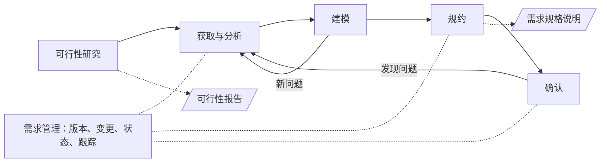
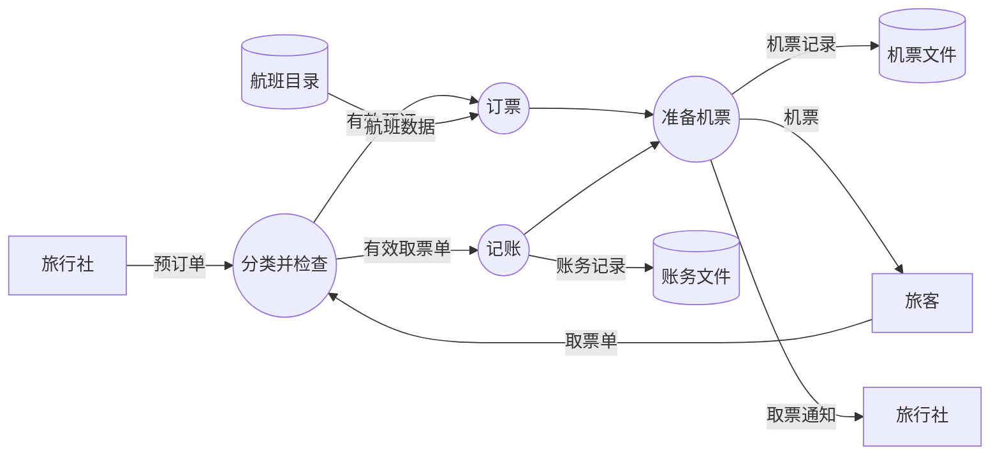
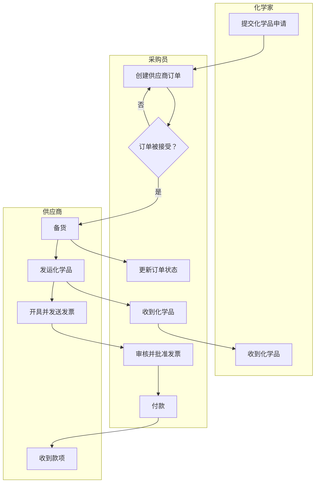
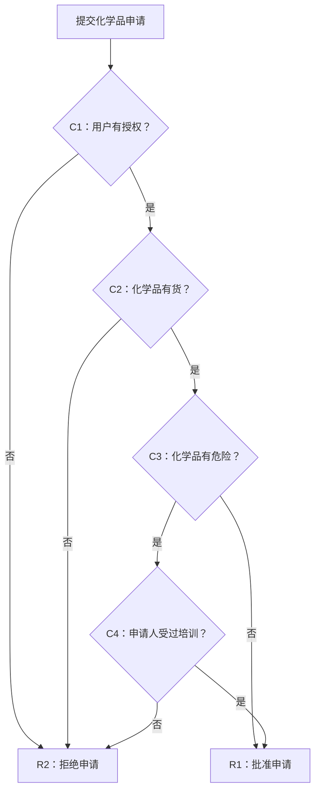
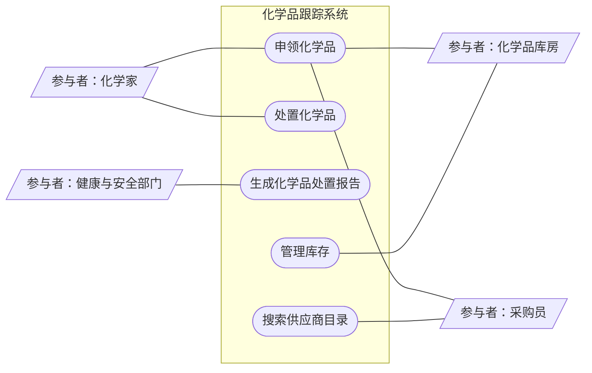
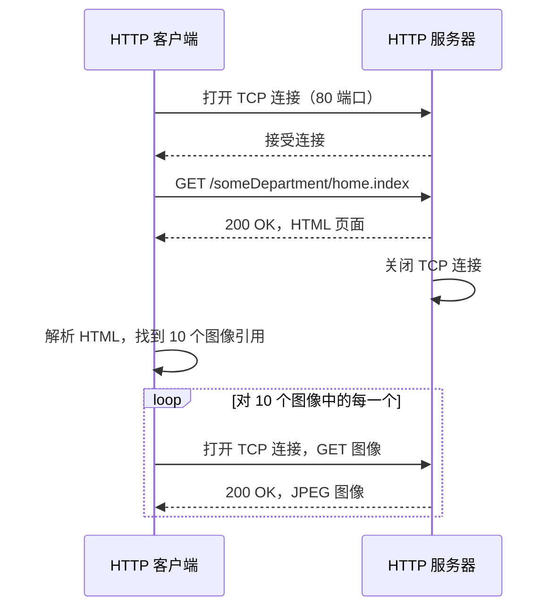
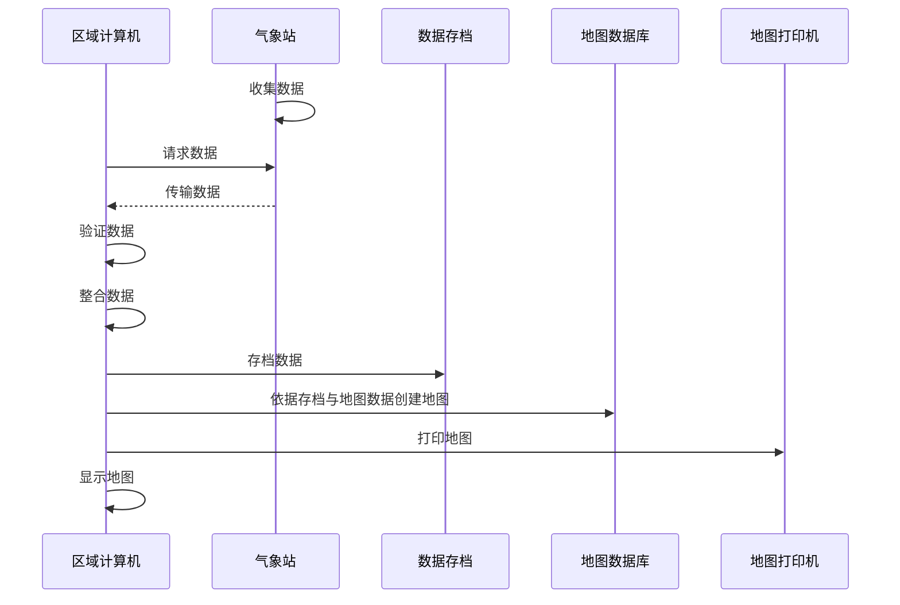
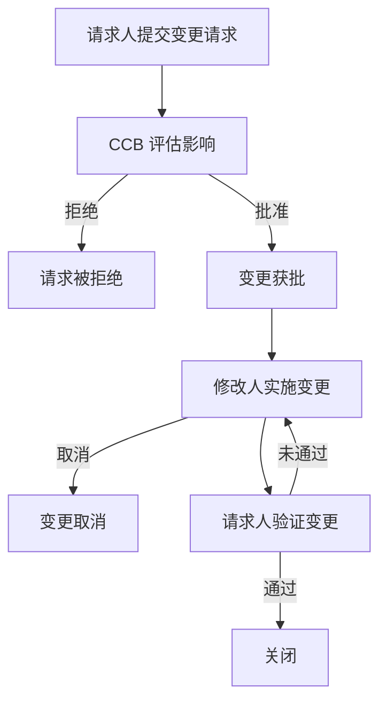

每个软件项目都始于某个人想要某样东西，而大多数失败的项目也败在这里：团队做出了错误的东西，或者做出了对的东西却带着错误的约束，并且在代码写完之后才发现。需求工程是**软件工程**中把含糊的愿望变成对系统"必须做什么、必须做到多好"的精确的、一致认可的、可检查的描述的那一部分。本章按活动通常的顺序展开：什么是需求、它为何重要（4.1），如何从用户和其他干系人那里获得需求（4.2），如何用模型分析需求（4.3），如何把需求写下来（4.4），以及在需求变化时如何控制它们（4.5）。最后一节（4.6）把同样的思想用于规格的一类新读者，即 AI **编程智能体**，它恰好实现被告知的内容，因此使规格的质量更重要，而不是更不重要。全章使用一个贯穿的案例，即 Wiegers 与 Beatty 的 *Software Requirements*（《软件需求》）中的化学品跟踪系统。需求工作所处的过程模型（瀑布、**Scrum**、用户故事）是 [4.14.2](/4.14.2) 的主题；由需求导出的设计是 [4.14.5](/4.14.5) 的主题；需求还会在测试中再次出现，因为每个测试都检查某条需求（[4.14.11](/4.14.11)）。

## 4.1. 基本概念

### 4.1.1. 什么是需求

**定义 4.1.1（需求）** **需求**（requirement）是表达干系人的某一需要及其相关条件与约束的陈述：对系统必须具有的行为或性质的描述，从而约束了它的开发（Sommerville 与 Sawyer，1997；ISO/IEC/IEEE 29148）。

需求分为两大类。

**定义 4.1.2（功能需求与非功能需求）** **功能需求**（functional requirement）描述系统应当做什么：它执行的功能，或它向用户和其他系统提供的服务。**非功能需求**（non-functional requirement）描述的是系统的性质或约束，而不是行为：业务规则、外部接口、设计约束，以及性能、可靠性、可维护性、安全性等质量属性。

功能需求是规格的核心：非功能需求总是某个功能的性质（"搜索在 2 秒内响应"以存在搜索功能为前提）。在实践中，客户说的话里两者混在一起。设想一位经理被分析师问到新的员工信息系统应当做什么：

> 嗯，新系统必须比旧系统快。还有，员工姓名很长的时候，旧系统会崩溃，我们得打电话请技术支持替我们录入，所以新系统不能在长姓名上崩溃。另外，新规定说我们不能再用身份证号作为员工编号，所以要把所有编号都改掉。哦，要是能有一份报表，说明每个员工今年受了多少小时的培训，那就太好了。

| 陈述 | 需求的种类 | 仍然缺少什么 |
|---|---|---|
| "比旧系统快" | 质量属性（性能） | 哪些操作、怎么度量、快多少 |
| "不能在长姓名上崩溃" | 功能（输入处理）加可靠性 | 姓名最大长度、字符集、超出限制时的行为 |
| "不能用身份证号作为员工编号" | 业务规则（法规），迫使进行数据迁移 | 新的编号方案、迁移及其期限 |
| "培训小时数报表" | 功能（一份报表） | 内容、期间、谁可以看、多久一次 |

这四条陈述没有一条能按原样实现。这不是客户的错：人们描述的是问题和愿望，而不是规格。把左列变成右列，就是需求工程的工作。

### 4.1.2. 需求为何重要

R. Young（*Effective Requirements Practices*，2001）把开发者最糟的噩梦描述为这样一位客户，他说："我知道你以为你听懂了我说的话，但你不明白的是，我说的并不是我的意思。"所说的与所要的之间的差距，通常出现得很晚，那时期限已经许下，钱已经花掉。

对项目结果的调查指向同一方向。Standish Group 的第一份 CHAOS 报告（1994 年对 365 家公司和 8,380 个应用项目的调查）询问了是什么使项目成功、陷入困境或被放弃。每份清单上排在前面的因素都与需求和用户有关：

| 成功因素 | % | 挑战因素 | % | 失败因素 | % |
|---|---|---|---|---|---|
| 用户参与 | 15.9 | 缺乏用户输入 | 12.8 | 需求不完整 | 13.1 |
| 高层管理支持 | 13.9 | 需求与规格不完整 | 12.3 | 缺乏用户参与 | 12.4 |
| 需求陈述清晰 | 13.0 | 需求与规格变化 | 11.8 | 资源不足 | 10.6 |
| 恰当的计划 | 9.6 | 缺乏高层支持 | 7.5 | 不切实际的期望 | 9.9 |

CHAOS 的方法论受到过批评（它把"成功"定义为按时、按预算并具备全部功能，数据也未公开），所以不应当把这些百分比当真；但定性的发现，即需求不清晰、不稳定以及缺乏用户参与占主导地位，已被后来的许多研究证实。正如 Capers Jones 所说，重大软件灾难的种子通常是在项目的头三个月里播下的。

### 4.1.3. 需求工程过程

**定义 4.1.3（需求工程）** **需求工程**（requirements engineering）是在系统的整个生命周期内，对系统需求进行的系统化的发现、分析、记录、确认与管理。

需求工程在三类人之间起中介作用：有目标和期望的用户；把它们变成规格的分析师；依据规格构建系统的工程师。它的活动通常列举如下。

| 活动 | 问题 | 主要产出 |
|---|---|---|
| 可行性研究 | 系统值得做吗，能在预算和进度内做出来吗？ | 可行性报告 |
| 需求获取（requirements elicitation）与分析 | 干系人需要什么？哪些需要相互冲突？ | 需要清单、优先级、未决问题 |
| 需求建模 | 数据和控制如何流动，谁与系统交互、怎样交互？ | 模型：数据流图、用例、顺序图 |
| 需求规约（requirements specification） | 每条需求如何精确地陈述？ | 软件需求规格说明（SRS） |
| 需求确认（requirements validation） | 写下的需求描述的是干系人真正需要的吗？ | 经评审、批准的需求（一条**基线**） |
| 需求管理 | 如何控制变更、如何跟踪需求？ | 变更记录、跟踪信息 |



这些活动不是只做一次的阶段。获取、建模、规约与确认构成一个循环，随着理解的加深而重复；在敏捷过程（[4.14.2](/4.14.2)）中，这个循环在每次迭代中针对接下来要构建的那部分产品再运行一遍。需求管理则始终伴随进行。

## 4.2. 需求获取

### 4.2.1. 用户与用户类

"需求收集中，乃至软件与系统项目的许多工作中，最大的挑战是人们之间如何互动。"Wiegers 与 Beatty 这样写道；没有任何工具能把沟通自动化，而在软件开发中，沟通比操作计算机更重要。因此获取从用户开始：他们是谁，想要达到什么目标，以及产品*不*该做什么。由用户目标界定的产品可以放心地舍弃一些东西：两款技术相近的消息产品可以服务于相反的需要（一款围绕已有的熟人，一款围绕结识陌生人），而每一款若试图同时兼顾两者，都会变差。

我们贯穿全章的案例，开头如同许多项目那样。出资方是一家化工公司的经理，他说：

> 我们需要一个信息系统，跟踪我们库房和实验室里的所有化学品，这样化学家就能使用别人剩下的化学品，而不是总去买新的。这能为我们省下很多钱。健康与安全部门还希望这个系统能减轻我们编制向政府提交的化学品使用与处置报告的工作。你们能在五个月内交付吗？化学家们太忙了，没法在你们开始之前把所有细节都想清楚；难道你们的人不能自己弄清楚要做什么吗？需求我已经告诉你们了；请开始吧，并随时向我通报进展。

出资方陈述了两个业务目标（重用化学品，简化监管报告）和一个进度，但没有给出需求。第一步是弄清谁会使用这个系统。

**定义 4.2.1（用户类）** **用户类**（user class）是以相似方式使用系统的一群用户：他们共享任务、访问权限、使用频率、对领域和计算机的经验、平台和语言。用户直接或间接（通过接收系统的输出）地与系统交互。

| 用户类 | 规模 | 描述 |
|---|---|---|
| 化学家 | 约 1,000 人，分布在六栋楼 | 向供应商或库房申领化学品；每人每天使用系统数次 |
| 采购员 | 5 人 | 处理采购申请；向外部供应商下单并跟踪订单 |
| 化学品库房人员 | 6 名技术员，1 名主管 | 管理三个库房中超过 500,000 个化学品容器；供应容器、订购新的化学品、跟踪每个容器的出入 |
| 健康与安全部门 | 1 名经理 | 生成符合联邦和州关于化学品使用与处置法规的预定义季度报告 |

每个用户类都是需求的来源，而各个类的需要分量不同：化学家是人数最多、使用最频繁的用户，而健康与安全部门的经理只是一个用户，但他的报告是法律要求的。

### 4.2.2. 干系人与决策

用户不是唯一对系统有利害关系的人。

**定义 4.2.2（干系人）** **干系人**（stakeholder）是积极参与项目、受项目的过程或结果影响、或者能影响项目的过程或结果的个人、群体或组织。

干系人处于离项目的三种距离上：开发组织之外（客户、最终用户、监管者、接口系统的供应商）、开发组织之内但在项目之外（管理层、市场、运营、法务）、以及项目团队内部（项目经理、分析师、开发者、测试者、技术文档撰写者）。在化学品跟踪系统中，接收报告的政府机构是干系人，即使它们从不接触软件。

干系人会有分歧，所以项目必须事先决定由*谁*来决定、*如何*决定。只要关键路径上出现冲突、有变更请求要接受或拒绝、或有一组需求要批准纳入某个发布，就需要做决定。常见的决策规则有：

- 决策负责人独自决定（可能在征询意见之后）；
- 团体投票，多数获胜，或要求一致同意；
- 团体讨论直至达成共识，使每个人都认同并支持这一决定；
- 决策负责人把决定委托给某一个人；
- 团体做决定，但某个人拥有否决权。

典型的争议以及通常的解决办法（依 Wiegers 与 Beatty）如下：

| 分歧的双方 | 解决办法 |
|---|---|
| 个别用户 | 产品拥护者或**产品负责人**决定 |
| 用户类之间 | 受青睐的用户类优先 |
| 细分市场之间 | 对业务成功影响最大的细分市场优先 |
| 企业客户之间 | 由业务目标决定方向 |
| 用户与其经理 | 由产品负责人或产品经理替该用户类决定 |
| 开发者与客户 | 讨论，依据业务目标和每个选项的代价 |
| 开发者与市场 | 由产品经理决定，参考每个选项的代价 |

对需求达成一致是客户与开发者关系的核心。在开发继续之前，客户确认需求描述了他们的需要，开发者确认他们理解这些需求并能实现，测试者确认它们是可验证的，管理层确认它们服务于业务目标。所一致同意的内容被记录为一条基线。

**定义 4.2.3（需求基线）** **需求基线**（requirements baseline）是一组需求在某一时间点上、经评审并一致认可的快照，作为进一步开发的基础。以后对已纳入基线的需求的变更，要经过变更控制（4.5）。

### 4.2.3. 获取技术

需求是被获取出来的，而不是被收集来的：用户很少现成地拥有它们，所以分析师必须把它们引导出来。主要的技术通常组合使用，有：

| 技术 | 做法 | 适用于 |
|---|---|---|
| 访谈 | 一对一或小组的谈话，事先准备好问题 | 了解各用户类的目标与问题 |
| 工作坊 | 有主持人的会议，由若干用户类的代表参加 | 解决冲突，迅速形成共同的定义 |
| 焦点小组 | 与一群典型用户的主持式讨论 | 大量用户群体的意见与期望 |
| 观察 | 观看用户在真实环境中做真实的工作 | 用户在访谈中绝不会提到的隐性知识 |
| 问卷 | 发给许多用户的结构化调查 | 人数多或地理上分散的用户群体 |
| 文档分析 | 阅读法规、手册、表格、现有系统的报表 | 业务规则、数据定义、所需的报表 |
| 系统接口分析 | 考察新系统必须与之交换数据的系统 | 外部接口需求 |
| 原型 | 构建模型或局部系统供用户试用 | 探索不确定的需求，尤其是用户界面 |

好的访谈询问任务和目标（"请带我走一遍你现在是怎么拿到化学品的""哪里出过问题？"），而不是功能（"你想要哪些按钮？"），分析师把听到的内容写出来，并请用户确认。

### 4.2.4. 获取为何困难

困难分为两组。

| 理解需求 | 记录与表达需求 |
|---|---|
| 确定系统边界：系统做什么、不做什么，它与其他系统的接口在哪里 | 记录需求之间的关系 |
| 确定功能：用户说得含糊，不同用户想要不同的东西，陈述有歧义 | 以合适的粒度把功能从粗到细分解 |
| 应对变化：用户、他们的需要、技术和市场在项目期间都在变 | 记录依赖：输入与输出数据、执行顺序 |
| | 陈述每个功能的非功能约束和异常处理 |
| | 在用户与开发者之间找到共同语言；不同层次和类型的需求需要不同的记法 |

最后一点解释了为什么需求工程使用这么多种图（4.3）：图往往是达成共同理解的最快途径。它也解释了为什么需求要在不止一个详细程度上书写。为客户写的一句话，会变成给开发者的若干条精确陈述，如下面这个来自精神健康诊所患者管理系统的例子（Sommerville）：

| 层次 | 文本 |
|---|---|
| 用户需求 | 系统应生成月报，显示每个诊所当月所开药物的费用。 |
| 系统需求 1 | 在每个月最后一个工作日，应生成所开药物、其费用及开药诊所的汇总。 |
| 系统需求 2 | 系统应在每月最后一个工作日 17:30 之后生成供打印的报告。 |
| 系统需求 3 | 应为每个诊所创建一份报告，列出各药物名称、处方总数、所开剂量数和所开药物的总费用。 |
| 系统需求 4 | 若药物有不同的剂量单位（例如 10 mg、20 mg），应为每个剂量单位分别创建报告。 |
| 系统需求 5 | 对所有费用报告的访问应限于管理访问控制列表上列出的授权用户。 |

用户需求是客户批准的内容；系统需求是开发者实现、测试者检查的内容。需求 5 是一项安全约束，在用户的那句话里根本没有：它是通过询问谁可以看这份报告才发现的。

## 4.3. 需求建模

自然语言灵活但有歧义，长篇的文字会掩盖缺漏。模型用某种记法表达需求的一个方面，使某些错误变得可见。每种模型回答不同的问题：

| 模型 | 方面 | 回答的问题 |
|---|---|---|
| 数据流图 | 数据流 | 数据从哪里来，如何被变换，存放在哪里？ |
| 泳道图 | 跨职能的过程 | 谁按什么顺序做业务过程的哪一步？ |
| 判定表、判定树 | 条件与响应 | 在每一种条件组合下系统必须做什么？ |
| 用例图、**用户故事** | 从用户视角的功能分解 | 谁使用系统，为了什么目标？ |
| 顺序图 | 对象之间的交互 | 在一个场景中，消息以什么顺序交换？ |

### 4.3.1. 数据流图

**定义 4.3.1（数据流图）** **数据流图**（data flow diagram，DFD）展示数据如何在系统中移动：它从哪里进入，哪些加工对它做变换，存放在哪里，从哪里离开。它的四种元素是数据流（标有数据名称的箭头）、加工（圆或椭圆，用动词加名词命名）、数据存储（画在两条平行线之间）和外部实体（矩形，系统之外数据的来源和目的地）。

DFD 给出系统中数据的概貌，适合事务处理及其他以功能为中心的系统；它们通常与流程图一起使用，流程图表示的是控制而不是数据。经验法则是一张图中最多保留约十个加工，并把复杂的加工细化为它自己的下一层 DFD。

**例 4.3.1** 一个机票预订服务。旅行社发来预订单；系统对它们分类并检查，依据航班目录订票，把交易记入账务文件，并准备机票，机票交给旅客，同时一份取票通知回到旅行社。（Mermaid 没有双线形状，所以数据存储画成圆柱。）



图中没有说明各加工何时运行或按什么顺序运行；这使它成为数据的模型，而不是控制的模型。

### 4.3.2. 泳道图

**定义 4.3.2（泳道图）** **泳道图**（swimlane diagram，跨职能图）描述业务过程或系统运作的各个步骤，按可视的泳道划分，每个在过程中执行步骤的角色、部门或子系统各占一条泳道。它的元素是划分过程的泳道、过程步骤、步骤之间的转移以及判定点。

在 UML（4.3.4）中，同样的思想是活动图（activity diagram），其动作被分组到各分区中。泳道图展示的不只是步骤的顺序，还有角色之间的交接，而业务过程最常出错的地方正是交接。

**例 4.3.2** 在化学品跟踪系统中向供应商订购化学品涉及三种角色。化学家提交申请；采购员创建供应商订单；如果供应商接受订单，供应商就备货、发运化学品并发送发票，同时采购员更新订单状态，化学家和采购员收到化学品；最后采购员审核并批准发票、付款，供应商收到款项。



画出这张图，立刻提出了出资方那一段话从未回答的问题，而每个问题都是尚待获取的一条需求：申请包含什么，如何提交？订单如何管理、状态如何报告？发票如何接收和管理，系统是否需要一个与财务系统的接口？

### 4.3.3. 判定表与判定树

软件常常受复杂逻辑支配，其中许多条件组合导致不同的行为。功能需求必须描述系统在每一种可能的组合下的响应；漏掉一种组合，就意味着缺少一条需求。当逻辑变得复杂时，判定表或判定树使条件组合与响应之间的对应关系变得明确。

**定义 4.3.3（判定表）** **判定表**（decision table）列出影响某一行为的条件、可能的动作和一组规则（列）；每条规则为每个条件给出一个值（真、假，或"无所谓"，记作 –），并标出条件取这些值时采取的动作。判定表是*完备的*，当每一种条件取值组合都匹配某条规则；是*一致的*，当没有任何组合匹配两条动作不同的规则。

**例 4.3.3** 在化学品跟踪系统中，一个新的化学品申请是批准还是拒绝，取决于四个条件：C1，申请人有权申请化学品；C2，该化学品在库房或供应商处有货；C3，该化学品在危险化学品清单上，需要专门的安全培训；C4，申请人已接受过这类危险化学品的培训。判定树按顺序提出这些问题：



从根到叶的每条路径成为判定表的一条规则：

| | 规则 1 | 规则 2 | 规则 3 | 规则 4 | 规则 5 |
|---|---|---|---|---|---|
| C1 用户有授权 | F | T | T | T | T |
| C2 化学品有货 | – | F | T | T | T |
| C3 化学品有危险 | – | – | F | T | T |
| C4 申请人受过培训 | – | – | – | F | T |
| R1 批准申请 | | | X | | X |
| R2 拒绝申请 | X | X | | X | |

这张表是完备且一致的：四个布尔条件有 $2^4 = 16$ 种组合，而这些规则覆盖了其中的 $8 + 4 + 2 + 1 + 1 = 16$ 种，每种恰好一次（含有 $k$ 个"无所谓"项的规则覆盖 $2^k$ 种组合）。这类检查是机械的，这也是判定表成为黑盒**测试用例**（[4.14.11](/4.14.11)）的标准来源的原因之一；4.6.3 就把这张表变成了一个可执行的测试。

当条件自然地依次询问时，判定树更易读；当许多条件相互作用时，判定表更便于检查完备性，也更容易扩展。

### 4.3.4. UML 与用例

**定义 4.3.4（UML）** **统一建模语言**（Unified Modeling Language，UML）是用于说明、可视化、构造和记录软件系统工件的标准化图形语言。它由 Grady Booch、Ivar Jacobson 和 James Rumbaugh 在 20 世纪 90 年代创建，由对象管理组织（Object Management Group）维护（现行版本 2.5.1，2017），定义了结构图（类图、构件图、部署图等）和行为图（用例图、活动图、状态机图、顺序图等）。

需求工作主要使用两种 UML 图：用例图，概览谁为了什么使用系统；以及顺序图（4.3.6），详述一个场景。

**定义 4.3.5（用例）** **参与者**（actor）是为完成某个用例而与系统交互的人、其他软件系统或硬件设备。**用例**（use case）是系统与一个或多个参与者之间的一系列交互，产生对某个参与者有价值的结果，其描述不暴露系统的内部结构。**用例图**（use case diagram）是用户需求的高层可视化概要：在系统边界之内，画出参与者、用例以及它们之间的关联。

用例描述用户期望发生什么，而不是系统怎么做，所以不应当深入设计细节。

**例 4.3.4** 化学品跟踪系统的用例图（参与者在系统边界之外，用例在边界之内）：



找出用例分三步：

1. 识别参与者，分析他们与系统的交互："化学家申领化学品""健康与安全部门提交化学品使用报告"。
2. 分析业务过程，把场景概括成用例："使用库房里剩下的化学品"和"向供应商购买化学品"是同一个用例*申领化学品*的两个场景，涉及化学家、库房和采购员。
3. 识别外部事件，并把它们与参与者和用例联系起来：季度截止日期触发*生成化学品处置报告*，其输出送给另一个参与者，即政府机构。

然后可以对照一份简短的清单检查用例模型：

| 参与者 | 用例 |
|---|---|
| 与系统交互的每个角色都由一个参与者表示 | 系统的每个主要功能都由一个用例表示 |
| 每个参与者至少与一个用例相关联 | 已分析用例之间的共性，得到新的用例以及它们之间的包含、扩展和泛化关系 |
| 包含另一个参与者的参与者与之合并 | 复杂的用例已被分解 |
| 与互不相关的几组用例相关联的参与者要拆分 | |

选择用例的粒度需要判断。相似的需求可以合并成一个用例，也不必把每条需求都硬塞进用例（尤其是非功能需求，写在别处）。反过来，流程超过 10 到 15 步的用例应当拆成几个场景。用例太多会使用户应接不暇；太复杂又会使他们困惑。用例不是用户界面，也不是系统结构：它关乎用户与系统之间的交互，所以按输入与输出来区分功能，但不包含数据定义，也不含设计。

用例图只是一个概要；每个用例都要在用例描述中详细说明。

**定义 4.3.6（用例描述）** 一个用例的**用例描述**（use case description）记录：唯一的编号和一个陈述用户目标的简短名称；对其目的的简要说明；**触发条件**，即启动它的事件；零个或多个**前置条件**，即在用例开始之前必须成立的系统状态条件（系统首先检查它们）；一个或多个**后置条件**，即成功完成之后系统的状态；以及一个带编号的步骤序列，即参与者与系统之间的交互，分为**正常流程**、**备选流程**和**异常流程**。

正常流程（也称主流程或基本流程，或称顺利路径）是缺省的事件序列。备选流程是其中某些步骤不同、但用例仍能成功的变体。异常流程是用例不能成功的场景；它描述出错的条件以及系统如何处理。后置条件可以是用户可观察的（ATM 显示账户余额）、物理的（它吐出现金并打印凭条），或内部状态的变化（账户被扣除金额和手续费）；ATM 用例*取款*的一个前置条件是机器里有现金。

**例 4.3.5** 用例*申领化学品*：

| 字段 | 内容 |
|---|---|
| 编号与名称 | UC-4 申领化学品 |
| 描述 | 申请人从库房或供应商处申领一个容器的化学品。 |
| 参与者 | 申请人（主要）、化学品库房、采购员 |
| 触发条件 | 申请人需要一种化学品。 |
| 前置条件 | 1. 用户身份已通过认证。2. 用户有权申领化学品。3. 化学品库存数据库在线。 |
| 后置条件 | 1. 申请已存入化学品跟踪系统。2. 申请已发送给化学品库房或采购员。 |
| 正常流程 | 1. 申请人指定所需的化学品。2. 系统列出库房中该化学品可用的容器。3. 申请人查看某个容器的历史。4. 申请人选择一个容器。5. 申请人输入其他信息以完成申请。6. 系统存储申请并通知化学品库房。 |
| 备选流程 4.1（向供应商订购） | 在步骤 4，如果库存中没有合适的容器：4.1 申请人搜索供应商目录；4.2 系统显示供应商列表；4.3 申请人选择一个供应商和一个容器；从步骤 5 继续，申请交给采购员。 |
| 异常流程 | 在步骤 4.2，如果没有供应商提供该化学品，系统通知申请人，用例结束，不产生申请。 |

写出描述，恰恰迫使人面对图所掩盖的那些问题：库存里什么也没有怎么办，没有供应商出售这种化学品怎么办，数据库离线怎么办。

### 4.3.5. 用例与用户故事

敏捷团队通常把用户需求表达为用户故事，而不是用例（[4.14.2](/4.14.2)）。**用户故事**写在一张卡片上，形式为"作为〈角色〉，我可以〈活动〉，以便〈业务价值〉"，并附有**验收标准**，即实现必须满足的、使故事算作完成的条件。例如：

> 作为一名能源消费者，我想看到我每天的能源使用情况，以便降低能源费用和用量。
>
> 验收标准：系统每 10 秒读取一次电表，并在门户上以 15 分钟为单位显示用量；……

好的故事满足 INVEST 准则（独立、可协商、有价值、可估算、小、可测试）。这两种形式的差别更多在目的上，而不在内容上：

| | 用例 | 用户故事 |
|---|---|---|
| 它是什么 | 对一个连贯的功能单元的定义，不暴露系统的内部结构 | 对用户有价值的功能的简短描述；一场对话的占位符，而不是详细的规格 |
| 长度与细节 | 详细：目标、触发条件、前置条件、流程、备选流程、后置条件 | 简短扼要，一个场景 |
| 主要用途 | 开发者依据描述实现功能；分析师据此导出功能需求 | 分析师和产品负责人在上下文中确定需要，并在故事地图上给功能排优先级 |
| 典型过程 | 计划驱动的过程；可作为蓝图适配到敏捷 | 敏捷过程，决策快、频繁重新排序 |

两者是兼容的。故事的验收标准起着用例的后置条件和备选流程的作用，团队可以保留故事用于计划，同时为复杂的交互写一份用例描述。

### 4.3.6. 顺序图

**定义 4.3.7（顺序图）** **顺序图**（sequence diagram）是一种 UML 交互图，针对一个用例中的单个场景，展示参与者（对象或参与者）之间交换的消息以及它们发生的顺序。它的纵向是时间，向下延伸；横向列出各参与者，每个都带有一条垂直的生命线。

**例 4.3.6** 一个 Web 浏览器通过 HTTP/1.0、不用持久连接，获取一个引用了十张 JPEG 图像的页面。客户端向服务器的 80 端口打开一个 TCP 连接，服务器接受；客户端发送对页面的请求；服务器返回 HTML 并关闭连接；客户端解析 HTML，发现十个被引用的图像，并对每一个重复整个交换过程。



这张图使设计的代价变得可见：为一个页面建立十一次连接，这就是 HTTP/1.1 把连接做成持久的原因（而 HTTP/2 和 HTTP/3 则在一个连接上多路复用请求）。

顺序图可以通过提取"主语–谓语–宾语"三元组，从文字描述中系统地导出。

**例 4.3.7** 一段需求陈述（依 Sommerville）写道："气象数据收集系统定期生成气象图，使用从远程无人值守的气象站和其他来源收集的数据。气象站响应区域计算机的请求，把它们的数据传输给该计算机。区域计算机验证所收集的数据，并把它与来自其他来源的数据整合。整合后的数据被存档，并使用这个存档的数据和一个数字化地图数据库，创建一组本地气象图。地图可以在专用的地图打印机上打印，或以多种格式显示。"其中的动作有：气象站收集数据；区域计算机向气象站请求数据；气象站传输它们的数据；区域计算机验证、整合并存档数据；它使用地图数据库创建气象图；地图打印机打印地图；区域计算机显示地图。



文本中的名词成为参与者，动词成为消息；文本没有说清的任何地方（气象站是持续收集，还是只在被请求时收集？谁来决定显示格式？）都在图中表现为空缺。

## 4.4. 需求规约

### 4.4.1. 为什么要写规格

需求的记录方式差别很大。Wiegers 与 Beatty 描述的四个项目说明了几种失败模式：

| 项目 | 需求如何记录 | 结果 |
|---|---|---|
| 一个复杂的过程控制应用，一百多人，历时数年 | 约 800 条高层需求，20 个子项目各有自己的需求，约 800 到 900 条导出的系统需求 | 一大堆文档 |
| 一个中等规模的项目 | 每个项目一份指导文档，包含一切：需求、预算、进度、质量计划、测试 | 大杂烩式的文档，其中的需求难以找到 |
| 一个大型敏捷项目 | 贴在便利贴上的故事 | 几个月之后，便利贴散落得到处都是 |
| 一个中等项目，约 40 到 60 页需求 | 十二个单独的文件：一个讲批处理，一个讲报表引擎，一个讲十份报表…… | 文档爆炸：变更难以同步，没有完整的图景 |

目标不是更多的文档，而是恰当的文档：需求只记录一次，记在一个已知的地方，详细程度与项目的风险相称。软件需求规格说明是一份同时服务于许多读者的合同：

| 读者 | 用 SRS 来 |
|---|---|
| 客户与市场人员 | 了解将交付什么产品 |
| 项目经理 | 估计进度、工作量和资源 |
| 开发团队 | 知道要构建什么 |
| 测试者 | 制定基于需求的测试、测试计划和测试规程 |
| 维护与支持人员 | 了解产品的每个部分做什么 |
| 文档撰写者 | 编写用户手册和在线帮助 |
| 培训人员 | 准备培训材料和计划 |

### 4.4.2. StRS、SyRS 与 SRS

**定义 4.4.1（软件需求规格说明）** **软件需求规格说明**（software requirements specification，SRS）是一份文档，或工具中一组结构化的需求，陈述软件必须提供的功能、能力、性能、约束和质量属性，详细到足以设计、构建和验证它。

国际标准 ISO/IEC/IEEE 29148（第一版 2011，现行版本 2018；它取代了 IEEE 830 及相关的 IEEE 标准）描述了三种处于不同层次的规格，并为每种给出了提纲。概括如下：

| 干系人需求规格（StRS） | 系统需求规格（SyRS） | 软件需求规格（SRS） |
|---|---|---|
| 业务目的、范围与概述 | 系统目的、范围与概述 | 目的、范围、产品视角 |
| 干系人、业务环境、目标与目的 | 功能、可用性与性能需求 | 产品功能、用户特征、限制 |
| 业务模型、信息环境、业务过程 | 系统接口、操作、模式与状态 | 假设与依赖、需求的分配 |
| 业务策略、规则与约束 | 物理特性、环境条件 | 具体需求：外部接口、功能、可用性、性能 |
| 用户需求、操作概念与场景 | 安全、信息管理、政策与法规 | 逻辑数据库需求、设计约束、标准符合性 |
| 项目约束 | 生命周期维持、包装、搬运与运输、验证 | 软件系统属性、验证、支持信息 |

StRS 描述业务视角，SyRS 描述整个系统（硬件、软件、人员），SRS 描述其中的软件部分。小项目把它们合并成一份文档；要紧的是每一类信息都有各自的位置。

### 4.4.3. 需求的层次与类型

同一个系统从不同的距离看，样子不同。Wiegers 与 Beatty 区分了需求的三个层次，每个层次记录在各自的文档中，由不同的干系人负责。

**定义 4.4.2（业务需求、用户需求与功能需求）** **业务需求**（business requirement）描述组织为什么要构建一个系统：它期望的业务目标或收益，记录在愿景与范围文档中。**用户需求**（user requirement）描述用户必须能用系统完成的目标或任务，或对用户满意度重要的产品属性，例如记录为用例或用户故事。**功能需求**，在软件层面，描述开发者必须实现的行为，使用户能完成他们的任务，从而满足业务需求，记录在 SRS 中。

| 层次 | 例子（一家航空公司） | 文档 | 主要来源 |
|---|---|---|---|
| 业务需求 | 把机场柜台人员成本降低 25% | 愿景与范围文档 | 出资方、客户、市场、产品管理 |
| 用户需求 | 乘客可以在航空公司网站上或在机场自助终端办理航班值机 | 用户需求文档（用例、故事） | 用户代表、分析师、产品经理 |
| 功能需求 | 乘客应能为其已办理值机的所有航段打印登机牌。如果乘客的资料中没有指定座位偏好，订座系统应分配一个座位。 | SRS | 分析师、开发者、测试者 |

每个层次都应当可追溯到上一层：值机功能之所以存在，是因为自助终端减少了柜台人员，而不服务于任何业务需求的功能是删除的候选。

围绕这三个层次的还有其他种类的需求：

| 类型 | 它是什么 | 例子 |
|---|---|---|
| *业务规则*（business rule） | 政策、政府法规、行业标准或计算算法。它本身不是软件需求，因为它存在于任何单个应用的范围之外，但它常常规定系统必须包含的功能 | 只有受过培训的人员才能处理危险化学品；报告必须遵循联邦和州的法规 |
| 质量属性 | 系统执行其功能做得多好的一种性质：可用性、性能、健壮性、对异常情形的处理。仅有正确的功能并不能使产品成功 | 系统应在 2 秒内显示可用的容器 |
| *系统需求*（system requirement） | 对一个系统的需求，该系统包含软件以及硬件、人员和过程，即软件所依赖的环境 | 一个超市收银台，带有读卡器、秤、手持条码扫描器和小票打印机 |
| *外部接口需求*（external interface requirement） | 系统与用户、其他软件、硬件设备或通信协议之间的连接 | 用库房的条码扫描器读取容器标签；与供应商的系统交换订单 |
| 约束 | 对开发者可用的设计或实现选择的限制 | 系统应运行在公司现有的数据库服务器上 |

业务规则、质量属性、外部接口和约束合在一起，构成定义 4.1.2 的非功能需求。质量属性及实现它们的设计战术在 [4.14.5](/4.14.5) 中讨论。

### 4.4.4. 编写需求陈述

ISO/IEC/IEEE 29148 把需求陈述定义为这样的陈述：可以验证；系统为解决干系人的问题或实现干系人的目标而必须满足或具备；由可度量的条件限定并受约束的界定；定义的是系统的能力或性能，而不是用户或操作员的能力。它推荐一种至多含六个部分的句子结构：

$$
[\text{Condition}]\ [\text{Subject}]\ [\text{Action}]\ [\text{Object}]\ [\text{Constraint}]\ [\text{Value}]
$$

主语是系统（或它的一部分），动作用"应"（shall）来陈述，条件、约束和值把意图变成可度量的东西。下面每一对给出一个较弱的陈述及其格式良好的版本：

| 较弱 | 格式良好 |
|---|---|
| 系统应设置信号 x。 | *当收到信号 x 时*［条件］，系统［主语］应在 2 秒［值］内［约束］设置［动作］信号 x 已收到位［宾语］。 |
| 雷达系统应探测目标。 | *在海况 1 级时*［条件］，雷达系统［主语］应探测［动作］目标［宾语］，距离［约束］最远至 100 海里［值］。 |
| 发票系统应显示发票。 | 发票系统［主语］应显示［动作］待处理的客户［约束］发票［宾语］，按其应付款日期［约束］升序［值］排列。 |

**定义 4.4.3（约束）** 在需求陈述中，**约束**（constraint）限制设计方案或系统的实现。约束可以适用于所有需求，可以附于某一条或一组需求，也可以作为独立的需求陈述。

上面例子中的约束限制的是不同的东西：两个动作之间的时间（接收与设置信号），动作的范围（探测最远至 100 海里），以及动作的对象范围与形式（只有待处理的客户发票，且升序排列）。

没有值的需求只是一个愿望。"外卖必须快"和"扫码解锁共享单车必须迅速"是用户的说法；需求则是"3 公里以内 95% 的订单应在付款后 30 分钟内送达"和"对 99% 的解锁尝试，车锁应在扫码成功后 2 秒内打开"。选定数字是业务决策；省略它们，就是把决策留给了开发者。

一个广泛使用的、对这一结构加以细化的模板是 EARS，即*简易需求语法*（Easy Approach to Requirements Syntax），由 Mavin 等人于 2009 年提出。它提供几种句型，每种以一个标明需求种类的关键词开头：

| 模式 | 模板 | 化学品跟踪系统中的例子 |
|---|---|---|
| 普遍型 | ⟨系统⟩应⟨响应⟩。 | 系统应记录每个化学品容器的位置。 |
| 事件驱动型 | 当⟨触发⟩时，⟨系统⟩应⟨响应⟩。 | 当一个容器被领出时，系统应记录申请人和时间。 |
| 状态驱动型 | 当⟨状态⟩期间，⟨系统⟩应⟨响应⟩。 | 当库存数据库离线期间，系统应拒绝新的申请，并给出说明信息。 |
| 异常行为型 | 如果⟨条件⟩，则⟨系统⟩应⟨响应⟩。 | 如果没有危险品培训的申请人申领危险化学品，则系统应拒绝该申请并指出所需的课程。 |
| 可选特性型 | 在包含⟨特性⟩的情况下，⟨系统⟩应⟨响应⟩。 | 在安装了供应商接口的情况下，系统应以电子方式发送采购订单。 |

复杂的需求组合使用这些关键词（"当……期间，当……时，系统应……"）。这些句型足够简单，非专业人员也能用，固定的结构使缺失的触发条件和响应易于发现。

### 4.4.5. 好需求的特性

需求中的缺陷代价高昂。Beizer（1990）观察到，需求是代价高昂的缺陷的主要来源，视应用而定，占百分之几到一半以上，而且"它们最早侵入系统，最后离开"：一条有错的需求可以通过全部开发测试、beta 测试和最初的现场使用，直到几百次安装之后才被发现。Davis（1993）汇总了可追溯到 Boehm 的数据，按发现的时间给出了修复一个需求缺陷的相对代价：

| 发现缺陷的阶段 | 修复的相对代价 |
|---|---|
| 需求 | 0.1–0.2 |
| 设计 | 0.5 |
| 编码 | 1 |
| 单元测试 | 2 |
| 验收测试 | 5 |
| 维护 | 20 |

这些确切的比值来自 20 世纪 70 和 80 年代计划驱动的项目，后来受到质疑；短迭代、自动化测试和**持续交付**使这条曲线变平。方向是毫无疑问的：误解发现得越晚，建立在它之上的工作就越多。

ISO/IEC/IEEE 29148 列出了需求应当具备的特性。大多数教材仍遵循的 2011 版列出了九条：

| 特性 | 含义 |
|---|---|
| 必要（Necessary） | 删去它会留下缺陷；它可追溯到真实的干系人需要 |
| 不涉及实现（Implementation free） | 陈述需要什么，而不是怎么构建 |
| 无歧义（Unambiguous） | 只能有一种解释 |
| 一致（Consistent） | 与其他需求没有冲突 |
| 完整（Complete） | 无需进一步补充；可度量，足以描述该需要 |
| 单一（Singular） | 陈述单一的能力、特性或约束 |
| 可行（Feasible） | 在项目的约束内技术上可达成，风险可接受 |
| 可追溯（Traceable） | 其来源已知，并可链接到设计、代码和测试 |
| 可验证（Verifiable） | 其实现可以用客观的方法（检查、分析、演示或测试）证明 |

2018 版重新组织了这份清单。对单条需求，它要求：必要、恰当（appropriate，适合它所适用的实体的层次；这取代了"不涉及实现"）、无歧义、完整、单一、可行、可验证、正确（correct，准确地表达了它所来源的需要）和合规（conforming，符合经批准的模板和风格，如 EARS）。一致性、可理解性和可确认性现在是一组需求的性质，与这组需求的完备性和可行性并列；可追溯性被视为由需求管理（4.5）维护的需求属性。

首先要找的缺陷是歧义：一个看似清楚的句子可以有两种逻辑结构。

**例 4.4.1** "当探测到一个不友好、且任务未知、或者可能在 5 分钟内进入禁飞空域的飞行物时，发出警报。"记 $A$ 为"该物体不友好"，$B$ 为"它的任务未知"，$C$ 为"它可能在 5 分钟内进入禁飞空域"。这个句子可以读作 $(A \land B) \lor C$，也可以读作 $A \land (B \lor C)$。两种读法恰在 $A$ 为假而 $C$ 为真时不同：一架即将误入禁飞空域的友机，按第一种读法会触发警报，按第二种则不会。到底是哪种读法，是只有干系人才能作出的领域决定；画出两棵判定树，或把条件写成公式，就会暴露这个问题。

某些词是歧义的可靠标志：

| 避免 | 改为 |
|---|---|
| 尽可能、最好、大多数 | 陈述数量 |
| 至少、至多、介于 | 陈述边界值，以及是否包含边界 |
| 高效、快速、灵活、用户友好 | 陈述可度量的准则 |
| 通常、在大多数情况下、理想情况下 | 陈述其他情况下会发生什么 |
| 支持…… | 陈述支持它意味着什么 |
| 匹配、符合、与……相同 | 陈述比较的标准 |

如果存在一种客观的方法可以检查需求是否已被正确实现，这条需求就是可验证的。不完整、不一致、不可行或有歧义的需求都不可验证，所以可验证性是最实用的单一质量检验：测试者如果无法为一条需求设计测试，就是发现了它的缺陷。

完整性是指每条需求必须包含所有必要的信息，而规格作为一个整体必须涵盖所有功能与约束。判定表可以暴露缺失的情形。

**例 4.4.2** "如果客户既没有选择最优套餐，也没有提供凭证，系统应自动选择默认的基本套餐。"该陈述只覆盖了四种组合中的一种：

| | 1 | 2 | 3 | 4 |
|---|---|---|---|---|
| 选择了最优套餐 | T | T | F | F |
| 提供了凭证 | T | F | T | F |
| 选择默认的基本套餐 | ? | ? | ? | X |

当客户选择了最优套餐但没有凭证、有凭证，或者提供了凭证但没有选择最优套餐时，该怎么办？三个问号就是三条缺失的需求。

需求还必须是单一的：混杂了几种需要的段落必须拆分。

**例 4.4.3** 一份真实规格中的一段："系统必须检查活动账户日志与账户管理档案之间账户数据的一致性。用于生成比对数据的逻辑应基于现有一致性检查工具的逻辑；换言之，新代码不需要从头开发。但是，必须增加额外的逻辑来识别数据库是否为权威的信息源。新功能将包括向一张表写入数据，以说明不一致是如何、在何处解决的。此外，代码还应检查违反安全工具数据库的异常情况。一旦发生违规，应向安全合规团队发送自动警告邮件。"分析师的问题：

1. 指的是哪个现有工具，"基于"它是什么意思：对它的接口、集成，还是复制它的逻辑？
2. 新代码应当如何重用或扩展现有代码？（这是设计决定，也许根本不属于需求。）
3. "额外的逻辑"是什么？
4. 什么使一个来源成为"权威的"，如何识别？
5. "新功能"还包括什么？
6. 解决记录中的"如何"和"在何处"究竟指什么？
7. 这一段至少包含五条需求，应当拆成各自可单独验证的陈述。

问题得到回答之后，这一段可以变成："REQ-1. 系统应每晚 02:00 把活动账户日志中的账户记录与账户管理档案中的记录比对。REQ-2. 对每个记录不同的账户，系统应向解决表写入一行，包含账户编号、不同的字段以及被声明为权威的来源。REQ-3. 当某条记录违反安全工具数据库中的某条规则时，系统应在 5 分钟内向安全合规团队发送一封警告邮件。"现在每条陈述都可以单独测试。

最后，在一组需求被纳入基线之前要经过确认：它描述的是干系人真正需要的吗？主要的技术有：由各类干系人对书面的需求做评审和审查（用依据上述特性建立的检查表）、让用户试用预期行为的原型，以及在代码出现之前依据需求编写的验收测试。早早写测试本身就是一种评审：每条无法变成测试的需求都会被退回。

## 4.5. 需求管理

### 4.5.1. 活动

需求在项目期间会变化：用户通过看到早期版本才知道自己想要什么，市场和法规在变动，错误被发现。需求管理使这些变化处于控制之下。它有四组活动：

| 版本控制 | 变更控制 | 需求状态跟踪 | 需求跟踪 |
|---|---|---|---|
| 定义版本标识方案 | 提出变更 | 定义需求可能的状态 | 定义与其他需求的链接 |
| 跟踪单条需求的版本 | 分析每个变更的影响 | 记录每条需求的状态 | 定义与其他系统元素（设计、代码、测试）的链接 |
| 跟踪需求集的版本 | 做出决定 | 跟踪所有需求的状态 | |
| | 更新单条需求和需求集，更新计划，度量需求的易变性 | | |

每条需求的状态在一小组取值中迁移（依 Wiegers 与 Beatty）：*已提出*（proposed，由授权来源提出）、*已批准*（approved，已分析、估算影响、分配给某个发布）、*已实现*（implemented，代码已设计、编写并通过单元测试）、*已验证*（verified，经测试或其他方法确认），以及对离开需求集的需求，*已删除*或*已拒绝*。处于各状态的需求所占的比例，是比"代码完成了 90%"好得多的进度度量。

**定义 4.5.1（需求跟踪）** **需求跟踪**（requirements traceability）是沿两个方向追踪需求生命的能力：向后追溯到它的来源（业务需求、干系人、法规），向前追踪到实现并验证它的设计元素、代码和测试。这些链接常记录在**需求跟踪矩阵**中，这是一张表，行是需求，列是与之链接的工件。

| 需求 | 来源 | 用例 | 设计元素 | 测试 |
|---|---|---|---|---|
| CTS-REQ-12 批准或拒绝申请 | 业务规则：危险品培训 | UC-4 申领化学品 | `approval.decide` | `test_decision_table`（16 个用例） |
| CTS-REQ-20 季度处置报告 | 业务目标 2：监管报告 | UC-7 生成化学品处置报告 | `reports.disposal` | `test_disposal_report` |

跟踪回答变更控制所提出的问题：法规变化时哪些代码和测试必须修改（向前），以及一段代码究竟为何存在（向后）。无法追溯到任何需求的代码，要么是没有文档记载的功能，要么是累赘。

### 4.5.2. 变更控制

**定义 4.5.2（变更控制委员会）** **变更控制委员会**（change control board，CCB）是决定对已纳入基线的需求的拟议变更是被接受还是被拒绝的一群人。它代表所有受影响的干系人，同时又小到能快速响应变更请求。

变更请求经过一个固定的流程：



*影响分析*（impact analysis）针对项目的每项活动（需求、设计、编码、测试、项目管理）评估变更的可行性与代价，并把工作量估算为一份任务清单：更新 SRS 或需求库；创建新的并修改已有的设计构件；创建新的并修改已有的用户界面构件；编写新的用户文档和帮助界面；编写新的并修改已有的源代码；获取、许可并集成第三方软件；编写新的并修改已有的单元测试与集成测试；等等，汇总为一个总的估算工作量。变更要付出人力（更多人手）、时间（进度延误）和金钱（额外的硬件和软件）。每个受影响的人都必须知道并确认这一变更：用户决定它对业务是否必要、是否有价值，开发团队承诺交付它，管理层分配资源。

变更控制并不是为官僚而官僚。没有它，需求会通过走廊里的闲谈悄悄混进来，进度在没有人决定推迟的情况下推迟了，规格也不再描述系统。在敏捷过程中，同样的功能由**产品负责人**和**产品待办列表**承担：变更是一个新的或被重新排序的待办条目，只有经过计划才被接纳进一个冲刺（[4.14.2](/4.14.2)）。

## 4.6. 为 AI 编程智能体编写规格

### 4.6.1. 为什么规格更重要

当**编程智能体**（[4.2.14](/4.2.14)）写出大部分代码时，项目的瓶颈从写代码转移到决定代码应当做什么。智能体的三个特点使**需求工程**更重要而不是更不重要：

- 智能体靠猜来填补空白。遇到不清楚的需求，人类开发者往往会去问；智能体则倾向于选定一种看似合理的解释，并自信地实现它。4.4.5 中的每一处歧义，都成为智能体悄悄做出的一个决定。
- 智能体依据交给它的文本工作。它不参加会议，不认识干系人，每次会话开始时都没有上一次的上下文，除非这些上下文被写在仓库里。
- 代码很廉价，所以大量产出。对照一个含糊的意图去评审一千行生成的代码，既慢又不可靠；对照明确的需求和测试去检查它们，则又快又可靠。

先写规格、评审它、然后让智能体依据它规划和实现，这种做法如今常被称为*规格驱动开发*（spec-driven development）。它就是本章的需求过程，只是开发者换成了一种新的类型，同样的特性依然适用：规格必须无歧义、完整、单一、可验证、可追溯。如何为智能体表述单个任务，见 [4.2.14](/4.2.14#sec-14.4.1)；本节讲的是这类任务所源自的需求，而 4.14.14 把它们置于整个工程工作流之中。

### 4.6.2. 规格的构成

给智能体的规格是保存在仓库里、紧挨着代码、处于**版本控制**之下的一份简短文档。一种实用的结构是：

| 部分 | 内容 | 需求概念 |
|---|---|---|
| 目标与背景 | 功能为何存在，谁使用它，链接到用户故事或用例 | 业务需求与用户需求（4.4.3） |
| 范围与非目标 | 包含什么，以及明确地不包含什么 | 系统边界（4.2.4） |
| 需求 | 按 EARS 等固定句型写成的编号陈述 | 格式良好的单一需求（4.4.4） |
| 验收标准 | 具体的例子和必须通过的测试 | 可验证性（4.4.5） |
| 约束 | 不得改变的接口、允许的依赖、性能与安全上限 | 约束、质量属性（4.4.3） |
| 未决问题 | 尚未作出的决定，及其负责人 | 未解决的获取问题 |

非目标一节是最常缺失的，也是智能体最需要的：没有它，被要求实现审批规则的智能体可能会"好心地"把申请表单也重新设计一遍。未决问题一节防止相反的失败：不让智能体去猜，而是告诉它哪些决定不归它做。

**例 4.6.1** 例 4.3.3 的审批规则的规格：

```markdown
# Spec: Automatic approval of chemical requests (CTS-REQ-12)

## Goal
Chemists get an immediate decision on most requests; only trained staff
receive hazardous chemicals (business rule BR-3, hazard training).
Source: use case UC-4 "Request a chemical", step 6.

## Scope
In scope: the decision function and its use in the request service.
Non-goals: no change to the request form, the database schema or the
notification emails.

## Requirements
- REQ-12.1 When a request is submitted, the system shall decide
  "approve" or "reject" from four facts: requester authorized (C1),
  chemical available (C2), chemical hazardous (C3), requester trained (C4).
- REQ-12.2 If C1 or C2 is false, then the system shall reject the request.
- REQ-12.3 If C3 is true and C4 is false, then the system shall reject
  the request.
- REQ-12.4 In all other cases the system shall approve the request.

## Acceptance criteria
- tests/test_approval.py checks all 16 combinations of C1..C4 against
  the decision table in docs/cts-decisions.md; all tests pass.

## Constraints
- Keep the signature decide(Request) -> str; no new dependencies.

## Open questions
- Should a rejected hazardous request name the required training course?
  (Owner: health and safety manager; do not implement until answered.)
```

### 4.6.3. 作为可执行测试的验收标准

对智能体和人来说，最有效的需求形式是机器能够检查的形式。判定表可以直接翻译成 pytest 中的参数化**单元测试**，它枚举全部 $2^4$ 种组合，检查每种组合恰好匹配一条规则（表的完备性与一致性，4.3.3），并把实现与规则的动作相比较：

```python
import itertools

import pytest

from approval import Request, decide

# Decision table for CTS-REQ-12; None means "don't care".
RULES = [
    # (C1,   C2,    C3,    C4,    action)
    (False, None,  None,  None,  "reject"),   # rule 1
    (True,  False, None,  None,  "reject"),   # rule 2
    (True,  True,  False, None,  "approve"),  # rule 3
    (True,  True,  True,  False, "reject"),   # rule 4
    (True,  True,  True,  True,  "approve"),  # rule 5
]


def matching_rules(values):
    return [rule for rule in RULES
            if all(c is None or c == v for c, v in zip(rule[:4], values))]


@pytest.mark.parametrize(
    "values",
    list(itertools.product([False, True], repeat=4)),
    ids=lambda v: "".join("T" if x else "F" for x in v),
)
def test_decision_table(values):
    rules = matching_rules(values)
    assert len(rules) == 1, "table must be complete and non-overlapping"
    assert decide(Request(*values)) == rules[0][4]
```

正确的实现通过全部十六个用例（pytest 9.1）：

```text
$ uv run --with pytest pytest -q
................                                                         [100%]
16 passed in 0.02s
```

假设某个实现把培训检查与授权检查混淆了（`if r.hazardous and not r.authorized`），这种笔误读起来很像回事，匆匆浏览差异的评审者可能会漏掉。测试会指出被违反的那条规则：危险化学品、未受培训的申请人，即规则 4。

```text
$ uv run --with pytest pytest -q
=========================== short test summary info ============================
FAILED test_approval.py::test_decision_table[TTTF] - AssertionError: assert '...
1 failed, 15 passed in 0.02s
```

这个测试是从需求导出的，而不是从代码导出的，所以它检查的是干系人所要求的；而且由于它几秒钟就能运行完，智能体可以在每次修改之后运行它，在人看到结果之前修正自己的错误。这就是把测试用作护栏在需求方面的体现；测试设计与自动化是 [4.14.11](/4.14.11) 和 [4.14.12](/4.14.12) 的主题。有两点需要注意。第一，测试只检查它所陈述的内容：为通过测试而优化的智能体，可能以非预期的方式满足测试（对测试输入作特殊处理、削弱断言），所以测试和规格要由人和智能体来评审，并要求智能体未经批准不得修改它们。第二，许多需求，尤其是可用性之类的质量属性，不能归结为单元测试，仍然需要检查、度量和用户反馈。

### 4.6.4. 与智能体一起管理规格

4.5 的需求管理实践可以直接沿用。

- 版本控制：规格放在仓库里，经由与代码相同的提交和评审而变更；规格的 diff 是需求变更的精确记录。
- 变更控制：需求变化时，先修改规格并评审，然后才让智能体更新代码和测试。直接改代码而把规格丢在一边，会以很高的速度重现规格过时的问题。
- 可追溯性：需求编号出现在测试名、docstring 和提交说明中（上面的 `CTS-REQ-12`），使向前和向后的追踪成为一次文本搜索，被问到"哪里实现了 REQ-12.3？"时，智能体也能做这件事。
- 由人确认：智能体可以根据一次对话起草规格，就它生成问题，并找出例 4.4.2 中缺失情形那样的空缺。决定系统应当做什么仍是干系人的工作：智能体可以为一个未决问题提出答案，但需求的负责人要批准它。

工具已经开始内置这一工作流。例如 AWS 的 Kiro 生成一份 `requirements.md`，其中有用户故事和 EARS 记法的**验收标准**，然后生成 `design.md` 和 `tasks.md`，智能体据此实现，各步之间有评审；GitHub 的开源 Spec Kit 把工作组织成类似的阶段（项目原则、规格、技术方案、任务清单、实现），可在多种**编程智能体**中运行。工具各不相同，但阶段都是本章的经典阶段：获取、规约、确认，然后构建，并使文档与代码保持同步。

## 小结

- 需求表达干系人的某一需要及其条件与约束。功能需求说明系统做什么；非功能需求（业务规则、质量属性、外部接口、约束）说明在什么条件下、做到多好。
- 不清晰、不完整、不断变化的需求以及缺乏用户参与，是项目出问题的首要原因，而需求缺陷发现得越晚，代价越高。
- 需求工程由获取与分析、建模、规约和确认构成，作为循环反复进行，管理伴随始终。获取从用户类和干系人出发，约定决策规则，并以一条基线告终。
- 模型暴露不同的空缺：数据流图暴露数据，泳道图暴露角色之间的交接，判定表和判定树暴露条件组合，用例和用户故事暴露用户目标，顺序图暴露交互的顺序。
- 需求存在于业务、用户和功能三个层次，分别记录在愿景与范围文档、用户需求和 SRS 中（ISO/IEC/IEEE 29148：StRS、SyRS、SRS）。
- 格式良好的需求有条件、主语、动作、宾语、约束和值；EARS 给出标准句型。好的需求是必要的、无歧义的、完整的、单一的、可行的、可验证的、正确的和可追溯的；含糊的词、隐藏的逻辑结构和缺失的情形是常见的缺陷。
- 需求管理控制版本和变更（借助变更控制委员会与影响分析），跟踪每条需求的状态，并把需求追溯到它们的来源以及设计、代码和测试。
- 有了 AI 编程智能体，规格成为实现的主要输入：规格包含非目标、编号的需求、可执行的验收测试和未决问题，保存在仓库中，并在代码之前先改。
