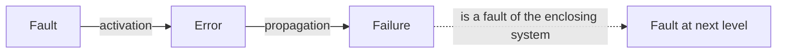
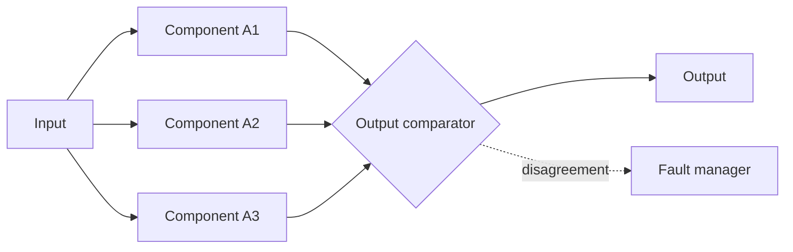
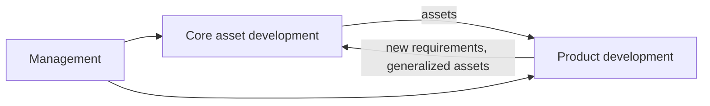
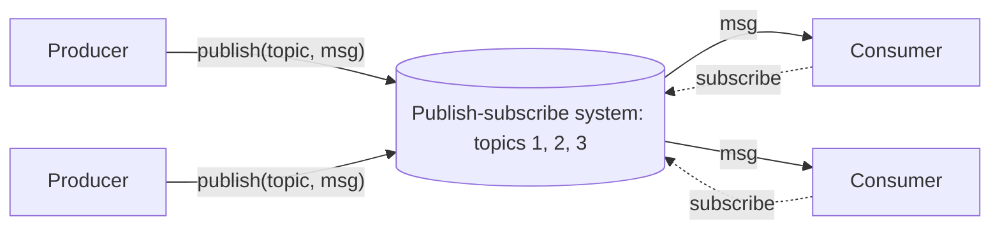
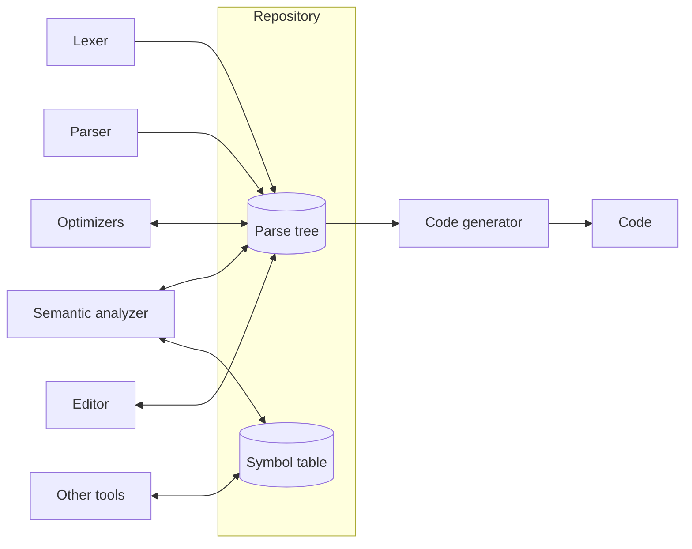
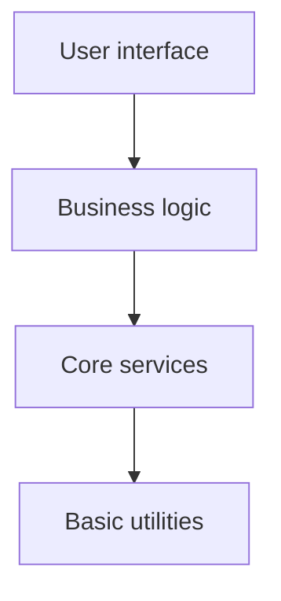

**Requirements** ([4.14.4](/4.14.4)) say what a system must do and how well; architecture is the first and most consequential answer to the question of how. Two systems with identical functions can differ by orders of magnitude in how many users they serve, how often they fail and how expensive they are to change, and these differences are fixed largely by the system's high-level structure, long before the first line of code is written. This chapter defines software architecture (5.1), the quality attributes that architecture serves and the design tactics that achieve them (5.2), the techniques of fault tolerance (5.3), and software product lines, an architectural answer to the cost of change (5.4). It then states the general design principles (5.5) and describes four classic architectural styles: event-based, pipes and filters, repository and layered (5.6). The next chapter ([4.14.6](/4.14.6)) continues with the distributed styles of Internet services (client–server, peer-to-peer, microservices, REST) and the patterns large websites use for performance, availability and scalability. At the level of classes and objects, the same ideas appear as **design patterns** ([4.2.13](/4.2.13)); at the level of code, as the principles of code quality ([4.14.10](/4.14.10)).

## 5.1. What Software Architecture Is

### 5.1.1. Definition

**Definition 5.1.1 (Software Architecture)** The **software architecture** of a system is its fundamental organization, embodied in its components, their relationships to each other and to the environment, and the principles governing its design and evolution.

This definition comes from IEEE Std 1471-2000, *Recommended Practice for Architectural Description of Software-Intensive Systems*. The standard has been superseded by ISO/IEC/IEEE 42010 (2011, revised 2022), which phrases architecture as the "fundamental concepts or properties of an entity in its environment and governing principles for the realization and evolution of this entity"; the substance is unchanged. Three points matter. Architecture is about structure (components and their relationships), not about the internals of components. It includes the *environment*: the users, the hardware, the other systems the software talks to. And it includes *principles*, the rules that keep the structure intact while the system evolves.

The distinction between programming in the small and in the large expresses the same idea. In the small, a programmer chooses **data structures** and algorithms. In the large, an architect chooses components and connectors and hides how each component is implemented.

**Definition 5.1.2 (Component and Connector)** In an architectural description, a **component** is a unit of computation or data storage with a defined interface, such as a process, a service, a library or a database. A **connector** is an interaction mechanism between components, such as a procedure call, a pipe, an event bus, a message queue, a shared database or a network protocol.

**Definition 5.1.3 (Architectural Style)** An **architectural style** (or architectural pattern) is a named family of architectures that share a vocabulary of component and connector types and a set of constraints on how they may be combined. It records a proven way of connecting subsystems to meet a class of functional and non-functional requirements.

No single diagram shows an architecture. Architects describe a system in several *views*, each for one set of concerns: a module view (code units and their dependencies), a component-and-connector view (the run-time components and their interactions) and an allocation view (how software maps to hardware, teams and files). The views are drawn informally as boxes and arrows, in the C4 model (context, containers, components, code), or with **UML** component and deployment diagrams.

### 5.1.2. Why Architecture Matters

George Fairbanks (*Just Enough Software Architecture*, 2010) compares architecture to the skeleton of a system. There is no single right architecture, but some skeletons suit a job far better than others: a planetary file-sharing network practically has to be peer-to-peer, and a bank's ledger practically has to keep its authoritative data in one consistent store. Architecture also enables or inhibits quality: beyond supporting the required functions, the structure decides whether the system can be fast, available, secure and changeable. A system designed for a hundred users may be impossible to scale to a hundred thousand without an architectural change, and such a change, made late, is the most expensive kind of rework there is.

Architecture is therefore driven less by functions than by quality attributes. Almost any structure can implement a given set of functions; only some structures can implement them while also meeting a response-time target, surviving the failure of a server, and allowing the team to ship a new feature every week.

## 5.2. Quality Attributes

### 5.2.1. Quality Attributes and Scenarios

**Definition 5.2.1 (Quality Attribute)** A **quality attribute** is a measurable or testable property of a system that indicates how well the system satisfies the needs of its stakeholders, beyond its basic function: for example performance, availability, modifiability, security, testability or usability.

The standard catalog of quality attributes is the product quality model of ISO/IEC 25010 (third edition, 2023). It has nine characteristics, each divided into subcharacteristics:

| Characteristic | Concern | Examples of subcharacteristics |
|---|---|---|
| functional suitability | the functions are complete, correct and appropriate | functional correctness |
| performance efficiency | time and resources used under stated conditions | time behavior, resource utilization, capacity |
| compatibility | coexistence and exchange of information with other systems | interoperability |
| interaction capability | use by specified users through the user interface (formerly "usability") | learnability, user error protection, inclusivity |
| reliability | performing functions under stated conditions for a stated period | faultlessness, availability, fault tolerance, recoverability |
| security | protecting information and resisting attack | confidentiality, integrity, non-repudiation, accountability, authenticity, resistance |
| maintainability | ease and cost of modification | modularity, reusability, analyzability, modifiability, testability |
| flexibility | adapting to changed requirements, contexts and workloads (formerly "portability") | adaptability, scalability, installability, replaceability |
| safety | avoiding states that endanger life, health, property or the environment | fail safe, hazard warning |

A name such as "the system shall be highly available" cannot be designed against or tested. Bass, Clements and Kazman (*Software Architecture in Practice*, 4th ed., 2021) make quality attributes precise with scenarios.

**Definition 5.2.2 (Quality Attribute Scenario)** A **quality attribute scenario** specifies a quality requirement in six parts: the *source* of a stimulus, the *stimulus* itself, the *artifact* that is stimulated, the *environment* (the conditions at the time), the *response* of the system, and the *response measure* by which the response is judged.

| Part | Performance scenario | Availability scenario | Modifiability scenario |
|---|---|---|---|
| source | users | internal hardware | developer |
| stimulus | 1,000 search requests per second | a database server crashes | request to add a payment method |
| artifact | search service | order database | payment module |
| environment | normal operation, peak hour | normal operation | design time |
| response | requests are processed | a replica takes over | the change is made and deployed |
| response measure | 99% within 200 ms | no more than 30 s of unavailability, no committed order lost | within 3 person-days, touching no other module |

**Definition 5.2.3 (Architectural Tactic)** An **architectural tactic** is a design decision that influences the response of the system to a stimulus, and thereby one quality attribute, such as adding redundancy for availability or introducing a cache for performance. Architectural styles are bundles of tactics.

The following subsections take the main quality attributes in turn.

### 5.2.2. Performance

**Definition 5.2.4 (Performance)** **Performance** is the ability of a software system to meet its timing requirements: how fast it responds to events (*latency*, or response time) and how many events it processes per unit of time (**throughput**), under a given load.

Performance is pervasive: everything affects it, from the code to all underlying layers (operating system, middleware, hardware, network). For much of the history of software engineering it was the driving factor of system architecture, and it remains so for Internet services, where a slow page loses users. Response time is usually stated as a percentile (the 99th percentile latency, "p99") rather than an average, because users experience the slow tail: in a page that calls 100 back-end services, almost every page view hits at least one request slower than the p99 of a single service.

The simplest structure for a web service is a synchronous request: a client sends a request, one server handles it, reads and writes the database, and returns the answer while the client waits. Three architectural elements recur when this structure has to serve more load (Kate Matsudaira, "Scalable Web Architecture and Distributed Systems", in *The Architecture of Open Source Applications*):

| Element | What it does | Examples |
|---|---|---|
| cache | keeps results of expensive operations or recently used data closer to the requester | in-process caches, Redis, Memcached, CDNs |
| load balancer | distributes requests over a pool of identical servers, so capacity grows by adding servers | Nginx, HAProxy, LVS, cloud load balancers |
| queue | decouples a request from its processing: work is written to a queue and processed asynchronously by workers | RabbitMQ, Apache Kafka, Redis streams |

The corresponding tactics fall into two groups: *controlling resource demand* (reducing work per request, caching, limiting the event rate, prioritizing requests) and *managing resources* (adding servers, running work concurrently, keeping replicas of data and computation). Their concrete forms in large websites are the subject of [4.14.6](/4.14.6).

### 5.2.3. Availability

When designing a high-availability or safety-critical system, failure is not an option: it is almost inevitable. What makes a system safe and available is planning for the occurrence of failures and handling them gracefully.

**Definition 5.2.5 (Fault, Error and Failure)** A **failure** is an event in which the service delivered by a system deviates from correct service. An **error** is the part of the system's state that may lead to a failure. A **fault** is the adjudged or hypothesized cause of an error. A fault is *active* when it produces an error, otherwise *dormant*; an error *propagates* until it reaches the service interface, where it becomes a failure (Avižienis, Laprie, Randell and Landwehr, 2004).



A bug in a line of code is a fault; when the line executes with a triggering input and corrupts a variable, there is an error; when the corrupted value reaches the user as a wrong answer or a crash, there is a failure. The failure of a component is in turn a fault of the system containing it, so the chain repeats at every level.

**Definition 5.2.6 (Availability)** **Availability** is the ability of a system to mask or repair faults such that the cumulative service outage over a specified time interval does not exceed a required value. Quantitatively, it is the fraction of time the system is able to deliver its service:

$$
A = \frac{\mathrm{MTTF}}{\mathrm{MTTF} + \mathrm{MTTR}},
$$
where $\mathrm{MTTF}$ is the mean time to failure and $\mathrm{MTTR}$ the mean time to repair.

The formula shows the two levers: make failures rarer (larger $\mathrm{MTTF}$), or make recovery faster (smaller $\mathrm{MTTR}$). For large services the second lever is usually the cheaper one. Availability targets are given in "nines":

| Availability | Downtime per year | Downtime per 30-day month |
|---|---|---|
| 99% ("two nines") | 3.65 days | 7.2 hours |
| 99.9% | 8.77 hours | 43.2 minutes |
| 99.95% | 4.38 hours | 21.6 minutes |
| 99.99% | 52.6 minutes | 4.32 minutes |
| 99.999% | 5.26 minutes | 25.9 seconds |

Availability targets become contracts in a service-level agreement. Amazon's SLA for EC2, for example, commits to a monthly uptime of 99.99% for instances deployed across two or more availability zones of a region and 99.5% for a single instance; if Amazon misses the commitment, customers receive service credits (10% of the monthly bill below the target, up to 100% below 95%). Service-level objectives, error budgets and their operational use are the subject of [4.14.13](/4.14.13).

**Example 5.2.1 (Availability of Series and Parallel Systems)** Assume components fail independently. If a request needs every one of $n$ components (a series system), the system is available only when all are:

$$
A_{\text{series}} = \prod_{i=1}^{n} A_i .
$$
A web server and a database, each with $A = 99.9\%$, give $0.999^2 \approx 99.8\%$: every component added in series lowers availability. If instead any one of $n$ replicas suffices (a parallel system), the system fails only when all replicas fail:

$$
A_{\text{parallel}} = 1 - \prod_{i=1}^{n} (1 - A_i).
$$
Two replicas with $A = 99\%$ each give $1 - 0.01^2 = 99.99\%$. Redundancy turns two cheap, unreliable components into one reliable one, provided that their failures really are independent, the assumption that 5.3 examines.

The goal of all availability tactics is to ensure that faults do not result in failures. The dependability literature groups them into four means:

| Means | Question | Examples |
|---|---|---|
| fault prevention | how to prevent the occurrence or introduction of faults | requirements reviews, type systems, coding standards, safe languages |
| fault tolerance | how to deliver correct service in the presence of faults | redundancy, replication, failover, retries, graceful degradation |
| fault removal | how to reduce the number and severity of faults | testing, static analysis, **code review**, formal verification |
| fault forecasting | how to estimate the present number, the future incidence and the likely consequences of faults | reliability growth models, failure mode and effects analysis, chaos experiments |

### 5.2.4. Modifiability

**Definition 5.2.7 (Modifiability)** **Modifiability** is the ease with which a software system can accommodate changes; it relates to the cost and risk of making a change (Northrop, 2004).

If change is the only constant in the universe, then software change is not only constant but ubiquitous. Changes are made to add, change or retire features; to fix defects, tighten security or improve performance; to improve the user experience; and to adopt new technologies, platforms, protocols and standards. Planning for modifiability means answering four questions for each likely kind of change: *what* can change (functions, platforms, environment, capacity); how *likely* the change is; *when* the change is made (at design time, at build time, by configuration at deployment, at run time) and *who* makes it (developer, administrator, end user); and what the change *costs*, both to make the system modifiable in advance and to make the change itself.

The tactics follow from the principles of 5.5: keep modules small and cohesive, reduce coupling between them (interfaces, intermediaries, publish–subscribe), and defer binding, so that a change can be made by configuration or a plug-in instead of a code change. Product lines (5.4) apply the same idea to whole families of systems.

### 5.2.5. Other Quality Attributes

| Attribute | Typical response measure | Representative tactics |
|---|---|---|
| security | proportion of attacks resisted; time to detect and recover; data exposed | authenticate and authorize every actor, least privilege, encrypt data in transit and at rest, validate input, limit exposure, audit logs |
| testability | effort to create a test; coverage reached; time to find a fault | separate interfaces from implementations, inject dependencies, control and observe state, use deterministic components, sandboxes |
| usability (interaction capability) | time to complete a task; error rate; user satisfaction | separate the user interface from the logic, support undo and cancel, give feedback, maintain a model of the user's task |
| scalability | how cost and response time change as load grows | stateless services, horizontal replication, partitioning of data, asynchronous processing |
| deployability | time and risk to put a change into production | automated pipelines, small releases, feature flags, canary and blue–green deployment, rollback |

Testability is treated in detail in [4.14.11](/4.14.11) and [4.14.12](/4.14.12), deployability in [4.14.13](/4.14.13), and web security in [4.14.7](/4.14.7).

### 5.2.6. Trade-offs

Quality attributes conflict. Redundancy improves availability but costs money and complicates consistency; a cache improves performance but can return stale data; an extra layer of indirection improves modifiability but adds latency; encryption and authentication improve security but cost performance and usability. Architecture is therefore an exercise in trade-offs, and an architect's main job is to make them explicitly, according to the priorities of the stakeholders, rather than by accident. A common practice is to record each significant decision in an *architecture decision record* (ADR): a short document stating the context, the decision, the alternatives considered and the consequences, kept in version control next to the code.

## 5.3. Fault Tolerance

### 5.3.1. Redundancy

**Definition 5.3.1 (Fault Tolerance)** **Fault tolerance** is the property that enables a system to continue operating properly, possibly at a reduced level (*graceful degradation*), in the event of the failure of some of its components. A *fault-tolerant system* is designed around this property: it combines redundancy with techniques of error detection, fault diagnosis and recovery.

The idea of masking failures with redundancy goes back to von Neumann's 1956 paper on building reliable automata from unreliable components and to Moore and Shannon's paper of the same year on reliable circuits made of unreliable relays. Algirdas Avižienis integrated masking with practical techniques of error detection, diagnosis and recovery into the concept of fault-tolerant computing (1967), and with Liming Chen proposed N-version programming for software (1977).

**Definition 5.3.2 (Triple Modular Redundancy)** **Triple modular redundancy** (TMR) uses three replicated, identical components that receive the same input; a voter (output comparator) compares their outputs and passes on the majority value. If one output differs from the other two, it is ignored and the component is assumed to have failed; a fault manager records the failure and arranges repair.



If each component works with probability $R$ and failures are independent, the TMR system works when at least two components work:

$$
R_{\mathrm{TMR}} = R^3 + 3R^2(1-R) = 3R^2 - 2R^3 .
$$
For $R = 0.9$ this gives $0.972$, and for $R = 0.99$ about $0.9997$. TMR helps only if $R > 1/2$ (at $R = 0.5$ the two are equal, and for $R = 0.4$ TMR gives $0.352$), and the voter itself must be far more reliable than the components.

### 5.3.2. Why Software Needs Diversity

The success of TMR rests on two assumptions: the components contain no common design faults, and they fail randomly and independently, so simultaneous failures are rare. Both hold reasonably well for hardware, where most failures come from physical wear and defects. Neither holds for software. Three copies of the same program contain the same bugs, and the same input triggers them in all three copies at once: simultaneous failure is then virtually certain. Software redundancy must therefore be *diverse*: the versions must be designed and implemented in different ways, so that they have different failure modes. Diversity can come from different design approaches (object-oriented and function-oriented), different programming languages, different tools and development environments, and different algorithms.

**Definition 5.3.3 (N-Version Programming)** In **N-version programming**, the same specification is implemented in $N \ge 3$ versions by independent teams. All versions execute simultaneously on the same input, and a voter selects the majority output.

**Definition 5.3.4 (Recovery Blocks)** In the **recovery block** scheme (Randell, 1975), several explicitly different versions of the same specification are provided. One is designated the primary version and the others secondary versions (spares). The primary version is executed and its result checked by an acceptance test; if the test fails, the state is restored and the first secondary version is tried, and so on, until one version passes the acceptance test or, if none does, the system fails.

| | N-version programming | Recovery blocks |
|---|---|---|
| execution | all versions in parallel | sequential, one at a time |
| error detection | voting among outputs | acceptance test on one output |
| cost at run time | $N$ times the computation, constant latency | low normally; extra latency when a version fails |
| weak point | correlated faults; the voter | designing an acceptance test that is simpler than the problem but still effective |
| typical use | flight control, railway signaling | systems that can afford retries |

Design diversity is used in safety-critical systems. The Airbus A320 family, the first civil airliner with digital fly-by-wire controls (1988), uses two types of flight control computers (ELAC and SEC) built on different processors, by different suppliers, with software developed independently by different teams, and each computer has a command channel and a separately programmed monitor channel that checks it.

Diversity does not guarantee independence. In an experiment by Knight and Leveson (1986), 27 versions of the same program written independently from one specification failed on the same inputs far more often than independence would predict. The reasons recur in practice:

- teams are trained in the same way and tend to tackle problems in the same way, often choosing the same algorithms;
- some parts of a problem are harder than others, so all teams tend to make mistakes in the same places;
- all versions are developed from a common specification, so an error in the specification is reflected in every implementation. This can be addressed to some extent by multiple specification representations, for example a formal and an informal one.

For most commercial software, full N-version programming is too expensive. The diversity that Internet services rely on is cheaper and coarser: replicas in independent failure domains (racks, data centers, regions), gradual rollout of new versions so that the old version remains as a fallback, and graceful degradation when a dependency fails ([4.14.6](/4.14.6)).

## 5.4. Software Product Lines

CelsiusTech Systems, a Swedish defense contractor supplying shipboard command and control systems to navies around the world, faced a crisis in 1985. It had contracts to build two systems far larger than anything it had attempted before, and it already had trouble meeting schedules and budgets. Instead of building two systems, it built one architecture that could satisfy the very different requirements of both customers, and of the customers that would come after them, across a wide but planned range of products. The strategy, later documented by the Software Engineering Institute (Brownsword and Clements, 1996), let the company deliver both systems and more than 50 later ones. It took years off delivery schedules, allowed a smaller staff to produce more systems, and raised software reuse to about 90%. Integration testing of one of these real-time, safety-critical, highly distributed systems of 1.5 million lines of Ada could routinely be handled by one or two people, and porting a system to a new computing environment and operating system took less than a month.

**Definition 5.4.1 (Software Product Line)** A **software product line** (or application family) is a set of software-intensive systems sharing a common, managed set of features that satisfy the specific needs of a particular market segment or mission, and that are developed from a common set of core assets in a prescribed way (Clements and Northrop, 2001).

A product line is a related set of applications with a common, domain-specific architecture. A common base of *core assets* (the architecture, reusable components, requirements and test cases, plans) is reused each time a new application is produced, and each application is an instantiation of the core assets, specialized through planned *variation points* such as configuration, plug-ins and optional components. Three activities form a feedback loop:



Products are built from core assets; assets are extracted from products, evolved and generalized; and management must have the vision to invest in core assets before they pay off and to coordinate the production of products with the availability of assets. Product lines are common in embedded systems (cars, printers, phones). The configurable platforms of today, such as an operating system distribution that runs on many devices or a software-as-a-service product with per-customer configuration, apply the same idea.

## 5.5. Architecture Design Principles

High-level design is guided by a handful of principles that recur at every scale, from functions to services. The five discussed here are KISS, modularity, separation of concerns, design for change and design for reuse.

### 5.5.1. Keep It Simple

*KISS* ("keep it simple, stupid", a design maxim attributed to the aircraft engineer Kelly Johnson) states that a design should be no more complicated than its problem requires, in its algorithms, structure, interactions, implementation and user interface alike. C. A. R. Hoare put the case in his 1980 Turing Award lecture: "There are two ways of constructing a software design: One way is to make it so simple that there are obviously no deficiencies, and the other way is to make it so complicated that there are no obvious deficiencies. The first method is far more difficult." Simplicity is difficult because it requires understanding the problem well enough to see what can be left out. Related maxims are YAGNI ("you aren't gonna need it": do not build for speculative requirements) and the advice to choose boring, well-understood technology unless a problem demands otherwise.

### 5.5.2. Modularity

Complex problems are solved by systematic thinking in two steps: *decomposition* of the problem into subproblems that are small, simple and controllable, and *synthesis* of their solutions into an integrated solution. The Chinese parable of Cook Ding, who after years of practice no longer saw the whole ox but only its joints and cut along them so that his knife never dulled, describes the skill: a good decomposition follows the natural joints of the problem.

**Definition 5.5.1 (Modularity)** **Modularity** is the degree to which a system is composed of discrete components (modules) such that a change to one component has minimal impact on the others. A *module* is a unit of decomposition with an interface that hides its implementation.

The benefits of modularity are that development can be planned more easily, software increments can be defined and delivered, changes can be accommodated more easily, testing and debugging are more efficient, and long-term maintenance can be conducted without serious side effects. Modularity rests on **information hiding** (Parnas, 1972): each module hides a design decision that is likely to change behind an interface that is not. The quality of a decomposition is measured by two complementary properties, introduced by Stevens, Myers and Constantine (1974).

**Definition 5.5.2 (Coupling and Cohesion)** **Coupling** is the degree of interdependence between modules: how much one module must know about, and is affected by changes to, another. **Cohesion** is the degree to which the elements inside a module belong together, that is, serve one well-defined purpose.

A good design has *strong cohesion and weak coupling*. The classical scales order the kinds from worst to best:

| Coupling (worst to best) | Meaning | Cohesion (worst to best) | Meaning |
|---|---|---|---|
| content | one module modifies or relies on the internals of another | coincidental | elements grouped arbitrarily ("utils") |
| common | modules share global data | logical | elements do similar kinds of things, selected by a flag |
| control | one module passes a flag that steers the other's logic | temporal | elements run at the same time (initialization) |
| stamp | modules share a composite data structure but use only part of it | procedural | elements follow one control sequence |
| data | modules share only the parameters they need | communicational, sequential | elements work on the same data or feed each other |
| message | modules interact only through messages or published interfaces | functional | all elements contribute to one single task |

How far should decomposition go? The cost of developing each module falls as modules become smaller and simpler, but more modules mean more interfaces, more complex dependencies and higher integration cost. The total cost has a minimum at an intermediate number of modules, a region rather than a point, and the right granularity depends on the context: what is right for functions in one program differs from what is right for services maintained by separate teams ([4.14.6](/4.14.6)).

Interfaces are where coupling lives, so two tactics deserve emphasis: *simplify interfaces* (few operations, few parameters, stable data formats), and *decouple module dependencies*, typically by an intermediary. When $n$ systems are integrated by direct interfacing, each pair may need its own interface, up to $n(n-1)/2$ of them; with middleware (an integration bus, a message broker, a publish–subscribe system) each system needs one connection to the middleware, $n$ in total, and systems need not know about each other at all:



### 5.5.3. Separation of Concerns

**Definition 5.5.3 (Separation of Concerns)** **Separation of concerns** is the principle of dealing with different aspects (concerns) of a problem separately, so that each part of a design addresses one concern and can be understood, developed and changed with little regard for the others.

The term is due to Dijkstra (1974). Many decisions in software development are strongly related and interdependent; separation makes them manageable by concentrating on one aspect at a time, such as functionality, a quality attribute, the development process or the operating constraints. The separation may be based on time (phases of the process), qualities (first correctness, then performance), views (data, behavior, deployment), size (subsystems) or level of detail (abstraction). Separating the front end of a web application, responsible for interaction with the user, from the back end, responsible for data processing, is a typical application ([4.14.7](/4.14.7)).

Some concerns resist separation.

**Definition 5.5.4 (Crosscutting Concern)** A **crosscutting concern** is a concern whose implementation cuts across many program components, such as logging, security checks, transactions or error handling. It leads to *scattering* (the code of one concern spread over many modules) and *tangling* (the code of several concerns mixed in one module).

A classic illustration by the AspectJ team (Kiczales and colleagues, who introduced aspect-oriented programming in 1997) colors the lines of code that handle logging in the Apache Tomcat server: they appear not in one place, and not even in a small number of places, but in almost every class. A change to how logging is done then touches the whole system. Remedies include aspect-oriented programming, which declares such code once and weaves it in; decorators and middleware in web frameworks, which wrap every request handler with the same logic (the **decorator pattern**, [4.2.13](/4.2.13)); and, at the system level, separate infrastructure such as a service mesh that handles encryption and retries for every service ([4.14.6](/4.14.6)). The ideal remains that each program element does one thing and only one thing, the **single-responsibility principle** at the level of classes.

### 5.5.4. Design for Change

Change is inevitable and frequent: bugs are removed, user requirements change, technology evolves, and both the product and the development process change. The strategy is to consider the likely changes as part of the system design: identify them early and isolate each in a specific portion of the software, so that a change is restricted to a small part. This is Parnas's criterion for decomposition: modules should be chosen to hide the decisions most likely to change (the format of the data, the choice of an algorithm, the interface to hardware or an external service), not to follow the steps of the processing. The **open–closed principle** states the same goal for classes: open for extension, closed for modification.

In a multi-tier system, for instance, the user interface, the application logic and the database run on separate servers, and video, file, database, web and application servers can each be replaced, scaled or upgraded without touching the others. The price of this flexibility is the indirection and communication between tiers, which is why designing for change must be guided by the *likely* changes, not every conceivable one.

### 5.5.5. Design for Reuse

Software is expensive, and reusing software assets increases the return on investment: lower production and maintenance cost, faster delivery, and higher quality, since reused components have been tested and debugged in earlier use. The principle at the level of code is *DRY* (Don't Repeat Yourself), as opposed to *WET* ("write everything twice"): every piece of knowledge should have a single authoritative representation. The industrial analogy is the change from handcraft to the assembly line at the Ford Motor Company in 1913–14, made possible by interchangeable parts and by redesigned workflows and jobs; it reduced unit cost (the affordable Model T), made quality consistent and improved productivity.

Reusable assets are not only code: requirements, designs, test cases, problem and design solutions (patterns), tools, processes, and experience and best practices can all be reused. Today the main form of reuse is the adoption of mature open-source components: a typical web application consists mostly of frameworks and libraries written by others. This reuse brings its own engineering duties, such as choosing well-maintained dependencies, pinning versions, tracking security advisories and checking licenses.

## 5.6. Architectural Styles

An architectural style is described by its components, its connectors, and its constraints, and judged by how it supports problem decomposition, system maintenance, system reuse and performance. This section treats four classic styles; the distributed styles (client–server, peer-to-peer, service-oriented architecture and microservices) follow in [4.14.6](/4.14.6).

### 5.6.1. Event-Based Style

**Definition 5.6.1 (Event-Based Architecture)** In an **event-based architecture** (implicit invocation), rather than invoking a procedure directly or sending a message to a known receiver, a component announces, or broadcasts, one or more *events*. Other components register interest in an event by associating a procedure with it; when the event is announced, the system itself invokes all registered procedures (Garlan and Shaw, 1994).

| Element | Description |
|---|---|
| components | objects or processes whose interfaces define both the events they announce and the events they process |
| connectors | bindings between event announcements and procedures, maintained by an event manager or bus |
| constraint | the announcer does not know which components, if any, will react, nor in what order |

Two variants exist. In *broadcast models*, an event is broadcast to all subsystems, and any subsystem that can handle it may do so; *selective broadcasting* delivers it only to subsystems that have subscribed. In *interrupt-driven models*, used in real-time systems, interrupts are detected by an interrupt handler (through an interrupt vector) and passed to the component that processes them. The publish–subscribe pattern is the common modern form.

**Definition 5.6.2 (Publish–Subscribe)** **Publish–subscribe** is a messaging pattern in which publishers send messages to named *topics* without knowledge of the receivers, and subscribers receive all messages on the topics they have subscribed to, without knowledge of the publishers.

A minimal in-process implementation shows the essential decoupling: the payment component announces that an order was paid, and three components it has never heard of react.

```python
from collections import defaultdict
from typing import Any, Callable

Handler = Callable[[dict[str, Any]], None]


class EventBus:
    """A minimal in-process publish-subscribe connector."""

    def __init__(self) -> None:
        self._handlers: dict[str, list[Handler]] = defaultdict(list)

    def subscribe(self, topic: str, handler: Handler) -> None:
        self._handlers[topic].append(handler)

    def publish(self, topic: str, event: dict[str, Any]) -> None:
        # The publisher does not know who (if anyone) receives the event.
        for handler in self._handlers[topic]:
            handler(event)


bus = EventBus()

# Independent components register interest in the same event.
bus.subscribe("order.paid", lambda e: print(f"inventory: reserve items of order {e['id']}"))
bus.subscribe("order.paid", lambda e: print(f"email: send receipt for order {e['id']}"))
bus.subscribe("order.paid", lambda e: print(f"analytics: record revenue {e['amount']:.2f}"))

# The payment component only announces what happened.
bus.publish("order.paid", {"id": 1042, "amount": 59.90})
bus.publish("order.shipped", {"id": 1042})  # no subscribers: nothing happens
```

```text
inventory: reserve items of order 1042
email: send receipt for order 1042
analytics: record revenue 59.90
```

Adding a fourth reaction, say fraud detection, requires one new `subscribe` call and no change to the payment code. The same structure appears in graphical user interfaces (event handlers for clicks), in the **event loop** of asynchronous programs, in the observer pattern of object-oriented design, and, distributed over a network, in message brokers such as Apache Kafka.

| | Advantages | Disadvantages |
|---|---|---|
| problem decomposition | computation and coordination are separated | loss of control: the announcer knows neither which components respond nor in which order (hence also "independent components" style); interactions are hard to predict and correctness is hard to ensure; exchanging data is awkward, and a shared repository may be needed |
| maintenance and reuse | components can be added and replaced with minimal effect on others; a new component is plugged in by registering it for events | a central "yellow pages" of events, registrations and dispatch policies must be maintained |
| performance | invocations can run in parallel | dispatching and data sharing cost time; the order of invocation is non-deterministic |

### 5.6.2. Pipes and Filters

**Definition 5.6.3 (Pipes and Filters)** The **pipes-and-filters** style provides a structure for systems that process a stream of data. Each processing step is encapsulated in a filter component, which reads a stream of data on its input and produces a stream on its output by a local, incremental transformation; data is passed through pipes, which connect the output of one filter to the input of the next, typically as first-in-first-out buffers. Recombining filters builds families of related systems (Buschmann et al., *Pattern-Oriented Software Architecture*, 1996).

The canonical examples are the Unix shell, whose **pipe** connects the standard output of one process to the standard input of the next ([4.11.10](/4.11.10)), and the traditional compiler, which passes the program through lexical analysis, syntax analysis, semantic analysis, optimization and code generation. Given a tab-separated log file,

```text
error	disk full	/var
info	started	-
error	timeout	db
warning	slow query	db
```

the pipeline below extracts the messages of all errors; each filter knows only its own job and the line-oriented text format they share:

```bash
cat app.log | grep '^error' | cut -f 2
cut -f 1 app.log | sort | uniq -c | sort -rn   # count lines by level
```

```text
disk full
timeout
      2 error
      1 warning
      1 info
```

| | Advantages | Disadvantages |
|---|---|---|
| problem decomposition | the system is a composition of filters, and a filter may itself be a pipeline (hierarchical decomposition) | it is hard to design incremental filters for operations that need the whole input (sorting); sharing global data is expensive or limiting; interactive applications are difficult |
| maintenance and reuse | filters can be added, replaced and reordered; each filter is a black box, reusable wherever the agreed data format is used | every filter must parse its input and unparse its output, a cost in time and a source of errors |
| performance | filters can run in parallel, as concurrent processes or threads | with finite buffers, filters that wait on each other can **deadlock** |

Modern data processing uses the style at a large scale: extract-transform-load jobs, stream processing engines such as Apache Flink ([4.14.6](/4.14.6)), and the build and deployment pipelines of **continuous integration**.

### 5.6.3. Repository Style

**Definition 5.6.4 (Repository Architecture)** In a **repository architecture** (shared-data style), a central data store holds the large amount of data shared among subsystems, and a collection of independent components operates on it. The central store represents the state of the system.

The connectors between the components and the store come in two forms. In the *passive repository* (the transactional database model), an incoming stream of transactions triggers the processes, which act on the data. In the *blackboard* model (active), the state of the data store itself triggers the processes: knowledge sources watch the blackboard and run when it contains something they can work on, as in early speech-understanding systems and in some rule-based systems.

The compiler shows how styles combine. A pure pipeline passes the whole program from phase to phase, but every phase needs information about identifiers, so real compilers add a shared symbol table; modern compilers and language servers go further and organize the phases, the editor and other tools around a shared repository of parse trees and symbol tables, from which each tool reads and to which it writes:



| Advantages | Disadvantages |
|---|---|
| an efficient way to share large amounts of data: no need to transmit data explicitly from one subsystem to another | subsystems must agree on a repository data model, a compromise that may hurt the performance of some of them |
| subsystems need not be concerned with how data is produced or used by others | new subsystems whose data models do not fit the agreed schema are difficult to integrate |
| centralized management of backup, security, access control and recovery | data evolution is difficult and expensive, because every subsystem depends on the schema |
| the sharing model is published as the repository schema, so new tools integrate easily if they are compatible with it | difficult to distribute efficiently; replication brings redundancy and inconsistency problems |
| | forces the same policy (security, backup) on all subsystems |

**Version control systems** such as Git ([4.14.3](/4.14.3)), integrated development environments and most business information systems built around one database are repository architectures.

### 5.6.4. Layered Style

**Definition 5.6.5 (Layered Architecture)** A **layered architecture** is organized hierarchically, each layer providing services to the layer above it and serving as a client of the layer below. In a *strict* (closed) layered system each layer uses only the layer immediately below; in a *relaxed* (open) one a layer may use any lower layer (Garlan and Shaw, 1994).

| Element | Description |
|---|---|
| components | layers: groups of subtasks that implement a "virtual machine" at a certain level of the hierarchy |
| connectors | the protocols or interfaces between adjacent layers |
| constraint | each layer hides the layers below it and provides distinct services to the layer above |

A typical application has a user interface layer, a business logic layer, a core layer and a layer of basic utilities. The best-known example is the seven-layer OSI reference model of networking (application, presentation, session, transport, network, data link, physical): layer $N$ offers services to layer $N+1$ through a service access point, and the two instances of a layer on communicating machines talk to each other through a peer protocol, carried by the layers below. Operating systems (hardware, kernel, system libraries, applications), the Android platform and the three tiers of web applications (presentation, business logic, data) are also layered.



| | Advantages | Disadvantages |
|---|---|---|
| problem decomposition | increasing levels of **abstraction** partition a complex problem | not all systems are easily structured in layers, and finding the right levels of abstraction is difficult |
| maintenance | a layer interacts only with the layers above and below, which limits the effect of a change | opaque layers prevent users from controlling functionality deep in the stack |
| reuse | each layer supports a set of standard interfaces, so different implementations of the same interface can be interchanged (TCP over Ethernet or Wi-Fi) | bridging layers for convenience or speed destroys the integrity of the architecture |
| performance | | communication down through the layers and back up costs time |

### 5.6.5. Comparison

| Style | Components | Connectors | Fits | Avoid when |
|---|---|---|---|---|
| event-based | event announcers and handlers | event bus, implicit invocation | user interfaces, integration of loosely related subsystems, reactive systems | the order of processing must be guaranteed or reasoned about |
| pipes and filters | filters | pipes (streams) | batch and stream processing, compilers, data transformation | interaction or shared global state is central |
| repository | data store, independent clients | data access (transactions, triggers) | information systems, development tools | subsystems have conflicting data models or must be widely distributed |
| layered | layers | interfaces, protocols | operating systems, network stacks, business applications | performance-critical paths that cannot afford indirection |

Real systems mix styles: a web application is layered, keeps its data in a repository, processes uploads in a pipeline and notifies other services by events. The style names give the team a shared vocabulary for such decisions and a catalog of their known consequences.

## 5.7. Architecture When AI Writes Code

A **coding agent** ([4.2.14](/4.2.14)) works on one task at a time, with a limited view of the system, and optimizes for completing that task. Left alone, it tends to solve each problem where it sees it: by adding a direct import across a layer, a second copy of an existing helper, or a new dependency. Each change is locally reasonable; together they erode the architecture. The practices of this chapter become more important, and more of them must be made explicit and checkable. Architectural decisions belong in short written records and in the project instructions an agent reads, so that the agent knows the layers, the allowed dependencies and the reasons behind them. Rules that can be checked mechanically should be: dependency rules between packages can be enforced by tools such as import-linter for Python or dependency-cruiser for JavaScript, and quality attribute scenarios with measurable responses (5.2.1) can be turned into automated performance or failover tests that every change must pass. Agents are useful for architectural work too, for example for drafting alternatives and listing their trade-offs, or for analyzing the dependency structure of an unfamiliar code base; but choosing among the trade-offs remains the responsibility of the people who will own the system. [4.14.14](/4.14.14) treats these practices in general.

## Summary

- Software architecture is the fundamental organization of a system: its components, their relationships and environment, and the principles of its design and evolution. Architectural styles are proven families of component and connector structures.
- Architecture is driven by quality attributes, made precise as scenarios (source, stimulus, artifact, environment, response, response measure) and achieved by tactics; the attributes conflict, so architecture means explicit trade-offs.
- Availability is $\mathrm{MTTF}/(\mathrm{MTTF}+\mathrm{MTTR})$; components in series multiply availabilities, redundant replicas multiply unavailabilities, provided their failures are independent.
- Faults cause errors, which cause failures; fault tolerance masks faults by redundancy. TMR works for hardware, but software needs design diversity (N-version programming, recovery blocks), and even diverse versions fail in correlated ways.
- Product lines build families of systems from shared core assets; CelsiusTech reached about 90% reuse.
- Design principles: keep it simple; decompose into modules with strong cohesion and weak coupling; separate concerns, and watch for crosscutting ones; isolate likely changes; reuse.
- Classic styles: event-based (decoupled, but control is lost), pipes and filters (composable streams), repository (shared data, but a shared schema), layered (abstraction and replaceability, at a cost in performance).
