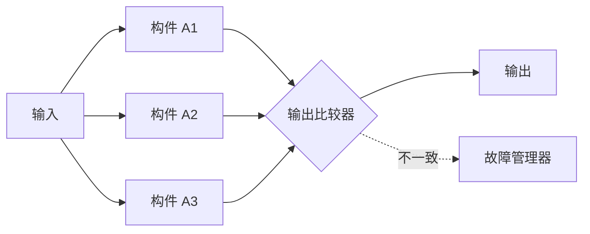
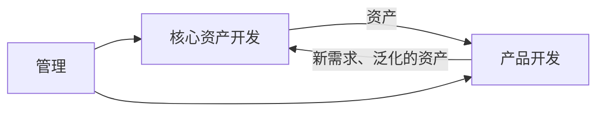
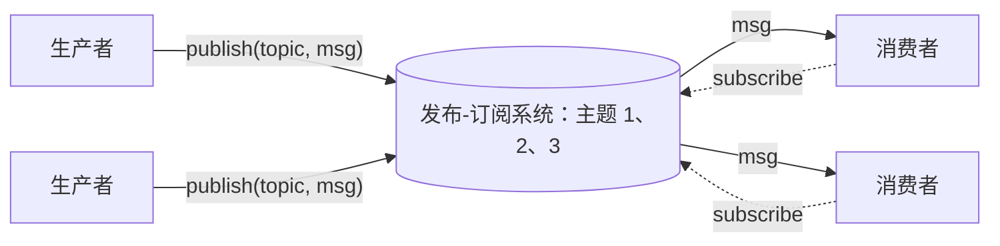
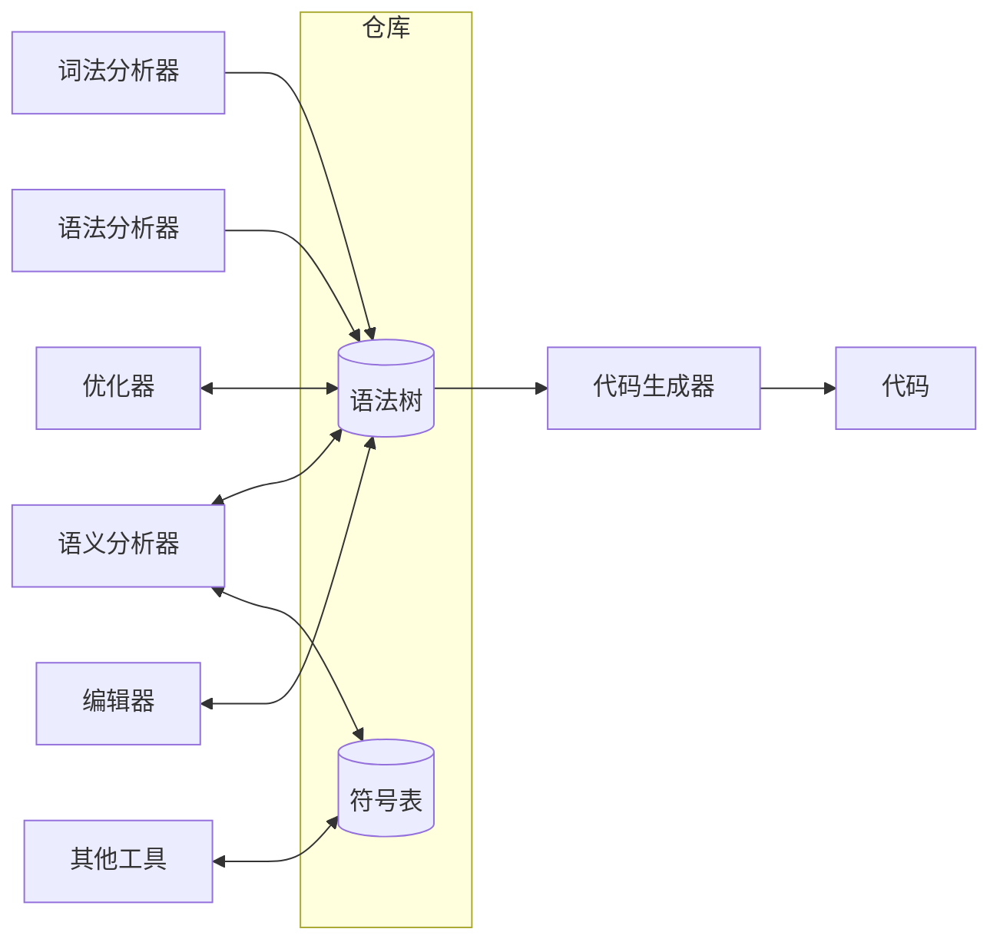
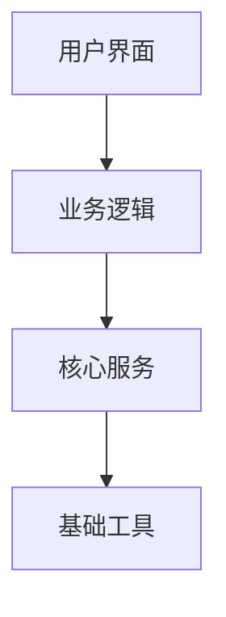

**需求**（[4.14.4](/4.14.4)）说明系统必须做什么、做到什么程度；架构则是对“怎么做”的第一个、也是影响最大的回答。功能完全相同的两个系统，在能服务多少用户、多久失效一次、修改代价多高等方面可以相差几个数量级，而这些差别在很大程度上由系统的高层结构决定，早在第一行代码写下之前就已确定。本章先给出软件架构的定义（5.1），然后讨论架构所服务的质量属性及实现它们的设计战术（5.2）、容错技术（5.3）和软件产品线（针对变更代价的一种架构对策，5.4）；接着陈述一般的设计原则（5.5），并介绍四种经典架构风格：事件驱动、管道-过滤器、仓库与分层（5.6）。下一章（[4.14.6](/4.14.6)）继续讨论互联网服务的分布式风格（客户端-服务器、对等网络、微服务、REST），以及大型网站为性能、可用性和可伸缩性所用的各种模式。在类与对象的层面，同样的思想表现为**设计模式**（[4.2.13](/4.2.13)）；在代码的层面，则表现为代码质量的各项原则（[4.14.10](/4.14.10)）。

## 5.1. 什么是软件架构

### 5.1.1. 定义

**定义 5.1.1（软件架构）** 系统的**软件架构**是其基本组织，体现在它的构件、构件之间以及构件与环境之间的关系，以及指导其设计与演化的原则之中。

这一定义出自 IEEE Std 1471-2000，*Recommended Practice for Architectural Description of Software-Intensive Systems*。该标准已被 ISO/IEC/IEEE 42010（2011 年，2022 年修订）取代，后者把架构表述为“实体在其环境中的基本概念或属性，以及实现和演化该实体的指导原则”，实质没有变化。有三点值得注意。架构关心的是结构（构件及其关系），而不是构件内部的实现。它包含环境：用户、硬件以及软件所交互的其他系统。它还包含原则，即系统演化时保持结构完整的规则。

“小型编程”与“大型编程”（programming in the small / in the large）之分表达的是同一个想法。在小的层面，程序员选择**数据结构**和算法；在大的层面，架构师选择构件与连接件，并隐藏各构件的实现方式。

**定义 5.1.2（构件与连接件）** 在架构描述中，**构件**是具有明确定义接口的计算或数据存储单元，例如进程、服务、库或数据库。**连接件**是构件之间的交互机制，例如过程调用、管道、事件总线、消息队列、共享数据库或网络协议。

**定义 5.1.3（架构风格）** **架构风格**（或架构模式）是一族有名称的架构，它们共享一套构件与连接件类型的词汇，并遵守同一组关于如何组合它们的约束。它记录了一种经过验证的连接子系统的方式，用以满足某一类功能与非功能需求。

没有任何一张图能展示整个架构。架构师从若干视图描述系统，每个视图对应一组关注点：模块视图（代码单元及其依赖）、构件与连接件视图（运行时的构件及其交互）和分配视图（软件如何映射到硬件、团队和文件）。视图可以用方框和箭头非正式地绘制，也可以采用 C4 模型（context、containers、components、code），或使用 **UML** 的构件图和部署图。

### 5.1.2. 架构为何重要

George Fairbanks（*Just Enough Software Architecture*，2010）把架构比作系统的骨架。并不存在唯一正确的架构，但有些骨架比另一些更适合某项任务：全球范围的文件共享网络几乎必然是对等网络，银行的账本几乎必然把权威数据放在同一个一致的存储中。架构还会促成或抑制质量：它除了支撑所需的功能，还决定系统能否快速、可用、安全且易于变更。为一百个用户设计的系统，不改变架构可能就无法扩展到十万用户，而晚期进行的架构变更是所有返工中代价最高的一种。

因此，驱动架构的与其说是功能，不如说是质量属性。几乎任何结构都能实现给定的一组功能；只有部分结构能在实现功能的同时满足响应时间目标、在服务器故障时存活，并且允许团队每周发布一个新特性。

## 5.2. 质量属性

### 5.2.1. 质量属性与场景

**定义 5.2.1（质量属性）** **质量属性**是系统的一种可度量或可测试的性质，表明系统在基本功能之外满足干系人需要的程度，例如性能、可用性、可修改性、安全性、可测试性或易用性。

标准的质量属性目录是 ISO/IEC 25010（2023 年第三版）的产品质量模型。它有九个特性，每个特性又分为若干子特性：

| 特性 | 关注点 | 子特性举例 |
|---|---|---|
| 功能适合性（functional suitability） | 功能完整、正确且恰当 | 功能正确性 |
| 性能效率（performance efficiency） | 在规定条件下所用的时间与资源 | 时间特性、资源利用率、容量 |
| 兼容性（compatibility） | 与其他系统共存并交换信息 | 互操作性 |
| 交互能力（interaction capability） | 指定用户通过用户界面使用系统（原称“易用性”） | 易学性、用户错误防护、包容性 |
| 可靠性（reliability） | 在规定条件下、规定时间内执行功能 | 无故障性、可用性、容错性、可恢复性 |
| 安全性（security） | 保护信息并抵御攻击 | 保密性、完整性、不可否认性、可核查性、真实性、抗攻击性 |
| 可维护性（maintainability） | 修改的难易程度与代价 | 模块化、可复用性、可分析性、可修改性、可测试性 |
| 灵活性（flexibility） | 适应变化的需求、环境与工作负载（原称“可移植性”） | 适应性、可伸缩性、可安装性、可替换性 |
| 安全保障（safety） | 避免危及生命、健康、财产或环境的状态 | 失效安全、危险预警 |

“系统应当高度可用”这样的说法既无法据以设计，也无法测试。Bass、Clements 和 Kazman（*Software Architecture in Practice*，第 4 版，2021）用场景把质量属性说得精确。

**定义 5.2.2（质量属性场景）** **质量属性场景**用六个部分描述一项质量需求：刺激的来源（source）、刺激本身（stimulus）、被刺激的制品（artifact）、环境（environment，即当时的条件）、系统的响应（response），以及据以评判响应的响应度量（response measure）。

| 部分 | 性能场景 | 可用性场景 | 可修改性场景 |
|---|---|---|---|
| 来源 | 用户 | 内部硬件 | 开发者 |
| 刺激 | 每秒 1000 个搜索请求 | 一台数据库服务器崩溃 | 要求增加一种支付方式 |
| 制品 | 搜索服务 | 订单数据库 | 支付模块 |
| 环境 | 正常运行，高峰时段 | 正常运行 | 设计期 |
| 响应 | 请求得到处理 | 副本接管 | 完成修改并部署 |
| 响应度量 | 99% 的请求在 200 ms 内完成 | 不可用时间不超过 30 s，已提交的订单不丢失 | 在 3 人天内完成，不触及其他模块 |

**定义 5.2.3（架构战术）** **架构战术**是影响系统对某一刺激的响应、从而影响某一质量属性的设计决策，例如为可用性增加冗余，或为性能引入缓存。架构风格是若干战术的组合。

下面依次讨论主要的质量属性。

### 5.2.2. 性能

**定义 5.2.4（性能）** **性能**是软件系统满足时间要求的能力：在给定负载下，系统对事件的响应有多快（延迟，latency，即响应时间），以及单位时间内能处理多少事件（**吞吐率**）。

性能无处不在：从代码到所有底层（操作系统、中间件、硬件、网络），一切都会影响它。在软件工程的很长一段历史中，它是系统架构的主要驱动因素，对互联网服务来说至今如此，因为页面太慢就会流失用户。响应时间通常用百分位数（第 99 百分位延迟，“p99”）而不是平均值来表述，因为用户体验到的是慢的尾部：在一个调用 100 个后端服务的页面中，几乎每次页面访问都会遇到至少一个比单个服务的 p99 更慢的请求。

Web 服务最简单的结构是同步请求：客户端发出请求，一台服务器处理它，读写数据库，并在客户端等待期间返回答案。当这一结构需要承受更大负载时，会反复出现三种架构元素（Kate Matsudaira，“Scalable Web Architecture and Distributed Systems”，载于 *The Architecture of Open Source Applications*）：

| 元素 | 作用 | 例子 |
|---|---|---|
| 缓存（cache） | 把昂贵操作的结果或最近使用的数据保存在离请求方更近的地方 | 进程内缓存、Redis、Memcached、CDN |
| 负载均衡器（load balancer） | 把请求分发给一组相同的服务器，使容量可以通过增加服务器而增长 | Nginx、HAProxy、LVS、云负载均衡器 |
| 队列（queue） | 使请求与其处理解耦：工作被写入队列，由工作进程异步处理 | RabbitMQ、Apache Kafka、Redis streams |

相应的战术分为两组：控制资源需求（减少每个请求的工作量、缓存、限制事件速率、为请求排优先级）和管理资源（增加服务器、并发运行任务、保存数据与计算的副本）。它们在大型网站中的具体形式见 [4.14.6](/4.14.6)。

### 5.2.3. 可用性

设计高可用或安全攸关的系统时，失效不是可以排除的选项：它几乎不可避免。使系统安全而可用的，是预先规划失效的发生并从容地处理它们。

**定义 5.2.5（故障、错误与失效）** **失效**是系统所提供的服务偏离正确服务的事件。**错误**是系统状态中可能导致失效的部分。**故障**是错误的被判定或被假设的原因。故障在产生错误时是活动的，否则是休眠的；错误会传播，直到到达服务接口，在那里变成失效（Avižienis、Laprie、Randell 和 Landwehr，2004）。


一行代码中的缺陷是故障；当这行代码在触发它的输入下执行并破坏了某个变量时，就出现了错误；当被破坏的值以错误答案或崩溃的形式到达用户时，就发生了失效。构件的失效又是包含它的系统的故障，因此这条链在每一层上重复。

**定义 5.2.6（可用性）** **可用性**是系统屏蔽或修复故障，使得在指定时间区间内累计的服务中断不超过要求值的能力。从定量上说，它是系统能够提供服务的时间所占的比例：

$$
A = \frac{\mathrm{MTTF}}{\mathrm{MTTF} + \mathrm{MTTR}},
$$
其中 $\mathrm{MTTF}$ 是平均失效前时间，$\mathrm{MTTR}$ 是平均修复时间。

公式显示了两个杠杆：让失效更少发生（增大 $\mathrm{MTTF}$），或让恢复更快（减小 $\mathrm{MTTR}$）。对大型服务来说，后者通常更便宜。可用性目标以“几个 9”表示：

| 可用性 | 每年停机时间 | 每 30 天的月停机时间 |
|---|---|---|
| 99%（“两个 9”） | 3.65 天 | 7.2 小时 |
| 99.9% | 8.77 小时 | 43.2 分钟 |
| 99.95% | 4.38 小时 | 21.6 分钟 |
| 99.99% | 52.6 分钟 | 4.32 分钟 |
| 99.999% | 5.26 分钟 | 25.9 秒 |

可用性目标会在服务水平协议中成为合同条款。例如，Amazon 的 EC2 SLA 承诺：部署在同一区域两个或更多可用区的实例，月度正常运行时间为 99.99%；单个实例为 99.5%；若 Amazon 未能兑现承诺，客户会得到服务抵扣额（低于目标时为当月账单的 10%，低于 95% 时最高为 100%）。服务水平目标、错误预算及其运维用法见 [4.14.13](/4.14.13)。

**例 5.2.1（串联与并联系统的可用性）** 假设各构件独立失效。若一个请求需要全部 $n$ 个构件（串联系统），则只有所有构件都可用时系统才可用：

$$
A_{\text{series}} = \prod_{i=1}^{n} A_i .
$$
一台 Web 服务器和一个数据库，各自 $A = 99.9\%$，则 $0.999^2 \approx 99.8\%$：每串联一个构件，可用性就降低一分。反之，若 $n$ 个副本中任何一个即可胜任（并联系统），则只有所有副本都失效时系统才失效：

$$
A_{\text{parallel}} = 1 - \prod_{i=1}^{n} (1 - A_i).
$$
两个副本各有 $A = 99\%$，则 $1 - 0.01^2 = 99.99\%$。冗余把两个廉价而不可靠的构件变成一个可靠的构件，前提是它们的失效确实相互独立，这一假设将在 5.3 中检验。

所有可用性战术的目标，都是确保故障不会导致失效。可信性（dependability）文献把它们归为四类手段：

| 手段 | 问题 | 例子 |
|---|---|---|
| 故障预防 | 如何防止故障的发生或引入 | 需求评审、类型系统、编码规范、安全语言 |
| 容错 | 如何在存在故障时仍提供正确的服务 | 冗余、复制、故障切换、重试、优雅降级 |
| 故障排除 | 如何减少故障的数量与严重程度 | 测试、静态分析、**代码评审**、形式化验证 |
| 故障预测 | 如何估计故障的当前数量、未来发生率与可能后果 | 可靠性增长模型、失效模式与影响分析、混沌实验 |

### 5.2.4. 可修改性

**定义 5.2.7（可修改性）** **可修改性**是软件系统适应变更的难易程度，涉及进行变更的代价与风险（Northrop，2004）。

如果变化是宇宙中唯一不变的事，那么软件的变更不仅是恒常的，而且无处不在。变更的目的包括：增加、修改或淘汰特性；修复缺陷、加强安全或提高性能；改善用户体验；采用新的技术、平台、协议和标准。规划可修改性，就是对每一种可能的变更回答四个问题：什么会变（功能、平台、环境、容量）；变更有多大可能发生；变更在何时进行（设计期、构建期、部署时通过配置、运行时），由谁进行（开发者、管理员、最终用户）；以及变更的代价，既包括预先使系统可修改的代价，也包括实施变更本身的代价。

相应的战术来自 5.5 的原则：保持模块小而内聚，降低模块之间的耦合（接口、中介、发布-订阅），并推迟绑定，使变更可以通过配置或插件完成而不必修改代码。产品线（5.4）把同样的思想用于整个系统家族。

### 5.2.5. 其他质量属性

| 属性 | 典型响应度量 | 代表性战术 |
|---|---|---|
| 安全性 | 被抵御的攻击所占比例；检测与恢复的时间；暴露的数据 | 对每个参与者进行认证与授权、最小权限、对传输和静态数据加密、校验输入、限制暴露面、审计日志 |
| 可测试性 | 编写测试的工作量；达到的覆盖率；发现故障的时间 | 将接口与实现分离、注入依赖、控制并观察状态、使用确定性构件、沙箱 |
| 易用性（交互能力） | 完成任务的时间；错误率；用户满意度 | 将用户界面与逻辑分离、支持撤销与取消、给出反馈、维护用户任务的模型 |
| 可伸缩性 | 负载增长时成本和响应时间如何变化 | 无状态服务、水平复制、数据分区、异步处理 |
| 可部署性 | 将变更投入生产的时间与风险 | 自动化流水线、小版本发布、特性开关、金丝雀与蓝绿部署、回滚 |

可测试性在 [4.14.11](/4.14.11) 和 [4.14.12](/4.14.12) 中详细讨论，可部署性见 [4.14.13](/4.14.13)，Web 安全见 [4.14.7](/4.14.7)。

### 5.2.6. 权衡

质量属性相互冲突。冗余提高可用性，却要花钱，并使一致性复杂化；缓存提高性能，却可能返回过期数据；多一层间接提高可修改性，却增加延迟；加密与认证提高安全性，却要付出性能与易用性的代价。因此架构是一种权衡的艺术，架构师的主要工作是依据干系人的优先级明确地作出这些权衡，而不是任其偶然发生。一种常见做法是把每个重要决策记录为架构决策记录（architecture decision record，ADR）：一份简短的文档，说明背景、决策、考虑过的备选方案及后果，与代码一起放在版本控制中。

## 5.3. 容错

### 5.3.1. 冗余

**定义 5.3.1（容错）** **容错**是使系统在部分构件失效时仍能正常运行（可能降低水平，即优雅降级）的性质。容错系统（fault-tolerant system）围绕这一性质设计：它把冗余与错误检测、故障诊断和恢复技术结合起来。

用冗余屏蔽失效的思想可追溯到 von Neumann 1956 年关于用不可靠元件构造可靠自动机的论文，以及 Moore 和 Shannon 同年关于用不可靠继电器构成可靠电路的论文。Algirdas Avižienis 把屏蔽与错误检测、诊断和恢复的实用技术整合为容错计算的概念（1967），并与 Liming Chen 一起为软件提出了 N 版本程序设计（1977）。

**定义 5.3.2（三模冗余）** **三模冗余**（TMR）使用三个复制的相同构件，它们接收同样的输入；表决器（输出比较器）比较它们的输出，并传出多数值。若有一个输出与另外两个不同，则它被忽略，并假定相应构件已失效；故障管理器记录该失效并安排修复。



若每个构件正常工作的概率为 $R$ 且失效相互独立，则 TMR 系统在至少两个构件正常时工作：

$$
R_{\mathrm{TMR}} = R^3 + 3R^2(1-R) = 3R^2 - 2R^3 .
$$
$R = 0.9$ 时得 $0.972$，$R = 0.99$ 时约为 $0.9997$。TMR 仅当 $R > 1/2$ 时才有帮助（$R = 0.5$ 时两者相等，$R = 0.4$ 时 TMR 只有 $0.352$），并且表决器本身必须比构件可靠得多。

### 5.3.2. 软件为何需要多样性

TMR 的成功依赖两个假设：构件不含共同的设计缺陷，并且它们随机、独立地失效，因此同时失效很少发生。对硬件来说这两条大体成立，因为多数失效来自物理磨损与缺陷。对软件则两条都不成立。同一个程序的三份副本含有相同的缺陷，同一个输入会同时在三份副本中触发它们：同时失效几乎是必然的。因此软件冗余必须是多样的：各版本必须以不同的方式设计和实现，使它们具有不同的失效模式。多样性可以来自不同的设计方法（面向对象与面向功能）、不同的编程语言、不同的工具和开发环境，以及不同的算法。

**定义 5.3.3（N 版本程序设计）** 在 **N 版本程序设计**中，同一份规格说明由独立的团队实现为 $N \ge 3$ 个版本。所有版本在同一输入上同时执行，由表决器选出多数输出。

**定义 5.3.4（恢复块）** 在**恢复块**方案（Randell，1975）中，为同一份规格说明提供若干明确不同的版本。其中一个指定为主版本，其余为次版本（备份）。先执行主版本，并用验收测试检查其结果；若测试失败，则恢复状态并尝试第一个次版本，依此类推，直到某个版本通过验收测试，或者没有任何版本通过，系统失效。

| | N 版本程序设计 | 恢复块 |
|---|---|---|
| 执行方式 | 所有版本并行 | 顺序执行，一次一个 |

| 错误检测 | 对各输出表决 | 对单个输出做验收测试 |
| 运行时代价 | $N$ 倍的计算量，延迟不变 | 正常时很低；某个版本失效时延迟增加 |
| 薄弱点 | 相关的故障；表决器 | 设计一个比问题本身简单、却仍然有效的验收测试 |
| 典型用途 | 飞行控制、铁路信号 | 能承受重试的系统 |

设计多样性用于安全攸关的系统。空客 A320 系列是第一种采用数字电传操纵的民用客机（1988），它使用两类飞行控制计算机（ELAC 和 SEC），分别基于不同的处理器、由不同的供应商制造，软件由不同团队独立开发，并且每台计算机都有一条指令通道和一条另行编程的监控通道来检查它。

多样性并不保证独立性。在 Knight 和 Leveson 的一项实验（1986）中，由独立团队依据同一规格说明编写的同一程序的 27 个版本，在相同输入上同时失效的频率远高于独立性所预期的。这些原因在实践中反复出现：

- 团队接受相同的训练，倾向于以相同的方式处理问题，常常选择相同的算法；
- 问题的某些部分比另一些更难，因此所有团队往往在相同的地方出错；
- 所有版本都依据同一份规格说明开发，因此规格说明中的错误会体现在每个实现中。这在一定程度上可以通过多种规格表示来缓解，例如同时使用形式化和非形式化的规格。

对多数商业软件来说，完整的 N 版本程序设计过于昂贵。互联网服务所依赖的多样性更便宜也更粗糙：把副本放在相互独立的故障域（机架、数据中心、区域），分阶段发布新版本以便旧版本仍可作为后备，以及依赖失效时的优雅降级（[4.14.6](/4.14.6)）。

## 5.4. 软件产品线

CelsiusTech Systems 是瑞典的一家国防承包商，向世界各国海军提供舰载指挥控制系统，1985 年它面临一场危机。它签下了两个远大于以往任何项目的系统，而且在进度和预算上已经捉襟见肘。它没有分别构建两个系统，而是构建了一个架构，既能满足两家客户差别很大的需求，也能满足此后更多客户在一个范围很宽但经过规划的产品谱系中的需求。这一策略后来由软件工程研究所（Software Engineering Institute）整理成文（Brownsword 和 Clements，1996），使该公司交付了这两个系统以及后来的 50 多个系统。它把交付周期缩短了数年，使较少的人员能够生产更多的系统，并把软件复用率提高到约 90%。这类实时、安全攸关、高度分布的系统中，有一个含 150 万行 Ada 代码，其集成测试通常只需一两个人就能完成，把系统移植到新的计算环境和操作系统上不到一个月。

**定义 5.4.1（软件产品线）** **软件产品线**（或应用族）是一组软件密集型系统，它们共享一套受管理的公共特性，满足特定细分市场或任务的特定需求，并以规定的方式由一组共同的核心资产开发而成（Clements 和 Northrop，2001）。

产品线是一组具有共同的、面向特定领域的架构的相关应用。每生产一个新应用，就复用一次共同的核心资产（core assets）基础，包括架构、可复用构件、需求与测试用例、计划等；每个应用都是核心资产的一个实例，通过配置、插件和可选构件等预先规划的变化点（variation points）实现特化。三项活动构成一个反馈回路：



产品由核心资产构建；资产从产品中提取，并加以演化和泛化；管理层必须有远见，在核心资产见效之前就投入资金，并使产品的生产与资产的就绪情况相协调。产品线在嵌入式系统（汽车、打印机、手机）中很常见。今天的可配置平台，例如可在多种设备上运行的操作系统发行版，或按客户配置的软件即服务产品，应用的是同样的思想。

## 5.5. 架构设计原则

高层设计受少数几条原则的指导，这些原则在从函数到服务的每个尺度上反复出现。这里讨论其中的五条：KISS、模块化、关注点分离、面向变更的设计与面向复用的设计。

### 5.5.1. 保持简单

KISS（“keep it simple, stupid”，据说是飞机工程师 Kelly Johnson 的设计格言）主张：设计不应比问题所需的更复杂，无论在算法、结构、交互、实现还是用户界面方面。C. A. R. Hoare 在 1980 年图灵奖演讲中阐明了这一点：“构造软件设计有两种方式：一种是使它简单到显然没有缺陷，另一种是使它复杂到没有明显的缺陷。第一种方法要困难得多。”简单之所以困难，是因为需要对问题有足够深的理解，才能看出哪些可以舍去。相关的格言有 YAGNI（“you aren't gonna need it”：不要为臆想的需求而构建），以及除非问题需要，否则选择乏味但广为人知的技术这一建议。

### 5.5.2. 模块化

复杂问题要用系统的思维分两步解决：把问题分解为小、简单、可控的子问题（分解），再把它们的解综合为整体的解（综合）。中国的庖丁解牛寓言描述了这种功夫：庖丁练习多年后，眼里不再是整头牛，而只看见牛的关节，顺着关节下刀，因此刀从不变钝；好的分解也要顺着问题的天然关节。

**定义 5.5.1（模块化）** **模块化**是系统由离散的构件（模块）组成、使得对某一构件的修改对其他构件的影响最小的程度。模块是分解的单位，具有隐藏其实现的接口。

模块化的好处是：开发更容易规划，软件增量可以被定义并交付，变更更容易容纳，测试和调试更高效，长期维护也可以在没有严重副作用的情况下进行。模块化的基础是**信息隐藏**（Parnas，1972）：每个模块把一个可能变化的设计决策隐藏在一个不变的接口之后。分解的质量由 Stevens、Myers 和 Constantine（1974）提出的两个互补性质来衡量。

**定义 5.5.2（耦合与内聚）** **耦合**是模块之间相互依赖的程度：一个模块必须了解另一个模块多少内容，并在多大程度上受其变更影响。**内聚**是模块内部各元素相互归属的程度，即它们是否服务于同一个明确的目的。

好的设计应当强内聚、弱耦合。经典的分级把各种类型从最差到最好排序：

| 耦合（从最差到最好） | 含义 | 内聚（从最差到最好） | 含义 |
|---|---|---|---|
| 内容耦合 | 一个模块修改或依赖另一个模块的内部 | 偶然内聚 | 元素被任意地归在一起（“utils”） |
| 公共耦合 | 模块共享全局数据 | 逻辑内聚 | 元素做相似的事，由一个标志选择 |
| 控制耦合 | 一个模块传递标志来操纵另一个模块的逻辑 | 时间内聚 | 元素在同一时刻运行（初始化） |
| 标记耦合 | 模块共享一个复合数据结构，但只用其中一部分 | 过程内聚 | 元素遵循同一个控制序列 |
| 数据耦合 | 模块只共享它们所需的参数 | 通信内聚、顺序内聚 | 元素处理相同的数据，或彼此传递数据 |
| 消息耦合 | 模块只通过消息或公开的接口交互 | 功能内聚 | 所有元素都为同一项任务服务 |

分解应当做到多细？随着模块变小变简单，开发每个模块的代价下降，但模块越多，接口就越多，依赖关系越复杂，集成代价也越高。总代价在模块数量取某个中间值时最小，这是一个区间而不是一个点，合适的粒度取决于具体情境：对一个程序中的函数合适的粒度，不同于对由不同团队维护的服务合适的粒度（[4.14.6](/4.14.6)）。

接口是耦合所在之处，因此有两条战术值得强调：简化接口（操作少、参数少、数据格式稳定），以及解耦模块之间的依赖，通常借助中介。当 $n$ 个系统通过直接接口集成时，每一对系统都可能需要自己的接口，最多 $n(n-1)/2$ 个；使用中间件（集成总线、消息代理、发布-订阅系统）时，每个系统只需与中间件建立一个连接，共 $n$ 个，系统之间完全不必相互了解：



### 5.5.3. 关注点分离

**定义 5.5.3（关注点分离）** **关注点分离**是把问题的不同方面（关注点）分开处理的原则，使设计的每个部分只处理一个关注点，从而可以在很少顾及其他部分的情况下被理解、开发和修改。

这一术语出自 Dijkstra（1974）。软件开发中的许多决策相互紧密关联、彼此依赖；分离使它们可以管理，因为每次只需集中于一个方面，如功能、某个质量属性、开发过程或运行约束。分离可以基于时间（过程的各个阶段）、质量（先求正确，再求性能）、视图（数据、行为、部署）、规模（子系统）或细节层次（抽象）。把 Web 应用中负责与用户交互的前端与负责数据处理的后端分开，就是一个典型的应用（[4.14.7](/4.14.7)）。

有些关注点难以分离。

**定义 5.5.4（横切关注点）** **横切关注点**是其实现横跨许多程序构件的关注点，例如日志、安全检查、事务或错误处理。它会导致分散（scattering，一个关注点的代码散布在许多模块中）与纠缠（tangling，多个关注点的代码混杂在同一个模块中）。

AspectJ 团队（Kiczales 等人，他们于 1997 年提出面向切面编程）给出过一个经典的图示：把 Apache Tomcat 服务器中处理日志的代码行着上颜色，它们不在一处，甚至不在少数几处，而是几乎出现在每个类中。于是，改变日志的做法就会牵动整个系统。补救办法包括：面向切面编程，它只声明一次这类代码并把它织入；Web 框架中的装饰器与中间件，它们用同样的逻辑包装每个请求处理函数（**装饰器模式**，[4.2.13](/4.2.13)）；以及在系统层面，用独立的基础设施如服务网格（service mesh）为每个服务处理加密与重试（[4.14.6](/4.14.6)）。理想情形仍然是每个程序元素只做一件事，这在类的层面就是**单一职责原则**。

### 5.5.4. 面向变更的设计

变更不可避免而且频繁：缺陷被修复，用户需求变化，技术演进，产品和开发过程都在改变。对策是在系统设计中考虑可能的变更：及早识别它们，并把每一种隔离在软件的特定部分，使变更局限在一小部分。这就是 Parnas 的分解准则：选择模块应当以隐藏最可能变化的决策（数据的格式、算法的选择、与硬件或外部服务的接口）为目标，而不是遵循处理的步骤。**开闭原则**对类陈述了同一目标：对扩展开放，对修改关闭。

例如在多层系统中，用户界面、应用逻辑和数据库运行在不同的服务器上，视频服务器、文件服务器、数据库服务器、Web 服务器和应用服务器都可以被替换、扩展或升级，而不触及其他部分。这种灵活性的代价是各层之间的间接和通信，因此面向变更的设计必须以可能的变更为指导，而不是以所有可以想象的变更为指导。

### 5.5.5. 面向复用的设计

软件是昂贵的，复用软件资产可以提高投资回报：生产和维护成本更低、交付更快、质量更高，因为被复用的构件已在先前的使用中经过测试和调试。代码层面的原则是 DRY（Don't Repeat Yourself，不要重复自己），与之相对的是 WET（“write everything twice”，每样东西写两遍）：每一项知识都应当有唯一的权威表示。工业上的类比是福特汽车公司在 1913—1914 年从手工生产转向流水线，这得益于可互换的零件，以及重新设计的工作流程和岗位；它降低了单位成本（价格亲民的 T 型车），使质量稳定并提高了生产率。

可复用的资产不只是代码：需求、设计、测试用例、问题与设计的解法（模式）、工具、过程，以及经验与最佳实践都可以复用。今天复用的主要形式是采用成熟的开源构件：典型的 Web 应用大部分由他人编写的框架和库组成。这种复用带来了它自己的工程职责，例如选择维护良好的依赖、锁定版本、跟踪安全公告和检查许可证。

## 5.6. 架构风格

架构风格由它的构件、连接件和约束来描述，并根据它对问题分解、系统维护、系统复用和性能的支持程度来评判。本节讨论四种经典风格；分布式风格（客户端-服务器、对等网络、面向服务的架构和微服务）见 [4.14.6](/4.14.6)。

### 5.6.1. 事件驱动风格

**定义 5.6.1（事件驱动架构）** 在**事件驱动架构**（隐式调用）中，构件不是直接调用某个过程，也不是向已知的接收者发送消息，而是宣告或广播一个或多个事件。其他构件通过把某个过程与事件关联起来，登记对该事件的兴趣；当事件被宣告时，系统本身调用所有已登记的过程（Garlan 和 Shaw，1994）。

| 要素 | 描述 |
|---|---|
| 构件 | 对象或进程，其接口既定义它们所宣告的事件，也定义它们所处理的事件 |
| 连接件 | 事件宣告与过程之间的绑定，由事件管理器或总线维护 |
| 约束 | 宣告者不知道会有哪些构件（如果有的话）作出反应，也不知道反应的顺序 |

有两种变体。在广播模型中，事件被广播给所有子系统，任何能处理它的子系统都可以处理；选择性广播只把它投递给已订阅的子系统。在用于实时系统的中断驱动模型中，中断由中断处理程序检测（通过中断向量），并传给处理它的构件。发布-订阅模式是常见的现代形式。

**定义 5.6.2（发布-订阅）** **发布-订阅**是一种消息传递模式：发布者向有名称的主题（topic）发送消息而不了解接收者，订阅者接收其所订阅主题上的所有消息而不了解发布者。

一个最小的进程内实现展示了其中本质的解耦：支付构件宣告订单已支付，三个它从未听说过的构件作出反应。

```python
from collections import defaultdict
from typing import Any, Callable

Handler = Callable[[dict[str, Any]], None]


class EventBus:
    """A minimal in-process publish-subscribe connector."""

    def __init__(self) -> None:
        self._handlers: dict[str, list[Handler]] = defaultdict(list)

    def subscribe(self, topic: str, handler: Handler) -> None:
        self._handlers[topic].append(handler)

    def publish(self, topic: str, event: dict[str, Any]) -> None:
        # The publisher does not know who (if anyone) receives the event.
        for handler in self._handlers[topic]:
            handler(event)


bus = EventBus()

# Independent components register interest in the same event.
bus.subscribe("order.paid", lambda e: print(f"inventory: reserve items of order {e['id']}"))
bus.subscribe("order.paid", lambda e: print(f"email: send receipt for order {e['id']}"))
bus.subscribe("order.paid", lambda e: print(f"analytics: record revenue {e['amount']:.2f}"))

# The payment component only announces what happened.
bus.publish("order.paid", {"id": 1042, "amount": 59.90})
bus.publish("order.shipped", {"id": 1042})  # no subscribers: nothing happens
```

```text
inventory: reserve items of order 1042
email: send receipt for order 1042
analytics: record revenue 59.90
```

再增加第四种反应，比如欺诈检测，只需一次新的 `subscribe` 调用，无需修改支付代码。同样的结构出现在图形用户界面（点击的事件处理函数）、异步程序的**事件循环**、面向对象设计的观察者模式中，分布在网络上时则出现在 Apache Kafka 之类的消息代理中。

| | 优点 | 缺点 |
|---|---|---|
| 问题分解 | 计算与协调相分离 | 失去控制：宣告者既不知道哪些构件会响应，也不知道响应的顺序（因此也称“独立构件”风格）；交互难以预测，正确性难以保证；交换数据不便，可能需要共享仓库 |
| 维护与复用 | 构件可以增加和替换，对其他构件的影响最小；新构件只需登记其感兴趣的事件即可接入 | 必须维护一份关于事件、登记和分派策略的中央“黄页” |
| 性能 | 调用可以并行执行 | 分派和数据共享要耗费时间；调用的顺序是不确定的 |

### 5.6.2. 管道-过滤器

**定义 5.6.3（管道-过滤器）** **管道-过滤器**风格为处理数据流的系统提供一种结构。每个处理步骤封装在一个过滤器构件中，它在输入端读取数据流，通过局部的、增量的变换在输出端产生数据流；数据经管道传递，管道把一个过滤器的输出连接到下一个过滤器的输入，通常实现为先进先出的缓冲区。重新组合过滤器可以构造出一族相关的系统（Buschmann 等，*Pattern-Oriented Software Architecture*，1996）。

典型的例子是 Unix shell，其**管道**把一个进程的标准输出连接到下一个进程的标准输入（[4.11.10](/4.11.10)），以及传统的编译器，它让程序依次经过词法分析、语法分析、语义分析、优化和代码生成。给定一个以制表符分隔的日志文件，

```text
error	disk full	/var
info	started	-
error	timeout	db
warning	slow query	db
```

下面的管道提取所有错误的消息；每个过滤器只了解自己的工作，以及它们共用的面向行的文本格式：

```bash
cat app.log | grep '^error' | cut -f 2
cut -f 1 app.log | sort | uniq -c | sort -rn   # count lines by level
```

```text
disk full
timeout
      2 error
      1 warning
      1 info
```

| | 优点 | 缺点 |
|---|---|---|
| 问题分解 | 系统是过滤器的组合，而过滤器本身也可以是一条管道（层次分解） | 对需要整个输入的操作（排序），很难设计增量式过滤器；共享全局数据代价高或受限；交互式应用困难 |
| 维护与复用 | 过滤器可以增加、替换和重新排序；每个过滤器是一个黑盒，凡是使用约定数据格式之处都可复用 | 每个过滤器都必须解析其输入并反解析其输出，这既耗费时间，也是错误的来源 |
| 性能 | 过滤器可以作为并发进程或线程并行运行 | 缓冲区有限时，相互等待的过滤器可能**死锁** |

现代数据处理在大规模上使用这种风格：抽取-转换-加载（ETL）作业、Apache Flink 之类的流处理引擎（[4.14.6](/4.14.6)），以及**持续集成**的构建与部署流水线。

### 5.6.3. 仓库风格

**定义 5.6.4（仓库架构）** 在**仓库架构**（共享数据风格）中，一个中央数据存储保存子系统之间共享的大量数据，一组独立的构件对它进行操作。中央存储代表系统的状态。

构件与存储之间的连接件有两种形式。在被动仓库（事务型数据库模型）中，到来的事务流触发各个进程，进程对数据进行操作。在黑板（blackboard）模型（主动）中，数据存储本身的状态触发各个进程：知识源监视黑板，在黑板上出现它们可以处理的内容时运行，早期的语音理解系统和某些基于规则的系统就是如此。

编译器说明了各种风格如何组合。纯粹的管道把整个程序逐阶段传递，但每个阶段都需要关于标识符的信息，所以实际的编译器增加了共享的符号表；现代编译器和语言服务器走得更远，围绕一个由语法树和符号表构成的共享仓库来组织各个阶段、编辑器和其他工具，每个工具都从中读取并向其中写入：



| 优点 | 缺点 |
|---|---|
| 共享大量数据的高效方式：无需在子系统之间显式传输数据 | 子系统必须就仓库的数据模型达成一致，这种折中可能损害其中某些子系统的性能 |
| 子系统不必关心数据由其他子系统如何产生或使用 | 数据模型与约定模式不相符的新子系统难以集成 |
| 备份、安全、访问控制和恢复可以集中管理 | 数据演化困难而昂贵，因为每个子系统都依赖于模式 |
| 共享模型以仓库模式的形式公开，因此与之兼容的新工具容易集成 | 难以高效地分布；复制带来冗余与不一致问题 |
| | 对所有子系统强制同一套策略（安全、备份） |

Git（[4.14.3](/4.14.3)）之类的**版本控制系统**、集成开发环境，以及大多数围绕单个数据库构建的业务信息系统，都是仓库架构。

### 5.6.4. 分层风格

**定义 5.6.5（分层架构）** **分层架构**按层次组织，每一层为其上一层提供服务，并作为其下一层的客户。在严格（封闭）的分层系统中，每一层只使用紧邻其下的一层；在宽松（开放）的分层系统中，一层可以使用任何更低的层（Garlan 和 Shaw，1994）。

| 要素 | 描述 |
|---|---|
| 构件 | 层：在层次结构的某一级上实现一台“虚拟机”的若干子任务的集合 |
| 连接件 | 相邻层之间的协议或接口 |
| 约束 | 每一层隐藏其下的各层，并向其上的一层提供不同的服务 |

典型的应用有用户界面层、业务逻辑层、核心层和基础工具层。最著名的例子是网络的七层 OSI 参考模型（应用层、表示层、会话层、传输层、网络层、数据链路层、物理层）：第 $N$ 层通过服务访问点向第 $N+1$ 层提供服务，通信双方机器上同一层的两个实例通过对等协议相互通信，该协议由其下各层承载。操作系统（硬件、内核、系统库、应用）、Android 平台，以及 Web 应用的三层结构（表示、业务逻辑、数据）同样是分层的。



| | 优点 | 缺点 |
|---|---|---|
| 问题分解 | 逐级提高的**抽象**层次划分了复杂问题 | 并非所有系统都容易分层，而且找到合适的抽象层次很困难 |
| 维护 | 一层只与其上、其下的层交互，这限制了变更的影响 | 不透明的层使用户无法控制栈深处的功能 |
| 复用 | 每一层支持一组标准接口，因此同一接口的不同实现可以互换（TCP 既可运行在以太网上，也可运行在 Wi-Fi 上） | 为方便或速度而跨越层次，会破坏架构的完整性 |
| 性能 | | 向下穿过各层再返回向上的通信耗费时间 |

### 5.6.5. 比较

| 风格 | 构件 | 连接件 | 适用 | 不宜使用的情形 |
|---|---|---|---|---|
| 事件驱动 | 事件的宣告者与处理者 | 事件总线、隐式调用 | 用户界面、关系松散的子系统的集成、反应式系统 | 必须保证或推断处理顺序时 |
| 管道-过滤器 | 过滤器 | 管道（流） | 批处理与流处理、编译器、数据变换 | 交互或共享全局状态居于核心时 |
| 仓库 | 数据存储、独立的客户端 | 数据访问（事务、触发器） | 信息系统、开发工具 | 子系统的数据模型相互冲突，或必须广泛分布时 |
| 分层 | 层 | 接口、协议 | 操作系统、网络协议栈、业务应用 | 无法承受间接开销的性能关键路径 |

实际系统混合使用各种风格：一个 Web 应用是分层的，把数据保存在仓库中，用管道处理上传，并通过事件通知其他服务。风格的名称为团队提供了讨论这类决策的共同词汇，以及一份关于其已知后果的目录。

## 5.7. AI 编写代码时的架构

**编程智能体**（[4.2.14](/4.2.14)）一次处理一项任务，对系统的视野有限，并以完成该任务为优化目标。如果放任不管，它倾向于就地解决每个问题：跨层添加一个直接导入、给已有的辅助函数增加第二份副本，或者引入一个新的依赖。每一处改动在局部都合理，合在一起却侵蚀架构。本章的各项实践因此更加重要，其中更多的内容必须明确化并且可检查。架构决策应当写进简短的书面记录，以及智能体读取的项目说明，使智能体了解分层、允许的依赖及其背后的理由。能够机械检查的规则就应当机械检查：包之间的依赖规则可以用 Python 的 import-linter 或 JavaScript 的 dependency-cruiser 之类的工具强制执行，带有可度量响应的质量属性场景（5.2.1）可以转化为每次变更都必须通过的自动化性能测试或故障切换测试。智能体在架构工作中也有用处，例如起草备选方案并列出它们的权衡，或分析不熟悉代码库的依赖结构；但在各种权衡之间作出选择，仍然是将要拥有这个系统的人的责任。[4.14.14](/4.14.14) 一般性地讨论这些实践。

## 小结

- 软件架构是系统的基本组织：它的构件、它们之间及其与环境的关系，以及其设计与演化的原则。架构风格是经过验证的构件与连接件结构族。
- 架构由质量属性驱动，质量属性用场景（来源、刺激、制品、环境、响应、响应度量）表述精确，并通过战术实现；各属性相互冲突，因此架构意味着明确的权衡。
- 可用性为 $\mathrm{MTTF}/(\mathrm{MTTF}+\mathrm{MTTR})$；串联的构件把可用性相乘，冗余的副本把不可用性相乘，前提是它们的失效相互独立。
- 故障引起错误，错误引起失效；容错通过冗余屏蔽故障。TMR 对硬件有效，但软件需要设计多样性（N 版本程序设计、恢复块），而且即使是多样的版本也会以相关的方式失效。
- 产品线由共享的核心资产构建系统族；CelsiusTech 达到了约 90% 的复用率。
- 设计原则：保持简单；分解为强内聚、弱耦合的模块；分离关注点，并留意横切关注点；隔离可能的变更；复用。
- 经典风格：事件驱动（解耦，但失去控制）、管道-过滤器（可组合的流）、仓库（共享数据，但要共享模式）、分层（抽象与可替换性，代价是性能）。
