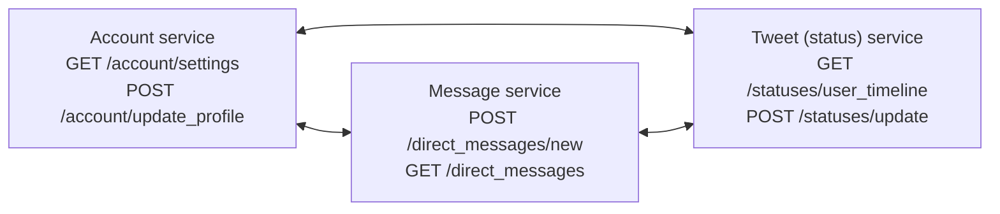
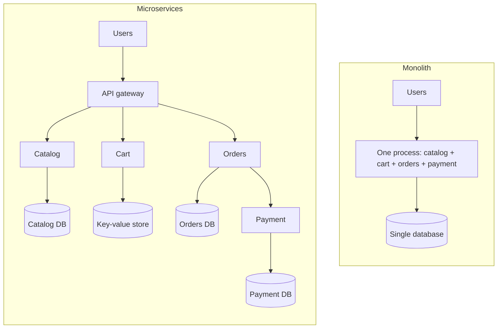
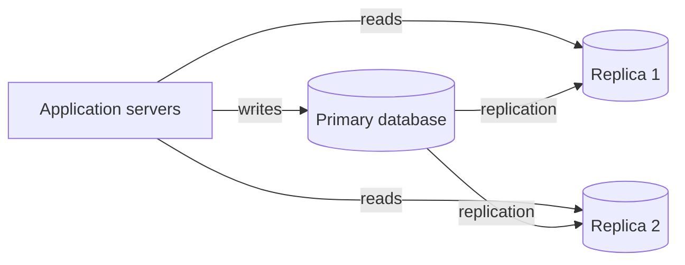
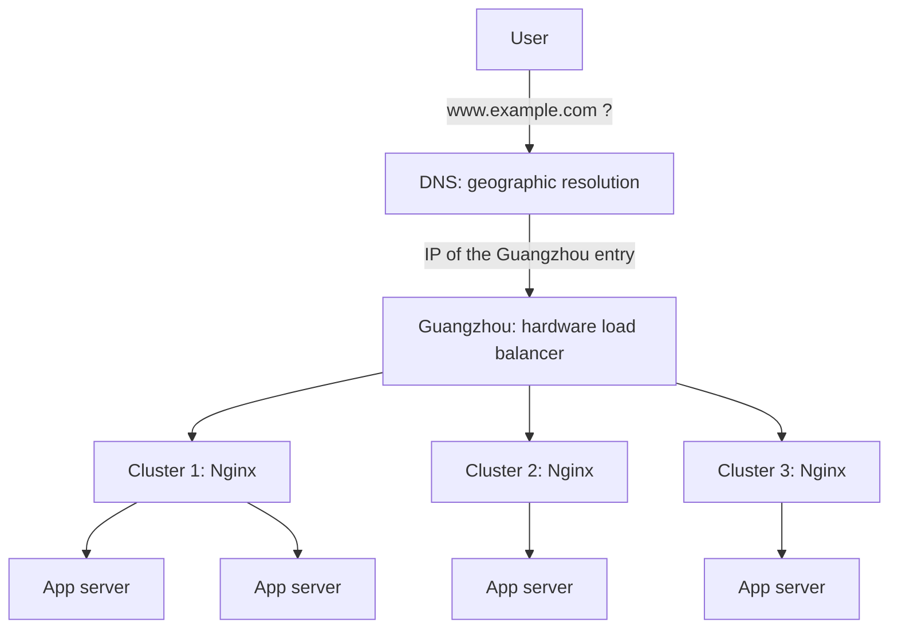
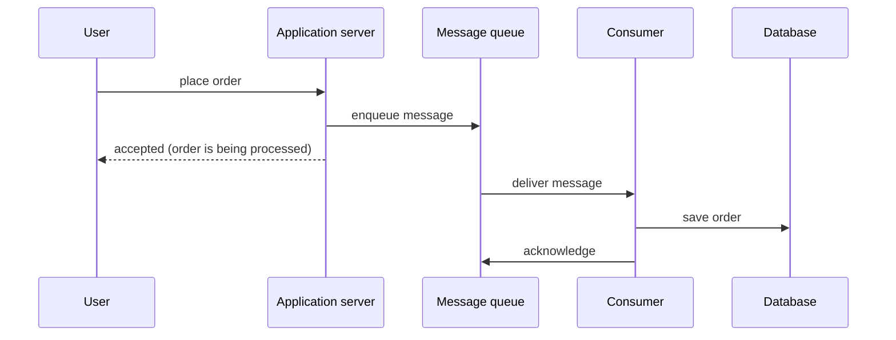
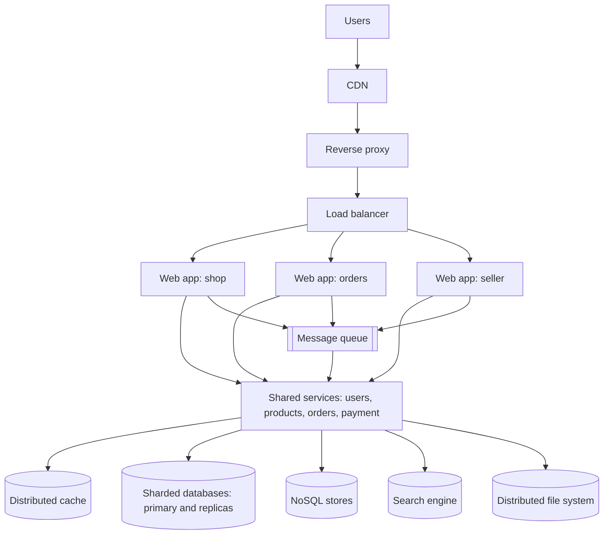
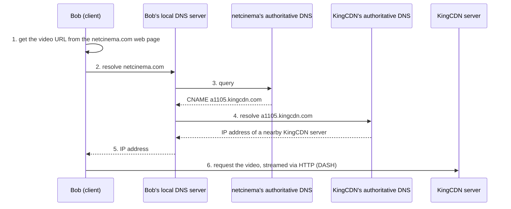

The styles of the previous chapter ([4.14.5](/4.14.5)) were described without regard to where components run. Internet services run on many machines, connected by a network that is slow compared with memory, that loses messages and that partitions; they serve millions of users whose number can grow tenfold in a month; and they must stay up while they are changed every day. This chapter treats the architectures that have evolved under these constraints. It begins with the two basic distributed styles, client–server and peer-to-peer (6.1), the cloud platforms on which most services now run (6.2), and the service-based architectures built on them: service-oriented architecture and microservices (6.3), together with their two main connectors, REST and RPC (6.4). It then collects the architectural patterns large websites use to reach the quality attributes of [4.14.5](/4.14.5): high performance (6.5), high availability (6.6) and scalability (6.7). Three case studies show the patterns combined (6.8). The details of HTTP APIs, authentication and web security follow in [4.14.7](/4.14.7); the operation of such systems in production is the subject of [4.14.13](/4.14.13). Many of the data-management techniques used here (indexes, partitioning, transactions, distributed databases) are treated from the database side in [4.13](/4.13).

## 6.1. Client–Server and Peer-to-Peer

### 6.1.1. Client–Server

**Definition 6.1.1 (Client–Server Architecture)** In a **client–server architecture**, *servers* are stand-alone components that provide specific services (printing, data management, web pages, computation), and *clients* are components that call on these services by sending requests; the connector is the network, through which clients access remote servers. A server responds to the requests of many clients.

The style captures the reusable behavior of specialized servers and clients without specifying how either is implemented. It suits applications with distributed data and processing across a range of components; file servers, database servers, mail servers and web servers are examples. A server is always on and has a permanent, known address; clients may come and go, may have changing addresses and do not communicate with each other directly.

When the server side itself becomes complex, it is divided into tiers: in the common *three-tier architecture*, a presentation tier (the browser or mobile app), an application tier (the business logic) and a data tier (the database) run on separate machines and can be scaled and replaced independently. This is the layered style of [4.14.5](/4.14.5) distributed over a network.

### 6.1.2. Peer-to-Peer

**Definition 6.1.2 (Peer-to-Peer Architecture)** In a **peer-to-peer** (P2P) architecture there is no always-on server: arbitrary end systems (peers) communicate directly, each requesting services from other peers and providing services to other peers in return.

Peer-to-peer design makes every entity act as both client and server. Its main advantage is *self-scalability*: each new peer brings new service demand but also new service capacity. Its difficulties follow from the same design: peers are intermittently connected and change their IP addresses, so the system must cope with constant churn, and management, security and the quality of service are hard to control because no one owns the infrastructure.

**Example 6.1.1 (File Distribution Time)** How long does it take to distribute a file of size $F$ from one server to $N$ peers? Let $u_s$ be the upload rate of the server, $u_i$ and $d_i$ the upload and download rates of peer $i$, and $d_{\min} = \min_i d_i$; assume the network core has abundant bandwidth, so only the access links limit the rates (Kurose and Ross, *Computer Networking*, ch. 2).

In the client–server approach, the server must upload $N$ copies, which takes at least $NF/u_s$; and the slowest client needs at least $F/d_{\min}$ to download its copy. Hence

$$
D_{\mathrm{cs}} \ge \max\left\{ \frac{NF}{u_s},\ \frac{F}{d_{\min}} \right\},
$$
which, for large $N$, increases linearly in $N$.

In the P2P approach, the server must upload at least one copy ($F/u_s$); the slowest peer still needs $F/d_{\min}$; and in total $NF$ bits must be downloaded, while the total upload rate of the system is at most $u_s + \sum_{i=1}^N u_i$. Hence

$$
D_{\mathrm{P2P}} \ge \max\left\{ \frac{F}{u_s},\ \frac{F}{d_{\min}},\ \frac{NF}{u_s + \sum_{i=1}^{N} u_i} \right\}.
$$
The last term also grows with $N$, but so does its denominator, since each peer brings upload capacity. Both bounds can be achieved with a suitable schedule, so they are the minimum distribution times. With all peers uploading at rate $u$, $F/u = 1$ hour, $u_s = 10u$ and $d_{\min} \ge u_s$, the client–server time is $N/10$ hours, while the P2P time is $\max\{0.1, N/(10+N)\}$ hours, which never exceeds one hour however many peers there are: for $N = 30$ it is 0.75 hours against 3 hours, and for $N = 1000$ about 0.99 hours against 100 hours.


### 6.1.3. Peer-to-Peer Systems

| System | Year | Idea | Remarks |
|---|---|---|---|
| Napster | 1999 | a central index server lists which peer has which song; files are transferred directly between peers | created by Shawn Fanning as a freshman at Northeastern University; sued by the RIAA for contributory copyright infringement in 2000 and shut down in July 2001 |
| BitTorrent | 2001 | a file is split into chunks; peers exchanging chunks of one file form a *torrent*, and a *tracker* (or a distributed hash table) tracks the peers in it | designed by Bram Cohen; peers download the rarest chunks first and upload preferentially to peers that upload to them ("tit-for-tat"); still one of the most common protocols for large files |
| Bitcoin | 2009 | a peer-to-peer payment system: transactions between users are verified by network nodes and recorded in a public distributed ledger, the *blockchain* | no intermediary; consensus by proof of work |
| Dragonfly | 2017 | peer-to-peer distribution of container images and other large files inside a data center: hosts that already have pieces of an image serve them to other hosts | developed at Alibaba, a graduated CNCF project since 2025; also used to distribute AI model weights; a scheduler coordinates the peers, so it is not purely P2P |

The BitTorrent protocol itself is perfectly legal; legal problems stem from using it to distribute copyrighted material. The examples also show that the line between the styles is blurred: Napster's index and Dragonfly's scheduler are central servers in an otherwise peer-to-peer system. Skype, which began in 2003 as a P2P telephony system, moved its infrastructure to Microsoft's data centers after 2011, because mobile devices make poor peers (limited battery and bandwidth, intermittent connections); Microsoft retired the service in May 2025.

## 6.2. Cloud Computing

### 6.2.1. Software as a Service

Web search, e-mail, maps, online documents and music streaming have something in common with smart speakers, smart thermostats and streaming boxes: the device is only a client, and the service runs in the cloud.

**Definition 6.2.1 (Software as a Service)** **Software as a service** (SaaS) delivers software and its data as a service over the Internet, usually through a thin client such as a web browser or a mobile app, instead of as a product that customers install and run on their own machines.

SaaS has three advantages over shrink-wrapped software:

1. Data is stored safely in the cloud: losing a device does not mean losing data, and groups can easily share and collaborate.
2. There is one copy of the software, in a single hardware and operating-system environment: developers and users have no compatibility hassles, upgrading means deploying to the cloud, and a new feature can be tried on 1% of users first.
3. Continuous customer feedback is possible, and the developers can respond by rolling out changes quickly: the service is in "forever beta". This matches agile development ([4.14.2](/4.14.2)) well, and frameworks and cloud tools have removed many obstacles to practicing it, which levels the field for small teams.

In return, SaaS places three demands on the infrastructure: communication (users everywhere must reach the service), scalability and elasticity (capacity must follow demand, which can grow or shrink quickly), and dependability ("24 × 7" service, since there is no maintenance window when users are worldwide).

### 6.2.2. Warehouse-Scale Computers and Utility Computing

The infrastructure that meets these demands is the warehouse-scale computer: clusters of (mostly) commodity computers connected by (mostly) commodity Ethernet switches. Compared with conventional large servers they are more scalable and much cheaper per unit of computation; they reach dependability through extensive redundancy rather than through reliable hardware; and few operators can run thousands of servers, thanks to careful selection of identical hardware and software and to automation with **virtual machines** and containers, orchestrated by systems such as Kubernetes ([4.11.9](/4.11.9)).

Driven by the demand for SaaS, clusters grew from about 1,000 to 100,000 servers and more, and economies of scale lowered the cost per server of the largest data centers by factors of 3 to 8. Traditional data centers, however, were only 10–20% utilized. The idea of cloud computing was to sell the spare capacity: offer pay-as-you-go use of as many computers as a customer needs, at less than the customer's own cost.

**Definition 6.2.2 (Cloud Computing)** **Cloud computing** is a model for enabling ubiquitous, convenient, on-demand network access to a shared pool of configurable computing resources (networks, servers, storage, applications and services) that can be rapidly provisioned and released with minimal management effort or interaction with the service provider (NIST SP 800-145, 2011).

Computing, storage and communication are bought by the hour or second: 1,000 computers for 1 hour cost the same as 1 computer for 1,000 hours, from well under one cent per hour for the smallest virtual machines. The main public clouds are Amazon Web Services, Microsoft Azure, Google Cloud, and in China Alibaba Cloud, Tencent Cloud and Huawei Cloud. Infrastructure managed by dedicated experts can lower the total cost of ownership, and capacity can be scaled up and down within minutes (*elasticity*). A famous success story is Zynga's FarmVille on AWS (2009), which reached 1 million users in 4 days, 10 million in 2 months and 75 million in 9 months, when the largest earlier online game had about 5 million.

| Service model | The provider manages | The customer manages | Examples |
|---|---|---|---|
| infrastructure as a service (IaaS) | hardware, network, virtualization | operating system, runtime, application, data | virtual machines (Amazon EC2), block storage |
| platform as a service (PaaS) | also the operating system and runtime | application and data | managed databases, application platforms, Kubernetes services |
| serverless (function as a service) | also scaling and servers per request | functions and data | AWS Lambda, Cloudflare Workers |
| software as a service (SaaS) | everything | data and configuration | e-mail, office suites, CRM |

Inexpensive warehouse-size clusters give the potential of unlimited scalability, but scalability must also be designed into the software. The rest of this chapter is about how.

## 6.3. Service-Oriented Architecture and Microservices

### 6.3.1. Service-Oriented Architecture

**Definition 6.3.1 (Service-Oriented Architecture)** A **service-oriented architecture** (SOA) is a client–server design approach in which an application consists of software services and software service consumers (clients or service requesters). It differs from the general client–server model in its emphasis on loose coupling between components and on separately standing interfaces: services are independent and composable, and can be combined as black boxes (after Gartner, 1996).

A later Gartner description sharpened the point: SOA "starts with an interface definition and builds the entire application topology as a topology of interfaces, interface implementations and interface calls"; it would be better named "interface-oriented" architecture. The classic illustration is an early Twitter-like design of three services that call each other only through their published HTTP interfaces:



| Benefits | Costs |
|---|---|
| reusable: existing services can be combined, each implemented in its own language and framework, the implementation hidden behind its API | performance: each call goes through the network stack and layers of APIs; state is split across services |
| easier testing: each service does one thing, and testing one thing in isolation is easier; developers can use the best tool for each service | dependability: partial failure is possible, since services fail independently, so the system is not simply "working" or "not working", and integration and system tests become harder |
| agile-friendly: small teams develop services, which are then combined | development work: each service needs its own interface instead of one interface for the whole application |
| the same team develops, tests and operates its service, so customer feedback cycles are short | operations: developers must understand operations to manage the functionality and performance of their service ("you build it, you run it") |

### 6.3.2. Component and Connector Patterns

Distributed architectures evolved from client–server (multi-tier) systems, through distributed objects and middleware, to broker-based architectures, SOA, event-driven architectures and microservices. Each step introduced component and connector patterns that are still in use:

| Component patterns | Connector patterns |
|---|---|
| distributed process | remote procedure call (RPC) |
| distributed object (CORBA, Java RMI) | stub and skeleton of distributed objects |
| service | middleware, broker |
| microservice | REST over HTTP |
| function (serverless) | messaging and event streams |

The ultimate goal of this evolution has been to deliver better software faster.

### 6.3.3. Microservices

**Definition 6.3.2 (Microservice Architecture)** The **microservice architecture** is an approach to developing a single application as a suite of small services, each running in its own process and communicating with lightweight mechanisms, often an HTTP resource API. The services are built around business capabilities and are independently deployable by fully automated deployment machinery (James Lewis and Martin Fowler, 2014).

The contrast is with the *monolith*, which puts all its functionality into a single process and scales by replicating the whole application on multiple servers. A microservice architecture puts each element of functionality into a separate service and scales by distributing these services across servers, replicating each as needed. The same contrast applies to data: a monolith typically uses a single database, while each microservice manages its own.



Microservices are a means to an end: enabling continuous delivery and deployment. Lewis and Fowler list their characteristics:

- Componentization via services: services are the building blocks, used through published interfaces, and can be replaced and upgraded independently.
- Organized around business capabilities: each team owns a capability end to end (user interface, logic, data) rather than one technical layer.
- Products, not projects: the development team takes full responsibility for the software in production.
- Smart endpoints and dumb pipes: the logic lives in the services; the connectors only carry messages (HTTP, a lightweight message bus), unlike the "smart" enterprise service bus of classical SOA.
- Decentralized governance: each team chooses the languages and tools that suit its service.
- Decentralized data management: each service manages its own database, either different instances of the same database technology or entirely different systems, an approach called *polyglot persistence*.
- Design for failure: since any service can fail, callers must tolerate it (timeouts, retries, circuit breakers, fallbacks), and teams set up sophisticated monitoring and logging for each service, with dashboards of up/down status and operational and business metrics.
- Evolutionary design: service decomposition is a tool for controlling change in an application without slowing it down.

Industrial systems are large: WeChat reported more than 3,000 services on over 20,000 machines (Zhou et al., 2018), and Netflix reported several hundred microservices handling billions of API requests a day already by the mid-2010s. Jamshidi et al. (2018) describe four generations of microservice infrastructure, each moving more of the common concerns out of the services' code:

| Generation | What is added | Concerns moved out of the service |
|---|---|---|
| container orchestration | services in containers, scheduled by an orchestrator (Kubernetes) | deployment, placement, restart |
| service discovery and fault tolerance | registry and client libraries (Netflix Eureka, Hystrix) | finding instances, timeouts, circuit breaking |
| sidecar and service mesh | a proxy next to every service (Envoy, Istio, Linkerd) | traffic management, encryption, retries, telemetry |
| serverless | functions as a service | servers, scaling, even the long-running process |

The price is the complexity of a distributed system. Every call can fail or be slow, data consistency across services needs explicit protocols, testing and debugging span many processes, and operations need mature automation. A common recommendation is therefore to start with a well-modularized monolith and split off services only where independent deployment or scaling pays for that complexity.

SOA and microservices overlap: both build applications from services, but classical SOA, typically used to integrate enterprise systems, relies on a heavyweight enterprise service bus (ESB), whereas microservices are finer-grained and communicate through lightweight protocols.

| Aspect | SOA | Microservices |
|---|---|---|
| service granularity | coarse | fine |
| communication | heavyweight: ESB, SOAP, WS-* standards | lightweight: HTTP and REST, gRPC, message brokers |
| delivery of a service | slow, centrally coordinated | fast, independent per team |
| typical setting | enterprise integration | Internet services |

## 6.4. REST and RPC

### 6.4.1. REST

How should services talk to each other over the Web? The 2000s saw many proposals: SOAP, WSDL and UDDI, XML-RPC, CORBA. The Internet evolves by developer consensus, and the winner was the one that was easy for developers to understand and use, made common cases easy and rare ones possible, required no burdensome license, and matched the design of the Web itself: REST.

**Definition 6.4.1 (REST)** **Representational state transfer** (REST) is an architectural style for distributed hypermedia systems, defined by Roy Fielding (2000) as a set of constraints: client–server separation; stateless interaction; cacheable responses; a uniform interface (resources identified by URIs, manipulated through representations, self-descriptive messages, and hypermedia links that drive the application's state); a layered system of intermediaries; and, optionally, code on demand. A service whose operations follow these constraints is called **RESTful**.

The central idea is that everything is a resource. A route names not a page or an action but a *resource* together with an *operation* on it. Designing a RESTful API thus means answering three questions for each operation: what is the primary resource affected; what operation is to be done, and what are its possible results and side effects; and what other data the operation needs, and how it is specified. A resource may have several *representations*, hence the name: JSON (rarely XML) for programmatic access, and HTML for human users. Responses may include hyperlinks to related resources.

The basic operations on a resource are create, read, update, delete and list (CRUD, or CRUDI with "index"), mapped onto the HTTP methods:

| Action | Meaning | HTTP method and route |
|---|---|---|
| create | create a new resource instance | `POST /movies` |
| read | retrieve one resource instance | `GET /movies/253` |
| update | modify an existing instance: replace it entirely or change some fields | `PUT /movies/253` or `PATCH /movies/253` |
| delete | destroy an instance | `DELETE /movies/253` |
| index (list) | enumerate a collection, possibly filtered | `GET /movies`, `GET /movies?title=hidden+figures` |

The argument identifying the primary resource usually appears in the path (`/movies/253`); query parameters customize an operation on a collection. The response may consist of headers without a body (`204 No Content` after a delete) or include a JSON representation of the new or updated resource:

```text
GET /movies?title=hidden+figures HTTP/1.1
Host: api.example.com
Accept: application/json

HTTP/1.1 200 OK
Content-Type: application/json
Cache-Control: max-age=60

{"movies": [{"id": 253, "title": "Hidden Figures", "year": 2016,
             "links": {"self": "/movies/253", "reviews": "/movies/253/reviews"}}]}
```

What about "add a movie to my watch list"? When an operation seems awkward to express in terms of resources, ask whether another resource type is waiting to be defined, and what relationship it has to the existing ones. Here it is the watch-list entry: `POST /users/42/watchlist` with body `{"movie_id": 253}` creates one, and `DELETE /users/42/watchlist/253` removes it. Often this results in a simpler design: a new resource, but only CRUD operations on it.

Three of Fielding's constraints have direct engineering consequences.

- Stateless: each request contains all the data needed to process it (credentials such as an access token, identifiers, parameters); the server keeps no session state between requests. Requests can then be handled by any server behind a load balancer, which makes the service easy to scale, and a request does not depend on an earlier one that might have failed. Statelessness concerns the state of the interaction: the resources themselves (the movies, the watch lists) are of course stored on the server.
- Cacheable: since statelessness can increase the number and size of requests, responses must label themselves as cacheable or not (`Cache-Control`, `ETag`). Caching then happens in the client, in intermediaries such as content delivery networks and reverse proxies, or both, which reduces the number of interactions with the API and the latency users see.
- Uniform interface: the interface provides an unchanging, standardized means of communication between client and server (URIs, HTTP methods, standard media types such as JSON). The API is decoupled from the technology stack and the internal service layers, so the implementation can change without affecting clients.

A stable interface is also why API design needs a long-term view. Versioning an API (`/v2/movies`) should be a last resort, for when the existing API can no longer meet the needs: every version must be supported and maintained in parallel and confuses users. Compatible evolution (adding optional fields and new resources, never changing the meaning of existing ones) is preferred. REST "won" because it is simple and matches the engineering constraints of how the Web evolved, such as stateless HTTP. The concrete conventions of HTTP APIs (status codes, error formats, pagination, authentication) are treated in [4.14.7](/4.14.7).

### 6.4.2. RPC

**Definition 6.4.2 (Remote Procedure Call)** A **remote procedure call** (RPC) lets a program call a procedure in another address space, usually on another machine, with the syntax of a local call. A client stub, generated from an interface definition, marshals the arguments into a message and sends it; a server stub (skeleton) unmarshals them, calls the procedure and returns the result the same way.

RPC is the main connector inside the data centers of large companies: Google reports tens of billions of RPCs per second through its internal system Stubby, whose open-source successor is gRPC. In gRPC, the interface is written in the Protocol Buffers language and compiled into stubs for many programming languages; messages are encoded in a compact binary format and carried over HTTP/2:

```text
syntax = "proto3";

package catalog.v1;

service MovieCatalog {
  rpc GetMovie(GetMovieRequest) returns (Movie);
  rpc ListMovies(ListMoviesRequest) returns (stream Movie);
}

message GetMovieRequest { int64 id = 1; }
message ListMoviesRequest { string title_contains = 1; }
message Movie {
  int64 id = 1;
  string title = 2;
  int32 year = 3;
}
```

| | RPC (gRPC, JSON-RPC, Thrift) | REST |
|---|---|---|
| abstraction | procedures: the client must know their names, parameters and order | resources with a uniform set of operations |
| tooling | needs a library and generated stubs | needs only an HTTP client |
| routes | one method per action (in gRPC, `POST /catalog.v1.MovieCatalog/GetMovie`) | one URI per resource, several methods on it |
| HTTP use | typically only POST (JSON-RPC also GET) | the HTTP methods carry the meaning |
| format | tied to the RPC system (Protocol Buffers, JSON-RPC envelopes) | any content type, mostly JSON |
| contract and documentation | the interface definition is the contract; strongly typed | separate documentation (OpenAPI), possibly hypermedia |
| efficiency | higher: binary encoding, persistent multiplexed connections, streaming | lower, but cacheable by standard HTTP infrastructure |
| typical use | internal service-to-service calls | public APIs, browser clients |

Both are usually stateless. The choice is not exclusive: many systems offer a REST (or GraphQL) API to browsers and third parties and use gRPC between their internal services.

## 6.5. Patterns for High Performance

### 6.5.1. Measuring Performance

Performance can be seen from three perspectives, each with its own measures and means of optimization:

| Perspective | What is measured | Means of optimization |
|---|---|---|
| user | response speed felt in the browser: communication time between the user's computer and the server, server processing time, time for the browser to construct requests and render responses | front-end architecture, page structure, concurrent and asynchronous loading, browser caching, CDNs, reverse proxies |
| developer | the application and its subsystems: latency, throughput, concurrency, stability | caching, clusters, asynchronous message queues, code optimization |
| operator | infrastructure performance and utilization: network bandwidth, server hardware, data center network, resource utilization | backbone networks, customized servers, virtualization |

Designing for performance requires a feeling for the cost of basic operations. Typical orders of magnitude on current hardware (after Jeff Dean's well-known table, updated):

| Operation | Typical time |
|---|---|
| read 1 MB sequentially from memory | 10–50 µs |
| send 2 KB over a 10 Gbit/s network link | about 2 µs (about 20 µs at 1 Gbit/s) |
| round trip within a data center | about 0.5 ms |
| read one value from a remote cache such as Redis | about 0.5 ms (dominated by the round trip) |
| read 1 MB sequentially from an NVMe SSD | 0.1–0.3 ms |
| one seek of a magnetic disk | 4–10 ms |
| read 1 MB sequentially from a magnetic disk | about 5 ms |
| a database query on an indexed table | about 1–10 ms |
| a round trip between continents | 100–200 ms |
| loading a web page | 1–3 s |

**Definition 6.5.1 (Throughput and Concurrency)** The **throughput** of a system is the number of requests it processes per unit of time, measured as transactions per second (TPS), HTTP requests per second, queries per second (QPS), pages per second or business transactions per hour. Its **concurrency** is the number of requests it is handling at the same time.

Concurrency must be distinguished from the number of users: registered users far outnumber online users, who far outnumber users with a request in progress at a given moment. Throughput, concurrency and response time are linked by Little's law: in a stable system, the average number of requests in the system equals the arrival rate times the average time a request spends in the system, $L = \lambda W$. A service handling $\lambda = 2000$ requests per second with an average response time of $W = 50$ ms has on average $L = 2000 \times 0.05 = 100$ requests in progress, so it needs at least 100 concurrent workers (threads, connections, coroutines); if the response time doubles under load, so does the required concurrency. Besides these measures, operators watch *performance counters* of servers and operating systems: the system load (the number of processes running or waiting to run on the CPU), the numbers of objects and threads, memory and CPU usage, and disk and network I/O.

### 6.5.2. Read/Write Splitting

The database is usually the first bottleneck, and in most web applications reads far outnumber writes. *Read/write splitting* distributes the two kinds of operations over different database nodes:



The database servers form a cluster with one primary node and several replica nodes (in older terminology "master" and "slave"). The primary handles all writes and replicates the changes to the replicas, usually asynchronously; the replicas handle reads. The main complication is *replication lag*: a user who has just updated a profile may read it from a replica that has not received the update yet. Common remedies are to send reads that follow a write (or all reads of critical data) to the primary for a short time, to read one's own writes from the primary, or to wait for a replica that has caught up.

The routing of statements to nodes can be implemented in two ways:

| Approach | How | Examples | Trade-off |
|---|---|---|---|
| program code | a data-access library inside the application decides where each statement goes | Taobao's TDDL, Apache ShardingSphere-JDBC, routing in ORMs (Django database routers) | simple and fast, but every language needs its own library |
| middleware | an independent proxy speaks the database protocol and routes statements; applications see a single database | ProxySQL, MySQL Router, Vitess, Apache ShardingSphere-Proxy (Qihoo 360's Atlas was an early one, no longer maintained) | transparent to applications and languages, but an extra hop and a component that must itself be highly available |

### 6.5.3. Sharding

Read/write splitting relieves reads, but all writes and all data still go to one primary. The next step divides the data itself. Dividing a database by business module is called vertical partitioning of the database: users, products and orders go to separate database servers. As a rough guide, one database server supports a business with about a hundred thousand users; splitting by business supports millions or tens of millions. The cost is that operations become more complex (no joins or transactions across databases), the amount of code grows, and so does the cost.

Even the data of one business can exceed a single server, as the user table of a site with hundreds of millions of users does. Tables are then split themselves:

- *Vertical table splitting* moves rarely used columns that take a lot of space (a long description, a profile photo) into a separate table; the price is that some queries need two lookups.
- *Horizontal table splitting* divides the rows of a very large table (tens of millions of rows and more) into several tables with the same schema, possibly on different servers.

**Definition 6.5.2 (Sharding)** **Sharding** is the horizontal partitioning of the rows of a table across several database servers; each part, a **shard**, holds the rows whose *shard key* is mapped to it by a routing rule.

| Routing | Rule | Advantage | Disadvantage |
|---|---|---|---|
| range | consecutive ranges of the key (user IDs 1–10 million on shard 1, …) | easy to add shards as data grows; range queries stay on few shards | uneven load: the newest range is often the busiest |
| hash | $\text{shard} = h(\text{key}) \bmod n$ with a **hash function** $h$ | even distribution | changing $n$ moves most rows (consistent hashing reduces this); range queries touch every shard |
| configuration (directory) | a lookup table maps each key or key range to a shard | full flexibility, shards can be rebalanced individually | the lookup table is an extra component and a potential bottleneck |

Sharding brings the problems of a distributed database into the application: joins and aggregations across shards, transactions spanning shards, globally unique IDs (the auto-increment counter of one server no longer suffices, hence schemes such as Snowflake IDs or UUIDs), and re-sharding when the data grows. This is why distributed SQL databases (below) that shard automatically have become attractive.

### 6.5.4. NoSQL and NewSQL

Relational databases are not the right tool for every kind of data. The non-relational systems known as NoSQL ("not only SQL") each address one limitation of the relational model; they complement relational databases rather than replace them:

| Kind | Problem of relational databases it addresses | Representatives |
|---|---|---|
| key–value store | storing data structures (lists, sets, counters) with very fast access by key | Redis, Valkey |
| document database | the rigid schema: documents (in JSON) of varying structure | MongoDB |
| wide-column and column-oriented stores | I/O in big-data scenarios: scans over a few columns of very many rows | HBase, Cassandra; ClickHouse for analytics |
| full-text search engine | the poor performance of full-text search | Elasticsearch, OpenSearch |
| graph database | the performance of queries over graphs (paths, neighborhoods) | Neo4j |

Many enterprise systems that handle high-value data, such as financial and order-processing systems, are too large for a conventional single-server relational database, but have transactional and consistency requirements that NoSQL systems cannot meet. NewSQL, or distributed SQL, systems seek to provide the scalability of NoSQL systems for online transaction processing while keeping the ACID guarantees of a traditional database: Google Spanner, CockroachDB, TiDB and OceanBase shard and replicate data automatically and run distributed transactions.

### 6.5.5. Caching

Two kinds of data defeat even a well-designed storage system: data that needs complex computation to produce (a personalized recommendation list, an aggregated ranking), where the storage system cannot help; and data that is read very often and written rarely (a popular product page), where the storage system can help but is wasted. Both belong in a cache. A single Memcached or Redis node serves on the order of $10^5$ simple key–value operations per second, far more than a relational database.

The common pattern is *cache-aside*: the application first looks in the cache; on a miss it reads the database, stores the result in the cache with an expiry time (TTL), and returns it; on a write it updates the database and deletes the cached entry. Large-scale caches must handle three classic problems:

| Problem | What happens | Remedies |
|---|---|---|
| cache penetration | requests for data that does not exist miss the cache every time and all reach the database (often from attackers or bugs) | cache a "not found" marker with a short TTL; reject impossible keys with a Bloom filter in front of the cache |
| cache avalanche | many entries expire at the same moment, or the cache cluster fails, and the whole load suddenly falls on the database | randomize TTLs; let only one request rebuild an entry (a lock) while others wait or get stale data; refresh hot entries in the background; replicate the cache |
| hot keys | a single extremely popular key (a celebrity's post, a flash-sale item) overloads the one cache node that holds it | replicate hot keys across several nodes or under several key names; keep a small local cache in each application server |

Caching appears at every level of a web system: in the browser, in CDNs and reverse proxies (6.8.1), in the application servers, in distributed caches, and in the database's own buffer pool.

### 6.5.6. Load Balancing

**Definition 6.5.3 (Load Balancing)** **Load balancing** distributes incoming requests over a cluster of servers that provide the same service, so that no single server is overloaded, capacity can be increased by adding servers, and the failure of one server does not interrupt the service.

Load balancers work at different levels:

| Kind | Level | Examples | Characteristics |
|---|---|---|---|
| DNS load balancing | name resolution | geographic DNS, global server load balancing | returns different IP addresses to users in different regions; simple and nearly free, and sends users to a nearby data center; but DNS caching makes changes slow to take effect, and control is coarse |
| hardware load balancing | network (layer 4) | F5 BIG-IP, A10 | very high performance (millions of concurrent connections) and rich features; expensive |
| software load balancing | layer 4 or layer 7 | LVS (Linux Virtual Server, layer 4); Nginx, HAProxy, Envoy (layer 7) | cheap and flexible; layer 7 balancers understand HTTP and can route by URL, header or cookie; lower performance than hardware |

Large sites combine the three. DNS sends a user to a region (Beijing, Guangzhou, Shanghai); a hardware load balancer at the region's entrance spreads requests over clusters; and software load balancers in each cluster distribute them to the application servers:



The balancing algorithm decides which server gets the next request:

| Algorithm | Rule | Suitable when |
|---|---|---|
| round robin | servers in turn | servers are identical; the balancer must detect failed or disconnected servers |
| weighted round robin | in turn, proportionally to configured weights | servers differ in capacity |
| least load | the server with the fewest connections, HTTP requests, or the lowest CPU or I/O load | request costs vary; needs sampling of server state |
| best performance | the server with the fastest recent responses | servers or paths differ in speed; needs sampling |
| hash | by a hash of the source address or of a user or session ID | requests of one client must reach the same server (session affinity, local caches) |

### 6.5.7. Message Queues

Without a queue, a request writes its data straight to the database while the user waits; under high concurrency this puts enormous pressure on the database, and response times grow. With a queue, the application server sends the data to a message queue and returns immediately; consumer processes take the messages from the queue and write them to the database asynchronously.



Asynchronous processing also *shaves peaks*: the burst of transactions produced in a short period is stored in the queue and processed at the rate the database can sustain. In an e-commerce promotion, a queue absorbs the flood of orders at the moment the sale starts. The guiding principle is: anything that can be done later should be done later. The price is that the result is no longer immediate, so the user interface must show a pending state, and that messages can be delivered twice or out of order, so consumers must be idempotent (processing the same message twice has the same effect as once). Widely used message systems are Apache Kafka (a replicated, partitioned log, also used for event streaming), RabbitMQ and Apache RocketMQ, and managed cloud queues.

## 6.6. Patterns for High Availability

Failures are inevitable in a system of thousands of machines, so high availability must be designed in. The basic method is redundancy ([4.14.5](/4.14.5)); in a distributed system, redundancy of data raises the question of consistency.

### 6.6.1. The CAP Theorem

**Theorem 6.6.1 (CAP Theorem)** A distributed data store that is subject to network partitions cannot simultaneously guarantee both of the following for every read and write:

- consistency: every read receives the most recent write or an error;
- availability: every request to a non-failing node receives a non-error response, without the guarantee that it contains the most recent write;

given partition tolerance: the system continues to operate despite an arbitrary number of messages being dropped or delayed by the network between nodes. (Conjectured by Eric Brewer in 2000, proved by Gilbert and Lynch in 2002.)

The theorem is often stated as "pick two of three", but partitions are not optional in a real network. The real choice is what to do *during* a partition. Suppose nodes $N_1$ and $N_2$ each hold a copy of value $x$, the link between them fails, and a client writes $x$ on $N_1$ and then reads it from $N_2$. A CP system makes $N_2$ return an error (or refuse writes on the minority side), sacrificing availability; an AP system lets $N_2$ answer with the old value, sacrificing consistency, and reconciles the copies after the partition heals. Banking ledgers, inventory counts and configuration stores (ZooKeeper, etcd) choose CP; shopping carts, social feeds and DNS choose AP, often with **eventual consistency**. When there is no partition, a system still trades latency against consistency, since keeping replicas synchronized takes round trips (Abadi's PACELC formulation).

### 6.6.2. Analyzing Failures

A practical method for checking an architecture's availability is a failure mode and effects analysis (FMEA). Start from the initial architecture diagram; assume that one component fails, in each of its failure modes (crash, slowness, wrong output, network loss); analyze the effect on the system's functions (which features fail, how many users are affected, whether data is lost, whether the failure can be detected); and decide from the results whether the architecture must be improved, for example by adding a replica or a fallback. Repeating this for every component reveals the *single points of failure*: components whose failure alone stops the service.

### 6.6.3. Highly Available Storage

Storage is the hardest part to make highly available, because data must be copied and the copies kept consistent. With two machines, three questions arise: how to replicate, how to deal with replication lag, and what to do when replication is interrupted.

| Scheme | How it works | Suitable for |
|---|---|---|
| primary–backup | clients read and write only the primary; the backup only receives replicated data, and is switched in manually when the primary fails. A *cold standby* is started only after the failure; a *warm standby* runs and receives data continuously | data that changes rarely, with few users and low frequency of use: student, employee or leave management systems, internal back-office systems; not online business |
| primary–replica | the primary handles writes, replicas also serve reads (6.5.2); switching is still manual in the basic form | read-heavy businesses (1:10 to 1:100 write–read ratio): forums, news sites |
| multi-primary | both machines accept reads and writes and replicate to each other | temporary data that may be lost or overwritten, such as forum drafts, since concurrent writes on both sides conflict |

Automatic failover from a primary to a standby requires two decisions. *State judgment*: how the state of the primary is detected (the channel and content of the status messages). *Switching decision*: when to switch, how (and whether to switch back), and how automatically. Three designs exist for detecting the state:

| Design | How the state is judged | Weakness |
|---|---|---|
| interconnected | primary and standby exchange heartbeats over a direct channel | if only the channel fails, both may believe they are primary ("split brain") |
| mediated | both report to an intermediary that decides (often a ZooKeeper or etcd cluster) | the intermediary must itself be highly available |
| simulated | the standby acts like a client, sending reads and writes to the primary and judging its health from the responses | the standby sees less information than a real status channel |

Open-source coordination services such as ZooKeeper and etcd serve as the mediator: they resolve disagreements between replicas about the state of the primary and decide which node becomes the new primary after a failure, using consensus protocols (ZAB for ZooKeeper, Raft for etcd). Such a cluster is small, typically 3 or 5 machines (an odd number, so that a majority exists), and holds little data.

When data no longer fits one machine, the cluster stores it in two ways. In a *centralized data cluster* one primary holds the master copy and several replicas follow it. In a *distributed data cluster*, data is divided into partitions spread over many servers, each partition replicated on several of them; this scales well to hundreds or thousands of servers and huge data volumes. Some node must assign partitions to servers: a dedicated server, like the NameNode of the Hadoop distributed file system, which manages the placement of all blocks; or an elected node, like the master node of an Elasticsearch cluster, which handles lightweight cluster-wide actions such as creating or deleting an index, tracking which nodes belong to the cluster and deciding which shards to allocate to which nodes.

Partitioning can also guard against geographic disasters: the data is divided by a rule into partitions located in different places, each storing part of the data, so that the loss of one site loses only part of it, and the partitions back each other up. Three backup topologies are used: *centralized* (all partitions back up to one central site), *mutual* (each partition backs up to another partition's site) and *independent* (each partition has its own backup site).

### 6.6.4. Highly Available Computation

Computation is easier to make highly available than storage, since a task can simply be rerun elsewhere. The architecture is a cluster with a task dispatcher.

- In a *symmetric cluster* (a load-balancing cluster), all servers have the same role; the dispatcher distributes tasks by a strategy (round robin, random, …) and must detect server state (crashed, disconnected) and task state (stuck, running too long).
- In an *asymmetric cluster*, servers have different roles, such as one leader and several followers. Tasks are classified and assigned to servers by role, and the roles themselves are assigned by *leader election*, using protocols such as ZAB or Raft.

### 6.6.5. Active–Active Across Sites

The highest level of availability is *active–active across sites*: the business runs at several sites at the same time; users get correct service from whichever site they reach, and when one site fails, users are served by the others. The sites can be in different zones of one city (protecting against the loss of a building), in different cities (against a regional disaster) or in different countries (for global users). Active–active designs require grading the business (only the core functions need to be active–active), classifying the data (which data must be synchronized, and how stale it may be), synchronizing data between sites, and handling failures and inconsistencies. Alipay, WeChat and DiDi are examples. Cloud providers offer the building blocks: AWS *Regions* are large, widely separated geographic areas; *Availability Zones* are distinct locations within a region, engineered to be isolated from failures in other zones, and connected to the other zones of the region by inexpensive, low-latency network links. The EC2 commitment of 99.99% quoted in [4.14.5](/4.14.5) applies only to deployments spread across zones.

## 6.7. Patterns for Scalability

### 6.7.1. Scalability and Extensibility

**Definition 6.7.1 (Scalability)** **Scalability** is the ability of a system to accommodate growth, expected or not, in load (more users, more data, more requests) while continuing to deliver the expected quality of service, at a cost that grows roughly in proportion to the load. *Vertical scaling* (scaling up) uses bigger machines; *horizontal scaling* (scaling out) adds more machines.

Scalability is distinct from performance: a fast system may collapse under ten times the load, and a scalable system may be slow for a single user. Two related properties are *openness* (new components can be integrated with existing ones) and support for *heterogeneity* (of hardware, operating systems, networks and programming languages). A second meaning of the same word, *extensibility*, is the ability to give a system new functions and features by modification and extension, to meet new requirements or follow technology trends.

The basic idea behind all designs for extensibility can be summed up in one word: split. A large, unified system is split into smaller parts, so that an extension changes only one part instead of the whole system, which reduces the scope and risk of each change. Three ways of splitting differ in what is split, from large to small: process > service > function.

| Splitting by | Each part is | Resulting architecture |
|---|---|---|
| process | a stage of the business process | layered architecture |
| service | a service the system provides | SOA, microservices |
| function | a single function | microkernel (plug-in) architecture |

Take a student management system. Splitting by process gives four layers: a presentation layer (the pages: login, registration, information management, security settings), a business layer (the logic of login, registration, information management, password change), a data layer (data access: reading and writing the database, writing events to log files) and a storage layer (MySQL, a Memcached cache). Most extensions change only one layer, a few change two adjacent ones, and none change all. Splitting by service gives registration, login, information management and security services; extending one service or adding a new one leaves the others untouched. Splitting by function divides each service further: registration by mobile phone number, ID card or student e-mail; information management into basic information, course information and grade information. The three can be combined: the whole system can consist of microservices, of which the registration service is internally layered and the login service is a microkernel with one plug-in per login method.

### 6.7.2. Layered Architectures

Layered architectures differ in what they divide. Client–server divides the whole business system along the dimension of user interaction: the part that interacts with users becomes one layer, and the back end that supports it another. MVC divides a single subsystem by responsibility into model (data and logic), view (display) and controller (handling user input), with more flexible dependencies between the parts; the web frameworks of [4.14.9](/4.14.9) use variants of it. The Android platform is layered from the Linux kernel through a hardware abstraction layer, the native libraries and Android runtime and the Java API framework, up to the applications.

Three rules keep a layered architecture effective: the differences between layers must be clear and the boundaries obvious, so that anyone can understand the architecture from its diagram; each layer must isolate one concern, its components handling only that layer's logic; and requests pass from layer to adjacent layer, without skipping layers, which keeps the overall complexity low.

### 6.7.3. Microkernel Architecture

**Definition 6.7.2 (Microkernel Architecture)** The **microkernel architecture**, also called **plug-in architecture**, splits a system by function into a minimal core system and independent plug-in modules that add features through interfaces defined by the core. The core provides plug-in management (discovery, loading, lifecycle), communication between plug-ins, and the basic functions common to all of them.

The name comes from the **microkernel** of operating systems ([4.11.1](/4.11.1)), which keeps only the essential mechanisms in the kernel and moves everything else into user-level services. The architecture is typical of applications that users download and extend: web browsers with their extensions, IDEs such as Eclipse and VS Code, Unix-like operating systems with loadable modules, the large mobile apps of e-commerce platforms, and rule systems such as an insurance company's premium calculation, where each insurance product is a plug-in that encapsulates its own rules. Adding a feature means adding a plug-in, without changing the core; the difficulty is to design a core and a plug-in interface general enough for features nobody has imagined yet.

## 6.8. Case Studies

### 6.8.1. The Evolution of a Large E-Commerce Website

Large websites face high concurrency and heavy traffic, high availability requirements, massive data, users spread over the world with complex network conditions, a hostile security environment, and rapidly changing requirements with frequent releases. No large website was designed that way from the start: they grow step by step, adding one technique at a time as the business demands it (Li Zhihui, *Technical Architecture of Large Websites*, 2013). A typical sequence of stages:

| Stage | Change | Problem solved | New bottleneck |
|---|---|---|---|
| 1. initial | application, database and files all on one cheap server (classically Linux, Apache, MySQL, PHP) | getting started at minimal cost | the single server's CPU, memory and disk |
| 2. separate application and data services | application server, database server and file server, each with hardware suited to its role | concurrency and storage capacity improve greatly | database access |
| 3. caching | a local cache in the application server plus a remote distributed cache cluster for hot data | most reads no longer reach the database | one application server can handle only so many connections |
| 4. application server cluster | several application servers behind a load balancer | the application tier is no longer the bottleneck | the database: all writes and the reads that miss the cache (misses, expiry) |
| 5. read/write splitting | primary database for writes, replicas for reads, through a data-access module (6.5.2) | read load is spread | latency for distant users; static content load |
| 6. reverse proxy and CDN | both are caches: a CDN in network providers' data centers near users, a reverse proxy at the front of the site's central data center | users get content from nearby; back-end load falls | the single database and file system reach their limits |
| 7. distributed file systems and databases | data and files spread over clusters; databases first split by business (6.5.3) | storage scales | complex queries, full-text search, unstructured data |
| 8. NoSQL and search engines | non-relational stores and search engines beside the relational database (6.5.4) | each kind of data is stored and searched appropriately | the application itself has become huge and hard to change |
| 9. business splitting | the site is split into separate applications by business line (home page, shop, orders, buyer, seller), communicating through links, message queues and shared data | each business evolves independently | duplicated functions across applications |
| 10. distributed services | common functions (users, products, orders, payment) become shared services called by all applications, through RPC or REST (6.3, 6.4) | reuse; independent deployment and scaling | the complexity of a distributed system, managed by service governance |



The same history yields lessons about values and misconceptions. The core value of large-website architecture is to respond flexibly to what the site needs; the main force driving its technical development is the growth of the business. Common mistakes are to follow the solutions of large companies blindly (their problems are not yours), to adopt technology for its own sake, and to try to solve every problem with technology: some problems are better solved by changing the business process or the product.

### 6.8.2. A Real-Time Data Warehouse

The music streaming service NetEase Cloud Music built a real-time data warehouse whose goal is to collect logs as they are produced, run common extract-transform-load (ETL) processing, global aggregation and window aggregation in real time, and store the results. Stream platforms of this kind share a general architecture of three parts, a pipes-and-filters system at data-center scale ([4.14.5](/4.14.5)):


Logs from clients and web servers are collected into the message queue; the computation engine processes the data in the queue in real time; and the results are stored in a real-time storage system by appending or updating. The requirements on each part follow from the quality attributes. The message queue (typically Apache Kafka) needs high throughput with low latency (hundreds of thousands of messages per second with millisecond latency), high concurrency (thousands of clients reading and writing simultaneously), fault tolerance (replicated data, so that losing a node loses nothing) and scalability (adding nodes without affecting the running business). The computation engine (typically Apache Flink) needs high throughput and low latency, flexible streaming windows, exactly-once semantics for stateful computation, lightweight fault tolerance (periodic checkpoints of the state), support for event time and out-of-order events, and one engine for both stream and batch processing.

### 6.8.3. Video Streaming

Streaming video is the major consumer of Internet bandwidth: Netflix, YouTube and Amazon Prime Video accounted for about 80% of residential ISP traffic in 2020. Two challenges dominate: scale (how to reach about a billion users) and heterogeneity (users differ in capability: wired or mobile, rich or poor in bandwidth). The solution is a distributed, application-level infrastructure.

The bandwidth between server and client varies over time with congestion in the home, the access network, the network core and the video server, and packet loss and delay due to congestion delay playout or reduce quality. Yet playout must keep the original timing: this *continuous playout constraint*, together with variable network delay (jitter), requires a client-side buffer. The client waits for a playout delay, filling the buffer, and then plays at a constant rate while data keeps arriving at a variable rate; the buffer absorbs the variation. Clients also need interactivity (pause, fast-forward, rewind, jumps), and lost packets may have to be retransmitted.

**Definition 6.8.1 (DASH)** In **dynamic adaptive streaming over HTTP** (DASH), the server divides a video into chunks of a few seconds, encodes each chunk at several bit rates, stores the encodings in separate files, replicated in CDN nodes, and publishes a *manifest file* that gives the URLs of the chunks at each rate. The client periodically estimates the bandwidth to the server and, consulting the manifest, requests one chunk at a time, choosing the highest rate sustainable at the current bandwidth; it may choose different rates at different times, and different servers.

The intelligence is at the client: it decides when to request a chunk (so that the buffer neither starves nor overflows), at what encoding rate (higher quality when more bandwidth is available), and from where (a nearby server or one with high available bandwidth). In short, streaming video = encoding + DASH + playout buffering. Because DASH uses plain HTTP, it passes through middleboxes and firewalls and reuses the existing HTTP caching and CDN infrastructure.

How can content chosen from millions of videos be streamed to hundreds of thousands of simultaneous users? A single, large "mega-server" would be a single point of failure and a point of network congestion, with long and possibly congested paths to distant clients: this solution does not scale.

**Definition 6.8.2 (Content Delivery Network)** A **content delivery network** (CDN) stores copies of content at many geographically distributed server sites and directs each user's request to a copy that can serve it well, typically one close to the user.

Two placement philosophies exist. *Enter deep* pushes CDN servers deep into many access networks, close to users (Akamai, with servers in thousands of networks in over 130 countries). *Bring home* builds a smaller number (tens) of large clusters at points of presence near access networks (Limelight). A CDN is "over the top" (OTT): it provides its service on top of the Internet's host-to-host communication, without control over the network in between, and must cope with congestion from the edge by deciding what content to place in which node, and from which node, at which rate, each client should retrieve it.

A common way to direct users to a CDN is DNS redirection. Suppose the page of the video service `netcinema.com` links a video at `http://netcinema.com/6Y7B23V`, stored at the CDN company KingCDN:



Netflix shows how the pieces fit together. Its control plane (registration, accounts, the catalog and recommendations, the selection of a server for each user) runs on Amazon's cloud, as a large microservice system. The video itself is delivered by Netflix's own CDN, Open Connect: Netflix places its own cache servers inside Internet service providers and at exchange points (an "enter deep" design) and fills them with the popular titles during off-peak hours. When a user presses play, the cloud services return a manifest pointing to suitable Open Connect servers, and the client streams the chunks from them by DASH.

## 6.9. Internet Services and AI Agents

The patterns of this chapter carry knowledge that is not visible in any single file: why reads of an account go to the primary, why a consumer must be idempotent, which data may be stale for how long. A **coding agent** ([4.2.14](/4.2.14)) that changes one service sees only that service, and the typical failures it introduces are distributed-systems failures: a new call to another service without a timeout, a retry loop that turns a slow dependency into an outage, a cache that is never invalidated, a database query that bypasses the read/write routing, an API change that breaks clients. Three practices make agent-made changes safe in such systems. Interfaces are written down as machine-checkable contracts (OpenAPI documents, Protocol Buffers definitions) and checked for backward compatibility in continuous integration. Cross-cutting rules (every outbound call has a timeout, every queue consumer is idempotent, every new endpoint is authenticated) are stated in the project instructions and enforced by shared libraries, linters or a service mesh, rather than left to each change. And changes reach production gradually (canary releases, feature flags) with monitoring that can stop them ([4.14.13](/4.14.13)), because the effects of a change on a distributed system often appear only under real load. Agents are also useful on the operational side, for example for summarizing traces and logs during an incident, but decisions about consistency, availability and cost remain architectural decisions made by people.

## Summary

- Client–server systems have always-on servers serving many clients; peer-to-peer systems have no always-on server and are self-scalable: the minimum time to distribute a file grows linearly in $N$ for client–server but stays bounded for P2P.
- Cloud computing sells the capacity of warehouse-scale computers on demand; SaaS gives one copy of the software, continuous deployment and fast feedback, and demands communication, elasticity and dependability.
- SOA builds applications from loosely coupled services with separate interfaces; microservices are small, independently deployable services organized around business capabilities, owning their data and designed for failure, at the price of distributed-system complexity.
- REST models an API as resources with representations and a uniform set of operations, under constraints such as statelessness and cacheability; RPC exposes procedures through generated stubs and is more efficient for internal calls.
- Performance patterns: read/write splitting, sharding by range, hash or directory, NoSQL stores for specific data and NewSQL for scalable transactions, caches (with penetration, avalanche and hot-key problems), load balancing at DNS, layer 4 and layer 7, and message queues for asynchrony and peak shaving. Little's law $L = \lambda W$ links concurrency, throughput and response time.
- Availability patterns: under a network partition a system must choose consistency or availability (CAP); storage is replicated as primary–backup, primary–replica or multi-primary, with failover decided by heartbeats, a mediator such as ZooKeeper, or simulation; compute clusters are symmetric or use leader election; the highest level is active–active across sites.
- Scalability comes from splitting: by process (layers), by service (SOA, microservices) or by function (microkernel, plug-ins).
- Large websites evolve stage by stage, driven by the business; stream processing combines queues, engines and storage; video streaming combines DASH, client buffering and CDNs.
