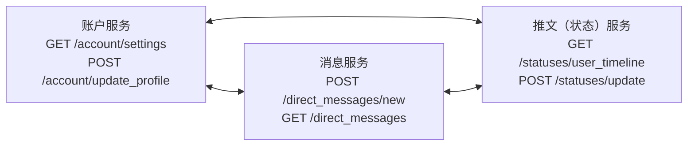
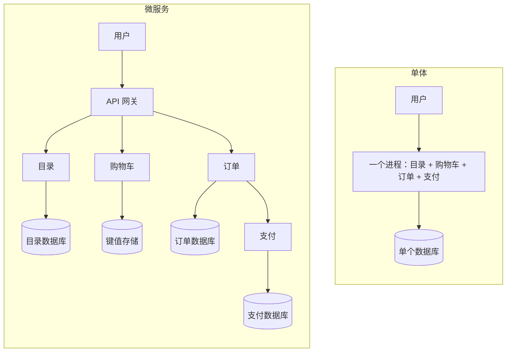
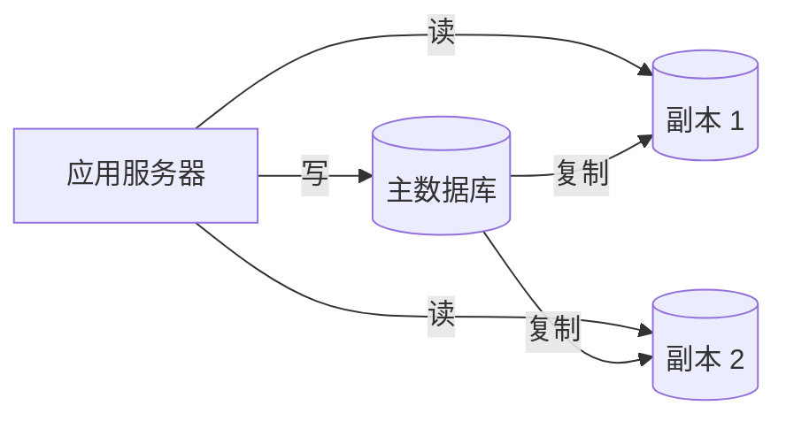
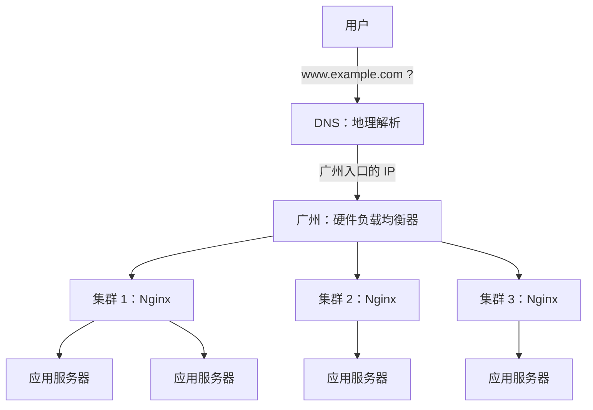
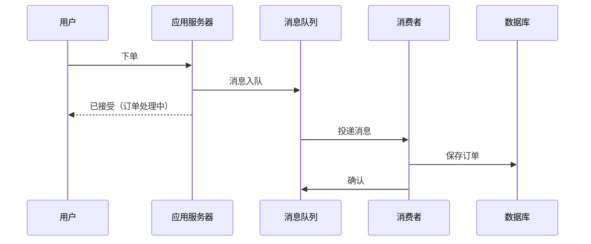
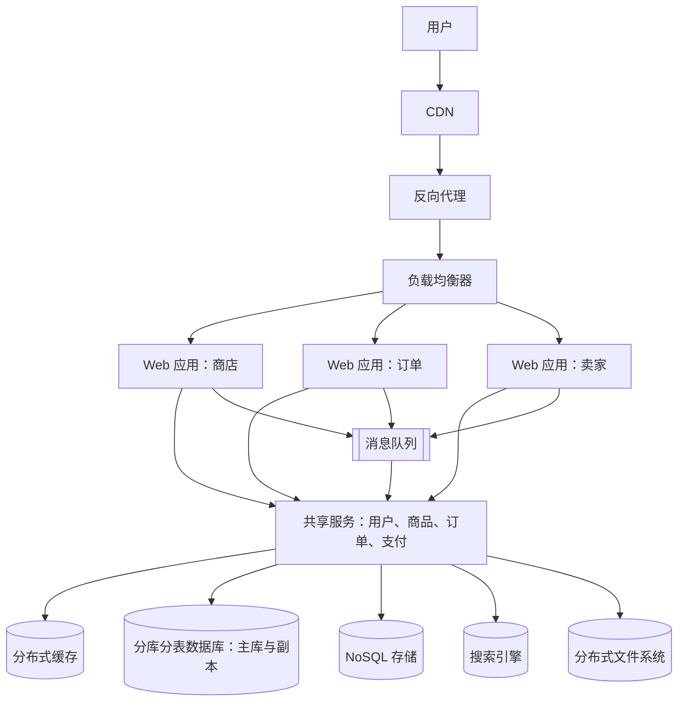
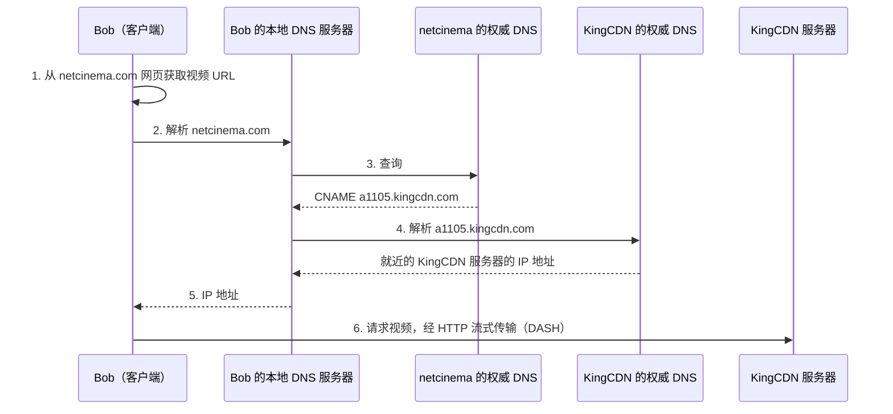

上一章（[4.14.5](/4.14.5)）所讲的各种风格，并不关心**构件**运行在何处。互联网服务运行在许多机器上，这些机器由一种比内存慢得多、会丢消息、还会发生分区的网络连接；它们服务数以百万计的用户，用户数一个月内就可能增长十倍；它们还必须在每天都被修改的同时保持不间断运行。本章讨论在这些约束之下演化出来的架构。先介绍两种基本的分布式风格，即客户端-服务器与对等网络（6.1），然后是如今多数服务所运行的云平台（6.2），以及建立在云平台之上的基于服务的架构：面向服务的架构与微服务（6.3），连同它们的两种主要**连接件**，REST 与 RPC（6.4）。接着汇集大型网站为达到 [4.14.5](/4.14.5) 中的质量属性所用的**架构模式**：高性能（6.5）、高可用（6.6）和可伸缩性（6.7）。三个案例展示这些模式如何组合（6.8）。HTTP API、认证与 Web 安全的细节见 [4.14.7](/4.14.7)；这类系统在生产环境中的运行则是 [4.14.13](/4.14.13) 的主题。这里用到的许多数据管理技术（索引、分区、事务、分布式数据库）在 [4.13](/4.13) 中从数据库的角度讨论。

## 6.1. 客户端-服务器与对等网络

### 6.1.1. 客户端-服务器

**定义 6.1.1（客户端-服务器架构）** 在**客户端-服务器架构**中，服务器（server）是提供特定服务（打印、数据管理、网页、计算）的独立构件，客户端（client）是通过发送请求来调用这些服务的构件；连接件是网络，客户端通过网络访问远程服务器。一个服务器响应许多客户端的请求。

这种风格抽取了专门的服务器与客户端的可复用行为，而不规定二者如何实现。它适用于数据和处理分布在一系列构件上的应用；文件服务器、数据库服务器、邮件服务器和 Web 服务器都是例子。服务器始终在线，具有固定且已知的地址；客户端可以来去自由，地址可以变化，彼此之间不直接通信。

当服务器端本身变得复杂时，就把它划分为若干层：在常见的三层架构中，表示层（浏览器或移动应用）、应用层（业务逻辑）和数据层（数据库）运行在不同的机器上，可以独立伸缩和替换。这就是 [4.14.5](/4.14.5) 中的**分层架构**分布到网络上的形式。

### 6.1.2. 对等网络

**定义 6.1.2（对等网络架构）** 在**对等网络**（P2P）架构中没有始终在线的服务器：任意的端系统（对等方，peer）直接通信，每个对等方既向其他对等方请求服务，也向其他对等方提供服务。

对等网络的设计让每个实体同时充当客户端和服务器。它的主要优点是自伸缩性：每个新加入的对等方既带来新的服务需求，也带来新的服务能力。它的困难源于同一设计：对等方时断时续地连接并改变 IP 地址，因此系统必须应对持续的流动（churn）；又因为没有人拥有这套基础设施，管理、安全和服务质量都难以控制。

**例 6.1.1（文件分发时间）** 把大小为 $F$ 的文件从一个服务器分发给 $N$ 个对等方需要多长时间？设 $u_s$ 为服务器的上传速率，$u_i$ 和 $d_i$ 为对等方 $i$ 的上传和下载速率，$d_{\min} = \min_i d_i$；假定网络核心带宽充裕，只有接入链路限制速率（Kurose 和 Ross，*Computer Networking*，第 2 章）。

在客户端-服务器方式中，服务器必须上传 $N$ 份副本，至少需要 $NF/u_s$；而最慢的客户端下载自己的副本至少需要 $F/d_{\min}$。因此

$$
D_{\mathrm{cs}} \ge \max\left\{ \frac{NF}{u_s},\ \frac{F}{d_{\min}} \right\},
$$
当 $N$ 很大时，它随 $N$ 线性增长。

在 P2P 方式中，服务器至少要上传一份副本（$F/u_s$）；最慢的对等方仍需要 $F/d_{\min}$；并且总共要下载 $NF$ 比特，而系统的总上传速率至多为 $u_s + \sum_{i=1}^N u_i$。因此

$$
D_{\mathrm{P2P}} \ge \max\left\{ \frac{F}{u_s},\ \frac{F}{d_{\min}},\ \frac{NF}{u_s + \sum_{i=1}^{N} u_i} \right\}.
$$
最后一项同样随 $N$ 增长，但它的分母也在增长，因为每个对等方都带来上传能力。适当的调度可以达到这两个下界，所以它们就是最短分发时间。设所有对等方以速率 $u$ 上传，$F/u = 1$ 小时，$u_s = 10u$，$d_{\min} \ge u_s$，则客户端-服务器所需时间为 $N/10$ 小时，而 P2P 的时间为 $\max\{0.1, N/(10+N)\}$ 小时，无论对等方有多少，都不会超过一小时：$N = 30$ 时为 0.75 小时，对比 3 小时；$N = 1000$ 时约为 0.99 小时，对比 100 小时。


### 6.1.3. 对等网络系统

| 系统 | 年份 | 思想 | 备注 |
|---|---|---|---|
| Napster | 1999 | 中央索引服务器列出哪个对等方有哪首歌；文件在对等方之间直接传输 | 由 Shawn Fanning 在东北大学读大一时创建；2000 年因帮助侵犯版权被美国唱片业协会（RIAA）起诉，2001 年 7 月关闭 |
| BitTorrent | 2001 | 文件被切成块；交换同一文件的块的对等方构成一个种子群（torrent），由追踪器（tracker）或分布式哈希表记录其中的对等方 | 由 Bram Cohen 设计；对等方优先下载最稀有的块，并优先向给自己上传的对等方上传（“以牙还牙”，tit-for-tat）；至今仍是传输大文件最常用的协议之一 |
| Bitcoin | 2009 | 点对点支付系统：用户之间的交易由网络节点验证，并记录在公共的分布式账本，即区块链（blockchain）中 | 没有中介；以工作量证明达成共识 |
| Dragonfly | 2017 | 在数据中心内部点对点分发容器镜像和其他大文件：已经拥有镜像某些部分的主机把它们提供给其他主机 | 由阿里巴巴开发，2025 年起为 CNCF 毕业项目；也用于分发 AI 模型权重；由一个调度器协调各对等方，因此并非纯粹的 P2P |

BitTorrent 协议本身完全合法；法律问题来自用它分发受版权保护的材料。这些例子还表明，各种风格之间的界线是模糊的：Napster 的索引和 Dragonfly 的调度器，都是在其余部分为对等网络的系统中的中央服务器。Skype 于 2003 年作为 P2P 电话系统起步，2011 年之后把基础设施迁到了微软的数据中心，因为移动设备不适合作为对等方（电池和带宽有限，连接时断时续）；微软已于 2025 年 5 月停止该服务。

## 6.2. 云计算

### 6.2.1. 软件即服务

网页搜索、电子邮件、地图、在线文档和音乐流媒体，与智能音箱、智能恒温器和流媒体盒子有一个共同点：设备只是客户端，服务运行在云中。

**定义 6.2.1（软件即服务）** **软件即服务**（SaaS）把软件及其数据作为服务通过互联网交付，通常经由网页浏览器或移动应用之类的瘦客户端，而不是作为产品让客户安装并运行在自己的机器上。

与盒装软件相比，SaaS 有三个优点：

1. 数据安全地保存在云中：丢失设备并不意味着丢失数据，团队可以方便地共享与协作。
2. 软件只有一份，运行在单一的硬件和操作系统环境中：开发者和用户都没有兼容性的麻烦，升级就是向云端部署，新特性可以先在 1% 的用户上试用。
3. 可以持续获得客户反馈，开发者可以快速推出变更来响应：服务处于“永远的测试版”状态。这与**敏捷开发**（[4.14.2](/4.14.2)）非常契合，而框架和云工具已经消除了实践它的许多障碍，使小团队也能公平竞争。

作为回报，SaaS 对基础设施提出三项要求：通信（各地的用户都必须能访问服务）、可伸缩性与弹性（容量必须跟随需求，需求可能快速增长或缩减）和可信性（“24 × 7”服务，因为用户遍布全球，没有维护窗口）。

### 6.2.2. 仓储级计算机与效用计算

满足这些要求的基础设施是仓储级计算机（warehouse-scale computer）：由（大多为）商用计算机组成、通过（大多为）商用以太网交换机连接的集群。与传统的大型服务器相比，它们伸缩性更好，每单位计算的成本低得多；它们靠大量冗余而不是靠可靠的硬件来达到可信性；而由于精心选用相同的硬件和软件，并借助**虚拟机**和**容器**的自动化，由 Kubernetes（[4.11.9](/4.11.9)）之类的系统编排，只需很少的运维人员就能运行成千上万台服务器。

在 SaaS 需求的推动下，集群规模从约 1000 台增长到 10 万台以上，规模经济使最大数据中心的每台服务器成本降低了 3 到 8 倍。然而传统数据中心的利用率只有 10%—20%。云计算的想法就是出售闲置容量：按使用付费，提供客户所需数量的计算机，价格低于客户自己的成本。

**定义 6.2.2（云计算）** **云计算**是一种模式，它使人们能够随时随地、方便地按需通过网络访问一个共享的可配置计算资源池（网络、服务器、存储、应用和服务），这些资源可以快速地供应与释放，只需极少的管理工作或与服务提供者的交互（NIST SP 800-145，2011）。

计算、存储和通信按小时或秒购买：1000 台计算机用 1 小时的费用与 1 台计算机用 1000 小时相同，最小的虚拟机每小时远不到一美分。主要的公有云有 Amazon Web Services、Microsoft Azure、Google Cloud，以及中国的阿里云、腾讯云和华为云。由专门的专家管理的基础设施可以降低总拥有成本，容量可以在几分钟内扩大或缩小（弹性，elasticity）。一个著名的成功案例是 Zynga 的 FarmVille 在 AWS 上的部署（2009）：4 天达到 100 万用户，2 个月达到 1000 万，9 个月达到 7500 万，而此前最大的在线游戏约有 500 万用户。

| 服务模型 | 提供者管理 | 客户管理 | 例子 |
|---|---|---|---|
| 基础设施即服务（IaaS） | 硬件、网络、虚拟化 | 操作系统、运行时、应用、数据 | 虚拟机（Amazon EC2）、块存储 |
| 平台即服务（PaaS） | 还包括操作系统和运行时 | 应用和数据 | 托管数据库、应用平台、Kubernetes 服务 |
| 无服务器（函数即服务） | 还包括按请求的伸缩与服务器 | 函数和数据 | AWS Lambda、Cloudflare Workers |
| 软件即服务（SaaS） | 全部 | 数据与配置 | 电子邮件、办公套件、CRM |

廉价的仓库规模集群提供了无限伸缩的潜力，但可伸缩性还必须设计进软件之中。本章其余部分讲的就是如何做到这一点。

## 6.3. 面向服务的架构与微服务

### 6.3.1. 面向服务的架构

**定义 6.3.1（面向服务的架构）** **面向服务的架构**（SOA）是一种客户端-服务器设计方法，其中应用由软件服务和软件服务消费者（客户端或服务请求者）组成。它与一般的客户端-服务器模型的区别，在于强调构件之间的松耦合以及各自独立的接口：服务彼此独立、可以组合，并可作为黑盒被组合起来（参考 Gartner，1996）。

Gartner 后来的描述更鲜明地指出了这一点：SOA“从接口定义开始，把整个应用拓扑构建为接口、接口实现和接口调用的拓扑”；它本应叫作“面向接口”的架构。经典的图示是早期类似 Twitter 的设计：三个服务只通过各自公开的 HTTP 接口相互调用：



| 好处 | 代价 |
|---|---|
| 可复用：现有服务可以组合起来，各自用自己的语言和框架实现，实现隐藏在其 API 之后 | 性能：每次调用都要经过网络栈和多层 API；状态分散在各服务中 |
| 测试更容易：每个服务只做一件事，孤立地测试一件事更容易；开发者可以为每个服务选用最好的工具 | 可信性：可能出现部分失效，因为服务独立失效，系统不再是简单的“正常”或“不正常”，集成测试和系统测试也更困难 |
| 对敏捷友好：由小团队开发服务，再把它们组合起来 | 开发工作：每个服务都需要自己的接口，而不是整个应用共用一个接口 |
| 同一个团队开发、测试并运维自己的服务，因此客户反馈周期很短 | 运维：开发者必须了解运维，才能管理自己服务的功能与性能（“谁构建，谁运行”，you build it, you run it） |

### 6.3.2. 构件与连接件模式

分布式架构从客户端-服务器（多层）系统出发，经过分布式对象和中间件，演化到基于代理的架构、SOA、事件驱动架构和微服务。每一步都引入了至今仍在使用的构件与连接件模式：

| 构件模式 | 连接件模式 |
|---|---|
| 分布式进程 | 远程过程调用（RPC） |
| 分布式对象（CORBA、Java RMI） | 分布式对象的存根与骨架 |

| 服务 | 中间件、代理（broker） |
| 微服务 | 基于 HTTP 的 REST |
| 函数（无服务器） | 消息传递与事件流 |

这一演化的最终目标，是更快地交付更好的软件。

### 6.3.3. 微服务

**定义 6.3.2（微服务架构）** **微服务架构**是把单个应用开发为一组小型服务的方法，每个服务运行在自己的进程中，并通过轻量级机制通信，通常是 HTTP 资源 API。这些服务围绕业务能力构建，并可由全自动化的部署机制独立部署（James Lewis 和 Martin Fowler，2014）。

与之相对的是单体（monolith）：它把全部功能放在单个进程中，通过在多台服务器上复制整个应用来伸缩。微服务架构则把每个功能元素放进单独的服务，通过把这些服务分布到各服务器上、并按需复制每个服务来伸缩。数据方面同样如此：单体通常使用单个数据库，而每个微服务管理自己的数据库。



微服务是达到目的的手段：这个目的是实现**持续交付**与部署。Lewis 和 Fowler 列出了它的特征：

- 通过服务实现构件化：服务是构建块，通过公开的接口使用，并且可以被独立地替换和升级。
- 围绕业务能力组织：每个团队端到端地拥有一项能力（用户界面、逻辑、数据），而不是某一个技术层。
- 产品而非项目：开发团队对生产环境中的软件承担全部责任。
- 智能的端点与哑管道：逻辑在服务里；连接件只传递消息（HTTP、轻量级消息总线），不同于经典 SOA 中“智能”的企业服务总线。
- 去中心化的治理：每个团队选择适合自己服务的语言和工具。
- 去中心化的数据管理：每个服务管理自己的数据库，可以是同一数据库技术的不同实例，也可以是完全不同的系统，这种做法称为多语言持久化（polyglot persistence）。
- 为失效而设计：由于任何服务都可能失效，调用方必须容忍这一点（超时、重试、断路器、后备方案），并且团队要为每个服务建立完善的监控与日志，配备显示运行状态以及运维与业务指标的仪表盘。
- 演化式设计：服务分解是在不拖慢应用的前提下控制其变更的工具。

工业系统规模庞大：微信报告在 2 万多台机器上有 3000 多个服务（Zhou 等，2018），Netflix 则报告早在 2010 年代中期，就有数百个微服务每天处理数十亿次 API 请求。Jamshidi 等（2018）描述了微服务基础设施的四代演进，每一代都把更多的共性关注点移出服务的代码：

| 代 | 新增的内容 | 移出服务的关注点 |
|---|---|---|
| 容器编排 | 服务置于容器中，由编排器（Kubernetes）调度 | 部署、放置、重启 |
| 服务发现与**容错** | 注册中心和客户端库（Netflix Eureka、Hystrix） | 查找实例、超时、断路 |
| 边车与服务网格 | 每个服务旁边有一个代理（Envoy、Istio、Linkerd） | 流量管理、加密、重试、遥测 |
| 无服务器 | 函数即服务 | 服务器、伸缩，甚至长期运行的进程 |

代价是分布式系统的复杂性。每次调用都可能失败或变慢，跨服务的数据一致性需要显式的协议，测试和调试要跨越许多进程，运维也需要成熟的自动化。因此常见的建议是从模块化良好的单体起步，只在独立部署或独立伸缩的收益足以抵偿这种复杂性的地方才拆出服务。

SOA 与微服务有重叠：二者都由服务构建应用，但经典 SOA 通常用于集成企业系统，依赖重量级的企业服务总线（ESB），而微服务粒度更细，通过轻量级协议通信。

| 方面 | SOA | 微服务 |
|---|---|---|
| 服务粒度 | 粗 | 细 |
| 通信 | 重量级：ESB、SOAP、WS-* 标准 | 轻量级：HTTP 与 REST、gRPC、消息代理 |
| 服务的交付 | 慢，集中协调 | 快，每个团队独立 |
| 典型场景 | 企业集成 | 互联网服务 |

## 6.4. REST 与 RPC

### 6.4.1. REST

服务之间应当如何通过 Web 通信？2000 年代出现了许多方案：SOAP、WSDL 与 UDDI、XML-RPC、CORBA。互联网的演化靠开发者的共识，胜出的是这样一种方案：开发者容易理解和使用，让常见情形简单、让罕见情形可行，不要求繁重的许可，并与 Web 本身的设计相匹配，这就是 REST。

**定义 6.4.1（REST）** **表述性状态转移**（REST）是一种面向分布式超媒体系统的架构风格，由 Roy Fielding（2000）定义为一组约束：客户端与服务器分离；无状态交互；响应可缓存；统一接口（资源由 URI 标识，通过表述来操纵，消息自描述，并且由超媒体链接驱动应用的状态）；由中介组成的分层系统；以及可选的按需代码。其操作遵循这些约束的服务称为 **RESTful** 服务。

核心思想是一切皆资源。一条路由命名的不是页面或动作，而是一个资源以及对它的一种操作。因此，设计 RESTful API 就是对每个操作回答三个问题：受影响的主要资源是什么；要执行什么操作，其可能的结果和副作用是什么；操作还需要哪些其他数据，以及如何指定。一个资源可以有多种表述（representation），名称即由此而来：供程序访问的 JSON（很少用 XML），以及供人类用户阅读的 HTML。响应中可以包含指向相关资源的超链接。

对资源的基本操作是创建、读取、更新、删除和列表（CRUD，加上“index”则为 CRUDI），它们映射到 HTTP 方法：

| 动作 | 含义 | HTTP 方法与路由 |
|---|---|---|
| 创建（create） | 创建一个新的资源实例 | `POST /movies` |
| 读取（read） | 获取一个资源实例 | `GET /movies/253` |
| 更新（update） | 修改已有实例：整个替换或修改部分字段 | `PUT /movies/253` 或 `PATCH /movies/253` |
| 删除（delete） | 销毁一个实例 | `DELETE /movies/253` |
| 列表（index） | 枚举一个集合，可以带过滤条件 | `GET /movies`、`GET /movies?title=hidden+figures` |

标识主要资源的参数通常出现在路径中（`/movies/253`）；查询参数用来定制对集合的操作。响应可以只有头部而没有消息体（删除之后返回 `204 No Content`），也可以包含新建或更新后资源的 JSON 表述：

```text
GET /movies?title=hidden+figures HTTP/1.1
Host: api.example.com
Accept: application/json

HTTP/1.1 200 OK
Content-Type: application/json
Cache-Control: max-age=60

{"movies": [{"id": 253, "title": "Hidden Figures", "year": 2016,
             "links": {"self": "/movies/253", "reviews": "/movies/253/reviews"}}]}
```

“把一部电影加入我的待看清单”怎么办？当某个操作似乎很难用资源来表达时，就问问是否还有另一种资源类型有待定义，以及它与已有资源是什么关系。这里它就是待看清单条目：`POST /users/42/watchlist`，消息体为 `{"movie_id": 253}`，创建一个条目；`DELETE /users/42/watchlist/253` 则把它删除。这样往往得到更简单的设计：多了一种资源，但对它只有 CRUD 操作。

Fielding 的约束中有三条直接带来工程上的后果。

- 无状态：每个请求都包含处理它所需的全部数据（凭据如访问令牌、标识符、参数）；服务器在请求之间不保存会话状态。于是请求可以由负载均衡器后面的任何一台服务器处理，这使服务易于伸缩，而且一个请求不依赖于可能已经失败的先前请求。无状态指的是交互的状态：资源本身（电影、待看清单）当然仍存储在服务器上。
- 可缓存：由于无状态会增加请求的数量和大小，响应必须声明自己是否可缓存（`Cache-Control`、`ETag`）。缓存可以发生在客户端、**内容分发网络**和**反向代理**之类的中介上，或二者兼有，这样就减少了与 API 的交互次数，也降低了用户看到的延迟。
- 统一接口：接口为客户端与服务器之间的通信提供一种不变的、标准化的手段（URI、HTTP 方法、JSON 之类的标准媒体类型）。API 与技术栈和内部服务层解耦，因此实现可以改变而不影响客户端。

接口稳定，也是 API 设计需要长远眼光的原因。给 API 加版本（`/v2/movies`）应当是最后的手段，只在现有 API 已无法满足需求时才用：每个版本都必须并行地支持和维护，还会让用户困惑。更可取的是兼容的演化（增加可选字段和新资源，绝不改变已有内容的含义）。REST 之所以“获胜”，是因为它简单，并且符合 Web 演化的工程约束，例如无状态的 HTTP。HTTP API 的具体约定（状态码、错误格式、分页、认证）在 [4.14.7](/4.14.7) 中讨论。

### 6.4.2. RPC

**定义 6.4.2（远程过程调用）** **远程过程调用**（RPC）让程序用本地调用的语法调用另一个地址空间（通常在另一台机器上）中的过程。由接口定义生成的客户端存根（stub）把参数编组成消息并发送；服务器存根（骨架，skeleton）解组参数，调用过程，并以同样的方式返回结果。

RPC 是大公司数据中心内部的主要连接件：Google 报告其内部系统 Stubby 每秒处理数百亿次 RPC，它的开源后继者是 gRPC。在 gRPC 中，接口用 Protocol Buffers 语言编写，并编译为多种编程语言的存根；消息以紧凑的二进制格式编码，经 HTTP/2 传输：

```text
syntax = "proto3";

package catalog.v1;

service MovieCatalog {
  rpc GetMovie(GetMovieRequest) returns (Movie);
  rpc ListMovies(ListMoviesRequest) returns (stream Movie);
}

message GetMovieRequest { int64 id = 1; }
message ListMoviesRequest { string title_contains = 1; }
message Movie {
  int64 id = 1;
  string title = 2;
  int32 year = 3;
}
```

| | RPC（gRPC、JSON-RPC、Thrift） | REST |
|---|---|---|
| 抽象 | 过程：客户端必须知道其名称、参数及顺序 | 资源，配有一套统一的操作 |
| 工具 | 需要库和生成的存根 | 只需要 HTTP 客户端 |
| 路由 | 每个动作一个方法（gRPC 中为 `POST /catalog.v1.MovieCatalog/GetMovie`） | 每个资源一个 URI，其上有多种方法 |
| HTTP 的使用 | 通常只用 POST（JSON-RPC 也用 GET） | 由 HTTP 方法承载语义 |
| 格式 | 与 RPC 系统绑定（Protocol Buffers、JSON-RPC 封装） | 任何内容类型，多为 JSON |
| 契约与文档 | 接口定义即契约；强类型 | 另有文档（OpenAPI），可能还有超媒体 |
| 效率 | 较高：二进制编码、持久的多路复用连接、流式传输 | 较低，但可由标准 HTTP 基础设施缓存 |
| 典型用途 | 内部服务之间的调用 | 公共 API、浏览器客户端 |

二者通常都是无状态的。选择并不是排他的：许多系统向浏览器和第三方提供 REST（或 GraphQL）API，而在内部服务之间使用 gRPC。

## 6.5. 高性能模式

### 6.5.1. 度量性能

可以从三个视角看性能，每个视角有各自的度量和优化手段：

| 视角 | 度量什么 | 优化手段 |
|---|---|---|
| 用户 | 在浏览器中感受到的响应速度：用户的计算机与服务器之间的通信时间、服务器处理时间、浏览器构造请求和渲染响应的时间 | 前端架构、页面结构、并发与异步加载、浏览器缓存、CDN、反向代理 |
| 开发者 | 应用及其子系统：延迟、**吞吐率**、并发数、稳定性 | 缓存、集群、异步消息队列、代码优化 |
| 运维者 | 基础设施的性能与利用率：网络带宽、服务器硬件、数据中心网络、资源利用率 | 骨干网络、定制服务器、虚拟化 |

为性能而设计，需要对基本操作的代价有切身的感觉。当前硬件上的典型数量级如下（参考 Jeff Dean 那张著名的表，并已更新）：

| 操作 | 典型时间 |
|---|---|
| 从内存顺序读取 1 MB | 10–50 µs |
| 经 10 Gbit/s 网络链路发送 2 KB | 约 2 µs（1 Gbit/s 时约 20 µs） |
| 数据中心内的一次往返 | 约 0.5 ms |
| 从 Redis 之类的远程缓存读取一个值 | 约 0.5 ms（以往返时间为主） |
| 从 NVMe SSD 顺序读取 1 MB | 0.1–0.3 ms |
| 磁盘的一次寻道 | 4–10 ms |
| 从磁盘顺序读取 1 MB | 约 5 ms |
| 对带索引的表的一次数据库查询 | 约 1–10 ms |
| 洲际之间的一次往返 | 100–200 ms |
| 加载一个网页 | 1–3 s |

**定义 6.5.1（吞吐率与并发数）** 系统的**吞吐率**是它单位时间内处理的请求数，以每秒事务数（TPS）、每秒 HTTP 请求数、每秒查询数（QPS）、每秒页面数或每小时业务事务数来度量。它的**并发数**是它同时正在处理的请求数。

并发数必须与用户数区分开：注册用户远多于在线用户，在线用户又远多于某一时刻有请求正在进行的用户。吞吐率、并发数和响应时间由**利特尔法则**联系起来：在稳定的系统中，系统内的平均请求数等于到达率乘以请求在系统中停留的平均时间，$L = \lambda W$。一个服务每秒处理 $\lambda = 2000$ 个请求，平均响应时间为 $W = 50$ ms，则平均有 $L = 2000 \times 0.05 = 100$ 个请求在处理中，因此它至少需要 100 个并发的工作单元（线程、连接、协程）；如果响应时间在负载下翻倍，所需的并发数也翻倍。除这些度量之外，运维者还会关注服务器和操作系统的性能计数器（performance counter）：系统负载（在 CPU 上运行或等待运行的进程数）、对象数和线程数、内存和 CPU 使用率，以及磁盘和网络 I/O。

### 6.5.2. 读写分离

数据库通常是第一个瓶颈，而在大多数 Web 应用中，读远多于写。读写分离（read/write splitting）把这两类操作分配到不同的数据库节点：



数据库服务器组成一个集群，有一个主节点和若干副本节点（旧术语称为“master”和“slave”）。主节点处理所有写操作，并把变更复制到副本，通常是异步的；副本处理读操作。主要的复杂之处是复制延迟（replication lag）：刚更新了个人资料的用户，可能从尚未收到该更新的副本上读取它。常见的补救办法是：在写之后的短时间内（或对关键数据的所有读）把读请求发往主节点，从主节点读取自己写入的数据，或者等待副本追上进度。

把语句路由到节点可以用两种方式实现：

| 方式 | 做法 | 例子 | 权衡 |
|---|---|---|---|
| 程序代码 | 应用内部的数据访问库决定每条语句发往何处 | 淘宝的 TDDL、Apache ShardingSphere-JDBC、ORM 中的路由（Django 数据库路由器） | 简单而快，但每种语言都需要自己的库 |
| 中间件 | 独立的代理讲数据库协议并路由语句；应用看到的是单个数据库 | ProxySQL、MySQL Router、Vitess、Apache ShardingSphere-Proxy（奇虎 360 的 Atlas 是早期的一个，已不再维护） | 对应用和语言透明，但多一跳，而且这个组件自身也必须高可用 |

### 6.5.3. 分片

读写分离缓解了读，但所有的写和所有的数据仍然都进入一个主节点。下一步是划分数据本身。按业务模块划分数据库称为数据库的垂直分区：用户、商品和订单分别放到不同的数据库服务器上。粗略地说，一台数据库服务器支撑的业务约有十万用户；按业务拆分后可支撑数百万乃至数千万用户。代价是运维变得更复杂（不能跨数据库做连接和**事务**），代码量增加，成本也随之增加。

即使是一项业务的数据，也可能超出单台服务器，亿级用户网站的用户表就是如此。这时表本身要被拆分：

- 垂直拆表把很少使用而又占用大量空间的列（长描述、头像）移到单独的表中；代价是有些查询需要两次查找。
- 水平拆表把超大表（千万行以上）的行分到多个具有相同模式的表中，这些表可以位于不同的服务器上。

**定义 6.5.2（分片）** **分片**是把一个表的行水平划分到若干数据库服务器上；每一部分称为一个**分片**，保存其分片键（shard key）按路由规则映射到它的那些行。

| 路由 | 规则 | 优点 | 缺点 |
|---|---|---|---|
| 范围 | 键的连续区间（用户 ID 1 至 1000 万在分片 1，……） | 数据增长时容易增加分片；范围查询只涉及少数分片 | 负载不均：最新的区间往往最忙 |
| 哈希 | $\text{shard} = h(\text{key}) \bmod n$，其中 $h$ 是**哈希函数** | 分布均匀 | 改变 $n$ 会迁移大部分行（一致性哈希可以减少迁移）；范围查询要访问每个分片 |
| 配置（目录） | 由一张查找表把每个键或键区间映射到一个分片 | 完全灵活，可以单独重新平衡各个分片 | 查找表是额外的组件，还可能成为瓶颈 |

分片把分布式数据库的问题带进了应用：跨分片的连接与聚合、跨分片的事务、全局唯一的 ID（单台服务器的自增计数器不再够用，于是有了 Snowflake ID 或 UUID 之类的方案），以及数据增长时的重新分片。这就是自动分片的分布式 **SQL** 数据库（见下）变得有吸引力的原因。

### 6.5.4. NoSQL 与 NewSQL

关系数据库并不是对每一种数据都合适的工具。称为 **NoSQL**（“not only SQL”）的非关系系统，各自解决了**关系模型**的一个局限；它们是对关系数据库的补充，而不是替代：

| 类型 | 所解决的关系数据库的问题 | 代表 |
|---|---|---|
| 键值存储 | 存储数据结构（列表、集合、计数器），并按键极快地访问 | Redis、Valkey |
| 文档数据库 | 僵化的模式：结构各异的文档（JSON） | MongoDB |
| 宽列与列式存储 | 大数据场景下的 I/O：在极多的行上扫描少数几列 | HBase、Cassandra；用于分析的 ClickHouse |
| 全文搜索引擎 | 全文搜索性能差 | Elasticsearch、OpenSearch |
| 图数据库 | 图上查询（路径、邻域）的性能 | Neo4j |

许多处理高价值数据的企业系统，例如金融和订单处理系统，规模太大，传统的单服务器关系数据库无法承受，但它们的事务与一致性要求又是 NoSQL 系统无法满足的。**NewSQL**，即分布式 SQL，系统力求为**联机事务处理**提供 NoSQL 系统的可伸缩性，同时保持传统数据库的 ACID 保证：Google Spanner、CockroachDB、TiDB 和 OceanBase 自动对数据分片和复制，并运行分布式事务。

### 6.5.5. 缓存

有两类数据，即使是设计良好的存储系统也难以应对：需要复杂计算才能产生的数据（个性化推荐列表、聚合排行榜），存储系统帮不上忙；以及读非常频繁、写很少的数据（热门商品页），存储系统能帮上忙但是被浪费了。二者都应放进缓存。单个 Memcached 或 Redis 节点每秒可以处理 $10^5$ 量级的简单键值操作，远多于关系数据库。

常见的模式是旁路缓存（cache-aside）：应用先在缓存中查找；未命中时读数据库，把结果连同过期时间（TTL）存入缓存，并返回；写入时更新数据库并删除缓存条目。大规模缓存必须处理三个经典问题：

| 问题 | 发生什么 | 补救办法 |
|---|---|---|
| 缓存穿透 | 对不存在的数据的请求每次都不命中缓存，全部落到数据库上（常来自攻击者或程序缺陷） | 缓存一个带短 TTL 的“未找到”标记；用缓存前面的布隆过滤器拒绝不可能存在的键 |
| 缓存雪崩 | 许多条目在同一时刻过期，或缓存集群失效，全部负载突然落到数据库上 | 随机化 TTL；只让一个请求重建条目（加锁），其余的等待或得到过期数据；在后台刷新热点条目；复制缓存 |
| 热点键 | 单个极其热门的键（名人的帖子、秒杀商品）使保存它的那个缓存节点过载 | 把热点键复制到多个节点或以多个键名保存；在每台应用服务器中保留一个小的本地缓存 |

缓存出现在 Web 系统的每一层：浏览器中、CDN 和反向代理中（6.8.1）、应用服务器中、分布式缓存中，以及数据库自身的缓冲池中。

### 6.5.6. 负载均衡

**定义 6.5.3（负载均衡）** **负载均衡**把到来的请求分配到一组提供相同服务的服务器集群上，使得没有任何一台服务器过载，容量可以通过增加服务器来提高，并且一台服务器的失效不会中断服务。

负载均衡器工作在不同的层次：

| 类型 | 层次 | 例子 | 特点 |

|---|---|---|---|
| DNS 负载均衡 | 名称解析 | 地理 DNS、全局服务器负载均衡 | 向不同地区的用户返回不同的 IP 地址；简单且几乎免费，并把用户引向就近的数据中心；但 DNS 缓存使变更生效缓慢，控制粒度粗 |
| 硬件负载均衡 | 网络（第 4 层） | F5 BIG-IP、A10 | 性能极高（数百万并发连接）、功能丰富；价格昂贵 |
| 软件负载均衡 | 第 4 层或第 7 层 | LVS（Linux Virtual Server，第 4 层）；Nginx、HAProxy、Envoy（第 7 层） | 便宜而灵活；第 7 层负载均衡器理解 HTTP，可以按 URL、头部或 Cookie 路由；性能低于硬件 |

大型网站把三者结合起来。DNS 把用户引向某个地区（北京、广州、上海）；地区入口处的硬件负载均衡器把请求分散到各个集群；每个集群中的软件负载均衡器再把请求分发到应用服务器：



均衡算法决定下一个请求交给哪台服务器：

| 算法 | 规则 | 适用情形 |
|---|---|---|
| 轮询 | 依次轮流选择服务器 | 服务器相同；负载均衡器必须检测出失效或断开的服务器 |
| 加权轮询 | 依次轮流，按配置的权重成比例分配 | 服务器的容量不同 |
| 最小负载 | 选择连接数、HTTP 请求数最少，或 CPU、I/O 负载最低的服务器 | 请求的代价各不相同；需要对服务器状态采样 |
| 最佳性能 | 选择最近响应最快的服务器 | 服务器或路径的速度不同；需要采样 |
| 哈希 | 按源地址或用户、会话 ID 的哈希值选择 | 同一客户端的请求必须到达同一台服务器（会话亲和性、本地缓存） |

### 6.5.7. 消息队列

没有队列时，请求在用户等待的同时把数据直接写入数据库；在高并发下，这给数据库带来巨大压力，响应时间随之增长。有了队列，应用服务器把数据发送到消息队列后立即返回；消费者进程从队列中取出消息，异步地写入数据库。



异步处理还能削峰（shave peaks）：短时间内产生的突发事务被存入队列，并以数据库能够承受的速率处理。在电商促销中，队列吸收了开售那一刻涌入的订单洪流。指导原则是：凡是可以晚做的事，就晚做。代价是结果不再是即时的，所以用户界面必须显示等待状态；消息还可能被投递两次或乱序，所以消费者必须是幂等的（处理同一条消息两次与处理一次效果相同）。广泛使用的消息系统有 Apache Kafka（带复制的分区日志，也用于事件流）、RabbitMQ 和 Apache RocketMQ，以及托管的云队列。

## 6.6. 高可用模式

在由成千上万台机器组成的系统中，**失效**不可避免，因此高**可用性**必须经过设计。基本方法是冗余（[4.14.5](/4.14.5)）；在分布式系统中，数据的冗余引出了一致性问题。

### 6.6.1. CAP 定理

**定理 6.6.1（CAP 定理）** 一个会遭遇网络分区的分布式数据存储，无法对每一次读和写同时保证以下两点：

- 一致性：每次读取都收到最近一次写入的结果，或者收到错误；
- 可用性：对未失效节点的每个请求都收到非错误的响应，但不保证响应包含最近一次写入；

前提是分区容错性：即使网络在节点之间丢弃或延迟了任意多的消息，系统仍继续运行。（由 Eric Brewer 于 2000 年猜想，Gilbert 和 Lynch 于 2002 年证明。）

这一定理常被表述为“三选二”，但在真实的网络中分区并不是可选的。真正的选择是分区期间怎么做。设节点 $N_1$ 和 $N_2$ 各保存值 $x$ 的一份副本，二者之间的链路失效，客户端在 $N_1$ 上写入 $x$，然后从 $N_2$ 读取它。CP 系统让 $N_2$ 返回错误（或拒绝少数派一侧的写入），牺牲可用性；AP 系统让 $N_2$ 用旧值回答，牺牲一致性，并在分区恢复后协调各副本。银行账本、库存计数和配置存储（ZooKeeper、etcd）选择 CP；购物车、社交信息流和 DNS 选择 AP，通常辅以**最终一致性**。没有分区时，系统仍要在延迟与一致性之间权衡，因为保持副本同步需要往返通信（Abadi 的 PACELC 表述）。

### 6.6.2. 分析失效

检查架构可用性的一种实用方法是失效模式与影响分析（FMEA）。从最初的架构图出发；假设某个构件以其每种失效模式（崩溃、变慢、输出错误、网络丢失）失效；分析对系统功能的影响（哪些特性失效、多少用户受影响、数据是否丢失、失效能否被检测到）；并根据结果决定架构是否必须改进，例如增加副本或后备方案。对每个构件重复这一过程，就会发现单点故障（single point of failure）：仅凭其失效就足以使服务停止的构件。

### 6.6.3. 高可用存储

存储是最难做到高可用的部分，因为数据必须被复制，而且各副本必须保持一致。有两台机器时，会出现三个问题：如何复制，如何处理复制延迟，以及复制中断时怎么办。

| 方案 | 工作方式 | 适用于 |
|---|---|---|
| 主备 | 客户端只读写主机；备机只接收被复制的数据，在主机失效时由人工切换。冷备（cold standby）在失效之后才启动；热备（warm standby）一直运行并持续接收数据 | 很少变化的数据，用户少且使用频率低：学生、员工或请假管理系统，内部后台系统；不适用于在线业务 |
| 主从 | 主机处理写，从机也提供读（6.5.2）；基本形式下仍由人工切换 | 读多写少的业务（写读比为 1:10 到 1:100）：论坛、新闻网站 |
| 多主 | 两台机器都接受读写，并相互复制 | 可以丢失或被覆盖的临时数据，如论坛草稿，因为两侧的并发写入会冲突 |

从主机到备机的自动故障切换需要两项决策。状态判断：如何检测主机的状态（状态消息的通道与内容）。切换决策：何时切换、如何切换（以及是否切换回来）、自动化到什么程度。检测状态有三种设计：

| 设计 | 如何判断状态 | 弱点 |
|---|---|---|
| 互连式 | 主机与备机通过直连通道交换心跳 | 若仅通道失效，双方可能都认为自己是主机（“脑裂”） |
| 中介式 | 双方都向一个中介报告，由它裁决（常为 ZooKeeper 或 etcd 集群） | 中介本身必须高可用 |
| 模拟式 | 备机像客户端一样向主机发送读写请求，并根据响应判断其健康状况 | 备机看到的信息少于真正的状态通道 |

ZooKeeper 和 etcd 之类的开源协调服务充当中介：它们解决各副本对主机状态的分歧，并在失效之后用共识协议（ZooKeeper 用 ZAB，etcd 用 Raft）决定哪个节点成为新的主机。这样的集群很小，通常是 3 台或 5 台机器（奇数，以保证存在多数），保存的数据很少。

当数据不再能放进一台机器时，集群以两种方式存储它。在集中式数据集群中，一个主机保存主副本，若干从机跟随它。在分布式数据集群中，数据被划分为分区，分布在许多服务器上，每个分区在其中几台上有副本；这可以很好地扩展到成百上千台服务器和海量数据。必须有某个节点把分区分配给服务器：可以是专门的服务器，如 Hadoop 分布式文件系统的 NameNode，它管理所有数据块的放置；也可以是选举产生的节点，如 Elasticsearch 集群的主节点，它处理轻量的集群级操作，如创建或删除索引、跟踪哪些节点属于集群、决定把哪些分片分配给哪些节点。

分区还可以防范地理灾难：数据按某种规则划分为位于不同地点的分区，每个分区存储一部分数据，这样一个站点的丢失只会丢失部分数据，而各分区相互备份。使用三种备份拓扑：集中式（所有分区都备份到一个中心站点）、互备式（每个分区备份到另一个分区的站点）和独立式（每个分区有自己的备份站点）。

### 6.6.4. 高可用计算

计算比存储更容易做到高可用，因为任务可以直接在别处重新运行。架构是带有任务分配器的集群。

- 在对称集群（负载均衡集群）中，所有服务器角色相同；分配器按某种策略（轮询、随机等）分发任务，并且必须检测服务器状态（崩溃、断开）和任务状态（卡住、运行过久）。
- 在非对称集群中，服务器角色不同，例如一个领导者和若干跟随者。任务被分类并按角色分配给服务器，而角色本身由领导者选举（leader election）分配，使用 ZAB 或 Raft 之类的协议。

### 6.6.5. 跨站点双活

最高级别的可用性是跨站点双活（active–active）：业务同时在多个站点运行；无论用户到达哪个站点，都能得到正确的服务，当一个站点失效时，由其他站点为用户服务。这些站点可以位于同一城市的不同区域（防范一栋建筑的丢失）、不同城市（防范区域性灾难）或不同国家（服务全球用户）。双活设计需要对业务分级（只有核心功能需要双活）、对数据分类（哪些数据必须同步，允许多陈旧）、在站点之间同步数据，以及处理失效与不一致。支付宝、微信和滴滴就是例子。云服务商提供了构建块：AWS 区域（Region）是相距很远的大片地理区域；可用区（Availability Zone）是区域内相互不同的位置，经过设计与其他可用区的失效相隔离，并通过廉价、低延迟的网络链路与区域内其他可用区相连。[4.14.5](/4.14.5) 中引用的 EC2 的 99.99% 承诺只适用于分布在多个可用区的部署。

## 6.7. 可伸缩性模式

### 6.7.1. 可伸缩性与可扩展性

**定义 6.7.1（可伸缩性）** **可伸缩性**是系统容纳负载增长（无论是否预期；更多用户、更多数据、更多请求）、同时继续提供预期服务质量的能力，其成本大致与负载成正比增长。垂直伸缩（scaling up）使用更大的机器；水平伸缩（scaling out）增加更多的机器。

可伸缩性不同于**性能**：快的系统可能在十倍负载下崩溃，可伸缩的系统对单个用户可能很慢。两个相关的性质是开放性（openness，新构件可以与已有构件集成）和对异构性（heterogeneity，硬件、操作系统、网络和编程语言）的支持。同一个词的第二种含义是可扩展性（extensibility）：通过修改和扩展为系统增添新的功能与特性，以满足新需求或顺应技术趋势的能力。

一切可扩展性设计背后的基本思想可以用一个字概括：拆。把庞大而统一的系统拆成较小的部分，使一次扩展只改变一个部分而不是整个系统，从而缩小每次变更的范围与风险。三种拆分方式拆的对象不同，从大到小依次为：流程 > 服务 > 功能。

| 按什么拆 | 每个部分是 | 得到的架构 |
|---|---|---|
| 流程 | 业务流程的一个阶段 | 分层架构 |
| 服务 | 系统提供的一项服务 | SOA、微服务 |
| 功能 | 单个功能 | 微内核（插件）架构 |


以学生管理系统为例。按流程拆分得到四层：表示层（页面：登录、注册、信息管理、安全设置）、业务层（登录、注册、信息管理、修改密码的逻辑）、数据层（数据访问：读写数据库，把事件写入日志文件）和存储层（MySQL、Memcached 缓存）。大多数扩展只改变一层，少数改变相邻两层，没有任何扩展改变全部各层。按服务拆分得到注册、登录、信息管理和安全服务；扩展一个服务或新增一个服务，其他服务都不受影响。按功能拆分则进一步划分每个服务：注册可分为手机号、身份证或学生邮箱注册；信息管理可分为基本信息、课程信息和成绩信息。三者可以组合：整个系统可以由微服务组成，其中注册服务内部分层，登录服务是微内核，每种登录方式对应一个插件。

### 6.7.2. 分层架构

各种分层架构的区别在于它们划分的对象。客户端-服务器沿用户交互这一维度划分整个业务系统：与用户交互的部分成为一层，支撑它的后端成为另一层。MVC 按职责把单个子系统划分为模型（数据与逻辑）、视图（显示）和控制器（处理用户输入），各部分之间的依赖更灵活；[4.14.9](/4.14.9) 中的 Web 框架使用的是它的变体。Android 平台自 Linux 内核起逐层向上，经过硬件抽象层、原生库与 Android 运行时、Java API 框架，直到应用。

三条规则使分层架构保持有效：各层之间的差别必须清楚、边界必须明显，使任何人都能从架构图理解该架构；每一层必须隔离一个关注点，其构件只处理该层的逻辑；请求从一层传到相邻的一层，不跨层，这使整体的复杂度保持较低。

### 6.7.3. 微内核架构

**定义 6.7.2（微内核架构）** **微内核架构**，也称**插件化架构**，按功能把系统拆分为一个最小的核心系统和若干独立的插件模块，插件模块通过核心定义的接口增加特性。核心提供插件管理（发现、加载、生命周期）、插件之间的通信，以及所有插件共用的基本功能。

这个名称来自操作系统的**微内核**（[4.11.1](/4.11.1)），它只在内核中保留必要的机制，把其余一切移入用户态服务。这种架构典型地见于用户可下载并扩展的应用：带有扩展的网页浏览器、Eclipse 和 VS Code 之类的 IDE、带有可加载模块的类 Unix 操作系统、电商平台的大型移动应用，以及保险公司保费计算之类的规则系统，其中每个保险产品都是一个封装了自身规则的插件。增加特性就是增加插件，而不改变核心；困难在于设计一个核心和一套插件接口，使之足够通用，能容纳尚无人想到的特性。

## 6.8. 案例研究

### 6.8.1. 大型电商网站的演化

大型网站面临高并发与大流量、高可用要求、海量数据、遍布全球且网络条件复杂的用户、险恶的安全环境，以及快速变化的需求与频繁的发布。没有哪个大型网站从一开始就是这样设计的：它们一步步成长，随着业务需要每次增加一种技术（李智慧，《大型网站技术架构》，2013）。一个典型的阶段序列：

| 阶段 | 变化 | 解决的问题 | 新的瓶颈 |
|---|---|---|---|
| 1. 初始 | 应用、数据库和文件都放在一台廉价服务器上（经典的是 Linux、Apache、MySQL、PHP） | 以最低成本起步 | 单台服务器的 CPU、内存和磁盘 |
| 2. 应用与数据服务分离 | 应用服务器、数据库服务器和文件服务器，各自配备适合其角色的硬件 | 并发能力和存储容量大大提高 | 数据库访问 |
| 3. 缓存 | 应用服务器中的本地缓存，加上保存热点数据的远程分布式缓存集群 | 大部分读不再到达数据库 | 一台应用服务器能处理的连接数有限 |
| 4. 应用服务器集群 | 负载均衡器后面有多台应用服务器 | 应用层不再是瓶颈 | 数据库：所有的写，以及未命中缓存（未命中、过期）的读 |
| 5. 读写分离 | 通过数据访问模块（6.5.2），主数据库负责写，副本负责读 | 读负载被分散 | 远方用户的延迟；静态内容的负载 |
| 6. 反向代理与 CDN | 二者都是缓存：CDN 位于网络服务商靠近用户的数据中心，反向代理位于网站中心数据中心的前端 | 用户从就近处获取内容；后端负载下降 | 单个数据库和文件系统达到极限 |
| 7. 分布式文件系统与数据库 | 数据和文件分布在集群上；数据库先按业务拆分（6.5.3） | 存储可以伸缩 | 复杂查询、全文搜索、非结构化数据 |
| 8. NoSQL 与搜索引擎 | 关系数据库旁边增加非关系存储和搜索引擎（6.5.4） | 每种数据都得到合适的存储与搜索 | 应用本身已变得庞大而难以修改 |
| 9. 业务拆分 | 网站按业务线（首页、商店、订单、买家、卖家）拆成独立的应用，通过链接、消息队列和共享数据通信 | 每项业务独立演化 | 各应用之间功能重复 |
| 10. 分布式服务 | 公共功能（用户、商品、订单、支付）成为共享服务，供所有应用通过 RPC 或 REST 调用（6.3、6.4） | 复用；独立部署与伸缩 | 分布式系统的复杂性，由服务治理来管理 |



同一段历史还带来关于价值观与误区的教训。大型网站架构的核心价值，是灵活地响应网站的需要；推动其技术发展的主要力量是业务的增长。常见的错误是盲目照搬大公司的方案（它们的问题不是你的问题）、为技术而技术，以及试图用技术解决所有问题：有些问题通过改变业务流程或产品来解决更好。

### 6.8.2. 实时数据仓库

音乐流媒体服务网易云音乐构建了一个实时**数据仓库**，目标是在日志产生时就收集它们，实时执行常见的抽取-转换-加载（ETL）处理、全局聚合和窗口聚合，并存储结果。这类流平台具有由三部分组成的通用架构，也就是数据中心规模的**管道-过滤器**系统（[4.14.5](/4.14.5)）：


来自客户端和 Web 服务器的日志被收集到消息队列中；计算引擎实时处理队列中的数据；结果以追加或更新的方式存入实时存储系统。对各部分的要求来自**质量属性**。消息队列（通常是 Apache Kafka）需要高吞吐与低延迟（每秒数十万条消息，毫秒级延迟）、高并发（数千个客户端同时读写）、容错（数据有副本，因此丢失一个节点不会丢失任何数据）和可伸缩性（增加节点而不影响运行中的业务）。计算引擎（通常是 Apache Flink）需要高吞吐与低延迟、灵活的流窗口、对有状态计算的恰好一次（exactly-once）语义、轻量的容错（对状态做周期性检查点）、对事件时间和乱序事件的支持，以及一个同时支持流处理和批处理的引擎。

### 6.8.3. 视频流

流媒体视频是互联网带宽的主要消耗者：2020 年，Netflix、YouTube 和 Amazon Prime Video 约占住宅 ISP 流量的 80%。有两个挑战最为突出：规模（如何触达约十亿用户）和异构性（用户的能力各不相同：有线或移动、带宽充裕或匮乏）。解决办法是一套分布式的应用层基础设施。

服务器与客户端之间的带宽随家庭网络、接入网、网络核心和视频服务器上的拥塞而随时间变化，拥塞造成的丢包和延迟会推迟播放或降低质量。然而播放必须保持原有的时序：这一连续播放约束，加上可变的网络延迟（抖动），要求客户端设置缓冲区。客户端先等待一段播放延迟，填充缓冲区，然后以恒定速率播放，同时数据继续以可变速率到达；缓冲区吸收了这种变化。客户端还需要交互性（暂停、快进、倒带、跳转），丢失的分组可能需要重传。

**定义 6.8.1（DASH）** 在**基于 HTTP 的动态自适应流**（DASH）中，服务器把视频划分为几秒长的块，把每个块编码为若干种比特率，把这些编码存放在单独的文件中并复制到 CDN 节点，同时发布一个清单文件（manifest file），给出每种速率下各块的 URL。客户端周期性地估计到服务器的带宽，并参照清单，每次请求一个块，选择当前带宽下可持续的最高速率；它可以在不同时刻选择不同的速率，也可以选择不同的服务器。

智能在客户端：它决定何时请求一个块（使缓冲区既不会饿死也不会溢出）、以什么编码速率（带宽充裕时用更高画质），以及从哪里获取（就近的服务器或可用带宽高的服务器）。简言之，流媒体视频 = 编码 + DASH + 播放缓冲。由于 DASH 使用普通的 HTTP，它能穿过中间盒和防火墙，并复用现有的 HTTP 缓存与 CDN 基础设施。

如何把从数百万个视频中选出的内容，流式传输给数十万同时在线的用户？单个庞大的“超级服务器”会成为单点故障和网络拥塞点，到远方客户端的路径又长又可能拥塞：这一方案无法伸缩。

**定义 6.8.2（内容分发网络）** **内容分发网络**（CDN）把内容的副本存储在许多地理上分散的服务器站点，并把每个用户的请求导向能够良好服务的副本，通常是靠近用户的那一份。

有两种部署理念。深入式（enter deep）把 CDN 服务器深入推进许多接入网，靠近用户（Akamai，在 130 多个国家的数千个网络中部署服务器）。回家式（bring home）则在靠近接入网的接入点（point of presence）建造数量较少（数十个）的大型集群（Limelight）。CDN 是“过顶”（OTT）的：它在互联网主机到主机通信的基础之上提供服务，对中间的网络没有控制权，必须从边缘应对拥塞，办法是决定把什么内容放在哪个节点，以及每个客户端应当从哪个节点、以什么速率获取它。

把用户导向 CDN 的一种常见方式是 DNS 重定向。设视频服务 `netcinema.com` 的页面链接了一个视频 `http://netcinema.com/6Y7B23V`，它存放在 CDN 公司 KingCDN：



Netflix 展示了各部分如何配合。它的控制平面（注册、账户、目录与推荐、为每个用户选择服务器）运行在 Amazon 的云上，是一个大型微服务系统。视频本身由 Netflix 自己的 CDN Open Connect 分发：Netflix 把自己的缓存服务器放在互联网服务提供商内部和交换点（“深入式”设计），并在非高峰时段向其中填充热门片目。用户按下播放时，云服务返回一份指向合适的 Open Connect 服务器的清单，客户端用 DASH 从这些服务器流式获取各个块。

## 6.9. 互联网服务与 AI 智能体

本章的各种模式承载着在任何单个文件中都看不到的知识：为什么对账户的读要走主库，为什么消费者必须是幂等的，哪些数据可以陈旧多久。**编程智能体**（[4.2.14](/4.2.14)）修改一个服务时只看得到这个服务，它带来的典型失败是分布式系统的失败：对另一个服务的新调用没有超时，重试循环把变慢的依赖变成一场故障，缓存永远不失效，数据库查询绕过了读写路由，API 变更破坏了客户端。三项实践使智能体所做的变更在这类系统中是安全的。接口被写成机器可检查的契约（OpenAPI 文档、Protocol Buffers 定义），并在**持续集成**中检查向后兼容性。贯穿各处的规则（每个出站调用都有超时，每个队列消费者都是幂等的，每个新端点都经过认证）写在项目说明中，并由共享库、lint 工具或服务网格强制执行，而不是留给每次变更自行处理。变更则逐步到达生产环境（金丝雀发布、特性开关），并配有能够叫停它们的监控（[4.14.13](/4.14.13)），因为变更对分布式系统的影响往往只在真实负载下才显现。智能体在运维方面也有用，例如在故障期间总结追踪与日志，但关于一致性、可用性和成本的决定，仍是由人作出的架构决策。

## 小结

- 客户端-服务器系统有始终在线的服务器为许多客户端服务；对等网络没有始终在线的服务器，并且具有自伸缩性：分发文件的最短时间在客户端-服务器方式下随 $N$ 线性增长，而在 P2P 方式下保持有界。
- 云计算按需出售仓储级计算机的容量；SaaS 提供唯一的一份软件、持续部署和快速反馈，并对通信、弹性和可信性提出要求。
- SOA 由松耦合、接口各自独立的服务构建应用；微服务是围绕业务能力组织的、可独立部署的小服务，拥有自己的数据并为失效而设计，代价是分布式系统的复杂性。
- REST 把 API 建模为带有表述和一套统一操作的资源，遵循无状态、可缓存等约束；RPC 通过生成的存根暴露过程，对内部调用更高效。
- 性能模式：读写分离，按范围、哈希或目录分片，面向特定数据的 NoSQL 存储和面向可伸缩事务的 NewSQL，缓存（及其穿透、雪崩和热点键问题），DNS、第 4 层和第 7 层的负载均衡，以及用于异步和削峰的消息队列。利特尔法则 $L = \lambda W$ 把并发数、吞吐率和响应时间联系起来。
- 可用性模式：发生网络分区时，系统必须在一致性与可用性之间选择（CAP）；存储以主备、主从或多主方式复制，由心跳、ZooKeeper 之类的中介或模拟来决定故障切换；计算集群是对称的或使用领导者选举；最高级别是跨站点双活。
- 可伸缩性来自拆分：按流程（分层）、按服务（SOA、微服务）或按功能（微内核、插件）。
- 大型网站在业务驱动下分阶段演化；流处理把队列、引擎和存储结合起来；视频流把 DASH、客户端缓冲和 CDN 结合起来。
