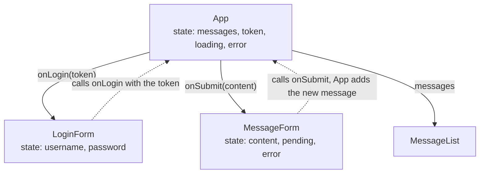

This chapter builds the front end of the separated architecture of [4.14.7](/4.14.7): a single-page application that runs in the browser and talks to the back end only through its API. It uses React, the most widely used library for building user interfaces, with TypeScript and the build tool Vite. The emphasis is on ideas rather than syntax: what problem a component library solves, how React thinks about a user interface as a function of state, where the boundary lies between rendering and the outside world, and how a front end is built, tested and deployed. The code is the front end of the message board that runs through [4.14.7](/4.14.7) to [4.14.9](/4.14.9): it lists the messages, lets a user log in and post. Everything was run with Node.js 24, React 19.3, Vite 8.3, TypeScript 6.0, React Router 8.5 and Vitest 5.0; the official documentation at react.dev and vite.dev is the reference for details.

## 8.1. The Modern Front-End Toolchain

### 8.1.1. From Pages to Applications

A web page is made of three languages: HTML for structure and content, CSS for presentation, and JavaScript for behavior. The browser parses the HTML into a tree of objects and renders that tree.

**Definition 8.1.1 (Document Object Model)** The **Document Object Model** (DOM) is the tree of objects that a browser builds from an HTML document, one node per element, attribute and piece of text, together with the programming interface through which scripts read and change the tree; every change to the DOM is reflected on the screen.

Without a library, interactive pages are written *imperatively*: find a node, change its text, add a child, remove a class, in response to each event. When a page has many pieces of state that affect each other (a list, a filter, a selection, a form, a loading indicator, an error), every event handler must remember to update every affected node, and the screen drifts out of step with the data. Front-end libraries replace this with a *declarative* model: the programmer describes what the interface should look like for a given state, and the library computes and applies the DOM changes. React (Meta, 2013; governed since 2026 by the React Foundation under the Linux Foundation) made this model mainstream; Vue, Svelte, Solid and Angular are its main alternatives, with the same basic idea and different mechanisms.

### 8.1.2. Node.js and npm

Front-end code runs in the browser, but the tools that build it run on the developer's machine, on Node.js, a JavaScript runtime outside the browser. Its **package manager** npm installs libraries from the npm registry. A project is described by `package.json`, which lists its dependencies with version ranges in the notation of semantic versioning ([4.14.3](/4.14.3#sec-3.1.2)) (`"react": "^19.3.1"` accepts every 19.x release from 19.3.1 on) and defines scripts; `npm install` resolves the ranges, downloads the packages into `node_modules/` and records the exact versions of the whole dependency tree in `package-lock.json`, the project's **lock file**, which is committed to Git so that every developer and the CI server install identical versions. pnpm, Yarn and Bun are alternative package managers and runtimes with the same model. A typical front-end project pulls in hundreds of transitive packages, which makes the supply chain a security concern of its own: install from lock files (`npm ci`), keep dependencies few and updated, and review what a new dependency brings.

### 8.1.3. TypeScript

**Definition 8.1.2 (TypeScript)** **TypeScript** is a superset of JavaScript that adds static types: type annotations, interfaces, generics and union types, checked by the TypeScript compiler before the program runs. The types are erased when the code is compiled to JavaScript and have no effect at run time.

JavaScript is dynamically typed, and in a large front end the most common errors are type errors: a misspelled field, a value that can be `null`, a function called with the wrong arguments. **Static typing** catches them in the editor. For a separated application TypeScript has a further benefit: the shape of the API's data can be written down once as types that the compiler enforces everywhere (§8.4.2), which turns the API contract of [4.14.7](/4.14.7#sec-7.3.1) into something the compiler checks. The compiler `tsc` is used only for checking (`tsc -b`); the build tool strips the types without checking them, which is fast. TypeScript 7, a port of the compiler to native code that checks about ten times faster, appeared in 2026; the Vite template used here still pins TypeScript 6.0.

### 8.1.4. Vite

Browsers can load JavaScript modules directly, but a real project needs more: TypeScript and JSX must be compiled, imports of packages from `node_modules` resolved, CSS and images processed, and for production the hundreds of source modules combined, minified and split into a few files that load quickly.

**Definition 8.1.3 (Build Tool)** A front-end **build tool** turns the source of a web application (modules in TypeScript, JSX, CSS and other assets) into files that browsers can load: during development it serves the sources through a local dev server with fast updates, and for production it *bundles* them into a small number of optimized static files.

Vite (French for "fast"; created by Evan You in 2020) is the standard build tool for new projects. In development it serves each source module separately, compiled on demand as the browser requests it, so the dev server starts in milliseconds regardless of the size of the project, and an edited module is replaced in the running page without reloading it and without losing its state (*hot module replacement*). For production it bundles the application. Since Vite 8 (2026) both are done by one toolchain written in Rust, the bundler Rolldown and the compiler Oxc, instead of the earlier pair esbuild (development) and Rollup (production). Create React App, the tool used in older courses and tutorials, was deprecated in 2025 and should not be used.

A new project is created from a template:

```bash
npm create vite@latest frontend -- --template react-ts
cd frontend
npm install
npm run dev
```

```text
create-vite v9.3.1

◇  Scaffolding project in /home/user/frontend...
└  Done. Now run:

  cd frontend
  npm install
  npm run dev

  VITE v8.3.5  ready in 141 ms

  ➜  Local:   http://localhost:5173/
  ➜  Network: use --host to expose
```

The generated project (after replacing the demo component with the message board, §8.4):

```text
frontend/
├── index.html            the single page; loads /src/main.tsx
├── package.json          dependencies and scripts
├── package-lock.json     exact versions (commit it)
├── tsconfig.json         TypeScript settings (tsconfig.app.json, tsconfig.node.json)
├── vite.config.ts        Vite settings: plugins, dev-server proxy
├── public/               files copied unchanged (favicon)
└── src/
    ├── main.tsx          entry point: mounts <App /> into <div id="root">
    ├── App.tsx           the root component
    ├── api.ts            typed functions for the back-end API
    ├── MessageList.tsx   components
    ├── MessageForm.tsx
    ├── LoginForm.tsx
    └── index.css
```

```json
{
  "scripts": {
    "dev": "vite",
    "build": "tsc -b && vite build",
    "lint": "oxlint",
    "preview": "vite preview"
  },
  "dependencies": { "react": "^19.3.1", "react-dom": "^19.3.1" },
  "devDependencies": {
    "@vitejs/plugin-react": "^6.1.2",
    "typescript": "~6.0.3",
    "vite": "^8.3.4"
  }
}
```

`index.html` contains only an empty `<div id="root">` and a `<script type="module" src="/src/main.tsx">`; `main.tsx` asks React to take over that element:

```tsx
import { StrictMode } from 'react'
import { createRoot } from 'react-dom/client'
import './index.css'
import App from './App.tsx'

createRoot(document.getElementById('root')!).render(
  <StrictMode>
    <App />
  </StrictMode>,
)
```

## 8.2. Components and JSX

### 8.2.1. Components

**Definition 8.2.1 (React Component)** A **React component** is a JavaScript function whose name starts with a capital letter and that returns a description of a piece of user interface (written in JSX). Components are composed: a component's output can contain other components, so that an application's interface is a tree of components, rendered by React into the DOM.

The component that shows the list of messages:

```tsx
import type { Message } from './api.ts'

interface Props {
  messages: Message[]
}

export function MessageList({ messages }: Props) {
  if (messages.length === 0) return <p>No messages yet.</p>
  return (
    <ul>
      {messages.map((m) => (
        <li key={m.id}>
          <strong>{m.author}</strong>: {m.content}
        </li>
      ))}
    </ul>
  )
}
```

Components are the unit of reuse and of division of work: a screen is split into components the way a program is split into functions, along the lines of the visual design and of the data each part needs, and each component can be developed, reviewed and tested on its own.

### 8.2.2. JSX

JSX is a syntax extension that lets markup be written inside JavaScript; the compiler turns `<li key={m.id}>...</li>` into a function call that creates an object describing the element. Its rules are few:

- a component returns one root element; several elements are wrapped in a fragment `<>...</>`;
- braces `{...}` embed any JavaScript expression: a value, a function call, a conditional (`cond && <p/>`, `a ? <X/> : <Y/>`);
- attributes use the DOM's camelCase names (`className` instead of `class`, `onClick`, `htmlFor`), and every tag must be closed (`<input />`);
- a list is rendered with `map`, and each item gets a `key` that is stable and unique among its siblings (the message ID, not the array index), so that React can match items between renders when the list changes.

Text in braces is escaped: if a message's content is `<script>alert("XSS")</script>`, React renders those characters as text, not as an element. This default closes the most common path to cross-site scripting ([4.14.7](/4.14.7#sec-7.5.2)). The escape hatch, `dangerouslySetInnerHTML={{ __html: html }}`, is named to make every use of it stand out in code review; it is acceptable only for HTML that has been sanitized.

### 8.2.3. Props and Purity

The inputs of a component are its *props*, passed like HTML attributes (`<MessageList messages={messages} />`) and received as one object parameter. Props are read-only: a component never changes its props, just as a function should not change its arguments. More generally, React requires rendering to be a **pure function** of props and state: the same inputs give the same output, and rendering has no **side effects** (no network requests, no changes to variables outside the component, no direct DOM manipulation). Side effects belong in event handlers and effects (§8.4). Purity is what lets React render a component as often as it needs, skip unnecessary renders, and render in the background without showing half-finished work; in development, `StrictMode` renders every component twice to reveal impure code.

## 8.3. State, Events and Hooks

### 8.3.1. State

**Definition 8.3.1 (State)** The **state** of a React component is data that the component remembers between renders and that changes over time, typically in response to user input or network responses. It is declared with `const [value, setValue] = useState(initial)`; calling the setter stores a new value and makes React render the component again with it.

A render is a snapshot: during one render, a state variable has one fixed value, and a setter does not change it but schedules a new render. When the new value depends on the old one, the setter is given an *updater function*, `setMessages((prev) => [created, ...prev])`, which React applies to the latest state. State is treated as immutable: instead of modifying an array or object (`messages.push(m)`), a new one is created (`[m, ...messages]`), which is how React detects that something changed. Not everything belongs in state: values that can be computed from props or other state (the trimmed text and whether it is valid, below) are computed during rendering, because storing them twice invites inconsistencies.

### 8.3.2. Events and Controlled Inputs

Event handlers are functions passed as props such as `onClick`, `onChange` and `onSubmit`. An input whose value is held in state and updated on every keystroke is a *controlled* input: the state is the single source of truth, and the input displays it. The form for posting a message:

```tsx
import { useState, type FormEvent } from 'react'

const MAX_LENGTH = 280

interface Props {
  onSubmit: (content: string) => Promise<void>
}

export function MessageForm({ onSubmit }: Props) {
  const [content, setContent] = useState('')
  const [pending, setPending] = useState(false)
  const [error, setError] = useState<string | null>(null)

  const trimmed = content.trim()
  const valid = trimmed.length > 0 && trimmed.length <= MAX_LENGTH

  async function handleSubmit(event: FormEvent<HTMLFormElement>) {
    event.preventDefault()
    setPending(true)
    setError(null)
    try {
      await onSubmit(trimmed)
      setContent('')
    } catch (e) {
      setError(e instanceof Error ? e.message : String(e))
    } finally {
      setPending(false)
    }
  }

  return (
    <form onSubmit={handleSubmit}>
      <textarea
        value={content}
        onChange={(e) => setContent(e.target.value)}
        placeholder="Write a message"
      />
      <span>{trimmed.length}/{MAX_LENGTH}</span>
      <button type="submit" disabled={!valid || pending}>
        {pending ? 'Posting...' : 'Post'}
      </button>
      {error && <p role="alert">{error}</p>}
    </form>
  )
}
```

The form repeats the back end's rule (non-blank, at most 280 characters) so that the user gets immediate feedback and the button is disabled for invalid input. This is a convenience, not a guarantee: the back end checks the same rule again and is the authority ([4.14.7](/4.14.7#sec-7.5.1)). The form also shows the three states that every operation over a network has: pending, failed (with the server's message) and succeeded.

### 8.3.3. One-Way Data Flow

Where should the list of messages live? Both the list (which displays it) and the form (whose success adds to it) depend on it, so it lives in their closest common parent, `App`, and flows down as props; changes flow up through callbacks that the parent passes down. This *lifting state up* gives React applications a one-way data flow: every piece of state has one owner, and the interface is derived from it.



State that many distant components need (the logged-in user, the color theme) is passed through *context* (`createContext`, `useContext`) instead of through every intermediate component. Larger applications sometimes add a state-management library (Zustand, Redux Toolkit), and almost always a library for server data (§8.4.2), but the principle stays: one owner per piece of state.

### 8.3.4. Hooks

**Definition 8.3.2 (Hook)** A **hook** is a function whose name starts with `use` and that lets a component use a React feature, such as state (`useState`) or effects (`useEffect`). Hooks may be called only at the top level of a component or of another hook, never inside conditions, loops or nested functions, so that React can associate each call with the same piece of stored data on every render.

| Hook | Purpose |
|---|---|
| `useState`, `useReducer` | state; `useReducer` for state with many transitions, handled by a reducer function |
| `useContext` | read a context provided by an ancestor |
| `useRef` | a mutable value that survives renders without causing them; a reference to a DOM node |
| `useEffect` | synchronize with something outside React (§8.4.1) |
| `useEffectEvent` | a function called from an effect that always sees the latest props and state (React 19.2) |
| `useMemo`, `useCallback` | cache a computed value or a function between renders; mostly unnecessary with the React Compiler |
| `useTransition`, `useDeferredValue` | mark an update as non-urgent so that typing stays responsive |
| `useActionState`, `useOptimistic` | state of a form action, and an optimistic update shown before the server confirms (React 19) |
| `use` | read a promise (with Suspense) or a context |

Programmers write *custom hooks* to reuse stateful logic: a `useMessages()` hook could contain the state and the effect of `App` below and return `{ messages, loading, error }`. The React Compiler (version 1.0, 2025), a build-time plugin, memoizes components and values automatically, which removes most manual `useMemo` and `useCallback`; it relies on components being pure.

## 8.4. Effects and Data Fetching

### 8.4.1. Effects

**Definition 8.4.1 (Effect)** An **effect** in React is code that a component runs after rendering, to synchronize the component with an external system (a network request, a subscription, a timer, a browser API, a non-React widget). It is declared with `useEffect(setup, dependencies)`: React runs `setup` after the component first appears on the screen and again whenever a value in the dependency array has changed; the function that `setup` may return is the *cleanup*, which React runs before the next setup and when the component disappears.

Every effect should be written so that setup followed by cleanup leaves no trace: a subscription is unsubscribed, a timer cleared, a request cancelled. In development, `StrictMode` runs setup, cleanup and setup again right after the first render to expose effects without proper cleanup. Effects are an escape hatch, not the place for ordinary logic: values derived from props or state are computed during rendering, and the response to a user's action (posting a message) belongs in the event handler, not in an effect watching some state. The React documentation's guide "You Might Not Need an Effect" collects these cases.

### 8.4.2. Fetching Data from the API

The front end's knowledge of the API is collected in one module. Its types repeat the shape of the back end's JSON ([4.14.9](/4.14.9#sec-9.6.1)), and its functions are the only place that knows URLs, headers and the format of errors:

```typescript
export interface Message {
  id: number
  author: string
  content: string
  created_at: string // ISO 8601
}

export interface Page<T> {
  count: number
  next: string | null
  previous: string | null
  results: T[]
}

export class ApiError extends Error {
  status: number
  constructor(status: number, message: string) {
    super(message)
    this.status = status
  }
}

async function request<T>(path: string, init: RequestInit = {}, token?: string): Promise<T> {
  const headers = new Headers(init.headers)
  headers.set('Accept', 'application/json')
  if (init.body) headers.set('Content-Type', 'application/json')
  if (token) headers.set('Authorization', `Token ${token}`)
  const response = await fetch(`/api${path}`, { ...init, headers })
  if (!response.ok) {
    const body = await response.json().catch(() => ({}))
    throw new ApiError(response.status, JSON.stringify(body))
  }
  return response.json() as Promise<T>
}

export function fetchMessages(signal?: AbortSignal): Promise<Page<Message>> {
  return request('/messages/', { signal })
}

export async function login(username: string, password: string): Promise<string> {
  const data = await request<{ token: string }>('/token/', {
    method: 'POST',
    body: JSON.stringify({ username, password }),
  })
  return data.token
}

export function postMessage(token: string, content: string): Promise<Message> {
  return request('/messages/', { method: 'POST', body: JSON.stringify({ content }) }, token)
}
```

`fetch` is the browser's HTTP client; it returns a promise, which `await` waits for without blocking the page. Note that `fetch` rejects only when no response arrives (a network failure): a `404` or `500` is a successful fetch with `response.ok === false`, which `request` turns into an error explicitly. The root component loads the messages in an effect and owns the application state:

```tsx
import { useEffect, useState } from 'react'
import { fetchMessages, postMessage, type Message } from './api.ts'
import { LoginForm } from './LoginForm.tsx'
import { MessageForm } from './MessageForm.tsx'
import { MessageList } from './MessageList.tsx'

export default function App() {
  const [messages, setMessages] = useState<Message[]>([])
  const [loading, setLoading] = useState(true)
  const [error, setError] = useState<string | null>(null)
  const [token, setToken] = useState<string | null>(null)

  useEffect(() => {
    const controller = new AbortController()
    fetchMessages(controller.signal)
      .then((page) => setMessages(page.results))
      .catch((e) => {
        if (!controller.signal.aborted) setError(String(e))
      })
      .finally(() => {
        if (!controller.signal.aborted) setLoading(false)
      })
    return () => controller.abort() // cleanup: cancel the request on unmount
  }, [])

  async function handlePost(content: string) {
    const created = await postMessage(token!, content)
    setMessages((prev) => [created, ...prev])
  }

  return (
    <main>
      <h1>Message Board</h1>
      {token ? <MessageForm onSubmit={handlePost} /> : <LoginForm onLogin={setToken} />}
      {loading && <p>Loading...</p>}
      {error && <p role="alert">{error}</p>}
      <MessageList messages={messages} />
    </main>
  )
}
```

The empty dependency array runs the effect once, when `App` appears. The cleanup aborts the request if the component disappears before the response arrives, so that a late response does not set the state of a component that is gone; with effects that depend on changing values (a search box), the same cleanup prevents a slow old response from overwriting a newer one. The token is kept only in memory, so a page reload logs the user out; keeping it across reloads means choosing between `localStorage` and a cookie, with the trade-offs of [4.14.7](/4.14.7#sec-7.4.3). `LoginForm` is a small form like `MessageForm` that calls `login` and hands the token to `onLogin`.

The URLs are relative (`/api/messages/`), so in development the browser sends them to Vite's dev server at `localhost:5173`, which forwards them to the Django server: the reverse-proxy arrangement of [4.14.7](/4.14.7#sec-7.2.2), with no cross-origin requests and no CORS configuration.

```typescript
import react from '@vitejs/plugin-react'
import { defineConfig } from 'vite'

// https://vite.dev/config/
export default defineConfig({
  plugins: [react()],
  server: {
    // Forward API calls to Django, so the browser sees a single origin.
    proxy: { '/api': 'http://127.0.0.1:8000' },
  },
})
```

```text
$ curl -s http://localhost:5173/api/messages/
{"count":4,"next":null,"previous":null,"results":[{"id":4,"author":"alice","content":"Posted with a token", ...
```

Loading data in effects by hand is fine for one list, but real applications need more: caching responses, sharing them between components, refetching when data is stale, retrying, pagination, and updating the cache after a mutation. Libraries do this well and are the usual choice: TanStack Query (`useQuery`, `useMutation`) or SWR in a single-page application, and the data loaders of a framework (§8.6.3) where routes load their own data.

### 8.4.3. Forms and Actions

React 19 also supports *form actions*: a function passed as `<form action={fn}>` receives the form's `FormData` when the form is submitted, and `useActionState` keeps the action's result and pending status, which replaces the hand-written `pending` and `error` state of `MessageForm`:

```tsx
const [error, submitAction, isPending] = useActionState(
  async (_previous: string | null, formData: FormData) => {
    try {
      await onSubmit(String(formData.get('content')).trim())
      return null
    } catch (e) {
      return String(e)
    }
  },
  null,
)
// <form action={submitAction}> <textarea name="content" /> ... </form>
```

`useOptimistic` adds the new message to the list immediately and removes it again if the server rejects it, which makes the interface feel instant. Either style works; what matters is that every mutation handles its pending, error and success states.

## 8.5. Routing

A single-page application still has URLs: users bookmark them, share them and use the back button. *Client-side routing* maps the URL to components in the browser: following a link changes the URL with the History API (`history.pushState`) and renders the matching components without a request for a new page. React Router (version 8) is the most common router; in its simplest, declarative mode:

```tsx
import { BrowserRouter, Link, Route, Routes, useParams } from 'react-router'
import App from './App.tsx'

function MessageDetail() {
  const { id } = useParams() // the ":id" segment of the URL
  return <h2>Message {id}</h2>
}

export function Root() {
  return (
    <BrowserRouter>
      <nav>
        <Link to="/">Board</Link> | <Link to="/about">About</Link>
      </nav>
      <Routes>
        <Route path="/" element={<App />} />
        <Route path="/messages/:id" element={<MessageDetail />} />
        <Route path="/about" element={<p>A small full-stack example.</p>} />
        <Route path="*" element={<p>Page not found.</p>} />
      </Routes>
    </BrowserRouter>
  )
}
```

React Router also has a *data mode*, in which each route declares a loader that fetches its data before rendering, and a *framework mode* (§8.6.3); TanStack Router is a type-safe alternative. Client-side routing has one consequence for deployment: when a user opens `https://example.com/messages/4` directly, the request goes to the server, which has no file of that name. The static file server must therefore answer every unknown path with `index.html` (the SPA fallback, §8.6.2), and the router then renders the right page.

## 8.6. Testing, Building and Deploying

### 8.6.1. Testing Components

Front-end code is tested at the same levels as other code ([4.14.12](/4.14.12)). Pure logic (formatting, validation) gets ordinary **unit tests**. Components are tested with Vitest, a test runner that shares Vite's configuration, and Testing Library, which renders a component into a simulated DOM (jsdom) and queries it the way a user perceives it: by role, label and visible text, not by internal structure, so that the tests survive refactoring. Whole user journeys in real browsers are tested end to end with Playwright.

```tsx
// @vitest-environment jsdom
import { cleanup, render, screen } from '@testing-library/react'
import userEvent from '@testing-library/user-event'
import { afterEach, expect, test, vi } from 'vitest'
import { MessageForm } from './MessageForm.tsx'

afterEach(cleanup)

test('button is disabled until the message is non-blank', async () => {
  render(<MessageForm onSubmit={vi.fn()} />)
  const button = screen.getByRole('button', { name: 'Post' })
  expect(button).toHaveProperty('disabled', true)
  await userEvent.type(screen.getByPlaceholderText('Write a message'), '   ')
  expect(button).toHaveProperty('disabled', true)
  await userEvent.type(screen.getByPlaceholderText('Write a message'), 'hi')
  expect(button).toHaveProperty('disabled', false)
})

test('submits the trimmed text and clears the box', async () => {
  const onSubmit = vi.fn().mockResolvedValue(undefined)
  render(<MessageForm onSubmit={onSubmit} />)
  const box = screen.getByPlaceholderText('Write a message')
  await userEvent.type(box, '  hello  ')
  await userEvent.click(screen.getByRole('button', { name: 'Post' }))
  expect(onSubmit).toHaveBeenCalledWith('hello')
  expect(box).toHaveProperty('value', '')
})

test('shows the server error', async () => {
  const onSubmit = vi.fn().mockRejectedValue(new Error('{"detail":"Invalid token."}'))
  render(<MessageForm onSubmit={onSubmit} />)
  await userEvent.type(screen.getByPlaceholderText('Write a message'), 'hello')
  await userEvent.click(screen.getByRole('button', { name: 'Post' }))
  expect((await screen.findByRole('alert')).textContent).toContain('Invalid token')
})
```

`vi.fn()` creates a test double that records its calls and returns what it is told to; a second test file renders `App` with `fetch` replaced by such a double that returns a page of messages, and checks that they appear. Neither needs a running back end:

```text
$ npx vitest run --reporter=verbose
 ✓ src/App.test.tsx > loads and shows the messages from the API 31ms
 ✓ src/MessageForm.test.tsx > button is disabled until the message is non-blank 140ms
 ✓ src/MessageForm.test.tsx > submits the trimmed text and clears the box 35ms
 ✓ src/MessageForm.test.tsx > shows the server error 29ms

 Test Files  2 passed (2)
      Tests  4 passed (4)
```

Besides tests, a front-end CI pipeline runs the type checker (`tsc -b`) and a linter (oxlint in the Vite template, or ESLint with the React hooks rules, which flag hooks called conditionally and effects with missing dependencies).

### 8.6.2. Building and Deploying

`npm run build` type-checks the project and bundles it:

```text
$ npm run build
> tsc -b && vite build

vite v8.3.5 building client environment for production...
✓ 20 modules transformed.
dist/index.html                   0.45 kB │ gzip:  0.29 kB
dist/assets/index-DGNrK5qb.css    1.78 kB │ gzip:  0.81 kB
dist/assets/index-CRwedpMU.js   222.11 kB │ gzip: 69.53 kB
✓ built in 81ms
```

The result in `dist/` is a set of static files. Their names contain a hash of their content, so they can be cached forever (`Cache-Control: max-age=31536000, immutable`): a new build produces new names, and only `index.html`, which refers to them and is served without long caching, has to be fetched again. Deployment is therefore simple: copy `dist/` to any static file host (a CDN, an object store, GitHub Pages, Nginx), with two requirements: unknown paths fall back to `index.html` (§8.5), and requests to `/api/` reach the back end, either through a reverse proxy on the same origin or by an absolute API URL with CORS ([4.14.7](/4.14.7#sec-7.5.3)). An Nginx configuration for the same-origin arrangement appears in [4.14.9](/4.14.9#sec-9.8.2).

Configuration that differs between environments (the API's base URL) is read from environment variables prefixed with `VITE_` through `import.meta.env.VITE_API_URL`, and substituted at build time. Everything in the bundle is public: anyone can read it in the browser, so a front end must never contain secrets such as API keys of paid services; calls that need them go through the back end.

### 8.6.3. Frameworks

React itself only renders components; routing, data loading, server rendering and code splitting come from elsewhere. The React documentation recommends starting new applications with a *framework* that provides them together: Next.js, React Router in framework mode (the successor of Remix) or Expo for mobile apps. Frameworks render pages on the server or at build time and hydrate them in the browser ([4.14.7](/4.14.7#sec-7.1.3)), and support React Server Components, components that run only on the server, can read a database directly and send only their rendered result to the browser. A plain Vite single-page application, as in this chapter, remains a good choice when the back end is a separate service in another language, such as Django, when search-engine indexing does not matter (an application behind a login), and for learning, since it has the fewest moving parts. Server-side React brings back the concerns of a back end, including its vulnerabilities: in December 2025 a critical remote code execution flaw in the React Server Components protocol affected applications built on Next.js and other frameworks, which had to be updated urgently.

## 8.7. Front-End Work with Coding Agents

**Coding agents** ([4.2.14](/4.2.14)) are productive at front-end work, because components are small, conventional and plentiful in their training data; the risks lie where their output cannot be checked by a compiler. Types are the first guardrail: with the API's data written as TypeScript types (ideally generated from the back end's OpenAPI description), a mismatch between front end and back end is a type error, not a blank screen in production. Component tests written against roles and visible text are the second, because they state behavior without fixing the implementation. What remains for human review is what no test checks easily: whether the interface looks right and is usable, which an agent can approach only through screenshots of a real browser; accessibility (labels, keyboard navigation, contrast); the handling of loading and error states, which generated code tends to leave out; and new dependencies, each of which is code from the supply chain. Asking the agent to follow the project's existing patterns (one API module, one data-fetching library, one styling approach) keeps a growing front end coherent.

## Summary

- The browser renders the DOM; React replaces imperative DOM updates with a declarative description of the interface as a function of state. The toolchain is Node.js with npm (dependencies in `package.json`, exact versions in the lock file), TypeScript (static types, erased at build time) and Vite (dev server with hot module replacement, production bundling with Rolldown since Vite 8).
- A component is a function that returns JSX; components compose into a tree. JSX embeds expressions in braces, renders lists with stable keys and escapes text by default.
- Props are read-only inputs; rendering must be pure. State is remembered between renders, changed only through setters, treated as immutable and lifted to the closest common owner; data flows down as props and changes flow up through callbacks.
- Hooks (`useState`, `useEffect`, `useContext`, `useRef`, ...) are called at the top level only. Effects synchronize with external systems and clean up after themselves; derived values and responses to user actions do not belong in effects.
- Data from the API is fetched through one typed module; every request has pending, error and success states; in development Vite proxies `/api` to the back end. Server-state libraries such as TanStack Query handle caching and refetching.
- Client-side routing maps URLs to components and needs an `index.html` fallback on the server. Components are tested with Vitest and Testing Library; the build produces hashed static files for a CDN; nothing in the bundle is secret. Frameworks add server rendering and server components.
