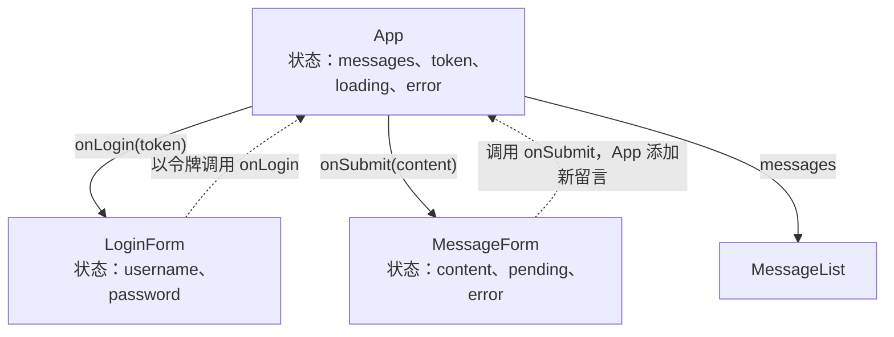

本章构建 [4.14.7](/4.14.7) 中分离式架构的前端：一个运行在浏览器中、只通过后端的 API 与后端交谈的**单页应用**。它使用最广泛的用户界面构建库 React，配合 TypeScript 和构建工具 Vite。重点在于思想而不是语法：组件库解决什么问题，React 如何把用户界面看作状态的函数，渲染与外部世界的边界在哪里，以及前端如何构建、测试和部署。代码是贯穿 [4.14.7](/4.14.7) 至 [4.14.9](/4.14.9) 的留言板的前端：它列出留言，并让用户登录和发布留言。所有内容都用 Node.js 24、React 19.3、Vite 8.3、TypeScript 6.0、React Router 8.5 和 Vitest 5.0 运行过；细节请以 react.dev 和 vite.dev 的官方文档为准。

## 8.1. 现代前端工具链

### 8.1.1. 从页面到应用

网页由三种语言构成：HTML 负责结构和内容，CSS 负责呈现，JavaScript 负责行为。浏览器把 HTML 解析成一棵对象树，并渲染这棵树。

**定义 8.1.1（文档对象模型）** **文档对象模型**（DOM）是浏览器根据 HTML 文档构建的对象树，每个元素、属性和每段文本对应一个节点，同时也包括脚本读取和修改这棵树所用的编程接口；对 DOM 的每次修改都会反映在屏幕上。

没有库时，交互式页面是命令式（imperatively）编写的：针对每个事件，找到一个节点、修改它的文本、添加一个子节点、移除一个类。当页面有许多相互影响的状态片段（列表、过滤器、选中项、表单、加载指示、错误）时，每个事件处理函数都必须记得更新每个受影响的节点，屏幕就会与数据脱节。前端库用声明式（declarative）模型取而代之：程序员描述在给定状态下界面应当是什么样子，由库计算并应用对 DOM 的修改。React（Meta，2013；自 2026 年起由 Linux 基金会下的 React 基金会管理）使这一模型成为主流；Vue、Svelte、Solid 和 Angular 是它的主要替代者，基本思想相同，机制各异。

### 8.1.2. Node.js 与 npm

前端代码在浏览器中运行，但构建它的工具运行在开发者的机器上，基于 Node.js，一种浏览器之外的 JavaScript 运行时。它的**包管理器** npm 从 npm 注册中心安装库。项目由 `package.json` 描述，其中用**语义化版本**（[4.14.3](/4.14.3#sec-3.1.2)）的记法列出带版本范围的依赖（`"react": "^19.3.1"` 接受从 19.3.1 起的每个 19.x 版本），并定义脚本；`npm install` 解析这些范围，把包下载到 `node_modules/`，并把整棵依赖树的确切版本记录在 `package-lock.json` 中，这就是项目的**锁文件**，它提交到 Git，使每个开发者和 **CI** 服务器安装完全相同的版本。pnpm、Yarn 和 Bun 是模型相同的其他**包管理器**和运行时。典型的前端项目会引入数百个传递依赖的包，这使供应链本身成为一个安全问题：从锁文件安装（`npm ci`），保持依赖少而新，并审查新依赖带来了什么。

### 8.1.3. TypeScript

**定义 8.1.2（TypeScript）** **TypeScript** 是 JavaScript 的超集，增加了静态类型：类型注解、接口、泛型和联合类型，由 TypeScript 编译器在程序运行之前检查。类型在代码编译为 JavaScript 时被擦除，在运行时没有任何影响。

JavaScript 是动态类型的，在大型前端中最常见的错误就是类型错误：拼错的字段、可能为 `null` 的值、用错误的参数调用的函数。**静态类型**在编辑器中就能捕获它们。对分离式应用，TypeScript 还有另一个好处：API 数据的形状可以一次性写成类型，由编译器处处强制执行（8.4.2），这就把 [4.14.7](/4.14.7#sec-7.3.1) 的 API 契约变成了编译器检查的东西。编译器 `tsc` 只用于检查（`tsc -b`）；构建工具去掉类型而不做检查，这样很快。TypeScript 7 是编译器移植到原生代码的版本，检查速度约快十倍，于 2026 年发布；这里用的 Vite 模板仍固定在 TypeScript 6.0。

### 8.1.4. Vite

浏览器可以直接加载 JavaScript 模块，但真正的项目需要更多：TypeScript 和 JSX 必须编译，对 `node_modules` 中包的导入必须解析，CSS 和图片必须处理，而在生产环境中，数百个源模块要被合并、压缩，并拆分成少数几个能快速加载的文件。

**定义 8.1.3（构建工具）** 前端**构建工具**把 Web 应用的源码（TypeScript、JSX、CSS 和其他资源的模块）转换成浏览器可以加载的文件：开发时通过本地开发服务器提供源码并快速更新，生产时把它们打包（bundle）成少量优化过的静态文件。

Vite（法语，意为“快”；由 Evan You 于 2020 年创建）是新项目的标准构建工具。在开发中，它分别提供每个源模块，在浏览器请求时按需编译，因此无论项目多大，开发服务器都能在几毫秒内启动，被编辑的模块会在运行中的页面里被替换，既不用重新加载页面，也不丢失其状态（热模块替换，hot module replacement）。生产环境中它对应用打包。自 Vite 8（2026）起，两者都由一套用 Rust 编写的工具链完成，即打包器 Rolldown 和编译器 Oxc，取代了早先的一对工具：esbuild（开发）与 Rollup（生产）。Create React App 是旧课程和教程里用的工具，已于 2025 年弃用，不应再使用。

新项目从模板创建：

```bash
npm create vite@latest frontend -- --template react-ts
cd frontend
npm install
npm run dev
```

```text
create-vite v9.3.1

◇  Scaffolding project in /home/user/frontend...
└  Done. Now run:

  cd frontend
  npm install
  npm run dev

  VITE v8.3.5  ready in 141 ms

  ➜  Local:   http://localhost:5173/
  ➜  Network: use --host to expose
```

生成的项目（把演示组件替换成留言板之后，8.4）：

```text
frontend/
├── index.html            the single page; loads /src/main.tsx
├── package.json          dependencies and scripts
├── package-lock.json     exact versions (commit it)
├── tsconfig.json         TypeScript settings (tsconfig.app.json, tsconfig.node.json)
├── vite.config.ts        Vite settings: plugins, dev-server proxy
├── public/               files copied unchanged (favicon)
└── src/
    ├── main.tsx          entry point: mounts <App /> into <div id="root">
    ├── App.tsx           the root component
    ├── api.ts            typed functions for the back-end API
    ├── MessageList.tsx   components
    ├── MessageForm.tsx
    ├── LoginForm.tsx
    └── index.css
```

```json
{
  "scripts": {
    "dev": "vite",
    "build": "tsc -b && vite build",
    "lint": "oxlint",
    "preview": "vite preview"
  },
  "dependencies": { "react": "^19.3.1", "react-dom": "^19.3.1" },
  "devDependencies": {
    "@vitejs/plugin-react": "^6.1.2",
    "typescript": "~6.0.3",
    "vite": "^8.3.4"
  }
}
```

`index.html` 里只有一个空的 `<div id="root">` 和一个 `<script type="module" src="/src/main.tsx">`；`main.tsx` 让 React 接管那个元素：

```tsx
import { StrictMode } from 'react'
import { createRoot } from 'react-dom/client'
import './index.css'
import App from './App.tsx'

createRoot(document.getElementById('root')!).render(
  <StrictMode>
    <App />
  </StrictMode>,
)
```

## 8.2. 组件与 JSX

### 8.2.1. 组件

**定义 8.2.1（React 组件）** **React 组件**是一个名称以大写字母开头的 JavaScript 函数，它返回一块用户界面的描述（用 JSX 书写）。组件可以组合：一个组件的输出可以包含其他组件，因此应用的界面是一棵组件树，由 React 渲染到 DOM 中。

显示留言列表的组件：

```tsx
import type { Message } from './api.ts'

interface Props {
  messages: Message[]
}

export function MessageList({ messages }: Props) {
  if (messages.length === 0) return <p>No messages yet.</p>
  return (
    <ul>
      {messages.map((m) => (
        <li key={m.id}>
          <strong>{m.author}</strong>: {m.content}
        </li>
      ))}
    </ul>
  )
}
```


组件是复用和分工的单位：一个界面按视觉设计和每部分所需的数据拆分成组件，就像程序拆分成函数一样，每个组件都可以单独开发、评审和测试。

### 8.2.2. JSX

JSX 是一种语法扩展，允许在 JavaScript 里书写标记；编译器把 `<li key={m.id}>...</li>` 变成一个函数调用，创建描述该元素的对象。它的规则不多：

- 组件返回一个根元素；多个元素用片段（fragment）`<>...</>` 包起来；
- 花括号 `{...}` 嵌入任意 JavaScript 表达式：值、函数调用、条件（`cond && <p/>`、`a ? <X/> : <Y/>`）；
- 属性使用 DOM 的驼峰式名称（用 `className` 而不是 `class`，`onClick`，`htmlFor`），并且每个标签都必须闭合（`<input />`）；
- 列表用 `map` 渲染，每一项都有一个在兄弟之间稳定而唯一的 `key`（留言的 ID，而不是数组下标），这样列表变化时 React 才能在两次渲染之间匹配各项。

花括号中的文本会被转义：如果某条留言的内容是 `<script>alert("XSS")</script>`，React 把这些字符渲染为文本，而不是元素。这一默认行为堵住了通向**跨站脚本**（[4.14.7](/4.14.7#sec-7.5.2)）最常见的路径。逃生口 `dangerouslySetInnerHTML={{ __html: html }}` 的名字就是为了让它的每次使用在**代码评审**中都格外显眼；它只适用于已经过净化的 HTML。

### 8.2.3. props 与纯粹性

组件的输入是它的 props，像 HTML 属性一样传递（`<MessageList messages={messages} />`），并作为一个对象参数接收。props 是只读的：组件绝不修改自己的 props，就像函数不应修改自己的参数一样。更一般地，React 要求渲染是 props 和 state 的**纯函数**：相同的输入得到相同的输出，并且渲染没有**副作用**（没有网络请求、不修改组件之外的变量、不直接操作 DOM）。副作用属于事件处理函数和 Effect（8.4）。正因为纯粹，React 才能按需多次渲染一个组件、跳过不必要的渲染，并在后台渲染而不显示做了一半的工作；在开发中，`StrictMode` 会把每个组件渲染两次，以暴露不纯的代码。

## 8.3. 状态、事件与 Hook

### 8.3.1. 状态

**定义 8.3.1（状态）** React 组件的**状态**是组件在多次渲染之间记住的、并随时间变化的数据，通常是为响应用户输入或网络响应而变化。它用 `const [value, setValue] = useState(initial)` 声明；调用设置函数会存储新值，并使 React 带着它重新渲染该组件。

一次渲染是一张快照：在一次渲染期间，状态变量只有一个固定的值，设置函数并不改变它，而是安排一次新的渲染。当新值依赖于旧值时，要给设置函数传一个更新函数（updater function），`setMessages((prev) => [created, ...prev])`，React 把它应用于最新的状态。状态被视为不可变的：不要修改数组或对象（`messages.push(m)`），而是创建新的（`[m, ...messages]`），React 正是据此检测到有东西改变了。并非一切都属于状态：可以由 props 或其他状态计算出来的值（下面的去除空白后的文本及其是否有效）在渲染期间计算，因为把它们存两次会招致不一致。

### 8.3.2. 事件与受控输入

事件处理函数是作为 `onClick`、`onChange` 和 `onSubmit` 之类的 props 传入的函数。值保存在状态中并在每次按键时更新的输入，是受控（controlled）输入：状态是唯一的事实来源，输入框只是显示它。发布留言的表单：

```tsx
import { useState, type FormEvent } from 'react'

const MAX_LENGTH = 280

interface Props {
  onSubmit: (content: string) => Promise<void>
}

export function MessageForm({ onSubmit }: Props) {
  const [content, setContent] = useState('')
  const [pending, setPending] = useState(false)
  const [error, setError] = useState<string | null>(null)

  const trimmed = content.trim()
  const valid = trimmed.length > 0 && trimmed.length <= MAX_LENGTH

  async function handleSubmit(event: FormEvent<HTMLFormElement>) {
    event.preventDefault()
    setPending(true)
    setError(null)
    try {
      await onSubmit(trimmed)
      setContent('')
    } catch (e) {
      setError(e instanceof Error ? e.message : String(e))
    } finally {
      setPending(false)
    }
  }

  return (
    <form onSubmit={handleSubmit}>
      <textarea
        value={content}
        onChange={(e) => setContent(e.target.value)}
        placeholder="Write a message"
      />
      <span>{trimmed.length}/{MAX_LENGTH}</span>
      <button type="submit" disabled={!valid || pending}>
        {pending ? 'Posting...' : 'Post'}
      </button>
      {error && <p role="alert">{error}</p>}
    </form>
  )
}
```

这个表单重复了后端的规则（非空白、至多 280 个字符），使用户得到即时反馈，并在输入无效时禁用按钮。这只是一种便利，而不是保证：后端会再次检查同一规则，并且后端才是权威（[4.14.7](/4.14.7#sec-7.5.1)）。这个表单还展示了每个网络操作都有的三种状态：进行中、失败（带有服务器的消息）和成功。

### 8.3.3. 单向数据流

留言列表应当放在哪里？列表（显示它）和表单（成功时向其中添加）都依赖它，所以它放在两者最近的共同父组件 `App` 中，并作为 props 向下流动；变化通过父组件向下传递的回调向上流动。这种状态提升（lifting state up）使 React 应用有了单向数据流：每一份状态都有一个所有者，界面由它派生。



许多相距较远的组件都需要的状态（已登录的用户、颜色主题），通过上下文（context，`createContext`、`useContext`）传递，而不是经过每个中间组件。较大的应用有时会加上状态管理库（Zustand、Redux Toolkit），并且几乎总会加上处理服务器数据的库（8.4.2），但原则不变：每份状态只有一个所有者。

### 8.3.4. Hook

**定义 8.3.2（Hook）** **Hook** 是名称以 `use` 开头的函数，让组件使用 React 的某项特性，如状态（`useState`）或 Effect（`useEffect`）。Hook 只能在组件或另一个 Hook 的顶层调用，绝不能放在条件、循环或嵌套函数中，这样 React 才能在每次渲染时把每次调用与同一份存储的数据对应起来。

| Hook | 用途 |
|---|---|
| `useState`、`useReducer` | 状态；`useReducer` 用于有许多转换、由 reducer 函数处理的状态 |
| `useContext` | 读取祖先组件提供的上下文 |
| `useRef` | 在多次渲染间保持而不引起渲染的可变值；对 DOM 节点的引用 |
| `useEffect` | 与 React 之外的东西同步（8.4.1） |
| `useEffectEvent` | 从 Effect 中调用的函数，总能看到最新的 props 和状态（React 19.2） |
| `useMemo`、`useCallback` | 在多次渲染之间缓存计算出的值或函数；有 React Compiler 时大多不再需要 |
| `useTransition`、`useDeferredValue` | 把某次更新标记为不紧急，使输入保持流畅 |
| `useActionState`、`useOptimistic` | 表单动作的状态，以及在服务器确认之前显示的乐观更新（React 19） |
| `use` | 读取 promise（配合 Suspense）或上下文 |

程序员编写自定义 Hook（custom hooks）来复用有状态的逻辑：`useMessages()` 这个 Hook 可以包含下面 `App` 的状态和 Effect，并返回 `{ messages, loading, error }`。React Compiler（1.0 版，2025）是构建时的插件，自动对组件和值做记忆化（memoization），去掉了大部分手写的 `useMemo` 和 `useCallback`；它依赖于组件是纯粹的。

## 8.4. Effect 与数据获取

### 8.4.1. Effect

**定义 8.4.1（Effect）** React 中的 **Effect** 是组件在渲染之后运行的代码，用来使组件与外部系统（网络请求、订阅、定时器、浏览器 API、非 React 的部件）同步。它用 `useEffect(setup, dependencies)` 声明：React 在组件首次出现在屏幕上之后运行 `setup`，此后只要依赖数组中的某个值改变就再次运行；`setup` 可以返回的那个函数是清理函数（cleanup），React 在下一次 setup 之前以及组件消失时运行它。

每个 Effect 都应当写成 setup 之后再 cleanup 不留痕迹：订阅被取消，定时器被清除，请求被取消。在开发中，`StrictMode` 会在首次渲染之后立即运行 setup、cleanup 再运行 setup，以暴露没有妥善清理的 Effect。Effect 是逃生口，而不是放普通逻辑的地方：由 props 或状态派生的值在渲染期间计算，对用户操作（发布留言）的响应属于事件处理函数，而不是监视某个状态的 Effect。React 文档里的指南“You Might Not Need an Effect”汇集了这些情形。

### 8.4.2. 从 API 获取数据

前端对 API 的了解集中在一个模块中。它的类型重复了后端 JSON 的形状（[4.14.9](/4.14.9#sec-9.6.1)），它的函数是唯一了解 URL、头部和错误格式的地方：

```typescript
export interface Message {
  id: number
  author: string
  content: string
  created_at: string // ISO 8601
}

export interface Page<T> {
  count: number
  next: string | null
  previous: string | null
  results: T[]
}

export class ApiError extends Error {
  status: number
  constructor(status: number, message: string) {
    super(message)
    this.status = status
  }
}

async function request<T>(path: string, init: RequestInit = {}, token?: string): Promise<T> {
  const headers = new Headers(init.headers)
  headers.set('Accept', 'application/json')
  if (init.body) headers.set('Content-Type', 'application/json')
  if (token) headers.set('Authorization', `Token ${token}`)
  const response = await fetch(`/api${path}`, { ...init, headers })
  if (!response.ok) {
    const body = await response.json().catch(() => ({}))
    throw new ApiError(response.status, JSON.stringify(body))
  }
  return response.json() as Promise<T>
}

export function fetchMessages(signal?: AbortSignal): Promise<Page<Message>> {
  return request('/messages/', { signal })
}

export async function login(username: string, password: string): Promise<string> {
  const data = await request<{ token: string }>('/token/', {
    method: 'POST',
    body: JSON.stringify({ username, password }),
  })
  return data.token
}

export function postMessage(token: string, content: string): Promise<Message> {
  return request('/messages/', { method: 'POST', body: JSON.stringify({ content }) }, token)
}
```

`fetch` 是浏览器的 HTTP 客户端；它返回一个 promise，`await` 等待它而不阻塞页面。注意 `fetch` 只在没有收到响应时（网络故障）才会拒绝：`404` 或 `500` 对 `fetch` 来说是成功的，只是 `response.ok === false`，`request` 把它显式地转换成了错误。根组件在 Effect 中加载留言，并拥有应用的状态：

```tsx
import { useEffect, useState } from 'react'
import { fetchMessages, postMessage, type Message } from './api.ts'
import { LoginForm } from './LoginForm.tsx'
import { MessageForm } from './MessageForm.tsx'
import { MessageList } from './MessageList.tsx'

export default function App() {
  const [messages, setMessages] = useState<Message[]>([])
  const [loading, setLoading] = useState(true)
  const [error, setError] = useState<string | null>(null)
  const [token, setToken] = useState<string | null>(null)

  useEffect(() => {
    const controller = new AbortController()
    fetchMessages(controller.signal)
      .then((page) => setMessages(page.results))
      .catch((e) => {
        if (!controller.signal.aborted) setError(String(e))
      })
      .finally(() => {
        if (!controller.signal.aborted) setLoading(false)
      })
    return () => controller.abort() // cleanup: cancel the request on unmount
  }, [])

  async function handlePost(content: string) {
    const created = await postMessage(token!, content)
    setMessages((prev) => [created, ...prev])
  }

  return (
    <main>
      <h1>Message Board</h1>
      {token ? <MessageForm onSubmit={handlePost} /> : <LoginForm onLogin={setToken} />}
      {loading && <p>Loading...</p>}
      {error && <p role="alert">{error}</p>}
      <MessageList messages={messages} />
    </main>
  )
}
```

空的依赖数组使 Effect 只运行一次，即 `App` 出现的时候。如果组件在响应到达之前消失，cleanup 会中止请求，这样迟到的响应就不会去设置一个已不存在的组件的状态；对于依赖会变化的值的 Effect（搜索框），同样的 cleanup 防止缓慢的旧响应覆盖较新的响应。令牌只保存在内存中，所以页面重新加载会使用户登出；要让它在重新加载之后保留，就要在 `localStorage` 和 Cookie 之间选择，并面对 [4.14.7](/4.14.7#sec-7.4.3) 的权衡。`LoginForm` 是类似 `MessageForm` 的小表单，它调用 `login`，并把令牌交给 `onLogin`。

URL 是相对的（`/api/messages/`），所以在开发中浏览器把它们发给 `localhost:5173` 上的 Vite 开发服务器，由它转发给 Django 服务器：这就是 [4.14.7](/4.14.7#sec-7.2.2) 的反向代理安排，没有跨源请求，也不需要 **CORS** 配置。

```typescript
import react from '@vitejs/plugin-react'
import { defineConfig } from 'vite'

// https://vite.dev/config/
export default defineConfig({
  plugins: [react()],
  server: {
    // Forward API calls to Django, so the browser sees a single origin.
    proxy: { '/api': 'http://127.0.0.1:8000' },
  },
})
```

```text
$ curl -s http://localhost:5173/api/messages/
{"count":4,"next":null,"previous":null,"results":[{"id":4,"author":"alice","content":"Posted with a token", ...
```

在 Effect 中手工加载数据，对一个列表来说没问题，但真实的应用需要更多：缓存响应、在组件之间共享、数据陈旧时重新获取、重试、分页，以及在变更之后更新缓存。库能很好地做到这些，是通常的选择：单页应用中的 TanStack Query（`useQuery`、`useMutation`）或 SWR，以及路由自己加载数据的框架的数据加载器（8.6.3）。

### 8.4.3. 表单与动作

React 19 还支持表单动作（form actions）：作为 `<form action={fn}>` 传入的函数，在表单提交时收到表单的 `FormData`，而 `useActionState` 保存动作的结果和进行中状态，这取代了 `MessageForm` 中手写的 `pending` 和 `error` 状态：

```tsx
const [error, submitAction, isPending] = useActionState(
  async (_previous: string | null, formData: FormData) => {
    try {
      await onSubmit(String(formData.get('content')).trim())
      return null
    } catch (e) {
      return String(e)
    }
  },
  null,
)
// <form action={submitAction}> <textarea name="content" /> ... </form>
```

`useOptimistic` 把新留言立即加入列表，若服务器拒绝则再把它移除，这使界面感觉是即时的。两种风格都行；重要的是每个变更都要处理它的进行中、错误和成功状态。

## 8.5. 路由

单页应用仍然有 URL：用户会收藏它们、分享它们，并使用后退按钮。客户端路由（client-side routing）在浏览器中把 URL 映射到组件：点击链接时用 History API（`history.pushState`）改变 URL，并渲染匹配的组件，而不请求新页面。React Router（第 8 版）是最常见的路由库；在它最简单的声明式模式中：

```tsx
import { BrowserRouter, Link, Route, Routes, useParams } from 'react-router'
import App from './App.tsx'

function MessageDetail() {
  const { id } = useParams() // the ":id" segment of the URL
  return <h2>Message {id}</h2>
}

export function Root() {
  return (
    <BrowserRouter>
      <nav>
        <Link to="/">Board</Link> | <Link to="/about">About</Link>
      </nav>
      <Routes>
        <Route path="/" element={<App />} />
        <Route path="/messages/:id" element={<MessageDetail />} />
        <Route path="/about" element={<p>A small full-stack example.</p>} />
        <Route path="*" element={<p>Page not found.</p>} />
      </Routes>
    </BrowserRouter>
  )
}
```

React Router 还有数据模式（data mode），其中每条路由声明一个加载器（loader），在渲染之前获取自己的数据；以及框架模式（framework mode，8.6.3）；TanStack Router 是类型安全的替代品。客户端路由对部署有一个后果：当用户直接打开 `https://example.com/messages/4` 时，请求发往服务器，而服务器上没有这个名字的文件。因此静态文件服务器必须对每个未知路径都回答 `index.html`（SPA 回退，8.6.2），然后由路由库渲染正确的页面。

## 8.6. 测试、构建与部署

### 8.6.1. 测试组件

前端代码与其他代码在同样的层次上测试（[4.14.12](/4.14.12)）。纯逻辑（格式化、校验）用普通的**单元测试**。组件用 Vitest 测试，这是一个与 Vite 共用配置的测试运行器，再配合 Testing Library，它把组件渲染到模拟的 DOM（jsdom）中，并以用户感知的方式查询它：按角色、标签和可见文本，而不是按内部结构，这样测试在重构后仍然有效。完整的用户流程则在真实浏览器中用 Playwright 做端到端测试。

```tsx
// @vitest-environment jsdom
import { cleanup, render, screen } from '@testing-library/react'
import userEvent from '@testing-library/user-event'
import { afterEach, expect, test, vi } from 'vitest'
import { MessageForm } from './MessageForm.tsx'

afterEach(cleanup)

test('button is disabled until the message is non-blank', async () => {
  render(<MessageForm onSubmit={vi.fn()} />)
  const button = screen.getByRole('button', { name: 'Post' })
  expect(button).toHaveProperty('disabled', true)
  await userEvent.type(screen.getByPlaceholderText('Write a message'), '   ')
  expect(button).toHaveProperty('disabled', true)
  await userEvent.type(screen.getByPlaceholderText('Write a message'), 'hi')
  expect(button).toHaveProperty('disabled', false)
})

test('submits the trimmed text and clears the box', async () => {
  const onSubmit = vi.fn().mockResolvedValue(undefined)
  render(<MessageForm onSubmit={onSubmit} />)
  const box = screen.getByPlaceholderText('Write a message')
  await userEvent.type(box, '  hello  ')
  await userEvent.click(screen.getByRole('button', { name: 'Post' }))
  expect(onSubmit).toHaveBeenCalledWith('hello')
  expect(box).toHaveProperty('value', '')
})

test('shows the server error', async () => {
  const onSubmit = vi.fn().mockRejectedValue(new Error('{"detail":"Invalid token."}'))
  render(<MessageForm onSubmit={onSubmit} />)
  await userEvent.type(screen.getByPlaceholderText('Write a message'), 'hello')
  await userEvent.click(screen.getByRole('button', { name: 'Post' }))
  expect((await screen.findByRole('alert')).textContent).toContain('Invalid token')
})
```

`vi.fn()` 创建一个测试替身（test double），它记录自己被调用的情况，并返回被告知要返回的值；第二个测试文件渲染 `App`，其中 `fetch` 被这样一个返回一页留言的替身取代，并检查这些留言是否出现。二者都不需要运行中的后端：

```text
$ npx vitest run --reporter=verbose
 ✓ src/App.test.tsx > loads and shows the messages from the API 31ms
 ✓ src/MessageForm.test.tsx > button is disabled until the message is non-blank 140ms
 ✓ src/MessageForm.test.tsx > submits the trimmed text and clears the box 35ms
 ✓ src/MessageForm.test.tsx > shows the server error 29ms

 Test Files  2 passed (2)
      Tests  4 passed (4)
```

除了测试之外，前端的 **CI** 流水线还运行**类型检查器**（`tsc -b`）和 linter（Vite 模板中的 oxlint，或带有 React Hook 规则的 ESLint，后者会标出被有条件地调用的 Hook 以及依赖缺失的 Effect）。

### 8.6.2. 构建与部署

`npm run build` 对项目做类型检查并打包：

```text
$ npm run build
> tsc -b && vite build

vite v8.3.5 building client environment for production...
✓ 20 modules transformed.
dist/index.html                   0.45 kB │ gzip:  0.29 kB
dist/assets/index-DGNrK5qb.css    1.78 kB │ gzip:  0.81 kB
dist/assets/index-CRwedpMU.js   222.11 kB │ gzip: 69.53 kB
✓ built in 81ms
```

`dist/` 中的结果是一组静态文件。它们的名字包含内容的哈希，因此可以永久缓存（`Cache-Control: max-age=31536000, immutable`）：新的构建会产生新的名字，只有引用它们、且不做长期缓存的 `index.html` 需要重新获取。因此部署很简单：把 `dist/` 复制到任何静态文件主机（**CDN**、对象存储、GitHub Pages、Nginx），有两个要求：未知路径回退到 `index.html`（8.5），对 `/api/` 的请求能到达后端，或者通过同一个源上的**反向代理**，或者使用带 CORS 的绝对 API URL（[4.14.7](/4.14.7#sec-7.5.3)）。同源安排的 Nginx 配置见 [4.14.9](/4.14.9#sec-9.8.2)。

随环境而异的配置（API 的基础 URL）从以 `VITE_` 为前缀的**环境变量**中读取，通过 `import.meta.env.VITE_API_URL`，并在构建时替换进去。包里的一切都是公开的：任何人都能在浏览器中读到它，所以前端绝不能包含付费服务的 API 密钥之类的秘密；需要它们的调用要经过后端。

### 8.6.3. 框架

React 本身只渲染组件；路由、数据加载、服务器渲染和代码拆分来自别处。React 文档建议新应用从一个把它们一并提供的框架（framework）起步：Next.js、框架模式下的 React Router（Remix 的后继者）或用于移动应用的 Expo。框架在服务器上或构建时渲染页面，并在浏览器中对其做水合（[4.14.7](/4.14.7#sec-7.1.3)），并支持 React 服务器组件，这类组件只在服务器上运行，可以直接读取数据库，并且只把渲染结果发给浏览器。当后端是用另一种语言（如 Django）编写的独立服务时、搜索引擎索引无关紧要时（登录之后的应用），以及用于学习时，本章这样的普通 Vite 单页应用仍然是不错的选择，因为它的活动部件最少。服务器端的 React 把后端的关注点带了回来，也包括它的漏洞：2025 年 12 月，React 服务器组件协议中的一个严重的远程代码执行缺陷影响了基于 Next.js 和其他框架构建的应用，它们不得不紧急更新。

## 8.7. 与编程智能体一起做前端工作

**编程智能体**（[4.2.14](/4.2.14)）在前端工作中很高效，因为组件小、有惯例，而且在它们的训练数据中大量存在；风险在于其输出无法由编译器检查的地方。类型是第一道护栏：把 API 的数据写成 TypeScript 类型（最好由后端的 **OpenAPI** 描述生成），前端与后端的不匹配就是类型错误，而不是生产环境里的白屏。针对角色和可见文本编写的组件测试是第二道，因为它们陈述行为而不固定实现。留给人工评审的，是几乎没有测试能轻易检查的东西：界面看起来是否正确、是否可用，智能体只能通过真实浏览器的截图来接近这一点；可访问性（标签、键盘导航、对比度）；对加载和错误状态的处理，生成的代码往往会漏掉它；以及新的依赖，每个依赖都是来自供应链的代码。要求智能体遵循项目已有的模式（一个 API 模块、一个数据获取库、一种样式方案），可使不断增长的前端保持连贯。

## 小结

- 浏览器渲染 DOM；React 用对界面的声明式描述（界面是状态的函数）取代命令式的 DOM 更新。工具链是带 npm 的 Node.js（依赖在 `package.json` 中，确切版本在**锁文件**中）、TypeScript（静态类型，构建时擦除）和 Vite（带热模块替换的开发服务器；自 Vite 8 起用 Rolldown 做生产打包）。
- 组件是返回 JSX 的函数；组件组合成树。JSX 用花括号嵌入表达式，用稳定的 key 渲染列表，并默认转义文本。
- props 是只读的输入；渲染必须是纯粹的。状态在多次渲染之间被记住，只能通过设置函数改变，被视为不可变，并提升到最近的共同所有者；数据作为 props 向下流动，变化通过回调向上流动。
- Hook（`useState`、`useEffect`、`useContext`、`useRef` 等）只能在顶层调用。Effect 与外部系统同步并自行清理；派生的值和对用户操作的响应不属于 Effect。
- 来自 API 的数据通过一个带类型的模块获取；每个请求都有进行中、错误和成功状态；开发中 Vite 把 `/api` 代理到后端。TanStack Query 之类的服务器状态库处理缓存和重新获取。
- 客户端路由把 URL 映射到组件，并需要服务器上的 `index.html` 回退。组件用 Vitest 和 Testing Library 测试；构建产生带哈希的静态文件交给 CDN；包里没有任何秘密。框架增加服务器渲染和服务器组件。
