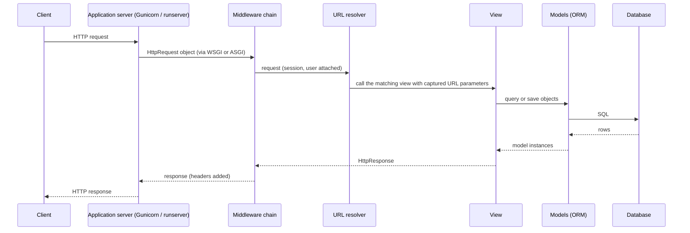
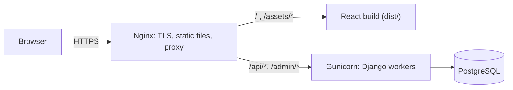

This chapter builds the back end of the separated architecture of [4.14.7](/4.14.7): the server that owns the data, enforces the rules and answers the API requests of the React front end of [4.14.8](/4.14.8). It uses Django, a mature Python web framework ("the web framework for perfectionists with deadlines", first released in 2005), together with Django REST framework (DRF) for the API. As in the previous chapter the aim is the structure rather than the syntax: which jobs a back-end framework divides among which parts, how a request travels through them, how classes become database tables, and how a back end is debugged, tested and deployed. The concepts carry over to other frameworks (Flask and FastAPI in Python, Spring in Java, Express in JavaScript, Rails in Ruby, Gin in Go) under other names. All code is the message board's back end, run with Python 3.14, Django 6.1 and DRF 3.18; Django 5.2 is the long-term support release (supported until April 2028), and the next one, 6.2, is due in April 2027. The databases themselves, SQL and its query processing are the subject of [4.13](/4.13).

## 9.1. What a Back End Does

### 9.1.1. Two Jobs

A back end has two jobs. It exchanges data with the front end: for query requests (`GET`) it returns the data the front end needs to render a page, such as the recommended videos on a home page or the user's profile; for modification requests (`POST` to create, `PUT` or `PATCH` to update, `DELETE` to delete) it checks the request and then performs it, such as uploading a video, posting a comment or deleting an account. The data travels as JSON ([4.14.7](/4.14.7#sec-7.3.2)), which Python's `json` module converts to and from dictionaries and lists. And it manages persistent storage: it organizes users' data so that it can be queried and modified efficiently later, and keeps it consistent. For a very simple application, files may be enough; for anything larger, a database management system ([4.13.1](/4.13.1)) is indispensable: SQLite, a library that keeps a whole database in one file and is ideal for development, tests and small applications, or a server such as PostgreSQL or MySQL in production, possibly with a document store such as MongoDB or a cache such as Redis beside it.

### 9.1.2. The Parts of a Back-End Framework

A mature back-end framework separates these jobs into decoupled parts:

| Part | Job | In Django |
|---|---|---|
| routing | map the path of a request to the function that handles it | `urls.py`: URL patterns |
| models | define the data and interact with the database in object-oriented style | `models.py`: classes mapped to tables by the ORM |
| views | handle a request: check it, use the models, return a response | `views.py`: functions or classes |
| templates | render data into HTML pages, when the framework serves pages itself | `templates/*.html` |
| tests | simulate requests, read and write a test database, assert on the results | `tests.py`: `django.test.TestCase`, `Client` |

The decomposition follows a classic pattern of user-interface software.

**Definition 9.1.1 (Model–View–Controller)** **Model–view–controller** (MVC) is an architectural pattern that divides an interactive application into three kinds of components: the **model**, which holds the data and the business rules and is independent of how they are presented; the **view**, which presents the model to the user; and the **controller**, which receives the user's input, translates it into operations on the model and selects a view to show the result.

MVC originated in Smalltalk-80 for desktop interfaces; web frameworks adapted it to the request–response cycle. Django calls its variant MTV: what Django calls a *view* is the request handler (MVC's controller), what it calls a template is the presentation (MVC's view), and the URL dispatcher together with the framework itself plays the remaining part of the controller. In a separated architecture, templates largely disappear: the "view" of the data is the JSON representation, and the user-facing presentation is the React front end.

| MVC | Django (MTV) | Separated application |
|---|---|---|
| model | model (`models.py`) | model |
| view | template | serializer (JSON) on the back end; React components on the front end |
| controller | view (`views.py`) and URL dispatcher | API view, viewset and router |

## 9.2. Projects and Apps

### 9.2.1. Creating a Project

**Definition 9.2.1 (Django Project and App)** A Django **project** is the configuration of one website: a Python package with its settings (`settings.py`), its root URL configuration (`urls.py`) and its entry points for application servers (`wsgi.py`, `asgi.py`), together with the management script `manage.py`. An **app** is a Python package that implements one self-contained piece of functionality, with its own models, views, URLs, admin configuration, migrations and tests; a project consists of several apps, its own and reusable ones (Django's authentication, admin and sessions are apps).

```bash
uv run --with django --with djangorestframework django-admin startproject config .
uv run --with django --with djangorestframework python manage.py startapp board
```

(`uv run --with ...` runs a command in a temporary environment with the given packages, [4.4](/4.4); in a real project the dependencies are declared in `pyproject.toml` and a **lock file**.) The commands create the project package `config` and the app `board`; with the files added in this chapter the project looks like:

```text
.
├── manage.py            command-line entry point: runserver, migrate, test, shell, ...
├── config/              the project
│   ├── __init__.py
│   ├── settings.py      all configuration
│   ├── urls.py          root URL configuration
│   ├── asgi.py          entry point for ASGI servers (Uvicorn)
│   └── wsgi.py          entry point for WSGI servers (Gunicorn)
└── board/               the message board app
    ├── __init__.py
    ├── admin.py         registration with the admin site
    ├── apps.py          app configuration
    ├── migrations/      generated schema changes (commit them)
    ├── models.py        the data
    ├── serializers.py   JSON representation and validation (DRF)
    ├── permissions.py   access rules (DRF)
    ├── api.py           API views (DRF)
    ├── views.py         plain Django views
    ├── urls.py          the app's URL patterns
    └── tests.py         tests
```

Helper code shared by several apps (utilities for time, request parsing, authentication) goes into a package of its own, for example `utils/`, imported by its path. The project is registered in `settings.py`:

```python
INSTALLED_APPS = [
    'django.contrib.admin',
    'django.contrib.auth',
    'django.contrib.contenttypes',
    'django.contrib.sessions',
    'django.contrib.messages',
    'django.contrib.staticfiles',
    'rest_framework',
    'rest_framework.authtoken',
    'board',
]
```

### 9.2.2. Settings and Middleware

`settings.py` is an ordinary Python module, and everything configurable lives there: `INSTALLED_APPS`; `DATABASES` (by default an SQLite file `db.sqlite3`); `SECRET_KEY`, the key used for signing sessions, CSRF tokens and password-reset links; `DEBUG`; `ALLOWED_HOSTS`; time zone settings (`USE_TZ = True`: store times in UTC); and the middleware.

**Definition 9.2.2 (Middleware)** **Middleware** in a web framework is a layer of code that wraps the handling of every request: each middleware receives the request before the view, can modify it or answer it directly, passes it on to the next layer, and receives the response on its way back, which it can also modify. The middleware form an ordered chain around the views.

Middleware is where crosscutting concerns ([4.14.5](/4.14.5#sec-5.5.3)) are implemented once instead of in every view; each layer is an instance of the **decorator pattern**. Django's default chain:

```python
MIDDLEWARE = [
    'django.middleware.security.SecurityMiddleware',          # HTTPS redirects, security headers
    'django.contrib.sessions.middleware.SessionMiddleware',   # load and save the session
    'django.middleware.common.CommonMiddleware',              # URL normalization (trailing slash)
    'django.middleware.csrf.CsrfViewMiddleware',              # CSRF protection
    'django.contrib.auth.middleware.AuthenticationMiddleware', # request.user from the session
    'django.contrib.messages.middleware.MessageMiddleware',   # one-time messages for templates
    'django.middleware.clickjacking.XFrameOptionsMiddleware',  # X-Frame-Options: DENY
]
```

The order matters: authentication needs the session, so `AuthenticationMiddleware` comes after `SessionMiddleware`. The security headers seen in the responses of [4.14.7](/4.14.7#sec-7.1.1) and the `403` for a `POST` without a CSRF token ([4.14.7](/4.14.7#sec-7.5.4)) both come from this chain.

### 9.2.3. The Life of a Request



A Python web application talks to the HTTP server through a standard interface: WSGI (synchronous, PEP 3333) or ASGI (asynchronous, which also supports WebSockets and long-lived connections). During development, `python manage.py runserver` starts a simple server that reloads the code on every change; in production an application server runs the project (§9.8).

## 9.3. Routing

The first question when a request arrives is which view of which app handles it. Django answers it with the `urls.py` files of the project and of the apps. Suppose the back end runs at `my-backend.com` and receives a request for `my-backend.com/board/restart`. Django searches the project's URL configuration for a pattern matching `board/restart`:

```python
urlpatterns = [
    path('board/', include('board.urls')),
]
```

The pattern `board/` matches the beginning of the path; `include` strips it and hands the rest, `restart`, to the app's URL configuration `board/urls.py`:

```python
urlpatterns = [
    path('restart', views.restart_board),
]
```

The remaining `restart` matches the first pattern, and Django calls the function `restart_board` in `board/views.py`, passing it an `HttpRequest` object that describes the request (method, headers, body, the session and the user) and, as keyword arguments, any values captured from the path. Path converters capture and convert parts of the path: with `path('users/<int:user_id>/', views.user_detail)`, a request for `users/42/` calls `user_detail(request, user_id=42)`, and `users/abc/` does not match at all, so the view never sees a malformed ID. The converters are `str` (the default, any segment without `/`), `int`, `slug`, `uuid` and `path`; `re_path` accepts regular expressions. Patterns can be named (`name="user-detail"`) so that code builds URLs with `reverse("user-detail", args=[42])` instead of hard-coding them.

The message board's configuration mounts the app under `api/`:

```python
# config/urls.py
from django.contrib import admin
from django.urls import include, path

urlpatterns = [
    path("admin/", admin.site.urls),
    path("api/", include("board.urls")),
]
```

```python
# board/urls.py
from django.urls import path
from rest_framework.authtoken.views import obtain_auth_token
from rest_framework.routers import DefaultRouter

from . import api, views

router = DefaultRouter()
router.register("messages", api.MessageViewSet)

urlpatterns = [
    path("latest/", views.latest_messages),
    path("token/", obtain_auth_token),
    *router.urls,
]
```

The router (§9.6.2) generates the patterns for the message resource; listing all patterns of the project shows the result:

```text
api/latest/
api/token/
api/^messages/$                     message-list
api/^messages/(?P<pk>[^/.]+)/$      message-detail
api/                                api-root
```

## 9.4. Models and the ORM

### 9.4.1. Object–Relational Mapping

A relational database ([4.13.2](/4.13.2)) stores data in tables of rows and columns; a Python program works with objects. Bridging the two by hand means writing SQL for every query and copying values between rows and objects.

**Definition 9.4.1 (Object–Relational Mapping)** **Object–relational mapping** (ORM) is a technique that maps a relational database to the classes of an object-oriented program: each table corresponds to a class (an *entity class*), each column to an attribute, each row to an instance, and each foreign key to a reference between objects. A library that implements it, an *object–relational mapper*, generates the SQL for creating the tables and for loading, saving and querying objects, so that the program views a table as the collection of all instances of its class.

In Django, a model is a class derived from `django.db.models.Model` in an app's `models.py`; each class attribute that is a field describes a column:

```python
from django.conf import settings
from django.db import models


class Message(models.Model):
    author = models.ForeignKey(
        settings.AUTH_USER_MODEL, on_delete=models.CASCADE, related_name="messages"
    )
    content = models.CharField(max_length=280)
    created_at = models.DateTimeField(auto_now_add=True)

    class Meta:
        ordering = ["-created_at", "-id"]

    def __str__(self):
        return f"{self.author}: {self.content[:20]}"
```

Django adds an automatic primary key `id` (a 64-bit `BigAutoField`). `CharField(max_length=280)` becomes `varchar(280)` and is also the validation rule for forms and serializers; `DateTimeField(auto_now_add=True)` stores the creation time, in UTC, when the object is first saved; the `ForeignKey` to the user model becomes a column `author_id` with a foreign-key constraint and an index, and `on_delete=models.CASCADE` deletes a user's messages with the user (alternatives: `PROTECT`, `SET_NULL`; Django 6.1 adds `DB_CASCADE`, which leaves the cascade to the database). `related_name` gives the reverse direction: `alice.messages.all()`. `Meta.ordering` is the default order of queries. The users themselves come from the app `django.contrib.auth`, whose `User` model stores passwords only as salted hashes ([4.14.7](/4.14.7#sec-7.4.1)); an application should use it (or a custom user model derived from `AbstractUser`, set as `AUTH_USER_MODEL` at the start of a project) instead of a home-made model with a password column.

### 9.4.2. Migrations

**Definition 9.4.2 (Migration)** A **schema migration** is a versioned, replayable description of a change to the structure of a database (creating a table, adding a column, adding an index), together with the reverse change where possible. Migrations are applied in order, and the database records which ones it has applied, so that the schema of every copy of the database (on each developer's machine, in tests, in production) can be brought to the same version.

After changing `models.py`, Django compares the models with the state recorded in the existing migrations and generates a new migration; `migrate` applies it:

```text
$ python manage.py makemigrations board
Migrations for 'board':
  board/migrations/0001_initial.py
    + Create model Message
$ python manage.py migrate
Operations to perform:
  Apply all migrations: admin, auth, authtoken, board, contenttypes, sessions
Running migrations:
  Applying contenttypes.0001_initial... OK
  Applying auth.0001_initial... OK
  ...
  Applying board.0001_initial... OK
  Applying sessions.0001_initial... OK
```

`sqlmigrate` shows the SQL that a migration executes on the configured database (here SQLite):

```text
$ python manage.py sqlmigrate board 0001
BEGIN;
--
-- Create model Message
--
CREATE TABLE "board_message" ("id" integer NOT NULL PRIMARY KEY AUTOINCREMENT, "content" varchar(280) NOT NULL, "created_at" datetime NOT NULL, "author_id" integer NOT NULL REFERENCES "auth_user" ("id") DEFERRABLE INITIALLY DEFERRED);
CREATE INDEX "board_message_author_id_83908abc" ON "board_message" ("author_id");
COMMIT;
```

Migrations are source code: they are committed to Git with the model change, reviewed in the pull request, and applied by the deployment before the new code starts. Rules that avoid trouble: never edit a migration that has been applied anywhere else, but add a new one; resolve two migrations created on parallel branches with `makemigrations --merge`; write *data migrations* (`RunPython`) when existing rows must be transformed; and on a database in use, make changes in compatible steps (add a nullable column, fill it, then make it required), so that the old and the new version of the code can run against the same schema during a rolling deployment.

### 9.4.3. Queries

Every model has a *manager*, `Message.objects`, whose methods return a `QuerySet`: a description of a query that can be refined by further methods and is executed only when its results are needed (iteration, `len`, `list`, slicing with a step, `count()`, `first()`), an instance of **lazy evaluation**. Field lookups are written as keyword arguments with double underscores, which also follow relations: `author__username="alice"` joins the user table.

```python
from django.contrib.auth.models import User
from board.models import Message

alice = User.objects.create_user("alice", password="s3cret-pass")
bob = User.objects.create_user("bob", password="an0ther-pass")
Message.objects.create(author=alice, content="Hello, board!")
Message.objects.create(author=bob, content="Hi Alice")
Message.objects.create(author=alice, content="Lunch at noon?")

qs = Message.objects.filter(author__username="alice").order_by("created_at")
print(qs.count())
print([m.content for m in qs])
print(qs.query)
print(Message.objects.exclude(content__icontains="hi").values_list("content", flat=True))
```

```text
2
['Hello, board!', 'Lunch at noon?']
SELECT "board_message"."id", "board_message"."author_id", "board_message"."content", "board_message"."created_at" FROM "board_message" INNER JOIN "auth_user" ON ("board_message"."author_id" = "auth_user"."id") WHERE "auth_user"."username" = alice ORDER BY "board_message"."created_at" ASC
<QuerySet ['Lunch at noon?', 'Hello, board!']>
```

The printed SQL shows the value `alice` inline only for display; the query actually sent to the database is parameterized, with the value bound separately, which is why ORM queries are not open to SQL injection ([4.13.4](/4.13.4#sec-4.9.2)). Raw SQL remains available (`Message.objects.raw(...)`, `connection.cursor()`) for queries the ORM cannot express, with the same obligation to pass parameters separately. Other common operations: `get(pk=4)` (exactly one object, else an exception), `update()` and `delete()` on a whole queryset in one statement, aggregation with `aggregate(Count("id"))` and `annotate()`, and `F()` expressions that refer to columns, such as `update(likes=F("likes") + 1)`, which increments in the database and avoids a lost update between two concurrent requests.

### 9.4.4. The N+1 Problem and Transactions

The convenience of following relations as attributes hides the queries they cost. Reading the author of each message issues one query for the messages and then one per message for its author:

```python
from django.db import connection, reset_queries
from board.models import Message

reset_queries()
names = [m.author.username for m in Message.objects.all()]
print(len(connection.queries), names)

reset_queries()
names = [m.author.username for m in Message.objects.select_related("author")]
print(len(connection.queries), names)
```

```text
4 ['alice', 'bob', 'alice']
1 ['alice', 'bob', 'alice']
```

With $N$ messages the first loop issues $N+1$ queries, each a round trip to the database server; the second issues one query with a join. `select_related` follows foreign keys with a join; `prefetch_related` loads many-to-many and reverse relations with one extra query per relation; Django 6.1's *fetch modes* (`Message.objects.fetch_mode(models.FETCH_PEERS)`) load a missing related field for all objects of the queryset at once when it is first accessed. Such problems are found by counting queries: in tests with `assertNumQueries`, in development with django-debug-toolbar.

Several changes that must succeed or fail together are wrapped in a transaction ([4.13.10](/4.13.10)) with `transaction.atomic()`, as a decorator or context manager; if an exception escapes the block, all its changes are rolled back:

```python
from django.db import transaction

with transaction.atomic():
    order = Order.objects.create(user=user, total=total)
    Stock.objects.filter(pk=item.pk).update(count=F("count") - 1)
```

## 9.5. Views

**Definition 9.5.1 (View)** A Django **view** is a callable that takes an `HttpRequest` (and the parameters captured from the URL) and returns an `HttpResponse`; it is the main entry point of the back-end logic for one kind of request.

A plain Django view that returns the five newest messages as JSON:

```python
from django.http import HttpRequest, JsonResponse
from django.views.decorators.http import require_GET

from .models import Message


@require_GET
def latest_messages(request: HttpRequest) -> JsonResponse:
    messages = Message.objects.select_related("author")[:5]
    data = [
        {"id": m.id, "author": m.author.username, "content": m.content}
        for m in messages
    ]
    return JsonResponse({"results": data})
```

The decorator answers every method other than `GET` with `405 Method Not Allowed`; slicing a queryset becomes `LIMIT 5`. A view that handles several methods branches on `request.method`, and a view for modifications must parse `request.body` (`json.loads`), validate every field, check that the user is authenticated and allowed, perform the change and return `201`, `400`, `401`, `403` or `404` as appropriate ([4.14.7](/4.14.7#sec-7.1.2)). Projects often write small helpers for this (a function that returns an error response with a status code and a message, a decorator that checks a JWT), and Django offers class-based views (`View`, `ListView`, `DetailView`) that put each method in its own method of a class. For an API, Django REST framework provides all of this ready-made. Django can serve pages too: a view may render a template, and the built-in *admin site*, enabled by registering a model in `admin.py`, gives staff a complete interface for browsing and editing the data with no further code:

```python
from django.contrib import admin

from .models import Message


@admin.register(Message)
class MessageAdmin(admin.ModelAdmin):
    list_display = ["id", "author", "content", "created_at"]
    search_fields = ["content", "author__username"]
```

## 9.6. Django REST Framework

### 9.6.1. Serializers

An API view repeats the same steps for every resource: convert model instances to JSON, parse incoming JSON, validate it field by field and report errors per field, create or update instances. Django REST framework factors them into serializers.

**Definition 9.6.1 (Serialization)** **Serialization** is the conversion of an in-memory object into a format that can be stored or transmitted (a JSON text, a byte string), and **deserialization** the reverse conversion. In Django REST framework a *serializer* class does both for one resource and also validates the incoming data, so that it is the single place that defines the resource's representation in the API.

```python
from rest_framework import serializers

from .models import Message


class MessageSerializer(serializers.ModelSerializer):
    author = serializers.ReadOnlyField(source="author.username")

    class Meta:
        model = Message
        fields = ["id", "author", "content", "created_at"]
        read_only_fields = ["id", "created_at"]

    def validate_content(self, value: str) -> str:
        value = value.strip()
        if not value:
            raise serializers.ValidationError("Content must not be blank.")
        return value
```

A `ModelSerializer` derives its fields and their validation from the model (`content` is a string of at most 280 characters, required). The explicit `fields` list is an allowlist: fields not listed are neither shown nor accepted, which protects against mass assignment ([4.14.7](/4.14.7#sec-7.5.1)), and `author` is read-only, shown as the username but never taken from the request. `validate_<field>` methods add rules of one's own. The serializer's output is exactly the JSON that the TypeScript interface `Message` of the front end describes ([4.14.8](/4.14.8#sec-8.4.2)).

### 9.6.2. ViewSets and Routers

A *viewset* groups the views of one resource into one class, and a *router* generates their URL patterns:

```python
from rest_framework import permissions, viewsets

from .models import Message
from .permissions import IsAuthorOrReadOnly
from .serializers import MessageSerializer


class MessageViewSet(viewsets.ModelViewSet):
    queryset = Message.objects.select_related("author")
    serializer_class = MessageSerializer
    permission_classes = [permissions.IsAuthenticatedOrReadOnly, IsAuthorOrReadOnly]

    def perform_create(self, serializer):
        # The author is the authenticated user, never a field sent by the client.
        serializer.save(author=self.request.user)
```

| Action | Method and URL | Status on success |
|---|---|---|
| `list` | `GET /api/messages/` | `200`, one page |
| `create` | `POST /api/messages/` | `201` |
| `retrieve` | `GET /api/messages/{id}/` | `200` |
| `update`, `partial_update` | `PUT`, `PATCH /api/messages/{id}/` | `200` |
| `destroy` | `DELETE /api/messages/{id}/` | `204` |

Global behavior is configured in `settings.py`; the message board paginates lists by page number ([4.14.7](/4.14.7#sec-7.3.4)) and accepts two authentication methods:

```python
REST_FRAMEWORK = {
    "DEFAULT_AUTHENTICATION_CLASSES": [
        "rest_framework.authentication.TokenAuthentication",
        "rest_framework.authentication.SessionAuthentication",
    ],
    "DEFAULT_PAGINATION_CLASS": "rest_framework.pagination.PageNumberPagination",
    "PAGE_SIZE": 20,
}
```

These twenty lines of serializer and viewset give a complete resource with validation, pagination, per-field error messages ([4.14.7](/4.14.7#sec-7.3.3)), `404` for unknown IDs, `405` for unsupported methods and a browsable HTML version of the API for developers. An unknown ID:

```text
$ curl -i http://127.0.0.1:8000/api/messages/1/
HTTP/1.1 404 Not Found
Content-Type: application/json

{"detail":"No Message matches the given query."}
```

### 9.6.3. Authentication and Permissions

DRF separates the two questions of [4.14.7](/4.14.7#sec-7.4.1). *Authentication classes* determine `request.user` from the request: `TokenAuthentication` from an `Authorization: Token ...` header, looked up in a table of opaque tokens (the app `rest_framework.authtoken`), and `SessionAuthentication` from Django's session cookie, with CSRF enforcement. JWT authentication is available from the package `djangorestframework-simplejwt`. *Permission classes* then decide: `IsAuthenticatedOrReadOnly` lets anyone read and only authenticated users write, and an object-level permission of one's own lets only the author change or delete a message:

```python
from rest_framework import permissions


class IsAuthorOrReadOnly(permissions.BasePermission):
    """Anyone may read; only the author may change or delete a message."""

    def has_object_permission(self, request, view, obj):
        if request.method in permissions.SAFE_METHODS:
            return True
        return obj.author == request.user
```

The view `obtain_auth_token` exchanges a username and password for a token. A session with `curl` (the `$` lines are commands; `$TOKEN` holds the token):

```text
$ curl -X POST http://127.0.0.1:8000/api/token/ -H 'Content-Type: application/json' \
       -d '{"username": "alice", "password": "s3cret-pass"}'
{"token":"71f108dd0617a960e928b5820fbbf7c0c9554303"}

$ curl -i -X POST http://127.0.0.1:8000/api/messages/ -H "Authorization: Token $TOKEN" \
       -H 'Content-Type: application/json' -d '{"author": "bob", "content": "  Posted with a token  "}'
HTTP/1.1 201 Created
Content-Type: application/json

{"id":4,"author":"alice","content":"Posted with a token","created_at":"2026-10-21T12:53:52.386793Z"}

$ curl -i -X DELETE http://127.0.0.1:8000/api/messages/2/ -H "Authorization: Token $TOKEN"
HTTP/1.1 403 Forbidden
Content-Type: application/json

{"detail":"You do not have permission to perform this action."}
```

The attempt to post as Bob is ignored (the author is Alice, the owner of the token), the content is trimmed by the serializer, and Alice may not delete Bob's message 2. Without a token the same `POST` receives `401` ([4.14.7](/4.14.7#sec-7.4.1)).

## 9.7. Debugging and Testing

### 9.7.1. Manual Testing and Debugging

A back end without a front end is exercised by sending requests directly. `curl` and HTTPie do it from the command line, as in this chapter; API platforms such as Postman, Apifox and Bruno provide a graphical interface for building requests with any method, headers and body (JSON, form data, files), inspecting responses, saving requests in shared collections, setting variables such as the token per environment, and attaching small test scripts to requests. DRF's browsable API, shown when a URL is opened in a browser, serves the same purpose for quick checks. The development server logs every request with its status, which is often enough to see what happened:

```text
Unauthorized: /api/messages/
[21/Oct/2026 12:53:51] "POST /api/messages/ HTTP/1.1" 401 58
[21/Oct/2026 12:53:52] "POST /api/token/ HTTP/1.1" 200 52
[21/Oct/2026 12:53:52] "POST /api/messages/ HTTP/1.1" 201 100
Forbidden: /api/messages/2/
[21/Oct/2026 12:53:52] "DELETE /api/messages/2/ HTTP/1.1" 403 63
```

For deeper **debugging**: with `DEBUG = True`, an unhandled exception produces a page with the traceback and the local variables of every frame (which is also why `DEBUG` must never be on in production); a call to `breakpoint()` in a view stops the development server in the Python debugger at that line, and an IDE can set a **breakpoint** without changing the code; `python manage.py shell` gives an interactive session with the models, as in §9.4.3; the `logging` module, configured in `settings.py`, records what happens in production; and django-debug-toolbar shows the SQL queries, their time and the templates of each request. Security testing tools such as Burp Suite act as a proxy between browser and server and let a tester intercept and modify any request, which is the practical demonstration that the client is not to be trusted.

### 9.7.2. Unit Tests

Manual requests check a change once; automated tests check it after every change. In a large project, a change in one place often breaks a function elsewhere, and a fixed set of test programs and test cases, run on every commit by continuous integration ([4.14.3](/4.14.3#sec-3.8)), ensures that only versions that pass reach users. For a back end, a test plays the role of the front end and of a database inspector at once: it treats the routing and the views as a black box, sends simulated requests, and asserts what the response must be and how the database must have changed, much like the test data of an **online judge** that define what the output for each input must be. The tests should cover the normal cases and as many corner cases as possible: invalid and missing fields, boundary lengths, missing credentials, someone else's object.

Django's `TestCase` creates a separate test database, runs each test inside a transaction that is rolled back afterwards (so that tests do not see each other's data), and provides a `Client` that sends requests to the application without a network; DRF's `APITestCase` and `APIClient` add JSON handling and `force_authenticate`. The tests of the message board:

```python
from django.contrib.auth.models import User
from rest_framework import status
from rest_framework.test import APITestCase

from .models import Message


class MessageApiTests(APITestCase):
    def setUp(self):
        self.alice = User.objects.create_user("alice", password="pw-alice-123")
        self.bob = User.objects.create_user("bob", password="pw-bob-123")
        self.msg = Message.objects.create(author=self.bob, content="Hi Alice")

    def test_anyone_can_list(self):
        response = self.client.get("/api/messages/")
        self.assertEqual(response.status_code, status.HTTP_200_OK)
        self.assertEqual(response.data["count"], 1)
        self.assertEqual(response.data["results"][0]["author"], "bob")

    def test_anonymous_cannot_post(self):
        response = self.client.post("/api/messages/", {"content": "spam"}, format="json")
        self.assertEqual(response.status_code, status.HTTP_401_UNAUTHORIZED)
        self.assertEqual(Message.objects.count(), 1)

    def test_author_comes_from_login_not_from_body(self):
        self.client.force_authenticate(user=self.alice)
        response = self.client.post(
            "/api/messages/", {"author": "bob", "content": "  hello  "}, format="json"
        )
        self.assertEqual(response.status_code, status.HTTP_201_CREATED)
        self.assertEqual(response.data["author"], "alice")
        self.assertEqual(Message.objects.get(pk=response.data["id"]).content, "hello")

    def test_blank_and_too_long_content_rejected(self):
        self.client.force_authenticate(user=self.alice)
        for content in ["   ", "x" * 281]:
            response = self.client.post("/api/messages/", {"content": content}, format="json")
            self.assertEqual(response.status_code, status.HTTP_400_BAD_REQUEST)
            self.assertIn("content", response.data)

    def test_only_author_can_delete(self):
        self.client.force_authenticate(user=self.alice)
        url = f"/api/messages/{self.msg.id}/"
        self.assertEqual(self.client.delete(url).status_code, status.HTTP_403_FORBIDDEN)
        self.client.force_authenticate(user=self.bob)
        self.assertEqual(self.client.delete(url).status_code, status.HTTP_204_NO_CONTENT)
        self.assertFalse(Message.objects.exists())

    def test_token_login(self):
        response = self.client.post(
            "/api/token/", {"username": "alice", "password": "pw-alice-123"}, format="json"
        )
        self.assertEqual(response.status_code, status.HTTP_200_OK)
        token = response.data["token"]
        self.client.credentials(HTTP_AUTHORIZATION=f"Token {token}")
        response = self.client.post("/api/messages/", {"content": "via token"}, format="json")
        self.assertEqual(response.status_code, status.HTTP_201_CREATED)
```

```text
$ python manage.py test -v 2
Found 6 test(s).
Creating test database for alias 'default' ('file:memorydb_default?mode=memory&cache=shared')...
...
test_anonymous_cannot_post (board.tests.MessageApiTests.test_anonymous_cannot_post) ... ok
test_anyone_can_list (board.tests.MessageApiTests.test_anyone_can_list) ... ok
test_author_comes_from_login_not_from_body (board.tests.MessageApiTests.test_author_comes_from_login_not_from_body) ... ok
test_blank_and_too_long_content_rejected (board.tests.MessageApiTests.test_blank_and_too_long_content_rejected) ... ok
test_only_author_can_delete (board.tests.MessageApiTests.test_only_author_can_delete) ... ok
test_token_login (board.tests.MessageApiTests.test_token_login) ... ok

----------------------------------------------------------------------
Ran 6 tests in 3.284s

OK
```

Four of the six tests are negative tests: they check that the back end refuses what it must refuse, which is exactly what a front end, however correct, cannot guarantee. The boundary 281 characters is chosen just above the limit of 280. The same tests run under pytest with the plugin pytest-django, which many projects prefer for its fixtures and concise assertions; a `pytest.ini` names the settings module:

```text
$ cat pytest.ini
[pytest]
DJANGO_SETTINGS_MODULE = config.settings
python_files = tests.py test_*.py
$ pytest
collected 6 items

board/tests.py ......                                                    [100%]

============================== 6 passed in 2.06s ===============================
```

Who should write these tests? A tester who did not write the code thinks of cases the developer overlooked, since a case the developer could imagine has usually been handled already; this is the value of independent testing, and of review. But it does not follow that developers should not test: in current practice developers write the **unit tests** for their own code, often before the code (test-driven development), and run them on every change, while independent testers concentrate on integration, system and acceptance testing ([4.14.12](/4.14.12)). Designing test cases systematically, by equivalence classes and boundary values, is the subject of [4.14.11](/4.14.11).

## 9.8. Deployment

### 9.8.1. Production Settings

The development server and the default settings are for development only. Django's deployment check lists what must change:

```text
$ python manage.py check --deploy
SystemCheckError: System check identified some issues:

ERRORS:
?: (mail.E001) Your MAILERS setting uses a development-only email backend in the 'default' entry (django.core.mail.backends.console.EmailBackend).

WARNINGS:
?: (security.W004) You have not set a value for the SECURE_HSTS_SECONDS setting. ...
?: (security.W008) Your SECURE_SSL_REDIRECT setting is not set to True. ...
?: (security.W009) Your SECRET_KEY has less than 50 characters, less than 5 unique characters, or it's prefixed with 'django-insecure-' indicating that it was generated automatically by Django. ...
?: (security.W012) SESSION_COOKIE_SECURE is not set to True. ...
?: (security.W016) You have 'django.middleware.csrf.CsrfViewMiddleware' in your MIDDLEWARE, but you have not set CSRF_COOKIE_SECURE to True. ...
?: (security.W018) You should not have DEBUG set to True in deployment.
?: (security.W020) ALLOWED_HOSTS must not be empty in deployment.

System check identified 8 issues (0 silenced).
```

Settings that differ between environments, and above all secrets, are read from **environment variables**, so that the same code runs everywhere and no secret is ever committed to Git:

```python
import os

SECRET_KEY = os.environ.get("DJANGO_SECRET_KEY", "django-insecure-dev-only")
DEBUG = os.environ.get("DJANGO_DEBUG", "1") == "1"
ALLOWED_HOSTS = os.environ.get("DJANGO_ALLOWED_HOSTS", "localhost,127.0.0.1").split(",")
```

`ALLOWED_HOSTS` makes Django reject requests whose `Host` header names another site (`400 Bad Request`), which defeats attacks based on forged host names. In production, the database is a server such as PostgreSQL, configured through a connection URL in an environment variable; static files (the admin's CSS) are collected with `collectstatic` and served by the reverse proxy, a CDN or the package WhiteNoise; `SECURE_SSL_REDIRECT`, `SECURE_HSTS_SECONDS` and secure cookies enforce HTTPS ([4.14.7](/4.14.7#sec-7.5.5)).

The project is run by a production application server: Gunicorn for WSGI, with several worker **processes** so that requests are handled in parallel, or Uvicorn (or Gunicorn with Uvicorn workers) for ASGI. With `DEBUG` off and a random secret key:

```text
$ DJANGO_DEBUG=0 DJANGO_SECRET_KEY=... gunicorn config.wsgi --bind 127.0.0.1:8000 --workers 2
[INFO] Starting gunicorn 26.2.0
[INFO] Listening at: http://127.0.0.1:8000 (36011)
[INFO] Using worker: sync
[INFO] Booting worker with pid: 36018
[INFO] Booting worker with pid: 36019
$ curl -s -i -H 'Host: evil.example' http://127.0.0.1:8000/api/messages/ | head -1
HTTP/1.1 400 Bad Request
```

### 9.8.2. Putting the Pieces Together

A complete deployment of the message board combines the two halves of [4.14.7](/4.14.7#sec-7.2.2): a reverse proxy serves the React build and forwards `/api/` and `/admin/` to Gunicorn.



An Nginx configuration for it (a sketch; TLS certificates omitted):

```text
server {
    listen 443 ssl;
    server_name board.example.com;

    root /srv/board/frontend/dist;

    location /assets/ {                  # hashed file names: cache forever
        add_header Cache-Control "public, max-age=31536000, immutable";
    }
    location /api/ {
        proxy_pass http://127.0.0.1:8000;
        proxy_set_header Host $host;
        proxy_set_header X-Forwarded-Proto $scheme;
    }
    location / {                         # SPA fallback for client-side routes
        try_files $uri /index.html;
    }
}
```

Today the back end is usually shipped as a container image ([4.11.9](/4.11.9#sec-9.4)), which packages the code with exactly the interpreter and libraries it was tested with; the same image runs on a developer's machine, in CI and on a cluster:

```dockerfile
FROM python:3.14-slim
WORKDIR /app
COPY requirements.txt .
RUN pip install --no-cache-dir -r requirements.txt
COPY . .
RUN python manage.py collectstatic --noinput
EXPOSE 8000
CMD ["gunicorn", "config.wsgi", "--bind", "0.0.0.0:8000", "--workers", "3"]
```

Because the back end keeps no state in its processes (sessions and tokens are in the database), the orchestrator can run as many replicas of the image as the load requires, behind a load balancer ([4.14.6](/4.14.6#sec-6.5.6)). The CI pipeline of [4.14.3](/4.14.3#sec-3.8) runs both test suites, the Django tests and the Vitest tests, on every pull request, builds the image and the front end, and the deployment applies the migrations before switching traffic to the new version; monitoring and operations after that are the subject of [4.14.13](/4.14.13).

## 9.9. Back-End Work with Coding Agents

A back-end framework with strong conventions is an advantage when a **coding agent** writes the code: models, serializers, viewsets and tests have a standard shape, and the framework's checks (`manage.py check`, migrations, the test runner) give the agent fast, objective feedback. The parts that need a human are those where a plausible implementation can be wrong in ways that no test written by the same agent will reveal. Access control: every viewset needs the right permission classes and every object-level rule a test with a second user, as in §9.7.2. Data: a generated migration is a change to production data and must be read before it is applied, especially one that drops or renames a column; queries inside loops should be checked for the N+1 pattern with `assertNumQueries`. Secrets and configuration: an agent that cannot make something work may switch `DEBUG` on, widen `ALLOWED_HOSTS` or `CORS_ALLOWED_ORIGINS` to everything, or add `@csrf_exempt`; the deployment check and code review should catch such changes. The most effective division of labor is the one of [4.14.7](/4.14.7#sec-7.6): a human states the API contract and the negative tests, and the agent implements until they pass.

## Summary

- A back end exchanges data with the front end (queries with `GET`, modifications with `POST`, `PUT`, `PATCH`, `DELETE`, in JSON) and manages persistent storage. A framework divides the work into routing, models, views, templates and tests, a web variant of model–view–controller (Django's MTV).
- A Django project holds the settings, the root URLs and the WSGI/ASGI entry points; apps hold models, views, URLs, migrations and tests. Middleware wraps every request with crosscutting concerns: sessions, authentication, CSRF, security headers.
- `urls.py` maps paths to views, through `include` for apps and path converters for parameters. A view takes an `HttpRequest` and returns an `HttpResponse`.
- Models map classes to tables (ORM); migrations version the schema and are committed and reviewed; querysets are lazy and parameterized; `select_related` and `prefetch_related` avoid N+1 queries; `transaction.atomic` groups changes.
- Django REST framework: serializers define the representation and validation of a resource (an allowlist of fields), viewsets and routers its endpoints, authentication classes who the user is, permission classes what they may do.
- Debug with curl or Postman, the development server's log, `breakpoint()` and the shell; test the API as a black box with `APITestCase`, including the negative cases, under `manage.py test` or pytest-django.
- Deploy with `DEBUG` off, secrets in environment variables, `check --deploy` clean, Gunicorn or Uvicorn behind a reverse proxy that also serves the React build, usually as a container image with stateless replicas.
