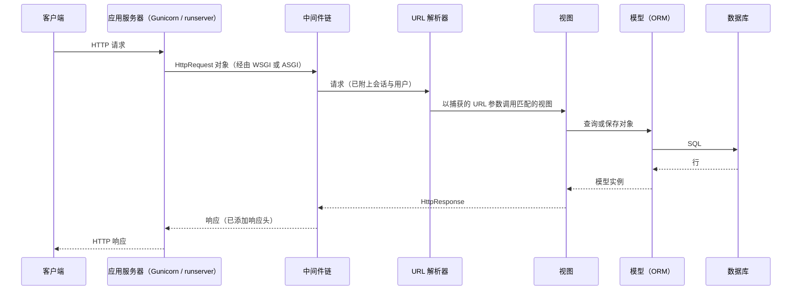
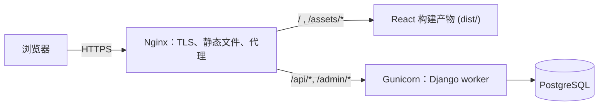

本章构建 [4.14.7](/4.14.7) 中前后端分离架构的后端：它是数据的持有者，负责执行业务规则，并响应 [4.14.8](/4.14.8) 中 React 前端发来的 API 请求。本章使用成熟的 Python Web 框架 Django（"为有截止日期的完美主义者准备的 Web 框架"，2005 年首次发布），并配合 Django REST framework（DRF）实现 API。与上一章一样，重点在结构而非语法：后端框架把哪些工作分给哪些部分，请求如何依次经过它们，类如何变成数据库表，以及后端如何调试、测试与部署。这些概念在其他框架中同样适用，只是名称不同（Python 的 Flask 与 FastAPI，Java 的 Spring，JavaScript 的 Express，Ruby 的 Rails，Go 的 Gin）。所有代码都是留言板的后端，运行环境为 Python 3.14、Django 6.1 与 DRF 3.18；Django 5.2 是长期支持版本（支持到 2028 年 4 月），下一个长期支持版本 6.2 预计在 2027 年 4 月发布。数据库本身、**SQL** 及其查询处理是 [4.13](/4.13) 的内容。

## 9.1. 后端做什么

### 9.1.1. 两项工作

后端有两项工作。一是与前端交换数据：对于查询请求（`GET`），返回前端渲染页面所需的数据，例如首页的推荐视频或用户的个人资料；对于修改请求（`POST` 创建，`PUT` 或 `PATCH` 更新，`DELETE` 删除），先检查请求再执行，例如上传视频、发表评论或注销账号。数据以 JSON 形式传输（[4.14.7](/4.14.7#sec-7.3.2)），Python 的 `json` 模块可在 JSON 与字典、列表之间互相转换。二是管理持久存储：把用户数据组织起来，使之日后能被高效地查询和修改，并保持一致。对于非常简单的应用，文件可能就够了；稍大一些的应用则离不开**数据库管理系统**（[4.13.1](/4.13.1)）：开发、测试和小型应用适合用 SQLite（把整个数据库存放在一个文件中的库），生产环境则用 PostgreSQL 或 MySQL 之类的服务器，旁边可能还有 MongoDB 之类的文档存储或 Redis 之类的缓存。

### 9.1.2. 后端框架的组成

成熟的后端框架把这些工作分给相互解耦的几个部分：

| 部分 | 职责 | 在 Django 中 |
|---|---|---|
| 路由 | 把请求的路径映射到处理它的函数 | `urls.py`：URL 模式 |
| 模型 | 定义数据，并以面向对象的方式与数据库交互 | `models.py`：由 ORM 映射为表的类 |
| 视图 | 处理请求：检查请求、使用模型、返回响应 | `views.py`：函数或类 |
| 模板 | 当框架自己提供页面时，把数据渲染成 HTML 页面 | `templates/*.html` |
| 测试 | 模拟请求，读写测试数据库，对结果作断言 | `tests.py`：`django.test.TestCase`、`Client` |

这种划分遵循用户界面软件的一个经典模式。

**定义 9.1.1（模型-视图-控制器）** **模型-视图-控制器**（MVC）是一种架构模式，它把交互式应用划分为三类组件：**模型**，保存数据与业务规则，与数据如何呈现无关；**视图**，把模型呈现给用户；**控制器**，接收用户输入，把它转换为对模型的操作，并选择视图来展示结果。

MVC 起源于 Smalltalk-80 的桌面界面；Web 框架把它改造成适应请求-响应循环的形式。Django 称自己的变体为 MTV：Django 所说的*视图*是请求处理函数（相当于 MVC 的控制器），它所说的模板是呈现层（相当于 MVC 的视图），URL 分发器与框架本身承担控制器的其余部分。在前后端分离的架构中，模板基本消失：数据的"视图"就是 JSON 表示，面向用户的呈现则由 React 前端完成。

| MVC | Django（MTV） | 前后端分离的应用 |
|---|---|---|
| 模型 | 模型（`models.py`） | 模型 |
| 视图 | 模板 | 后端的序列化器（JSON）；前端的 React 组件 |
| 控制器 | 视图（`views.py`）与 URL 分发器 | API 视图、视图集与路由器 |

## 9.2. 项目与应用

### 9.2.1. 创建项目

**定义 9.2.1（Django 项目与应用）** Django **项目**是一个网站的配置：一个 Python 包，包含配置（`settings.py`）、根 URL 配置（`urls.py`）和面向应用服务器的入口（`wsgi.py`、`asgi.py`），外加管理脚本 `manage.py`。**应用**是实现一块自成一体的功能的 Python 包，有自己的模型、视图、URL、管理站点配置、迁移与测试；一个项目由若干应用组成，既有自己编写的，也有可复用的（Django 的认证、管理站点与会话都是应用）。

```bash
uv run --with django --with djangorestframework django-admin startproject config .
uv run --with django --with djangorestframework python manage.py startapp board
```

（`uv run --with ...` 在装有指定包的临时环境中运行命令，见 [4.4](/4.4)；真实项目会在 `pyproject.toml` 中声明依赖，并配有**锁文件**。）这两条命令创建了项目包 `config` 与应用 `board`；加上本章添加的文件，项目的结构如下：

```text
.
├── manage.py            command-line entry point: runserver, migrate, test, shell, ...
├── config/              the project
│   ├── __init__.py
│   ├── settings.py      all configuration
│   ├── urls.py          root URL configuration
│   ├── asgi.py          entry point for ASGI servers (Uvicorn)
│   └── wsgi.py          entry point for WSGI servers (Gunicorn)
└── board/               the message board app
    ├── __init__.py
    ├── admin.py         registration with the admin site
    ├── apps.py          app configuration
    ├── migrations/      generated schema changes (commit them)
    ├── models.py        the data
    ├── serializers.py   JSON representation and validation (DRF)
    ├── permissions.py   access rules (DRF)
    ├── api.py           API views (DRF)
    ├── views.py         plain Django views
    ├── urls.py          the app's URL patterns
    └── tests.py         tests
```

多个应用共用的辅助代码（时间、请求解析、认证相关的工具）放进单独的包，例如 `utils/`，按路径导入。项目在 `settings.py` 中登记应用：

```python
INSTALLED_APPS = [
    'django.contrib.admin',
    'django.contrib.auth',
    'django.contrib.contenttypes',
    'django.contrib.sessions',
    'django.contrib.messages',
    'django.contrib.staticfiles',
    'rest_framework',
    'rest_framework.authtoken',
    'board',
]
```

### 9.2.2. 配置与中间件

`settings.py` 是一个普通的 Python 模块，一切可配置的内容都在其中：`INSTALLED_APPS`；`DATABASES`（默认是 SQLite 文件 `db.sqlite3`）；`SECRET_KEY`，用于签名会话、**CSRF** 令牌与密码重置链接的密钥；`DEBUG`；`ALLOWED_HOSTS`；时区设置（`USE_TZ = True`：以 UTC 存储时间）；以及中间件。

**定义 9.2.2（中间件）** Web 框架中的**中间件**是包裹每个请求处理过程的一层代码：每个中间件在视图之前接收请求，可以修改请求或直接作出响应，把请求传给下一层，并在响应返回的途中接收响应，同样可以修改它。多个中间件在视图外围构成一条有序的链。

中间件是**横切关注点**（[4.14.5](/4.14.5#sec-5.5.3)）只需实现一次、而不必在每个视图中重复的地方；每一层都是**装饰器模式**的一个实例。Django 的默认中间件链如下：

```python
MIDDLEWARE = [
    'django.middleware.security.SecurityMiddleware',          # HTTPS redirects, security headers
    'django.contrib.sessions.middleware.SessionMiddleware',   # load and save the session
    'django.middleware.common.CommonMiddleware',              # URL normalization (trailing slash)
    'django.middleware.csrf.CsrfViewMiddleware',              # CSRF protection
    'django.contrib.auth.middleware.AuthenticationMiddleware', # request.user from the session
    'django.contrib.messages.middleware.MessageMiddleware',   # one-time messages for templates
    'django.middleware.clickjacking.XFrameOptionsMiddleware',  # X-Frame-Options: DENY
]
```

顺序很重要：认证需要会话，所以 `AuthenticationMiddleware` 排在 `SessionMiddleware` 之后。[4.14.7](/4.14.7#sec-7.1.1) 中响应里的安全头，以及不带 CSRF 令牌的 `POST` 得到的 `403`（[4.14.7](/4.14.7#sec-7.5.4)），都来自这条链。

### 9.2.3. 请求的生命周期



Python Web 应用通过标准接口与 **HTTP** 服务器通信：WSGI（同步，PEP 3333）或 ASGI（异步，还支持 WebSocket 与长连接）。开发时，`python manage.py runserver` 启动一个简单的服务器，代码每次改动都会自动重新加载；生产环境中则由应用服务器运行项目（§9.8）。

## 9.3. 路由

请求到达时的第一个问题是：由哪个应用的哪个视图来处理它。Django 用项目与各应用的 `urls.py` 文件来回答。假设后端运行在 `my-backend.com`，收到对 `my-backend.com/board/restart` 的请求。Django 在项目的 URL 配置中查找与 `board/restart` 匹配的模式：

```python
urlpatterns = [
    path('board/', include('board.urls')),
]
```

模式 `board/` 匹配路径的开头；`include` 去掉这一部分，把剩下的 `restart` 交给应用的 URL 配置 `board/urls.py`：

```python
urlpatterns = [
    path('restart', views.restart_board),
]
```

剩下的 `restart` 匹配第一个模式，于是 Django 调用 `board/views.py` 中的函数 `restart_board`，传给它一个描述请求的 `HttpRequest` 对象（方法、请求头、请求体、会话与用户），以及以关键字参数形式给出的、从路径中捕获的值。路径转换器负责捕获并转换路径的某些部分：对于 `path('users/<int:user_id>/', views.user_detail)`，对 `users/42/` 的请求会调用 `user_detail(request, user_id=42)`，而 `users/abc/` 根本不匹配，因此视图永远不会收到格式错误的 ID。转换器有 `str`（默认，任何不含 `/` 的片段）、`int`、`slug`、`uuid` 与 `path`；`re_path` 接受正则表达式。模式可以命名（`name="user-detail"`），这样代码就可以用 `reverse("user-detail", args=[42])` 构造 URL，而不必硬编码。

留言板的配置把应用挂载在 `api/` 之下：

```python
# config/urls.py
from django.contrib import admin
from django.urls import include, path

urlpatterns = [
    path("admin/", admin.site.urls),
    path("api/", include("board.urls")),
]
```

```python
# board/urls.py
from django.urls import path
from rest_framework.authtoken.views import obtain_auth_token
from rest_framework.routers import DefaultRouter

from . import api, views

router = DefaultRouter()
router.register("messages", api.MessageViewSet)

urlpatterns = [
    path("latest/", views.latest_messages),
    path("token/", obtain_auth_token),
    *router.urls,
]
```

路由器（§9.6.2）为留言资源生成相应的模式；列出项目的全部模式即可看到结果：

```text
api/latest/
api/token/
api/^messages/$                     message-list
api/^messages/(?P<pk>[^/.]+)/$      message-detail
api/                                api-root
```

## 9.4. 模型与 ORM

### 9.4.1. 对象关系映射

关系数据库（[4.13.2](/4.13.2)）把数据存放在由行和列组成的表中，而 Python 程序处理的是对象。用手工方式连接两者，意味着每个查询都要写 SQL，并在行与对象之间来回复制值。

**定义 9.4.1（对象关系映射）** **对象关系映射**（ORM）是把关系数据库映射到面向对象程序中的类的技术：每个表对应一个类（*实体类*），每一列对应一个属性，每一行对应一个实例，每个外键对应对象之间的一个引用。实现它的库，即*对象关系映射器*，负责生成创建表、加载、保存与查询对象所需的 SQL，使程序把表看作其类的全部实例的集合。

在 Django 中，模型是 `django.db.models.Model` 的派生类，写在应用的 `models.py` 中；每个字段类型的类属性描述一列：

```python
from django.conf import settings
from django.db import models


class Message(models.Model):
    author = models.ForeignKey(
        settings.AUTH_USER_MODEL, on_delete=models.CASCADE, related_name="messages"
    )
    content = models.CharField(max_length=280)
    created_at = models.DateTimeField(auto_now_add=True)

    class Meta:
        ordering = ["-created_at", "-id"]

    def __str__(self):
        return f"{self.author}: {self.content[:20]}"
```

Django 会自动添加**主键** `id`（64 位的 `BigAutoField`）。`CharField(max_length=280)` 变成 `varchar(280)`，同时也是表单与序列化器的校验规则；`DateTimeField(auto_now_add=True)` 在对象第一次保存时以 UTC 存储创建时间；指向用户模型的 `ForeignKey` 变成带外键约束和索引的列 `author_id`，`on_delete=models.CASCADE` 使用户的留言随用户一起删除（其他选择有 `PROTECT`、`SET_NULL`；Django 6.1 新增了 `DB_CASCADE`，把级联交给数据库完成）。`related_name` 给出反方向的访问：`alice.messages.all()`。`Meta.ordering` 是查询的默认顺序。用户本身来自应用 `django.contrib.auth`，其 `User` 模型只以加盐哈希的形式存储密码（[4.14.7](/4.14.7#sec-7.4.1)）；应用应当使用它（或在项目开始时从 `AbstractUser` 派生自定义用户模型，并设为 `AUTH_USER_MODEL`），而不要自制一个带密码列的模型。

### 9.4.2. 迁移

**定义 9.4.2（迁移）** **数据库迁移**是对数据库结构的一次改动（创建表、添加列、添加索引）的、带版本且可重放的描述，并在可能时附带反向改动。迁移按顺序应用，数据库会记录已经应用了哪些迁移，因此每一份数据库副本（开发者的机器、测试环境、生产环境）的模式都能升到同一版本。

修改 `models.py` 之后，Django 把模型与已有迁移所记录的状态相比较，生成新的迁移；`migrate` 负责应用它：

```text
$ python manage.py makemigrations board
Migrations for 'board':
  board/migrations/0001_initial.py
    + Create model Message
$ python manage.py migrate
Operations to perform:
  Apply all migrations: admin, auth, authtoken, board, contenttypes, sessions
Running migrations:
  Applying contenttypes.0001_initial... OK
  Applying auth.0001_initial... OK
  ...
  Applying board.0001_initial... OK
  Applying sessions.0001_initial... OK
```

`sqlmigrate` 显示迁移在所配置的数据库（这里是 SQLite）上执行的 SQL：

```text
$ python manage.py sqlmigrate board 0001
BEGIN;
--
-- Create model Message
--
CREATE TABLE "board_message" ("id" integer NOT NULL PRIMARY KEY AUTOINCREMENT, "content" varchar(280) NOT NULL, "created_at" datetime NOT NULL, "author_id" integer NOT NULL REFERENCES "auth_user" ("id") DEFERRABLE INITIALLY DEFERRED);
CREATE INDEX "board_message_author_id_83908abc" ON "board_message" ("author_id");
COMMIT;
```

迁移就是源代码：它随模型改动一起提交到 Git，在**拉取请求**中接受评审，并由部署流程在新代码启动之前应用。避免麻烦的规则如下：不要修改已在别处应用过的迁移，而是新增一个；并行分支上产生的两个迁移用 `makemigrations --merge` 解决；需要转换已有数据行时写*数据迁移*（`RunPython`）；在正在使用的数据库上，分成相互兼容的几步进行改动（先添加可为空的列，填充数据，再改为必填），这样在滚动部署期间，新旧两个版本的代码可以同时在同一个模式上运行。

### 9.4.3. 查询

每个模型都有一个*管理器* `Message.objects`，其方法返回 `QuerySet`：它是对查询的描述，可以用更多方法继续细化，只在需要结果时才执行（迭代、`len`、`list`、带步长的切片、`count()`、`first()`），是**惰性求值**的一个实例。字段查找写成带双下划线的关键字参数，也可以沿关系延伸：`author__username="alice"` 会连接用户表。

```python
from django.contrib.auth.models import User
from board.models import Message

alice = User.objects.create_user("alice", password="s3cret-pass")
bob = User.objects.create_user("bob", password="an0ther-pass")
Message.objects.create(author=alice, content="Hello, board!")
Message.objects.create(author=bob, content="Hi Alice")
Message.objects.create(author=alice, content="Lunch at noon?")

qs = Message.objects.filter(author__username="alice").order_by("created_at")
print(qs.count())
print([m.content for m in qs])
print(qs.query)
print(Message.objects.exclude(content__icontains="hi").values_list("content", flat=True))
```

```text
2
['Hello, board!', 'Lunch at noon?']
SELECT "board_message"."id", "board_message"."author_id", "board_message"."content", "board_message"."created_at" FROM "board_message" INNER JOIN "auth_user" ON ("board_message"."author_id" = "auth_user"."id") WHERE "auth_user"."username" = alice ORDER BY "board_message"."created_at" ASC
<QuerySet ['Lunch at noon?', 'Hello, board!']>
```

打印出的 SQL 把值 `alice` 直接写在语句里，只是为了显示；实际发送给数据库的查询是参数化的，值单独绑定，因此 ORM 查询不会受到 **SQL 注入**（[4.13.4](/4.13.4#sec-4.9.2)）的攻击。对于 ORM 无法表达的查询，仍可使用原生 SQL（`Message.objects.raw(...)`、`connection.cursor()`），同样必须把参数单独传入。其他常用操作有：`get(pk=4)`（恰好一个对象，否则抛出异常），对整个查询集用一条语句执行 `update()` 与 `delete()`，用 `aggregate(Count("id"))` 与 `annotate()` 做聚合，以及引用列的 `F()` 表达式，如 `update(likes=F("likes") + 1)`，它在数据库中完成自增，避免两个并发请求之间的丢失更新。

### 9.4.4. N+1 问题与事务

把关系当作属性来访问很方便，但也掩盖了它们的查询代价。读取每条留言的作者时，先发出一次查询取留言，再为每条留言各发出一次查询取其作者：

```python
from django.db import connection, reset_queries
from board.models import Message

reset_queries()
names = [m.author.username for m in Message.objects.all()]
print(len(connection.queries), names)

reset_queries()
names = [m.author.username for m in Message.objects.select_related("author")]
print(len(connection.queries), names)
```

```text
4 ['alice', 'bob', 'alice']
1 ['alice', 'bob', 'alice']
```

对 $N$ 条留言，第一个循环发出 $N+1$ 次查询，每次都是到数据库服务器的一次往返；第二个循环只发出一次带连接的查询。`select_related` 用连接来跟随**外键**；`prefetch_related` 用每个关系额外一次查询来加载多对多关系与反向关系；Django 6.1 的*获取模式*（`Message.objects.fetch_mode(models.FETCH_PEERS)`）在第一次访问缺失的关联字段时，为查询集中的所有对象一次性加载该字段。这类问题通过统计查询次数来发现：测试中用 `assertNumQueries`，开发中用 django-debug-toolbar。

必须同时成功或同时失败的若干改动，用 `transaction.atomic()` 包进一个**事务**（[4.13.10](/4.13.10)），它既可作装饰器也可作上下文管理器；只要异常逃出代码块，块内的所有改动都会回滚：

```python
from django.db import transaction

with transaction.atomic():
    order = Order.objects.create(user=user, total=total)
    Stock.objects.filter(pk=item.pk).update(count=F("count") - 1)
```

## 9.5. 视图

**定义 9.5.1（视图）** Django **视图**是一个可调用对象，接收 `HttpRequest`（以及从 URL 捕获的参数）并返回 `HttpResponse`；它是某一类请求的后端逻辑的主要入口。

下面是一个普通的 Django 视图，以 JSON 返回最新的五条留言：

```python
from django.http import HttpRequest, JsonResponse
from django.views.decorators.http import require_GET

from .models import Message


@require_GET
def latest_messages(request: HttpRequest) -> JsonResponse:
    messages = Message.objects.select_related("author")[:5]
    data = [
        {"id": m.id, "author": m.author.username, "content": m.content}
        for m in messages
    ]
    return JsonResponse({"results": data})
```

装饰器对 `GET` 以外的所有方法回复 `405 Method Not Allowed`；对查询集切片会变成 `LIMIT 5`。处理多种方法的视图根据 `request.method` 分支；负责修改的视图必须解析 `request.body`（`json.loads`），校验每个字段，检查用户是否已认证且有权限，执行修改，并按情况返回 `201`、`400`、`401`、`403` 或 `404`（[4.14.7](/4.14.7#sec-7.1.2)）。项目里常常为此写一些小的辅助函数（返回带状态码和消息的错误响应的函数，检查 JWT 的装饰器）；Django 还提供基于类的视图（`View`、`ListView`、`DetailView`），把每种方法放进类的单独方法中。对于 API，Django REST framework 把这一切都准备好了。Django 也能提供页面：视图可以渲染模板，而内置的*管理站点*只要在 `admin.py` 中注册模型即可启用，无需再写代码，就给工作人员提供了浏览和编辑数据的完整界面：

```python
from django.contrib import admin

from .models import Message


@admin.register(Message)
class MessageAdmin(admin.ModelAdmin):
    list_display = ["id", "author", "content", "created_at"]
    search_fields = ["content", "author__username"]
```

## 9.6. Django REST Framework

### 9.6.1. 序列化器

API 视图对每种资源都重复同样的步骤：把模型实例转换为 JSON，解析传入的 JSON，逐字段校验并按字段报告错误，创建或更新实例。Django REST framework 把这些步骤抽取到序列化器中。

**定义 9.6.1（序列化）** **序列化**是把内存中的对象转换为可存储或可传输的格式（JSON 文本、字节串）；**反序列化**是反向的转换。在 Django REST framework 中，*序列化器*类为一种资源同时完成这两项转换，还要校验传入的数据，因此它是定义该资源在 API 中的表示的唯一位置。

```python
from rest_framework import serializers

from .models import Message


class MessageSerializer(serializers.ModelSerializer):
    author = serializers.ReadOnlyField(source="author.username")

    class Meta:
        model = Message
        fields = ["id", "author", "content", "created_at"]
        read_only_fields = ["id", "created_at"]

    def validate_content(self, value: str) -> str:
        value = value.strip()
        if not value:
            raise serializers.ValidationError("Content must not be blank.")
        return value
```

`ModelSerializer` 从模型推导出字段及其校验规则（`content` 是至多 280 个字符的字符串，必填）。显式的 `fields` 列表是一份允许清单：未列出的字段既不显示也不接受，这可以防止批量赋值（[4.14.7](/4.14.7#sec-7.5.1)）；`author` 是只读的，显示为用户名，但绝不取自请求。`validate_<field>` 方法用来添加自己的规则。序列化器的输出恰好就是前端的 TypeScript 接口 `Message` 所描述的 JSON（[4.14.8](/4.14.8#sec-8.4.2)）。

### 9.6.2. 视图集与路由器

*视图集*把一种资源的各个视图归入一个类，*路由器*则为它们生成 URL 模式：

```python
from rest_framework import permissions, viewsets

from .models import Message
from .permissions import IsAuthorOrReadOnly
from .serializers import MessageSerializer


class MessageViewSet(viewsets.ModelViewSet):
    queryset = Message.objects.select_related("author")
    serializer_class = MessageSerializer
    permission_classes = [permissions.IsAuthenticatedOrReadOnly, IsAuthorOrReadOnly]

    def perform_create(self, serializer):
        # The author is the authenticated user, never a field sent by the client.
        serializer.save(author=self.request.user)
```

| 动作 | 方法与 URL | 成功时的状态码 |
|---|---|---|
| `list` | `GET /api/messages/` | `200`，一页数据 |
| `create` | `POST /api/messages/` | `201` |
| `retrieve` | `GET /api/messages/{id}/` | `200` |
| `update`、`partial_update` | `PUT`、`PATCH /api/messages/{id}/` | `200` |
| `destroy` | `DELETE /api/messages/{id}/` | `204` |

全局行为在 `settings.py` 中配置；留言板按页码对列表分页（[4.14.7](/4.14.7#sec-7.3.4)），并接受两种认证方式：

```python
REST_FRAMEWORK = {
    "DEFAULT_AUTHENTICATION_CLASSES": [
        "rest_framework.authentication.TokenAuthentication",
        "rest_framework.authentication.SessionAuthentication",
    ],
    "DEFAULT_PAGINATION_CLASS": "rest_framework.pagination.PageNumberPagination",
    "PAGE_SIZE": 20,
}
```

这二十来行序列化器与视图集代码，就给出了一个完整的资源：带校验、分页、按字段的错误消息（[4.14.7](/4.14.7#sec-7.3.3)），对未知 ID 返回 `404`，对不支持的方法返回 `405`，还为开发者提供了可在浏览器中浏览的 HTML 版 API。未知 ID 的情形如下：

```text
$ curl -i http://127.0.0.1:8000/api/messages/1/
HTTP/1.1 404 Not Found
Content-Type: application/json

{"detail":"No Message matches the given query."}
```

### 9.6.3. 认证与权限

DRF 把 [4.14.7](/4.14.7#sec-7.4.1) 中的两个问题分开处理。*认证类*根据请求确定 `request.user`：`TokenAuthentication` 根据 `Authorization: Token ...` 请求头，到一张不透明令牌的表（应用 `rest_framework.authtoken`）中查找；`SessionAuthentication` 根据 Django 的会话 Cookie，并强制检查 CSRF。JWT 认证可由软件包 `djangorestframework-simplejwt` 提供。随后由*权限类*作出决定：`IsAuthenticatedOrReadOnly` 允许任何人读取，只有已认证的用户才能写入；自己编写的对象级权限则只允许作者修改或删除留言：

```python
from rest_framework import permissions


class IsAuthorOrReadOnly(permissions.BasePermission):
    """Anyone may read; only the author may change or delete a message."""

    def has_object_permission(self, request, view, obj):
        if request.method in permissions.SAFE_METHODS:
            return True
        return obj.author == request.user
```

视图 `obtain_auth_token` 用用户名和密码换取令牌。下面是用 `curl` 进行的一次会话（以 `$` 开头的行是命令；`$TOKEN` 保存令牌）：

```text
$ curl -X POST http://127.0.0.1:8000/api/token/ -H 'Content-Type: application/json' \
       -d '{"username": "alice", "password": "s3cret-pass"}'
{"token":"71f108dd0617a960e928b5820fbbf7c0c9554303"}

$ curl -i -X POST http://127.0.0.1:8000/api/messages/ -H "Authorization: Token $TOKEN" \
       -H 'Content-Type: application/json' -d '{"author": "bob", "content": "  Posted with a token  "}'
HTTP/1.1 201 Created
Content-Type: application/json

{"id":4,"author":"alice","content":"Posted with a token","created_at":"2026-10-21T12:53:52.386793Z"}

$ curl -i -X DELETE http://127.0.0.1:8000/api/messages/2/ -H "Authorization: Token $TOKEN"
HTTP/1.1 403 Forbidden
Content-Type: application/json

{"detail":"You do not have permission to perform this action."}
```

冒充 Bob 发帖的尝试被忽略了（作者是令牌的持有者 Alice），内容被序列化器去掉了首尾空白，而 Alice 无权删除 Bob 的留言 2。没有令牌时，同样的 `POST` 会收到 `401`（[4.14.7](/4.14.7#sec-7.4.1)）。

## 9.7. 调试与测试

### 9.7.1. 手工测试与调试

没有前端的后端，要通过直接发送请求来检验。`curl` 与 HTTPie 在命令行中完成这件事，本章就是这样做的；Postman、Apifox、Bruno 等 API 平台则提供图形界面，可以用任意方法、请求头与请求体（JSON、表单数据、文件）构造请求，查看响应，把请求保存到共享的集合中，按环境设置令牌之类的变量，并给请求附上小型测试脚本。DRF 的可浏览 API 在浏览器中打开 URL 时显示，用于快速检查，作用相同。开发服务器会记录每个请求及其状态码，这往往足以看出发生了什么：

```text
Unauthorized: /api/messages/
[21/Oct/2026 12:53:51] "POST /api/messages/ HTTP/1.1" 401 58
[21/Oct/2026 12:53:52] "POST /api/token/ HTTP/1.1" 200 52
[21/Oct/2026 12:53:52] "POST /api/messages/ HTTP/1.1" 201 100
Forbidden: /api/messages/2/
[21/Oct/2026 12:53:52] "DELETE /api/messages/2/ HTTP/1.1" 403 63
```

更深入的**调试**手段有：`DEBUG = True` 时，未处理的异常会生成一个页面，显示回溯与每一帧的局部变量（这也是 `DEBUG` 绝不能在生产环境中开启的原因）；在视图中调用 `breakpoint()`，开发服务器就会在那一行停在 Python 调试器中，IDE 也可以不改代码就设置**断点**；`python manage.py shell` 提供带有各模型的交互式会话，如 §9.4.3 所示；在 `settings.py` 中配置的 `logging` 模块记录生产环境中发生的事；django-debug-toolbar 则显示每个请求的 SQL 查询、耗时与所用模板。Burp Suite 之类的安全测试工具充当浏览器与服务器之间的代理，让测试者可以拦截并修改任意请求，这正是"客户端不可信任"的实际演示。

### 9.7.2. 单元测试

手工请求只在改动当时检查一次；自动化测试则在每次改动之后都检查。在大型项目中，一处改动常常弄坏别处的某个函数，而一组固定的测试程序和**测试用例**，通过**持续集成**（[4.14.3](/4.14.3#sec-3.8)）在每次提交时运行，就能保证只有通过测试的版本才会到达用户手中。对后端而言，测试同时扮演前端与数据库检查员两个角色：它把路由与视图当作黑盒，发送模拟请求，断言响应必须是什么、数据库必须发生怎样的变化，这很像**在线评测系统**（online judge）的测试数据，规定了每个输入对应的输出。测试应当覆盖正常情形和尽可能多的边角情形：非法与缺失的字段、边界长度、缺少凭据、他人的对象。

Django 的 `TestCase` 会创建单独的测试数据库，让每个测试在事后回滚的**事务**中运行（这样测试之间看不到彼此的数据），并提供不经网络就向应用发送请求的 `Client`；DRF 的 `APITestCase` 与 `APIClient` 增加了 JSON 处理与 `force_authenticate`。留言板的测试如下：

```python
from django.contrib.auth.models import User
from rest_framework import status
from rest_framework.test import APITestCase

from .models import Message


class MessageApiTests(APITestCase):
    def setUp(self):
        self.alice = User.objects.create_user("alice", password="pw-alice-123")
        self.bob = User.objects.create_user("bob", password="pw-bob-123")
        self.msg = Message.objects.create(author=self.bob, content="Hi Alice")

    def test_anyone_can_list(self):
        response = self.client.get("/api/messages/")
        self.assertEqual(response.status_code, status.HTTP_200_OK)
        self.assertEqual(response.data["count"], 1)
        self.assertEqual(response.data["results"][0]["author"], "bob")

    def test_anonymous_cannot_post(self):
        response = self.client.post("/api/messages/", {"content": "spam"}, format="json")
        self.assertEqual(response.status_code, status.HTTP_401_UNAUTHORIZED)
        self.assertEqual(Message.objects.count(), 1)

    def test_author_comes_from_login_not_from_body(self):
        self.client.force_authenticate(user=self.alice)
        response = self.client.post(
            "/api/messages/", {"author": "bob", "content": "  hello  "}, format="json"
        )
        self.assertEqual(response.status_code, status.HTTP_201_CREATED)
        self.assertEqual(response.data["author"], "alice")
        self.assertEqual(Message.objects.get(pk=response.data["id"]).content, "hello")

    def test_blank_and_too_long_content_rejected(self):
        self.client.force_authenticate(user=self.alice)
        for content in ["   ", "x" * 281]:
            response = self.client.post("/api/messages/", {"content": content}, format="json")
            self.assertEqual(response.status_code, status.HTTP_400_BAD_REQUEST)
            self.assertIn("content", response.data)

    def test_only_author_can_delete(self):
        self.client.force_authenticate(user=self.alice)
        url = f"/api/messages/{self.msg.id}/"
        self.assertEqual(self.client.delete(url).status_code, status.HTTP_403_FORBIDDEN)
        self.client.force_authenticate(user=self.bob)
        self.assertEqual(self.client.delete(url).status_code, status.HTTP_204_NO_CONTENT)
        self.assertFalse(Message.objects.exists())

    def test_token_login(self):
        response = self.client.post(
            "/api/token/", {"username": "alice", "password": "pw-alice-123"}, format="json"
        )
        self.assertEqual(response.status_code, status.HTTP_200_OK)
        token = response.data["token"]
        self.client.credentials(HTTP_AUTHORIZATION=f"Token {token}")
        response = self.client.post("/api/messages/", {"content": "via token"}, format="json")
        self.assertEqual(response.status_code, status.HTTP_201_CREATED)
```

```text
$ python manage.py test -v 2
Found 6 test(s).
Creating test database for alias 'default' ('file:memorydb_default?mode=memory&cache=shared')...
...
test_anonymous_cannot_post (board.tests.MessageApiTests.test_anonymous_cannot_post) ... ok
test_anyone_can_list (board.tests.MessageApiTests.test_anyone_can_list) ... ok
test_author_comes_from_login_not_from_body (board.tests.MessageApiTests.test_author_comes_from_login_not_from_body) ... ok
test_blank_and_too_long_content_rejected (board.tests.MessageApiTests.test_blank_and_too_long_content_rejected) ... ok
test_only_author_can_delete (board.tests.MessageApiTests.test_only_author_can_delete) ... ok
test_token_login (board.tests.MessageApiTests.test_token_login) ... ok

----------------------------------------------------------------------
Ran 6 tests in 3.284s

OK
```

六个测试中有四个是负面测试：它们检查后端是否拒绝了必须拒绝的请求，而这正是前端无论多么正确都无法保证的。边界值 281 个字符取在上限 280 的紧上方。同样的测试也可以在 pytest 与插件 pytest-django 下运行，许多项目更喜欢它的夹具与简洁的断言；`pytest.ini` 指明配置模块：

```text
$ cat pytest.ini
[pytest]
DJANGO_SETTINGS_MODULE = config.settings
python_files = tests.py test_*.py
$ pytest
collected 6 items

board/tests.py ......                                                    [100%]

============================== 6 passed in 2.06s ===============================
```

这些测试该由谁来写？没有参与编写代码的测试者，会想到开发者忽略的情形，因为开发者能想象到的情形通常已经处理过了；这就是独立测试与评审的价值。但这并不意味着开发者不该测试：当前的实践中，开发者为自己的代码编写**单元测试**，常常先于代码编写（测试驱动开发），并在每次改动时运行，而独立的测试人员则集中于集成测试、系统测试与验收测试（[4.14.12](/4.14.12)）。如何用等价类与边界值系统地设计测试用例，是 [4.14.11](/4.14.11) 的内容。

## 9.8. 部署

### 9.8.1. 生产配置

开发服务器与默认配置只适合开发。Django 的部署检查列出了必须修改的地方：

```text
$ python manage.py check --deploy
SystemCheckError: System check identified some issues:

ERRORS:
?: (mail.E001) Your MAILERS setting uses a development-only email backend in the 'default' entry (django.core.mail.backends.console.EmailBackend).

WARNINGS:
?: (security.W004) You have not set a value for the SECURE_HSTS_SECONDS setting. ...
?: (security.W008) Your SECURE_SSL_REDIRECT setting is not set to True. ...
?: (security.W009) Your SECRET_KEY has less than 50 characters, less than 5 unique characters, or it's prefixed with 'django-insecure-' indicating that it was generated automatically by Django. ...
?: (security.W012) SESSION_COOKIE_SECURE is not set to True. ...
?: (security.W016) You have 'django.middleware.csrf.CsrfViewMiddleware' in your MIDDLEWARE, but you have not set CSRF_COOKIE_SECURE to True. ...
?: (security.W018) You should not have DEBUG set to True in deployment.
?: (security.W020) ALLOWED_HOSTS must not be empty in deployment.

System check identified 8 issues (0 silenced).
```

随环境而异的设置，尤其是各种密钥，从**环境变量**读取，这样同一份代码可以在任何地方运行，也绝不会有密钥被提交到 Git：

```python
import os

SECRET_KEY = os.environ.get("DJANGO_SECRET_KEY", "django-insecure-dev-only")
DEBUG = os.environ.get("DJANGO_DEBUG", "1") == "1"
ALLOWED_HOSTS = os.environ.get("DJANGO_ALLOWED_HOSTS", "localhost,127.0.0.1").split(",")
```

`ALLOWED_HOSTS` 让 Django 拒绝 `Host` 头指向其他站点的请求（`400 Bad Request`），从而挫败基于伪造主机名的攻击。生产环境中，数据库是 PostgreSQL 之类的服务器，通过**环境变量**中的连接 URL 配置；静态文件（管理站点的 CSS）用 `collectstatic` 收集，由**反向代理**、CDN 或软件包 WhiteNoise 提供；`SECURE_SSL_REDIRECT`、`SECURE_HSTS_SECONDS` 与安全 Cookie 则强制使用 HTTPS（[4.14.7](/4.14.7#sec-7.5.5)）。

项目由生产级应用服务器运行：WSGI 用 Gunicorn，开多个 worker **进程**以并行处理请求；ASGI 则用 Uvicorn（或带 Uvicorn worker 的 Gunicorn）。关闭 `DEBUG` 并使用随机密钥时：

```text
$ DJANGO_DEBUG=0 DJANGO_SECRET_KEY=... gunicorn config.wsgi --bind 127.0.0.1:8000 --workers 2
[INFO] Starting gunicorn 26.2.0
[INFO] Listening at: http://127.0.0.1:8000 (36011)
[INFO] Using worker: sync
[INFO] Booting worker with pid: 36018
[INFO] Booting worker with pid: 36019
$ curl -s -i -H 'Host: evil.example' http://127.0.0.1:8000/api/messages/ | head -1
HTTP/1.1 400 Bad Request
```

### 9.8.2. 把各部分组装起来

留言板的完整部署把 [4.14.7](/4.14.7#sec-7.2.2) 的两半结合起来：反向代理提供 React 构建产物，并把 `/api/` 与 `/admin/` 转发给 Gunicorn。



对应的 Nginx 配置如下（草图，省略了 TLS 证书）：

```text
server {
    listen 443 ssl;
    server_name board.example.com;

    root /srv/board/frontend/dist;

    location /assets/ {                  # hashed file names: cache forever
        add_header Cache-Control "public, max-age=31536000, immutable";
    }
    location /api/ {
        proxy_pass http://127.0.0.1:8000;
        proxy_set_header Host $host;
        proxy_set_header X-Forwarded-Proto $scheme;
    }
    location / {                         # SPA fallback for client-side routes
        try_files $uri /index.html;
    }
}
```

如今后端通常以**容器镜像**（[4.11.9](/4.11.9#sec-9.4)）的形式交付，它把代码与测试时所用的解释器和库一并打包；同一个镜像可以运行在开发者的机器上、CI 中和集群里：

```dockerfile
FROM python:3.14-slim
WORKDIR /app
COPY requirements.txt .
RUN pip install --no-cache-dir -r requirements.txt
COPY . .
RUN python manage.py collectstatic --noinput
EXPOSE 8000
CMD ["gunicorn", "config.wsgi", "--bind", "0.0.0.0:8000", "--workers", "3"]
```

由于后端的进程内不保存状态（会话与令牌都在数据库里），编排器可以按负载需要运行任意多个镜像副本，置于负载均衡器之后（[4.14.6](/4.14.6#sec-6.5.6)）。[4.14.3](/4.14.3#sec-3.8) 的 CI 流水线在每个拉取请求上运行两套测试，即 Django 测试与 Vitest 测试，构建镜像与前端；部署则在把流量切换到新版本之前先应用迁移；此后的监控与运维是 [4.14.13](/4.14.13) 的内容。

## 9.9. 与编码智能体一起做后端

当**编程智能体**来写代码时，约定严格的后端框架是一个优势：模型、序列化器、视图集与测试都有标准的形态，而框架的检查（`manage.py check`、迁移、测试运行器）能给智能体快速而客观的反馈。需要人来把关的，是那些看似合理的实现可能出错、而且同一个智能体写的测试发现不了的地方。访问控制：每个视图集都需要正确的权限类，每条对象级规则都需要一个用第二个用户进行的测试，如 §9.7.2 所示。数据：生成的迁移是对生产数据的改动，应用之前必须阅读，尤其是删除或重命名列的迁移；循环内的查询应当用 `assertNumQueries` 检查是否存在 N+1 模式。密钥与配置：智能体在某件事做不通时，可能把 `DEBUG` 打开，把 `ALLOWED_HOSTS` 或 `CORS_ALLOWED_ORIGINS` 放宽到所有来源，或者加上 `@csrf_exempt`；部署检查与代码评审应当抓出这类改动。最有效的分工与 [4.14.7](/4.14.7#sec-7.6) 相同：人负责写出 API 契约与负面测试，智能体负责实现，直到它们通过。

## 小结

- 后端与前端交换数据（用 `GET` 查询，用 `POST`、`PUT`、`PATCH`、`DELETE` 修改，格式为 JSON），并管理持久存储。框架把工作划分为路由、模型、视图、模板与测试，这是模型-视图-控制器的 Web 变体（Django 的 MTV）。
- Django 项目包含配置、根 URL 与 WSGI/ASGI 入口；应用包含模型、视图、URL、迁移与测试。中间件用横切关注点包裹每个请求：会话、认证、CSRF、安全头。
- `urls.py` 通过应用的 `include` 与参数的路径转换器，把路径映射到视图。视图接收 `HttpRequest` 并返回 `HttpResponse`。
- 模型把类映射到表（ORM）；迁移为模式添加版本，需提交并评审；查询集是惰性且参数化的；`select_related` 与 `prefetch_related` 避免 N+1 查询；`transaction.atomic` 把若干改动组成一组。
- Django REST framework：序列化器定义资源的表示与校验（字段的允许清单），视图集与路由器定义其端点，认证类确定用户是谁，权限类确定用户能做什么。
- 用 curl 或 Postman、开发服务器的日志、`breakpoint()` 与 shell 调试；用 `APITestCase` 把 API 当作黑盒测试，包括负面情形，运行在 `manage.py test` 或 pytest-django 下。
- 部署时关闭 `DEBUG`，密钥放在环境变量中，`check --deploy` 无告警，Gunicorn 或 Uvicorn 置于反向代理之后（同时由它提供 React 构建产物），通常以容器镜像交付，副本无状态。
