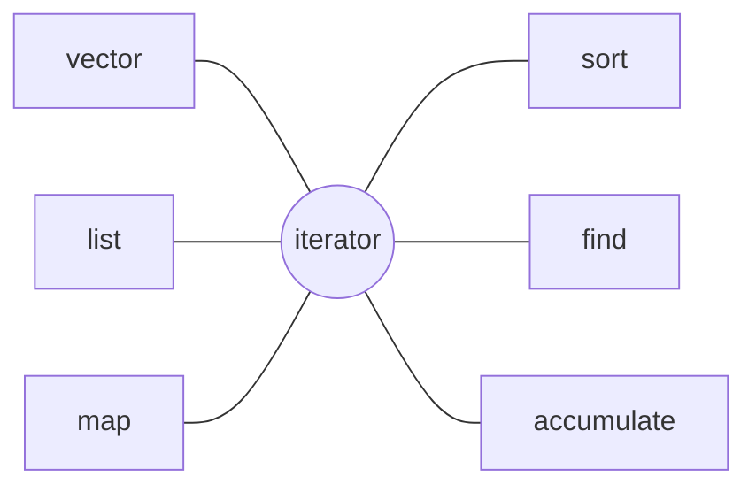

With **templates** (Chapter 9), a data structure or algorithm can be written once and used for any element type. The part of the C++ standard library written with templates is called the Standard Template Library, and it is the most heavily used part of everyday C++ programming: one almost never hand-writes a dynamic array, a linked list or a sort any more. This chapter treats the standard library from the user's point of view: namespaces, the choice among containers and their complexities, the iterators that connect containers to algorithms, the iterator invalidation problem that is the most common source of errors when using iterators, and finally the standard algorithms and C++20 ranges. How the data structures behind the containers (dynamic arrays, **linked lists**, red-black trees, hash tables) are implemented, and where their complexities come from, is the subject of [4.3 Data Structures and Algorithms](/4.3); this chapter only touches on it.

## 10.1. Namespaces

Large programs and third-party libraries inevitably contain functions and classes with the same name. A *namespace* is a named scope that groups names to avoid collisions:

```cpp
#include <format>
#include <iostream>

namespace geometry {
    double area(double w, double h) { return w * h; }
    namespace detail {                     // nested namespace: geometry::detail
        double square(double x) { return x * x; }
    }
}

namespace physics {
    double area(double r);                 // same name, different namespace
}

int main() {
    std::cout << std::format("{}\n", geometry::area(2, 3));
    using geometry::detail::square;        // using-declaration: one name
    std::cout << std::format("{}\n", square(4));
}
```

- All names of the standard library are in the namespace `std`, hence we write `std::vector` and `std::println`.
- The using-declaration `using std::vector;` introduces one name; the using-directive `using namespace std;` introduces all names of a namespace into the current scope. The latter is acceptable for convenience in the `.cpp` file of a small program, but must not be written in a header file: every file that includes the header would be forced to import all names of `std`, bringing the collisions back.
- Names in an unnamed namespace `namespace { … }` are visible only in the current translation unit, which plays the role of `static` functions in C ([4.2.2](/4.2.2)).

In Python every module is a namespace: after `import math` we write `math.sqrt`, `from math import sqrt` corresponds to a using-declaration, and `from math import *` corresponds to a using-directive, which is likewise not recommended.

## 10.2. The Structure of the Standard Template Library

**Definition 10.2.1 (Standard Template Library)** The generic components of the C++ standard library implemented with templates, including containers, iterators, algorithms and function objects, are collectively called the **Standard Template Library** (STL). It originates in the design of Alexander Stepanov in the early 1990s and was incorporated into the C++ standard in 1998.

The core idea of the STL is to separate the storage of data (containers) from its processing (algorithms) and to connect the two with iterators:



Algorithms do not operate on containers directly; they access elements only through iterators. So $M$ containers and $N$ algorithms require only $M + N$ pieces of code instead of $M \times N$. Any data structure that provides suitable iterators, including plain arrays and containers written by the user, can use all the standard algorithms directly.

## 10.3. pair and tuple

`std::pair<T1, T2>` combines two values into one object, with members `first` and `second`; `std::tuple<T...>` generalizes this to any number of values, and `std::get<i>` retrieves the $i$-th. Their most common use is to let a function return several values. C++17 structured bindings can unpack them in one step:

```cpp tab
#include <format>
#include <iostream>
#include <string>
#include <tuple>
#include <utility>
#include <vector>

std::pair<int, int> minMax(const std::vector<int>& v) {
    int lo = v[0], hi = v[0];
    for (int x : v) {
        if (x < lo) lo = x;
        if (x > hi) hi = x;
    }
    return {lo, hi};
}

int main() {
    auto [lo, hi] = minMax({3, 1, 4, 1, 5, 9});        // structured binding
    std::cout << std::format("{} {}\n", lo, hi);

    std::tuple<std::string, int, double> rec{"Alice", 20, 3.9};
    std::cout << std::format("{} {}\n", std::get<0>(rec), std::get<2>(rec));
    auto [name, age, gpa] = rec;
    std::cout << std::format("{} is {}\n", name, age);
}
```

```python tab
def min_max(v: list[int]) -> tuple[int, int]:
    return min(v), max(v)              # a tuple is built implicitly


lo, hi = min_max([3, 1, 4, 1, 5, 9])   # tuple unpacking
print(lo, hi)

rec: tuple[str, int, float] = ("Alice", 20, 3.9)
print(rec[0], rec[2])
name, age, gpa = rec
print(f"{name} is {age}")
```

`pair` and `tuple` are compared in **lexicographic order** (compare the first component first, and the second if they are equal), so they can be sorted directly. When the meaning of the members is not obvious (what is `rec.first`?), defining a named `struct` is clearer.

## 10.4. Sequence Containers

### 10.4.1. vector

**Definition 10.4.1 (Container)** An object that stores a group of elements of the same type and manages their storage and lifetime is called a **container**. A container in which the position of an element is determined by the order of insertion is called a **sequence container**; one in which elements are organized and looked up by key is called an **associative container**.

`std::vector<T>` is the most commonly used container and the default choice: its elements are stored contiguously in memory and support random access by index; inserting or deleting at the end takes $O(1)$ on average, while inserting or deleting in the middle requires moving the following elements and takes $O(n)$.

A `vector` internally maintains three quantities: a pointer to the storage, the number of elements `size()`, and the allocated capacity `capacity()`. When `push_back` is called while `size()` equals `capacity()`, the `vector` allocates a larger block of storage (usually 1.5 or 2 times the old one), moves the elements into it, and releases the old block. Growing the capacity by a factor guarantees that `push_back` has $O(1)$ amortized complexity (for amortized analysis see [4.3.2](/4.3.2)).

```cpp
#include <cstddef>
#include <format>
#include <iostream>
#include <vector>

int main() {
    std::vector<int> v;
    std::size_t cap = v.capacity();
    for (int i = 0; i < 100; ++i) {
        v.push_back(i);
        if (v.capacity() != cap) {          // a reallocation just happened
            cap = v.capacity();
            std::cout << std::format("{} ", cap);
        }
    }
    std::cout << '\n';
    std::vector<int> w;
    w.reserve(100);                         // allocate once, no reallocation below
    for (int i = 0; i < 100; ++i) w.push_back(i);
    std::cout << std::format("{} {}\n", w.size(), w.capacity());
}
```

```text
1 2 4 8 16 32 64 128
100 100
```

(These are the results of GCC, with growth factor 2; the growth factor of MSVC is 1.5.) When the number of elements is known in advance, `reserve` allocates enough capacity at once and avoids repeated reallocation. `v[i]` does not check the index, and going out of range is undefined behavior; `v.at(i)` checks the index and throws `std::out_of_range` when it is out of range.

### 10.4.2. Other Sequence Containers

| Container | Structure | Random access | Insert/delete at front | Insert/delete at back | Insert/delete in middle |
|---|---|---|---|---|---|
| `vector` | Dynamic array | $O(1)$ | $O(n)$ | Amortized $O(1)$ | $O(n)$ |
| `deque` | Segmented array | $O(1)$ | $O(1)$ | $O(1)$ | $O(n)$ |
| `list` | Doubly linked list | Not supported | $O(1)$ | $O(1)$ | $O(1)$ (given an iterator) |
| `forward_list` | Singly linked list | Not supported | $O(1)$ | Not supported | $O(1)$ (after a given position) |
| `array<T, N>` | Fixed-size array | $O(1)$ | Not supported | Not supported | Not supported |

The $O(1)$ insertion of a linked list holds only when the position is already in hand; finding the position first still takes $O(n)$. Moreover, the nodes of a linked list are scattered in memory and have a low cache hit rate. In measurements, even when insertion in the middle is needed, `vector` is usually faster than `list` up to a few thousand elements. Therefore `vector` should be chosen unless frequent insertion and deletion at known positions is needed, or the addresses of elements must remain unchanged under insertion and deletion.

The standard library also provides three container adapters, `stack`, `queue` and `priority_queue`, which expose only the interface of a stack, a queue or a heap on top of an underlying sequence container (by default `deque`, and `vector` for `priority_queue`); see [4.3.4](/4.3.4) and [4.3.12](/4.3.12).

## 10.5. Iterators

### 10.5.1. Iterators and Ranges

**Definition 10.5.1 (Iterator)** An object that points to an element of a container (or another sequence), can access that element with `*it`, and can move to the next element with `++it`, is called an **iterator**. It is an abstraction of the pointer: a pointer into an array is one kind of iterator.

Each container provides `begin()` and `end()`: `begin()` points to the first element, and `end()` points to the position after the last element (which cannot be dereferenced). A pair of iterators `[first, last)` denotes a half-open range, and the empty range is `first == last`. The half-open convention makes the length of a range `last - first`, lets adjacent ranges be joined end to end, and lets the termination condition of loops be written uniformly as `it != last`.

```cpp
#include <format>
#include <iostream>
#include <list>
#include <vector>

int main() {
    std::vector<int> v{10, 20, 30};
    for (auto it = v.begin(); it != v.end(); ++it) *it += 1;   // modify through it
    for (int x : v) std::cout << std::format("{} ", x);  // range-for uses begin/end
    std::cout << '\n';

    std::list<int> l{1, 2, 3};
    for (auto it = l.rbegin(); it != l.rend(); ++it)            // reverse iterators
        std::cout << std::format("{} ", *it);
    std::cout << '\n';
}
```

The range-based `for` loop `for (int x : v)` is an iterator loop that the compiler rewrites in terms of `begin()` and `end()`, so any type that provides these two functions can be used in a range-based `for`. According to the operations they support, the standard library divides iterators into several categories, and an algorithm states its requirement as the weakest category it needs:

| Category | Additional operations supported | Examples |
|---|---|---|
| Input iterator | Read `*it`, `++it`; single pass only | `istream_iterator` reading from an input stream |
| Forward iterator | Can traverse multiple times | `forward_list`, `unordered_map` |
| Bidirectional iterator | `--it` | `list`, `set`, `map` |
| Random-access iterator | `it + n`, `it[n]`, `it1 - it2`, `<` | `deque` |
| Contiguous iterator | Elements contiguous in memory | `vector`, `array`, `string`, built-in arrays |

For example, `std::sort` requires random-access iterators and therefore cannot be used on `std::list` (`list` has its own member function `l.sort()`); `std::find` requires only input iterators and works for every container.

### 10.5.2. Iterator Invalidation

An iterator remembers the position of an element (for a `vector`, an address). After the structure of the container changes, an old position may no longer correspond to the original element, or may even have been freed.

**Definition 10.5.2 (Iterator Invalidation)** The situation in which a modification of a container causes previously obtained iterators (and pointers and references to elements) to no longer point to the elements they were meant to point to is called **iterator invalidation**. Using an invalidated iterator is undefined behavior.

The invalidation rules of different containers are determined by their data structures:

| Container | After insertion | After erasure |
|---|---|---|
| `vector`, `string` | All invalidated if a reallocation occurs; otherwise those at and after the insertion point | Those at and after the erasure point (including `end()`) |
| `deque` | Insertion in the middle invalidates all; insertion at either end invalidates all iterators, but references to elements remain valid | Erasure in the middle invalidates all; erasing at either end invalidates only those of the erased elements (erasing the last element also invalidates `end()`) |
| `list`, `forward_list` | None invalidated | Only those of the erased elements |
| Ordered containers such as `set`, `map` | None invalidated | Only those of the erased elements |
| `unordered_set`, `unordered_map` | All iterators invalidated on rehashing (references remain valid); otherwise none | Only those of the erased elements |

The most typical mistake is to modify a container while traversing it:

```cpp
#include <format>
#include <iostream>
#include <vector>

int main() {
    std::vector<int> v{1, 2, 3, 4, 5, 6};

    // Wrong: after erase(it), it is invalid and ++it is undefined behaviour.
    // for (auto it = v.begin(); it != v.end(); ++it)
    //     if (*it % 2 == 0) v.erase(it);

    // Wrong: push_back may reallocate and invalidate it and v.end().
    // for (auto it = v.begin(); it != v.end(); ++it) v.push_back(*it);

    for (auto it = v.begin(); it != v.end();) {    // erase returns the next valid iterator
        if (*it % 2 == 0) it = v.erase(it);
        else ++it;
    }
    for (int x : v) std::cout << std::format("{} ", x);
    std::cout << '\n';

    std::vector<int> w{1, 2, 3, 4, 5, 6};
    std::erase_if(w, [](int x) { return x % 2 == 0; });   // C++20: the simplest form
    std::cout << std::format("{}\n", w.size());
}
```

Each deletion in the correct loop above moves the following elements, for a total cost of $O(n^2)$; `std::erase_if` (or the traditional erase–remove idiom `v.erase(std::remove_if(v.begin(), v.end(), pred), v.end())`) moves the retained elements forward in a single pass, needing only $O(n)$, and cannot be written wrongly.

## 10.6. Associative Containers

### 10.6.1. set and map

`std::set<K>` stores distinct keys and `std::map<K, V>` stores a mapping from keys to values; both store elements ordered by key, usually implemented as red-black trees ([4.3.8](/4.3.8)), with $O(\log n)$ insertion, deletion and lookup, and traversal in increasing key order. The key type must support `<` (or a comparator must be supplied). The versions that allow duplicate keys are `multiset` and `multimap`.

When using `map`, note the semantics of `operator[]`: if the key `k` does not exist, `m[k]` inserts a value-initialized element and then returns a reference to it. It therefore cannot be used on a `const map`; to merely query, use `m.find(k)` (which returns an iterator equal to `m.end()` if the key is not found), `m.contains(k)` (C++20) or `m.at(k)` (which throws an exception if the key is not found).

### 10.6.2. Unordered Containers

`std::unordered_set<K>` and `std::unordered_map<K, V>` are implemented with hash tables ([4.3.9](/4.3.9)); insertion, deletion and lookup take $O(1)$ on average and $O(n)$ in the worst case, and the traversal order of the elements is meaningless. The key type must support `==` and have a hash function `std::hash<K>`; the standard library provides hash functions for built-in types and `std::string`, while for user-defined types one must specialize `std::hash` oneself (the **template specialization** of Chapter 9). When ordered traversal or range queries are not needed, unordered containers are usually faster.

| Need | Choice |
|---|---|
| Store by position, the default | `vector` |
| Access at both ends | `deque` |
| Lookup by key, with ordered traversal or range queries (`lower_bound`) | `map` / `set` |
| Lookup by key, order irrelevant | `unordered_map` / `unordered_set` |
| Frequent insertion and deletion at known positions, or element addresses must stay fixed | `list` |

### 10.6.3. Example: A Thesaurus

We use `map<string, set<string>>` to record the synonyms of each word: the outer `map` makes the words come out in alphabetical order, and the inner `set` removes duplicates and sorts automatically.

```cpp tab
#include <format>
#include <iostream>
#include <map>
#include <set>
#include <string>

using Thesaurus = std::map<std::string, std::set<std::string>>;

void addSynonyms(Thesaurus& t, const std::string& a, const std::string& b) {
    t[a].insert(b);           // operator[] creates an empty set if a is new
    t[b].insert(a);
}

int main() {
    Thesaurus t;
    addSynonyms(t, "big", "large");
    addSynonyms(t, "big", "huge");
    addSynonyms(t, "small", "little");
    addSynonyms(t, "big", "large");                 // duplicate: no effect

    for (const auto& [word, others] : t) {          // ordered by key
        std::cout << std::format("{}:", word);
        for (const auto& w : others) std::cout << std::format(" {}", w);
        std::cout << '\n';
    }
    if (auto it = t.find("huge"); it != t.end())    // lookup without insertion
        std::cout << std::format("huge has {} synonym(s)\n", it->second.size());
    std::cout << std::format("{}\n", t.contains("tiny"));
}
```

```python tab
from collections import defaultdict

thesaurus: defaultdict[str, set[str]] = defaultdict(set)


def add_synonyms(a: str, b: str) -> None:
    thesaurus[a].add(b)       # defaultdict creates an empty set if a is new
    thesaurus[b].add(a)


add_synonyms("big", "large")
add_synonyms("big", "huge")
add_synonyms("small", "little")
add_synonyms("big", "large")

for word in sorted(thesaurus):                  # dict keeps insertion order, so sort
    print(f"{word}:", *sorted(thesaurus[word]))
if (others := thesaurus.get("huge")) is not None:
    print(f"huge has {len(others)} synonym(s)")
print("tiny" in thesaurus)
```

```text
big: huge large
huge: big
large: big
little: small
small: little
huge has 1 synonym(s)
false
```

(The Python version prints `False` on the last line.)

## 10.7. Algorithms

### 10.7.1. Algorithms on Iterators

`<algorithm>` and `<numeric>` provide over a hundred function templates, all taking iterator ranges as parameters. The commonly used ones are as follows.

| Purpose | Algorithms |
|---|---|
| Searching | `find`, `find_if`, `count`, `count_if`, `any_of`, `all_of` |
| Sorting and sorted ranges | `sort`, `stable_sort`, `partial_sort`, `nth_element`, `binary_search`, `lower_bound`, `merge` |
| Modification | `copy`, `transform`, `fill`, `replace`, `reverse`, `unique`, `remove_if` |
| Numeric | `accumulate`, `reduce`, `inner_product`, `iota`, `partial_sum` |
| Extremes and permutations | `min_element`, `max_element`, `minmax`, `next_permutation` |

Algorithms with the suffix `_if` take a predicate, usually written as a lambda expression (Chapter 12). Algorithms never change the size of a container: `remove_if` only moves the elements to keep to the front and returns the new logical end, and actual deletion still requires calling the container's `erase`, which is the origin of the erase–remove idiom of the previous section. Compared with a hand-written loop, the name of an algorithm states the intent directly, and the algorithm has been thoroughly tested and optimized.

### 10.7.2. ranges

The C++20 ranges library (`<ranges>`) improves algorithms in two ways.

- The algorithms in `std::ranges::` accept a whole container directly, without writing `v.begin(), v.end()`, and support projections: sorting or searching by some member of an element or by the value of some function.
- Views chain operations such as filtering and transformation into a pipeline with `|`; they are evaluated lazily and produce no intermediate containers.

```cpp tab
#include <algorithm>
#include <format>
#include <iostream>
#include <numeric>
#include <ranges>
#include <string>
#include <vector>

int main() {
    std::vector<int> v{5, 3, 8, 1, 9, 2};
    std::ranges::sort(v);                                         // 1 2 3 5 8 9
    auto pos = std::ranges::lower_bound(v, 4) - v.begin();        // binary search
    auto evens = std::ranges::count_if(v, [](int x) { return x % 2 == 0; });
    int total = std::accumulate(v.begin(), v.end(), 0);
    std::cout << std::format("{} {} {}\n", pos, evens, total);

    std::vector<std::string> words{"pear", "fig", "banana"};
    std::ranges::sort(words, {}, &std::string::size);            // projection: by length
    std::cout << std::format("{} {} {}\n", words[0], words[1], words[2]);

    auto odd = [](int x) { return x % 2 == 1; };
    auto square = [](int x) { return x * x; };
    for (int x : v | std::views::filter(odd) | std::views::transform(square))
        std::cout << std::format("{} ", x);                                     // lazy pipeline
    std::cout << '\n';
}
```

```python tab
import bisect

v = [5, 3, 8, 1, 9, 2]
v.sort()                                          # 1 2 3 5 8 9
pos = bisect.bisect_left(v, 4)                    # binary search
evens = sum(1 for x in v if x % 2 == 0)
total = sum(v)
print(pos, evens, total)

words = ["pear", "fig", "banana"]
words.sort(key=len)                               # key function: by length
print(*words)

for x in (x * x for x in v if x % 2 == 1):        # lazy generator expression
    print(x, end=" ")
print()
```

```text
3 2 28
fig pear banana
1 9 25 81
```

## 10.8. Python Comparison

### 10.8.1. Built-In Containers

Python's built-in containers cover the most commonly used ones of the STL, and all can hold objects of any type (what is stored are references):

| Python | Implementation | Corresponding C++ | Complexity of main operations |
|---|---|---|---|
| `list` | Dynamic array (storing object pointers) | `vector` | Index $O(1)$, `append` amortized $O(1)$, `insert(0, x)` and `pop(0)` $O(n)$ |
| `tuple` | Fixed-size, immutable array | `tuple`, `array` | Index $O(1)$ |
| `dict` | Hash table, keeps insertion order (since 3.7) | `unordered_map` | Lookup, insertion, deletion $O(1)$ on average |
| `set`, `frozenset` | Hash table | `unordered_set` | $O(1)$ on average |
| `str` | Immutable character sequence | `string` | Chapter 11 |

The Python standard library has no ordered map based on balanced trees; when order is needed, sort the keys (`sorted(d)`), or use the `bisect` module for binary search and insertion in a sorted `list`. The keys of `dict` and `set` must be hashable: immutable built-in types all are, while `list` and `dict` are not; a user-defined class is hashed by object identity by default, and when `__eq__` is redefined, `__hash__` must be defined as well.

### 10.8.2. collections and Related Modules

| Module and type | Purpose | Corresponding C++ |
|---|---|---|
| `collections.deque` | Queue with $O(1)$ access at both ends | `deque` |
| `collections.defaultdict` | Missing keys get a value created by a factory function | Behavior of `map::operator[]` |
| `collections.Counter` | Counting, `most_common(k)` | `map<K, int>` |
| `collections.OrderedDict` | Dictionary whose order can be adjusted, `move_to_end` | — |
| `collections.namedtuple`, `dataclasses.dataclass` | Records with field names | `struct` |
| `heapq` | Maintains a binary heap in a `list` | `priority_queue`, `make_heap` |
| `bisect` | Binary search and insertion in a sorted `list` | `lower_bound`, `upper_bound` |
| `itertools` | Lazy iterator combinators: `chain`, `islice`, `groupby`, `product`, etc. | `std::views` |

### 10.8.3. The Iterator Protocol and Containers Under Modification

Python's iterators are also a protocol (the **duck typing** of Chapter 8): the `__iter__` of an iterable returns an iterator, and the `__next__` of the iterator returns the next element each time, raising `StopIteration` when there are no more. The `for` loop is rewritten according to this protocol, and a generator function (a function containing `yield`) is the simplest way to write an iterator:

```python
class Countdown:
    def __init__(self, n: int) -> None:
        self.n = n

    def __iter__(self):                 # a generator function returns an iterator
        k = self.n
        while k > 0:
            yield k
            k -= 1


print(list(Countdown(3)))

d = {"a": 1, "b": 2}
try:
    for k in d:
        d[k + k] = 0                    # changing the size while iterating
except RuntimeError as e:
    print("RuntimeError:", e)

v = [1, 2, 3, 4, 5, 6]
v = [x for x in v if x % 2 != 0]        # build a new list instead of deleting in place
print(v)
```

```text
[3, 2, 1]
RuntimeError: dictionary changed size during iteration
[1, 3, 5]
```

Python has no undefined behavior, but the problem of "modifying while traversing" exists as well: changing the size of a `dict` or `set` while traversing it raises `RuntimeError`; deleting elements from a `list` while traversing it raises no error but skips elements, so the result is silently wrong. The usual practice is to traverse a copy or, as in the example above, to build a new list with a comprehension.

## Summary

- The STL consists of containers, iterators and algorithms, with iterators decoupling the first from the third; use using-declarations, and do not put using-directives in header files.
- Use `vector` by default; for lookup by key use `map` (ordered) or `unordered_map` (faster on average); `map::operator[]` inserts elements.
- Iterators denote half-open ranges and fall into five categories by capability: input, forward, bidirectional, random-access and contiguous.
- Modifying a container may invalidate iterators, with rules determined by the data structure; when erasing during traversal, use the return value of `erase` or `std::erase_if`.
- Prefer the standard algorithms; C++20 ranges let algorithms act directly on containers, and views form lazy pipelines.
- Python's `list`, `dict` and `set` correspond to dynamic arrays and hash tables, with `collections`, `heapq` and `bisect` supplying the other structures; the iterator protocol is `__iter__` and `__next__`.
