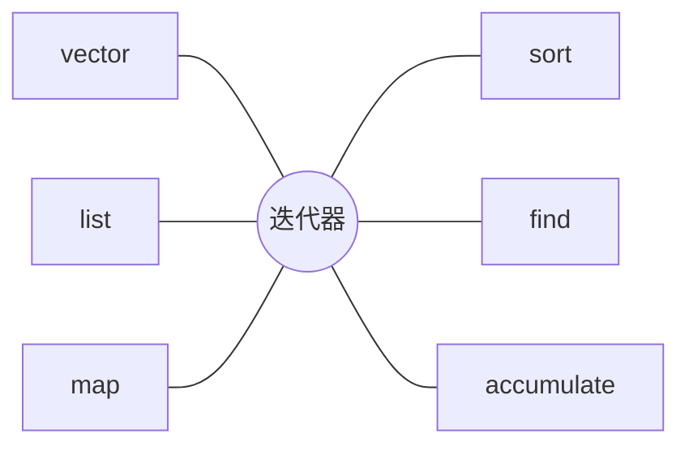

有了**模板**（第 9 章），就可以一次写好对任何元素类型都适用的数据结构与算法。C++ 标准库中以模板写成的这一部分称为标准模板库，它是日常 C++ 编程中使用最多的部分：几乎不再需要手写动态数组、链表或排序。本章从使用者的角度讲标准库：命名空间、几种容器的选择与复杂度、连接容器与算法的迭代器，以及使用迭代器时最容易出错的迭代器失效问题，最后介绍标准算法与 C++20 的 ranges。容器背后的数据结构（动态数组、**链表**、红黑树、散列表）怎样实现、复杂度从何而来，是 [4.3 数据结构与算法](/4.3)的内容，本章只点到为止。

## 10.1. 命名空间

大型程序和第三方库中难免出现同名的函数与类。命名空间（namespace）是一个有名字的作用域，它把名字分组，避免冲突：

```cpp
#include <format>
#include <iostream>

namespace geometry {
    double area(double w, double h) { return w * h; }
    namespace detail {                     // nested namespace: geometry::detail
        double square(double x) { return x * x; }
    }
}

namespace physics {
    double area(double r);                 // same name, different namespace
}

int main() {
    std::cout << std::format("{}\n", geometry::area(2, 3));
    using geometry::detail::square;        // using-declaration: one name
    std::cout << std::format("{}\n", square(4));
}
```

- 标准库的名字都在命名空间 `std` 中，所以写 `std::vector`、`std::println`。
- using 声明 `using std::vector;` 引入一个名字；using 指令 `using namespace std;` 把整个命名空间的名字都引入当前作用域。后者在小程序的 `.cpp` 文件中图省事可以接受，但不要写在头文件里：所有包含该头文件的文件都会被迫引入 `std` 的全部名字，重新带来命名冲突。
- 没有名字的命名空间 `namespace { … }` 中的名字只在本翻译单元可见，作用相当于 C 的 `static` 函数（[4.2.2](/4.2.2)）。

Python 中每个模块就是一个命名空间：`import math` 后写 `math.sqrt`，`from math import sqrt` 相当于 using 声明，`from math import *` 相当于 using 指令，同样不推荐。

## 10.2. 标准模板库的结构

**定义 10.2.1（标准模板库）** C++ 标准库中以模板实现的通用容器、迭代器、算法及函数对象等组件，统称为**标准模板库**（Standard Template Library，STL）。它源于 Alexander Stepanov 在 1990 年代初的设计，1998 年并入 C++ 标准。

STL 的核心思想是把数据的存放（容器）与数据的处理（算法）分开，用迭代器连接二者：



算法不直接操作容器，只通过迭代器访问元素，因此 $M$ 种容器与 $N$ 种算法只需要写 $M + N$ 份代码，而不是 $M \times N$ 份。任何提供了合适迭代器的数据结构，包括普通数组和用户自己写的容器，都能直接使用全部标准算法。

## 10.3. pair 与 tuple

`std::pair<T1, T2>` 把两个值组合成一个对象，成员是 `first`、`second`；`std::tuple<T...>` 推广到任意多个值，用 `std::get<i>` 取出第 $i$ 个。它们最常见的用途是让函数返回多个值。C++17 的结构化绑定可以一次把它们拆开：

```cpp tab
#include <format>
#include <iostream>
#include <string>
#include <tuple>
#include <utility>
#include <vector>

std::pair<int, int> minMax(const std::vector<int>& v) {
    int lo = v[0], hi = v[0];
    for (int x : v) {
        if (x < lo) lo = x;
        if (x > hi) hi = x;
    }
    return {lo, hi};
}

int main() {
    auto [lo, hi] = minMax({3, 1, 4, 1, 5, 9});        // structured binding
    std::cout << std::format("{} {}\n", lo, hi);

    std::tuple<std::string, int, double> rec{"Alice", 20, 3.9};
    std::cout << std::format("{} {}\n", std::get<0>(rec), std::get<2>(rec));
    auto [name, age, gpa] = rec;
    std::cout << std::format("{} is {}\n", name, age);
}
```

```python tab
def min_max(v: list[int]) -> tuple[int, int]:
    return min(v), max(v)              # a tuple is built implicitly


lo, hi = min_max([3, 1, 4, 1, 5, 9])   # tuple unpacking
print(lo, hi)

rec: tuple[str, int, float] = ("Alice", 20, 3.9)
print(rec[0], rec[2])
name, age, gpa = rec
print(f"{name} is {age}")
```

`pair` 与 `tuple` 按**字典序**比较（先比第一个分量，相等再比第二个），所以可以直接排序。成员含义不明显时（`rec.first` 是什么？），定义一个有名字的 `struct` 更清楚。

## 10.4. 顺序容器

### 10.4.1. vector

**定义 10.4.1（容器）** 存放一组同类型元素、并负责管理这些元素的存储与生存期的对象称为**容器**。元素的位置由插入的次序决定的称为**顺序容器**；元素按键组织、按键查找的称为**关联容器**。

`std::vector<T>` 是最常用的容器，也是默认的选择：元素在内存中连续存放，支持下标随机访问；在尾部插入、删除平均为 $O(1)$，在中间插入、删除要移动后面的元素，为 $O(n)$。

`vector` 内部维护三个量：指向存储区的指针、元素个数 `size()` 和已分配的容量 `capacity()`。`size()` 达到 `capacity()` 时再 `push_back`，`vector` 会分配一块更大的存储区（通常是原来的 1.5 或 2 倍），把元素移动过去，再释放旧的存储区。容量按倍数增长，保证了 `push_back` 的分摊复杂度是 $O(1)$（分摊分析见 [4.3.2](/4.3.2)）。

```cpp
#include <cstddef>
#include <format>
#include <iostream>
#include <vector>

int main() {
    std::vector<int> v;
    std::size_t cap = v.capacity();
    for (int i = 0; i < 100; ++i) {
        v.push_back(i);
        if (v.capacity() != cap) {          // a reallocation just happened
            cap = v.capacity();
            std::cout << std::format("{} ", cap);
        }
    }
    std::cout << '\n';
    std::vector<int> w;
    w.reserve(100);                         // allocate once, no reallocation below
    for (int i = 0; i < 100; ++i) w.push_back(i);
    std::cout << std::format("{} {}\n", w.size(), w.capacity());
}
```

```text
1 2 4 8 16 32 64 128
100 100
```

（以上是 GCC 的结果，增长因子 2；MSVC 的增长因子是 1.5。）事先知道元素个数时用 `reserve` 一次分配足够的容量，可以避免多次重新分配。`v[i]` 不检查下标，越界是未定义行为；`v.at(i)` 检查下标，越界时抛出 `std::out_of_range`。

### 10.4.2. 其他顺序容器

| 容器 | 结构 | 随机访问 | 头部插入删除 | 尾部插入删除 | 中间插入删除 |
|---|---|---|---|---|---|
| `vector` | 动态数组 | $O(1)$ | $O(n)$ | 分摊 $O(1)$ | $O(n)$ |
| `deque` | 分段的数组 | $O(1)$ | $O(1)$ | $O(1)$ | $O(n)$ |
| `list` | 双向链表 | 不支持 | $O(1)$ | $O(1)$ | $O(1)$（已有迭代器时） |
| `forward_list` | 单向链表 | 不支持 | $O(1)$ | 不支持 | $O(1)$（在给定位置之后） |
| `array<T, N>` | 定长数组 | $O(1)$ | 不支持 | 不支持 | 不支持 |

链表的 $O(1)$ 插入只在已经持有位置时成立，先找到位置仍需 $O(n)$；而且链表的结点分散在内存中，缓存命中率低。实测中，即使需要在中间插入，几千个元素以内 `vector` 通常也比 `list` 快。因此除非需要在已知位置频繁插入删除、或需要元素地址在插入删除时保持不变，都应选择 `vector`。

标准库还提供三个容器适配器：`stack`、`queue` 和 `priority_queue`，它们在一个底层顺序容器（默认 `deque`，`priority_queue` 默认 `vector`）之上只开放栈、队列、堆的接口（见 [4.3.4](/4.3.4)、[4.3.12](/4.3.12)）。

## 10.5. 迭代器

### 10.5.1. 迭代器与区间

**定义 10.5.1（迭代器）** 指向容器（或其他序列）中某个元素、可以用 `*it` 访问该元素并用 `++it` 移到下一个元素的对象，称为**迭代器**（iterator）。它是对指针的抽象：数组中的指针就是一种迭代器。

每个容器提供 `begin()` 与 `end()`：`begin()` 指向第一个元素，`end()` 指向最后一个元素之后的位置（不能解引用）。一对迭代器 `[first, last)` 表示一个左闭右开的区间，空区间就是 `first == last`。左闭右开的约定使区间的长度为 `last - first`，相邻的区间可以首尾相接，循环的终止条件统一写成 `it != last`。

```cpp
#include <format>
#include <iostream>
#include <list>
#include <vector>

int main() {
    std::vector<int> v{10, 20, 30};
    for (auto it = v.begin(); it != v.end(); ++it) *it += 1;   // modify through it
    for (int x : v) std::cout << std::format("{} ", x);  // range-for uses begin/end
    std::cout << '\n';

    std::list<int> l{1, 2, 3};
    for (auto it = l.rbegin(); it != l.rend(); ++it)            // reverse iterators
        std::cout << std::format("{} ", *it);
    std::cout << '\n';
}
```

范围 `for` 循环 `for (int x : v)` 就是编译器按 `begin()`、`end()` 改写出的迭代器循环，所以任何提供这两个函数的类型都能用于范围 `for`。按迭代器支持的操作，标准库把迭代器分为几类，算法按它需要的最弱的一类提出要求：

| 类别 | 额外支持的操作 | 例子 |
|---|---|---|
| 输入迭代器 | 读 `*it`、`++it`，只能遍历一遍 | 从输入流读取的 `istream_iterator` |
| 前向迭代器 | 可多次遍历 | `forward_list`、`unordered_map` |
| 双向迭代器 | `--it` | `list`、`set`、`map` |
| 随机访问迭代器 | `it + n`、`it[n]`、`it1 - it2`、`<` | `deque` |
| 连续迭代器 | 元素在内存中连续 | `vector`、`array`、`string`、原生数组 |

例如 `std::sort` 要求随机访问迭代器，所以不能用于 `std::list`（`list` 自带成员函数 `l.sort()`）；`std::find` 只要求输入迭代器，适用于一切容器。

### 10.5.2. 迭代器失效

迭代器记住的是元素的位置（对 `vector` 而言就是一个地址）。容器的结构改变后，旧的位置可能已经不再对应原来的元素，甚至已经被释放。

**定义 10.5.2（迭代器失效）** 对容器的修改使原先得到的迭代器（以及指向元素的指针和引用）不再指向它本应指向的元素，称为**迭代器失效**（iterator invalidation）。使用已失效的迭代器是未定义行为。

不同容器的失效规则由它们的数据结构决定：

| 容器 | 插入后 | 删除后 |
|---|---|---|
| `vector`、`string` | 发生重新分配时全部失效；否则插入点及之后的失效 | 删除点及之后的失效（包括 `end()`） |
| `deque` | 在中间插入时全部失效；在两端插入时迭代器全部失效，但元素的引用仍有效 | 在中间删除时全部失效；删除两端元素时只有被删元素的失效（删尾元素还使 `end()` 失效） |
| `list`、`forward_list` | 都不失效 | 只有被删元素的失效 |
| `set`、`map` 等有序容器 | 都不失效 | 只有被删元素的失效 |
| `unordered_set`、`unordered_map` | 发生重散列时迭代器全部失效（引用仍有效）；否则都不失效 | 只有被删元素的失效 |

最典型的错误是一边遍历一边修改：

```cpp
#include <format>
#include <iostream>
#include <vector>

int main() {
    std::vector<int> v{1, 2, 3, 4, 5, 6};

    // Wrong: after erase(it), it is invalid and ++it is undefined behaviour.
    // for (auto it = v.begin(); it != v.end(); ++it)
    //     if (*it % 2 == 0) v.erase(it);

    // Wrong: push_back may reallocate and invalidate it and v.end().
    // for (auto it = v.begin(); it != v.end(); ++it) v.push_back(*it);

    for (auto it = v.begin(); it != v.end();) {    // erase returns the next valid iterator
        if (*it % 2 == 0) it = v.erase(it);
        else ++it;
    }
    for (int x : v) std::cout << std::format("{} ", x);
    std::cout << '\n';

    std::vector<int> w{1, 2, 3, 4, 5, 6};
    std::erase_if(w, [](int x) { return x % 2 == 0; });   // C++20: the simplest form
    std::cout << std::format("{}\n", w.size());
}
```

上面正确的循环每次删除都要移动后面的元素，总代价为 $O(n^2)$；`std::erase_if`（或传统的 erase–remove 惯用法 `v.erase(std::remove_if(v.begin(), v.end(), pred), v.end())`）把保留的元素一次性向前移动，只需 $O(n)$，也不会写错。

## 10.6. 关联容器

### 10.6.1. set 与 map

`std::set<K>` 存放互不相同的键，`std::map<K, V>` 存放键到值的映射；二者都按键的大小有序存放，通常用红黑树实现（[4.3.8](/4.3.8)），插入、删除、查找都是 $O(\log n)$，遍历时按键从小到大。键类型需要支持 `<`（或提供比较器）。允许重复键的版本是 `multiset`、`multimap`。

使用 `map` 时要注意 `operator[]` 的语义：`m[k]` 在键 `k` 不存在时会插入一个值初始化的元素再返回其引用。因此它不能用于 `const map`，只想查询时应使用 `m.find(k)`（返回迭代器，找不到时等于 `m.end()`）、`m.contains(k)`（C++20）或 `m.at(k)`（找不到时抛出异常）。

### 10.6.2. 无序容器

`std::unordered_set<K>`、`std::unordered_map<K, V>` 用散列表实现（[4.3.9](/4.3.9)），插入、删除、查找平均 $O(1)$、最坏 $O(n)$，元素的遍历顺序没有意义。键类型需要支持 `==` 并有散列函数 `std::hash<K>`；标准库为内置类型和 `std::string` 提供了散列函数，自定义类型要自己特化 `std::hash`（第 9 章的**模板特化**）。不需要有序遍历或范围查询时，无序容器通常更快。

| 需要 | 选择 |
|---|---|
| 按位置存放，默认 | `vector` |
| 两端进出 | `deque` |
| 按键查找，需要有序遍历或范围查询（`lower_bound`） | `map` / `set` |
| 按键查找，不关心顺序 | `unordered_map` / `unordered_set` |
| 已知位置处频繁插入删除，或要求元素地址不变 | `list` |

### 10.6.3. 例：同义词词典

用 `map<string, set<string>>` 记录每个词的同义词：外层的 `map` 让词按字母序输出，内层的 `set` 自动去重并排序。

```cpp tab
#include <format>
#include <iostream>
#include <map>
#include <set>
#include <string>

using Thesaurus = std::map<std::string, std::set<std::string>>;

void addSynonyms(Thesaurus& t, const std::string& a, const std::string& b) {
    t[a].insert(b);           // operator[] creates an empty set if a is new
    t[b].insert(a);
}

int main() {
    Thesaurus t;
    addSynonyms(t, "big", "large");
    addSynonyms(t, "big", "huge");
    addSynonyms(t, "small", "little");
    addSynonyms(t, "big", "large");                 // duplicate: no effect

    for (const auto& [word, others] : t) {          // ordered by key
        std::cout << std::format("{}:", word);
        for (const auto& w : others) std::cout << std::format(" {}", w);
        std::cout << '\n';
    }
    if (auto it = t.find("huge"); it != t.end())    // lookup without insertion
        std::cout << std::format("huge has {} synonym(s)\n", it->second.size());
    std::cout << std::format("{}\n", t.contains("tiny"));
}
```

```python tab
from collections import defaultdict

thesaurus: defaultdict[str, set[str]] = defaultdict(set)


def add_synonyms(a: str, b: str) -> None:
    thesaurus[a].add(b)       # defaultdict creates an empty set if a is new
    thesaurus[b].add(a)


add_synonyms("big", "large")
add_synonyms("big", "huge")
add_synonyms("small", "little")
add_synonyms("big", "large")

for word in sorted(thesaurus):                  # dict keeps insertion order, so sort
    print(f"{word}:", *sorted(thesaurus[word]))
if (others := thesaurus.get("huge")) is not None:
    print(f"huge has {len(others)} synonym(s)")
print("tiny" in thesaurus)
```

```text
big: huge large
huge: big
large: big
little: small
small: little
huge has 1 synonym(s)
false
```

（Python 版最后一行输出 `False`。）

## 10.7. 算法

### 10.7.1. 迭代器上的算法

`<algorithm>` 与 `<numeric>` 提供了一百多个函数模板，它们都以迭代器区间为参数。常用的有：

| 用途 | 算法 |
|---|---|
| 查找 | `find`、`find_if`、`count`、`count_if`、`any_of`、`all_of` |
| 排序与有序区间 | `sort`、`stable_sort`、`partial_sort`、`nth_element`、`binary_search`、`lower_bound`、`merge` |
| 修改 | `copy`、`transform`、`fill`、`replace`、`reverse`、`unique`、`remove_if` |
| 数值 | `accumulate`、`reduce`、`inner_product`、`iota`、`partial_sum` |
| 最值与排列 | `min_element`、`max_element`、`minmax`、`next_permutation` |

带 `_if` 的算法接受一个谓词，通常写成 lambda 表达式（第 12 章）。算法从不改变容器的大小：`remove_if` 只把要保留的元素移到前面并返回新的逻辑终点，真正删除还要调用容器的 `erase`，这正是上一节 erase–remove 惯用法的由来。与手写循环相比，算法的名字直接说明了意图，也经过了充分的测试与优化。

### 10.7.2. ranges

C++20 的 ranges 库（`<ranges>`）在两方面改进了算法：

- `std::ranges::` 中的算法直接接受整个容器，不必写 `v.begin(), v.end()`，并支持投影（projection）：按元素的某个成员或某个函数值排序、查找。
- 视图（view）用 `|` 把过滤、变换等操作串成管道，惰性求值，不产生中间容器。

```cpp tab
#include <algorithm>
#include <format>
#include <iostream>
#include <numeric>
#include <ranges>
#include <string>
#include <vector>

int main() {
    std::vector<int> v{5, 3, 8, 1, 9, 2};
    std::ranges::sort(v);                                         // 1 2 3 5 8 9
    auto pos = std::ranges::lower_bound(v, 4) - v.begin();        // binary search
    auto evens = std::ranges::count_if(v, [](int x) { return x % 2 == 0; });
    int total = std::accumulate(v.begin(), v.end(), 0);
    std::cout << std::format("{} {} {}\n", pos, evens, total);

    std::vector<std::string> words{"pear", "fig", "banana"};
    std::ranges::sort(words, {}, &std::string::size);            // projection: by length
    std::cout << std::format("{} {} {}\n", words[0], words[1], words[2]);

    auto odd = [](int x) { return x % 2 == 1; };
    auto square = [](int x) { return x * x; };
    for (int x : v | std::views::filter(odd) | std::views::transform(square))
        std::cout << std::format("{} ", x);                                     // lazy pipeline
    std::cout << '\n';
}
```

```python tab
import bisect

v = [5, 3, 8, 1, 9, 2]
v.sort()                                          # 1 2 3 5 8 9
pos = bisect.bisect_left(v, 4)                    # binary search
evens = sum(1 for x in v if x % 2 == 0)
total = sum(v)
print(pos, evens, total)

words = ["pear", "fig", "banana"]
words.sort(key=len)                               # key function: by length
print(*words)

for x in (x * x for x in v if x % 2 == 1):        # lazy generator expression
    print(x, end=" ")
print()
```

```text
3 2 28
fig pear banana
1 9 25 81
```

## 10.8. Python 对照

### 10.8.1. 内置容器

Python 的内置容器覆盖了 STL 中最常用的几种，而且都能存放任意类型的对象（存放的是引用）：

| Python | 实现 | 对应的 C++ | 主要操作的复杂度 |
|---|---|---|---|
| `list` | 动态数组（存放对象指针） | `vector` | 下标 $O(1)$，`append` 分摊 $O(1)$，`insert(0, x)` 与 `pop(0)` 为 $O(n)$ |
| `tuple` | 定长、不可变的数组 | `tuple`、`array` | 下标 $O(1)$ |
| `dict` | 散列表，保持插入顺序（3.7 起） | `unordered_map` | 查找、插入、删除平均 $O(1)$ |
| `set`、`frozenset` | 散列表 | `unordered_set` | 平均 $O(1)$ |
| `str` | 不可变的字符序列 | `string` | 第 11 章 |

Python 标准库没有基于平衡树的有序映射；需要有序时对键排序（`sorted(d)`），或用 `bisect` 模块在有序 `list` 上二分查找、插入。`dict` 与 `set` 的键必须可散列（hashable）：不可变的内置类型都可以，`list`、`dict` 不可以；自定义类默认按对象身份散列，重新定义 `__eq__` 时要同时定义 `__hash__`。

### 10.8.2. collections 与相关模块

| 模块与类型 | 用途 | 对应的 C++ |
|---|---|---|
| `collections.deque` | 两端 $O(1)$ 进出的队列 | `deque` |
| `collections.defaultdict` | 缺失的键自动用工厂函数创建值 | `map::operator[]` 的行为 |
| `collections.Counter` | 计数，`most_common(k)` | `map<K, int>` |
| `collections.OrderedDict` | 可调整顺序的字典，`move_to_end` | — |
| `collections.namedtuple`、`dataclasses.dataclass` | 有字段名的记录 | `struct` |
| `heapq` | 在 `list` 上维护二叉堆 | `priority_queue`、`make_heap` |
| `bisect` | 有序 `list` 上的二分查找与插入 | `lower_bound`、`upper_bound` |
| `itertools` | 惰性的迭代器组合：`chain`、`islice`、`groupby`、`product` 等 | `std::views` |

### 10.8.3. 迭代器协议与修改中的容器

Python 的迭代器也是一个协议（第 8 章的**鸭子类型**）：可迭代对象的 `__iter__` 返回一个迭代器，迭代器的 `__next__` 每次返回下一个元素，没有元素时抛出 `StopIteration`。`for` 循环就是按这一协议改写的，生成器函数（含 `yield` 的函数）是写迭代器最简便的方法：

```python
class Countdown:
    def __init__(self, n: int) -> None:
        self.n = n

    def __iter__(self):                 # a generator function returns an iterator
        k = self.n
        while k > 0:
            yield k
            k -= 1


print(list(Countdown(3)))

d = {"a": 1, "b": 2}
try:
    for k in d:
        d[k + k] = 0                    # changing the size while iterating
except RuntimeError as e:
    print("RuntimeError:", e)

v = [1, 2, 3, 4, 5, 6]
v = [x for x in v if x % 2 != 0]        # build a new list instead of deleting in place
print(v)
```

```text
[3, 2, 1]
RuntimeError: dictionary changed size during iteration
[1, 3, 5]
```

Python 没有未定义行为，但同样存在"一边遍历一边修改"的问题：遍历 `dict` 或 `set` 时改变其大小会抛出 `RuntimeError`；遍历 `list` 时删除元素不会报错，却会跳过元素，结果悄悄出错。通行的做法是遍历副本，或者像上例那样用推导式生成新的列表。

## 小结

- STL 由容器、迭代器和算法组成，迭代器把二者解耦；用 using 声明而不是在头文件中用 using 指令。
- 默认用 `vector`；按键查找用 `map`（有序）或 `unordered_map`（平均更快）；`map::operator[]` 会插入元素。
- 迭代器表示左闭右开区间，按能力分为输入、前向、双向、随机访问和连续五类。
- 修改容器可能使迭代器失效，规则由数据结构决定；遍历中删除用 `erase` 的返回值或 `std::erase_if`。
- 优先使用标准算法；C++20 ranges 让算法直接作用于容器，视图组成惰性管道。
- Python 的 `list`、`dict`、`set` 分别对应动态数组和散列表，`collections`、`heapq`、`bisect` 补充其余结构；迭代器协议是 `__iter__` 与 `__next__`。
