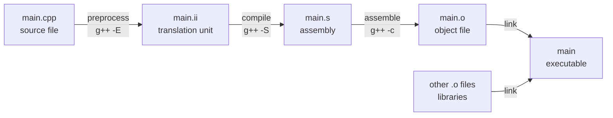

An object-oriented program almost always consists of several files: each class usually has a header file and an implementation file, and a program is assembled from dozens or hundreds of such files. To read and organize such a program, we must first understand how a C++ program turns from a set of source files into an executable. The compiler looks at only one source file at a time and uses declarations to check calls to functions in other files; the linker then joins the object files and finds the unique definition for every call. This chapter covers, in turn, the compilation process, declarations and definitions, header files, linking and the preprocessor, then the build tools Make and CMake, and finally command-line arguments and debuggers. At the end we compare with Python, which has no linking step and imports modules at run time. [4.1.1](/4.1.1) has already introduced the difference between compilation and interpretation, and [4.1.5](/4.1.5) the general methods of debugging and testing; for the command line and the shell see [4.11 Operating Systems](/4.11), and for version-control tools such as Git see [4.14 Software Engineering](/4.14).

## 2.1. From Source Code to Executable

### 2.1.1. The Four Stages

Obtaining an executable with the single command `g++ main.cpp -o main` actually goes through four stages:



| Stage | What it does | Run separately |
|---|---|---|
| Preprocessing | Handles directives such as `#include`, `#define` and `#if`: inserts the contents of header files verbatim, expands macros and removes code whose condition is false | `g++ -E main.cpp -o main.ii` |
| Compilation | Lexical and syntactic analysis, type checking and optimization; generates assembly code | `g++ -S main.cpp` |
| Assembly | Translates assembly code into machine code, producing an object file (`.o`, or `.obj` on Windows) | `g++ -c main.cpp` |
| Linking | Merges several object files and libraries into an executable and finds the definition of every reference to an external function or variable | `g++ main.o util.o -o main` |

**Definition 2.1.1 (Translation Unit)** The text obtained from a source file after preprocessing, with all `#include` directives and macros expanded, is called a **translation unit**. The compiler processes one translation unit at a time, independently of the others.

The independence of translation units is the key to everything in this chapter. When compiling `main.cpp`, the compiler cannot see what is written in `util.cpp`; it can only rely on the declarations that appear in `main.cpp` to check whether calls to functions in other files are legal. Where those calls finally point is left for the linker to decide.

### 2.1.2. Compilers and Common Options

There are three mainstream C++ compilers: GCC (the command `g++`, the default on Linux), Clang (`clang++`, the default on macOS, shipped with the Xcode command-line tools) and MSVC (`cl`, shipped with Visual Studio). When learning on Windows, we recommend using WSL (Windows Subsystem for Linux) to get the same toolchain as on Linux, or installing the MinGW-w64 build of GCC/Clang with MSYS2. When we type `g++` on the command line, the system looks for the program in the directories listed in the environment variable `PATH`; a "command not found" message after installation is usually because the directory containing the compiler is not in `PATH`.

| Option | Effect |
|---|---|
| `-o <file>` | Name the output file |
| `-c` | Compile only (to an object file), do not link |
| `-std=c++20`, `-std=c++23` | Select the language standard. The code in this course follows C++20 |
| `-Wall -Wextra -Wpedantic` | Turn on common warnings. Warnings often point to real errors and should be cleared |
| `-g` | Generate debugging information for the debugger |
| `-O0`, `-O2`, `-O3` | Optimization level. Use `-O0` when debugging and usually `-O2` for release |
| `-I<dir>`, `-L<dir>`, `-l<name>` | Header search directory, library search directory, link the library `lib<name>` |
| `-fsanitize=address,undefined` | Check at run time for out-of-bounds access, use after free, integer overflow and other errors (see §2.8) |

## 2.2. Declarations and Definitions

### 2.2.1. The Difference between Declarations and Definitions

**Definition 2.2.1** A **declaration** introduces a name to the compiler and states its type, so that the compiler can check uses of it; a **definition** is a declaration that fully specifies the entity: for a function it gives the function body, and for a variable it allocates storage. Every definition is a declaration, but not conversely.

| Form | Declaration or definition |
|---|---|
| `int add(int a, int b);` | Function declaration (parameter names may be omitted: `int add(int, int);`) |
| `int add(int a, int b) { return a + b; }` | Function definition |
| `extern int counter;` | Variable declaration: there is an `int` named `counter`, defined elsewhere |
| `int counter;`, `int counter = 0;` | Variable definition (a global variable that is not explicitly initialized is zero-initialized) |
| `class Stack;` | Class declaration (forward declaration) |
| `class Stack { /* members */ };` | Class definition |

The compiler needs only the declaration to compile a call: knowing that `add` takes two `int`s and returns an `int`, it can check the arguments and generate the call instruction. Where the function body is located is the linker's business.

### 2.2.2. The One Definition Rule

A name can be declared many times, but the number of definitions is strictly limited.

**Definition 2.2.2 (One Definition Rule)** The C++ **one definition rule** (ODR) requires that:

1. in each translation unit, any variable, function, class, enumeration and template has at most one definition;
2. in the whole program, every non-`inline` function and non-`inline` variable that is used has exactly one definition;
3. classes, `inline` functions, `inline` variables and templates may each be defined once in several translation units, but these definitions must be token-for-token identical.

Clause 3 is the reason header files can hold class definitions: every source file that includes the header gets a copy of the class definition, they are all identical, and the rule is satisfied. Clause 2 explains why a header must not contain definitions of ordinary functions and global variables: if the header is included by several source files, several definitions result, and linking reports "multiple definition" (§2.4.2).

A **global variable** that must be shared among several files is declared with `extern` in a header and defined in exactly one source file. However, global variables let any code modify shared state, which weakens **encapsulation** and makes programs hard to understand and test; data that can be passed as parameters should not be placed in global variables.

## 2.3. Header Files

### 2.3.1. The Role of Header Files

**Definition 2.3.1 (Header File)** A file that holds declarations and is shared among several source files through the `#include` directive is called a **header file**; its extension is usually `.h` or `.hpp`.

The effect of `#include "stats.h"` is merely to copy the entire text of `stats.h` to that line; the preprocessor does not understand its contents. The point of header files is to write a declaration only once: if every source file wrote `double mean(const std::vector<double>&);` by hand, then when the function signature changed, the place that was forgotten would show up only at link time (or even at run time). An implementation file should also include its own header, so that the compiler can check that the declarations and definitions agree.

A header usually contains function declarations, class definitions, `inline` functions and `constexpr` constants, templates, and type aliases; an implementation file (`.cpp`) contains the definitions of ordinary and member functions, and the definitions of global variables and static data members ([4.2.4](/4.2.4)).

`#include <iostream>` uses angle brackets and searches the system directories and those given with `-I`; `#include "stats.h"` uses double quotes and searches first in the directory of the current file.

### 2.3.2. A Multi-File Program

Here is a program of three files: the header `include/stats.h` declares the interface, `src/stats.cpp` implements it, and `src/main.cpp` uses it.

```cpp
// include/stats.h
#pragma once
#include <vector>

// Declarations only: what the functions are called and what they take.
double mean(const std::vector<double>& xs);
double variance(const std::vector<double>& xs);

extern int call_count;  // declaration of a variable defined in stats.cpp
```

```cpp
// src/stats.cpp
#include "stats.h"

int call_count = 0;  // the one definition of call_count

double mean(const std::vector<double>& xs) {
    ++call_count;
    double sum = 0;
    for (double x : xs) sum += x;
    return sum / static_cast<double>(xs.size());
}

double variance(const std::vector<double>& xs) {
    ++call_count;
    double m = mean(xs), ss = 0;
    for (double x : xs) ss += (x - m) * (x - m);
    return ss / static_cast<double>(xs.size() - 1);
}
```

```cpp
// src/main.cpp
#include <iostream>
#include "stats.h"

int main() {
    std::vector<double> xs{2, 4, 4, 4, 5, 5, 7, 9};
    std::cout << mean(xs) << ' ' << variance(xs) << '\n';  // 5 4.57143
    std::cout << "calls: " << call_count << '\n';          // calls: 3
}
```

We can compile and link in one step or in separate steps. The benefit of separate steps is that when only `main.cpp` has been modified, only it needs to be recompiled and then linked with the existing `stats.o`.

```bash
# one step: g++ compiles each file and links them
g++ -std=c++20 -Wall -Iinclude src/main.cpp src/stats.cpp -o app

# separate compilation, then linking
g++ -std=c++20 -Wall -Iinclude -c src/stats.cpp -o stats.o
g++ -std=c++20 -Wall -Iinclude -c src/main.cpp -o main.o
g++ main.o stats.o -o app
./app
```

### 2.3.3. Include Guards

The same header may be included indirectly several times. For example, both `a.h` and `b.h` include `stats.h`, and `main.cpp` includes both `a.h` and `b.h`. Repeated function declarations are harmless, but repeating a class definition within one translation unit violates the one definition rule. There are two ways to prevent repeated inclusion:

```cpp
// traditional include guard
#ifndef STATS_H
#define STATS_H
// ... contents of the header ...
#endif
```

```cpp
#pragma once
// ... contents of the header ...
```

The traditional include guard is the standard form and requires a unique macro name for every header; `#pragma once` is not part of the ISO standard, but GCC, Clang and MSVC all support it, it is simple to write, and it cannot fail because of duplicate macro names. Its limitation is that it works by "physical file": it cannot recognize two copies of the same content placed under different paths. Both are common in new code; just be consistent within a project.

C++20 introduced modules (`export module stats;` / `import stats;`), which fundamentally replace the "text copying" style of header files: a module is compiled only once and is unaffected by macros and inclusion order. C++23 also provides `import std;` to import the whole standard library at once. As of 2026, the three major compilers and CMake all have preliminary support for modules, but many libraries and toolchains still rely mainly on headers, and this course still uses header files.

## 2.4. Linking

### 2.4.1. Symbols and Linking

**Definition 2.4.1 (Linking)** The process of merging several object files and libraries into one executable or library is called **linking**, and it is carried out by the linker. It does two main things: symbol resolution, which finds the unique definition for every external symbol referenced in each object file; and relocation, which merges the code and data sections of the files, determines the final address of every function and variable, and rewrites all references to those addresses.

Each object file carries a symbol table: which symbols it defines and which not-yet-defined symbols it references. We can inspect it with `nm`:

```bash
$ nm -C stats.o | grep -E "mean|variance|call_count"
0000000000000000 B call_count
0000000000000000 T mean(std::vector<double, std::allocator<double> > const&)
0000000000000103 T variance(std::vector<double, std::allocator<double> > const&)
$ nm main.o | grep mean
                 U _Z4meanRKSt6vectorIdSaIdEE
```

`T` denotes a function defined in the code section, `B` denotes uninitialized or zero-initialized data, and `U` denotes a symbol that is referenced but not defined and awaits resolution by the linker. Without `-C`, what we see, `_Z4meanRKSt6vectorIdSaIdEE`, is the symbol name generated by the compiler: C++ allows functions of the same name with different parameter types to coexist ([function overloading](/4.2.3)), so the compiler encodes the parameter types into the symbol name, which is called name mangling. `-C` restores it to a readable form.

### 2.4.2. Common Linker Errors

Undefined reference: a function is called but no object file provides its definition. The most common causes are forgetting to add a source file to the compile command, or a declaration that does not match the definition. For example, the header declares `int add(int, int)` while the implementation file writes `float add(float, float)`: each file compiles on its own, but because of name mangling they are two different symbols.

```text
/usr/bin/ld: main.o: in function `main':
main.cpp:(.text+0x13): undefined reference to `add(int, int)'
collect2: error: ld returned 1 exit status
```

Multiple definition: the same symbol is defined in several object files, for example when two source files each write `int counter = 0;`, or when a function definition is put into a header that is included in several places.

```text
/usr/bin/ld: b.o:(.bss+0x0): multiple definition of `counter'; a.o:(.bss+0x0): first defined here
collect2: error: ld returned 1 exit status
```

In the message of a linker error it is `ld` (the linker), not the compiler, that appears, and the line numbers are merely offsets within object files. When we see these two kinds of errors, we should check "which file defines it" rather than look for syntax errors.

### 2.4.3. Internal and External Linkage

By default, global functions and global variables have *external linkage*: their symbols are visible to other translation units and can be referred to by declarations in other files. Helper functions and variables used only in this file should have *internal linkage*, which makes them invisible to other translation units, so that helper functions of the same name in different files do not conflict. C++ has two ways to write this:

```cpp
// helpers.cpp
static int counter = 0;           // internal linkage: invisible to other files

namespace {                       // unnamed namespace: everything inside has internal linkage
int helper() { return 1; }
}

int get() { return counter + helper(); }  // external linkage: callable from other files
```

Now even if another file also defines `int counter = 5;`, the two do not interfere; writing `extern int counter;` in another file cannot refer to the one in `helpers.cpp` either. Modern C++ prefers unnamed namespaces. Note that `static` at global scope means internal linkage, while for local variables inside functions and for class members it means something entirely different ([4.2.4](/4.2.4)).

### 2.4.4. Libraries

Packaging a set of object files into a library lets several programs reuse them. A *static library* (`.a` on Linux, `.lib` on Windows) is copied into the executable at link time; a *dynamic library* (`.so`, `.dll`, `.dylib`) is loaded only when the program runs, and several programs can share a single copy. The standard library is itself a library: when linking a C++ program, `g++` automatically links `libstdc++`, which is why linking C++ object files with `gcc` (the driver of the C compiler) produces a pile of undefined references.

## 2.5. The Preprocessor and Macros

The preprocessor performs purely textual transformations on the source code before compilation; it understands neither the syntax nor the types of C++.

**Definition 2.5.1 (Macro)** An identifier defined with `#define` and replaced by specified text during preprocessing is called a **macro**; for a macro with parameters, the text of the arguments is also substituted during replacement.

A macro is simple text replacement and is therefore error-prone. A classic example:

```cpp
#include <iostream>

#define M(y) y*y+3*y
#define MAX(a, b) ((a) > (b) ? (a) : (b))

int main() {
    std::cout << M(1+1) << '\n';  // 1+1*1+1+3*1+1 = 7, not 10
    int a = 1, b = 0;
    int m = MAX(a++, b);          // ((a++) > (b) ? (a++) : (b)): a is incremented twice
    std::cout << m << ' ' << a << '\n';  // 2 3
}
```

Even when every parameter is parenthesized, an argument with a **side effect** such as `MAX(a++, b)` is still evaluated twice. In modern C++, most uses of macros have type-safe replacements:

| Use of macros | Replacement |
|---|---|
| Constants `#define PI 3.14159` | `constexpr double pi = 3.14159;`, or the standard library's `std::numbers::pi` (C++20) |
| Function-like macros `#define SQR(x) ((x)*(x))` | `constexpr` functions, `inline` functions ([4.2.3](/4.2.3)) or function templates ([4.2.9](/4.2.9)) |
| Preventing repeated inclusion | Still use include guards or `#pragma once` |
| Conditional compilation | Still use `#if`, `#ifdef`; prefer `if constexpr` where it can be used |

Conditional compilation remains a legitimate use of macros, for example to select code by platform or to control debug output:

```cpp
#include <cassert>
#include <iostream>

int main() {
    int val = 42;
#ifdef DEBUG
    std::cout << "val = " << val << '\n';  // compiled only with g++ -DDEBUG
#endif
    assert(val > 0);  // checked unless compiled with -DNDEBUG
}
```

`g++ -DDEBUG` is equivalent to writing `#define DEBUG` at the beginning of the source file. The standard library's `assert` is also a macro: when `NDEBUG` is defined it expands to nothing, so an **assertion** in a release build has no run-time cost.

## 2.6. Build Systems

### 2.6.1. Why Build Tools Are Needed

When a project has dozens of source files, typing compile commands by hand is tedious and error-prone, and recompiling everything each time is slow. The ideal approach is an incremental build:

- on the first build, compile all source files and link;
- after modifying a few `.cpp` files, recompile only those and link again;
- after modifying a header file, recompile all `.cpp` files that include it and link again.

**Definition 2.6.1 (Build System)** A tool that, according to the dependencies among files, automatically decides which files need to be regenerated and executes the corresponding commands in the correct order is called a **build system**.

### 2.6.2. How Make Works

Make is the earliest and most basic build tool. It reads a file named `Makefile`, in which each rule has the form:

```makefile
target: prerequisites
	command
```

This means: the target `target` depends on `prerequisites`; if the target does not exist, or some prerequisite is newer than the target (judged by file modification time), the command is executed (the command line must begin with a Tab). Make links the rules into a dependency graph and, starting from the requested target, recursively checks each prerequisite, so it redoes only what is really out of date.

The following `Makefile` builds the program of §2.3.2:

```makefile
CXX      := g++
CXXFLAGS := -std=c++20 -Wall -Wextra -g -Iinclude -MMD -MP
OBJS     := build/main.o build/stats.o

app: $(OBJS)
	$(CXX) $^ -o $@

build/%.o: src/%.cpp | build
	$(CXX) $(CXXFLAGS) -c $< -o $@

build:
	mkdir -p build

.PHONY: clean
clean:
	rm -rf build app

-include $(OBJS:.o=.d)
```

| Form | Meaning |
|---|---|
| `CXX := g++` | Define a variable, referenced as `$(CXX)` |
| `$@`, `$^`, `$<` | Automatic variables: the current target, all prerequisites, the first prerequisite |
| `build/%.o: src/%.cpp` | Pattern rule: any `build/X.o` is obtained by compiling `src/X.cpp` |
| `\| build` | Order-only prerequisite: the directory `build` must exist first, but its timestamp does not trigger recompilation |
| `.PHONY: clean` | Declares that `clean` is not a file name, so the recipe runs even if a file named `clean` exists |
| `-MMD -MP` and `-include` | Make the compiler generate for each source file a `.d` file recording which headers it includes; Make reads them in, so that modifying a header triggers recompilation of the relevant sources |

Running `make` in this directory builds the first target `app`, `make clean` performs cleanup, `make -f other.mk` uses a Makefile with another file name, and `make -j8` runs independent commands in parallel.

### 2.6.3. CMake

Hand-written Makefiles have clear limitations: they are tied to a platform (MSVC on Windows does not use Make), and the lookup of dependent libraries and differences in compile options must be handled by hand. Today's C++ projects generally use CMake. It does not compile code itself; it reads `CMakeLists.txt`, which describes the project structure, and generates the actual build files for the current platform (Makefiles, Ninja files or Visual Studio projects). CMake is a "generator of build systems", and Make and Ninja are the underlying build tools it drives.

The `CMakeLists.txt` of the same project:

```text
cmake_minimum_required(VERSION 3.20)
project(stats_demo LANGUAGES CXX)

set(CMAKE_EXPORT_COMPILE_COMMANDS ON)  # compile_commands.json for clangd / VS Code

add_library(stats src/stats.cpp)
target_include_directories(stats PUBLIC include)
target_compile_features(stats PUBLIC cxx_std_20)
target_compile_options(stats PRIVATE -Wall -Wextra)

add_executable(app src/main.cpp)
target_link_libraries(app PRIVATE stats)
```

Modern CMake is centered on targets: `add_library` and `add_executable` define targets, and the `target_*` commands set properties on them. `PUBLIC` means the property is propagated to targets that link against it: after `app` links `stats`, it automatically gets the `include` directory and the C++20 requirement; `PRIVATE` takes effect only on the target itself. This matches the idea of `public`/`private` in classes: a library makes public what its users need and keeps implementation details inside.

```bash
cmake -S . -B build -DCMAKE_BUILD_TYPE=Debug   # configure: generate build files in build/
cmake --build build                            # build (incrementally)
./build/app
```

All build products go into a separate `build` directory, the source directory stays clean, and deleting `build` starts over completely. Larger projects also use `CMakePresets.json` to record frequently used configurations and vcpkg or Conan to manage third-party libraries.

## 2.7. Command-Line Arguments

Besides reading input with `std::cin` while running, a program can also receive arguments from the command line at startup. The other standard form of the `main` function is `int main(int argc, char* argv[])`: `argc` is the number of arguments, `argv` is an array of C strings, `argv[0]` is the program name, and `argv[argc]` is a null pointer. When we run `./add 4 5`, `argc` is 3 and `argv` holds `"./add"`, `"4"` and `"5"` in turn. Command-line arguments let a program be invoked in bulk by scripts and combined with other programs, which is the basic way Unix tools work.

A program must check that its arguments are valid: accessing `argv[1]` without checking `argc` goes out of bounds. When converting a string to an integer, the C library's `atoi` returns 0 on non-digits without reporting an error; we should use `std::stoi`, which throws an exception when conversion is impossible.

```cpp tab
#include <iostream>
#include <string>

int main(int argc, char* argv[]) {
    if (argc != 3) {
        std::cerr << "usage: " << argv[0] << " op1 op2\n";
        return 1;
    }
    try {
        int a = std::stoi(argv[1]);
        int b = std::stoi(argv[2]);
        std::cout << a + b << '\n';
    } catch (const std::exception& e) {
        std::cerr << "not an integer: " << e.what() << '\n';
        return 2;
    }
}
```

```python tab
import argparse

parser = argparse.ArgumentParser(description="Add two integers.")
parser.add_argument("a", type=int)
parser.add_argument("b", type=int)
args = parser.parse_args()  # prints a usage message and exits on bad input
print(args.a + args.b)
```

In Python, the raw argument list is `sys.argv`, and the standard library's `argparse` takes care of parsing, type conversion, error messages and automatic generation of `--help`. The return value of `main` is the program's **exit status**: 0 means success and nonzero means failure, and shell scripts use it to judge whether a command succeeded. When debugging in VS Code, the command-line arguments go in the `args` field of `launch.json`.

## 2.8. Debugging

### 2.8.1. gdb and lldb

A **debugger** lets the program pause at specified places, inspect variables and the **call stack**, and then execute line by line. After compiling with `-g`, start the debugger: gdb is usually used on Linux and lldb on macOS (gdb on macOS requires extra code-signing authorization). Their common commands correspond almost one to one; commands can be abbreviated to their first few letters, and pressing Enter repeats the previous command.

| Operation | gdb | lldb |
|---|---|---|
| Start the program (arguments allowed) | `run 3 4` | `run 3 4` |
| Set a breakpoint at line 8 | `break 8` | `breakpoint set -l 8` (or `b 8`) |
| Conditional breakpoint | `break 8 if i == 50` | `breakpoint set -l 8 -c 'i == 50'` |
| Step, without entering functions | `next` | `next` |
| Step, entering functions | `step` | `step` |
| Run until the current function returns | `finish` | `finish` |
| Continue to the next breakpoint | `continue` | `continue` |
| Inspect a variable or expression | `print s` | `print s` (or `p s`) |
| Display automatically at every stop | `display s` | `display s` |
| Pause when a variable is modified | `watch s` | `watchpoint set variable s` |
| Show the call stack | `backtrace` | `bt` |
| List breakpoints / delete breakpoint 1 | `info breakpoints` / `delete 1` | `breakpoint list` / `breakpoint delete 1` |
| Modify a variable's value | `print s = 0` | `expr s = 0` |
| Quit | `quit` | `quit` |

Take a program computing $1 + 2 + \cdots + 100$ as an example:

```cpp
#include <iostream>

int add(int s, int i) { return s + i; }

int main() {
    int s = 0;
    for (int i = 1; i <= 100; ++i) {
        s = add(s, i);
    }
    std::cout << s << '\n';
}
```

```bash
g++ -std=c++20 -g -O0 sum.cpp -o sum
gdb ./sum
# (gdb) break 8          stop at "s = add(s, i);"
# (gdb) run              runs until the breakpoint: s == 0, i == 1
# (gdb) step             enters add(s=0, i=1)
# (gdb) finish           returns to main and shows the returned value 1
# (gdb) continue         stops at line 8 again, now with i == 2
# (gdb) print s          s == 1
# (gdb) delete 1         remove breakpoint 1
# (gdb) break 10         the output line
# (gdb) continue         the loop runs to the end and stops at line 10
# (gdb) print s          s == 5050
```

### 2.8.2. VS Code

VS Code provides graphical debugging through extensions: install Microsoft's C/C++ extension (which calls gdb on Linux and Windows and lldb on macOS) or the CodeLLDB extension. Click to the left of a source line number to set a breakpoint (right-click to set a condition), press F5 to start, and the side panel shows variables, watch expressions and the call stack, while the toolbar offers buttons for continue, step over, step into and step out. The configuration is kept in the project's `.vscode` directory: `tasks.json` describes how to build, and `launch.json` describes how to launch the program being debugged (the executable path, the command-line arguments `args`, and so on). A project that uses CMake can install the CMake Tools extension, which reads `CMakeLists.txt` directly and does the configuring, building and debugging automatically, so these two files need not be written by hand; the C/C++ extension or clangd reads the `compile_commands.json` generated by CMake and gives accurate code completion and error hints. The Remote - SSH and WSL extensions let VS Code edit, build and debug on a remote server or in WSL just as if it were local.

### 2.8.3. Using Tools Instead of Eyes

A debugger is good at answering "what state is the program in at this moment", but many errors are far from where they occurred when their symptoms appear. For example, the following program writes past the boundary of the array `a`:

```cpp
#include <iostream>

int main() {
    int a[4], b[4] = {0, 0, 0, 0};
    for (int i = 0; i <= 4; ++i) a[i] = i;  // bug: writes a[4]
    std::cout << a[0] + b[0] << '\n';
}
```

Under some compilers and optimization levels, `a[4]` happens to fall at the position of `b[0]`, and the program prints 4 without reporting an error; `watch b[0]` can catch the moment it is accidentally modified, but only if we already suspect `b`. A more effective way is to let tools check automatically: compile with `-fsanitize=address,undefined` and run, and the line of the out-of-bounds write is reported immediately (`index 4 out of bounds for type 'int [4]'`). AddressSanitizer (ASan) checks for out-of-bounds access, use after free and memory leaks, and UndefinedBehaviorSanitizer (UBSan) checks for **integer overflow**, illegal shifts and other undefined behavior. Turning on these options during development and testing, together with the warnings of `-Wall -Wextra`, finds errors before they cause consequences that are hard to understand.

If a program is correct when run locally but fails at a different optimization level (such as the `-O2` commonly used by online judges), the program almost always contains **undefined behavior**: the optimizer assumes that undefined behavior does not occur and reorders and deletes code accordingly. In this case we should look for the error with the tools above rather than suspect the compiler.

### 2.8.4. Debugging in Python

Python ships with the debugger pdb: write a line `breakpoint()` in the code, and execution enters interactive debugging when it reaches that line, with commands similar to gdb's (`n`, `s`, `c`, `p expr`, `bt`, `q`). The Python extension for VS Code provides the same graphical debugging interface as for C++. The Python runtime checks for errors such as index out of range and raises exceptions with a full call stack, so there is no problem of "silently corrupting memory" as in C++.

## 2.9. Python Comparison: Modules and Packages

Python has no separate compilation and linking steps. A `.py` file is a module; `import stats` looks up `stats.py` at run time, executes its top-level code, and caches the resulting module object in `sys.modules`, from which later imports use it directly. Names are looked up only when execution reaches them, so what are linker errors in C++ appear in Python as run-time `ImportError`, `AttributeError` or `NameError`, discovered only when the corresponding code executes; this is one reason Python projects rely more on testing and type-checking tools such as mypy and Pyright.

| C++ | Python |
|---|---|
| Header file + implementation file | One `.py` file is both interface and implementation |
| `#include` (copies text) | `import` (loads a module object at run time, executed only once) |
| Namespace `namespace stats { ... }` | Each module is a separate namespace: `stats.mean` |
| Symbols resolved at link time | Attributes looked up at run time |
| Static and dynamic libraries | Packages (directories containing modules), distribution packages published to PyPI |
| CMake describes the build | `pyproject.toml` describes the project and dependencies ([4.4.1](/4.4.1)) |

```python
# stats.py
def mean(xs: list[float]) -> float:
    return sum(xs) / len(xs)


def variance(xs: list[float]) -> float:
    m = mean(xs)
    return sum((x - m) ** 2 for x in xs) / (len(xs) - 1)


if __name__ == "__main__":  # runs only when executed as a script, not when imported
    print(mean([2, 4, 4, 4, 5, 5, 7, 9]), variance([2, 4, 4, 4, 5, 5, 7, 9]))
```

A package is a directory containing modules, usually with an `__init__.py`; `from mypkg.stats import mean` imports a module of a package. The code under `if __name__ == "__main__":` is executed only when the file is run directly (`python stats.py` or `python -m stats`) and not when it is imported, which amounts to giving a module an optional `main` function. CPython compiles modules into **bytecode** cached in the `__pycache__` directory; this only speeds up the next load and, unlike the object files of C++, needs no linking.

## Summary

- After preprocessing, a source file becomes a translation unit; the compiler produces an object file from each translation unit, and the linker merges them and resolves symbols.
- A declaration introduces a name and type, and a definition gives the entity itself; the one definition rule is why headers hold declarations and class definitions while implementation files hold the definitions of functions and variables.
- "Undefined reference" and "multiple definition" are linker errors, caused by a missing or an extra definition; functions used only in one file get internal linkage through an unnamed namespace or `static`.
- Macros are text replacement; constants and function-like macros should be replaced with `constexpr`, `inline` functions and templates, while conditional compilation and include guards still use the preprocessor.
- Make builds incrementally by dependencies and timestamps; CMake describes a project around targets and generates build files for each platform, and is the standard practice for modern C++ projects.
- Debuggers inspect program state, while sanitizers and compiler warnings find errors automatically; Python imports modules at run time and has no linking step.
