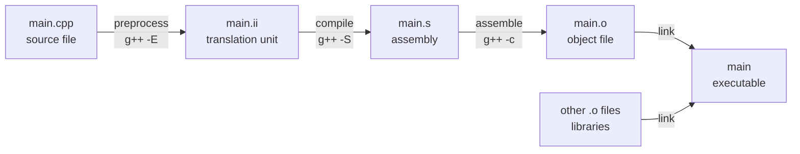

面向对象的程序几乎总是由多个文件组成：每个类通常有一个头文件和一个实现文件，程序由几十上百个这样的文件拼装而成。要读懂和组织这样的程序，必须先弄清 C++ 程序是怎样从一组源文件变成可执行文件的：编译器每次只看一个源文件，凭声明检查对其他文件中函数的调用；链接器再把各个目标文件拼接起来，为每个调用找到唯一的定义。本章依次讲编译过程、声明与定义、头文件、链接、预处理器，再讲自动化构建的工具 Make 与 CMake，最后介绍命令行参数与调试器。章末对照 Python：它没有链接这一步，模块在运行时导入。[4.1.1](/4.1.1) 已经介绍了编译与解释的区别，[4.1.5](/4.1.5) 介绍了调试与测试的一般方法；命令行与 Shell 的使用见 [4.11 操作系统](/4.11)，Git 等版本控制工具见 [4.14 软件工程](/4.14)。

## 2.1. 从源代码到可执行文件

### 2.1.1. 四个阶段

用 `g++ main.cpp -o main` 一条命令得到可执行文件，背后其实经过了四个阶段：



| 阶段 | 做什么 | 单独执行 |
|---|---|---|
| 预处理 | 处理 `#include`、`#define`、`#if` 等指令：把头文件的内容原样插入、展开宏、删去条件不成立的代码 | `g++ -E main.cpp -o main.ii` |
| 编译 | 词法与语法分析、类型检查、优化，生成汇编代码 | `g++ -S main.cpp` |
| 汇编 | 把汇编代码翻译成机器码，得到目标文件（`.o`，Windows 上为 `.obj`） | `g++ -c main.cpp` |
| 链接 | 把多个目标文件和库合并成可执行文件，为每个对外部函数和变量的引用找到其定义 | `g++ main.o util.o -o main` |

**定义 2.1.1（编译单元）** 一个源文件经过预处理、展开了所有 `#include` 和宏之后得到的文本，称为一个**编译单元**（也称翻译单元）。编译器每次只处理一个编译单元，彼此独立。

编译单元相互独立是理解本章所有内容的关键：编译 `main.cpp` 时，编译器看不到 `util.cpp` 里写了什么，它只能依据 `main.cpp` 中出现的声明来检查对其他文件中函数的调用是否合法；这些调用最终指向哪里，留给链接器决定。

### 2.1.2. 编译器与常用选项

主流的 C++ 编译器有三个：GCC（命令 `g++`，Linux 的默认选择）、Clang（`clang++`，macOS 的默认选择，Xcode 命令行工具附带）和 MSVC（Visual Studio 附带的 `cl`）。在 Windows 上学习时，推荐使用 WSL（Windows Subsystem for Linux）获得与 Linux 相同的工具链，或者用 MSYS2 安装 MinGW-w64 版的 GCC/Clang。在命令行中输入 `g++` 时，系统会在环境变量 `PATH` 列出的目录中查找这个程序；安装后提示"找不到命令"，通常就是因为编译器所在目录不在 `PATH` 中。

| 选项 | 作用 |
|---|---|
| `-o <file>` | 指定输出文件名 |
| `-c` | 只编译（到目标文件），不链接 |
| `-std=c++20`、`-std=c++23` | 指定语言标准。本课程的代码以 C++20 为准 |
| `-Wall -Wextra -Wpedantic` | 打开常用警告。警告往往指出真正的错误，应当清零 |
| `-g` | 生成调试信息，供调试器使用 |
| `-O0`、`-O2`、`-O3` | 优化级别。调试时用 `-O0`，发布时通常用 `-O2` |
| `-I<dir>`、`-L<dir>`、`-l<name>` | 头文件搜索目录、库搜索目录、链接库 `lib<name>` |
| `-fsanitize=address,undefined` | 运行时检查越界、释放后使用、整数溢出等错误（见 §2.8） |

## 2.2. 声明与定义

### 2.2.1. 声明与定义的区别

**定义 2.2.1** **声明**向编译器引入一个名字并说明它的类型，使编译器能够检查对它的使用；**定义**是完整给出实体的声明：对函数给出函数体，对变量分配存储空间。每个定义都是声明，反之不然。

| 写法 | 是声明还是定义 |
|---|---|
| `int add(int a, int b);` | 函数声明（参数名可以省略：`int add(int, int);`） |
| `int add(int a, int b) { return a + b; }` | 函数定义 |
| `extern int counter;` | 变量声明：存在一个名为 `counter` 的 `int`，定义在别处 |
| `int counter;`、`int counter = 0;` | 变量定义（全局变量未显式初始化时被零初始化） |
| `class Stack;` | 类的声明（前置声明） |
| `class Stack { /* members */ };` | 类的定义 |

编译器只需要声明就能编译一次调用：知道 `add` 接受两个 `int`、返回 `int`，就能检查实参并生成调用指令。函数体在哪里，是链接器的事。

### 2.2.2. 单一定义规则

一个名字可以声明许多次，但定义的次数有严格限制。

**定义 2.2.2（单一定义规则）** C++ 的**单一定义规则**（ODR）要求：

1. 在每个编译单元中，任何变量、函数、类、枚举和模板至多有一个定义；
2. 在整个程序中，每个被使用的非 `inline` 函数和非 `inline` 变量恰好有一个定义；
3. 类、`inline` 函数、`inline` 变量和模板可以在多个编译单元中各定义一次，但这些定义必须逐字相同。

第 3 条是头文件能够存放类定义的原因：每个包含了头文件的源文件都得到一份类定义，它们完全相同，符合规则。第 2 条则说明为什么头文件里不能放普通函数和全局变量的定义：头文件被几个源文件包含，就会产生几个定义，链接时报"重复定义"（§2.4.2）。

需要在多个文件间共享的**全局变量**，在头文件中用 `extern` 声明，在恰好一个源文件中定义。不过，全局变量让任何代码都能修改共享状态，削弱了**封装**，使程序难以理解和测试；能用参数传递的数据就不要放进全局变量。

## 2.3. 头文件

### 2.3.1. 头文件的作用

**定义 2.3.1（头文件）** 存放声明、供多个源文件通过 `#include` 指令共享的文件称为**头文件**，扩展名通常为 `.h` 或 `.hpp`。

`#include "stats.h"` 的效果只是把 `stats.h` 的全部文本复制到这一行的位置，预处理器并不理解其中的内容。头文件的意义在于让声明只写一次：如果每个源文件各自手写一遍 `double mean(const std::vector<double>&);`，一旦函数签名改动，漏改的那一处只会在链接时（甚至运行时）才暴露出来。实现文件也应包含自己的头文件，这样编译器能检查声明与定义是否一致。

头文件中通常放：函数声明、类的定义、`inline` 函数与 `constexpr` 常量、模板、类型别名；实现文件（`.cpp`）中放：普通函数和成员函数的定义、全局变量与静态数据成员的定义（[4.2.4](/4.2.4)）。

`#include <iostream>` 用尖括号，在系统和 `-I` 指定的目录中查找；`#include "stats.h"` 用双引号，先在当前文件所在目录查找。

### 2.3.2. 一个多文件程序

下面是一个由三个文件组成的程序：头文件 `include/stats.h` 声明接口，`src/stats.cpp` 实现它，`src/main.cpp` 使用它。

```cpp
// include/stats.h
#pragma once
#include <vector>

// Declarations only: what the functions are called and what they take.
double mean(const std::vector<double>& xs);
double variance(const std::vector<double>& xs);

extern int call_count;  // declaration of a variable defined in stats.cpp
```

```cpp
// src/stats.cpp
#include "stats.h"

int call_count = 0;  // the one definition of call_count

double mean(const std::vector<double>& xs) {
    ++call_count;
    double sum = 0;
    for (double x : xs) sum += x;
    return sum / static_cast<double>(xs.size());
}

double variance(const std::vector<double>& xs) {
    ++call_count;
    double m = mean(xs), ss = 0;
    for (double x : xs) ss += (x - m) * (x - m);
    return ss / static_cast<double>(xs.size() - 1);
}
```

```cpp
// src/main.cpp
#include <iostream>
#include "stats.h"

int main() {
    std::vector<double> xs{2, 4, 4, 4, 5, 5, 7, 9};
    std::cout << mean(xs) << ' ' << variance(xs) << '\n';  // 5 4.57143
    std::cout << "calls: " << call_count << '\n';          // calls: 3
}
```

可以一步编译链接，也可以分步进行。分步的好处是：只修改了 `main.cpp` 时，只需重新编译它，再与原来的 `stats.o` 链接。

```bash
# one step: g++ compiles each file and links them
g++ -std=c++20 -Wall -Iinclude src/main.cpp src/stats.cpp -o app

# separate compilation, then linking
g++ -std=c++20 -Wall -Iinclude -c src/stats.cpp -o stats.o
g++ -std=c++20 -Wall -Iinclude -c src/main.cpp -o main.o
g++ main.o stats.o -o app
./app
```

### 2.3.3. 包含保护

同一个头文件可能被间接包含多次，例如 `a.h` 和 `b.h` 都包含了 `stats.h`，而 `main.cpp` 同时包含 `a.h` 与 `b.h`。函数声明重复无妨，但类定义在同一编译单元中重复就违反了单一定义规则。防止重复包含有两种写法：

```cpp
// traditional include guard
#ifndef STATS_H
#define STATS_H
// ... contents of the header ...
#endif
```

```cpp
#pragma once
// ... contents of the header ...
```

传统的包含保护（include guard）是标准写法，需要为每个头文件取一个不重复的宏名；`#pragma once` 不是 ISO 标准的一部分，但 GCC、Clang、MSVC 都支持，写法简单，也不会因宏名重复而出错。它的局限是按"物理文件"判断：同一内容的两份拷贝放在不同路径下时无法识别。新代码中两种都常见，一个项目内保持统一即可。

C++20 引入了模块（`export module stats;` / `import stats;`），从根本上取代"文本复制"式的头文件：模块只编译一次，不受宏和包含顺序影响。C++23 还提供了 `import std;` 一次导入整个标准库。到 2026 年，三大编译器和 CMake 都已初步支持模块，但许多库和工具链仍以头文件为主，本课程仍使用头文件。

## 2.4. 链接

### 2.4.1. 符号与链接

**定义 2.4.1（链接）** 把多个目标文件和库合并为一个可执行文件或库的过程称为**链接**，由链接器完成。它主要做两件事：符号解析，即为每个目标文件中引用的外部符号找到唯一的定义；重定位，即合并各文件的代码段与数据段，确定每个函数和变量的最终地址，并把所有引用改写为这些地址。

每个目标文件带有一张符号表：它定义了哪些符号、引用了哪些尚未定义的符号。可以用 `nm` 查看：

```bash
$ nm -C stats.o | grep -E "mean|variance|call_count"
0000000000000000 B call_count
0000000000000000 T mean(std::vector<double, std::allocator<double> > const&)
0000000000000103 T variance(std::vector<double, std::allocator<double> > const&)
$ nm main.o | grep mean
                 U _Z4meanRKSt6vectorIdSaIdEE
```

`T` 表示定义在代码段中的函数，`B` 表示未初始化或零初始化的数据，`U` 表示引用了但未定义、等待链接器解决的符号。不加 `-C` 时看到的 `_Z4meanRKSt6vectorIdSaIdEE` 是编译器生成的符号名：C++ 允许同名函数以不同参数类型并存（[函数重载](/4.2.3)），因此编译器把参数类型编码进符号名中，这称为名字修饰（name mangling）。`-C` 把它还原为可读的形式。

### 2.4.2. 常见的链接错误

未定义的引用：调用了某个函数，却没有任何目标文件提供它的定义。最常见的原因是忘了把某个源文件加入编译命令，或者声明与定义不一致。例如头文件声明的是 `int add(int, int)`，实现文件里写成了 `float add(float, float)`：两个文件各自都能通过编译，但由于名字修饰，它们是两个不同的符号。

```text
/usr/bin/ld: main.o: in function `main':
main.cpp:(.text+0x13): undefined reference to `add(int, int)'
collect2: error: ld returned 1 exit status
```

重复定义：同一个符号在多个目标文件中都有定义，例如两个源文件各写了一个 `int counter = 0;`，或者把函数定义写进了被多处包含的头文件。

```text
/usr/bin/ld: b.o:(.bss+0x0): multiple definition of `counter'; a.o:(.bss+0x0): first defined here
collect2: error: ld returned 1 exit status
```

链接错误的信息中出现的是 `ld`（链接器）而不是编译器，行号也只是目标文件中的偏移量。看到这两类错误，应当检查的是"哪个文件定义了它"，而不是去找语法错误。

### 2.4.3. 内部链接与外部链接

默认情况下，全局函数和全局变量具有外部链接（external linkage）：它们的符号对其他编译单元可见，可以被其他文件中的声明引用。只供本文件使用的辅助函数和变量应当具有内部链接（internal linkage），对其他编译单元不可见，这样不同文件中的同名辅助函数不会冲突。C++ 中有两种写法：

```cpp
// helpers.cpp
static int counter = 0;           // internal linkage: invisible to other files

namespace {                       // unnamed namespace: everything inside has internal linkage
int helper() { return 1; }
}

int get() { return counter + helper(); }  // external linkage: callable from other files
```

此时即使另一个文件也定义了 `int counter = 5;`，两者互不干扰；另一个文件中写 `extern int counter;` 也无法引用到 `helpers.cpp` 里的那个。现代 C++ 更推荐使用无名命名空间。注意 `static` 用于全局作用域时表示内部链接，用于函数内的局部变量和类的成员时含义完全不同（[4.2.4](/4.2.4)）。

### 2.4.4. 库

把一组目标文件打包成库，可以供多个程序复用。静态库（static library，Linux 上的 `.a`，Windows 上的 `.lib`）在链接时被复制进可执行文件；动态库（dynamic library，`.so`、`.dll`、`.dylib`）在程序运行时才被加载，多个程序可以共享同一份。标准库本身就是一个库：链接 C++ 程序时 `g++` 会自动链接 `libstdc++`，这也是用 `gcc`（C 编译器的驱动程序）链接 C++ 目标文件会报一堆未定义引用的原因。

## 2.5. 预处理器与宏

预处理器在编译之前对源代码做纯文本的变换，它不懂 C++ 的语法和类型。

**定义 2.5.1（宏）** 用 `#define` 定义、在预处理阶段被替换为指定文本的标识符称为**宏**；带参数的宏在替换时还会把实参文本代入。

宏是简单的文本替换，因此容易出错。经典的例子：

```cpp
#include <iostream>

#define M(y) y*y+3*y
#define MAX(a, b) ((a) > (b) ? (a) : (b))

int main() {
    std::cout << M(1+1) << '\n';  // 1+1*1+1+3*1+1 = 7, not 10
    int a = 1, b = 0;
    int m = MAX(a++, b);          // ((a++) > (b) ? (a++) : (b)): a is incremented twice
    std::cout << m << ' ' << a << '\n';  // 2 3
}
```

即使每个参数都加了括号，像 `MAX(a++, b)` 这样带**副作用**的实参仍会被求值两次。现代 C++ 中，宏的大多数用途都有类型安全的替代：

| 宏的用途 | 替代 |
|---|---|
| 常量 `#define PI 3.14159` | `constexpr double pi = 3.14159;`，或使用标准库的 `std::numbers::pi`（C++20） |
| 类函数宏 `#define SQR(x) ((x)*(x))` | `constexpr` 函数、`inline` 函数（[4.2.3](/4.2.3)）或函数模板（[4.2.9](/4.2.9)） |
| 防止重复包含 | 仍用包含保护或 `#pragma once` |
| 条件编译 | 仍用 `#if`、`#ifdef`；能用 `if constexpr` 时优先用它 |

条件编译至今仍是宏的正当用途，例如按平台选择代码，或控制调试输出：

```cpp
#include <cassert>
#include <iostream>

int main() {
    int val = 42;
#ifdef DEBUG
    std::cout << "val = " << val << '\n';  // compiled only with g++ -DDEBUG
#endif
    assert(val > 0);  // checked unless compiled with -DNDEBUG
}
```

`g++ -DDEBUG` 相当于在源文件开头写 `#define DEBUG`。标准库的 `assert` 也是一个宏：定义了 `NDEBUG` 时它被展开为空，因此发布版本中的**断言**没有运行开销。

## 2.6. 构建系统

### 2.6.1. 为什么需要构建工具

项目有几十个源文件时，手工输入编译命令既繁琐又容易出错，而且每次全部重新编译很慢。理想的做法是增量构建：

- 第一次构建时，编译所有源文件并链接；
- 修改了某几个 `.cpp` 文件后，只重新编译它们，再重新链接；
- 修改了某个头文件后，重新编译所有包含了它的 `.cpp` 文件，再重新链接。

**定义 2.6.1（构建系统）** 根据文件之间的依赖关系，自动决定需要重新生成哪些文件、并按正确的顺序执行相应命令的工具，称为**构建系统**。

### 2.6.2. Make 的原理

Make 是最早也最基本的构建工具，它读取名为 `Makefile` 的文件，其中每条规则的格式是：

```makefile
target: prerequisites
	command
```

意思是：目标 `target` 依赖于 `prerequisites`；若目标不存在，或者某个依赖比目标更新（按文件修改时间判断），就执行命令（命令行必须以 Tab 开头）。Make 把规则连成一张依赖图，从要求的目标出发递归地检查每个依赖，因此只重做真正过时的部分。

下面的 `Makefile` 构建 §2.3.2 的程序：

```makefile
CXX      := g++
CXXFLAGS := -std=c++20 -Wall -Wextra -g -Iinclude -MMD -MP
OBJS     := build/main.o build/stats.o

app: $(OBJS)
	$(CXX) $^ -o $@

build/%.o: src/%.cpp | build
	$(CXX) $(CXXFLAGS) -c $< -o $@

build:
	mkdir -p build

.PHONY: clean
clean:
	rm -rf build app

-include $(OBJS:.o=.d)
```

| 写法 | 含义 |
|---|---|
| `CXX := g++` | 定义变量，用 `$(CXX)` 引用 |
| `$@`、`$^`、`$<` | 自动变量：当前目标、全部依赖、第一个依赖 |
| `build/%.o: src/%.cpp` | 模式规则：任何 `build/X.o` 都由 `src/X.cpp` 编译得到 |
| `\| build` | 仅要求顺序的依赖：目录 `build` 必须先存在，但它的时间戳不触发重新编译 |
| `.PHONY: clean` | 声明 `clean` 不是文件名，即使存在名为 `clean` 的文件也照样执行 |
| `-MMD -MP` 与 `-include` | 让编译器为每个源文件生成记录它包含了哪些头文件的 `.d` 文件，Make 读入后，修改头文件就会触发相关源文件重新编译 |

在该目录下运行 `make` 构建第一个目标 `app`，`make clean` 执行清理，`make -f other.mk` 使用其他文件名的 Makefile，`make -j8` 并行执行互不依赖的命令。

### 2.6.3. CMake

手写 Makefile 有明显的局限：它与平台绑定（Windows 上的 MSVC 不用 Make），依赖库的查找、编译选项的差异都要自己处理。现在的 C++ 项目普遍使用 CMake：它本身不编译代码，而是读取描述项目结构的 `CMakeLists.txt`，为当前平台生成实际的构建文件（Makefile、Ninja 文件或 Visual Studio 工程）。CMake 是"构建系统的生成器"，Make 和 Ninja 是它驱动的底层构建工具。

同一个项目的 `CMakeLists.txt`：

```text
cmake_minimum_required(VERSION 3.20)
project(stats_demo LANGUAGES CXX)

set(CMAKE_EXPORT_COMPILE_COMMANDS ON)  # compile_commands.json for clangd / VS Code

add_library(stats src/stats.cpp)
target_include_directories(stats PUBLIC include)
target_compile_features(stats PUBLIC cxx_std_20)
target_compile_options(stats PRIVATE -Wall -Wextra)

add_executable(app src/main.cpp)
target_link_libraries(app PRIVATE stats)
```

现代 CMake 以目标（target）为中心：`add_library` 和 `add_executable` 定义目标，`target_*` 命令为目标设置属性。`PUBLIC` 表示属性会传递给链接了它的目标：`app` 链接 `stats` 后，自动获得 `include` 目录和 C++20 要求；`PRIVATE` 只对目标自己生效。这与类的 `public`/`private` 思想一致：库把使用者需要的东西公开，把实现细节留在内部。

```bash
cmake -S . -B build -DCMAKE_BUILD_TYPE=Debug   # configure: generate build files in build/
cmake --build build                            # build (incrementally)
./build/app
```

构建产物全部放在单独的 `build` 目录中，源代码目录保持干净，删除 `build` 即可彻底重来。较大的项目还会用 `CMakePresets.json` 记录常用的配置，用 vcpkg 或 Conan 管理第三方库。

## 2.7. 命令行参数

程序除了在运行中用 `std::cin` 读取输入，还可以在启动时从命令行接收参数。`main` 函数的另一种标准形式是 `int main(int argc, char* argv[])`：`argc` 是参数个数，`argv` 是由 C 字符串组成的数组，`argv[0]` 是程序名，`argv[argc]` 是空指针。运行 `./add 4 5` 时，`argc` 为 3，`argv` 依次为 `"./add"`、`"4"`、`"5"`。命令行参数让程序可以被脚本批量调用、与其他程序组合，这是 Unix 工具的基本工作方式。

程序必须检查参数是否合法：不检查 `argc` 就访问 `argv[1]` 会越界。把字符串转换为整数时，C 库的 `atoi` 遇到非数字时返回 0 而不报错，应当用 `std::stoi`，它在无法转换时抛出异常。

```cpp tab
#include <iostream>
#include <string>

int main(int argc, char* argv[]) {
    if (argc != 3) {
        std::cerr << "usage: " << argv[0] << " op1 op2\n";
        return 1;
    }
    try {
        int a = std::stoi(argv[1]);
        int b = std::stoi(argv[2]);
        std::cout << a + b << '\n';
    } catch (const std::exception& e) {
        std::cerr << "not an integer: " << e.what() << '\n';
        return 2;
    }
}
```

```python tab
import argparse

parser = argparse.ArgumentParser(description="Add two integers.")
parser.add_argument("a", type=int)
parser.add_argument("b", type=int)
args = parser.parse_args()  # prints a usage message and exits on bad input
print(args.a + args.b)
```

Python 中原始的参数列表是 `sys.argv`，标准库 `argparse` 负责解析、类型转换、错误提示和自动生成 `--help`。`main` 的返回值就是程序的**退出状态**：0 表示成功，非零表示失败，Shell 脚本据此判断命令是否成功。在 VS Code 中调试时，命令行参数写在 `launch.json` 的 `args` 字段中。

## 2.8. 调试

### 2.8.1. gdb 与 lldb

**调试器**让程序在指定位置暂停，查看变量和**调用栈**，再逐行执行。用 `-g` 编译后启动调试器：Linux 上通常用 gdb，macOS 上用 lldb（gdb 在 macOS 上需要额外的签名授权）。两者的常用命令几乎一一对应，命令都可以缩写为前几个字母，直接回车重复上一条命令。

| 操作 | gdb | lldb |
|---|---|---|
| 启动程序（可带参数） | `run 3 4` | `run 3 4` |
| 在第 8 行设断点 | `break 8` | `breakpoint set -l 8`（或 `b 8`） |
| 条件断点 | `break 8 if i == 50` | `breakpoint set -l 8 -c 'i == 50'` |
| 单步执行，不进入函数 | `next` | `next` |
| 单步执行，进入函数 | `step` | `step` |
| 执行到当前函数返回 | `finish` | `finish` |
| 继续运行到下一个断点 | `continue` | `continue` |
| 查看变量或表达式 | `print s` | `print s`（或 `p s`） |
| 每次暂停时自动显示 | `display s` | `display s` |
| 变量被修改时暂停 | `watch s` | `watchpoint set variable s` |
| 查看调用栈 | `backtrace` | `bt` |
| 列出断点 / 删除 1 号断点 | `info breakpoints` / `delete 1` | `breakpoint list` / `breakpoint delete 1` |
| 修改变量的值 | `print s = 0` | `expr s = 0` |
| 退出 | `quit` | `quit` |

以一个求 $1 + 2 + \cdots + 100$ 的程序为例：

```cpp
#include <iostream>

int add(int s, int i) { return s + i; }

int main() {
    int s = 0;
    for (int i = 1; i <= 100; ++i) {
        s = add(s, i);
    }
    std::cout << s << '\n';
}
```

```bash
g++ -std=c++20 -g -O0 sum.cpp -o sum
gdb ./sum
# (gdb) break 8          stop at "s = add(s, i);"
# (gdb) run              runs until the breakpoint: s == 0, i == 1
# (gdb) step             enters add(s=0, i=1)
# (gdb) finish           returns to main and shows the returned value 1
# (gdb) continue         stops at line 8 again, now with i == 2
# (gdb) print s          s == 1
# (gdb) delete 1         remove breakpoint 1
# (gdb) break 10         the output line
# (gdb) continue         the loop runs to the end and stops at line 10
# (gdb) print s          s == 5050
```

### 2.8.2. VS Code

VS Code 用插件提供图形化的调试：安装 Microsoft 的 C/C++ 扩展（Linux、Windows 上调用 gdb，macOS 上调用 lldb）或 CodeLLDB 扩展。在源代码行号左侧点击设置断点（右键可设条件），按 F5 启动，左侧面板显示变量、监视表达式和调用栈，工具栏提供继续、单步跳过、单步进入、单步跳出等按钮。配置写在项目的 `.vscode` 目录中：`tasks.json` 描述如何构建，`launch.json` 描述如何启动被调试的程序（可执行文件路径、命令行参数 `args` 等）。使用 CMake 的项目可以安装 CMake Tools 扩展，它直接读取 `CMakeLists.txt`，自动完成配置、构建和调试，不必手写这两个文件；C/C++ 扩展或 clangd 读取 CMake 生成的 `compile_commands.json`，提供准确的代码补全和错误提示。Remote - SSH 和 WSL 扩展让 VS Code 在远程服务器或 WSL 中编辑、构建和调试，就像在本地一样。

### 2.8.3. 用工具代替肉眼

调试器擅长回答"程序在这一刻处于什么状态"，但很多错误在出现症状时已经远离了出错的地方。例如下面的程序写越了数组 `a` 的边界：

```cpp
#include <iostream>

int main() {
    int a[4], b[4] = {0, 0, 0, 0};
    for (int i = 0; i <= 4; ++i) a[i] = i;  // bug: writes a[4]
    std::cout << a[0] + b[0] << '\n';
}
```

在某些编译器和优化级别下，`a[4]` 恰好落在 `b[0]` 的位置，程序会输出 4 而不报错；用 `watch b[0]` 可以抓到它被意外修改的那一刻，但前提是已经怀疑到了 `b`。更有效的办法是让工具自动检查：用 `-fsanitize=address,undefined` 编译后运行，越界写入的那一行会被立即报告（`index 4 out of bounds for type 'int [4]'`）。AddressSanitizer（ASan）检查越界、释放后使用和内存泄漏，UndefinedBehaviorSanitizer（UBSan）检查**整数溢出**、非法移位等未定义行为。开发和测试时打开这些选项，再配合 `-Wall -Wextra` 的警告，能在错误造成难以理解的后果之前发现它们。

本地运行正确、换了优化级别（如在线评测常用的 `-O2`）就出错，几乎总是程序中有**未定义行为**：优化器假设未定义行为不会发生，据此重排和删除代码。此时应当用上述工具查找错误，而不是怀疑编译器。

### 2.8.4. Python 的调试

Python 自带调试器 pdb：在代码中写一行 `breakpoint()`，运行到那里就会进入交互式调试，命令与 gdb 类似（`n`、`s`、`c`、`p expr`、`bt`、`q`）。VS Code 的 Python 扩展提供与 C++ 相同的图形化调试界面。Python 运行时会检查下标越界等错误并抛出带完整调用栈的异常，因此不存在 C++ 那样"静默写坏内存"的问题。

## 2.9. Python 对照：模块与包

Python 没有单独的编译和链接步骤。一个 `.py` 文件就是一个模块，`import stats` 在运行时查找 `stats.py`，执行它的顶层代码，并把得到的模块对象缓存在 `sys.modules` 中，以后再导入就直接使用缓存。名字在运行到它的时候才被查找，因此 C++ 中的链接错误在 Python 中表现为运行时的 `ImportError`、`AttributeError` 或 `NameError`，只有执行到相应代码才会发现，这也是 Python 项目更依赖测试和类型检查工具（如 mypy、Pyright）的原因之一。

| C++ | Python |
|---|---|
| 头文件 + 实现文件 | 一个 `.py` 文件同时是接口与实现 |
| `#include`（复制文本） | `import`（运行时加载模块对象，只执行一次） |
| 命名空间 `namespace stats { ... }` | 每个模块是一个独立的命名空间：`stats.mean` |
| 链接时解析符号 | 运行时查找属性 |
| 静态库、动态库 | 包（含有模块的目录）、发布到 PyPI 的分发包 |
| CMake 描述构建 | `pyproject.toml` 描述项目与依赖（[4.4.1](/4.4.1)） |

```python
# stats.py
def mean(xs: list[float]) -> float:
    return sum(xs) / len(xs)


def variance(xs: list[float]) -> float:
    m = mean(xs)
    return sum((x - m) ** 2 for x in xs) / (len(xs) - 1)


if __name__ == "__main__":  # runs only when executed as a script, not when imported
    print(mean([2, 4, 4, 4, 5, 5, 7, 9]), variance([2, 4, 4, 4, 5, 5, 7, 9]))
```

包是包含模块的目录，通常带有 `__init__.py`；`from mypkg.stats import mean` 导入包中的模块。`if __name__ == "__main__":` 下的代码只在文件被直接运行（`python stats.py` 或 `python -m stats`）时执行，被导入时不执行，相当于给模块提供一个可选的 `main` 函数。CPython 会把模块编译成**字节码**缓存在 `__pycache__` 目录中，这只是为了加快下次加载，与 C++ 的目标文件不同，它不需要链接。

## 小结

- 一个源文件预处理后成为编译单元；编译器逐个编译单元生成目标文件，链接器把它们合并并解析符号。
- 声明引入名字和类型，定义给出实体本身；单一定义规则决定了头文件放声明和类定义、实现文件放函数与变量的定义。
- "未定义的引用"与"重复定义"是链接错误，原因是缺少或多出了定义；只在本文件使用的函数用无名命名空间或 `static` 给予内部链接。
- 宏是文本替换，常量和类函数宏应改用 `constexpr`、`inline` 函数与模板；条件编译和包含保护仍用预处理器。
- Make 按依赖关系和时间戳增量构建；CMake 以目标为中心描述项目，生成各平台的构建文件，是现代 C++ 项目的标准做法。
- 调试器查看程序状态，sanitizer 和编译器警告自动发现错误；Python 在运行时导入模块，没有链接步骤。
