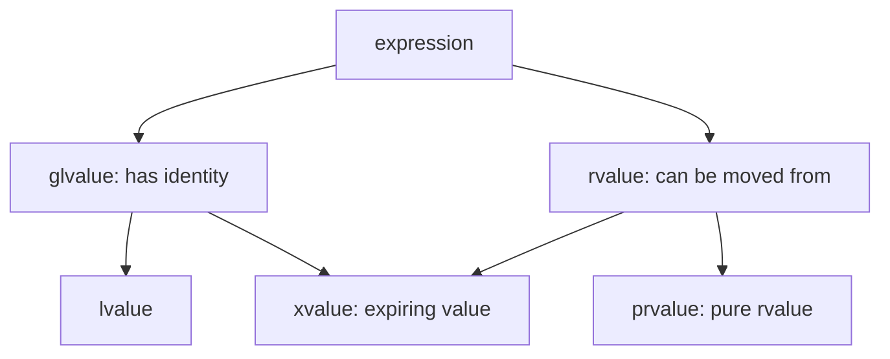
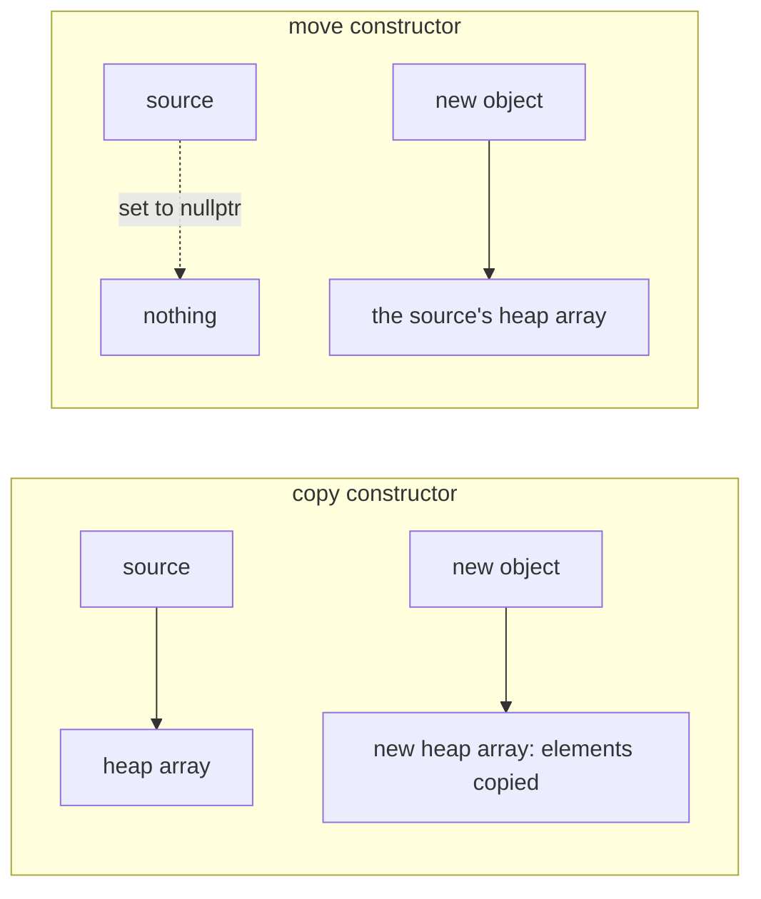

C++ objects have value semantics: `Buffer b = a;` creates a new, independent object, and modifying `b` does not affect `a`, just as with `int`. Value semantics make programs easy to reason about, but they raise two problems. First, what does "copy" mean for an object that manages a resource? If the object contains only a pointer to heap memory, copying member by member makes two objects share one block of memory, which is released twice at destruction. Second, copying can be expensive: copying a `std::vector` with a million elements requires allocating memory and copying all the elements each time, and the source of many copies is destroyed immediately afterward. This chapter first covers references, which avoid copying, then value categories, the concept that distinguishes "objects that may be moved from", then copy construction and copy assignment, move construction and move assignment, and the compiler's elision of copies, and summarizes them as the rules of zero, three and five. Finally it discusses the implicit conversions caused by single-argument **constructors** and conversion operators. These rules form the core of the C++ object model, and the **resource acquisition is initialization** idiom of [4.2.4](/4.2.4) also becomes complete only here: how ownership of a resource should be passed when an object is copied and moved. At the end we compare with Python, whose assignment never copies an object.

## 6.1. References

### 6.1.1. Defining References

**Definition 6.1.1 (Reference)** A **reference** is an alias for an existing object, defined as `Type& name = object;`. A reference must be initialized at its definition and thereafter always refers to the same object; every operation on the reference is an operation on the object it refers to.

```cpp
int i = 1;
int& j = i;   // j is another name for i
j = 3;        // assigns to i
i = 2;        // j == 2
```

The main uses of references are function parameters and return values. Under **pass by reference**, the parameter is the argument itself, so the function can modify the caller's variable (as in `void swap(int& a, int& b)`) and the copying of large objects is avoided ([4.1.4](/4.1.4) discussed passing by value and passing by pointer).

A reference is usually implemented as a pointer, but its semantics are more constrained and therefore safer:

| | Reference `T&` | Pointer `T*` |
|---|---|---|
| Initialization | Must be initialized | May be uninitialized, or `nullptr` |
| Can it be null | There is no null reference | May be null; must be checked before use |
| Can it be rebound | No; assignment acts on the referenced object | May point to another object at any time |
| Accessing the object | Use the name directly | Requires dereferencing `*p`, `p->m` |
| Operations | None | Pointer arithmetic, comparison |

A rule of thumb: use a reference when the parameter "definitely exists and need not be rebound"; use a pointer (or `std::optional`) when it "may be absent"; and use a smart pointer to express ownership ([4.2.12](/4.2.12)). References also make **operator overloading** possible: without references, an overload of `a += b` would either copy `b` or force users to write `a += &b`.

### 6.1.2. Const References

`const T&` is a read-only reference: the object can be read through it but not modified. It is the standard way of passing class-type parameters, avoiding copies while assuring the caller that the argument will not be modified. This embodies the principle of least privilege: give a function only the permissions it needs to do its job.

```cpp
double total(const std::vector<double>& xs);  // reads xs, does not copy it, cannot modify it
void normalize(std::vector<double>& xs);      // modifies the caller's vector
std::vector<double> sorted(std::vector<double> xs);  // works on its own copy
```

A const reference has one more special ability: it can bind to a temporary object (§6.2.2) and extends the **lifetime** of the temporary to that of the reference. So `total({1.0, 2.0})` is legal, whereas it could not be called this way if the parameter were a non-const reference `std::vector<double>&`.

### 6.1.3. Dangling References

A reference does not own the object it refers to. If the object is destroyed before the reference, the reference becomes a dangling reference, and accessing through it is **undefined behavior**. The most common mistake is returning a reference to a **local variable**:

```cpp
int& bad() {
    int x = 1;
    return x;  // warning: reference to local variable 'x' returned [-Wreturn-local-addr]
}              // x is destroyed here; the caller receives a dangling reference

int& good(std::vector<int>& v, std::size_t i) {
    return v[i];  // OK: the element outlives the call (as long as v does)
}
```

A function may return a reference provided that the referenced object still exists after the function returns: a member function returns `*this` or a reference to a data member, `operator[]` returns a reference to a container element, and `get(i)` returns a reference to an element of a global array. Returning by value is always safe and, thanks to moves and copy elision (§6.5), usually not expensive.

## 6.2. Value Categories

### 6.2.1. Lvalues and Rvalues

Besides its type, every C++ expression has a *value category*, which describes what kind of object the expression refers to.

**Definition 6.2.1** An expression that refers to an object with identity and persistence, whose address can be taken, is called an **lvalue**; an expression that does not refer to a persistent object but represents a temporary value (or an object about to be destroyed whose resources may be moved away) is called an **rvalue**.

```cpp
int a = 1;
int b = f();      // a, b: lvalues; 1 and the call f(): rvalues
int c = a + b;    // a + b: rvalue
int* p = &a;      // OK: an lvalue has an address
// int* q = &(a + b);  // error: cannot take the address of an rvalue
```

The names come from "whether it can appear on the left of an assignment", but this characterization is not accurate (a `const` variable is an lvalue but cannot be assigned to). A better test: something with a name whose address can be taken is usually an lvalue; literals (except string literals), calls of functions returning by value and the results of arithmetic expressions are rvalues.

Since C++11, the standard subdivides value categories into three basic categories:



| Category | Has identity | Can be moved from | Examples |
|---|---|---|---|
| lvalue | Yes | No | Variable name `a`, `*p`, `v[i]`, a call of a function returning an lvalue reference |
| xvalue (expiring value) | Yes | Yes | `std::move(a)`, a call of a function returning an rvalue reference |
| prvalue (pure rvalue) | No | Yes | `42`, `a + b`, a call `f()` of a function returning by value, `Test()` |

An xvalue is an object that "has identity but is no longer needed soon"; `std::move(a)` converts the lvalue `a` into an xvalue, meaning "I no longer need the value of `a`, and its resources may be moved away". Xvalues and prvalues together are called rvalues.

### 6.2.2. Rvalue References and Binding Rules

**Definition 6.2.2 (Rvalue Reference)** A reference declared with `T&&` that can bind only to rvalues is called an **rvalue reference**. Correspondingly, `T&` is called an lvalue reference.

Rvalue references let a function distinguish "the argument is an object that will still be used" from "the argument is a temporary object that may be hollowed out", which is the basis of move semantics. The rules for what each kind of reference can bind to are:

| | Non-const lvalue | Const lvalue | Rvalue |
|---|---|---|---|
| `T&` | ✓ | | |
| `const T&` | ✓ | ✓ | ✓ |
| `T&&` | | | ✓ |

`const T&` can bind rvalues so that `void f(const std::string& s)` can accept calls such as `f("hello")`: read-only access to a temporary object is safe. When both overloads can accept an rvalue, the rvalue binds preferentially to `T&&`.

```cpp
#include <iostream>

void ref(int& x) { std::cout << "lvalue " << x << '\n'; }
void ref(int&& x) {
    std::cout << "rvalue " << x << '\n';
    ref(x);  // x has a name: inside the function it is an lvalue
}

int main() {
    int a = 1;
    ref(a);             // lvalue 1
    ref(2);             // rvalue 2, then lvalue 2
    ref(std::move(a));  // rvalue 1, then lvalue 1
}
```

The last example illustrates an important rule: a named rvalue reference is itself an lvalue. The `x` inside `ref(int&& x)` has a name and its address can be taken, so `ref(x)` calls the lvalue version. A value category is a property of an expression, not of a variable's type: the type of `x` is `int&&`, but the expression `x` is an lvalue. To keep passing it on as an rvalue, we must write `std::move(x)` again.

## 6.3. Copying

### 6.3.1. The Copy Constructor

**Definition 6.3.1 (Copy Constructor)** A constructor whose first parameter is a reference to an object of the same class (usually `const T&`) and whose other parameters all have default values is called a **copy constructor**; it initializes a new object from an existing one.

The copy constructor is called on the following occasions (in practice the call may be omitted by copy elision, §6.5):

1. initializing a new object with an object of the same class: `T b(a);`, `T b = a;`, `T b{a};`;
2. passing an argument by value: `void f(T x); f(a);`;
3. returning an object by value: `T f() { T t; return t; }`.

The parameter of a copy constructor must be a reference. If it were written `T(T other)`, the copy constructor would have to be called first to pass the argument to `other`, recursing forever, so such a declaration is illegal.

### 6.3.2. Shallow Copy and Deep Copy

If a class declares no copy constructor, the compiler implicitly defines one: it copies each member in declaration order (calling the copy constructor for members of class type and copying the value directly for members of built-in type). For members such as `std::string` and `std::vector`, this is correct, since they know how to copy themselves. But for a raw pointer member that manages a resource, only the pointer value is copied, not what it points to:

```cpp
#include <cstddef>
#include <iostream>

class IntArray {
public:
    explicit IntArray(std::size_t n) : size_(n), data_(new int[n]{}) {}
    ~IntArray() { delete[] data_; }
    int& operator[](std::size_t i) { return data_[i]; }
    // no copy constructor: the compiler generates a memberwise copy

private:
    std::size_t size_;
    int* data_;
};

int main() {
    IntArray a(5);
    IntArray b = a;   // b.data_ == a.data_: both objects point to the same array
    b[2] = 3;
    std::cout << a[2] << '\n';  // 3: modifying b changed a
}   // b is destroyed, then a: the same array is deleted twice -> undefined behavior
```

Running with `-fsanitize=address` reports `attempting double-free`. Passing by value triggers the same problem: when `void fun(IntArray x)` returns, `x` is destroyed and releases the array of the caller's object (the phenomenon of "constructed once, destroyed twice" in [4.2.4](/4.2.4)).

**Definition 6.3.2** Copying only the members of the object itself, so that the copy shares with the original the resources the members point to, is called **shallow copy**; also copying the resources the members point to, so that the copy is entirely independent of the original, is called **deep copy**.

Older textbooks often call the compiler-generated copy a "bitwise copy". This is inaccurate: the implicit copy constructor copies member by member and calls the respective copy constructors of members of class type; only for built-in types and trivially copyable types is it equivalent to a byte-by-byte copy. For a class that manages resources, we need to write the deep copy ourselves.

### 6.3.3. The Copy Assignment Operator

Copying has another form: assigning the value of one existing object to another existing object.

**Definition 6.3.3 (Copy Assignment Operator)** A member function of the form `T& operator=(const T&)` is called a **copy assignment operator**; it copies the value of the right operand to the already existing left operand.

```cpp
Buffer a(3), b(5);
Buffer c = a;  // initialization: copy constructor (c did not exist before)
b = a;         // assignment: copy assignment operator (b already exists)
```

A definition with an equals sign, `Buffer c = a;`, is an initialization and calls the copy constructor, not assignment. Assignment does one more thing than construction: the resource originally held by the left operand must be released first, otherwise it leaks; and self-assignment `a = a` must be handled correctly, otherwise the object may release its own resource first and then copy from the released memory.

### 6.3.4. A Correct Resource Class

The `Buffer` below manages a dynamic array and defines copying and moving completely (moving is explained in §6.4). The copy assignment uses the copy-and-swap idiom: first make a copy in a temporary object with the copy constructor, then swap its contents with `*this`, and the temporary releases the old data when it is destroyed. Written this way, self-assignment is handled automatically, and if copying throws an exception (for example, out of memory), `*this` remains unchanged.

```cpp
#include <algorithm>
#include <cstddef>
#include <iostream>
#include <utility>

class Buffer {
public:
    explicit Buffer(std::size_t n = 0) : size_(n), data_(n ? new int[n]{} : nullptr) {
        std::cout << "construct(" << n << ")\n";
    }
    ~Buffer() { delete[] data_; }

    Buffer(const Buffer& other)                       // copy constructor: deep copy
        : size_(other.size_), data_(other.size_ ? new int[other.size_] : nullptr) {
        std::copy(other.data_, other.data_ + size_, data_);
        std::cout << "copy construct\n";
    }
    Buffer& operator=(const Buffer& other) {          // copy assignment
        std::cout << "copy assign\n";
        if (this != &other) {
            Buffer tmp(other);                        // copy first: if this throws, *this is untouched
            swap(tmp);
        }                                             // tmp now holds the old data and frees it
        return *this;
    }
    Buffer(Buffer&& other) noexcept                   // move constructor: steal the array
        : size_(std::exchange(other.size_, 0)), data_(std::exchange(other.data_, nullptr)) {
        std::cout << "move construct\n";
    }
    Buffer& operator=(Buffer&& other) noexcept {      // move assignment
        std::cout << "move assign\n";
        Buffer tmp(std::move(other));
        swap(tmp);
        return *this;
    }

    void swap(Buffer& other) noexcept {
        std::swap(size_, other.size_);
        std::swap(data_, other.data_);
    }
    int& operator[](std::size_t i) { return data_[i]; }
    std::size_t size() const { return size_; }

private:
    std::size_t size_;
    int* data_;  // owns an array of size_ ints (or nullptr when size_ == 0)
};

int main() {
    Buffer a(3);
    Buffer b = a;             // copy construct
    b[0] = 42;                // a is not affected
    std::cout << a[0] << ' ' << b[0] << '\n';  // 0 42
    Buffer c = std::move(a);  // move construct: a is now empty
    std::cout << a.size() << ' ' << c.size() << '\n';  // 0 3
    a = b;                    // copy assign
    c = Buffer(5);            // construct(5), then move assign
}
```

```text
construct(3)
copy construct
0 42
move construct
0 3
copy assign
copy construct
construct(5)
move assign
move construct
```

`a = b` printed "copy assign" and "copy construct": the latter comes from the temporary object `tmp` constructed inside the assignment operator. The right-hand side of `c = Buffer(5)` is a prvalue, so the move assignment is called.

### 6.3.5. Forbidding Copying

Some objects should not conceptually be copied: an open file, a mutex, a network connection, a thread. Copying them is either meaningless or causes the resource to be released twice. In this case the copy operations should be declared deleted (before C++11 the practice was to declare them `private` and leave them undefined):

```cpp
class File {
public:
    File(const File&) = delete;             // copying a File is a compile error
    File& operator=(const File&) = delete;
    // ...
};
```

The `File` class of [4.2.4](/4.2.4), and the standard library's `std::unique_ptr`, `std::thread` and `std::ifstream`, are all non-copyable, but they can be moved: ownership can be transferred but not shared.

## 6.4. Moving

### 6.4.1. Move Semantics

Consider `Buffer b = make_buffer(1000000);`: the temporary object returned by the function is about to be destroyed, so copying its million elements to `b` and then releasing the temporary's array is plainly wasteful. A better approach is to let `b` take over the temporary's array directly and then set the temporary's pointer to null, so that only one pointer and one integer are copied.

**Definition 6.4.1 (Move Semantics)** The semantics in which, when initializing or assigning from an rvalue, the source object's resources are transferred to the target object instead of being copied, and the source object is left in a valid but unspecified state, is called **move semantics**. It is implemented by the **move constructor** `T(T&&)` and the **move assignment operator** `T& operator=(T&&)`, which take an rvalue reference as parameter.



The move constructor of `Buffer` uses `std::exchange(other.data_, nullptr)` to take the source's pointer and set it to null. Setting it to null is necessary: the source object will still be destroyed later, and its destructor's `delete[] nullptr` does nothing, so it does not release the array that has been transferred to the new object.

A moved-from object is in a "valid but unspecified" state: it still satisfies the class **invariant**, can safely be destroyed and can be assigned to again, but its value should no longer be relied on. For standard-library types, a moved-from `std::string` or `std::vector` is usually empty, but the standard does not guarantee it.

Overload resolution chooses between copying and moving according to the binding rules of §6.2.2: when the argument is an lvalue, the copy constructor is called; when it is an rvalue (a prvalue or an xvalue), `T&&` is preferred and the move constructor is called.

### 6.4.2. std::move

For an lvalue whose value is definitely no longer needed, a move can be requested with `std::move`:

```cpp
std::vector<std::string> names;
std::string line = read_line();
names.push_back(std::move(line));  // the characters are moved into the vector; line is now unspecified
```

`std::move` itself moves nothing; it is only a type conversion: it converts an lvalue to an rvalue reference (an xvalue), so that overload resolution selects the move version. The real move happens in the move constructor or move assignment operator. If a type has no move operations, the copy operations are still called after `std::move`, and the result is correct, just not faster.

Implementing swap with moves turns three copies into three moves, which is exactly how `std::swap` is implemented:

```cpp
template <typename T>
void my_swap(T& a, T& b) {
    T tmp(std::move(a));  // move construct
    a = std::move(b);     // move assign
    b = std::move(tmp);   // move assign
}
```

### 6.4.3. noexcept

Move operations should be declared `noexcept`, and this is more than documentation: the standard library decides whether to use moves based on it. When a `std::vector` grows, it must move the elements from the old array to the new one and guarantee strong exception safety (if an exception is thrown during the transfer, the `vector` stays as it was). If an element's move constructor may throw, an error when half of the elements have already been moved away cannot be recovered from, so `vector` moves elements only if the move constructor is `noexcept` and otherwise falls back to copying:

```cpp
#include <iostream>
#include <vector>

template <bool NoexceptMove>
struct Item {
    static inline int copies = 0, moves = 0;
    Item() = default;
    Item(const Item&) { ++copies; }
    Item(Item&&) noexcept(NoexceptMove) { ++moves; }
};

template <bool B>
void grow() {
    std::vector<Item<B>> v;
    for (int i = 0; i < 1000; ++i) v.emplace_back();  // reallocates about 10 times
    std::cout << "noexcept(" << B << "): " << Item<B>::copies << " copies, "
              << Item<B>::moves << " moves\n";
}

int main() {
    grow<true>();   // noexcept(1): 0 copies, 1023 moves
    grow<false>();  // noexcept(0): 1023 copies, 0 moves
}
```

A move usually just swaps a few pointers, allocates no memory and naturally cannot throw, so it can almost always be declared `noexcept`. Move operations implicitly generated by the compiler are automatically `noexcept` when the moves of all members are `noexcept`.

## 6.5. Copy Elision

### 6.5.1. Return Value Optimization

Returning an object by value seems to require one copy (or move), but the compiler can construct the object directly in the place the caller has prepared for the result, omitting the copy entirely; this is called copy elision.

**Definition 6.5.1 (Copy Elision)** The optimization in which the compiler omits a copy or move construction and merges the source object and the target object into one is called **copy elision**. When applied to a function's return value it is called return value optimization (RVO); when the returned object is a named local variable it is called named return value optimization (NRVO).

Since C++17, copy elision is guaranteed by the language when an object of the same type is initialized from a prvalue: `T x = T();`, `T x = f();` (where `f` returns `return T(...);`) and passing by value `g(T())` call neither the copy nor the move constructor, and compile even if these constructors are deleted. Strictly speaking, C++17 changed the meaning of a prvalue: a prvalue is no longer "a temporary object that needs to be copied" but only "a way of initializing some object", and an object is really produced only when it is used to initialize the target object. Returning a named local variable (NRVO) is still only permitted, not required, and mainstream compilers do it in simple cases.

The following program is compiled under C++20 with the default options and with `-fno-elide-constructors` (which forbids non-mandatory copy elision):

```cpp
#include <iostream>

struct Test {
    Test() { std::cout << "Test()\n"; }
    Test(const Test&) { std::cout << "Test(const Test&)\n"; }
    Test(Test&&) noexcept { std::cout << "Test(Test&&)\n"; }
    ~Test() { std::cout << "~Test()\n"; }
};

Test make_prvalue() { return Test(); }  // returns a prvalue: elision is guaranteed (C++17)
Test make_named() {
    Test t;
    return t;                            // named object: NRVO is allowed but not required
}
void take(Test) {}

int main() {
    std::cout << "-- a\n";
    Test a = make_prvalue();
    std::cout << "-- b\n";
    Test b = make_named();
    std::cout << "-- take(a)\n";
    take(a);
    std::cout << "-- take(Test())\n";
    take(Test());
    std::cout << "-- end\n";
}
```

| Statement | `g++ -std=c++20` | `g++ -std=c++20 -fno-elide-constructors` |
|---|---|---|
| `Test a = make_prvalue();` | `Test()` | `Test()` (mandatory elision; the option has no effect) |
| `Test b = make_named();` | `Test()` (NRVO) | `Test()`, `Test(Test&&)`, `~Test()` (implicit move) |
| `take(a);` | `Test(const Test&)`, `~Test()` | Same (`a` is an lvalue and must be copied) |
| `take(Test());` | `Test()`, `~Test()` | Same (mandatory elision) |

The "one move on return and another move on initialization" observed with `-std=c++11 -fno-elide-constructors` in older textbooks no longer occurs under C++17 and later standards: `Test a = make_prvalue();` constructs only once in any case.

### 6.5.2. Implicit Move

Even if NRVO does not happen, `return t;` (where `t` is a local variable or a by-value parameter) first tries to treat `t` as an rvalue and call the move constructor, and copies only if that fails. This is where the `Test(Test&&)` in the right column of the second row of the table comes from. Therefore:

- To return a local object by value, simply write `return t;`.
- Do not write `return std::move(t);`: it turns `t` into an xvalue, which is no longer "the name of a returned local variable" and in fact prevents NRVO, yielding at best one move.
- Do not return a reference to a local object in order to "avoid copying"; that is a dangling reference (§6.1.3).

## 6.6. Special Member Functions and the Rules of Zero, Three and Five

### 6.6.1. Implicit Generation of Special Member Functions

**Definition 6.6.1 (Special Member Function)** The six member functions default constructor, destructor, copy constructor, copy assignment operator, move constructor and move assignment operator, which the compiler can generate implicitly when the program does not declare them but they are needed, are called **special member functions**.

The implicitly generated versions are all memberwise: they default-construct, destroy, copy or move each member in turn. Whether they are generated depends on what the programmer has declared:

| User declared | Default ctor | Destructor | Copy ctor | Copy assign | Move ctor | Move assign |
|---|---|---|---|---|---|---|
| Nothing | Generated | Generated | Generated | Generated | Generated | Generated |
| Another constructor | Not generated | Generated | Generated | Generated | Generated | Generated |
| Destructor | Generated | User's | Generated (not recommended to rely on) | Generated (not recommended to rely on) | Not generated | Not generated |
| Copy constructor | Not generated | Generated | User's | Generated (not recommended to rely on) | Not generated | Not generated |
| Copy assignment operator | Generated | Generated | Generated (not recommended to rely on) | User's | Not generated | Not generated |
| Move constructor | Not generated | Generated | Deleted | Deleted | User's | Not generated |
| Move assignment operator | Generated | Generated | Deleted | Deleted | Not generated | User's |

The key points: if a destructor or either copy operation is declared, the compiler no longer generates move operations, and "moving" an rvalue then degrades to copying (correct, but slow); if either move operation is declared, the copy operations are deleted and the class becomes move-only. "Not recommended to rely on" in the table means that the standard still generates it but this behavior has been marked deprecated and may be removed in the future. "Deleted" means it is defined as `= delete`, and calling it is a compile error.

### 6.6.2. The Rules of Three, Five and Zero

Behind the rules above lies a simple reasoning: if a class needs to write its own destructor, it is usually because it directly manages some resource; then the compiler's memberwise copy must also be wrong for it (a shallow copy), and its copy and move operations must also be written by hand. This yields three rules of thumb.

**Definition 6.6.2** Three design guidelines for special member functions:

1. The **rule of three**: if a class needs a user-defined destructor, copy constructor or copy assignment operator, then it almost certainly needs all three.
2. The **rule of five**: since C++11, in addition to the rule of three, a class should also define a move constructor and a move assignment operator (or explicitly `= delete` them), otherwise the class cannot be moved efficiently.
3. The **rule of zero**: a class should not manage resources directly but should hand them to dedicated **resource acquisition is initialization** (RAII) types (`std::vector`, `std::string`, `std::unique_ptr`, etc.) as data members; such a class needs to declare none of the special member functions, and the compiler-generated versions are correct.

The rule of zero is the first choice in modern C++. The `Buffer` of §6.3.4 wrote five special member functions and a `swap`, about 40 lines of code, every line of which could go wrong; replace `int*` with `std::vector<int>` and all of them can be deleted, while the behavior of copying, moving and destruction is entirely correct:

```cpp
#include <cstddef>
#include <iostream>
#include <vector>

class Buffer {  // rule of zero: no destructor, no copy or move operations declared
public:
    explicit Buffer(std::size_t n = 0) : data_(n) {}
    int& operator[](std::size_t i) { return data_[i]; }
    std::size_t size() const { return data_.size(); }

private:
    std::vector<int> data_;  // the vector manages the memory
};

int main() {
    Buffer a(3);
    Buffer b = a;             // deep copy, done by vector's copy constructor
    b[0] = 42;
    Buffer c = std::move(a);  // move, done by vector's move constructor
    std::cout << b[0] << ' ' << c.size() << '\n';  // 42 3
}
```

Only when writing an RAII type itself (such as implementing a new container or smart pointer) do we need to follow the rule of five and write these functions one by one. To merely forbid copying, it suffices to write the two copy operations as `= delete`, and the move operations are then no longer generated; to be movable but not copyable (such as `File`), also write the two move operations or `= default` them.

## 6.7. Type Conversions

### 6.7.1. Implicit Conversions

**Definition 6.7.1 (Implicit Conversion)** A type conversion that the compiler inserts automatically when the type of an expression differs from the type required by the context and a usable conversion exists is called an **implicit conversion**.

Between built-in types there are standard conversions (such as `int` to `double`, truncation from `double` to `int`, and integer promotion in arithmetic, [4.1.2](/4.1.2)). For class types, the user can define conversions in two ways:

- A *converting constructor*: a constructor `Dst(const Src&)` that can be called with one argument and is not declared `explicit` defines a conversion from `Src` to `Dst`;
- A *conversion operator*: the member function `operator Dst() const` defines a conversion from the current class to `Dst`. It has no return type (the return type is `Dst`) and no parameters, and must be a member function.

An implicit conversion sequence may contain at most one user-defined conversion, with a standard conversion allowed before and after it. The `SmallInt` below defines conversions in both directions:

```cpp
#include <iostream>

class SmallInt {
public:
    SmallInt(int i = 0) : val_(i) { std::cout << "SmallInt(int)\n"; }    // int -> SmallInt
    operator int() const { std::cout << "operator int\n"; return val_; } // SmallInt -> int
    int get() const { return val_; }

private:
    int val_;
};

int main() {
    SmallInt si;     // SmallInt(int)
    si = 4.10;       // double -> int (standard), then int -> SmallInt (user-defined)
    si = si + 3;     // SmallInt -> int, int + int, then int -> SmallInt
    std::cout << si.get() << '\n';  // 7
}
```

```text
SmallInt(int)
SmallInt(int)
operator int
SmallInt(int)
7
```

Why is `si + 3` not converted by turning `3` into a `SmallInt` and then adding? Because `SmallInt` defines no `operator+`, the only viable candidate is the built-in `int + int`, so `si` is converted to `int`. If we also defined `operator+(SmallInt, SmallInt)` for `SmallInt`, `si + 3` would have two equally good paths (convert `si` and use the built-in addition, or convert `3` and use the custom addition), the call would become ambiguous and compilation would fail. This shows that implicit conversions in both directions easily interfere with each other; between the same pair of types, we should also not define both a conversion operator in the source class and a converting constructor in the target class, otherwise the conversion from `Src` to `Dst` is itself ambiguous.

### 6.7.2. explicit

Implicit conversions often happen inadvertently: if `Matrix` has a constructor `Matrix(int n)` representing an $n \times n$ matrix, then `print(5)` quietly constructs a $5 \times 5$ matrix to pass to `print`, which is almost certainly a typo. Marking a constructor or conversion operator `explicit` allows only explicit conversions:

```cpp
#include <iostream>
#include <vector>

class Matrix {
public:
    explicit Matrix(int n) : n_(n) {}  // without explicit, Matrix m = 3; would compile
    int size() const { return n_; }

private:
    int n_;
};

class Handle {
public:
    explicit operator bool() const { return valid_; }  // usable in conditions only
private:
    bool valid_ = true;
};

void print(const Matrix& m) { std::cout << m.size() << '\n'; }

int main() {
    Matrix a(3);          // direct initialization: OK
    print(a);
    print(Matrix(4));     // explicit conversion: OK
    // print(5);          // error: no implicit conversion from int to Matrix
    // Matrix b = 3;      // error: copy-initialization needs an implicit conversion
    Handle h;
    if (h) std::cout << "valid\n";  // contextual conversion to bool: OK
    // int n = h;         // error: no implicit conversion to bool (and then to int)
    std::vector<int> v(3);           // three zeros: vector's size constructor is explicit
    std::cout << v.size() << '\n';
}
```

The guideline: write single-argument constructors as `explicit` by default, unless the conversion is semantically lossless and natural (such as integer to fraction, or `const char*` to `std::string`). `explicit operator bool` is the standard way of writing "can be used in `if`, `while`, `!` and `&&` to test truth, but is not treated as an integer in arithmetic", and the standard library's streams and smart pointers are defined this way.

### 6.7.3. Casts

When an explicit conversion is needed, C++ provides four named *cast* operators, each doing only one kind of conversion and written conspicuously, which makes them easy to search for and review:

| Form | Use |
|---|---|
| `static_cast<T>(e)` | Ordinary conversions checkable at compile time: between numeric types, calling a converting constructor or conversion operator, upcasts in an inheritance hierarchy and downcasts known to be safe |
| `dynamic_cast<T>(e)` | Downcast of polymorphic types with a run-time check; on failure returns a null pointer or throws an exception ([4.2.8](/4.2.8)) |
| `const_cast<T>(e)` | Add or remove `const` (modifying an object that was originally `const` after removing it is undefined behavior) |
| `reinterpret_cast<T>(e)` | Reinterpret the same bits as another type, such as converting between pointers and integers; highly implementation-dependent, to be avoided |

The C-style cast `(T)e` tries the above in turn and may inadvertently perform a `reinterpret_cast` or remove `const`, so it should not be used in C++ code. C++20's `std::bit_cast<T>(e)` is the safe way of reinterpreting bits (for example, to inspect the binary representation of a `float`). If code needs many casts, it usually indicates a problem in the design of the types.

## 6.8. Python Comparison: Assignment Semantics and Copying

### 6.8.1. Names and Objects

Python variables are names bound to objects ([4.2.1](/4.2.1)). The assignment `b = a` never copies an object; it merely makes `b` also point to the object `a` points to; passing arguments works the same way, and the function receives a reference to the same object ([4.1.4](/4.1.4)). For immutable objects (integers, strings, tuples) this makes no difference, but for mutable objects (lists, dictionaries, instances of user-defined classes) it means aliasing:

```cpp tab
#include <iostream>
#include <vector>

int main() {
    std::vector<int> a{1, 2, 3};
    std::vector<int> b = a;        // copies the elements: value semantics
    b.push_back(4);
    std::cout << a.size() << ' ' << b.size() << '\n';  // 3 4

    std::vector<int>& c = a;       // an alias must be asked for explicitly
    c.push_back(5);
    std::cout << a.size() << '\n';  // 4
}
```

```python tab
a = [1, 2, 3]
b = a                          # binds another name to the same list: reference semantics
b.append(4)
print(len(a), len(b), a is b)  # 4 4 True

c = list(a)                    # a copy must be asked for explicitly
c.append(5)
print(len(a), len(c))          # 4 5
```

The default behaviors of the two languages are exactly opposite: C++ copies by default and uses a reference explicitly when an alias is wanted; Python shares by default and copies explicitly when a copy is wanted. Precisely because Python's assignment and argument passing merely pass references, it needs no move semantics: "handing" a big list to another function never copied any elements in the first place. When an object is destroyed is determined by reference counting, and `del a` merely unbinds the name `a`.

### 6.8.2. Shallow Copy and Deep Copy

The standard library's `copy` module provides two kinds of copying: `copy.copy(x)` is a shallow copy, which creates a new outer object whose elements are still the original objects; `copy.deepcopy(x)` is a deep copy, which recursively copies all mutable sub-objects (and handles reference cycles correctly). For built-in containers, `list(x)`, `x.copy()`, `x[:]` and `dict(x)` are all shallow copies.

```python
import copy

grid = [[0, 0], [0, 0]]
shallow = copy.copy(grid)    # new outer list, same inner lists
deep = copy.deepcopy(grid)   # new outer list and new inner lists
grid[0][0] = 1
print(shallow[0][0], deep[0][0])  # 1 0

rows = [[0] * 2] * 2         # a classic pitfall: two references to one inner list
rows[0][0] = 1
print(rows)                  # [[1, 0], [1, 0]]
```

A user-defined class can define `__copy__` and `__deepcopy__` to control how it is copied, which corresponds to writing our own copy constructor in C++. Since Python 3.13, `copy.replace(obj, **changes)` creates a copy with some fields modified, which suits immutable objects such as data classes and named tuples.

| | C++ | Python |
|---|---|---|
| `b = a` | Copies (calls the copy constructor or copy assignment) | Shares the same object |
| Alias | `T& b = a;` | The default |
| Shallow copy | When the compiler-generated memberwise copy meets a raw pointer member | `copy.copy`, `list(x)`, `x.copy()` |
| Deep copy | Write your own copy constructor, or use members that manage resources (rule of zero) | `copy.deepcopy`, customizable with `__deepcopy__` |
| Transferring ownership | `std::move`, move construction | Not needed: just pass the reference |
| Forbidding copying | `= delete` | Usually not needed; can raise an exception in `__copy__` |

## Summary

- A reference is an alias for an object; it must be initialized and cannot be rebound; `const T&` is the standard way of passing class-type parameters and can bind temporaries. Do not return a reference to a local object.
- Expressions are divided into lvalues, xvalues and prvalues; an rvalue reference `T&&` binds only to rvalues, and a named rvalue reference is itself an lvalue. `std::move` merely converts an lvalue into an xvalue.
- The copy constructor and copy assignment operator define copying; the compiler-generated memberwise copy is a shallow copy for raw pointer members and leads to double release, so a class that manages resources must implement deep copy or forbid copying. Copy-and-swap makes the assignment operator handle self-assignment automatically and gives strong exception safety.
- Move construction and move assignment transfer resources without copying, leaving the source object in a valid but unspecified state; move operations should be declared `noexcept`, otherwise `std::vector` can only copy when it grows.
- Since C++17, copy elision is guaranteed when an object is initialized from a prvalue; to return a local variable write `return t;`, not `return std::move(t);`.
- Declaring a destructor or copy operations suppresses the generation of move operations. Classes that manage resources follow the rule of five; other classes follow the rule of zero, handing resources to RAII members and writing no special member function at all.
- Converting constructors and conversion operators define implicit conversions, with at most one user-defined conversion per conversion sequence; write single-argument constructors as `explicit` by default, and use named cast operators such as `static_cast` for explicit conversions.
- Python's assignment and argument passing only pass references, with no copying and no need for moves; use `copy.copy` or `copy.deepcopy` when a copy is wanted.
