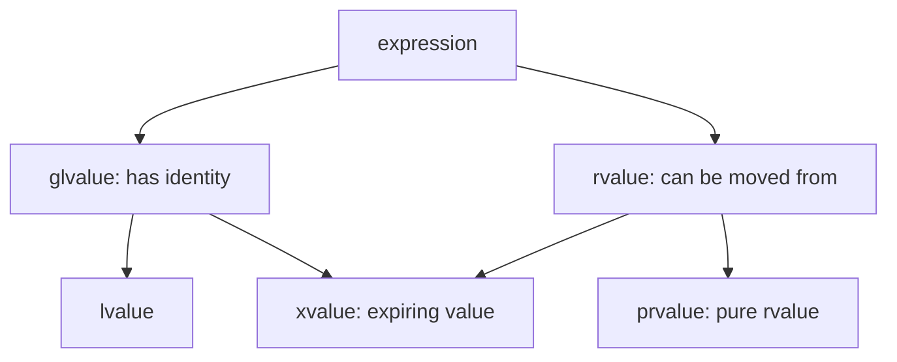
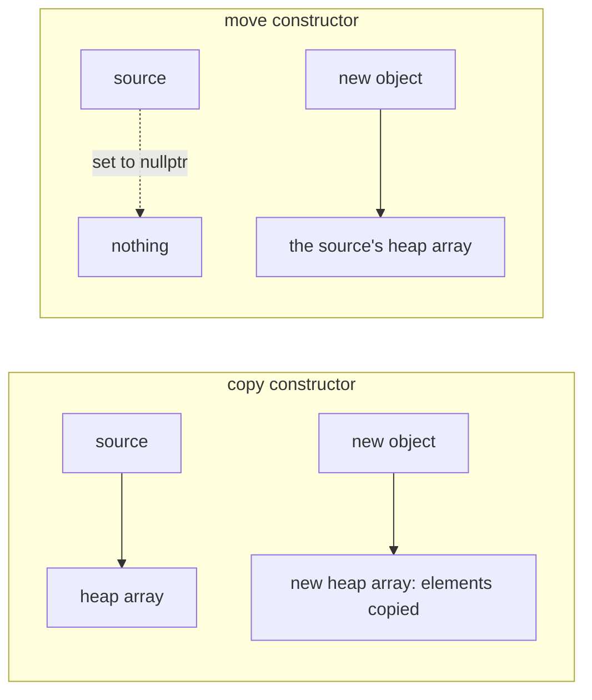

C++ 的对象具有值语义：`Buffer b = a;` 创建一个新的、独立的对象，修改 `b` 不影响 `a`，这与 `int` 的行为一致。值语义让程序容易推理，但也带来两个问题。第一，"复制"对一个管理着资源的对象意味着什么？如果对象内部只有一个指向堆内存的指针，逐个成员地复制会让两个对象共享同一块内存，析构时释放两次。第二，复制可能很昂贵：一个含有百万个元素的 `std::vector` 每复制一次就要分配内存、复制全部元素，而很多复制的源对象紧接着就被销毁了。本章先讲避免复制的引用，再讲值类别这一区分"可以被移走的对象"的概念，然后依次讲拷贝构造与拷贝赋值、移动构造与移动赋值、编译器对复制的消除，并总结为零、三、五法则。最后讨论单参数**构造函数**和类型转换运算符引起的隐式类型转换。这些规则构成了 C++ 对象模型的核心，[4.2.4](/4.2.4) 的 **RAII** 也要在这里才算完整：资源的所有权在对象被复制和移动时应当怎样传递。章末与 Python 对照：它的赋值从不复制对象。

## 6.1. 引用

### 6.1.1. 引用的定义

**定义 6.1.1（引用）** **引用**是已存在对象的别名，用 `类型& 名字 = 对象;` 定义。引用必须在定义时初始化，此后始终指代同一个对象；对引用的一切操作都是对它所指代的对象的操作。

```cpp
int i = 1;
int& j = i;   // j is another name for i
j = 3;        // assigns to i
i = 2;        // j == 2
```

引用最主要的用途是函数参数和返回值。按**引用传递**时，形参就是实参本身，函数可以修改调用者的变量（如 `void swap(int& a, int& b)`），也避免了复制大对象（[4.1.4](/4.1.4) 讨论了按**值传递**与按指针传递）。

引用在实现上通常就是一个指针，但语义更受约束，因而更安全：

| | 引用 `T&` | 指针 `T*` |
|---|---|---|
| 初始化 | 必须初始化 | 可以不初始化，也可以为 `nullptr` |
| 能否为空 | 不存在空引用 | 可以为空，使用前要检查 |
| 能否改变指向 | 不能，赋值作用于被引用的对象 | 可以随时指向另一个对象 |
| 访问对象 | 直接使用名字 | 需要解引用 `*p`、`p->m` |
| 运算 | 无 | 指针算术、比较 |

一个经验规则：参数"一定存在、不需要改变指向"时用引用；"可能不存在"时用指针（或 `std::optional`），需要表示所有权时用智能指针（[4.2.12](/4.2.12)）。引用还使**运算符重载**成为可能：如果没有引用，`a += b` 的重载要么复制 `b`，要么让使用者写 `a += &b`。

### 6.1.2. 常量引用

`const T&` 是只读的引用：可以通过它读取对象，但不能修改。它是传递类类型参数的标准方式，既避免复制，又向调用者保证不修改实参。这体现了最小特权原则：只给函数完成任务所需的权限。

```cpp
double total(const std::vector<double>& xs);  // reads xs, does not copy it, cannot modify it
void normalize(std::vector<double>& xs);      // modifies the caller's vector
std::vector<double> sorted(std::vector<double> xs);  // works on its own copy
```

常量引用还有一个特殊能力：它可以绑定到临时对象上（§6.2.2），并把临时对象的**生存期**延长到与引用相同。所以 `total({1.0, 2.0})` 合法，而如果参数是非常量引用 `std::vector<double>&` 就不能这样调用。

### 6.1.3. 悬垂引用

引用不拥有它指代的对象。如果对象先于引用被销毁，引用就成了悬垂引用，通过它访问是**未定义行为**。最常见的错误是返回**局部变量**的引用：

```cpp
int& bad() {
    int x = 1;
    return x;  // warning: reference to local variable 'x' returned [-Wreturn-local-addr]
}              // x is destroyed here; the caller receives a dangling reference

int& good(std::vector<int>& v, std::size_t i) {
    return v[i];  // OK: the element outlives the call (as long as v does)
}
```

函数可以返回引用，前提是被引用的对象在函数返回后仍然存在：成员函数返回 `*this` 或数据成员的引用，`operator[]` 返回容器元素的引用，`get(i)` 返回全局数组元素的引用。按值返回则总是安全的，而且得益于移动和复制消除（§6.5），通常也不昂贵。

## 6.2. 值类别

### 6.2.1. 左值与右值

每个 C++ 表达式除了类型之外，还有一个值类别（value category），它描述表达式所指代的是怎样的对象。

**定义 6.2.1** 指代一个有身份的、持久的对象，可以对其取地址的表达式称为**左值**；不指代持久的对象，而是表示一个临时的值（或即将被销毁、其资源可以被移走的对象）的表达式称为**右值**。

```cpp
int a = 1;
int b = f();      // a, b: lvalues; 1 and the call f(): rvalues
int c = a + b;    // a + b: rvalue
int* p = &a;      // OK: an lvalue has an address
// int* q = &(a + b);  // error: cannot take the address of an rvalue
```

名字来源于"能否出现在赋值号左边"，但这个说法并不准确（`const` 变量是左值却不能被赋值）。更好的判断方法是：有名字、能取地址的通常是左值；字面量（字符串字面量除外）、按值返回的函数调用、算术表达式的结果是右值。

C++11 起，标准把值类别细分为三种基本类别：



| 类别 | 有身份 | 可被移走 | 例子 |
|---|---|---|---|
| 左值（lvalue） | 是 | 否 | 变量名 `a`、`*p`、`v[i]`、返回左值引用的函数调用 |
| 将亡值（xvalue） | 是 | 是 | `std::move(a)`、返回右值引用的函数调用 |
| 纯右值（prvalue） | 否 | 是 | `42`、`a + b`、按值返回的函数调用 `f()`、`Test()` |

将亡值是"有身份但即将不再需要"的对象，`std::move(a)` 把左值 `a` 转换为将亡值，意思是"我不再需要 `a` 的值了，可以把它的资源移走"。将亡值与纯右值合称右值。

### 6.2.2. 右值引用与绑定规则

**定义 6.2.2（右值引用）** 用 `T&&` 声明、只能绑定到右值的引用称为**右值引用**。相应地，`T&` 称为左值引用。

右值引用让函数可以区分"实参是一个还要继续使用的对象"与"实参是一个临时的、可以被掏空的对象"，这是移动语义的基础。各种引用能绑定什么，规则如下：

| | 非常量左值 | 常量左值 | 右值 |
|---|---|---|---|
| `T&` | ✓ | | |
| `const T&` | ✓ | ✓ | ✓ |
| `T&&` | | | ✓ |

`const T&` 能绑定右值，是为了让 `void f(const std::string& s)` 能接受 `f("hello")` 这样的调用：只读访问一个临时对象是安全的。两个重载都能接受右值时，右值优先绑定 `T&&`。

```cpp
#include <iostream>

void ref(int& x) { std::cout << "lvalue " << x << '\n'; }
void ref(int&& x) {
    std::cout << "rvalue " << x << '\n';
    ref(x);  // x has a name: inside the function it is an lvalue
}

int main() {
    int a = 1;
    ref(a);             // lvalue 1
    ref(2);             // rvalue 2, then lvalue 2
    ref(std::move(a));  // rvalue 1, then lvalue 1
}
```

最后一个例子说明了一条重要规则：有名字的右值引用本身是左值。`ref(int&& x)` 内部的 `x` 有名字、可以取地址，因此 `ref(x)` 调用左值版本。值类别是表达式的属性，不是变量类型的属性：`x` 的类型是 `int&&`，但表达式 `x` 是左值。要把它继续作为右值传下去，需要再写一次 `std::move(x)`。

## 6.3. 复制

### 6.3.1. 拷贝构造函数

**定义 6.3.1（拷贝构造函数）** 第一个参数为同类对象的引用（通常是 `const T&`）、其余参数都有默认值的构造函数称为**拷贝构造函数**，它用一个已有对象初始化一个新对象。

拷贝构造函数在以下场合被调用（实际上可能被复制消除省略，§6.5）：

1. 用同类对象初始化新对象：`T b(a);`、`T b = a;`、`T b{a};`；
2. 按值传递参数：`void f(T x); f(a);`；
3. 按值返回对象：`T f() { T t; return t; }`。

拷贝构造函数的参数必须是引用。如果写成 `T(T other)`，为了把实参传给 `other` 就要先调用拷贝构造函数，无限递归，所以这样的声明是非法的。

### 6.3.2. 浅拷贝与深拷贝

如果类没有声明拷贝构造函数，编译器会隐式定义一个：它按声明顺序逐个复制每个成员（对类类型成员调用其拷贝构造函数，对内置类型成员直接复制值）。对 `std::string`、`std::vector` 这样的成员，这是正确的，它们自己知道怎样复制。但对管理资源的裸指针成员，只复制了指针值，没有复制它指向的内容：

```cpp
#include <cstddef>
#include <iostream>

class IntArray {
public:
    explicit IntArray(std::size_t n) : size_(n), data_(new int[n]{}) {}
    ~IntArray() { delete[] data_; }
    int& operator[](std::size_t i) { return data_[i]; }
    // no copy constructor: the compiler generates a memberwise copy

private:
    std::size_t size_;
    int* data_;
};

int main() {
    IntArray a(5);
    IntArray b = a;   // b.data_ == a.data_: both objects point to the same array
    b[2] = 3;
    std::cout << a[2] << '\n';  // 3: modifying b changed a
}   // b is destroyed, then a: the same array is deleted twice -> undefined behavior
```

用 `-fsanitize=address` 运行会报告 `attempting double-free`。按值传参也会触发同样的问题：`void fun(IntArray x)` 返回时 `x` 被析构，释放了调用者对象的数组（[4.2.4](/4.2.4) 中"构造一次、析构两次"的现象）。

**定义 6.3.2** 只复制对象本身的成员、使副本与原对象共享成员所指向的资源，称为**浅拷贝**；同时复制成员所指向的资源、使副本与原对象完全独立，称为**深拷贝**。

旧教材常把编译器生成的复制称为"位拷贝"（bitwise copy）。这个说法不准确：隐式的拷贝构造函数是逐成员复制，对类类型成员调用它们各自的拷贝构造函数；只有对内置类型和可平凡复制的类型，它才等价于逐字节复制。对管理资源的类，我们需要自己写出深拷贝。

### 6.3.3. 拷贝赋值运算符

复制还有另一种形式：把一个已有对象的值赋给另一个已有对象。

**定义 6.3.3（拷贝赋值运算符）** 形如 `T& operator=(const T&)` 的成员函数称为**拷贝赋值运算符**，它把右操作数的值复制给已经存在的左操作数。

```cpp
Buffer a(3), b(5);
Buffer c = a;  // initialization: copy constructor (c did not exist before)
b = a;         // assignment: copy assignment operator (b already exists)
```

带等号的定义 `Buffer c = a;` 是初始化，调用的是拷贝构造函数，不是赋值。赋值比构造多一件事：左操作数原来持有的资源必须先释放，否则会泄漏；而且要正确处理自赋值 `a = a`，否则可能先释放了自己的资源、再从已释放的内存中复制。

### 6.3.4. 一个正确的资源类

下面的 `Buffer` 管理一个动态数组，完整地定义了复制和移动（移动在 §6.4 讲解）。拷贝赋值使用 copy-and-swap 惯用法：先用拷贝构造函数在临时对象中做好一份副本，再与 `*this` 交换内容，临时对象析构时释放旧数据。这样写自动处理了自赋值，而且如果复制过程抛出异常（如内存不足），`*this` 保持原样不变。

```cpp
#include <algorithm>
#include <cstddef>
#include <iostream>
#include <utility>

class Buffer {
public:
    explicit Buffer(std::size_t n = 0) : size_(n), data_(n ? new int[n]{} : nullptr) {
        std::cout << "construct(" << n << ")\n";
    }
    ~Buffer() { delete[] data_; }

    Buffer(const Buffer& other)                       // copy constructor: deep copy
        : size_(other.size_), data_(other.size_ ? new int[other.size_] : nullptr) {
        std::copy(other.data_, other.data_ + size_, data_);
        std::cout << "copy construct\n";
    }
    Buffer& operator=(const Buffer& other) {          // copy assignment
        std::cout << "copy assign\n";
        if (this != &other) {
            Buffer tmp(other);                        // copy first: if this throws, *this is untouched
            swap(tmp);
        }                                             // tmp now holds the old data and frees it
        return *this;
    }
    Buffer(Buffer&& other) noexcept                   // move constructor: steal the array
        : size_(std::exchange(other.size_, 0)), data_(std::exchange(other.data_, nullptr)) {
        std::cout << "move construct\n";
    }
    Buffer& operator=(Buffer&& other) noexcept {      // move assignment
        std::cout << "move assign\n";
        Buffer tmp(std::move(other));
        swap(tmp);
        return *this;
    }

    void swap(Buffer& other) noexcept {
        std::swap(size_, other.size_);
        std::swap(data_, other.data_);
    }
    int& operator[](std::size_t i) { return data_[i]; }
    std::size_t size() const { return size_; }

private:
    std::size_t size_;
    int* data_;  // owns an array of size_ ints (or nullptr when size_ == 0)
};

int main() {
    Buffer a(3);
    Buffer b = a;             // copy construct
    b[0] = 42;                // a is not affected
    std::cout << a[0] << ' ' << b[0] << '\n';  // 0 42
    Buffer c = std::move(a);  // move construct: a is now empty
    std::cout << a.size() << ' ' << c.size() << '\n';  // 0 3
    a = b;                    // copy assign
    c = Buffer(5);            // construct(5), then move assign
}
```

```text
construct(3)
copy construct
0 42
move construct
0 3
copy assign
copy construct
construct(5)
move assign
move construct
```

`a = b` 输出了 "copy assign" 和 "copy construct"：后者来自赋值运算符内部构造的临时对象 `tmp`。`c = Buffer(5)` 的右边是纯右值，所以调用的是移动赋值。

### 6.3.5. 禁止复制

有些对象在概念上就不应被复制：一个打开的文件、一把互斥锁、一个网络连接、一个线程。复制它们要么没有意义，要么会导致资源被重复释放。这时应当把拷贝操作声明为删除的（C++11 之前的做法是把它们声明为 `private` 且不定义）：

```cpp
class File {
public:
    File(const File&) = delete;             // copying a File is a compile error
    File& operator=(const File&) = delete;
    // ...
};
```

[4.2.4](/4.2.4) 的 `File` 类、标准库的 `std::unique_ptr`、`std::thread`、`std::ifstream` 都是不可复制的，但它们可以移动：所有权可以转移，但不能分享。

## 6.4. 移动

### 6.4.1. 移动语义

考虑 `Buffer b = make_buffer(1000000);`：函数返回的临时对象马上就要被销毁，把它的百万个元素复制给 `b`、再释放临时对象的数组，显然是浪费。更好的做法是让 `b` 直接接管临时对象的数组，再把临时对象的指针置空，这样只复制了一个指针和一个整数。

**定义 6.4.1（移动语义）** 在用右值初始化或赋值时，把源对象的资源转移给目标对象、而不是复制资源，并使源对象处于有效但未指定的状态，这种语义称为**移动语义**。实现它的是以右值引用为参数的**移动构造函数** `T(T&&)` 和**移动赋值运算符** `T& operator=(T&&)`。



`Buffer` 的移动构造函数用 `std::exchange(other.data_, nullptr)` 取走源对象的指针并把它置空。置空是必需的：源对象之后仍会被析构，它的析构函数 `delete[] nullptr` 什么也不做，不会释放已经转移给新对象的数组。

被移走的对象处于"有效但未指定"的状态：它仍然满足类的**不变式**，可以安全地析构、可以被重新赋值，但它的值不应再被依赖。对标准库类型，被移走的 `std::string`、`std::vector` 通常为空，但标准不作保证。

重载决议按 §6.2.2 的绑定规则选择复制还是移动：实参是左值时调用拷贝构造函数；是右值（纯右值或将亡值）时，`T&&` 优先，调用移动构造函数。

### 6.4.2. std::move

对一个左值，如果确定之后不再需要它的值，可以用 `std::move` 请求移动：

```cpp
std::vector<std::string> names;
std::string line = read_line();
names.push_back(std::move(line));  // the characters are moved into the vector; line is now unspecified
```

`std::move` 本身不移动任何东西，它只是一个类型转换：把左值转换为右值引用（将亡值），使重载决议选中移动版本。真正的移动发生在移动构造函数或移动赋值运算符中。如果类型没有移动操作，`std::move` 之后仍然会调用拷贝操作，结果是正确的，只是没有更快。

用移动实现交换，三次复制变成三次移动，这正是 `std::swap` 的实现方式：

```cpp
template <typename T>
void my_swap(T& a, T& b) {
    T tmp(std::move(a));  // move construct
    a = std::move(b);     // move assign
    b = std::move(tmp);   // move assign
}
```

### 6.4.3. noexcept

移动操作应当声明为 `noexcept`，这不只是文档：标准库依据它决定是否使用移动。`std::vector` 扩容时要把旧数组中的元素搬到新数组中，并保证强异常安全（若搬运过程中抛出异常，`vector` 保持原状）。如果元素的移动构造函数可能抛出异常，一半元素已被移走时出错就无法恢复，所以 `vector` 只有在移动构造函数是 `noexcept` 时才移动元素，否则退而复制：

```cpp
#include <iostream>
#include <vector>

template <bool NoexceptMove>
struct Item {
    static inline int copies = 0, moves = 0;
    Item() = default;
    Item(const Item&) { ++copies; }
    Item(Item&&) noexcept(NoexceptMove) { ++moves; }
};

template <bool B>
void grow() {
    std::vector<Item<B>> v;
    for (int i = 0; i < 1000; ++i) v.emplace_back();  // reallocates about 10 times
    std::cout << "noexcept(" << B << "): " << Item<B>::copies << " copies, "
              << Item<B>::moves << " moves\n";
}

int main() {
    grow<true>();   // noexcept(1): 0 copies, 1023 moves
    grow<false>();  // noexcept(0): 1023 copies, 0 moves
}
```

移动通常只是交换几个指针，不会分配内存，天然不会抛出异常，所以几乎总能声明为 `noexcept`。编译器隐式生成的移动操作，在所有成员的移动都是 `noexcept` 时自动是 `noexcept` 的。

## 6.5. 复制消除

### 6.5.1. 返回值优化

按值返回对象看起来要复制（或移动）一次，但编译器可以直接在调用者为结果准备的位置上构造这个对象，完全省去复制，这称为复制消除。

**定义 6.5.1（复制消除）** 编译器省略拷贝构造或移动构造、把源对象与目标对象合二为一的优化称为**复制消除**。用于函数返回值时称为返回值优化（RVO）；返回的是有名字的局部变量时称为具名返回值优化（NRVO）。

C++17 起，用纯右值初始化同类型的对象时，复制消除是语言保证的：`T x = T();`、`T x = f();`（`f` 返回 `return T(...);`）、按值传参 `g(T())` 都不会调用拷贝或移动构造函数，即使这些构造函数被删除也可以编译。严格地说，C++17 改变了纯右值的含义：纯右值不再是"一个需要被复制的临时对象"，而只是"初始化某个对象的方式"，直到被用来初始化目标对象时才真正产生对象。返回有名字的局部变量（NRVO）则仍然只是允许、不是必需，主流编译器在简单情形下都会做。

下面的程序在 C++20 下分别用默认选项和 `-fno-elide-constructors`（禁止非强制的复制消除）编译：

```cpp
#include <iostream>

struct Test {
    Test() { std::cout << "Test()\n"; }
    Test(const Test&) { std::cout << "Test(const Test&)\n"; }
    Test(Test&&) noexcept { std::cout << "Test(Test&&)\n"; }
    ~Test() { std::cout << "~Test()\n"; }
};

Test make_prvalue() { return Test(); }  // returns a prvalue: elision is guaranteed (C++17)
Test make_named() {
    Test t;
    return t;                            // named object: NRVO is allowed but not required
}
void take(Test) {}

int main() {
    std::cout << "-- a\n";
    Test a = make_prvalue();
    std::cout << "-- b\n";
    Test b = make_named();
    std::cout << "-- take(a)\n";
    take(a);
    std::cout << "-- take(Test())\n";
    take(Test());
    std::cout << "-- end\n";
}
```

| 语句 | `g++ -std=c++20` | `g++ -std=c++20 -fno-elide-constructors` |
|---|---|---|
| `Test a = make_prvalue();` | `Test()` | `Test()`（强制消除，选项无效） |
| `Test b = make_named();` | `Test()`（NRVO） | `Test()`、`Test(Test&&)`、`~Test()`（隐式移动） |
| `take(a);` | `Test(const Test&)`、`~Test()` | 同左（`a` 是左值，必须复制） |
| `take(Test());` | `Test()`、`~Test()` | 同左（强制消除） |

旧教材中用 `-std=c++11 -fno-elide-constructors` 观察到的"返回时调用一次移动、初始化时再调用一次移动"，在 C++17 及以后的标准下已经不会出现：`Test a = make_prvalue();` 无论如何都只构造一次。

### 6.5.2. 隐式移动

即使 NRVO 没有发生，`return t;`（`t` 是局部变量或按值的参数）也会先尝试把 `t` 当作右值，调用移动构造函数，失败才复制。上表中第二行右栏的 `Test(Test&&)` 就是这样来的。因此：

- 按值返回局部对象，直接写 `return t;`。
- 不要写 `return std::move(t);`：它把 `t` 变成将亡值，不再是"返回局部变量的名字"，反而阻止了 NRVO，最多只能得到一次移动。
- 不要为了"避免复制"而返回局部对象的引用，那是悬垂引用（§6.1.3）。

## 6.6. 特殊成员函数与零、三、五法则

### 6.6.1. 特殊成员函数的隐式生成

**定义 6.6.1（特殊成员函数）** 默认构造函数、析构函数、拷贝构造函数、拷贝赋值运算符、移动构造函数和移动赋值运算符这六个成员函数，在程序没有声明而又需要时可以由编译器隐式生成，称为**特殊成员函数**。

隐式生成的版本都是逐成员的：逐个默认构造、析构、复制或移动每个成员。是否隐式生成取决于程序员声明了哪些：

| 用户声明了 | 默认构造 | 析构 | 拷贝构造 | 拷贝赋值 | 移动构造 | 移动赋值 |
|---|---|---|---|---|---|---|
| 什么都没有 | 生成 | 生成 | 生成 | 生成 | 生成 | 生成 |
| 其他构造函数 | 不生成 | 生成 | 生成 | 生成 | 生成 | 生成 |
| 析构函数 | 生成 | 用户的 | 生成（不推荐依赖） | 生成（不推荐依赖） | 不生成 | 不生成 |
| 拷贝构造函数 | 不生成 | 生成 | 用户的 | 生成（不推荐依赖） | 不生成 | 不生成 |
| 拷贝赋值运算符 | 生成 | 生成 | 生成（不推荐依赖） | 用户的 | 不生成 | 不生成 |
| 移动构造函数 | 不生成 | 生成 | 删除 | 删除 | 用户的 | 不生成 |
| 移动赋值运算符 | 生成 | 生成 | 删除 | 删除 | 不生成 | 用户的 |

要点：声明了析构函数或任一拷贝操作，编译器就不再生成移动操作，此时对右值的"移动"会退化为复制（结果正确，但慢）；声明了任一移动操作，拷贝操作就被删除，类变成只能移动的。表中"不推荐依赖"表示标准仍然生成它，但这一行为已被标记为过时（deprecated），将来可能取消。"删除"表示它被定义为 `= delete`，调用即编译错误。

### 6.6.2. 三法则、五法则与零法则

上面的规则背后有一个朴素的道理：如果一个类需要自己写析构函数，通常是因为它直接管理着某种资源；那么编译器逐成员的复制对它也必然是错的（浅拷贝），它的复制和移动也需要自己写。由此得到三条经验法则。

**定义 6.6.2** 关于特殊成员函数的三条设计准则：

1. **三法则**：如果一个类需要用户定义析构函数、拷贝构造函数、拷贝赋值运算符中的任何一个，那么它几乎肯定需要全部三个。
2. **五法则**：C++11 之后，在三法则的基础上还应定义移动构造函数和移动赋值运算符（或明确地将它们 `= delete`），否则这个类无法被高效地移动。
3. **零法则**：类不应直接管理资源，而应把资源交给专门的 **RAII** 类型（`std::vector`、`std::string`、`std::unique_ptr` 等）作为数据成员；这样的类不需要声明任何一个特殊成员函数，编译器生成的版本就是正确的。

零法则是现代 C++ 的首选。§6.3.4 的 `Buffer` 写了五个特殊成员函数和一个 `swap`，约 40 行代码，每一行都可能出错；把 `int*` 换成 `std::vector<int>`，它们就全部可以删去，而复制、移动、析构的行为完全正确：

```cpp
#include <cstddef>
#include <iostream>
#include <vector>

class Buffer {  // rule of zero: no destructor, no copy or move operations declared
public:
    explicit Buffer(std::size_t n = 0) : data_(n) {}
    int& operator[](std::size_t i) { return data_[i]; }
    std::size_t size() const { return data_.size(); }

private:
    std::vector<int> data_;  // the vector manages the memory
};

int main() {
    Buffer a(3);
    Buffer b = a;             // deep copy, done by vector's copy constructor
    b[0] = 42;
    Buffer c = std::move(a);  // move, done by vector's move constructor
    std::cout << b[0] << ' ' << c.size() << '\n';  // 42 3
}
```

只有在编写 RAII 类型本身时（如实现一个新的容器或智能指针），才需要遵循五法则逐一写出这些函数。只想禁止复制时，写出两个 `= delete` 的拷贝操作即可，移动操作随之不再生成；需要可移动而不可复制（如 `File`），就再把两个移动操作写出来或 `= default`。

## 6.7. 类型转换

### 6.7.1. 隐式类型转换

**定义 6.7.1（隐式类型转换）** 当表达式的类型与上下文所需的类型不同、且存在可用的转换时，编译器自动插入的类型转换称为**隐式类型转换**。

内置类型之间有标准转换（如 `int` 到 `double`、`double` 到 `int` 的截断、算术运算中的整数提升，[4.1.2](/4.1.2)）。对类类型，用户可以用两种方式定义转换：

- 转换构造函数（converting constructor）：可以用一个实参调用、且没有声明为 `explicit` 的构造函数 `Dst(const Src&)`，定义了从 `Src` 到 `Dst` 的转换；
- 类型转换运算符（conversion operator）：成员函数 `operator Dst() const`，定义了从当前类到 `Dst` 的转换。它没有返回类型（返回类型就是 `Dst`），也没有参数，必须是成员函数。

一次隐式转换序列中最多只能包含一次用户定义的转换，可以在其前后各加一次标准转换。下面的 `SmallInt` 同时定义了两个方向的转换：

```cpp
#include <iostream>

class SmallInt {
public:
    SmallInt(int i = 0) : val_(i) { std::cout << "SmallInt(int)\n"; }    // int -> SmallInt
    operator int() const { std::cout << "operator int\n"; return val_; } // SmallInt -> int
    int get() const { return val_; }

private:
    int val_;
};

int main() {
    SmallInt si;     // SmallInt(int)
    si = 4.10;       // double -> int (standard), then int -> SmallInt (user-defined)
    si = si + 3;     // SmallInt -> int, int + int, then int -> SmallInt
    std::cout << si.get() << '\n';  // 7
}
```

```text
SmallInt(int)
SmallInt(int)
operator int
SmallInt(int)
7
```

`si + 3` 为什么不是把 `3` 转换为 `SmallInt` 再相加？因为 `SmallInt` 没有定义 `operator+`，唯一可行的是内置的 `int + int`，所以 `si` 被转换为 `int`。如果再为 `SmallInt` 定义一个 `operator+(SmallInt, SmallInt)`，`si + 3` 就有了两条同样好的路径（转换 `si` 用内置加法，或转换 `3` 用自定义加法），调用变成二义的，编译失败。这说明双向的隐式转换很容易互相干扰；同一对类型之间，也不要同时在源类中定义类型转换运算符、又在目标类中定义转换构造函数，否则从 `Src` 到 `Dst` 的转换本身就是二义的。

### 6.7.2. explicit

隐式转换常常在不经意间发生：如果 `Matrix` 有一个构造函数 `Matrix(int n)` 表示 $n \times n$ 矩阵，那么 `print(5)` 会悄悄构造一个 $5 \times 5$ 的矩阵传给 `print`，这几乎肯定是笔误。用 `explicit` 修饰构造函数或类型转换运算符，就只允许显式的转换：

```cpp
#include <iostream>
#include <vector>

class Matrix {
public:
    explicit Matrix(int n) : n_(n) {}  // without explicit, Matrix m = 3; would compile
    int size() const { return n_; }

private:
    int n_;
};

class Handle {
public:
    explicit operator bool() const { return valid_; }  // usable in conditions only
private:
    bool valid_ = true;
};

void print(const Matrix& m) { std::cout << m.size() << '\n'; }

int main() {
    Matrix a(3);          // direct initialization: OK
    print(a);
    print(Matrix(4));     // explicit conversion: OK
    // print(5);          // error: no implicit conversion from int to Matrix
    // Matrix b = 3;      // error: copy-initialization needs an implicit conversion
    Handle h;
    if (h) std::cout << "valid\n";  // contextual conversion to bool: OK
    // int n = h;         // error: no implicit conversion to bool (and then to int)
    std::vector<int> v(3);           // three zeros: vector's size constructor is explicit
    std::cout << v.size() << '\n';
}
```

准则：单参数构造函数默认都写成 `explicit`，除非这个转换在语义上是无损而自然的（如整数到分数、`const char*` 到 `std::string`）。`explicit operator bool` 是"可以用在 `if`、`while`、`!`、`&&` 中判断真假，但不会被当成整数参与运算"的标准写法，标准库的流和智能指针都这样定义。

### 6.7.3. 强制类型转换

需要显式转换时，C++ 提供四个命名的强制类型转换（cast）运算符，各自只做一类转换，写法醒目，便于搜索和审查：

| 写法 | 用途 |
|---|---|
| `static_cast<T>(e)` | 编译期可检查的常规转换：数值类型之间、调用转换构造函数或类型转换运算符、继承体系中的向上转换和已知安全的向下转换 |
| `dynamic_cast<T>(e)` | 多态类型的运行时检查的向下转换，失败时返回空指针或抛出异常（[4.2.8](/4.2.8)） |
| `const_cast<T>(e)` | 添加或去掉 `const`（去掉后修改原本是 `const` 的对象是未定义行为） |
| `reinterpret_cast<T>(e)` | 按另一种类型重新解释同一段二进制位，如指针与整数互转；高度依赖实现，尽量避免 |

C 风格的转换 `(T)e` 会依次尝试上述几种，可能在无意中做了 `reinterpret_cast` 或去掉了 `const`，C++ 代码中不应使用。C++20 的 `std::bit_cast<T>(e)` 是按位重新解释的安全写法（例如查看 `float` 的二进制表示）。如果代码中需要大量强制转换，通常说明类型设计有问题。

## 6.8. Python 对照：赋值语义与复制

### 6.8.1. 名字与对象

Python 的变量是绑定到对象的名字（[4.2.1](/4.2.1)）。赋值 `b = a` 从不复制对象，只是让 `b` 也指向 `a` 所指向的对象；按值传参也是如此，函数得到的是对同一个对象的引用（[4.1.4](/4.1.4)）。这对不可变对象（整数、字符串、元组）没有区别，对可变对象（列表、字典、自定义类的实例）则意味着别名：

```cpp tab
#include <iostream>
#include <vector>

int main() {
    std::vector<int> a{1, 2, 3};
    std::vector<int> b = a;        // copies the elements: value semantics
    b.push_back(4);
    std::cout << a.size() << ' ' << b.size() << '\n';  // 3 4

    std::vector<int>& c = a;       // an alias must be asked for explicitly
    c.push_back(5);
    std::cout << a.size() << '\n';  // 4
}
```

```python tab
a = [1, 2, 3]
b = a                          # binds another name to the same list: reference semantics
b.append(4)
print(len(a), len(b), a is b)  # 4 4 True

c = list(a)                    # a copy must be asked for explicitly
c.append(5)
print(len(a), len(c))          # 4 5
```

两种语言的默认行为正好相反：C++ 默认复制，需要别名时显式使用引用；Python 默认共享，需要副本时显式复制。也正因为 Python 的赋值和传参只是传递引用，它不需要移动语义：把一个大列表"交给"另一个函数本来就不复制任何元素。对象何时被销毁由引用计数决定，`del a` 只是解除名字 `a` 的绑定。

### 6.8.2. 浅拷贝与深拷贝

标准库 `copy` 模块提供两种复制：`copy.copy(x)` 是浅拷贝，创建一个新的外层对象，但其中的元素仍是原来的对象；`copy.deepcopy(x)` 是深拷贝，递归地复制所有可变的子对象（并正确处理循环引用）。对内置容器，`list(x)`、`x.copy()`、`x[:]`、`dict(x)` 都是浅拷贝。

```python
import copy

grid = [[0, 0], [0, 0]]
shallow = copy.copy(grid)    # new outer list, same inner lists
deep = copy.deepcopy(grid)   # new outer list and new inner lists
grid[0][0] = 1
print(shallow[0][0], deep[0][0])  # 1 0

rows = [[0] * 2] * 2         # a classic pitfall: two references to one inner list
rows[0][0] = 1
print(rows)                  # [[1, 0], [1, 0]]
```

自定义类可以定义 `__copy__` 和 `__deepcopy__` 来控制复制的方式，相当于 C++ 中自己写拷贝构造函数。Python 3.13 起，`copy.replace(obj, **changes)` 创建一个修改了部分字段的副本，适用于数据类、命名元组等不可变对象。

| | C++ | Python |
|---|---|---|
| `b = a` | 复制（调用拷贝构造或拷贝赋值） | 共享同一对象 |
| 别名 | `T& b = a;` | 默认就是 |
| 浅拷贝 | 编译器生成的逐成员复制遇到裸指针成员时 | `copy.copy`、`list(x)`、`x.copy()` |
| 深拷贝 | 自己写拷贝构造函数，或使用管理资源的成员（零法则） | `copy.deepcopy`，可用 `__deepcopy__` 定制 |
| 转移所有权 | `std::move`、移动构造 | 不需要：传递引用即可 |
| 禁止复制 | `= delete` | 一般不需要；可在 `__copy__` 中抛出异常 |

## 小结

- 引用是对象的别名，必须初始化、不能改变指向；`const T&` 是传递类类型参数的标准方式，并能绑定临时对象。不要返回局部对象的引用。
- 表达式分为左值、将亡值和纯右值；右值引用 `T&&` 只绑定右值，有名字的右值引用本身是左值。`std::move` 只是把左值转换为将亡值。
- 拷贝构造函数和拷贝赋值运算符定义复制；编译器生成的逐成员复制对裸指针成员是浅拷贝，会导致重复释放，管理资源的类要实现深拷贝，或禁止复制。copy-and-swap 让赋值运算符自动处理自赋值并具有强异常安全性。
- 移动构造和移动赋值转移资源而不复制，源对象处于有效但未指定的状态；移动操作应声明为 `noexcept`，否则 `std::vector` 扩容时只能复制。
- C++17 起用纯右值初始化对象时保证复制消除；返回局部变量写 `return t;`，不要写 `return std::move(t);`。
- 声明析构函数或拷贝操作会抑制移动操作的生成。管理资源的类遵循五法则；其他类遵循零法则，把资源交给 RAII 成员，一个特殊成员函数也不写。
- 转换构造函数和类型转换运算符定义隐式转换，一次转换序列中最多一次用户定义的转换；单参数构造函数默认写成 `explicit`，显式转换使用 `static_cast` 等命名的转换运算符。
- Python 的赋值与传参只传递引用，不复制也不需要移动；需要副本时用 `copy.copy` 或 `copy.deepcopy`。
