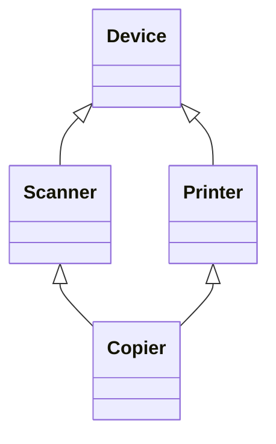

The previous chapters dealt with a single **class**: how to combine data and operations through **encapsulation**, and how to manage the creation, copying and destruction of **objects**. Real programs consist of many classes, and the relations among classes determine the structure of a program. This chapter discusses the two most basic forms of reuse: composition (using objects of existing classes as components of a new class) and inheritance (defining a new class as a special case of an existing class). Inheritance is the basis of virtual functions and polymorphism in the next chapter, and "prefer composition" is a principle that the design patterns of Chapter 13 embody again and again, so this chapter covers both the syntax and how to choose between the two.

## 7.1. Relations among Classes

Object-oriented programming tries to make the structure of a program correspond to the way people understand the world. Consider two groups of objects:

- A car and its doors, windows, engine and tires: the latter are components of the former. This is a "whole–part" relation, usually called has-a (a car has an engine).
- A shape and rectangles, circles and triangles: the latter are special cases of the former. This is a "general–special" relation, usually called is-a (a circle is a kind of shape).

In C++ and Python the two relations are expressed by composition and inheritance respectively.

**Definition 7.1.1 (Composition)** If an object of class $B$ implements its own functionality by taking an object of class $A$ as one of its components (a data member), the relation between $B$ and $A$ is called **composition** (the has-a relation). The object of $B$ is called the whole object, and the $A$ object inside it is called a sub-object (member object).

**Definition 7.1.2 (Inheritance)** The mechanism of defining a new class $B$ on the basis of an existing class $A$, so that $B$ automatically has all the data members and member functions of $A$ and may add new members and redefine existing member functions, is called **inheritance**. $A$ is called the **base class** (superclass) and $B$ the **derived class** (subclass). Inheritance should express an is-a relation: every $B$ object is an $A$ object.

Both are means of reusing existing code; they differ in what is reused. Composition reuses the implementation of an existing class, and the interface of the new class is decided by itself; inheritance reuses both implementation and interface, and the derived class promises to the outside "I can do everything the base class can do".

## 7.2. Composition

### 7.2.1. Objects as Data Members

Composition is written by declaring objects of existing classes as data members of the new class. Sub-objects can be placed in different access regions:

- As public members: users call the sub-object's interface directly through `car.engine.start()`. This is convenient to write, but the internal structure of the whole object is exposed, and it is hard to replace the part later.
- As private members: the whole object offers an interface itself and forwards requests to the sub-objects internally, and can also combine the operations of several sub-objects into new operations. This amounts to a conversion of the old interface and is the usual practice.

```cpp tab
#include <array>
#include <cstddef>
#include <format>
#include <iostream>

class Engine {
public:
    explicit Engine(int power) : power_(power) {}
    void start() const { std::cout << std::format("engine ({} kW) started\n", power_); }
private:
    int power_;
};

class Wheel {
public:
    void inflate(double bar) { pressure_ = bar; }
    double pressure() const { return pressure_; }
private:
    double pressure_ = 0.0;
};

class Car {
public:
    explicit Car(int power) : engine_(power) {}   // construct the sub-object
    void start() const { engine_.start(); }       // forward to a part
    void inflateTires(double bar) {               // a new operation built from parts
        for (auto& w : wheels_) w.inflate(bar);
    }
    double tirePressure(std::size_t i) const { return wheels_.at(i).pressure(); }
private:
    Engine engine_;
    std::array<Wheel, 4> wheels_;
};

int main() {
    Car car(110);
    car.start();
    car.inflateTires(2.4);
    std::cout << std::format("tire 0: {} bar\n", car.tirePressure(0));
}
```

```python tab
class Engine:
    def __init__(self, power: int) -> None:
        self._power = power

    def start(self) -> None:
        print(f"engine ({self._power} kW) started")


class Wheel:
    def __init__(self) -> None:
        self._pressure = 0.0

    def inflate(self, bar: float) -> None:
        self._pressure = bar

    @property
    def pressure(self) -> float:
        return self._pressure


class Car:
    def __init__(self, power: int) -> None:
        self._engine = Engine(power)                 # build the parts explicitly
        self._wheels = [Wheel() for _ in range(4)]

    def start(self) -> None:
        self._engine.start()                         # forward to a part

    def inflate_tires(self, bar: float) -> None:
        for w in self._wheels:
            w.inflate(bar)

    def tire_pressure(self, i: int) -> float:
        return self._wheels[i].pressure


car = Car(110)
car.start()
car.inflate_tires(2.4)
print(f"tire 0: {car.tire_pressure(0)} bar")
```

In C++ a sub-object is embedded in the memory of the whole object, and `sizeof(Car)` is at least the sum of the sizes of the sub-objects; a Python attribute is merely a reference to another object, and "component" is a convention rather than a memory layout.

### 7.2.2. Construction and Destruction Order of Sub-Objects

C++ guarantees that all sub-objects of a whole object have been constructed before the whole object starts to work:

1. First the sub-objects are constructed in the order in which they are declared in the class, and then the body of the whole object's constructor executes. The order is determined solely by the declaration order, regardless of the order written in the initializer list (the compiler gives a `-Wreorder` warning when the two differ).
2. When the constructor of a sub-object needs arguments, they must be given in the initializer list of the whole object's constructor; sub-objects that can be default-constructed may be omitted.
3. The order of destruction is the reverse of construction: first the body of the whole object's destructor executes, and then the sub-objects are destroyed in the reverse of the declaration order.

```cpp
#include <format>
#include <iostream>

class Part1 {
public:
    explicit Part1(int id) : id_(id) { std::cout << std::format("Part1({})\n", id_); }
    ~Part1() { std::cout << "~Part1()\n"; }
private:
    int id_;
};

class Part2 {
public:
    Part2() { std::cout << "Part2()\n"; }
    ~Part2() { std::cout << "~Part2()\n"; }
};

class Whole {
public:
    Whole() : p1_(123) { std::cout << "Whole()\n"; }   // p2_ is default-constructed
    ~Whole() { std::cout << "~Whole()\n"; }
private:
    Part1 p1_;   // declared first, constructed first
    Part2 p2_;
};

int main() {
    Whole w;
}
```

```text
Part1(123)
Part2()
Whole()
~Whole()
~Part2()
~Part1()
```

This order is one reason why **resource acquisition is initialization** works: when the destructor of the whole object runs, the sub-objects are still valid; sub-objects are released in reverse order, so those constructed later (which may depend on those constructed earlier) are destroyed first.

### 7.2.3. Copying and Assignment

The implicitly generated **copy constructor** and **copy assignment operator** copy member by member: for each sub-object they call its own copy constructor or copy assignment operator (the same holds for move operations, see [4.2.6](/4.2.6)). Therefore, as long as every member can copy itself correctly, the whole object need not write its copy operations by hand; this is the basis of the **rule of zero**.

Once the copy constructor of the whole object is written by hand, every sub-object must be copied explicitly in the initializer list, for example `Whole(const Whole& other) : p1_(other.p1_), p2_(other.p2_) {}`; a sub-object that is left out is default-constructed instead of being copied. This is a common mistake when writing copy operations by hand.

## 7.3. Inheritance

### 7.3.1. Base Classes and Derived Classes

C++ declares inheritance with `class Derived : inheritance-mode Base`. A derived-class object contains a complete base-class sub-object plus the members added by the derived class. The `Manager` below is a kind of `Employee`: it has everything an employee has (name, salary) and in addition a rank and a list of subordinates.

```cpp tab
#include <format>
#include <iostream>
#include <string>
#include <utility>
#include <vector>

class Employee {
public:
    Employee(std::string name, double salary)
        : name_(std::move(name)), salary_(salary) {}
    const std::string& name() const { return name_; }
    void print() const { std::cout << std::format("{}: {:.1f}\n", name_, salary_); }
private:
    std::string name_;
protected:
    double salary_;          // accessible to derived classes, hidden from users
};

class Manager : public Employee {
public:
    Manager(std::string name, double salary, int level)
        : Employee(std::move(name), salary), level_(level) {}   // base first
    void addReport(const Employee& e) { reports_.push_back(&e); }
    void raise(double percent) { salary_ *= 1 + percent / 100; }  // uses protected member
    void print() const {                     // redefines Employee::print
        Employee::print();                   // reuse the base version
        std::cout << std::format("  level {}, {} report(s)\n", level_, reports_.size());
    }
private:
    int level_;
    std::vector<const Employee*> reports_;
};

int main() {
    Employee alice("Alice", 8000);
    Manager bob("Bob", 12000, 2);
    bob.addReport(alice);
    bob.raise(10);
    alice.print();
    bob.print();
    std::cout << std::format("{}\n", bob.name());          // inherited member function
}
```

```python tab
class Employee:
    def __init__(self, name: str, salary: float) -> None:
        self.name = name
        self._salary = salary            # "protected" by convention only

    def print(self) -> None:
        print(f"{self.name}: {self._salary:.1f}")


class Manager(Employee):
    def __init__(self, name: str, salary: float, level: int) -> None:
        super().__init__(name, salary)   # must be called explicitly
        self._level = level
        self._reports: list[Employee] = []

    def add_report(self, e: Employee) -> None:
        self._reports.append(e)

    def raise_salary(self, percent: float) -> None:
        self._salary *= 1 + percent / 100

    def print(self) -> None:
        super().print()                  # reuse the base version
        print(f"  level {self._level}, {len(self._reports)} report(s)")


alice = Employee("Alice", 8000)
bob = Manager("Bob", 12000, 2)
bob.add_report(alice)
bob.raise_salary(10)
alice.print()
bob.print()
print(bob.name)
```

A derived class can do three things: inherit the members of the base class (`name()` need not be rewritten), add new members (`level_`, `addReport`), and redefine member functions of the base class (`print`). When redefining, `BaseName::functionName` can be used to call the base-class version and extend it. Note that `Manager::print` here merely hides `Employee::print` (§7.4): when called through an `Employee&`, the base-class version is still executed. To have calls dispatched according to the actual type of the object, we need the virtual functions of Chapter 8.

### 7.3.2. Construction and Destruction of Derived Classes

The construction order of a derived-class object is: first the base-class sub-object, then the members added by the derived class in declaration order, and finally the body of the derived class's constructor; destruction is in the reverse order. When the base-class constructor needs arguments, it is called in the initializer list of the derived class's constructor (such as `Employee(std::move(name), salary)` in the example above); otherwise the base class's default constructor is called, and if the base class has no default constructor, compilation fails.

**Constructors** are not inherited, but when a derived class adds no members that need initialization, since C++11 a `using` declaration can inherit constructors (*inheriting constructor*), letting the derived class accept the arguments of the base-class constructor directly:

```cpp
#include <format>
#include <iostream>
#include <string>
#include <utility>

class Employee {
public:
    Employee(std::string name, double salary)
        : name_(std::move(name)), salary_(salary) {}
    void print() const { std::cout << std::format("{}: {:.1f}\n", name_, salary_); }
private:
    std::string name_;
    double salary_;
};

class Intern : public Employee {
public:
    using Employee::Employee;    // inherit Employee(std::string, double)
    int mentorId = 0;            // new members get their default initializers
};

int main() {
    Intern carol("Carol", 3000);
    carol.print();
}
```

The rules for copy and move operations are the same as for composition: the implicitly generated versions first copy (move) the base-class sub-object and then copy (move) the members one by one; when written by hand, `Base(other)` must be written in the initializer list, otherwise the base part is default-constructed.

### 7.3.3. Inheritance Modes and Access

The access specifier `protected` lies between `public` and `private`: protected members are invisible to users of the class and visible to the member functions of derived classes. The inheritance mode (`public`, `protected`, `private`) further determines the access level of base-class members in the derived class: the stricter of the level in the base class and the inheritance mode.

| Member in the base class | public inheritance | protected inheritance | private inheritance |
|---|---|---|---|
| public | public | protected | private |
| protected | protected | protected | private |
| private | Inaccessible | Inaccessible | Inaccessible |

A few remarks:

- Private members of the base class exist in the derived-class object under any inheritance mode; the member functions of the derived class just cannot access them directly and must go through the public or protected interface of the base class.
- Only public inheritance expresses is-a: the outside can use a derived-class object as a base-class object (the upcast of Chapter 8). The default inheritance mode of `class` is private and that of `struct` is public, so `public` should be written explicitly when is-a is meant.
- Private inheritance expresses "implemented in terms of": the derived class borrows the base class's implementation but does not acknowledge being a kind of base class. A `using` declaration can reopen individual base-class members as public:

```cpp
#include <format>
#include <iostream>
#include <vector>

class IntStack : private std::vector<int> {   // a stack is not a vector
public:
    using std::vector<int>::size;              // re-expose selected members
    using std::vector<int>::empty;
    void push(int x) { push_back(x); }
    int pop() { int x = back(); pop_back(); return x; }
};

int main() {
    IntStack s;
    s.push(1);
    s.push(2);
    int top = s.pop();
    std::cout << std::format("popped {}, size {}\n", top, s.size());
    // s.insert(s.begin(), 0);  // error: insert is private in IntStack
}
```

The same effect can be obtained with composition (making `std::vector<int>` a private member), with looser coupling, and composition is generally preferred; private inheritance is necessary only when access to protected members of the base class or overriding its virtual functions is needed.

### 7.3.4. Composition or Inheritance

The basic criterion for the choice is the relation between the two kinds of objects:

| | Composition | Inheritance (public) |
|---|---|---|
| Relation | has-a, whole–part | is-a, general–special |
| What is reused | Implementation | Interface and implementation |
| Interface of the new class | Designed by itself; may transform the old interface | Includes the whole public interface of the base class |
| Coupling | Depends only on the public interface of the sub-object | Depends on the protected members and internal conventions of the base class |
| Replaceable at run time | Yes (when holding a pointer or reference) | No, fixed at compile time |

Is-a must be understood behaviorally: a derived-class object must be able to replace a base-class object anywhere one is used without breaking the correctness of the program (the Liskov substitution principle, see [4.2.13](/4.2.13)). The classic counterexample is "a square is a kind of rectangle": it holds mathematically, but if `Rectangle` provides `setWidth` and `setHeight` that set the width and height separately, `Square` cannot keep the width and height equal while satisfying this interface, and expressing them with inheritance actually goes wrong.

The rule of thumb is to prefer composition: inheritance makes the derived class depend on implementation details of the base class, and changes in the base class affect all derived classes; composition depends only on the interface and is easier to replace and test. Inheritance suits situations where many kinds of objects really must be handled uniformly through a base-class interface, which is exactly the use of polymorphism in Chapter 8.

## 7.4. Name Hiding

### 7.4.1. Hiding by Redefinition

The **scope** of a derived class is nested inside the scope of the base class. When the compiler looks up a member name, it looks first in the derived class and stops when it finds it, without going on to the base class. Therefore, as soon as a member function with the same name as one in the base class is declared in the derived class, whether or not the parameters are the same, all functions of that name in the base class (including all its overloaded versions) are hidden; this is called *name hiding*.

```cpp
#include <format>
#include <iostream>
#include <string>

struct Base {
    void f(int) { std::cout << "Base::f(int)\n"; }
    void f(double) { std::cout << "Base::f(double)\n"; }
};

struct Derived : Base {
    void f(const std::string&) { std::cout << "Derived::f(string)\n"; }
};

int main() {
    Derived d;
    d.f("text");
    // d.f(1);      // error: Base::f(int) is hidden by Derived::f
    d.Base::f(1);   // explicit qualification still works
}
```

This differs from **function overloading**: overloading takes place within one scope, where the compiler chooses among functions of the same name by their parameters; hiding takes place between nested scopes, where an inner name masks an outer name. `Manager::print` and `Employee::print` in the previous section have the same parameters and are likewise a case of hiding. A comparison of the three (overloading, hiding and overriding in Chapter 8) is given in Chapter 8.

### 7.4.2. Restoring Base-Class Members with using

If we want the derived class to keep the base class's overloaded versions while adding a new version, a using declaration can bring the base-class name into the derived class's scope, where the versions take part in overload resolution together with the derived class's version:

```cpp
#include <format>
#include <iostream>
#include <string>

struct Base {
    void f(int) { std::cout << "Base::f(int)\n"; }
    void f(double) { std::cout << "Base::f(double)\n"; }
};

struct Derived : Base {
    using Base::f;   // bring all Base::f overloads into this scope
    void f(const std::string&) { std::cout << "Derived::f(string)\n"; }
};

int main() {
    Derived d;
    d.f(1);
    d.f(2.5);
    d.f("text");
}
```

`using` has appeared in three uses in this chapter, all of which "bring a name from elsewhere into the current scope": bringing in the base class's overloaded versions, inheriting constructors, and reopening members in private inheritance.

## 7.5. Multiple Inheritance

### 7.5.1. Syntax and Semantics

**Definition 7.5.1 (Multiple Inheritance)** A derived class that has several direct base classes at once is said to use **multiple inheritance**. In C++ it is written `class D : public B1, public B2 { … };`; the derived-class object contains the base-class sub-objects in turn, and at construction they are constructed in the order in which the base classes are written in the derivation list.

Multiple inheritance suits an object that plays several roles at once, for example a class that is both "drawable" and "serializable". It brings two problems: name conflicts and repeated base classes.

- Name conflicts: when two base classes have members of the same name, accessing it directly through the derived class is ambiguous and compilation fails. We must specify it with `B1::name` or redefine the member in the derived class.
- *Diamond inheritance*: `Scanner` and `Printer` both derive from `Device`, and `Copier` derives from both `Scanner` and `Printer`. By default a `Copier` object contains two `Device` sub-objects, accessing members of `Device` is ambiguous, and the two copies of the data may also become inconsistent.



### 7.5.2. Virtual Inheritance

**Definition 7.5.2 (Virtual Inheritance)** Declaring a base class `virtual` in the derivation list (such as `class Scanner : virtual public Device`) makes that base class a virtual base class; no matter how many times it appears in the inheritance hierarchy, the object of the final derived class has only one sub-object of it. This kind of inheritance is called **virtual inheritance**.

The virtual-base sub-object is initialized by the constructor of the final derived class (the class actually created), and calls to the virtual base's constructor by the intermediate layers are ignored; virtual base classes are constructed before all non-virtual base classes.

```cpp
#include <format>
#include <iostream>
#include <string>
#include <utility>

struct Device {
    explicit Device(std::string id) : id(std::move(id)) {}
    std::string id;
};

struct Scanner : virtual Device {
    Scanner() : Device("scanner") {}
    void scan() const { std::cout << std::format("{} scans\n", id); }
};

struct Printer : virtual Device {
    Printer() : Device("printer") {}
    void print() const { std::cout << std::format("{} prints\n", id); }
};

struct Copier : Scanner, Printer {
    Copier() : Device("copier") {}   // the most derived class initializes Device
    void copy() const { scan(); print(); }
};

int main() {
    Copier c;
    c.copy();                        // both parts see the same Device
    std::cout << std::format("id = {}\n", c.id);   // unambiguous: only one Device sub-object
}
```

```text
copier scans
copier prints
id = copier
```

Virtual inheritance has a cost: the object must store extra information for locating the virtual base, accessing members of a virtual base takes one more indirection, and the construction rules are harder to understand. The practical advice is: use multiple inheritance mainly to combine several interfaces without data members (the abstract classes of Chapter 8), avoid letting base classes with data form a diamond, and use virtual inheritance only when a base class really must be shared. The standard library's `std::iostream` inherits from both `std::istream` and `std::ostream`, both of which inherit virtually from `std::basic_ios`, one of the few typical examples.

## 7.6. Python Comparison

### 7.6.1. Inheritance and super

Python declares inheritance with `class Derived(Base):`, and all classes ultimately derive from `object`. The `__init__` of a derived class does not call the base class's `__init__` automatically; `super().__init__(…)` must be written explicitly, and if it is omitted the attributes set by the base class do not exist. Python has no access control: `_name` means "internal use", and `__name` is rewritten by the interpreter to `_ClassName__name` so as not to be accidentally overridden by an attribute of the same name in a derived class, but neither is enforced.

### 7.6.2. No Overloading, Hence No Hiding

Python's class attributes are stored in a dictionary, a method of the same name defined later simply replaces the one defined earlier, and within a class a name corresponds to only one object. A derived class that defines a method of the same name replaces (overrides) the base class's method; moreover, lookup always starts from the actual type of the object, which amounts to every member function being virtual in C++ (Chapter 8).

### 7.6.3. Multiple Inheritance and the MRO

Python supports multiple inheritance and has no problem of "two base-class sub-objects": attributes are all stored in the instance's `__dict__`, in a single copy. What needs to be resolved is the lookup order: which one to use when a method is defined in several base classes.

**Definition 7.6.3 (Method Resolution Order)** In Python every class has a linear sequence of ancestors `C.__mro__`, called the **method resolution order** (MRO). When looking up an attribute on an instance, the classes in the MRO are searched in turn and the first one found is taken. The MRO is computed by the C3 linearization algorithm:

$$
L[C] = C + \operatorname{merge}(L[B_1], \dots, L[B_n], [B_1, \dots, B_n]),
$$
where $B_1, \dots, B_n$ are the direct base classes of $C$ (in the order written), and $\operatorname{merge}$ repeatedly takes the first head element that "does not appear in the tail of any list", appends it to the result and deletes it from all lists.

C3 linearization guarantees two things: a subclass always comes before its parent classes; and the order in which a class's direct base classes are written is preserved. When both cannot be satisfied (for example, two classes inherit the same two base classes in opposite orders), a `TypeError` is raised when the class is defined. For the diamond above:

$$
\begin{aligned}
L[\text{Scanner}] &= [\text{Scanner}, \text{Device}, \text{object}],\quad L[\text{Printer}] = [\text{Printer}, \text{Device}, \text{object}],\\
L[\text{Copier}] &= [\text{Copier}] + \operatorname{merge}([\text{Scanner}, \text{Device}, \text{object}], [\text{Printer}, \text{Device}, \text{object}], [\text{Scanner}, \text{Printer}])\\
&= [\text{Copier}, \text{Scanner}, \text{Printer}, \text{Device}, \text{object}].
\end{aligned}
$$

The meaning of `super()` is therefore not "the parent class" but "the next class after the current class in the MRO". When every class calls `super()` once, every method in the diamond executes exactly once, which is called cooperative multiple inheritance:

```python
class Device:
    def start(self) -> None:
        print("Device.start")


class Scanner(Device):
    def start(self) -> None:
        print("Scanner.start")
        super().start()          # next class in the MRO, not necessarily Device


class Printer(Device):
    def start(self) -> None:
        print("Printer.start")
        super().start()


class Copier(Scanner, Printer):
    def start(self) -> None:
        print("Copier.start")
        super().start()


print([c.__name__ for c in Copier.__mro__])
Copier().start()
```

```text
['Copier', 'Scanner', 'Printer', 'Device', 'object']
Copier.start
Scanner.start
Printer.start
Device.start
```

The `super()` in `Scanner.start` reaches `Printer.start`, while `Scanner` itself does not know that `Printer` exists: the call chain is determined by the MRO of the actual object. The mixin style common in Python (such as the standard library's `socketserver.ThreadingMixIn`) relies on this mechanism.

### 7.6.4. Composition Is Again the First Choice

Composition in Python is written by assigning other objects to attributes in `__init__` (the `Car` of §7.2.1). Because of duck typing (Chapter 8), Python programs need to inherit for the sake of a "uniform interface" less often than C++ programs do.

## Summary

- Composition expresses has-a and reuses implementation; public inheritance expresses is-a and reuses both interface and implementation. Prefer composition.
- In C++, sub-objects and base-class sub-objects are constructed before the whole object and destroyed after it; sub-objects are constructed in declaration order. When writing copy operations by hand, the base class and every member must be copied explicitly.
- The inheritance mode determines the access level of base-class members in the derived class; only public inheritance allows a derived-class object to be used as a base-class object.
- A function of the same name in the derived class hides all functions of that name in the base class; restore them with `using`.
- In multiple inheritance, virtual inheritance eliminates the repeated base-class sub-object of a diamond; Python obtains the MRO by C3 linearization, and `super()` calls cooperatively along the MRO.
