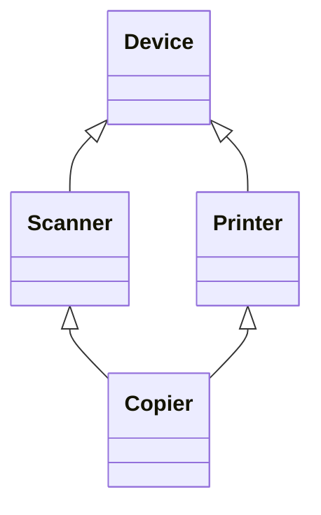

前几章讨论的都是单个**类**：怎样把数据和操作**封装**在一起，怎样管理**对象**的创建、复制与销毁。真实的程序由许多类组成，类与类之间的关系决定了程序的结构。本章讨论两种最基本的复用方式：组合（把已有类的对象当作新类的组成部分）与继承（把新类定义为已有类的特殊情形）。继承是下一章虚函数与多态的基础，而"优先使用组合"又是第 13 章设计模式反复体现的原则，所以本章既讲语法，也讲怎样在两者之间做选择。

## 7.1. 类之间的关系

面向对象的程序设计试图让程序的结构对应人们认识世界的方式。观察两组对象：

- 汽车与车门、车窗、引擎、轮胎：后者是前者的组成部分，这是"整体—部分"关系，英文常说 has-a（汽车有一个引擎）。
- 形状与矩形、圆形、三角形：后者是前者的特殊情形，这是"一般—特殊"关系，英文常说 is-a（圆形是一种形状）。

两种关系在 C++ 和 Python 中分别用组合与继承表达。

**定义 7.1.1（组合）** 若类 $B$ 的对象把类 $A$ 的对象作为自己的组成部分（数据成员）来实现自身的功能，称 $B$ 与 $A$ 之间是**组合**关系（has-a 关系）。$B$ 的对象称为整体对象，其中的 $A$ 对象称为子对象（成员对象）。

**定义 7.1.2（继承）** 在已有类 $A$ 的基础上定义新类 $B$，使 $B$ 自动拥有 $A$ 的全部数据成员与成员函数，并可以增加新成员、重新定义已有的成员函数，这种机制称为**继承**。$A$ 称为**基类**（父类），$B$ 称为**派生类**（子类）。继承应当表达 is-a 关系：每个 $B$ 对象都是一个 $A$ 对象。

两者都是复用已有代码的手段，区别在于复用的是什么：组合复用的是已有类的实现，新类的接口由自己决定；继承同时复用实现与接口，派生类对外承诺"基类能做的我都能做"。

## 7.2. 组合

### 7.2.1. 以对象为数据成员

组合的写法就是把已有类的对象声明为新类的数据成员。子对象可以放在不同的访问区域：

- 作为公有成员：使用者通过 `car.engine.start()` 直接调用子对象的接口。写法省事，但整体对象的内部结构暴露在外，以后很难更换零件。
- 作为私有成员：整体对象自己提供接口，在内部把请求转给子对象（转发），也可以把几个子对象的操作组合成新的操作。这相当于对旧接口做了一次转换，是通常的做法。

```cpp tab
#include <array>
#include <cstddef>
#include <format>
#include <iostream>

class Engine {
public:
    explicit Engine(int power) : power_(power) {}
    void start() const { std::cout << std::format("engine ({} kW) started\n", power_); }
private:
    int power_;
};

class Wheel {
public:
    void inflate(double bar) { pressure_ = bar; }
    double pressure() const { return pressure_; }
private:
    double pressure_ = 0.0;
};

class Car {
public:
    explicit Car(int power) : engine_(power) {}   // construct the sub-object
    void start() const { engine_.start(); }       // forward to a part
    void inflateTires(double bar) {               // a new operation built from parts
        for (auto& w : wheels_) w.inflate(bar);
    }
    double tirePressure(std::size_t i) const { return wheels_.at(i).pressure(); }
private:
    Engine engine_;
    std::array<Wheel, 4> wheels_;
};

int main() {
    Car car(110);
    car.start();
    car.inflateTires(2.4);
    std::cout << std::format("tire 0: {} bar\n", car.tirePressure(0));
}
```

```python tab
class Engine:
    def __init__(self, power: int) -> None:
        self._power = power

    def start(self) -> None:
        print(f"engine ({self._power} kW) started")


class Wheel:
    def __init__(self) -> None:
        self._pressure = 0.0

    def inflate(self, bar: float) -> None:
        self._pressure = bar

    @property
    def pressure(self) -> float:
        return self._pressure


class Car:
    def __init__(self, power: int) -> None:
        self._engine = Engine(power)                 # build the parts explicitly
        self._wheels = [Wheel() for _ in range(4)]

    def start(self) -> None:
        self._engine.start()                         # forward to a part

    def inflate_tires(self, bar: float) -> None:
        for w in self._wheels:
            w.inflate(bar)

    def tire_pressure(self, i: int) -> float:
        return self._wheels[i].pressure


car = Car(110)
car.start()
car.inflate_tires(2.4)
print(f"tire 0: {car.tire_pressure(0)} bar")
```

C++ 的子对象就嵌在整体对象的内存里，`sizeof(Car)` 至少是各子对象大小之和；Python 的属性只是指向其他对象的引用，"组成部分"是一种约定而不是内存布局。

### 7.2.2. 子对象的构造与析构次序

C++ 保证整体对象开始工作之前，它的所有子对象都已经构造完毕：

1. 先按子对象在类中声明的次序依次构造子对象，再执行整体对象构造函数的函数体。次序只由声明次序决定，与初始化列表中书写的次序无关（两者不一致时编译器会给出 `-Wreorder` 警告）。
2. 子对象的构造函数需要参数时，必须在整体对象构造函数的初始化列表中给出；能默认构造的子对象可以不写。
3. 析构的次序与构造相反：先执行整体对象析构函数的函数体，再按声明的逆序析构子对象。

```cpp
#include <format>
#include <iostream>

class Part1 {
public:
    explicit Part1(int id) : id_(id) { std::cout << std::format("Part1({})\n", id_); }
    ~Part1() { std::cout << "~Part1()\n"; }
private:
    int id_;
};

class Part2 {
public:
    Part2() { std::cout << "Part2()\n"; }
    ~Part2() { std::cout << "~Part2()\n"; }
};

class Whole {
public:
    Whole() : p1_(123) { std::cout << "Whole()\n"; }   // p2_ is default-constructed
    ~Whole() { std::cout << "~Whole()\n"; }
private:
    Part1 p1_;   // declared first, constructed first
    Part2 p2_;
};

int main() {
    Whole w;
}
```

```text
Part1(123)
Part2()
Whole()
~Whole()
~Part2()
~Part1()
```

这一次序是 **RAII** 能够成立的原因之一：整体对象的析构函数运行时，子对象仍然有效；子对象按逆序释放，后构造的（可能依赖先构造的）先销毁。

### 7.2.3. 复制与赋值

编译器隐式生成的**拷贝构造函数**和**拷贝赋值运算符**会逐个成员地复制：对每个子对象调用它自己的拷贝构造函数或拷贝赋值运算符（移动操作同理，见 [4.2.6](/4.2.6)）。因此，只要每个成员都能正确地复制自己，整体对象就不必手写复制操作——这正是**零法则**的依据。

一旦手写了整体对象的拷贝构造函数，就要在初始化列表中显式复制每个子对象，例如 `Whole(const Whole& other) : p1_(other.p1_), p2_(other.p2_) {}`；遗漏的子对象会被默认构造，而不是被复制。这是手写复制操作时常见的错误。

## 7.3. 继承

### 7.3.1. 基类与派生类

C++ 用 `class 派生类 : 继承方式 基类` 声明继承。派生类对象中包含一个完整的基类子对象，再加上派生类新增的成员。下面的 `Manager` 是一种 `Employee`：它有员工的一切（姓名、薪水），另外有职级和下属名单。

```cpp tab
#include <format>
#include <iostream>
#include <string>
#include <utility>
#include <vector>

class Employee {
public:
    Employee(std::string name, double salary)
        : name_(std::move(name)), salary_(salary) {}
    const std::string& name() const { return name_; }
    void print() const { std::cout << std::format("{}: {:.1f}\n", name_, salary_); }
private:
    std::string name_;
protected:
    double salary_;          // accessible to derived classes, hidden from users
};

class Manager : public Employee {
public:
    Manager(std::string name, double salary, int level)
        : Employee(std::move(name), salary), level_(level) {}   // base first
    void addReport(const Employee& e) { reports_.push_back(&e); }
    void raise(double percent) { salary_ *= 1 + percent / 100; }  // uses protected member
    void print() const {                     // redefines Employee::print
        Employee::print();                   // reuse the base version
        std::cout << std::format("  level {}, {} report(s)\n", level_, reports_.size());
    }
private:
    int level_;
    std::vector<const Employee*> reports_;
};

int main() {
    Employee alice("Alice", 8000);
    Manager bob("Bob", 12000, 2);
    bob.addReport(alice);
    bob.raise(10);
    alice.print();
    bob.print();
    std::cout << std::format("{}\n", bob.name());          // inherited member function
}
```

```python tab
class Employee:
    def __init__(self, name: str, salary: float) -> None:
        self.name = name
        self._salary = salary            # "protected" by convention only

    def print(self) -> None:
        print(f"{self.name}: {self._salary:.1f}")


class Manager(Employee):
    def __init__(self, name: str, salary: float, level: int) -> None:
        super().__init__(name, salary)   # must be called explicitly
        self._level = level
        self._reports: list[Employee] = []

    def add_report(self, e: Employee) -> None:
        self._reports.append(e)

    def raise_salary(self, percent: float) -> None:
        self._salary *= 1 + percent / 100

    def print(self) -> None:
        super().print()                  # reuse the base version
        print(f"  level {self._level}, {len(self._reports)} report(s)")


alice = Employee("Alice", 8000)
bob = Manager("Bob", 12000, 2)
bob.add_report(alice)
bob.raise_salary(10)
alice.print()
bob.print()
print(bob.name)
```

派生类可以做三件事：继承基类的成员（`name()` 不必重写）、增加新成员（`level_`、`addReport`）、重新定义基类的成员函数（`print`）。重新定义时，可以用 `基类名::函数名` 调用基类的版本，在其基础上扩充。注意 `Manager::print` 在这里只是隐藏了 `Employee::print`（§7.4）：通过 `Employee&` 调用时仍会执行基类版本。要让调用按对象的实际类型分派，需要第 8 章的虚函数。

### 7.3.2. 派生类的构造与析构

派生类对象的构造次序是：先构造基类子对象，再按声明次序构造派生类新增的成员，最后执行派生类构造函数的函数体；析构次序相反。基类的构造函数需要参数时，在派生类构造函数的初始化列表中调用它（如上例的 `Employee(std::move(name), salary)`）；否则调用基类的默认构造函数，基类没有默认构造函数就编译出错。

**构造函数**不被继承，但当派生类没有新增需要初始化的成员时，C++11 起可以用 `using` 声明继承构造函数（inheriting constructor），让派生类直接接受基类构造函数的参数：

```cpp
#include <format>
#include <iostream>
#include <string>
#include <utility>

class Employee {
public:
    Employee(std::string name, double salary)
        : name_(std::move(name)), salary_(salary) {}
    void print() const { std::cout << std::format("{}: {:.1f}\n", name_, salary_); }
private:
    std::string name_;
    double salary_;
};

class Intern : public Employee {
public:
    using Employee::Employee;    // inherit Employee(std::string, double)
    int mentorId = 0;            // new members get their default initializers
};

int main() {
    Intern carol("Carol", 3000);
    carol.print();
}
```

拷贝与移动操作的规则与组合相同：隐式生成的版本先复制（移动）基类子对象，再逐个复制（移动）成员；手写时要在初始化列表中写 `Base(other)`，否则基类部分会被默认构造。

### 7.3.3. 继承方式与访问权限

访问说明符 `protected` 介于 `public` 与 `private` 之间：保护成员对类的使用者不可见，对派生类的成员函数可见。继承方式（`public`、`protected`、`private`）进一步决定了基类成员在派生类中的访问级别：取基类中的级别与继承方式中更严格的一个。

| 基类中的成员 | public 继承 | protected 继承 | private 继承 |
|---|---|---|---|
| public | public | protected | private |
| protected | protected | protected | private |
| private | 不可访问 | 不可访问 | 不可访问 |

几点说明：

- 基类的私有成员在任何继承方式下都存在于派生类对象中，只是派生类的成员函数不能直接访问它们，必须通过基类的公有或保护接口。
- 只有 public 继承表达 is-a：外界可以把派生类对象当作基类对象使用（第 8 章的向上转型）。`class` 的默认继承方式是 private，`struct` 的默认是 public，因此表达 is-a 时应当显式写出 `public`。
- private 继承表达"照此实现"（implemented in terms of）：派生类借用基类的实现，但不承认自己是一种基类。可以用 `using` 声明把个别基类成员重新开放为公有：

```cpp
#include <format>
#include <iostream>
#include <vector>

class IntStack : private std::vector<int> {   // a stack is not a vector
public:
    using std::vector<int>::size;              // re-expose selected members
    using std::vector<int>::empty;
    void push(int x) { push_back(x); }
    int pop() { int x = back(); pop_back(); return x; }
};

int main() {
    IntStack s;
    s.push(1);
    s.push(2);
    int top = s.pop();
    std::cout << std::format("popped {}, size {}\n", top, s.size());
    // s.insert(s.begin(), 0);  // error: insert is private in IntStack
}
```

同样的效果用组合（把 `std::vector<int>` 作为私有成员）也能得到，而且耦合更松，一般更推荐组合；private 继承只在需要访问基类的保护成员或改写其虚函数时才有必要。

### 7.3.4. 组合还是继承

选择的基本判据是两类对象之间的关系：

| | 组合 | 继承（public） |
|---|---|---|
| 关系 | has-a，整体—部分 | is-a，一般—特殊 |
| 复用的是 | 实现 | 接口与实现 |
| 新类的接口 | 自己设计，可以转换旧接口 | 包含基类的全部公有接口 |
| 耦合 | 只依赖子对象的公有接口 | 依赖基类的保护成员与内部约定 |
| 运行时可否更换 | 可以（持有指针或引用时） | 不可以，在编译时确定 |

is-a 要从行为上理解：派生类对象必须能在任何使用基类对象的地方代替它，而不破坏程序的正确性（即 Liskov 替换原则，见 [4.2.13](/4.2.13)）。经典的反例是"正方形是一种矩形"：数学上成立，但如果 `Rectangle` 提供了分别设置宽和高的 `setWidth`、`setHeight`，`Square` 就无法在满足这一接口的同时保持宽高相等，用继承表达它们反而会出错。

经验法则是优先使用组合：继承让派生类依赖基类的实现细节，基类的改动会波及所有派生类；组合只依赖接口，更容易替换和测试。继承适用于确实需要通过基类接口统一处理多种对象的场合，这正是第 8 章多态的用途。

## 7.4. 名字隐藏

### 7.4.1. 重写隐藏

派生类的**作用域**嵌套在基类的作用域之内。编译器查找成员名字时，先在派生类中找，找到了就停止，不再去基类中找。因此，派生类中只要声明了与基类同名的成员函数，无论参数是否相同，基类中所有同名的函数（包括它的全部重载版本）都被隐藏，这称为重写隐藏（name hiding）。

```cpp
#include <format>
#include <iostream>
#include <string>

struct Base {
    void f(int) { std::cout << "Base::f(int)\n"; }
    void f(double) { std::cout << "Base::f(double)\n"; }
};

struct Derived : Base {
    void f(const std::string&) { std::cout << "Derived::f(string)\n"; }
};

int main() {
    Derived d;
    d.f("text");
    // d.f(1);      // error: Base::f(int) is hidden by Derived::f
    d.Base::f(1);   // explicit qualification still works
}
```

这与**函数重载**不同：重载发生在同一作用域内，编译器在同名函数中按参数选择；隐藏发生在嵌套作用域之间，内层的名字遮住外层的名字。上一节 `Manager::print` 与 `Employee::print` 的参数相同，同样属于隐藏。三者（重载、隐藏与第 8 章的覆盖）的对比见第 8 章。

### 7.4.2. 用 using 恢复基类成员

如果希望派生类在增加新版本的同时保留基类的重载版本，可以用 using 声明把基类的名字引入派生类的作用域，它们与派生类的版本一起参与重载决议：

```cpp
#include <format>
#include <iostream>
#include <string>

struct Base {
    void f(int) { std::cout << "Base::f(int)\n"; }
    void f(double) { std::cout << "Base::f(double)\n"; }
};

struct Derived : Base {
    using Base::f;   // bring all Base::f overloads into this scope
    void f(const std::string&) { std::cout << "Derived::f(string)\n"; }
};

int main() {
    Derived d;
    d.f(1);
    d.f(2.5);
    d.f("text");
}
```

`using` 在本章出现了三种用途，都是"把别处的名字引入当前作用域"：引入基类的重载版本、继承构造函数、在 private 继承中重新开放成员。

## 7.5. 多重继承

### 7.5.1. 语法与语义

**定义 7.5.1（多重继承）** 一个派生类同时有多个直接基类，称为**多重继承**。C++ 的写法是 `class D : public B1, public B2 { … };`，派生类对象依次包含各个基类子对象，构造时按基类在派生列表中的书写次序构造。

多重继承适合表达一个对象同时扮演几种角色，例如一个类既是"可绘制的"又是"可序列化的"。它带来两个问题：名字冲突和重复的基类。

- 名字冲突：两个基类有同名成员时，通过派生类直接访问是二义的，编译出错。要用 `B1::name` 指明，或在派生类中重新定义该成员。
- 菱形继承（diamond inheritance）：`Scanner` 和 `Printer` 都派生自 `Device`，`Copier` 又同时派生自 `Scanner` 和 `Printer`。默认情况下 `Copier` 对象中有两个 `Device` 子对象，访问 `Device` 的成员是二义的，两份数据也可能不一致。



### 7.5.2. 虚继承

**定义 7.5.2（虚继承）** 在派生列表中把基类声明为 `virtual`（如 `class Scanner : virtual public Device`），该基类称为虚基类；无论它在继承层次中出现多少次，最终派生类的对象中只有一个它的子对象。这种继承方式称为**虚继承**。

虚基类子对象由最终派生类（实际创建的那个类）的构造函数负责初始化，中间各层对虚基类构造函数的调用被忽略；虚基类在所有非虚基类之前构造。

```cpp
#include <format>
#include <iostream>
#include <string>
#include <utility>

struct Device {
    explicit Device(std::string id) : id(std::move(id)) {}
    std::string id;
};

struct Scanner : virtual Device {
    Scanner() : Device("scanner") {}
    void scan() const { std::cout << std::format("{} scans\n", id); }
};

struct Printer : virtual Device {
    Printer() : Device("printer") {}
    void print() const { std::cout << std::format("{} prints\n", id); }
};

struct Copier : Scanner, Printer {
    Copier() : Device("copier") {}   // the most derived class initializes Device
    void copy() const { scan(); print(); }
};

int main() {
    Copier c;
    c.copy();                        // both parts see the same Device
    std::cout << std::format("id = {}\n", c.id);   // unambiguous: only one Device sub-object
}
```

```text
copier scans
copier prints
id = copier
```

虚继承有代价：对象中要额外存放定位虚基类的信息，访问虚基类成员多一次间接寻址，构造规则也更难理解。实践中的建议是：多重继承主要用来组合多个没有数据成员的接口（第 8 章的抽象类），避免让带数据的基类形成菱形；确需共享基类时才使用虚继承。标准库中的 `std::iostream` 同时继承 `std::istream` 和 `std::ostream`，二者都虚继承自 `std::basic_ios`，这是少数典型的例子。

## 7.6. Python 对照

### 7.6.1. 继承与 super

Python 用 `class Derived(Base):` 声明继承，所有类最终都派生自 `object`。派生类的 `__init__` 不会自动调用基类的 `__init__`，需要显式写 `super().__init__(…)`；漏写时基类设置的属性就不存在。Python 没有访问控制，`_name` 表示"内部使用"，`__name` 会被解释器自动改写为 `_类名__name`，以免被派生类中的同名属性意外覆盖，但都不是强制的。

### 7.6.2. 没有重载，也就没有隐藏

Python 的类属性存在字典里，同名方法后定义的直接替换先定义的，一个类中一个名字只对应一个对象。派生类定义同名方法，就是替换（覆盖）基类的方法；而且查找总是从对象的实际类型开始，相当于 C++ 中所有成员函数都是虚函数（第 8 章）。

### 7.6.3. 多重继承与 MRO

Python 支持多重继承，并且不存在"两份基类子对象"的问题：属性都存在实例的 `__dict__` 中，只有一份。需要解决的是查找顺序：一个方法在多个基类中都有定义时用哪一个。

**定义 7.6.3（方法解析顺序）** Python 中每个类有一个线性的祖先序列 `C.__mro__`，称为**方法解析顺序**（method resolution order，MRO）。在实例上查找属性时，依次在 MRO 中的各个类里查找，取第一个找到的。MRO 由 C3 线性化算法计算：

$$
L[C] = C + \operatorname{merge}(L[B_1], \dots, L[B_n], [B_1, \dots, B_n]),
$$
其中 $B_1, \dots, B_n$ 是 $C$ 的直接基类（按书写次序），$\operatorname{merge}$ 反复取出第一个"不出现在任何列表尾部"的表头元素，追加到结果并从所有列表中删去。

C3 线性化保证两点：子类总在父类之前；同一个类的多个直接基类保持书写的先后次序。无法同时满足时（例如两个类以相反次序继承同样两个基类）定义类时就报 `TypeError`。对上面的菱形：

$$
\begin{aligned}
L[\text{Scanner}] &= [\text{Scanner}, \text{Device}, \text{object}],\quad L[\text{Printer}] = [\text{Printer}, \text{Device}, \text{object}],\\
L[\text{Copier}] &= [\text{Copier}] + \operatorname{merge}([\text{Scanner}, \text{Device}, \text{object}], [\text{Printer}, \text{Device}, \text{object}], [\text{Scanner}, \text{Printer}])\\
&= [\text{Copier}, \text{Scanner}, \text{Printer}, \text{Device}, \text{object}].
\end{aligned}
$$

`super()` 的含义因此不是"父类"，而是"MRO 中排在当前类之后的下一个类"。每个类都调用一次 `super()` 时，菱形中的每个方法恰好执行一次，这称为协作式多重继承：

```python
class Device:
    def start(self) -> None:
        print("Device.start")


class Scanner(Device):
    def start(self) -> None:
        print("Scanner.start")
        super().start()          # next class in the MRO, not necessarily Device


class Printer(Device):
    def start(self) -> None:
        print("Printer.start")
        super().start()


class Copier(Scanner, Printer):
    def start(self) -> None:
        print("Copier.start")
        super().start()


print([c.__name__ for c in Copier.__mro__])
Copier().start()
```

```text
['Copier', 'Scanner', 'Printer', 'Device', 'object']
Copier.start
Scanner.start
Printer.start
Device.start
```

`Scanner.start` 中的 `super()` 调用到的是 `Printer.start`，而 `Scanner` 本身并不知道 `Printer` 的存在：调用链由实际对象的 MRO 决定。Python 中常见的 mixin 写法（如标准库 `socketserver.ThreadingMixIn`）就依赖这一机制。

### 7.6.4. 组合同样是首选

Python 中组合的写法就是在 `__init__` 中把其他对象赋给属性（§7.2.1 的 `Car`）。由于有鸭子类型（第 8 章），Python 程序比 C++ 更少需要为了"统一接口"而继承。

## 小结

- 组合表达 has-a，复用实现；public 继承表达 is-a，同时复用接口与实现。优先使用组合。
- C++ 中子对象和基类子对象先于整体对象构造、后于它析构；子对象按声明次序构造。手写复制操作时要显式复制基类和每个成员。
- 继承方式决定基类成员在派生类中的访问级别；只有 public 继承允许把派生类对象当作基类对象使用。
- 派生类中的同名函数隐藏基类的全部同名函数，用 `using` 恢复。
- 多重继承中的菱形用虚继承消除重复的基类子对象；Python 用 C3 线性化得到 MRO，`super()` 沿 MRO 协作调用。
