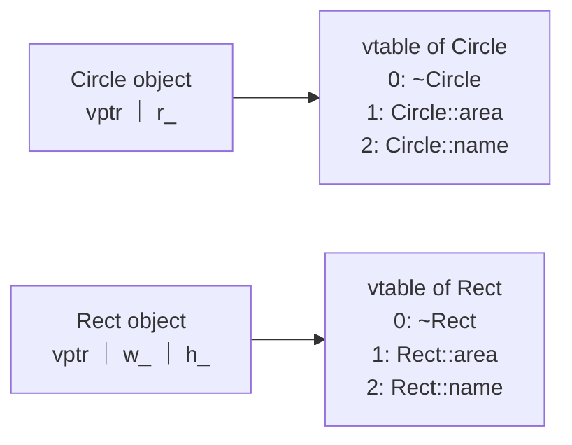

The **inheritance** of the previous chapter lets a derived class reuse the interface and implementation of its base class, but one thing is still missing. When a program knows only that "this is a shape", how can it automatically call the area computation of a circle or of a rectangle at run time? The answer of this chapter is the virtual function. We first see how a derived-class object is used as a base-class object (upcasting), then how C++ decides at run time which function to call (dynamic binding and the virtual method table), then pure virtual functions and abstract classes, and finally we gather these mechanisms under the name polymorphism. Polymorphism is the core of object-oriented programming: it lets callers depend only on an abstract interface, so that a new implementation can be added without modifying existing code, which is the common basis of the design patterns in Chapter 13. Templates, the topic of the next chapter, provide another form of polymorphism that is realized at compile time.

## 8.1. Upcasting

### 8.1.1. Upcasting Objects and Object Slicing

Public inheritance expresses is-a, so a derived-class object can be used wherever a base-class object is required.

**Definition 8.1.1 (Upcast)** Converting an object, pointer or reference of a derived class to an object, pointer or reference of its base class is called an **upcast**. For public inheritance, an upcast is performed implicitly and needs no cast expression.

"Up" refers to the base class being drawn above in the inheritance diagram. When the conversion is by value, the derived-class object is copied into a base-class object:

**Definition 8.1.2 (Object Slicing)** When a base-class object is initialized from, or assigned, a derived-class object, only the base-class subobject is copied and the data members added by the derived class are discarded. The resulting object has the base type, and the behavior redefined by the derived class is lost with it. This phenomenon is called **object slicing**.

```cpp
#include <format>
#include <iostream>
#include <string>

struct Pet {
    std::string name;
    virtual std::string speak() const { return "..."; }
    virtual ~Pet() = default;
};

struct Dog : Pet {
    std::string breed;
    std::string speak() const override { return "Woof"; }
};

void byValue(Pet p) { std::cout << std::format("{} says {}\n", p.name, p.speak()); }
void byRef(const Pet& p) { std::cout << std::format("{} says {}\n", p.name, p.speak()); }

int main() {
    Dog d;
    d.name = "Rex";
    d.breed = "collie";
    byValue(d);    // sliced: a Pet copy, breed is gone, Pet::speak is called
    byRef(d);      // no copy: the Dog itself, Dog::speak is called
}
```

```text
Rex says ...
Rex says Woof
```

Slicing is usually a mistake rather than something intended. A rule of thumb is to pass objects of polymorphic classes (classes with virtual functions) by reference or pointer, not by value; when a copy is needed, use the virtual `clone` function of §8.3.1.

### 8.1.2. Upcasting Pointers and References

Converting a `Dog*` to a `Pet*`, or binding a `Dog&` to a `Pet&`, copies nothing: the pointer still points to the original, complete `Dog` object. Two kinds of type must now be distinguished:

- The static type is the type an expression is declared to have in the source code, known at compile time (`Pet&`).
- The dynamic type is the type of the object the expression actually refers to at run time (`Dog`).

Through a base-class pointer or reference, only the members declared in the base class can be accessed (the static type determines what can be called); which version of a function is called depends on whether it is a virtual function (§8.2).

Upcasting holds implicitly outside the class only for public inheritance. Private inheritance means "implemented in terms of" ([4.2.7](/4.2.7)): outside the class a derived object cannot be used as a base object, and the conversion is available only in the member functions and friends of the derived class.

## 8.2. Virtual Functions and Dynamic Binding

### 8.2.1. Static and Dynamic Binding

Associating a function call with the function body it executes is called binding. Calls to ordinary functions and to non-virtual member functions are bound at compile time: the compiler determines the target from the static type and emits an instruction that jumps directly to the address of that function. This is called static binding or early binding.

**Definition 8.2.1 (Dynamic Binding)** Determining the target of a function call at run time from the dynamic type of the object is called **dynamic binding**, also known as late binding.

### 8.2.2. Virtual Functions

**Definition 8.2.2 (Virtual Function)** A member function declared with the keyword `virtual` in a base class is called a **virtual function**. When a derived class declares a function with the same name, the same parameter list (including qualifiers such as `const`) and the same or a covariant return type, that function **overrides** the base-class version and automatically becomes virtual. A call to a virtual function through a pointer or reference to the base class is dynamically bound.

```cpp tab
#include <format>
#include <iostream>
#include <memory>
#include <numbers>
#include <string>
#include <vector>

class Shape {
public:
    virtual ~Shape() = default;
    virtual double area() const { return 0.0; }
    virtual std::string name() const { return "shape"; }
    void describe() const {               // non-virtual, but calls virtual functions
        std::cout << std::format("{} with area {:.2f}\n", name(), area());
    }
};

class Circle : public Shape {
public:
    explicit Circle(double r) : r_(r) {}
    double area() const override { return std::numbers::pi * r_ * r_; }
    std::string name() const override { return "circle"; }
private:
    double r_;
};

class Rect : public Shape {
public:
    Rect(double w, double h) : w_(w), h_(h) {}
    double area() const override { return w_ * h_; }
    std::string name() const override { return "rectangle"; }
private:
    double w_, h_;
};

int main() {
    std::vector<std::unique_ptr<Shape>> shapes;
    shapes.push_back(std::make_unique<Circle>(1.0));
    shapes.push_back(std::make_unique<Rect>(2.0, 3.0));
    for (const auto& s : shapes) s->describe();   // dispatched on the dynamic type
}
```

```python tab
import math


class Shape:
    def area(self) -> float:
        return 0.0

    def name(self) -> str:
        return "shape"

    def describe(self) -> None:
        print(f"{self.name()} with area {self.area():.2f}")


class Circle(Shape):
    def __init__(self, r: float) -> None:
        self._r = r

    def area(self) -> float:
        return math.pi * self._r ** 2

    def name(self) -> str:
        return "circle"


class Rect(Shape):
    def __init__(self, w: float, h: float) -> None:
        self._w, self._h = w, h

    def area(self) -> float:
        return self._w * self._h

    def name(self) -> str:
        return "rectangle"


shapes: list[Shape] = [Circle(1.0), Rect(2.0, 3.0)]
for s in shapes:
    s.describe()
```

```text
circle with area 3.14
rectangle with area 6.00
```

Several points deserve attention.

- Dynamic binding occurs only for calls through a pointer or reference. For a call directly on an object (`Circle c; c.area();`) or on a base-class object obtained by slicing, the target is fixed at compile time.
- A call qualified with a scope (`Shape::area()`) switches dynamic binding off and always calls the named version; this is how an overriding function in a derived class reuses the base-class implementation.
- Inside the non-virtual function `describe`, the calls to the virtual functions `name()` and `area()` are still dynamically bound (`this` is a pointer). The base class fixes the procedure and the derived classes fill in the steps; this is the template method pattern of Chapter 13.
- The example stores objects of different types in `std::unique_ptr<Shape>`; when the `vector` is destroyed, each object is deleted automatically (Chapter 12).

### 8.2.3. The Virtual Method Table

The C++ standard specifies only the behavior of virtual functions, not their implementation, but all mainstream compilers use the same scheme.

**Definition 8.2.3 (Virtual Method Table)** For each class with virtual functions, the compiler generates a table of function pointers that stores the final version of each virtual function of the class in a fixed order of slots (an overridden slot holds the derived-class function, a slot that is not overridden keeps the base-class function). This table is called the **virtual method table** (vtable). Each object of the class stores at its beginning a hidden pointer, the vptr, to the vtable of its class; the constructor sets it.



A call `s->area()` is therefore compiled into three steps: fetch the vptr from `*s`, read the function address in slot 1 of the table, and call it indirectly. The compiler does not need to know what `s` actually points to; it only requires that all derived classes put `area` in the same slot. The costs are also visible from this:

- Space: every object carries one more pointer (8 bytes on a 64-bit system), and every class has one more table.
- Time: an extra load and an indirect call. More importantly, an indirect call usually cannot be inlined, which hinders compiler optimization. The difference is noticeable only for small functions that are called very frequently.

The vtable usually also holds type information (`std::type_info`), on which `typeid` and `dynamic_cast` (§8.5) rely to identify the dynamic type of an object at run time. This is called run-time type information (RTTI).

### 8.2.4. Constructors, Destructors and Virtual Functions

A virtual function called in a constructor or destructor is not dispatched to the derived-class version. When an object of a derived class is constructed, the constructor of the base class runs first; at that time the members of the derived class are not yet initialized, and the vptr of the object points to the vtable of the base class. Only after entering the derived-class constructor is the vptr changed to point to the table of the derived class. Destruction proceeds in the opposite order. Hence a virtual function called in a base-class constructor executes the base-class version:

```cpp
#include <iostream>

struct Base {
    Base() { hello(); }                       // the object is still a Base here
    virtual ~Base() = default;
    virtual void hello() const { std::cout << "Base::hello\n"; }
    void call() const { hello(); }
};

struct Derived : Base {
    Derived() { hello(); }
    void hello() const override { std::cout << "Derived::hello\n"; }
};

int main() {
    Derived d;
    d.call();
}
```

```text
Base::hello
Derived::hello
Derived::hello
```

This rule exists for safety: if a base-class constructor could call a function of the derived class, that function would read members of the derived class that are not yet initialized.

A **constructor** itself cannot be virtual (the type is known when an object is created), but a **destructor** should be virtual. When a derived-class object is deleted through a base-class pointer and the destructor of the base class is not virtual, the behavior is undefined; the typical outcome is that only the base-class destructor runs, and the resources held by the derived class leak. The rules are as follows.

- A base class intended for polymorphic use (deletion through a base-class pointer) declares its destructor `public` and `virtual`, usually written `virtual ~Base() = default;`.
- A base class not intended to be used this way can declare its destructor `protected` and non-virtual, which syntactically forbids deletion through a base-class pointer.

## 8.3. Overloading, Hiding and Overriding

### 8.3.1. How the Three Differ

Functions with the same name can be related in three ways, which are the easiest to confuse for beginners:

| | Overloading | Hiding | Overriding |
|---|---|---|---|
| Scope | Same scope | Derived class and base class | Derived class and base class |
| Function name | Same | Same | Same |
| Parameter list | Different | Same or different | Same (including `const` and ref-qualifiers) |
| Is the base-class function virtual? | Irrelevant | Not virtual, or parameters differ | Virtual |
| When is the target determined? | Compile time, by argument types | Compile time, by static type | Run time, by dynamic type |

Among the conditions for overriding, a *covariant return type* is allowed: when a base-class virtual function returns `Base*` or `Base&`, the overriding function in a derived class may return `Derived*` or `Derived&`. A typical use is the "virtual copy constructor":

```cpp
#include <iostream>

struct Shape {
    virtual ~Shape() = default;
    virtual Shape* clone() const = 0;
    virtual void draw() const = 0;
};

struct Circle : Shape {
    Circle* clone() const override { return new Circle(*this); }   // covariant return
    void draw() const override { std::cout << "circle\n"; }
};

int main() {
    const Shape& s = Circle{};
    Shape* copy = s.clone();   // copies the dynamic type, no slicing
    copy->draw();
    delete copy;
}
```

(In real code `clone` usually returns `std::unique_ptr<Shape>`; such return types cannot be covariant, so the derived classes also return `std::unique_ptr<Shape>`.)

### 8.3.2. override and final

Overriding requires identical signatures, and a missing `const` turns it into hiding: the code compiles but the base-class version is called at run time. The C++11 specifier `override` lets the compiler check this intention: a function marked `override` that overrides no base-class virtual function is a compile-time error.

```cpp
#include <iostream>

struct Base {
    virtual ~Base() = default;
    virtual void f(int) const { std::cout << "Base::f\n"; }
};

struct Derived : Base {
    // void f(int) override;            // error: does not override (missing const)
    void f(int) const override { std::cout << "Derived::f\n"; }
};

struct Leaf final : Derived {           // no class can derive from Leaf
    void f(int) const override { std::cout << "Leaf::f\n"; }
};

int main() {
    Leaf leaf;
    const Base& b = leaf;
    b.f(0);
}
```

Applied to a class, `final` forbids further derivation; applied to a virtual function, it forbids derived classes from overriding it again. Besides expressing design intent, it lets the compiler turn a virtual call into a direct call when the static type is a `final` class. The convention in modern C++ is to write `virtual` on the virtual function in the base class, and only `override` (or `final`) on the overriding functions in derived classes, without repeating `virtual`.

## 8.4. Pure Virtual Functions and Abstract Classes

### 8.4.1. Pure Virtual Functions

In §8.2.2, returning 0 from `Shape::area` was only a stopgap: a "generic shape" has no area. A more accurate approach is to declare only the interface and provide no implementation.

**Definition 8.4.1 (Pure Virtual Function)** A virtual function whose declaration ends with `= 0` (such as `virtual double area() const = 0;`) is called a **pure virtual function**. It indicates that the base class specifies only this interface, and that derived classes supply the implementation.

**Definition 8.4.2 (Abstract Class)** A class that contains at least one pure virtual function (including one inherited and not overridden) is called an **abstract class**. No object of an abstract class can be created, but pointers and references to it can be declared. A derived class becomes a concrete class, which can be instantiated, once it overrides all pure virtual functions.

```cpp
#include <format>
#include <iostream>
#include <numbers>

class Shape {                              // abstract: an interface
public:
    virtual ~Shape() = default;
    virtual double area() const = 0;
    virtual double perimeter() const = 0;
};

class Circle : public Shape {
public:
    explicit Circle(double r) : r_(r) {}
    double area() const override { return std::numbers::pi * r_ * r_; }
    double perimeter() const override { return 2 * std::numbers::pi * r_; }
private:
    double r_;
};

double roundness(const Shape& s) {         // depends only on the interface
    return 4 * std::numbers::pi * s.area() / (s.perimeter() * s.perimeter());
}

int main() {
    // Shape s;                            // error: Shape is abstract
    std::cout << std::format("{:.3f}\n", roundness(Circle(2.0)));
}
```

A pure virtual function may also have a definition (with the body written outside the class), which derived classes can call explicitly as `Shape::area()`; the class remains abstract. A special case is the pure virtual destructor: `virtual ~Shape() = 0;` makes a class abstract even when it has no other pure virtual function, but a definition `Shape::~Shape() = default;` must be provided outside the class, because the destructor of a derived class always calls it.

An abstract class that consists only of pure virtual functions and has no data members corresponds to an interface in other languages (Java, C#). These are the classes meant in [4.2.7](/4.2.7) by the remark that "multiple inheritance is mainly used to combine several interfaces": inheriting from several such classes causes no duplication of data.

### 8.4.2. Programming to an Interface

The function `roundness` in the example depends only on the interface of `Shape`. If `Polygon` or `Ellipse` is added later, `roundness` does not change by a single line and need not even be recompiled. This way of organizing code, in which the caller depends on an abstract interface and not on a concrete implementation, is called programming to an interface, and is the starting point of the design principles in Chapter 13. An abstract class separates "what" (the interface) from "how" (the implementation) so that the two can vary independently.

## 8.5. Downcasting

### 8.5.1. static_cast and dynamic_cast

Converting a base-class pointer or reference back to a derived class is called a *downcast*. It is not always safe: a `Shape*` does not necessarily point to a `Circle`. C++ offers two notations.

- `static_cast<Circle*>(p)` converts at compile time without any run-time check. It may be used only when the programmer knows for certain that `p` points to a `Circle`; otherwise the behavior is undefined.
- `dynamic_cast<Circle*>(p)` uses RTTI to check the dynamic type at run time. On success it returns the converted pointer, on failure it returns `nullptr`; for a reference, failure throws `std::bad_cast`. It requires the base class to be polymorphic (to have at least one virtual function).

```cpp
#include <format>
#include <iostream>
#include <memory>
#include <vector>

struct Shape { virtual ~Shape() = default; };
struct Circle : Shape { double r = 1.0; };
struct Rect : Shape { double w = 2.0, h = 3.0; };

int main() {
    std::vector<std::unique_ptr<Shape>> shapes;
    shapes.push_back(std::make_unique<Circle>());
    shapes.push_back(std::make_unique<Rect>());
    for (const auto& s : shapes) {
        if (auto* c = dynamic_cast<Circle*>(s.get()))
            std::cout << std::format("circle, r = {}\n", c->r);
        else
            std::cout << "not a circle\n";
    }
}
```

A frequent need to downcast and then branch on the type often indicates a design problem: logic that branches on type should be written as a virtual function and placed in the derived classes. `dynamic_cast` suits the few cases that really need the capabilities of a specific type (for example, checking whether an object additionally implements a certain interface). Two other explicit conversions are unrelated to inheritance: `const_cast` removes or adds `const`, and `reinterpret_cast` reinterprets a pointer bitwise. Both should be avoided as far as possible. The C-style `(T)x` silently picks one of these conversions, and modern C++ no longer uses it.

### 8.5.2. Virtual Functions and Multiple Inheritance

Under multiple inheritance, each base-class subobject with virtual functions has its own vptr in the derived-class object. In an object of `class D : public A, public B`, the `B` subobject is not at the starting address of the object, and when a `D*` is converted to a `B*` the compiler automatically adds an offset, so the numerical value of the pointer may differ before and after the conversion. `dynamic_cast` can also convert "sideways" between two base classes (`A*` to `B*`, provided the actual object is both), which `static_cast` cannot do. These details usually need no manual handling, but they explain why pointers within an inheritance hierarchy must not be converted with `reinterpret_cast` or `void*`.

## 8.6. Polymorphism

**Definition 8.6.1 (Polymorphism)** The ability of one interface to act on objects of different types, each type implementing it in its own way, is called **polymorphism**.

Programming languages have three main forms of polymorphism:

| Form | Mechanism in C++ | When determined | Example |
|---|---|---|---|
| Subtype polymorphism | Virtual functions, inheritance | Run time | `s->area()` |
| Ad hoc polymorphism | Function overloading, operator overloading | Compile time | `print(int)`, `print(double)` |
| Parametric polymorphism | Templates (Chapter 9) | Compile time | `std::max<T>` |

In an object-oriented context, "polymorphism" alone usually means subtype polymorphism: callers manipulate objects through a base-class interface, and the concrete behavior is determined by the dynamic type of the object. Its value lies in being open to extension: adding a derived class plugs it into existing code, which need not be modified (the open–closed principle of Chapter 13). **Encapsulation**, **inheritance** and polymorphism are together called the three basic features of **object-oriented programming**. Encapsulation binds data and operations together and hides the implementation; inheritance expresses the is-a relation between classes and reuses interfaces; polymorphism lets one interface behave differently on different objects.

Subtype polymorphism suits situations where the set of types is open and the set of operations is fixed: new kinds of shapes may appear at any time, while the operations every shape must support (area, drawing) are definite. Conversely, if the set of types is closed while operations are added frequently (for example, the kinds of syntax-tree nodes in a compiler are fixed, while analysis passes keep being added), the C++17 `std::variant` together with `std::visit` is often more suitable:

```cpp
#include <format>
#include <iostream>
#include <numbers>
#include <variant>
#include <vector>

struct Circle { double r; };
struct Rect { double w, h; };
using Shape = std::variant<Circle, Rect>;   // a closed set of alternatives

struct Area {                               // one operation, one overload per type
    double operator()(const Circle& c) const { return std::numbers::pi * c.r * c.r; }
    double operator()(const Rect& r) const { return r.w * r.h; }
};

int main() {
    std::vector<Shape> shapes{Circle{1.0}, Rect{2.0, 3.0}};
    for (const auto& s : shapes) std::cout << std::format("{:.2f}\n", std::visit(Area{}, s));
}
```

The objects of `std::variant` are stored by value and need neither heap allocation nor a vtable; omitting the overload for some type causes a compilation failure. The price is that when a new shape is added, all visitors must be modified. Each of the two approaches is friendly to extension in one direction; in programming languages this trade-off is known as the *expression problem*.

## 8.7. Python Comparison

### 8.7.1. All Methods Are Dynamically Bound

When Python looks up a method on an instance, it always starts from the actual type of the object and follows the **method resolution order** ([4.2.7](/4.2.7)). Every method call is therefore dynamically bound, no `virtual` is needed, and there is no distinction between hiding and overriding. A Python variable holds only a reference to an object, and neither assignment nor argument passing copies the object, so object slicing cannot occur either. The price is that every call involves an attribute lookup, which is much slower than a C++ virtual function call.

Calling an overridden method in `__init__` executes the version of the derived class, the opposite of C++ constructors (§8.2.4), so care is needed when the derived-class method uses attributes that have not been set yet.

### 8.7.2. Duck Typing

When Python calls `s.area()`, it does not check the type of `s`; it requires only that `s` have a callable attribute `area`.

**Definition 8.7.1 (Duck Typing)** Deciding whether an object can be used in some place solely by whether it has the required methods and attributes, and not by which class it belongs to or which base class it inherits from, is called **duck typing**. The name comes from the saying "if it walks like a duck and quacks like a duck, then it is a duck".

Duck typing makes Python's polymorphism independent of inheritance: the built-in function `len` works on any object that defines `__len__`, and the `for` loop works on any object that defines `__iter__` (Chapter 10). Its drawbacks are that errors are exposed only when a call fails at run time, and that interface contracts exist only in documentation. Python makes up for this with two mechanisms, corresponding to nominal typing (judging by declared inheritance) and structural typing (judging by the methods present).

### 8.7.3. Abstract Base Classes

The standard library module `abc` provides abstract base classes (ABCs), which correspond to abstract classes in C++:

```python
import math
from abc import ABC, abstractmethod


class Shape(ABC):
    @abstractmethod
    def area(self) -> float: ...

    def describe(self) -> str:                 # a concrete method using the abstract one
        return f"{type(self).__name__} with area {self.area():.2f}"


class Circle(Shape):
    def __init__(self, r: float) -> None:
        self.r = r

    def area(self) -> float:
        return math.pi * self.r ** 2


print(Circle(1.0).describe())
try:
    Shape()
except TypeError as e:
    print("TypeError:", e)
print(isinstance(Circle(1.0), Shape))
```

```text
Circle with area 3.14
TypeError: Can't instantiate abstract class Shape without an implementation for abstract method 'area'
True
```

A class with an unimplemented `@abstractmethod` raises an error on instantiation, just as no object of an abstract class can be created in C++, except that the check happens at run time. `isinstance(x, Shape)` tests whether `x` belongs to a class, corresponding to whether a `dynamic_cast` succeeds in C++; `Iterable`, `Sequence`, `Mapping` and others in `collections.abc` are abstract base classes for the interfaces of the standard containers.

### 8.7.4. Protocol

`typing.Protocol` (since Python 3.8) describes a structure: a class that has the methods listed in the protocol is regarded as satisfying it, without having to inherit from it. The check is done before execution by a static type checker (mypy, pyright), which makes it "duck typing with type checking":

```python
from collections.abc import Iterable
from typing import Protocol, runtime_checkable


@runtime_checkable
class HasArea(Protocol):
    def area(self) -> float: ...


class Square:                                  # does not inherit from HasArea
    def __init__(self, a: float) -> None:
        self.a = a

    def area(self) -> float:
        return self.a ** 2


def total_area(shapes: Iterable[HasArea]) -> float:
    return sum(s.area() for s in shapes)


print(total_area([Square(2), Square(3)]))
print(isinstance(Square(1), HasArea))          # runtime check enabled by the decorator
```

```text
13
True
```

| | C++ abstract class | Python ABC | Python Protocol |
|---|---|---|---|
| Basis of judgment | Explicit inheritance (nominal) | Explicit inheritance or registration (nominal) | Methods present (structural) |
| When checked | Compile time | Run time (instantiation, `isinstance`) | At type-checking time; also at run time with `@runtime_checkable` |
| Suited to | Class hierarchies you design yourself | Base classes that share an implementation | Describing interfaces for third-party classes and built-in types |

The C++20 **concepts** of the next chapter follow the same idea as Protocol: types are constrained by "which operations they have", except that the check happens at template instantiation.

## Summary

- A derived-class object can be upcast to its base class; conversion by value slices, while conversion by pointer or reference keeps the complete object.
- A virtual function called through a pointer or reference is dynamically bound, usually implemented with a vptr in each object and a vtable for each class. During construction and destruction there is no dispatch to the derived class; the destructor of a polymorphic base class must be virtual.
- Overriding requires identical signatures, and `override` lets the compiler check it; `final` forbids further derivation or overriding.
- An abstract class with pure virtual functions specifies only an interface; callers program to the interface, and adding an implementation does not require modifying the callers.
- Downcasting is checked with `dynamic_cast`; frequent branching on type should be replaced by virtual functions.
- Method calls in Python are always dynamically bound; duck typing makes polymorphism independent of inheritance, and ABCs and Protocol describe interfaces nominally and structurally, respectively.
