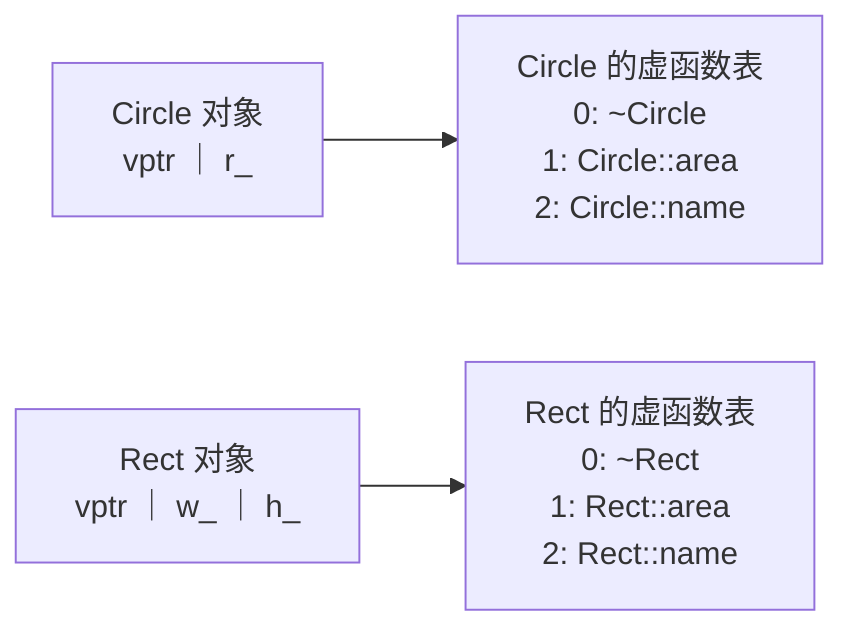

上一章的**继承**让派生类复用了基类的接口与实现，但还缺一样东西：当程序只知道"这是一个形状"时，怎样让它在运行时自动调用圆形或矩形各自的面积计算？本章的答案是虚函数。我们先看派生类对象怎样被当作基类对象使用（向上转型），再看 C++ 怎样在运行时决定调用哪个函数（动态绑定与虚函数表），然后讨论纯虚函数与抽象类，最后把这些机制归结为多态。多态是面向对象程序设计的核心：它让调用者只依赖抽象的接口，新增一种实现时不必修改已有代码，这是第 13 章各种设计模式的共同基础。下一章的模板提供了另一种在编译时实现的多态。

## 8.1. 向上转型

### 8.1.1. 对象的向上转型与对象切片

public 继承表达 is-a，所以凡是需要基类对象的地方，都可以使用派生类对象。

**定义 8.1.1（向上转型）** 把派生类的对象、指针或引用转换为基类的对象、指针或引用，称为**向上转型**（upcast）。对 public 继承，向上转型是隐式进行的，不需要写强制转换。

"向上"指继承层次图中基类画在上方。按值转换时，派生类对象被复制成一个基类对象：

**定义 8.1.2（对象切片）** 用派生类对象初始化或赋值给基类对象时，只有基类子对象部分被复制，派生类新增的数据成员被丢弃，所得对象的类型就是基类，派生类重新定义的行为也随之丢失。这种现象称为**对象切片**（object slicing）。

```cpp
#include <format>
#include <iostream>
#include <string>

struct Pet {
    std::string name;
    virtual std::string speak() const { return "..."; }
    virtual ~Pet() = default;
};

struct Dog : Pet {
    std::string breed;
    std::string speak() const override { return "Woof"; }
};

void byValue(Pet p) { std::cout << std::format("{} says {}\n", p.name, p.speak()); }
void byRef(const Pet& p) { std::cout << std::format("{} says {}\n", p.name, p.speak()); }

int main() {
    Dog d;
    d.name = "Rex";
    d.breed = "collie";
    byValue(d);    // sliced: a Pet copy, breed is gone, Pet::speak is called
    byRef(d);      // no copy: the Dog itself, Dog::speak is called
}
```

```text
Rex says ...
Rex says Woof
```

切片通常是错误而不是有意为之。经验法则：多态的类（含虚函数的类）的对象按引用或指针传递，不按值传递；需要复制时用 §8.3.1 的虚 `clone` 函数。

### 8.1.2. 指针与引用的向上转型

把 `Dog*` 转为 `Pet*`、把 `Dog&` 绑定到 `Pet&` 时，不复制任何东西：指针仍指向原来那个完整的 `Dog` 对象。这时要区分两种类型：

- 静态类型（static type）：表达式在源代码中声明的类型，编译时已知（`Pet&`）。
- 动态类型（dynamic type）：表达式在运行时实际所指对象的类型（`Dog`）。

通过基类指针或引用只能访问基类中声明的成员（由静态类型决定能调用什么）；而调用的是哪个版本的函数，取决于函数是不是虚函数（§8.2）。

向上转型只对 public 继承在类外隐式成立。private 继承是"照此实现"（[4.2.7](/4.2.7)），类外不能把派生类当作基类使用，转换只在派生类自己的成员函数和友元中可用。

## 8.2. 虚函数与动态绑定

### 8.2.1. 静态绑定与动态绑定

把一个函数调用与它要执行的函数体对应起来，称为绑定（binding）。普通函数、非虚成员函数的调用在编译时就绑定了：编译器根据静态类型确定调用目标，生成直接跳转到该函数地址的指令。这称为静态绑定或早绑定。

**定义 8.2.1（动态绑定）** 函数调用的目标在运行时根据对象的动态类型确定，称为**动态绑定**（dynamic binding），又称晚绑定（late binding）。

### 8.2.2. 虚函数

**定义 8.2.2（虚函数）** 在基类中用关键字 `virtual` 声明的成员函数称为**虚函数**。派生类中声明了与之同名、参数列表相同（包括 `const` 等限定符）、返回类型相同或协变的函数时，该函数**覆盖**（override）基类的版本，并自动成为虚函数。通过基类的指针或引用调用虚函数时，执行动态绑定。

```cpp tab
#include <format>
#include <iostream>
#include <memory>
#include <numbers>
#include <string>
#include <vector>

class Shape {
public:
    virtual ~Shape() = default;
    virtual double area() const { return 0.0; }
    virtual std::string name() const { return "shape"; }
    void describe() const {               // non-virtual, but calls virtual functions
        std::cout << std::format("{} with area {:.2f}\n", name(), area());
    }
};

class Circle : public Shape {
public:
    explicit Circle(double r) : r_(r) {}
    double area() const override { return std::numbers::pi * r_ * r_; }
    std::string name() const override { return "circle"; }
private:
    double r_;
};

class Rect : public Shape {
public:
    Rect(double w, double h) : w_(w), h_(h) {}
    double area() const override { return w_ * h_; }
    std::string name() const override { return "rectangle"; }
private:
    double w_, h_;
};

int main() {
    std::vector<std::unique_ptr<Shape>> shapes;
    shapes.push_back(std::make_unique<Circle>(1.0));
    shapes.push_back(std::make_unique<Rect>(2.0, 3.0));
    for (const auto& s : shapes) s->describe();   // dispatched on the dynamic type
}
```

```python tab
import math


class Shape:
    def area(self) -> float:
        return 0.0

    def name(self) -> str:
        return "shape"

    def describe(self) -> None:
        print(f"{self.name()} with area {self.area():.2f}")


class Circle(Shape):
    def __init__(self, r: float) -> None:
        self._r = r

    def area(self) -> float:
        return math.pi * self._r ** 2

    def name(self) -> str:
        return "circle"


class Rect(Shape):
    def __init__(self, w: float, h: float) -> None:
        self._w, self._h = w, h

    def area(self) -> float:
        return self._w * self._h

    def name(self) -> str:
        return "rectangle"


shapes: list[Shape] = [Circle(1.0), Rect(2.0, 3.0)]
for s in shapes:
    s.describe()
```

```text
circle with area 3.14
rectangle with area 6.00
```

几点要注意：

- 动态绑定只发生在通过指针或引用调用时。直接通过对象调用（`Circle c; c.area();`）或通过切片得到的基类对象调用，目标在编译时就确定了。
- 用作用域限定调用（`Shape::area()`）会关闭动态绑定，总是调用指定的版本；派生类在覆盖函数中复用基类实现时就这样写。
- 非虚函数 `describe` 内部调用的虚函数 `name()`、`area()` 仍然是动态绑定的（`this` 是指针）。基类固定流程、派生类填写步骤，这就是第 13 章的模板方法模式。
- 上面用 `std::unique_ptr<Shape>` 保存不同类型的对象，`vector` 销毁时自动 `delete` 每个对象（第 12 章）。

### 8.2.3. 虚函数表

C++ 标准只规定虚函数的行为，不规定实现；但所有主流编译器都用同一种方案。

**定义 8.2.3（虚函数表）** 编译器为每个含虚函数的类生成一张函数指针表，按固定的槽位次序存放该类各个虚函数的最终版本（被覆盖的槽位填入派生类的函数，没被覆盖的沿用基类的函数），称为**虚函数表**（vtable）。该类的每个对象在开头存放一个指向本类虚函数表的隐藏指针 vptr，由构造函数设置。



于是调用 `s->area()` 被编译成三步：从 `*s` 中取出 vptr，在表中取第 1 个槽位的函数地址，间接调用它。编译器不需要知道 `s` 实际指向什么，只要求所有派生类把 `area` 放在同一个槽位。代价也由此可见：

- 空间：每个对象多一个指针（64 位系统上 8 字节），每个类多一张表。
- 时间：一次额外的取址与间接调用；更重要的是间接调用通常无法内联，妨碍编译器优化。在频繁调用的小函数上这一差别才明显。

虚函数表中通常还存放类型信息（`std::type_info`），`typeid` 与 `dynamic_cast`（§8.5）就靠它在运行时识别对象的动态类型，这称为运行时类型识别（RTTI）。

### 8.2.4. 构造、析构与虚函数

在构造函数和析构函数中调用虚函数，不会分派到派生类的版本。构造派生类对象时，先运行基类的构造函数，此时派生类的成员尚未初始化，对象的 vptr 指向基类的虚函数表；进入派生类构造函数后 vptr 才改指派生类的表。析构的过程相反。因此在基类构造函数中调用的虚函数，执行的是基类的版本：

```cpp
#include <iostream>

struct Base {
    Base() { hello(); }                       // the object is still a Base here
    virtual ~Base() = default;
    virtual void hello() const { std::cout << "Base::hello\n"; }
    void call() const { hello(); }
};

struct Derived : Base {
    Derived() { hello(); }
    void hello() const override { std::cout << "Derived::hello\n"; }
};

int main() {
    Derived d;
    d.call();
}
```

```text
Base::hello
Derived::hello
Derived::hello
```

这一规则是为了安全：如果基类构造函数能调用派生类的函数，那个函数就会读到尚未初始化的派生类成员。

**构造函数**本身不能是虚函数（创建对象时类型是已知的），但**析构函数**应当是虚函数。通过基类指针 `delete` 一个派生类对象时，若基类的析构函数不是虚函数，行为是未定义的：典型的结果是只运行基类的析构函数，派生类持有的资源泄漏。规则是：

- 打算被多态使用（通过基类指针删除）的基类，析构函数声明为 `public` 且 `virtual`，通常写 `virtual ~Base() = default;`。
- 不打算这样使用的基类，可以把析构函数声明为 `protected` 且非虚，从语法上禁止通过基类指针删除。

## 8.3. 重载、隐藏与覆盖

### 8.3.1. 三者的区别

同名函数之间有三种关系，初学时最容易混淆：

| | 重载 | 重写隐藏 | 重写覆盖 |
|---|---|---|---|
| 作用域 | 同一作用域 | 派生类与基类 | 派生类与基类 |
| 函数名 | 相同 | 相同 | 相同 |
| 参数列表 | 不同 | 相同或不同 | 相同（含 `const`、引用限定符） |
| 基类函数是否为虚函数 | 无关 | 不是虚函数，或参数不同 | 是虚函数 |
| 何时确定调用目标 | 编译时，按实参类型 | 编译时，按静态类型 | 运行时，按动态类型 |

覆盖的条件中，允许协变返回类型（covariant return type）：基类虚函数返回 `Base*` 或 `Base&` 时，派生类的覆盖函数可以返回 `Derived*` 或 `Derived&`。它的典型用途是"虚拷贝构造函数"：

```cpp
#include <iostream>

struct Shape {
    virtual ~Shape() = default;
    virtual Shape* clone() const = 0;
    virtual void draw() const = 0;
};

struct Circle : Shape {
    Circle* clone() const override { return new Circle(*this); }   // covariant return
    void draw() const override { std::cout << "circle\n"; }
};

int main() {
    const Shape& s = Circle{};
    Shape* copy = s.clone();   // copies the dynamic type, no slicing
    copy->draw();
    delete copy;
}
```

（实际代码中 `clone` 通常返回 `std::unique_ptr<Shape>`，这时不能协变，派生类也返回 `std::unique_ptr<Shape>`。）

### 8.3.2. override 与 final

覆盖要求签名完全一致，差一个 `const` 就变成了隐藏：编译通过，运行时却调用了基类版本。C++11 的 `override` 让编译器检查这一意图：标了 `override` 的函数如果没有覆盖任何基类虚函数，就是编译错误。

```cpp
#include <iostream>

struct Base {
    virtual ~Base() = default;
    virtual void f(int) const { std::cout << "Base::f\n"; }
};

struct Derived : Base {
    // void f(int) override;            // error: does not override (missing const)
    void f(int) const override { std::cout << "Derived::f\n"; }
};

struct Leaf final : Derived {           // no class can derive from Leaf
    void f(int) const override { std::cout << "Leaf::f\n"; }
};

int main() {
    Leaf leaf;
    const Base& b = leaf;
    b.f(0);
}
```

`final` 用于类时禁止再被继承，用于虚函数时禁止派生类再覆盖它。它除了表达设计意图，还让编译器在静态类型为 `final` 类时把虚调用优化为直接调用。现代 C++ 的惯例是：基类中的虚函数写 `virtual`，派生类中的覆盖函数只写 `override`（或 `final`），不再重复 `virtual`。

## 8.4. 纯虚函数与抽象类

### 8.4.1. 纯虚函数

§8.2.2 中 `Shape::area` 返回 0 只是凑数：一个"一般的形状"本没有面积。更准确的做法是只声明接口，不提供实现。

**定义 8.4.1（纯虚函数）** 在声明末尾写 `= 0` 的虚函数（如 `virtual double area() const = 0;`）称为**纯虚函数**，表示基类只规定这一接口，由派生类提供实现。

**定义 8.4.2（抽象类）** 至少含有一个纯虚函数（包括继承来而未被覆盖的）的类称为**抽象类**。抽象类不能创建对象，但可以声明指向它的指针和引用。派生类覆盖了全部纯虚函数后才成为可以实例化的具体类（concrete class）。

```cpp
#include <format>
#include <iostream>
#include <numbers>

class Shape {                              // abstract: an interface
public:
    virtual ~Shape() = default;
    virtual double area() const = 0;
    virtual double perimeter() const = 0;
};

class Circle : public Shape {
public:
    explicit Circle(double r) : r_(r) {}
    double area() const override { return std::numbers::pi * r_ * r_; }
    double perimeter() const override { return 2 * std::numbers::pi * r_; }
private:
    double r_;
};

double roundness(const Shape& s) {         // depends only on the interface
    return 4 * std::numbers::pi * s.area() / (s.perimeter() * s.perimeter());
}

int main() {
    // Shape s;                            // error: Shape is abstract
    std::cout << std::format("{:.3f}\n", roundness(Circle(2.0)));
}
```

纯虚函数也可以有定义（在类外写函数体），派生类可以用 `Shape::area()` 显式调用它；它仍使类成为抽象类。一个特例是纯虚析构函数：`virtual ~Shape() = 0;` 可以让一个没有其他纯虚函数的类成为抽象类，但必须在类外提供定义 `Shape::~Shape() = default;`，因为派生类的析构函数总会调用它。

只含纯虚函数、没有数据成员的抽象类相当于其他语言（Java、C#）中的接口。[4.2.7](/4.2.7) 所说"多重继承主要用来组合多个接口"指的就是这种类：继承多个这样的类不会带来数据重复。

### 8.4.2. 针对接口编程

上例中的 `roundness` 只依赖 `Shape` 的接口：今后增加 `Polygon`、`Ellipse`，`roundness` 一行都不用改，也不必重新编译。这种"调用者依赖抽象接口、不依赖具体实现"的组织方式称为针对接口编程，是第 13 章设计原则的出发点。抽象类把"做什么"（接口）与"怎么做"（实现）分开，让二者可以独立变化。

## 8.5. 向下转型

### 8.5.1. static_cast 与 dynamic_cast

把基类指针或引用转回派生类称为向下转型（downcast）。它不一定安全：一个 `Shape*` 未必指向 `Circle`。C++ 提供两种写法：

- `static_cast<Circle*>(p)`：编译时转换，不做运行时检查。只有程序员确知 `p` 指向 `Circle` 时才能用，否则行为未定义。
- `dynamic_cast<Circle*>(p)`：利用 RTTI 在运行时检查动态类型，成功时返回转换后的指针，失败时返回 `nullptr`；对引用失败时抛出 `std::bad_cast`。它要求基类是多态类（至少有一个虚函数）。

```cpp
#include <format>
#include <iostream>
#include <memory>
#include <vector>

struct Shape { virtual ~Shape() = default; };
struct Circle : Shape { double r = 1.0; };
struct Rect : Shape { double w = 2.0, h = 3.0; };

int main() {
    std::vector<std::unique_ptr<Shape>> shapes;
    shapes.push_back(std::make_unique<Circle>());
    shapes.push_back(std::make_unique<Rect>());
    for (const auto& s : shapes) {
        if (auto* c = dynamic_cast<Circle*>(s.get()))
            std::cout << std::format("circle, r = {}\n", c->r);
        else
            std::cout << "not a circle\n";
    }
}
```

需要频繁地向下转型、再按类型分支，往往说明设计有问题：按类型分支的逻辑应当写成虚函数，放进各个派生类中。`dynamic_cast` 适合少数确实需要特定类型能力的场合（例如检查对象是否额外实现了某个接口）。另外两种显式转换与继承无关：`const_cast` 去掉或加上 `const`，`reinterpret_cast` 按位重新解释指针，二者都应尽量避免；C 风格的 `(T)x` 会悄悄地在这几种转换中选一种，现代 C++ 不再使用。

### 8.5.2. 多重继承中的虚函数

多重继承时，派生类对象中每个含虚函数的基类子对象各有一个 vptr。`class D : public A, public B` 的对象中，`B` 子对象不在对象的起始地址，把 `D*` 转为 `B*` 时编译器会自动加上偏移量，所以转换前后指针的数值可能不同。`dynamic_cast` 还能在两个基类之间"横向"转换（`A*` 转 `B*`，只要实际对象同时是二者），这是 `static_cast` 做不到的。这些细节一般不必手工处理，但它解释了为什么不能用 `reinterpret_cast` 或 `void*` 在继承层次中转换指针。

## 8.6. 多态

**定义 8.6.1（多态）** 同一个接口可以作用于不同类型的对象、并由各类型以自己的方式实现，称为**多态**（polymorphism）。

程序设计语言中的多态有三种主要形式：

| 形式 | C++ 中的机制 | 何时确定 | 例子 |
|---|---|---|---|
| 子类型多态 | 虚函数、继承 | 运行时 | `s->area()` |
| 特设多态 | 函数重载、运算符重载 | 编译时 | `print(int)`、`print(double)` |
| 参数多态 | 模板（第 9 章） | 编译时 | `std::max<T>` |

面向对象语境下单说"多态"，通常指子类型多态：调用者通过基类接口操作对象，具体行为由对象的动态类型决定。它的价值在于对扩展开放：新增一个派生类就能接入已有的代码，已有代码不必修改（第 13 章的开闭原则）。**封装**、**继承**与多态合称**面向对象编程**的三个基本特征：封装把数据与操作绑在一起、隐藏实现；继承表达类之间的 is-a 关系、复用接口；多态让同一接口在不同对象上表现出不同行为。

子类型多态适合"类型集合开放、操作集合固定"的场合：形状的种类随时会增加，而每种形状要支持的操作（面积、绘制）是确定的。反过来，如果类型集合是封闭的、操作却经常增加（例如编译器中语法树节点的种类是固定的，而分析遍历不断增加），C++17 的 `std::variant` 配合 `std::visit` 往往更合适：

```cpp
#include <format>
#include <iostream>
#include <numbers>
#include <variant>
#include <vector>

struct Circle { double r; };
struct Rect { double w, h; };
using Shape = std::variant<Circle, Rect>;   // a closed set of alternatives

struct Area {                               // one operation, one overload per type
    double operator()(const Circle& c) const { return std::numbers::pi * c.r * c.r; }
    double operator()(const Rect& r) const { return r.w * r.h; }
};

int main() {
    std::vector<Shape> shapes{Circle{1.0}, Rect{2.0, 3.0}};
    for (const auto& s : shapes) std::cout << std::format("{:.2f}\n", std::visit(Area{}, s));
}
```

`std::variant` 的对象按值存放、不需要堆分配和虚函数表；漏写某个类型的重载会编译失败。代价是新增一种形状时，所有的访问者都要修改。两种方案各自对一个方向的扩展友好，这一取舍在程序设计语言中称为表达式问题（expression problem）。

## 8.7. Python 对照

### 8.7.1. 所有方法都是动态绑定的

Python 在实例上查找方法时，总是从对象的实际类型开始沿**方法解析顺序**查找（[4.2.7](/4.2.7)），因此每个方法调用都是动态绑定的，不需要 `virtual`，也没有隐藏与覆盖的区别。Python 的变量只保存对象的引用，赋值和传参都不复制对象，所以也不会发生对象切片。代价是每次调用都要查找属性，比 C++ 的虚函数调用慢得多。

在 `__init__` 中调用被覆盖的方法会执行派生类的版本，这与 C++ 的构造函数相反（§8.2.4），需要小心派生类方法用到尚未设置的属性。

### 8.7.2. 鸭子类型

Python 调用 `s.area()` 时不检查 `s` 的类型，只要求 `s` 有一个能被调用的 `area` 属性。

**定义 8.7.1（鸭子类型）** 一个对象能否用在某处，只取决于它是否具有所需的方法与属性，而不取决于它属于哪个类、继承自哪个基类，这种类型使用方式称为**鸭子类型**（duck typing）。名称来自"如果它走起来像鸭子、叫起来也像鸭子，那它就是鸭子"。

鸭子类型让 Python 的多态不依赖继承：内置函数 `len` 适用于任何定义了 `__len__` 的对象，`for` 循环适用于任何定义了 `__iter__` 的对象（第 10 章）。它的缺点是错误要到运行时调用失败时才暴露，接口约定也只存在于文档中。Python 用两种机制弥补，分别对应名义类型（按声明的继承关系判断）与结构类型（按具有的方法判断）。

### 8.7.3. 抽象基类

标准库 `abc` 模块提供抽象基类（abstract base class，ABC），相当于 C++ 的抽象类：

```python
import math
from abc import ABC, abstractmethod


class Shape(ABC):
    @abstractmethod
    def area(self) -> float: ...

    def describe(self) -> str:                 # a concrete method using the abstract one
        return f"{type(self).__name__} with area {self.area():.2f}"


class Circle(Shape):
    def __init__(self, r: float) -> None:
        self.r = r

    def area(self) -> float:
        return math.pi * self.r ** 2


print(Circle(1.0).describe())
try:
    Shape()
except TypeError as e:
    print("TypeError:", e)
print(isinstance(Circle(1.0), Shape))
```

```text
Circle with area 3.14
TypeError: Can't instantiate abstract class Shape without an implementation for abstract method 'area'
True
```

含有未实现的 `@abstractmethod` 的类在实例化时报错，与 C++ 不能创建抽象类的对象相同，只是检查发生在运行时。`isinstance(x, Shape)` 判断 `x` 是否属于某个类，相当于 C++ 中 `dynamic_cast` 是否成功；`collections.abc` 中的 `Iterable`、`Sequence`、`Mapping` 等是标准容器接口的抽象基类。

### 8.7.4. Protocol

`typing.Protocol`（Python 3.8 起）描述的是结构：一个类只要具有协议中列出的方法，就被视为满足协议，不必继承它。检查由静态类型检查器（mypy、pyright）在运行前完成，相当于"有类型检查的鸭子类型"：

```python
from collections.abc import Iterable
from typing import Protocol, runtime_checkable


@runtime_checkable
class HasArea(Protocol):
    def area(self) -> float: ...


class Square:                                  # does not inherit from HasArea
    def __init__(self, a: float) -> None:
        self.a = a

    def area(self) -> float:
        return self.a ** 2


def total_area(shapes: Iterable[HasArea]) -> float:
    return sum(s.area() for s in shapes)


print(total_area([Square(2), Square(3)]))
print(isinstance(Square(1), HasArea))          # runtime check enabled by the decorator
```

```text
13
True
```

| | C++ 抽象类 | Python ABC | Python Protocol |
|---|---|---|---|
| 判断依据 | 显式继承（名义） | 显式继承或注册（名义） | 具有的方法（结构） |
| 检查时机 | 编译时 | 运行时（实例化、`isinstance`） | 类型检查时；加 `@runtime_checkable` 后也可运行时 |
| 适合 | 类层次由自己设计 | 需要共享实现的基类 | 对第三方类、内置类型描述接口 |

下一章的 C++20 **概念**与 Protocol 思路相同：按"具有哪些操作"约束类型，只是检查发生在模板实例化时。

## 小结

- 派生类对象可以向上转型为基类；按值转换会切片，按指针或引用转换保留完整对象。
- 虚函数通过指针或引用调用时动态绑定，通常由每个对象的 vptr 和每个类的虚函数表实现。构造与析构期间不分派到派生类；多态基类的析构函数必须是虚函数。
- 覆盖要求签名一致，用 `override` 让编译器检查；`final` 禁止继续派生或覆盖。
- 含纯虚函数的抽象类只规定接口；调用者针对接口编程，新增实现不必修改调用者。
- 向下转型用 `dynamic_cast` 检查；频繁按类型分支应改为虚函数。
- Python 的方法调用都是动态绑定；鸭子类型让多态不依赖继承，ABC 与 Protocol 分别以名义和结构的方式描述接口。
